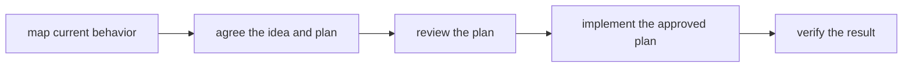

# Contributing

Read [README.md](README.md) for what wheelchair does. Before changing a directory,
read the root [AGENTS.md](AGENTS.md) and the nearest `AGENTS.md` below it. Those
routers say what the directory owns, its boundaries, and which source is authoritative.

Navigate in this order:

1. Read the applicable router.
2. Search the tree for the words used by the rule or behavior.
3. Use graphify only for cross-file blast radius, paths between distant concepts, or
   community structure, then confirm its results in source. A graph may be stale and
   never decides where a rule lives.

## Sources of truth

- `protocol/` holds the workflow's canonical rules. If behavior changes, change it
  there.
- `docs/plans/<slug>/` holds per-feature state. It is not a source of general rules.
- `AGENTS.md` files are maintained routing documents. Update them when a change moves
  ownership or makes a file-to-role entry false.
- `graphify-out/` is a disposable, gitignored snapshot. Do not treat it as
  documentation.

For feature work, a lead in an app thread carries the work from mapping through
verification, and the persistent documents hold its state:



The `status:` field in `docs/plans/<slug>/PLAN.md` is the workflow's state machine:
`planning -> ready-for-review -> approved -> implementing -> verifying -> done`.
Do not edit it to skip a stage.

## Editing conventions

- Keep rules in one place. Shared card kinds and fields live in `protocol/app/cards.md`; lead-only
  kinds and fields live in `protocol/app/cards-lead.md`. Template changes are contract changes that must agree with the role that consumes the
  template.
- Do not hand-edit the wheelchair-owned block in `~/.claude/CLAUDE.md` or
  `~/.codex/AGENTS.md`. `sensitivity/set.sh` is its only writer, and the next run
  overwrites that block.
- When ownership moves between directories, update the routers on both sides in the
  same change. Never reformat an existing router.
- Keep human-facing prose direct and grounded. Specific claims carry `file:line`, and
  anything not checked is named as unchecked rather than inferred.
- Do not commit `node_modules/`, `graphify-out/`, `viewer/test/.tmp/`, or
  `test-results/`.

## Installation and generated files

Run `./install.sh` after cloning, after installing another harness, or after pulling a
change under `viewer/`. It removes the retired skill and prompt wrappers and the old seen
hook from the harness homes, installs the viewer dependencies and both Chromium and Firefox, stops any
already-running viewer that isn't running the code you just pulled, sets up the app's state and, on a serving systemd or launchd machine, the viewer and machine
services, then updates the diagram-sensitivity block. This reaches outside the clone; the fixture suites below do
not. Because of that it runs only from the canonical clone: from a linked worktree or
anything under `~/.local/state/wheelchair/worktrees`, it and
`sensitivity/set.sh` refuse (exit 3) unless `WHEELCHAIR_ALLOW_WORKTREE=1` forces them. To
check the installer from a worktree, run `bash install/test/run.sh`.

Role or card file edits reach sessions started after the edit, never running sessions: the machine copies these files into each session’s starting instructions at start. For the delimited region in `protocol/sensitivity.md`, run `sensitivity/set.sh` or `./install.sh` after changing it.

The Mac CI job is `.github/workflows/macos.yml`. Its end-to-end check is
`test-support/macos/check.sh`; `test-support/macos/` also holds its fake `claude` and
`tailscale`.

## Validation

Run the checks for the area you changed, then run the full set before handing off a
cross-cutting change:

```bash
bash sensitivity/test/run.sh
bash codex/test/run.sh
bash install/test/run.sh
bash machine/test/run.sh
python3 -m unittest discover -s sudo-helper/test   # the root sudo helper, with shim runuser and sudo
bash sudo-helper/test/install-test.sh              # the helper's installer, against a temp root
./install.sh && ./install.sh   # canonical clone only; refused from a worktree
node --test viewer/test/*.test.js
npm --prefix viewer run test:browser
```

The glob in the Node test command must be unquoted, expanded by the shell — a quoted
glob isn't discovered on Node 20, which is what the always-on service runs. The browser
suite runs in both Chromium and Firefox. Protocol documents have no test suite; review
their rendered output and make sure each stage still produces the input the next stage
expects.

Do not validate viewer changes against a manually started default server: it may reuse
an older process. Use the suites, or start an isolated server with both `--port` and
`--cache-root`.

## Why the agent rules are the way they are

The diagram dial governs ordinary conversation turns before any stage reads `protocol/`. Its region is a rendering, not a hand-maintained copy: one source and one writer keep the harness instructions in sync. The sudo helper is installed from a root-owned copy so a password entered for a `sudo` card never passes through the hub, machine service or anything an agent can read.

`graphify-out/` is gitignored and per-clone, so a graph can be absent or arbitrarily old. It is a snapshot, and a stale graph can silently misroute work; it cannot carry a contract. There is no module-docstring step in navigation: the viewer and machine routers and their API tables already identify each file's role.

`install.sh` installs viewer dependencies, stops an outdated viewer, initializes the hub machine service's private state and credentials, and decides once whether to serve other tailnet devices (asking only on a headless machine without a decision). On serving systemd or launchd machines it installs both user services. It removes retired skill and prompt wrappers and the old seen hook through `install/unseen.py`, runs `codex/model.sh init`, and finally calls `sensitivity/set.sh`, warning rather than failing if it refuses. It hints when the root sudo helper is absent but never installs or updates it. Its machine-wide writes would point harnesses and services at temporary code if run from a worktree; the guard refuses linked worktrees and paths under `~/.local/state/wheelchair/worktrees` with exit 3 unless `WHEELCHAIR_ALLOW_WORKTREE=1` is set.

`.gitignore` excludes `node_modules/`, `graphify-out/`, browser `test-results/`, Python `__pycache__/`, and `viewer/test/.tmp/` from older viewer suites; `test-support/run-dir.js` sweeps old entries there.

The viewer test glob must be expanded by the shell: Node 20 does not discover a quoted glob, while Node 26.7.0 does not discover the suite from a bare directory. The unquoted glob works on both.

A viewer `--open` or `--show` start can register with an existing server at the default port and reuse its old code (`viewer/server.js:2306-2307`). Canonicalization drops unknown keys (`viewer/server.js:157`), so a write with a newer field can return 200 while silently losing it. The test helper starts an isolated server with `--port` and `--cache-root` (`viewer/test/helpers/server.js:87`). There is no cache-root environment variable: `server.js` reads `WHEELCHAIR_NO_BROWSER`, `WHEELCHAIR_BROWSER`, and `TMUX`, `TMUX_PANE`, `CLAUDECODE` for opener labels; exporting a cache-root variable leaves the default root in use.
