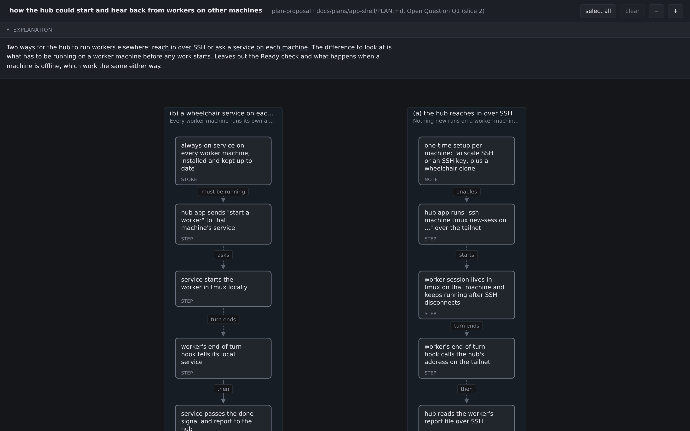

# wheelchair

Agents are good at writing code and bad at being held to a plan. This harness holds them to one.
You talk to a lead agent in a thread, in a browser or on a phone. It maps how the code works,
agrees what good looks like, and plans one question at a time. A **different model family** then
tries to tear the plan apart. Workers build it, and a blind verifier tries to prove the result
wrong.

The documents are the state, not a context window. Each feature gets a directory holding the map,
the idea, the decision log, the spec, every review round, and what got built. You can stop
mid-plan and resume a week later.

The reporting is held to the same standard as the work. Leads write in the style you set, and
draw a picture whenever the answer has a shape.

## Using the app

### First time

1. Run `./install.sh` on the machine that will run the agents (see "Install"). On a
   headless machine it asks whether to serve the app to your other devices over Tailscale.
2. Open `https://<machine>.<tailnet>.ts.net/wheelchair/app/` (or run
   `node viewer/server.js --url` for the bookmark address). Open it once per device; the
   browser is remembered after that.
3. In **Settings**:
   - **Accounts**: sign each Claude or GPT account in on the machine. The sign-in opens in
     the page; paste back the code it gives you.
   - **Models and preferences**: the model for the lead and for the other agents, and
     **Diagrams** (ask, default or high: how readily agents draw a picture).
   - **Writing style**: how leads write to you.
   - **Default project folder** (optional): a folder holding your repos, so New thread can
     list them.

### Doing a piece of work

1. **+ New thread**. Pick the machine and the project (any git repository; save ones you
   use often under "Saved directories"). Type what you want and press **Start**.
2. The lead answers in the thread. Each thread gets its own git worktree and branch, and
   ends in one pull request.
   - **A small fix** (a couple of files): the lead makes it, has it checked, and opens the
     pull request.
   - **Anything bigger**: it offers "Take it into planning?". Press it, or **Keep talking
     first**.
3. **Planning.** The lead maps the code, writes up your idea (**Your idea so far**, each
   bullet removable), asks you to confirm IDEA.md, then asks design questions one card at
   a time. Each question shows the lead's leaning; press an option or type your own answer
   under it. MAP.md, IDEA.md and PLAN.md open from the thread.
4. **Review.** Fresh reviewers try to break the plan, from the other model family when
   both are signed in. You only see the progress line, and a question if a real choice
   comes up.
5. **Approval.** The approval card lists any serious objection the lead overruled, with
   its reason (**Talk about this** to discuss one), and the Ready check: the machine is
   up and on the same version, and the logins work. Press **Start building**.
6. **Building.** A sub-lead runs workers in parallel and a verifier checks the result.
   The progress line shows tasks done.
7. **Done.** The done card says what you can do now, what was left out (each with
   **Start a thread about it**), and links the pull request. You merge it; the lead never
   does. Report a problem in the same thread while the pull request is open and the lead
   fixes it there.

### Finding your way

- **Needs you** (top bar): every card waiting on you, across threads. Cards are the only
  things the lead waits on; plain replies are updates.
- **Asides**: select text in a lead's message and pick **Ask about this**, **Say it
  simpler** or **Draw it**, or press **Ask about this message**. It opens a side
  conversation; **This changes my answer** sends what you settled back to the lead.
- **Pictures**: the thread's right column lists every picture; **Open full size** shows
  one on its own page.
- **Features**: every feature by stage, plus your projects and machines.
- **Agents**: every running session; each opens in a browser terminal.
- **Restart lead** appears if a thread's lead dies; the new one picks up from the plan
  files. **Archive** stops a thread's sessions and hides it.

Review and verification run cross-family when both `claude` and `codex` are installed. With one,
the gates still run, with a fresh reviewer that never saw the conversation.

### What a feature leaves behind

Each feature lives in `docs/plans/<slug>/` in the project:

| File | What it is |
|---|---|
| `MAP.md` | How the code works today, every claim with `file:line`, plus what wasn't checked |
| `IDEA.md` | The plain-language goal and non-goals, confirmed before any design question |
| `PLAN.md` | Question queue, decision log, spec, review rounds, implementation tasks |
| `graphs/` | Pictures drawn while planning |
| `COMPLETION.md`, `REMEDIATION-N.md` | What got built, with evidence, and each verification loop |

`status:` in `PLAN.md` is the state machine: `planning → ready-for-review → approved →
implementing → verifying → done`.

## Pictures



Ask how something works, or let a plan propose a flow, and the lead draws it and shows it in the
thread. "Open full size" opens the picture on its own page, with a link back to the thread. The
panel above the picture says what it shows and what it leaves out. You can drag boxes to
rearrange the flow.

## Install

```bash
./install.sh
```

This installs the viewer's dependencies, including Chromium and Firefox for its tests. It
also removes the skill and prompt wrappers and the per-turn hook that earlier versions put in
the harness homes. It is idempotent. Re-run it after pulling a change under `viewer/`.

It also writes a few things outside this repo:
- a delimited block in `~/.claude/CLAUDE.md` and/or `~/.codex/AGENTS.md`, which holds the
  diagram-sensitivity setting
- `~/.wheelchair/models`, if Codex is present: the GPT model pinned per tier
- `~/.local/state/wheelchair/`: the app's threads, machine registry and the machine service's
  secret; on a serving systemd machine, the `wheelchair-viewer` and `wheelchair-machine` user
  services

Only the delimited block is this repo's, so nothing else in those files is touched.

A heads-up line appears before a GPT session runs when Codex knows a newer model than a tier's
pin. `codex/model.sh set <tier> <model>` switches; nothing switches on its own.

## The viewer

A Node server with no runtime dependencies, bound to `127.0.0.1`. It serves the graphs, a list of
graphs and plans, and a document reader. By hand:

```bash
node viewer/server.js --show path/to/graph.json   # open a graph in the browser
node viewer/server.js --url                       # print the bookmark address
node viewer/server.js --stop
```

A machine can serve the viewer to your other devices over Tailscale: run `./install.sh --serve`,
or `--no-serve` to decline. This runs it as an always-on `systemd` user service, from this
checkout's code, at `https://<machine>.<tailnet>.ts.net/wheelchair/`. Open the bookmark once per
device and it's remembered. `--rotate-token` locks every device out again. Everything, including
dragging boxes, works on a phone.

A serving machine is also the hub for the app at `/wheelchair/app/`: threads with a lead
agent, from idea through planning, review, building and checking, driven from a browser or
phone. Each thread's agents run in tmux sessions, started by the machine service (`machine/`).
The Features and Agents pages, and a browser terminal, open into any session.

`protocol/graphs.md` has the full format.

## Layout

| Directory | What's there |
|---|---|
| `protocol/` | The rules every stage follows. The single source of truth |
| `viewer/` | The graph viewer and the app's hub: server, pages, tests |
| `machine/` | The machine service that runs agent sessions in tmux for the app |
| `sensitivity/`, `install/`, `codex/` | The dial writer, the installer's checks, the GPT model pins, and their test suites |
| `docs/plans/` | One directory per feature. The only mutable state |

Every directory that owns a rule has an `AGENTS.md` router saying what it owns and where to go
next. Start at the root one. `CONTRIBUTING.md` has the conventions and validation commands.

## Dependencies

- `claude` or `codex` (v0.146+). Either one alone works, and both unlock the cross-family gates.
  Codex sessions run through the app like any other.
- Node and npm, for the viewer.
- Playwright, pinned in `viewer/package.json` and installed by `install.sh`, for the browser tests.
