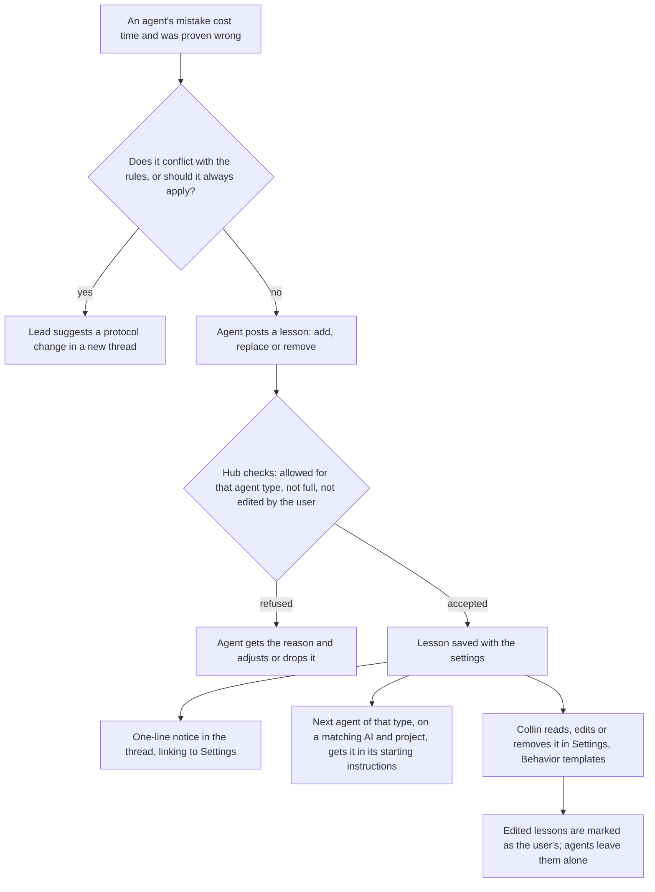

# Agents save lessons learned

**Idea:** `IDEA.md` — what this is for and why, in plain language. Read it first; it is
the north star this plan serves. Goal and Constraints live there, not here, so they don't
get buried as this file grows.

## Open Questions

## Watch List

| # | Noticed | What needs looking into | Raised to user? | Outcome |
|---|---------|-------------------------|-----------------|---------|

## Decision Log

Append-only. A reversal is a new entry superseding the old, never an edit.

| # | Decision | Rationale | Source |
|---|----------|-----------|--------|
| 1 | Mode is two-part | Collin's pick; learn what lessons are useful before hardening | user |
| 2 | A lesson reaches only agents of the type that saved it | Collin: an agent saves lessons only for its own type of agent | user |
| 3 | Lessons are shared across AIs; an agent may mark one as only for its own AI | Most lessons are about the job; a few are one AI's quirks | user |
| 4 | Shown in Settings › Behavior templates as one agent-written "Lessons learned" entry per agent type, marked apart from Collin's templates, editable with a warning | Collin: no new row per lesson; a template that can be edited but isn't recommended to | user |
| 5 | Bar for a lesson: cost real time and proven wrong (Collin's correction or a check failing twice for the same reason), recurs for that agent type across threads, one or two sentences | Collin picked "Cost + proof" | user |
| 6 | Lessons are their own always-on layer between wheelchair's role rules and Collin's in-use template; Collin's template wins where they disagree | Only one template per role is in use (`viewer/app/settings.js:131`); lessons must not replace it | defaulted |
| 7 | Lessons are stored by the hub with the other settings (`settings.json`, queued writes, `viewer/app/state.js:241`) and added to role layers at session start | One store every machine's agents get through role layers (`viewer/app/sessions.js:324`); works for every AI | defaulted |
| 8 | A lesson that conflicts with the rules or should always apply is not saved; the lead offers a stub for a protocol change instead | IDEA.md Not doing | defaulted |
| 9 | Running agents keep the lessons they started with | IDEA.md Not doing; prompts are a snapshot at start (`machine/service.js:781`) | defaulted |
| 10 | Lessons apply to all projects; an agent may mark one as only for the project it learned it in | Collin picked "All, unless marked" | user |
| 11 | Reviewer and verifier lessons are written by the lead, from what its triage of their findings and gaps shows; reviewers and verifiers never save lessons | Collin picked "Lead writes them": only the lead sees a reviewer's or verifier's mistake cost time | idea-change |
| 12 | Saving a lesson shows a one-line notice in the thread it came from (which agent type, the lesson text, link to Settings); it takes effect for agents started afterwards with no approval | Collin picked "A short notice" | user |
| 13 | Worker lessons are saved by workers themselves and by the sub-lead, from what it sees across worker tasks | Collin picked "Sub-lead too" | user |
| 14 | The lead also writes mapper lessons; mappers may still save their own | Collin picked "Lead writes them": mappers stop after their map, so only the lead sees a map turn out wrong | idea-change |
| 15 | Supersedes 2 and 3: a lesson reaches agents of the type it is saved for (S2: lead, sub-lead, worker, mapper save for themselves; the lead also for reviewers, verifiers and mappers; the sub-lead also for workers), and `only_ai` names any AI, usually the one the mistaken agent ran on | Decisions 11, 13, 14 and review-round-1 finding on `only_ai` | review-round-1 |

## Spec

Lessons are short instructions that agents save for later agents of a given type. The hub
stores them with the other settings, adds the applicable ones to every agent's starting
instructions, shows a notice in the thread when one is saved, and lets Collin edit them in
Settings › Behavior templates.



### S1. What a lesson is (the bar)

An agent saves a lesson only when all of these hold (decision 5):

1. A mistake cost real time: an extra review round, a retried task, a redo, a failed check.
2. Something proved it wrong: Collin corrected it, or a check (review triage, verifier,
   tests) failed twice for the same reason.
3. It will come up again for the same type of agent in other threads.
4. It fits in one or two sentences, written as an instruction to that type of agent.

Not lessons: facts about one codebase (maps hold those), one-off bug fixes, decisions for
one thread (the Decision Log holds those), hunches, and anything the role rules already
say. A lesson that conflicts with the role rules, or that should always apply, is not
saved: the lead posts a `stub` proposing a protocol change instead; a sub-lead, worker or
mapper sends the lead a `message` suggesting one (decision 8).

Before saving, the agent reads the existing lessons in its instructions. If one already
covers the point or is now wrong, it replaces or removes that one instead of adding.

### S2. Who saves lessons for whom

| Saver | May save lessons for |
|---|---|
| lead | lead, reviewer, verifier, mapper |
| sub-lead | sub-lead, worker |
| worker | worker |
| mapper | mapper |

Reviewers and verifiers never save lessons (decisions 2, 11, 13). The lead writes a
reviewer or verifier lesson when its own triage or checks show a reviewer or verifier
mistake met the bar (for example, reviewers rating an extra question card as major,
declined across rounds). The lead also writes mapper lessons, from a map that turned out
wrong (for example, an area reviewers or workers found it missed); mappers may still save
their own (decision 14). The sub-lead writes worker lessons from what it sees across
worker tasks. The hub refuses any other saver/target pair with
`a <saver> may not save lessons for <target>s`.

### S3. Storage

`settings.json` gains `lessons`, an object keyed by role (the six roles). Each value is an
array of lesson objects, oldest first:

| Field | Type | Meaning |
|---|---|---|
| `id` | string | Hub-assigned, `L` + 6 lowercase hex, unique across all roles |
| `text` | string | 1–300 characters, one paragraph (no line breaks) |
| `provider` | string, optional | One of the `PROVIDERS` keys; the lesson reaches only agents on that AI (decision 3) |
| `project` | string, optional | A project path; the lesson reaches only agents in that project (decision 10) |
| `saved_by` | string | `agent` or `user`: who last wrote the text |
| `thread` | string, optional | The thread id it was last saved from by an agent |
| `saved_at` | string | ISO time of the last write |

At most **12 lessons per role**. `normalize()` in `viewer/app/settings.js` keeps only
well-formed entries for known roles (dropping bad ones, as it does for accounts) and
defaults `lessons` to `{}` keyed per role with empty arrays. All writes go through
`settings.update()` (the queued read-modify-write, `viewer/app/state.js:241`), so two
agents saving at once both land. `assertFits()` keeps checking only Collin's layers (S5).

### S4. Saving: the `lesson` card

A new card kind, `lesson`, posted with `card.js lesson <file>` by lead, sub-lead, worker
and mapper. It is **shown** (it is the thread notice, decision 12) and **not pinned**.

| Field | Type | Required | Meaning |
|---|---|---|---|
| `action` | `add` \| `replace` \| `remove` | yes | What to do |
| `for` | role | yes | Whose lessons (must be allowed by S2) |
| `text` | string | `add`, `replace` | 1–300 characters, one line |
| `lesson` | string | `replace`, `remove` | The id of the lesson to change, as shown in the agent's instructions |
| `only_ai` | string | no | `add`/`replace`: `any` or a `PROVIDERS` key (`claude`, `gpt`, `gemini`, `kimi`, `openrouter`); sets `provider`, so the lesson reaches only agents on that AI. Name the AI of the agent that made the mistake, which for a reviewer, verifier, mapper or worker lesson is often not the saver's own |
| `only_project` | boolean | no | `add`/`replace`: true sets `project` to the thread's project path |
| `why` | string | `add`, `replace`, `remove` | One line, shown on the notice: what went wrong and how it was proven |

Like `done`, a `lesson` card is **never queued**: the machine relays it to the hub
synchronously and returns the hub's answer; if the hub cannot be reached or does not answer it returns 503
`the app did not confirm the lesson; run the same card again in a minute (repeating it is
safe)`. Repeats are made safe by the hub, not by a delivery id: an `add` whose `for`, `text`
and resulting `provider` and `project` all exactly match an existing lesson returns
success with that lesson's id and records no second notice (same text with a different
scope is a new lesson); a `replace` that leaves the lesson exactly as stored
returns success with no new notice; a `remove` of an id that is no longer present returns
success with no new notice (as Settings removals do, S7). The hub first
applies the change to `settings.lessons` through `settings.update()`, then records the card
in the thread. If the settings write fails or is refused, no card is recorded and the
refusal goes back to the agent. (A hub crash between the two writes leaves a saved lesson
with no notice; see Accepted Risks.) On success the stored card carries the resulting lesson `id` and a snapshot of the lesson
as it stands after the change (for `remove`, as it stood before): `text`, `provider` and
`project`. The notice is drawn from this snapshot only.
Refusals (422 unless noted), each a sentence the agent can act on:

- `a <saver> may not save lessons for <target>s` (S2).
- `lessons for <role>s are full (12): replace or remove one instead`, followed by every
  lesson for that role, one per line as `[<id>] <first 80 characters>` with its markers, including "(edited by the user)",
  so an agent whose instructions showed none of them (other AI or project) can still pick
  one. If none is worth dropping, the agent does not save the new lesson.
- `no lesson <id> for <role>s` for a `replace` naming an id not present for that role,
  and for a `replace` or `remove` naming an id that exists under another role. (A `remove`
  of an id present under no role succeeds silently, as above.)
- `the user edited this lesson; agents leave it as it is` for a `replace` or `remove` of a
  lesson whose current `saved_by` is `user`. The hub checks the stored value inside the
  queued settings update, so this holds even for an agent started before Collin's edit.
- field errors (400) from `card.js` validation as for other kinds.

On a `replace`, a marker field that is absent keeps the lesson's stored marker (so a
maintainer replacing a lesson scoped to another project keeps that scope); `only_ai:
"any"` clears `provider`; `only_project: false` clears `project`; `only_project: true`
sets it to this thread's project. On an `add`, absent means no marker. An unknown
`only_ai` value is refused by `card.js` (400). The stored
`saved_by` becomes `agent`.

### S5. Reaching agents

`roleLayers(settings, role, project, scout, provider)` gains a lessons block, placed
**right after** the opening "Nothing below overrides the built-in rules above." line and
**before** the user's template, so the user's template (later, lower layer) wins where
they disagree (decision 6). It contains the role's lessons whose `provider` is absent or
equals `provider` and whose `project` is absent or equals `project`:

```
Lessons learned by earlier <role>s, saved by agents. Follow them unless the rules above or
the user's template below say otherwise. To change one, see "Lessons" in your rules.
- [L1a2b3c] <text>
- [L4d5e6f] <text> (only on <AI name>)
- [L7a8b9c] <text> (edited by the user)
```

A lesson with `saved_by: user` carries "(edited by the user)". Agents do not reword or
remove such a lesson; if they think it is wrong, the lead raises it with Collin (a sub-lead,
worker or mapper tells the lead in a `message`).

No block when nothing applies. The hub already passes `role_layers` to the machine for
every provider (`viewer/app/sessions.js:324`), so all five AIs get it at session start.
Running sessions keep what they started with (decision 9). A session started with a
`role_prompt` override gets no lessons, as today it gets no layers.

The lead also gets the reviewer, verifier and mapper lessons (so it can replace or remove them):
its layer adds, after its own block, the same format headed
`Lessons you keep for reviewers:`, `Lessons you keep for verifiers:` and
`Lessons you keep for mappers:` (all of them,
with markers, unfiltered). The sub-lead likewise gets `Lessons you keep for workers:`.
Lessons blocks (the role's own and the "you keep" ones) are **not** counted by
`assertFits()`: that check guards Collin's own layers, and lessons are bounded on their own
by the 12-per-role cap and 300-character limit (at most about 11,000 characters for a lead,
next to a 64,000-character `lead.md`). `assertFits()` builds its sample layers without
lessons.

The Settings "See it in full" preview (`fullPrompt`) shows the lessons block with every
lesson for the role and its markers, filtered only by the template's project scope, and,
for the lead and sub-lead previews, their "Lessons you keep for …" blocks as well. The
preview caption (`viewer/pages/settings.js:709`) gains: "Lessons marked for one AI or one
project reach only agents on that AI or in that project."

### S6. The notice in the thread

The `lesson` card renders in the thread as one compact line, styled as a notice (not a
question): "Saved a lesson for <role plural>: <text>" (`add`), "Updated a lesson for
<role plural>: <text>" (`replace`), "Removed a lesson for <role plural>: <removed text>"
(`remove`), followed by the `why` in muted text and the snapshot's markers ("only on GPT", "only in
<last path segment of the project>"), and an "Open in Settings" link to `/wheelchair/app/settings#templates/lessons/<role>` (the
viewer serves app pages under `/wheelchair/app/`, `viewer/server.js:1748`). The Settings
page's hash handling (today it recognises only section names, `viewer/pages/settings.js:1493`)
is extended so `#templates/lessons/<role>` opens the Behavior templates section with that
role's Lessons entry selected. That address
always opens the role's Lessons entry, even with no lessons; empty, it says "No lessons
for <role plural> right now." (S7). It needs no
answer, never counts under "Needs you" and has no buttons.

### S7. Settings › Behavior templates

The template list gets, in each role's group (shown even when that role has no templates
of Collin's), one entry **"Lessons learned"** placed first, with a distinct "Written by
agents" tag and a visual style unlike Collin's templates (an accent-tinted background and a
text label, no icon). The tag shows the count, e.g.
"Written by agents · 4". It is listed only when the role has at least one lesson; with none,
the group shows nothing extra, but the address in S6 still opens the empty entry. It has no in-use toggle, no duplicate and no delete-all.

Selecting it opens an editor with:

- A warning line at the top: "Agents keep this list up to date. Editing is not
  recommended; a lesson you edit is marked as yours and agents leave it alone."
- One row per lesson: the text in an editable field (1–300 characters), its markers as
  read-only labels, "saved from <thread title>" as a link when `thread` is set and the
  thread still exists, and a Remove button (with a "Really remove" confirm step, as
  template Delete has).
- Save, which sends only what Collin changed, through a new
  `PUT /settings/lessons/<role>` (PUT, because the route dispatcher reads bodies only for
  POST, PUT and DELETE, `viewer/app/routes.js:65`) with body `{ edits: [{ id, text }], removals: [id] }`.
  The page puts a row in `edits` only if its text differs from what the page loaded, and
  in `removals` only if Collin confirmed Remove. Inside `settings.update()` the hub applies
  each edit (`saved_by: user`, `saved_at` now) and each removal to the current list;
  lessons Collin did not touch, including ones agents added or changed after the page
  loaded, are left as they are. An edit to an id no longer present is refused (409,
  `an agent removed a lesson you edited; reload to see the current list`) and nothing in
  that request is applied; a removal of an id no longer present is ignored. Markers cannot
  be changed or lessons added here (400). After saving, the page reloads the list.
- The note "Changes apply to agents started after you save." like templates.

Collin cannot add lessons from Settings (agents write them; his own instructions belong in
his templates). The `GET /settings` payload includes `lessons`.

### S8. Protocol text

- `protocol/app/cards.md`: the `lesson` kind in the kinds table (shown, not pinned, emitted
  by lead, sub-lead, worker, mapper) and its section (S4 fields, never queued, refusals).
- `protocol/app/lead.md`, `sub-lead.md`, `worker.md`, `mapper.md`: a short "Lessons"
  section with the bar (S1), whom it saves for (S2), "read the existing lessons first;
  replace or remove before adding", the 12 cap, the rule-conflict path, and that a lesson
  marked "(edited by the user)" is never reworded or removed by an agent. The lead's
  section says when it writes reviewer, verifier and mapper lessons (naming, in `only_ai`, the AI
  the reviewer, verifier or mapper ran on when the mistake is that AI's habit), and that a lesson card is a
  notice the user sees, so `why` is in the user's words. The sub-lead's says it writes
  worker lessons, naming the worker's AI in `only_ai` the same way. Because the sub-lead,
  not the lead, reads verifier reports during a build, its section also says: when a
  verifier mistake meets the bar (S1), send the lead a `message` with the proposed lesson
  text, the proof, and the verifier's AI; the lead decides and saves it.
- `protocol/app/reviewer.md`, `verifier.md`: one sentence that the lessons in their
  instructions are kept by the lead and they do not save lessons.

### S9. Non-goals

No undo or history, no stale-lesson detection, no sync with any AI's built-in memory, no
lessons in aside sessions, no change to running sessions, no lesson import/export with
thread handoffs.

### S10. Validation

- `cd viewer && npm test` passes, including new tests in
  `viewer/test/app-lessons.test.js` covering: S2 allowed and refused pairs; the 12 cap;
  replace/remove by id, missing id refused; `only_ai`/`only_project` set and cleared;
  `normalize()` dropping malformed lessons; `roleLayers` including only matching lessons,
  placing the block before the template text, and the lead's/sub-lead's "you keep" blocks;
  `only_ai` naming another AI than the saver's; `assertFits` ignoring lessons blocks; the `PUT /settings/lessons/<role>` rules (only changed rows applied, a concurrent agent add kept, 409 on an edited-then-removed id);
  repeat-safe `add`/`replace`/`remove` (an `add` with the same text but another scope is saved as new); `remove` of an absent id succeeding, `replace` of an absent id and either action on another role's id refused; `replace`/`remove` of a `saved_by: user` lesson refused against the stored value; the `PUT` route exercised over HTTP with a nonempty edit and removal; the "(edited by the user)" marker in the block; lead and sub-lead previews showing their "you keep" blocks; marker preservation on `replace`; the full-list refusal text; the machine returning 503 for a `lesson` card when the hub is unreachable
  instead of spooling.
- `cd viewer && npx playwright test test/app-settings.spec.js test/app-lessons.spec.js`
  passes, with `app-lessons.spec.js` covering: the "Lessons learned" entry and its tag
  appear only when lessons exist; editing and removing a lesson; the warning line; the
  thread notice line for add, replace and remove with its Settings link.
- `node viewer/app/card.js lesson <file>` refuses a reviewer or verifier session
  (role not allowed) and a missing `why`.

## Deferred

| # | Item | Why it can wait | Source | Notes for the follow-up |
|---|------|-----------------|--------|-------------------------|
| D1 | Undo and history of lesson changes | Removing or editing in Settings covers a bad lesson | planning | Keep prior versions per lesson id; restore from Settings |
| D2 | Spotting lessons that have gone stale | 12-per-role cap and agent replace/remove keep the list short at first | planning | E.g. flag lessons not reconfirmed in N months, or after the rules they reference change |
| D3 | Carrying lessons across installs and thread handoffs | One hub per user today | planning | Export/import with handoffs; merge rules on id clash |

## Accepted Risks

Real issues consciously not fixed, each with the reason. Part of the spec, not review
scaffolding — an implementer should read these, and later review rounds must not
re-raise them. Rare paths per `protocol/app/realism.md` land here in every mode, with round
`review-round-N`, `verification-N` or `lead-check`.

| Risk | Why accepted | Round |
|------|--------------|-------|
| Two agents in different threads replacing or removing the same lesson at nearly the same time: the later one wins, on a lesson it read at its own start | Rare path: lessons are few and rarely changed, and both changes show as notices; no lesson versioning | review-round-3 |
| If an `add` lands, its reply is lost, and Collin removes the lesson before the agent repeats the card, the repeat saves it again | Rare path: a lost reply and a removal within the same minute; Collin can remove it again | review-round-2 |
| `normalize()` keeps a lesson whose `saved_at` is a non-ISO date string `Date.parse()` accepts (e.g. "2020") | Rare path: the hub always writes ISO times; only a hand-edited settings.json produces it, and the field is display-only | verification-1 |
| A lessons save in Settings that is still pending when Collin switches to another role's Lessons entry and types there redraws the first role's editor when it returns, dropping the new draft | Rare path: needs a switch and typing inside the sub-second window of a local save; the saved data is correct and the draft can be retyped | verification-2 |
| If the hub dies after sending a reply's status and part of its body, the machine's lesson relay waits instead of returning the 503 (the agent's `card.js` call hangs) | Rare path: a hub crash mid-response; the relay helper `requestJson` (machine/service.js:218) is shared with `done` cards and predates this plan; the agent can re-run the card, which is repeat-safe | verification-3 |
| A hub crash between saving a lesson and recording its notice leaves the lesson active with no notice | Rare path (crash mid-operation, sub-second window); the lesson still shows in Settings | review-round-1 |

## Check Once Built

Review findings only the built code can settle, per `protocol/app/realism.md`. Verifiers
check each row against the build; a listed row is settled for later review rounds and
stays as review history.

| # | What to check | Round |
|---|---------------|-------|

## Review Rounds

### Round 1 — 2026-11-21

**Lanes:** intent — claude / claude-opus-5-5; mechanics — gpt / gpt-6.2-sol; cross-family: yes.

**Changed since Round 0:** n/a (first round — whole Spec in scope)

| Lane | Reported | Finding | Lead verdict | Resolution |
|------|----------|---------|--------------|------------|
| intent | blocking | `only_ai` as a boolean pins the lesson to the saver's AI, but lead/sub-lead save for reviewers, verifiers and workers that often run on another AI | upheld (blocking) | S4 `only_ai` names a provider; S8 tells lead and sub-lead to name the mistaken agent's AI |
| intent | minor | Lead's "you keep" blocks (up to 36 lessons) would trip the 12,000-character check before the 12 cap | upheld (minor) | S3/S5: lessons blocks excluded from `assertFits`; bounded by cap |
| mechanics | blocking | Settings save can't tell untouched rows from edits, or removals from lessons added meanwhile | upheld (blocking) | S7: PATCH with explicit `edits` and `removals`, merged in the write queue, 409 on edited-then-removed |
| mechanics | blocking | Lesson and notice can't be written in one step | accepted-risk (rare path) | S4: settings first, then card; crash between is in Accepted Risks |
| mechanics | blocking | Delegated saves can't target the mistaken agent's AI; replace drops another project's scope | upheld (blocking) | AI part fixed with the intent finding; S4: absent markers kept on `replace`, explicit clear values |
| mechanics | major | Lost hub reply then retry can duplicate a lesson | upheld (major) | S4: hub makes repeated add/replace/remove succeed without a second lesson or notice; 503 text says repeating is safe |
| mechanics | major | `assertFits` with lessons misses providers and lesson-only projects | declined | Superseded: lessons no longer counted by `assertFits` (intent minor); the 12,000 cap guards Collin's layers only (`docs/plans/app-settings/PLAN.md:279`), prompts already carry a 64k `lead.md` |
| mechanics | minor | Cap refusal gives no usable ids when the agent's prompt filtered them all out | upheld (minor) | S4: refusal lists every lesson for the role |
| mechanics | minor | Remove notice lacks the removed lesson's scope | upheld (minor) | S4/S6: card stores a snapshot; notice drawn from it |
| mechanics | minor | Settings link has no destination after the last lesson is removed | upheld (minor) | S6/S7: fixed address opens the role's entry even when empty |

### Round 2 — 2026-11-21

**Lanes:** intent — claude / claude-opus-5-5; mechanics — gpt / gpt-6.2-sol; cross-family: yes.

**Changed since Round 1:**
- S4: `only_ai` names an AI (`any` or a provider key); markers kept on `replace` unless explicitly cleared.
- S4: settings write first, then the notice card; crash between is an Accepted Risk.
- S4: repeated add/replace/remove succeed without duplicates; new 503 wording.
- S4: the full-cap refusal lists every lesson for the role.
- S4/S6: the card stores a snapshot of the lesson; the notice uses it.
- S3/S5: lessons are not counted by `assertFits()`.
- S6/S7: a fixed Settings address opens a role's Lessons entry, even when empty.
- S7: `PUT /settings/lessons/<role>` with explicit `edits` and `removals`.
- S8, S10: matching protocol and test changes.

| Lane | Reported | Finding | Lead verdict | Resolution |
|------|----------|---------|--------------|------------|
| intent | major | Mappers start fresh and are stopped after their result, so they can never meet the bar; mapper lessons would never be written | user-decision | Collin: lead writes them too (decision 14); S2, S5, S8 |
| intent | minor | Agents can reword Collin's edited lessons without knowing they are his | upheld (minor) | S5: "(edited by the user)" marker; agents never reword or remove those; S8 |
| intent | minor | Repeat-safe `remove` tied to thread card history; simpler to succeed on any missing id | upheld (minor) | S4: missing id on `remove` succeeds silently |
| intent | minor | Lead and sub-lead Settings previews don't say whether "you keep" blocks show | upheld (minor) | S5: previews include them |
| mechanics | blocking | Add dedup ignores scope, so a scoped lesson can silently block a global one with the same text | downgraded (minor) | Needs identical text saved twice with different scopes; S4 dedup now compares text, provider and project |
| mechanics | blocking | Notice link `/settings…` is not served; app pages live under `/wheelchair/app/` | upheld (blocking) | S6: `/wheelchair/app/settings#templates/lessons/<role>`; S10 follows the link |
| mechanics | blocking | PATCH bodies are not read by the route dispatcher | upheld (blocking) | S7: PUT instead (`viewer/app/routes.js:65`); S10 exercises it over HTTP |
| mechanics | major | Retry after a lost reply recreates a lesson Collin removed in between | accepted-risk (rare path) | Accepted Risks |
| mechanics | major | Running agents never see the "(edited by the user)" marker added after they started | upheld (major) | S4: hub refuses replace/remove of a `saved_by: user` lesson, checked in the queued update |
| mechanics | minor | Absent-id remove contradicts the refusal list; tests unspecified | upheld (minor) | S4 refusal list split by case; S10 tests each |
| mechanics | minor | Settings warning still says agents may reword Collin's edits | upheld (minor) | S7 warning reworded; S10 asserts it |

### Round 3 — 2026-11-21

**Lanes:** intent — claude / claude-opus-5-5; mechanics — gpt / gpt-6.2-sol; cross-family: yes.

**Changed since Round 2:**
- S2, S5, S8: the lead also writes mapper lessons and keeps a "you keep for mappers" block (decision 14).
- S4: `add` dedup compares text and scope; refusal list split by case (absent-id remove succeeds; absent-id replace and other-role ids refused); hub refuses replace/remove of a lesson Collin edited, checked in the queued update.
- S5: "(edited by the user)" marker; agents never reword or remove those; Settings previews include the "you keep" blocks.
- S6: notice link is `/wheelchair/app/settings#templates/lessons/<role>`.
- S7: Settings save uses `PUT`; warning line reworded.
- S10: matching tests. Accepted Risks: lost-reply retry after Collin's removal.

| Lane | Reported | Finding | Lead verdict | Resolution |
|------|----------|---------|--------------|------------|
| intent | minor | Mapper lessons not named in S5's "so it can replace" sentence or the S8/S4 `only_ai` guidance | upheld (minor) | S4, S5, S8 name mappers |
| intent | minor | Refusal hard-codes "Collin" | upheld (minor) | S4: "the user edited this lesson…" |
| intent | minor | Full-list refusal doesn't say it shows "(edited by the user)" | upheld (minor) | S4: included |
| intent | minor | Decision Log rows 2 and 3 contradict the Spec | upheld (minor) | Decision 15 supersedes them |
| mechanics | major | `replace`/`remove` act on a startup snapshot; two threads changing the same lesson can overwrite each other | accepted-risk (rare path) | Accepted Risks |
| mechanics | minor | Sub-lead triages verifier reports in builds but can't pass a verifier lesson to the lead | upheld (minor) | S8: sub-lead messages the lead with lesson, proof and AI |
| mechanics | minor | Preview caption says agents get what's shown, but markers filter lessons | upheld (minor) | S5: caption sentence added |
| mechanics | minor | Hash parser only knows section names; link could open Models | upheld (minor) | S6: hash handling extended; S10 asserts the right entry opens |

## Prior Work

Parts of the Spec already built before this plan reached Stage 3 — adopted from outside
with work already done, or left behind by an implementation run that died partway.

Stage 3 does not re-implement `pre-existing` items and does not touch their code. Stage 4
verifies them exactly as rigorously as everything else: this code has never been through
the gate, so skipping it would leave the least-trustworthy part of the change as the only
part nobody checked.

Ambiguous evidence means **not done**. A wrong "done" is a silent hole; a wrong "not done"
costs a worker one look.

| Spec item | State | Evidence (file:line) | Confidence |
|-----------|-------|----------------------|------------|
|           | pre-existing / partial | | high / low |

`partial` items are implemented by Stage 3 — the brief names what exists so the worker
completes it instead of restarting it.

## Implementation Tasks

Filled by Stage 3. One row per worker brief.

| # | Objective | Ownership boundary | Lane | Session id | Validation | Status |
|---|-----------|--------------------|------|-----------|------------|--------|
| T1 | Hub/machine/card backend: S2-S5, S7 route, node tests (tricky) | viewer/app/{settings,routes,card,cards}.js, machine/service.js, viewer/test/app-lessons.test.js | standard / gpt-6.1-terra | wc-7a7ad5f5b389-worker | `npm test` incl. app-lessons.test.js | done |
| T2 | Settings page Lessons entry and editor, thread notice, hash route, preview caption, Playwright spec (S5 caption, S6, S7 UI) | viewer/pages/settings.js, viewer/pages/thread.js, page CSS, viewer/test/app-lessons.spec.js | standard / claude-sonnet-5-5 | wc-7a7ad5f5b389-worker-3 | playwright app-settings + app-lessons specs | done |
| T4 | Harden app-lessons.test.js assertions the S10 list names but T1 checked loosely | viewer/test/app-lessons.test.js | light / gpt-6-luna | wc-7a7ad5f5b389-worker-4 | node --test test/app-lessons.test.js | done |
| T3 | Protocol text S8 | protocol/app/{cards,lead,sub-lead,worker,mapper,reviewer,verifier}.md | standard / claude-sonnet-5-5 | wc-7a7ad5f5b389-worker-2 | protocol-rules.test.js | done |

Session id = the `thread_id` of a `codex exec` lane, so remediation can resume it.

## Log

Free-form running notes: deviations discovered mid-implementation, scope events,
anything a future session needs that fits nowhere above.

- 2026-11-21 — Build accepted: approval 537a56ed-bf03-4f19-a1ff-c11f14e99b32
- 2026-11-21 — T3 accepted (band: scout): scout found cards.md paraphrased S4's 503 and refusal texts and left out replace's marker rules; the sub-lead fixed those in cards.md at merge, plus a double blank line in lead.md. protocol-rules.test.js sharedKinds needs `lesson` once T1 adds the schema (fixed at T1 merge).
- 2026-11-21 — Choice: T3, lead.md: Lessons section placed before `## Archiving`; the other role files get it at the end.
- 2026-11-21 — Choice: T3, role Lessons sections: "Not lessons" lists condensed, one-line intro per section, rule-conflict path worded as "post a `stub`" (lead) / "send the lead a `message`" (others).
- 2026-11-21 — Choice: T3, cards.md: a one-line intro to the `lesson` section; `only_ai`/`only_project` rows reworded from S4.
- 2026-11-21 — T1 accepted (band: self): code matches S2-S5 and S7; the sub-lead added `lesson` to protocol-rules.test.js sharedKinds at merge. Tests pass but some S10 items are asserted loosely (no-new-notice on repeats, cleared markers, AI marker text, full-list markers, assertFits over 12,000 with lessons, CLI refusal); T4 hardens them.
- 2026-11-21 — Choice: T1, settings.js: project marker in agent instructions uses the project's last path segment ("only in <name>").
- 2026-11-21 — Choice: T1, routes.js: PUT /settings/lessons refuses unknown body and row fields (400).
- 2026-11-21 — Choice: T1, cards.js: a lesson card failing field validation returns 400 (other kinds keep 422); a no-change repeat returns `{ ok: true, lesson: <id> }` and records no card.
- 2026-11-21 — Choice: T1, settings.js: normalize() drops lesson entries with a malformed id, a duplicate id, or a bad saved_at; keeps the first 12 per role.
- 2026-11-21 — T4 accepted (band: scout): all eight items asserted; the oversized-lessons assertFits check uses lead/reviewer/verifier/mapper lessons (it is the lead's layer that could pass 12,000), replacing the earlier weaker assertFits call.
- 2026-11-21 — Choice: T4, app-lessons.test.js: the CLI refusal is tested through `validate()` with the role, since card.js takes no role on the command line; the role check is enforced by the hub with the session's real role (cards.js).
- 2026-11-21 — Choice: T4, app-lessons.test.js: oversized lessons placed on the four non-worker roles; one shared settings object is mutated across assertions (worker didn't list these; scout found them).
- 2026-11-21 — T2 accepted (band: bigger-scout): strings, escaping, PUT body and hash handling match S6/S7. The note says "Changes apply to <role plural> started after you save.", like the template editor; kept.
- 2026-11-21 — Choice: T2, settings.js: Remove then "Really remove" strikes the row with Undo; nothing is sent until Save.
- 2026-11-21 — Choice: T2, settings.js: "saved from" thread titles come from GET /threads?view=list when an editor opens.
- 2026-11-21 — Choice: T2, settings.js: a role with lessons but no templates shows its group; with neither, no group. Empty entry shows only the note, no Save.
- 2026-11-21 — Choice: T2, settings.js: editor heading uses the existing role label ("Checker" for verifier); notice and empty text use "verifiers".
- 2026-11-21 — Choice: T2, settings.js: client refuses empty or over-300 edits before sending; textareas with maxLength 300.
- 2026-11-21 — Choice: T2, settings.js/thread.js: accent-soft background and border for the list entry; muted panel and italic markers for the notice.
- 2026-11-21 — Choice: T2, settings.js: the note text uses the role plural (worker didn't list this; scout found it).
- 2026-11-21 — Choice: T2, app-lessons.spec.js: seeds settings.json directly; screenshots only when LESSON_SHOTS is set.
- 2026-11-21 — R2 accepted (band: scout): gaps 1, 6, 7, 8, 9 fixed. The sub-lead made the Settings save lock survive a redraw during the save (fields and buttons render disabled while `lessonEdit.saving`).
- 2026-11-21 — Choice: R2, cards.md: the 400 bullet says "fix the field and run the card again".
- 2026-11-21 — Choice: R2, thread.js/css: notice is one `p.lesson-line` with inline spans for why, markers and link, 10px apart.
- 2026-11-21 — R1 accepted (band: scout): gaps 2, 3, 5, 10 fixed.
- 2026-11-21 — Choice: R1, cards.js: the allowed-saver list is written inline before validate(); a non-string `for` falls through to the 400 field error (worker reported none; scout listed 2).
- 2026-11-21 — Verification 2: Claude verifier PASS; GPT verifier FAIL with 2 gaps. Role switch during a pending save accepted as a rare path. "saved from" showing a raw thread id fixed by the sub-lead directly (one-line, transcription-level): viewer/pages/settings.js loadLessonThreads uses the thread's display name (title, slug, project folder, id), as viewer/app/peers.js threadName does; assertion added to app-lessons.spec.js and shown to fail on the old line.
- 2026-11-21 — Verification 3 on de861062: Claude verifier PASS; GPT verifier FAIL with 1 gap (relay hangs on a hub that drops mid-reply), accepted as a rare path. Merged list empty: verification passed. Both verifiers saw unrelated timing/port flakes in npm test (app-quiet, app-uploads-archive, server, run tests) that passed on rerun.
