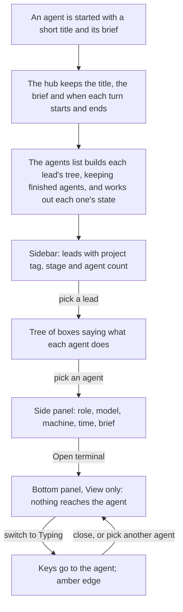

# Agents screen: layout and terminal

**Idea:** `IDEA.md` — what this is for and why, in plain language. Read it first; it is
the north star this plan serves. Goal and Constraints live there, not here, so they don't
get buried as this file grows. Design source: `docs/proposals/app-shell/agents-screen.md`
and `docs/proposals/app-shell/design/AgentsTree.dc.html`, `AgentsTerminal.dc.html`,
`AgentsTerminalTyping.dc.html`. How the code works today: `MAP.md`.

## Open Questions

None.

## Watch List

| # | Noticed | What needs looking into | Raised to user? | Outcome |
|---|---------|-------------------------|-----------------|---------|
| 1 | The sidebar shows a lead's stage ("Building") | Which record says a thread's stage today (progress card, PLAN status) | no | Settled: reuse `features()` stage grouping, Decision 10 |

## Decision Log

Append-only. A reversal is a new entry superseding the old, never an edit.

| # | Decision | Rationale | Source |
|---|----------|-----------|--------|
| 1 | Split the design: this thread builds layout, tree, side panel basics and bottom terminal; activity map, Latest, "is this normal?", context ring and question path go to the stub "Agents screen: live activity per agent" | Those need a per-step event stream that doesn't exist yet | user |
| 2 | "Waiting on X" for an agent is inferred: its turn has ended, its last card was a `message` to X, and X has not sent it a `message` since. A lead waiting on its own unfinished children keeps today's wording | Uses cards the hub already stores; no new protocol | defaulted |
| 3 | View-only scrolling moves through tmux scrollback fetched into the browser (last 2000 lines when the panel opens, then the live snapshot as today) | Today the page keeps no history (`viewer/pages/terminal.js:94-139`), so there is nothing to scroll without it | defaulted |
| 4 | The tree keeps every session of the lead's thread, including stopped ones (dashed, "finished"); archived threads are left out | The design shows finished agents; today they're pruned (`viewer/app/agents.js:3-27`) | defaulted |
| 5 | "Finished today" means leads whose sessions all ended since local midnight | Plain reading of the label | defaulted |
| 6 | Pop out opens today's terminal page, which also starts view only with the same typing switch | The stray-key problem exists there too | defaulted |
| 7 | The project tag is the basename of the thread's project path | Already stored on the thread (`viewer/app/threads.js:20-38`) | defaulted |
| 8 | On a phone (under 900px) the screen stacks: lead list, then the lead's tree, then the agent's panel full screen; the terminal opens full screen with the same view-only switch | Keeps everything reachable on a phone | user |
| 9 | Whoever starts an agent passes a short title (`wc.js session start --title`); the role files say to. Sessions without one fall back to the brief's first non-empty line; finished boxes show the result summary | The starter already knows what the agent is for; free and accurate | user |
| 10 | A lead's stage label is the Threads page's stage for that thread (Idea, Planning, Review, Building, Verifying, Done), from PLAN.md `status:` via the same mapping as `viewer/app/views.js:9-16` | One source for stage across pages | defaulted |
| 11 | Asides show as boxes under the lead, titled "Side conversation", with no Open terminal button (they have no tmux session); round 1 refines: open asides only, not selectable | Asides are records in `thread.asides`, not sessions (`viewer/app/asides.js:46-47`) | defaulted |
| 12 | Terminal mouse and scroll reports are never forwarded to tmux, in either mode; the wheel always scrolls the browser's own buffer | The likely source of stray characters is xterm mouse sequences split into keys (MAP.md, terminal paragraph) | defaulted |
| 13 | Supersedes 2: "Waiting on X" is inferred only for a message sent up the tree, to the agent's own starter, with no message back since. A reply sent down (lead to worker) never makes the sender wait | A lead answering a worker isn't waiting on it | review-round-1 |

## Spec

Designs: `docs/proposals/app-shell/design/AgentsTree.dc.html` (sidebar and tree),
`AgentsTerminal.dc.html` and `AgentsTerminalTyping.dc.html` (bottom terminal). Match their
layout, wording and colours, using the app's existing tokens in `viewer/pages/app.css`.
Ignore everything in `AgentsActivity.dc.html` and `AgentsNowOptions.dc.html`, and the
activity map, Latest, "is this normal?" line, context ring and amber question path in
any design: those belong to the stub thread.

### 1. Session titles and briefs (hub and `wc.js`)

- `wc.js session start` accepts `--title <text>` (optional). `sessionRequest` in
  `viewer/app/wc.js:70-94` adds it to the body; the machine forwards the body unchanged
  (`machine/service.js:883`).
- The hub's `sessionRequest` / `startSession` (`viewer/app/sessions.js:192-228,477-512`)
  store on the session record: `title` (trimmed, cut to 80 characters, may be absent) and
  `brief` (the brief text exactly as given).
- `publicSession` (`viewer/app/sessions.js:60-63`) leaves `brief` out of every list and
  thread response. New route `GET /wheelchair/api/sessions/:name/brief` returns
  `{ brief }` (404 when the session is unknown or has no stored brief), with the same
  sign-in and `wc-` name checks as the pane route (`viewer/app/routes.js:482-491`).
- Display title: `title` if present; else the first non-empty line of `brief` that does
  not start with `[wc:` or "Read " and is not "Nothing below overrides…", cut to 80
  characters; else the role name. Finished agents show their result summary instead: the
  `summary` of the newest `result` card the session authored (`thread.cards`, `session`
  equals its name), else the synthesized result from `viewer/app/sessions.js:276-300`,
  else the display title.
- `protocol/app/lead.md` (the `session start` line in "What you may start and stop",
  and the sub-lead start in step 7), `protocol/app/sub-lead.md:99-100` and
  `protocol/app/cards.md` (the `wc.js session` command section) gain `--title "<a few
  words saying what this agent does, in Collin's terms>"`. Leads' own sessions are started
  by the hub, not `wc.js`; a lead's display title is the thread title.

### 2. Turn timing (hub)

- The hub records `turn_started_at` (ISO) whenever it sets `turn_ended = false`
  (`viewer/app/sessions.js:368`, and the Enter/C-m path in `viewer/app/routes.js:493-517`),
  and `turn_ended_at` wherever it sets `turn_ended = true` (`sessions.js:307,415,418,422,436`).
  `ended_at` is set when `live` becomes false (`stopSession`, `pollDead`, a failed start).
- The first turn: the machine types the brief itself (`machine/service.js:534-540`), so the
  hub never sets `turn_ended = false` for it. When `startSession` creates a record with
  `first_message` true (`viewer/app/sessions.js:255-263`), it sets `turn_started_at` to
  the time the start response arrives. A record with `turn_ended` not true and no
  `turn_started_at` falls back to `created_at`.
- "How long it's been working" in the side panel: working → "Working for 4m" since
  `turn_started_at`; turn ended → "Idle for 4m" since `turn_ended_at`; finished →
  "Ran 22m" from `created_at` to `ended_at` (omit when either is missing).

### 3. The agents response (`GET /wheelchair/api/agents`)

`buildAgents` in `viewer/app/agents.js` changes:

- Keep every session of a non-archived thread; no pruning of non-live sessions. Keep the
  cycle guard and the existing parent rules (children of any lead attach to the newest
  lead; a missing parent falls back to the newest lead). Children are ordered by
  `created_at`.
- Each lead entry adds: `project` (basename of `thread.project`), `stage` (Decision 10;
  computed with the same `readStatus`/`STATUS_GROUP` logic as `viewer/app/views.js`, reused
  rather than copied), `finished` (true when no session in the thread is live), and
  `finished_at` (the latest `ended_at` of its sessions, when finished). `thread_title` and
  `lead_name` stay.
- Each lead entry adds `asides`: one node per record in `thread.asides` with
  `status: 'open'`, as `{ kind: 'aside', id, number, display_title: 'Side conversation
  <number>', state }`, where `state` is `working` when `aside.turn` is set or
  `aside.pending` is non-empty, otherwise `idle` (`viewer/app/asides.js:46,92-98`). Aside
  boxes are shown but not selectable: no side panel, no terminal, no URL entry.
- Each node adds `display_title` (section 1), `state` and `waiting_on` as below, and
  `has_brief`. `brief` and `token` are never included.
- `state` is one of:
  - `not-started`: `live` and status `starting` or waiting for capacity.
  - `finished`: not `live`, or `finished === true`.
  - `needs-you`: lead only, when the thread has a card that shows under "Needs you" on the
    Threads page (reuse `addNeeds` in `viewer/app/views.js:122-133`).
  - `waiting`: turn ended and either (a) Decision 13: the session's newest authored card
    is a `message` to its own starter X (`started_by`; for a starter that is an older
    lead, the newest lead), and X has authored no `message` to it since; or
    (b) it has live unfinished children (today's rule, `viewer/app/agents.js:11-14`).
  - `working`: turn not ended.
  - `idle`: everything else.
- `waiting_on`: for (a), `{ name: X, label: "Waiting on the <role of X>" }` ("Waiting on
  the lead" for a lead); for (b), `{ names: [...], label: "Waiting on N agents" }` (or
  "Waiting on the <role>" for one).
- Counts per lead: `counts: { total, working, waiting, not_started, finished, idle }`,
  over the lead and its descendants, not asides. A lead in `needs-you` is counted as
  `waiting` (the heading's "waiting" part then reads "waiting on another agent or you").

### 4. The Agents page layout (desktop, 900px and wider)

- **Left sidebar** of leads: live leads first, newest activity first (today's sort), each
  showing lead name, a project tag chip, the thread title, and "<Stage> · N agents". A
  lead whose `state` is `needs-you` shows "Needs you" in its sidebar entry and on its
  lead box in the tree; no other agent's box ever says it. Below, a folded "Finished today (N)" group of leads with `finished` true and
  `finished_at` since local midnight, each with its tag. Older finished leads are not
  shown. Clicking a lead selects it; the selection is kept in the URL (`?lead=<thread id>`)
  and defaults to the first live lead. A legacy `#lead-<thread id>` hash selects that lead
  too (and is replaced by `?lead=`), and the existing links that use it
  (`viewer/pages/threads.js:57`, `viewer/pages/thread.js:137,156`) change to
  `?lead=<thread id>`. An unknown or archived id falls back to the default.
- **Main area**: heading with lead name, thread title and tag, and the one-line count
  ("6 agents · 2 working · 2 waiting on another agent · 1 not started · 1 finished"; omit
  zero parts). Below, the tree drawn as boxes joined by connector lines, top to bottom:
  lead, then its children (mapper, sub-lead, reviewers, verifiers, asides), then the
  sub-lead's workers.
- **Box**: display title, role, a status dot and status text: working (filled dot,
  "Working"), waiting (hollow dot, the `waiting_on.label`), not started ("Not started"),
  finished ("Finished"), idle ("Idle"), needs you ("Needs you", lead only). Finished and not-started
  boxes have dashed borders. No session names in the box; no tmux commands anywhere on
  the page (remove the attach command and copy button, `viewer/pages/agents.js:47-90`).
- **Side panel** (right, about 380px) for the selected agent (default: none; the lead box
  selects the lead): role, display title, model and effort, machine, the timing line
  (section 2), status text, and buttons **Open terminal** (hidden for asides and for
  sessions not `live`) and **Read its brief** (hidden when `has_brief` is false; opens the
  brief as plain preformatted text in a dialog). The selected agent is kept in the URL
  (`&agent=<session name>`).
- The machine reachability notice and empty state stay as today.
- The page keeps polling every 5 seconds, redrawing without losing the selection, the
  open terminal, or the sidebar fold.

### 5. Phone layout (under 900px), Decision 8

Stacked: the lead list; tapping a lead shows its heading, count and tree (as an indented
list with the same boxes) with a "‹ Leads" back link; tapping an agent shows its side panel
content full screen with a "‹ <lead name>" back link; Open terminal opens the terminal full
screen with the same switch and a close button. The URL parameters drive which level shows,
so the browser back button works.

### 6. Bottom terminal panel

- Refactor the terminal page's logic (`viewer/pages/terminal.js`) into a reusable module
  (for example `viewer/pages/term-view.js`) that mounts into a given element for a given
  session and can be destroyed (stops polling, removes listeners). The terminal page and
  the Agents panel both use it. No page-global IDs inside the module.
- **Open terminal** opens a panel along the bottom of the Agents screen spanning under the
  tree and side panel, for the selected agent. It has a drag handle for height (kept in
  `localStorage`, wrapped in try/catch), **Full screen** (panel fills the window; Escape
  or the button again returns), **Pop out** (opens `/wheelchair/app/terminal?name=<session name>`
  — today's page and parameter, `viewer/pages/terminal.js:11` — in a new tab and closes
  the panel), and close.
- **Typing switch**, labelled "View only" / "Typing", starts at View only every time the
  panel opens or the page loads.
  - View only: nothing is sent to tmux. xterm input is ignored, the on-screen key row is
    hidden, and the cursor is hidden.
  - Typing on: the switch, the panel's edge and the cursor turn amber, and a line under the
    header says "Keys and pastes go straight to <display title>." Keys go to tmux as today.
  - The panel returns to View only when it closes or another agent is selected. Selecting
    another agent while the panel is open re-targets the panel to it if that agent has
    Open terminal (live session); otherwise the panel closes.
  - Switching to View only, closing or re-targeting discards any keys queued but not yet
    sent (today's send queue, `viewer/pages/terminal.js:72-86`); nothing queued reaches
    tmux after the switch.
- **Never forward mouse reports** (Decision 12): in both modes, drop any `onData` chunk
  that is a mouse report (`ESC [ M` followed by three bytes, `ESC [ <` … `M`/`m`, and
  `ESC [ ` digits `;` … `M`), and keep xterm from entering mouse-tracking mode from pane
  content (strip mouse-mode set sequences such as `ESC [ ? 1000 h`, `1002`, `1003`,
  `1005`, `1006`, `1015` from the pane text before writing it). The wheel then scrolls
  xterm's own buffer.
- **History** (Decision 3): the machine pane route accepts `?history=<n>` (0–2000) and
  runs `tmux capture-pane -p -e -S -<n> -t <name>`; the hub pane route passes it through.
  The view polls with `history=2000` every second (instead of 500 ms with no history),
  sets xterm scrollback to 2000, and rewrites the buffer each poll. If the reader had
  scrolled up, keep their position (same number of lines from the bottom); if they were at
  the bottom, follow the bottom. Skip the rewrite when the text is unchanged.
- The standalone terminal page gets the same switch, the same mouse-report filter and the
  same history, starting View only.

### 7. Non-goals

- Anything in the stub thread (activity map, Latest steps, "is this normal?", context
  ring, question path).
- Starting, stopping or messaging agents from this screen.
- Changing how agents ask questions; "waiting on" is read from existing cards.
- Navigation, Threads and Features pages, other than links that already point at Agents.

### 8. Edge cases

- A thread with no lead session yet (a stub not opened) does not appear.
- A lead restarted several times: only the newest lead is the root; older lead sessions do
  not appear as boxes (their children attach to the newest lead, as today).
- A session whose `started_by` points at a missing session attaches to the lead.
- Agents whose machine is unreachable keep their last state; Open terminal shows the
  pane route's error in the panel instead of a blank terminal.
- Records written before this change have no `title`, `brief`, `turn_started_at`,
  `turn_ended_at` or `ended_at`: fall back as section 1 and section 2 say, never show
  "undefined" or "NaN".
- `prefers-reduced-motion`: no animated status dots.

### 9. Tests and validation

- Update `viewer/test/app-agents.test.js`: finished sessions kept, `state` for each case
  above (including Decision 13: a message to the starter makes it wait, a reply from the
  starter clears it, and a lead's reply down to a worker never makes the lead wait),
  open aside nodes and their state, `turn_started_at` on a first turn,
  `waiting_on` labels, counts, `project`, `stage`, `finished_at`, display titles and
  result summaries, no `brief` or `token` in the response.
- Add node tests for: `--title` and `brief` stored by session start; `GET …/brief`
  (200, 404, sign-in); turn timing fields; the machine pane route with `history`
  (`machine/test/run.sh` suite, fake tmux receives `-S -2000`).
- Update `viewer/test/app-views.spec.js` (Playwright, Chromium and Firefox): the existing
  "agent tree shows waits, attach commands…" test becomes the new tree (no tmux command
  anywhere, dashed finished boxes, waiting label, Needs you only on the lead, sidebar
  project tags and Finished today fold, URL selection kept across a redraw); the terminal
  tests cover View only sending nothing (typing and wheel), Typing on sending keys with no
  extra Enter, mouse reports dropped while typing, the switch resetting on close and on
  selecting another agent (re-target when live, close when not), a long paste cut off by
  switching to View only sending nothing further, Pop out opening
  `terminal?name=`, a legacy `#lead-<id>` link selecting that lead, and the phone layout
  at 390px width.
- Commands: `node --test viewer/test/*.test.js`, `npm --prefix viewer run test:browser`,
  `bash machine/test/run.sh`.

## Accepted Risks

| Risk | Why accepted | Round |
|------|--------------|-------|

## Review Rounds

### Round 1 — 2026-11-17

**Lanes:** intent: gpt / gpt-6.1-sol; mechanics: gpt / gpt-6.1-sol; cross-family: no (Claude unavailable).

**Changed since Round 0:** n/a (first round — whole Spec in scope)

| Lane | Reported | Finding | Lead verdict | Resolution |
|------|----------|---------|--------------|------------|
| intent | blocking | Waiting inference marks a lead that replied to a worker as waiting on it | upheld | Decision 13; Spec §3 `waiting` (a) limited to messages to the starter |
| mechanics | blocking | Pop out used `?session=`; the terminal page reads `?name=` | upheld | Spec §6 uses `?name=` (`viewer/pages/terminal.js:11`) |
| mechanics | major | Aside nodes have no selection id or state mapping | upheld | Spec §3: open asides only, state from `turn`/`pending`, not selectable |
| mechanics | major | Retargeting the terminal to an agent with no terminal undefined | upheld | Spec §6: re-target if live, else close |
| mechanics | major | First turn never gets `turn_started_at` | upheld | Spec §2: set at start when `first_message`, fallback `created_at` |
| mechanics | major | "Needs you" said to be sidebar-only and also on the lead box | upheld | Spec §4: sidebar entry and lead box only |
| mechanics | major | Threads links use `#lead-<id>`; new selection uses `?lead=` | upheld | Spec §4: links change to `?lead=`, legacy hash still honoured |

### Round 2 — 2026-11-17

**Lanes:** intent: gpt / gpt-6.1-sol; mechanics: gpt / gpt-6.1-sol; cross-family: no (Claude unavailable).

**Changed since Round 1:**
- Decision 13: "waiting on" only for a message sent to the agent's own starter (§3).
- Asides: open only, state from `turn`/`pending`, not selectable (§3).
- First-turn `turn_started_at` (§2).
- "Needs you" on the sidebar entry and lead box only (§4).
- `?lead=` selection, legacy `#lead-` hash, link updates (§4).
- Pop out uses `terminal?name=` (§6); re-target or close on selecting another agent (§6).
- Tests (§9) for the above.

| Lane | Reported | Finding | Lead verdict | Resolution |
|------|----------|---------|--------------|------------|
| mechanics | minor | Switching to View only may leave queued keys sending | upheld | Spec §6: queued keys discarded on switch, close, re-target; test in §9 |
| mechanics | minor | Counts have no bucket for a lead that needs you | upheld | Spec §3: counted as waiting, heading wording |

## Prior Work

| Spec item | State | Evidence (file:line) | Confidence |
|-----------|-------|----------------------|------------|

## Implementation Tasks

| # | Objective | Ownership boundary | Lane | Session id | Validation | Status |
|---|-----------|--------------------|------|-----------|------------|--------|

## Log
