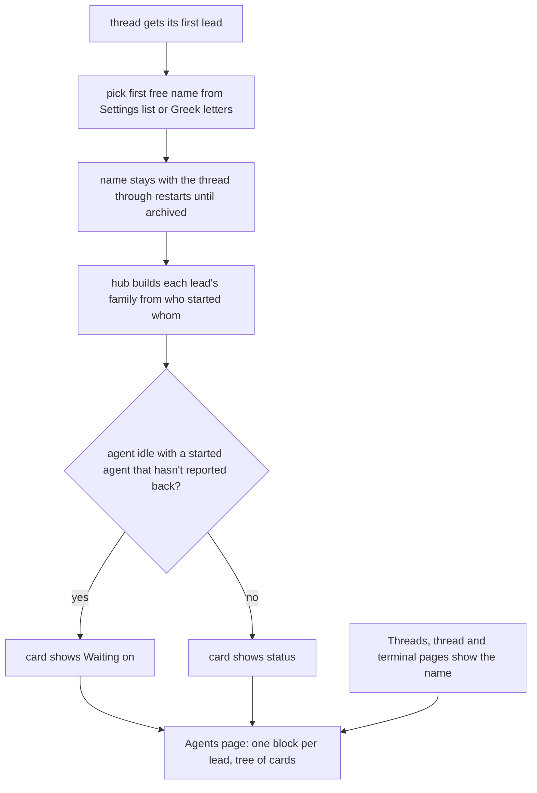

# Agents screen with named leads

**Idea:** `IDEA.md` — what this is for and why, in plain language. Read it first; it is
the north star this plan serves. Goal and Constraints live there, not here, so they don't
get buried as this file grows.

## Open Questions

(none)

## Watch List

| # | Noticed | What needs looking into | Raised to user? | Outcome |
|---|---------|-------------------------|-----------------|---------|

## Decision Log

Append-only. A reversal is a new entry superseding the old, never an edit.

| # | Decision | Rationale | Source |
|---|----------|-----------|--------|
| 1 | Names are given to leads only; a stub thread has no name until its lead starts. | Collin's words. | user |
| 2 | Name choice: the first name in the list (Greek alphabet by default, Alpha…Omega) not held by any thread with a live lead. When every name is held, add a number (`Alpha 2`). Names are reused once a thread's lead has ended. | Keeps names short and distinct among what is running now; history does not exhaust the list. | defaulted |
| 3 | "Waiting on a subagent" is derived, not reported: an agent whose turn has ended and that has live children it started which have not yet sent their `result` shows "Waiting on: <child role(s)>". | No field records it today (MAP.md); the result routing already knows parent and child, so derivation needs no change to agents' protocol. | defaulted |
| 4 | The hub records the model it resolved on each session record, next to effort, so cards can show it. | The machine stores effort but not model (`machine/service.js:301-308`); the page already tries to show `session.model`. | defaulted |
| 5 | The Sessions page is removed; its nav entry becomes Agents, and `sessions` page URLs redirect to Agents. The terminal page's back link goes to Agents. | IDEA.md: Agents replaces Sessions. | defaulted |
| 6 | The Agents screen shows live agents. Ended agents are hidden, except a lead's family keeps its ended lead row dimmed while any of its children are live. A Threads row whose lead has ended still shows the name, without a link. | Matches what the Sessions page shows today; avoids a growing list of dead sessions. | defaulted |
| 7 | A lead's name belongs to the thread: a restarted lead (`lead-2`, …) keeps the name, and the children of earlier leads in the thread show under the current lead in the tree. | Collin picked "Keep the name" (Q1). A restart is a repair; the Threads link lands on whoever is in charge now. | user |
| 8 | Supersedes #2 on reuse: a thread holds its name until it is archived, not only while its lead is live. Choice is otherwise as #2: first list name held by no unarchived thread, else a number is added. | Follows from #7: a restart after the lead died must not find its name taken by another thread. | defaulted |
| 9 | The names list is a hub setting, `lead_names`, edited on the Settings page as a text box, one name per line. | Collin picked "Settings page" (Q2). | user |
| 10 | The Agents screen reads a new hub endpoint built from the hub's own thread records (names, `started_by`, model, effort, `turn_ended`, `finished`), not the machine session lists. | The tree, names and waiting state all live in hub records; the machine lists lack model and names. | defaulted |
| 11 | Unmanaged tmux sessions (ones the app did not start) are not shown on the Agents screen. | They are not agents; IDEA.md is about the app's agents. | defaulted |
| 12 | Threads that already have a lead when this ships get names at hub start, oldest thread first. | So existing work is named without waiting for a restart. | defaulted |

## Spec

A thread's first lead gets a name from the list; the hub builds each lead's family from
who started whom; the Agents page draws it, and the Threads, thread and terminal pages link
to it.

### Lead names
- **Stored on the thread** as `thread.lead_name` (string), not on a session. A restarted
  lead (`lead-2`, …) shows the same name.
- **Assigned** at the moment a lead session record is first pushed onto a thread that has
  no `lead_name`: inside `startSession` (`viewer/app/sessions.js`), at both places a session
  record is pushed (the capacity-waiting record and the normal record), when `role ===
  'lead'`, saved with that same `hub.save(thread)`. A start that throws before any record is
  pushed (out-of-date machine, preflight failure, unknown model) leaves the thread unnamed,
  so an unopened stub never holds a name. A start that pushes a record and then fails
  (status `failed`) keeps the name: the thread now has a lead. `restartLead` therefore keeps
  an existing name and names a thread that has none.
- **Choice:** the list is `settings.lead_names` if non-empty, else the Greek alphabet in
  order (Alpha, Beta, Gamma, Delta, Epsilon, Zeta, Eta, Theta, Iota, Kappa, Lambda, Mu, Nu,
  Xi, Omicron, Pi, Rho, Sigma, Tau, Upsilon, Phi, Chi, Psi, Omega). Take the first list
  name not held (case-insensitive) by any unarchived thread. If all are held, take the
  first name `<list name> <n>` (n = 2, 3, …, walking the list for each n) that is free.
- **Release:** an archived thread no longer holds its name; it keeps `lead_name` for
  display. Unarchiving (if possible) does not re-check for clashes.
- **Serialized hub-wide:** assignment reads all threads and writes one, so it runs inside
  one hub-wide queue (a promise chain in the hub), so two threads created at once never
  get the same name.
- **Backfill:** at hub start, every unarchived thread that has at least one lead session
  and no `lead_name` gets one, oldest `created_at` first.
- Editing the list never renames existing threads.
- Workers, reviewers, verifiers, mappers and sub-leads have no names.

### The names setting
- `settings.lead_names`: array of strings, default `[]`. `normalize` keeps it (it currently
  drops unknown fields, `viewer/app/settings.js:171-196`). Validation on save: each name
  trimmed, 1–40 characters, no duplicates (case-insensitive), at most 200 names; blank
  lines are dropped, not errors.
- Settings page: a "Lead names" text box in the Leads section, one name per line, with a
  hint "Empty uses Greek letters. New leads only." Saved like other settings.

### Model on the session record
- `startSession` (`viewer/app/sessions.js`) stores `model: resolved.model` and
  `effort: input.effort || resolved.effort || null` on the hub's session record. Sessions
  started before this ships have no model; show "model unknown".

### Agents API
- `GET /wheelchair/api/agents` (added to `viewer/app/routes.js`, documented in
  `viewer/app/API.md`). Built from `hub.allThreads()`, unarchived threads only. Returns
  `{ leads: [Lead], machines: [{ machine, reachable, last_seen }] }` where each `Lead` is:
  `{ thread_id, thread_title, lead_name, machine, session: Agent, children: [Agent] }`,
  each `machines` entry also carries `hub: true|false` computed as `views.js` `sessions`
  does (`hub.state.resolveMachine(registry, 'hub')`), and the page builds attach commands
  from it exactly as `viewer/pages/sessions.js:12` does today
  and `Agent` is the public session (no token) plus `children: [Agent]` and
  `waiting_on: [child name]`.
- **Tree:** a thread's lead node is its newest lead session (largest `created_at`). Its
  children are every non-lead session whose `started_by` is any lead session of that
  thread. A session whose `started_by` is a non-lead session (a sub-lead's worker) hangs
  under that session. A session with `started_by` missing or not found in the thread
  hangs under the lead node.
- **Shown:** live sessions only (`live: true`). An ended session is dropped unless it has a
  live descendant, in which case it stays, marked ended. A thread whose lead node and all
  descendants are ended is omitted. Pending (`status: waiting`) sessions are live and shown.
- **Waiting on:** follows `started_by`, not the displayed tree, because results route to
  `started_by` (`viewer/app/cards.js:90`). For an agent with `turn_ended === true`,
  `waiting_on` lists the names of sessions whose `started_by` equals its own name, with
  `live: true` and `finished` not true. Otherwise `waiting_on` is `[]`. So a restarted lead
  is never shown waiting on an earlier lead's children, even though they display under it.
  (`finished` is set when a child's `result` is delivered, `viewer/app/cards.js:88` and
  `viewer/app/sessions.js:219`.)
- Machine reachability comes from `hub.machineSeen` and one `/v1/status` call per machine,
  as `views.js` `sessions` does.
- The old `GET /wheelchair/api/sessions` stays (nav badge and `findSessionMachine` use it).

### Agents page
- New `viewer/pages/agents.html` + `agents.js` (+ CSS in `views.css`), served at
  `/wheelchair/app/agents`, added to the server's page allowlist. Polls the API every 5s,
  keeps open/closed state of folds across redraws.
- One block per lead, ordered by thread `collin_at || created_at`, newest first. The block
  has `id="lead-<thread_id>"` so `/wheelchair/app/agents#lead-<thread_id>` scrolls to it
  and highlights it briefly.
- Each agent is a card like today's Sessions card: name line (a lead shows its
  `lead_name`, e.g. "Alpha", with "lead" badge; others show their role, e.g. "reviewer",
  plus the internal session name in small text), thread title (lead only), machine, CLI,
  model, effort ("default effort" when null), status badge (running / starting /
  waiting for capacity / ended), an "Open terminal" button (to
  `/wheelchair/app/terminal?name=<session name>`), the attach command with Copy, and on the
  lead an "Open thread" button.
- **Controls by state:** "Open terminal" and the attach command show only for a session
  with `live: true` and `status` not `waiting`. A capacity-waiting session shows "Waiting
  for capacity until <time>" (from `waiting_until`) instead. An ended ancestor kept for its
  live descendants is dimmed and shows only its name, role and "ended".
- **Waiting line:** when `waiting_on` is non-empty, the card shows "Waiting on: reviewer,
  verifier" (child roles, de-duplicated, in start order), and each named child's card gets
  a subtle marker.
- **Tree:** children indent under their parent with a connecting line; works at 360px wide
  (indent capped so three levels fit without horizontal scroll).
- Unreachable machines show a banner line at the top: "<machine> unreachable, last seen …".
- Empty state: "No agents running."

### Sessions page removal
- Delete `viewer/pages/sessions.html` and `sessions.js`. `/wheelchair/app/sessions`
  redirects (302) to `/wheelchair/app/agents`.
- Nav (`viewer/pages/nav.js`): the `sessions` entry becomes `['agents', 'Agents',
  '/wheelchair/app/agents']`; its live-count badge counts live agents from the agents API.
- Terminal page: `data-current="agents"` and back link "← Agents" to `/wheelchair/app/agents`.
  For a lead session, the header shows the lead name before the session name (e.g.
  "Alpha · wc-…-lead-2"), read from `GET /wheelchair/api/agents` (any lead session of a
  thread maps to that thread's `lead_name`; ended leads too, via `/wheelchair/api/threads`).
- Update every other reference (`server.js` header comment, routers `viewer/AGENTS.md`,
  `AGENTS.md`, tests that load the sessions page).

### Threads page
- Each row shows the lead name after the title as a small link-styled chip, e.g. "Alpha".
  The row today is one `<a>` (`viewer/pages/threads.js`); the chip must not be nested inside
  it. Restructure the row so the thread link and the chip are siblings (the thread link
  still covers the rest of the row for tapping).
- The chip links to `/wheelchair/app/agents#lead-<thread_id>` when the thread's newest lead
  session is live; otherwise it is plain text (no link). No chip when `lead_name` is unset
  (unopened stub).
- `GET /wheelchair/api/threads` returns `lead_name` (it returns stored threads already).

### Thread page
- The thread page header shows the lead name next to the title (plain text, same chip
  style, linking to the Agents entry when live).

### Non-goals
- Starting, stopping or restarting agents from the Agents screen.
- Names for non-lead roles. Renaming a thread's lead by hand.
- Changing how sessions are started, balanced, restarted or how results are delivered.
- Showing unmanaged tmux sessions.

### Validation
- `node --test viewer/test/*.test.js` passes, with new unit tests for: name choice
  (default list, custom list, all held → numbered, case-insensitive, archived releases),
  concurrent creation getting distinct names, restart keeping the name, stub getting a name
  only when opened, backfill, `lead_names` validation, model/effort recorded, and the
  agents API tree (grandchildren under a sub-lead, children of an ended earlier lead under
  the current lead, ended-with-live-descendant kept, `waiting_on` true/false cases).
- `npm --prefix viewer run test:browser` passes, with browser tests for: Agents page renders
  a tree and the waiting line at 360px and desktop widths without horizontal scroll; the
  Threads chip navigates to `#lead-<id>`; `/wheelchair/app/sessions` redirects; Settings
  saves a names list.
- Run viewer checks only with a server started with `--port` and `--cache-root` (see root
  `AGENTS.md`, Verification).

## Accepted Risks

| Risk | Why accepted | Round |
|------|--------------|-------|

## Review Rounds

### Round 1 — 2026-11-15

**Lanes:** intent lens; mechanics lens; cross-family: see Log.

**Changed since Round N-1:** n/a (first round — whole Spec in scope)

| Lane | Reported | Finding | Lead verdict | Resolution |
|------|----------|---------|--------------|------------|
| mechanics | major | A start that fails before any session exists would leave an unopened stub holding a name | upheld | Name now assigned when the first lead record is pushed, inside `startSession` |
| mechanics | major | "Waiting on" ambiguous between `started_by` and the displayed tree | upheld | Spec: follows `started_by` (results route there) |
| mechanics | minor | Terminal/attach controls undefined for capacity-waiting and ended-ancestor cards | upheld | Spec: controls by state |
| mechanics | minor | Agents API lacks the hub flag needed for attach commands | upheld | Spec: `machines[].hub` |
| intent | minor | Terminal header still shows only the internal name for leads | upheld | Spec: terminal header shows the lead name |

### Round 2 — 2026-11-15

**Lanes:** intent lens; mechanics lens.

**Changed since Round 1:**
- Lead names: assignment moved into `startSession`, at the first lead record push.
- Agents API: `waiting_on` follows `started_by`; `machines[].hub` added.
- Agents page: controls by state (capacity-waiting, ended ancestor).
- Terminal page header shows the lead name.

| Lane | Reported | Finding | Lead verdict | Resolution |
|------|----------|---------|--------------|------------|

No findings from either lens. Clean round. (Mechanics reviewer restarted once after a false "ended" notice; the original's report was used.)

## Prior Work

| Spec item | State | Evidence (file:line) | Confidence |
|-----------|-------|----------------------|------------|

## Implementation Tasks

| # | Objective | Ownership boundary | Lane | Session id | Validation | Status |
|---|-----------|--------------------|------|-----------|------------|--------|

## Log

- Round 1: both reviewers ran on GPT (Claude unavailable at start); not cross-family.
- Noticed, out of scope: a `result` sent to a lead that has since died sits in the dead
  lead's queue and is never delivered (`viewer/app/cards.js:90`; `restartLead` moves queues
  only at restart time). Not this feature's to fix; raise to Collin as a possible stub.
