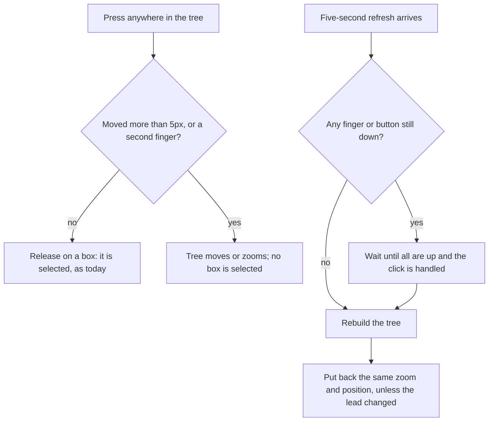

# Drag the Agents tree to see all of it

**Idea:** `IDEA.md` — what this is for and why, in plain language. Read it first; it is
the north star this plan serves. Goal and Constraints live there, not here, so they don't
get buried as this file grows.

Map: `MAP.md`.

## Open Questions

None.

## Watch List

| # | Noticed | What needs looking into | Raised to user? | Outcome |
|---|---------|-------------------------|-----------------|---------|

## Decision Log

Append-only. A reversal is a new entry superseding the old, never an edit.

| # | Decision | Rationale | Source |
|---|----------|-----------|--------|
| 1 | The view (drag offset, and zoom if any) is kept across the five-second rebuild and across selecting a box; it resets when switching to another lead. | IDEA requires no jumping back; a different lead is a different tree. | defaulted |
| 2 | The mouse wheel and two-finger trackpad scroll keep moving the tree as they do now. | Matches today's behaviour and every other page; nothing to relearn. | defaulted |
| 3 | A tree that already fits looks and behaves as it does today (centred, no drag needed). | IDEA "what good looks like". | defaulted |
| 4 | Zoom as well as drag: + and − buttons, plus pinch (trackpad or touch) and Ctrl+wheel. | Collin picked "Drag and zoom": a big tree can be seen whole. | user |
| 5 | A lead's tree opens at full size (100%), top centre, as today; zoom is never changed automatically. | Keeps decision 3; auto-shrinking would make boxes unreadable without being asked. | defaulted |
| 6 | View buttons: −, +, Fit and 100%. Fit shrinks the whole tree into the visible area, centred; 100% returns to full size, top centre. | Collin picked "Fit and 100%". | user |
| 7 | Zoom is limited to 20%–200%; Fit never enlarges past 100%; + and − step by 1.25×; zoom from the pinch/wheel keeps the point under the pointer still, zoom from buttons keeps the centre of the area still. | Common pan-zoom behaviour, matching the graph viewer's wheel zoom (`viewer/index.html:2362-2379`). | defaulted |
| 8 | A drag can start anywhere in the tree area, on a box or empty space. A press that moves more than 5px (in screen pixels) is a drag and selects nothing; a press that stays within 5px and releases on a box is a click and selects it as today. | Collin picked "Anywhere"; threshold approach follows the graph viewer (`viewer/index.html:2292-2309`). | user |
| 9 | Phones and any window under 900px keep today's indented list unchanged: no view buttons, no drag or zoom handling. | Collin picked "Keep the list". | user |
| 10 | Supersedes 5: a lead's tree opens at 100%, scrolled to the top with the lead box centred horizontally. Today a wide tree opens at its left edge, which can leave the lead off screen; the 100% button returns to this same view. | Decision 5 wrongly said this was today's behaviour; centring the lead is the useful start for a wide tree. | defaulted |
| 11 | Fit fits the tree into the part of the tree area the terminal panel does not cover. | Otherwise Fit would hide the bottom of the tree under an open terminal. | defaulted |
| 12 | The current zoom is shown as a percentage beside the buttons; the buttons sit in a row above the tree area and do not move when the tree moves. | Needs no choice from Collin; keeps the controls reachable. | defaulted |
| 13 | Supersedes 11: while the terminal panel is open (not full screen), the tree area shrinks to end above it, so dragging and scrolling reach every box and Fit needs no special case. Trees are always top-aligned; only horizontal centring is kept. | Intent review: the terminal covered the bottom of the tree at any zoom, and vertical centring changed how small trees look. | review-round-1 |
| 14 | Rebuilds wait from any pointer down in the tree area until after its click is delivered, not only during a confirmed drag. | Mechanics review: a still press spanning a poll would lose its button and never select. | review-round-1 |
| 15 | The page body is a fixed-height column so banners shorten the layout; the tree area has a 160px minimum and `.agents-main` scrolls as a whole when a tall terminal leaves less; deferred rebuilds wait for every active pointer. | Mechanics review round 2: banners pushed the tree under the terminal, a tall terminal could collapse the tree area, and a pinch flushed on its first finger up. | review-round-2 |
| 16 | The view record also keeps `.agents-main`'s own scroll; a two-finger gesture suppresses clicks from all its pointers. | Mechanics review round 3: the outer scroll jumped on every rebuild, and a still first finger lifting over a box during a pinch would select it. | review-round-3 |

## Spec

### What changes, in short



The picture shows a press becoming a click or a drag, and how a refresh waits for it; it
leaves out the buttons, Fit and the phone list.

On screens 900px and wider, the Agents screen's tree area becomes a fixed-size window
onto the tree. Collin moves the tree by dragging (from anywhere in it), by scrolling, or
with scrollbars, and zooms with buttons, pinch or Ctrl+wheel. Where he has moved survives
the page's own rebuilds. Under 900px nothing changes.

### Files

- `viewer/pages/agents.js`: view state, gestures, toolbar, keeping the view across rebuilds.
- `viewer/pages/views.css`: the layout and toolbar rules (desktop only; the `max-width: 899px` block must leave the phone list as it is).
- `viewer/test/app-views.spec.js`: browser tests (below).

No server, API or other page changes. Leave `.agents-children`, `.agents-branch` and
`.agents-box` geometry alone: the thread "Agents tree: straight connectors, shorter boxes"
may change those, and this design must not depend on box size or connector drawing.

### Layout (desktop, at least 900px wide)

- `.agents-view` (the `<main>`, which also holds the error and unreachable banners above `#agents`) becomes a column exactly the height below the nav (`calc(100vh - var(--nav-h))`). `.agents-layout` takes the rest (`flex: 1; min-height: 0`) instead of its own `min-height`, so a banner shortens the layout rather than pushing it down. The sidebar and the side panel each scroll on their own (`overflow: auto`) (decision 15).
- `.agents-main` is a column: heading, thread title, counts line, then the toolbar row, then the tree area, which takes all remaining height (`flex: 1; min-height: 0`).
- The tree area (`.agents-tree`) scrolls on both axes (`overflow: auto`). Inside it, a sizer element sized to the tree's natural size times the zoom, and inside that the tree itself scaled with `transform: scale(zoom)` and `transform-origin: 0 0`. The tree's natural size is its unscaled `offsetWidth`/`offsetHeight`. When the scaled tree is narrower than the area it is centred horizontally (as a small tree is today, decision 3); vertically it is always top-aligned, as today.
- When the terminal panel is open and not full screen, `.agents-main` gets bottom padding equal to the panel's current height (a CSS variable that `agents.js` sets on open, resize and close), so the tree area ends where the terminal starts and every box can be scrolled or dragged into view above it (decision 13).
- The tree area has a minimum height of 160px. When the terminal is dragged so tall that the heading, toolbar and 160px no longer fit, `.agents-main` keeps today's `overflow: auto` and scrolls as a whole, so nothing collapses; the terminal's own sizing is unchanged (decision 15).
- Moving the tree is changing the tree area's `scrollLeft`/`scrollTop`. So the wheel and two-finger trackpad scroll keep working natively (decision 2), as do scrollbars.

### Toolbar

A row above the tree area, right-aligned: `−`, the zoom as a percentage (for example `60%`, a label, not a button), `+`, `Fit`, `100%`. Plain `<button type="button">`s with accessible names "Zoom out", "Zoom in", "Fit", "Full size" (the visible text can stay `−`, `+`, `Fit`, `100%`). It is hidden under 900px.

### Zoom

- Range 20%–200%, clamped (decision 7). `+` multiplies by 1.25, `−` divides by 1.25; both keep the point at the centre of the tree area still.
- Ctrl+wheel (which is also how Chromium and Firefox deliver a trackpad pinch) zooms by `exp(-deltaY * 0.01)`-style steps, clamped, keeping the point under the pointer still. The wheel listener is non-passive and calls `preventDefault()` only when Ctrl is held, so the browser's own page zoom doesn't fire, and plain scrolling is untouched.
- Two-finger touch pinch on a touch screen at least 900px wide zooms around the midpoint of the two fingers.
- "Keeps a point still" means: after changing zoom from `z0` to `z1`, set scroll so that the tree coordinate under that screen point before is under it after (`scroll = (scroll + p) * z1/z0 - p`, per axis, with `p` the point's offset inside the tree area, adjusted for any centring offset).
- **Fit**: zoom = min(1, available width / natural width, available height / natural height), clamped to 20%, then scroll to the top and centre it horizontally. Available area is the tree area's client rectangle (which already stops above an open terminal, decision 13) less a 16px margin.
- **100%**: zoom 1, `scrollTop` 0, `scrollLeft` set so the lead box is centred horizontally in the tree area (decision 10). This is also the view a lead's tree opens at.

### Dragging and clicking (decision 8)

- A pointer down with the primary mouse button, a pen, or one finger anywhere in the tree area (on a box or not) starts a possible drag. Record the start point and scroll.
- Once the pointer has moved more than 5 screen pixels from its start, it is a drag: capture the pointer on the tree area, add a `dragging` class (grabbing cursor, `user-select: none`), and set scroll to start scroll minus movement for every later move.
- If it became a drag, the click that follows the release must not select anything: a capture-phase `click` listener on the tree area calls `preventDefault()` and `stopPropagation()` for that one click. If it never passed 5px, nothing is intercepted and the box's own click selects it, exactly as today.
- A gesture lasts from the first pointer down in the tree area until every pointer is up or cancelled. A second touch makes it a pinch, and a pinch counts as a drag for the whole gesture: no click from any of its pointers selects anything, even one whose finger never moved (decision 16).
- The tree area sets `touch-action: none` on desktop widths so the browser leaves touch drags and pinches to these handlers. The cursor over the tree area is `grab`; boxes keep `pointer` so they still look clickable.
- Asides (non-selectable boxes) are dragged through like empty space.

### Keeping the view (decisions 1, 10)

- The page keeps one view record: `{ lead, zoom, left, top, mainTop }`, updated on every scroll and zoom of the tree area and every scroll of `.agents-main` (`mainTop`, which only moves when a tall terminal makes `.agents-main` scroll as a whole).
- `render()` rebuilds the tree every five seconds and on every selection. After it puts the new tree area in place, it applies the record if `lead` matches the shown lead's `thread_id`: set zoom, then the tree area's `scrollLeft`/`scrollTop`, then `.agents-main`'s `scrollTop` (decision 16). If the lead differs (or there was none), it resets to the 100% view and records the new lead.
- From any pointer down in the tree area (a possible drag, not only a confirmed one) until that pointer's click has been delivered, the five-second refresh does not call `render()`: it stores the new data and marks a rebuild as pending. Deferral lasts until every pointer that went down in the tree area is up or cancelled (so lifting one finger of a pinch does not flush). When the last one is up or cancelled, the pending rebuild is run in a `setTimeout(..., 0)`, which lands after the browser has dispatched the click, so a still press that spans a poll still selects its box. If the click selects a box, `go()` renders anyway and the pending flag is cleared. A selection cannot happen mid-drag (decision 14).
- The terminal panel, its height, full screen and the side panel behave as today.

### Phones (decision 9)

Under 900px: the toolbar is hidden; `.agents-view`, `.agents-layout` and `.agents-main` keep today's heights and scrolling (none of the fixed-height column rules apply); the tree area has no fixed height, no `touch-action` override and no transform (zoom is treated as 1); pointer and wheel handlers do nothing (check `matchMedia('(max-width: 899px)')` at gesture start). The indented list scrolls and selects exactly as today. Resizing across 900px needs no special handling beyond that: the next render applies the right mode.

### Non-goals

- No change to the tree's layout, connectors or box sizes.
- No keyboard shortcuts for panning or zooming beyond the buttons themselves.
- No remembering the view across page reloads or between leads.
- No change to the graph viewer or any other page.

### Validation

New or updated browser tests in `viewer/test/app-views.spec.js` (desktop project unless said), using a lead with enough children to overflow (for example 12 workers, two of them with children of their own):

1. Opens at 100%: the lead box is horizontally centred in the tree area (within 2px) and `scrollTop` is 0. This replaces the "scroll from the left" assertion of the existing wide-tree test; keep its narrow-tree centring check.
2. A real mouse drag (`page.mouse.down/move/up`, more than 5px) starting on empty space changes `scrollLeft`/`scrollTop` by the movement.
3. A drag starting on a box moves the tree and does not select it (URL has no `agent=`, side panel says "Select an agent").
4. A still click on a box selects it, as today.
5. Ctrl+wheel over the tree changes the zoom label and the box's on-screen width; the page's own zoom (`devicePixelRatio`) is unchanged.
6. `Zoom in`/`Zoom out` change the label by 1.25× steps and stop at 200% and 20%.
7. `Fit` makes every box's bounding rectangle lie inside the tree area; `Full size` returns to the opening view.
8. A still press on a box held across a poll (mouse down, wait 5.5s, mouse up) still selects it.
9. After dragging and zooming, waiting 5.5s for a poll keeps the same zoom and scroll (within 1px); clicking a box keeps them too.
10. Switching to another lead in the sidebar opens it at 100%.
11. With the terminal open (select a live agent, Open terminal), scrolling the tree area to its bottom puts the lowest box's bottom edge above the terminal panel's top.
12. Phone project: the toolbar is not visible and the tree is still the indented list (existing phone tests keep passing).

Commands, all must pass:

```bash
node --test viewer/test/*.test.js
npm --prefix viewer run test:browser
```

## Accepted Risks

| Risk | Why accepted | Round |
|------|--------------|-------|

## Review Rounds

### Round 1 — 2026-11-17

**Lanes:** intent lens (gpt, claude unavailable); mechanics lens (gpt, no other family available); cross-family: no.

**Changed since Round 0:** n/a (first round — whole Spec in scope)

| Lane | Reported | Finding | Lead verdict | Resolution |
|------|----------|---------|--------------|------------|
| intent | blocking | An open terminal covers the bottom of the tree, so dragging can't reach the bottom boxes; only Fit accounted for it. | upheld | Tree area ends above the terminal (decision 13, Layout). |
| intent | minor | Centring small trees vertically changes how they look today. | upheld | Top-aligned always; horizontal centring only (decision 13). |
| mechanics | major | Vertical centring contradicts opening at the top. | upheld | Same fix: always top-aligned (decision 13). |
| mechanics | blocking | Fit centred in the area above an overlaying terminal can't be reached by scrolling alone. | upheld | Tree area now ends above the terminal, so Fit uses the area as is (decision 13). |
| mechanics | major | Rebuild deferral only covered confirmed drags; a still press across a poll, or a synchronous flush on pointer up, loses the click. | upheld | Defer from pointer down; flush after click via setTimeout 0 (decision 14). |

### Round 2 — 2026-11-17

**Lanes:** intent lens (gpt, claude unavailable); mechanics lens (gpt); cross-family: no.

**Changed since Round 1:**
- Layout: tree area ends above an open terminal (CSS variable for its height); trees always top-aligned, horizontal centring only (decision 13).
- Fit: no terminal special case; scrolls to top, centres horizontally (decision 13, supersedes 11).
- Keeping the view: rebuild deferred from any pointer down until after its click, flushed with setTimeout 0 (decision 14).
- Validation: new items 8 (still press across a poll) and 11 (terminal open, bottom reachable).

| Lane | Reported | Finding | Lead verdict | Resolution |
|------|----------|---------|--------------|------------|
| intent | — | No findings. | — | — |
| mechanics | major | Error and unreachable banners push the fixed-height layout down, so the tree runs under the terminal. | upheld | `.agents-view` is the fixed-height column; layout flexes (decision 15). |
| mechanics | major | A terminal resized near full height collapses the tree area. | upheld | 160px minimum; `.agents-main` scrolls as a whole (decision 15). |
| mechanics | major | A pinch flushes the pending rebuild when its first finger lifts. | upheld | Defer until every active pointer is up (decision 15). |

### Round 3 — 2026-11-17

**Lanes:** intent lens (gpt); mechanics lens (gpt); cross-family: no.

**Changed since Round 2:**
- Layout: `.agents-view` is the fixed-height column so banners shorten the layout; tree area minimum 160px with `.agents-main` scrolling as a whole below that (decision 15).
- Keeping the view: deferral lasts until every active pointer is up or cancelled (decision 15).
- Phones: the fixed-height column rules do not apply under 900px.

| Lane | Reported | Finding | Lead verdict | Resolution |
|------|----------|---------|--------------|------------|
| intent | — | No findings. | — | — |
| mechanics | major | `.agents-main`'s own scroll is lost on every rebuild. | upheld | Kept in the view record (decision 16). |
| mechanics | major | During a pinch, a still finger lifting over a box selects it. | upheld | A pinch suppresses clicks from all its pointers (decision 16). |

### Round 4 — 2026-11-17

**Lanes:** intent lens; mechanics lens.

**Changed since Round 3:**
- Keeping the view: the view record also keeps `.agents-main`'s scroll, restored after each rebuild (decision 16).
- Dragging: a gesture lasts until every pointer is up; a two-finger gesture suppresses clicks from all its pointers (decision 16).

| Lane | Reported | Finding | Lead verdict | Resolution |
|------|----------|---------|--------------|------------|

## Prior Work

| Spec item | State | Evidence (file:line) | Confidence |
|-----------|-------|----------------------|------------|

## Implementation Tasks

| # | Objective | Ownership boundary | Lane | Session id | Validation | Status |
|---|-----------|--------------------|------|-----------|------------|--------|
| T1 | Whole Spec: layout, toolbar, zoom, drag/click, view kept across rebuilds, phones unchanged, 12 browser tests | viewer/pages/agents.js, viewer/pages/views.css, viewer/test/app-views.spec.js | standard, gpt-6.1-terra (asked for claude; hub sent gpt) | wc-174e824a3643-worker (T1-a1) | `node --test viewer/test/*.test.js`; `npm --prefix viewer run test:browser` | in progress |

## Log

- 2026-11-17: review budget hit after round 3; Collin chose "Keep going", budget reset.
- 2026-11-17: round 4 clean. Ready check: hub and machine service answer (`wc.js session list`), claude and codex CLIs installed, Codex preflight passes (token fresh). Ready.

- 2026-11-17: the thread "Agents tree: straight connectors, shorter boxes" may edit the same CSS file; this plan touches only the layout, tree-area and toolbar rules, not box or connector rules.
