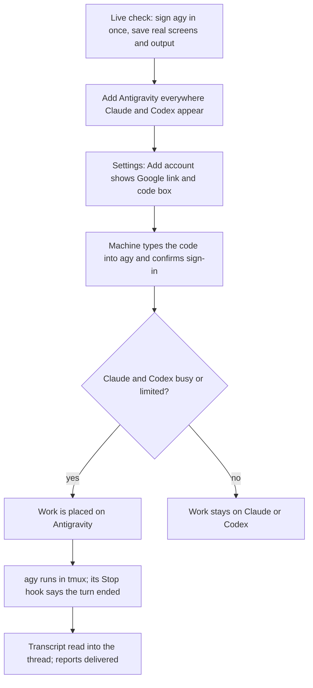

# Antigravity CLI as a third agent provider

**Idea:** `IDEA.md` — what this is for and why, in plain language. Read it first; it is
the north star this plan serves. Goal and Constraints live there, not here, so they don't
get buried as this file grows.

## Open Questions

None open.

## Watch List

| # | Noticed | What needs looking into | Raised to user? | Outcome |
|---|---------|-------------------------|-----------------|---------|
| 1 | Docs say credentials live in a shared app dir and the OS keyring | Whether two Antigravity accounts can be kept apart on one machine | no | Settled: live check decides; fallback is one account per machine (Decision 9) |
| 2 | `protocol/app/lead.md:82-83` says Ready checks both families; `viewer/app/ready.js:39-56` checks only the thread's CLI | Stale line | no | Settled: fix the line (Spec, Protocol) |
| 3 | `agy` self-updates in the background on every run | Formats can change under us | no | Settled: parsers fail loudly (Spec, Failure handling) |

## Decision Log

| # | Decision | Rationale | Source |
|---|----------|-----------|--------|
| 1 | Provider key `gemini`, CLI `agy`, shown as "Antigravity" | Provider keys name the model family (`claude`, `gpt`), CLIs name the binary | defaulted |
| 2 | Sign-in reuses the Settings sign-in card's link + pasted-code path that Claude uses | `agy` remote login is link then pasted code, same direction as Claude (`viewer/pages/settings.js:908-981`) | defaulted |
| 3 | With three families, cross-family review keeps two lanes; "the other family" means any family other than the first lane's, taken in role order | Keeps review cost the same; `both` generalises to "two or more families usable" | defaulted |
| 4 | No usage meter for Antigravity unless `agy` exposes limit windows; a rate-limit failure still marks the account limited | Limit windows are undocumented (MAP.md) | defaulted |
| 5 | Asides on Antigravity sessions use `agy -p --conversation` resume if it can fork; otherwise asides are unavailable on those sessions with a plain message | Headless resume is documented, fork is not | defaulted |
| 6 | `agy` 1.5.9 installed on this machine at `/home/collin/.local/bin/agy` via Google's installer (no root needed); the build starts with a live check task that captures real login, transcript and hook output as fixtures | Docs leave these unspecified | user |
| 7 | Antigravity can run every role; it is appended last to `worker_order` (and so to the lead order's `any`); saved orders missing it get it appended at load | Only picks up work when Claude and Codex are busy or limited; reorderable in Settings | user |
| 8 | Role instructions reach `agy` as a typed first message starting `[wc:role]`, like Codex (`typesRoleMessage: true`) | `agy` has no documented append-system-prompt flag | defaulted |
| 9 | Account isolation: the live check looks for a variable that moves only `agy`'s config and credentials (candidates seen in the binary: `ANTIGRAVITY_CONFIG_REL_DIR`, `ANTIGRAVITY_EXECUTABLE_DATA_DIR`). If none works without changing `HOME`, Antigravity supports only the machine's default account and Settings says so instead of offering "Add account" | Changing `HOME` for a session would break its git, gh and ssh setup | defaulted |
| 10 | Turn end comes from `agy`'s `Stop` hook; the hook file is written per account (`<config>/config/hooks.json`, merged, never overwritten) and calls `machine/hook.sh agy`, which takes the session name from `WHEELCHAIR_SESSION_NAME` in the session's environment | Hooks are global per config dir, not per session; the hook already exits 0 when no session token is set, so Collin's own `agy` runs are unaffected | defaulted |
| 11 | Model pins for `gemini` start from the live check's `agy models` list; until pinned, a slot is "not used" (`model.sh` exit 3), so nothing lands on Antigravity by accident | Models are only listed after sign-in | defaulted |
| 12 | `review_families` keeps the stored value `both` (shown as "Mix families") and gains `gemini` as a single-family choice | Saved settings stay valid | defaulted |
| 13 | Supersedes 11: `DEFAULTS.gemini` holds the real models Task 0 names, so Antigravity becomes eligible as soon as an account is signed in; being last in `worker_order` is what keeps it from taking work first. A slot is "not used" only when pinned `none` | `model.sh` `cell()` falls back to DEFAULTS, so an unpinned slot is never "not used" (`codex/model.sh:118-119`) | review-round-1 |
| 14 | Supersedes 7's migration: only `worker_order` gets missing providers appended at load; `lead_order` is left as saved, and reaches Antigravity through its trailing `any` when it has one | Appending before `any` would make `any` redundant and stop it following `worker_order` (`viewer/app/balancer.js:51`) | review-round-1 |
| 15 | `agy` permission prompts are found by watching the pane of every ready `agy` session (not by a hook, since `agy` has none for prompts) | Ready sessions are otherwise only polled once a prompt is already open (`machine/service.js:546-551`) | review-round-1 |
| 16 | Hooks go per session first: Task 0 checks whether `agy --settings <file>` loads a `Stop` hook. If it does, the adapter writes a settings file per session (as Claude does, `machine/adapters/claude.js:18-22`) with the session name as the hook's argument, and Decision 10's global hook file, its merge, `prepare(dir)`'s hook write and `WHEELCHAIR_SESSION_NAME` are all dropped. Decision 10 is the fallback only if it doesn't | Avoids writing into Collin's own `~/.gemini/config/hooks.json` | review-round-1 |
| 17 | Ready keeps checking only the thread's own CLI. For a Claude- or Codex-led thread, workers reach Antigravity only when placement already found a signed-in Antigravity account (`viewer/app/balancer.js` `signedIn`), so no separate Ready line is needed. The IDEA bullet means threads whose CLI is `agy` | Keeps the Ready card about what the thread itself needs | review-round-1 |
| 18 | Verification stays at most two verifiers. With `review_families` `both`: one family built → one verifier `--not-provider <it>`; two or more families built → one verifier on each of two families that built, chosen in the order claude, gpt, gemini (so all three building gives claude + gpt). Single-family settings are unchanged: one verifier, no flag | Each verifier checks the whole build, so a third adds cost without new coverage | review-round-3 |
| 19 | Supersedes 14's migration rule: settings store `worker_order_seen`. On load, append to `worker_order` only providers not in it, then mark every known provider seen. A file saved before this build, with no `worker_order_seen`, counts as having seen `claude` and `gpt`, so only Antigravity is appended, once. A provider removed with Settings' Remove stays removed | Appending every missing provider undid the existing Remove button, changing how Claude and Codex are placed, which IDEA.md rules out | lead (build) |

## Spec

### The flow at a glance



A one-time live check comes first. Then Antigravity is added beside Claude and Codex. An
account is signed in from Settings by opening a Google link and pasting the code back.
Work lands on Antigravity only when it is next in line, last by default. Its turns end
through a `Stop` hook, and its transcript feeds the thread and reviewer reports.

### What changes, in one paragraph

Antigravity becomes a third provider: key `gemini`, CLI `agy`, label "Antigravity". It
is wired through the same seams as Claude and Codex: the provider registry, Settings,
placement, model pins, the machine adapter, the hook bridge, the transcript parser,
asides, the Ready check, and the workflow protocol's `--provider` values. Sign-in uses the
existing Settings sign-in card (link + pasted code).

### Task 0: live check first (blocks every other task)

`agy` 1.5.9 is installed at `/home/collin/.local/bin/agy`, not yet signed in. Before any
parser is written, one task signs it in (Collin pastes the code once, through a `message`
to the lead, who posts a card) and records real output under
`machine/test/fixtures/agy/` (secrets, tokens and emails replaced):

1. The login screens: the method menu, the link + code prompt, the screen after a good
   code, the screen after a bad code.
2. Where credentials land with `DBUS_SESSION_BUS_ADDRESS` unset (the machine service has
   no desktop keyring), and that a session started later by the service is signed in.
3. Account isolation (Decision 9): try each candidate variable, check that a second
   signed-out config dir stays signed out and the first stays signed in.
4. `agy models` output, signed in and signed out (exit code and text).
5. Whether `agy --settings <file>` with a `hooks` key fires a `Stop` hook (Decision 16);
   if not, the global hooks file instead. Then an interactive run in tmux with that hook: the idle-prompt screen
   (ready text), the hook's stdin JSON, and the transcript file at `transcriptPath`.
6. A permission prompt screen under `--mode auto`, and confirmation that `--mode plan`
   cannot edit files (for reviewers).
7. `agy -p --conversation <id> --output-format json` run against the conversation of an
   interactive `agy` that is still running (as a lead is during a real aside): whether it
   forks or appends, and whether the interactive session is disturbed.
8. A rate-limit or quota error, if one can be provoked cheaply; otherwise record that it
   wasn't.

Findings go in a short `reports/T0.md`. If a finding contradicts this Spec, the sub-lead
asks the lead before building on it.

Login screen already seen on this machine (`agy` with a fresh HOME, pane joined with
`capture-pane -J`):

```text
 Welcome to the Antigravity CLI. You are currently not signed in.
 Select login method:
 > 1. Google OAuth
   2. Use a Google Cloud project
   ↑/↓ Navigate · enter Select
```
then, after Enter:
```text
 Your browser should open automatically. If not:
 https://accounts.google.com/o/oauth2/auth?access_type=offline&client_id=…&redirect_uri=https%3A%2F%2Fantigravity.google%2Foauth-callback&response_type=code&scope=…&state=…
 If you aren't automatically redirected, paste the authorization code below:
 authorization code...
```
The URL wraps across lines in an unjoined capture. There is no `agy login` or `auth
status` subcommand: sign-in happens inside the interactive CLI, which stays running
after it succeeds.

### Hub (viewer/app)

- `providers.js`: add `gemini: { cli: 'agy', label: 'Antigravity', effort: true,
  preflight: false, typesRoleMessage: true, asideFork: <per Task 0> }`; Claude and GPT get `asideFork: true`.
- `settings.js`: `PLANS.gemini = { unknown: 1, pro: 1, ultra: 4 }`; defaults gain account
  `default-gemini`; `worker_order` default `['gpt', 'claude', 'gemini']`; at load, any
  provider missing from a saved `worker_order` is appended at its end. `lead_order` is not
  migrated (Decision 14). `review_families` accepts `both | claude | gpt | gemini`.
- `balancer.js`: no logic change beyond accepting `gemini` in constraints; check that the
  `both`/single-family branch and `--not-provider` pick work for three families
  (excluding one provider leaves two; the first available in order wins).
- `sessions.js`: effort for `gemini` uses `agy`'s set (`low…max`); propagate the bound
  conversation id (new session field `agy_conversation_id`) the way `codex_thread_id` is.
- `ready.js`: unchanged logic; it already checks the thread's own CLI (Decision 17). Status must carry
  `agy` (below).
- `routes.js`: accept `gemini` wherever provider, effort and review-family values are
  validated (`routes.js:193-210,240-242,337-344`).
- `chat.js`: an `agy` transcript parser from the Task 0 fixture, producing the same
  message shape as the others. Unknown row types are skipped; a file with no row it can
  read shows "Couldn't read this Antigravity transcript" instead of an empty chat.
- `asides.js`: a new registry flag `asideFork` on `PROVIDERS.gemini` (true or false per
  Task 0). When false, `create` (`POST /asides`, `viewer/app/routes.js:396`) refuses an
  aside on a `gemini` session with 400 and "Side conversations aren't available on
  Antigravity sessions yet", shown where any aside error is shown. Every aside's first turn
  is a fork (`viewer/app/asides.js:33-40`), so `create` is the place; `claim` has no request
  to fail. The `asideFork` check runs first in `create`, before the `parent` lookup and
  the 409 "the lead isn't ready yet" (`viewer/app/asides.js:37-39`), whose two-way ternary
  becomes a map by provider. When true, the parent id for `agy` sessions is
  `agy_conversation_id`. Tested in `viewer/test/`: `create` on a `gemini` lead with
  `asideFork: false` returns 400 with that message.
- `chat.js` report extraction: add `ASSISTANT_CONTENT.agy` (`viewer/app/chat.js:198-204`)
  from the Task 0 transcript fixture, so a reviewer or verifier running on `agy` has its
  report delivered by `deliverReport` (`viewer/app/sessions.js:262-267`); the `Stop`
  hook payload carried no last message in the docs; if Task 0's payload does carry one,
  `deliverReport` may read it first, as it does for the others. Tested:
  `lastAssistantText('agy', fixture)` returns the fixture's last assistant text.

### Pages (viewer/pages)

- `settings.js`: Antigravity appears wherever Claude and GPT do (provider lists, model and
  effort pins, role orders, review families as "Mix families / Claude / GPT /
  Antigravity", accounts). Its sign-in card is the existing one: link, then a code box.
  If Decision 9 fell back to one account, the Antigravity accounts section shows only the
  default account and says "Antigravity supports one account per machine".
- `threads.js` and `thread.js`: label `gemini` as "Antigravity" and offer `agy` where a
  thread's CLI is chosen.

### Machine (machine/)

New `machine/adapters/agy.js`, registered in `adapters/index.js` as `agy`:

- `provider: 'gemini'`; `loginEnv(dir)` per Decision 9 (empty for the default account).
- `seed(dir, id)`: the common seed (no instruction-file link unless Task 0 shows `agy`
  reads one from its config dir).
- **Hooks, primary path (Decision 16)**: `command` writes a per-session settings file and
  returns `{ settingsPath, settings, argv }` exactly as `claude.js` does
  (`machine/adapters/claude.js:18-22`; the service writes it, `machine/service.js:489`):
  `settingsPath` is `<stateDir>/settings/<session name>.json`, `settings` is
  `{ hooks: { Stop: [{ hooks: [{ type: 'command', command: '<root>/machine/hook.sh agy
  <session name>' }] }] } }` in the shape Task 0 confirms, and `argv` carries `--settings
  <settingsPath>`. No global file is written and no new environment variable is added.
- **Hooks, fallback only (Decision 10), built only if Task 0 shows `--settings` does not
  load hooks**: a new optional adapter hook `prepare(dir)`, called by `startNamed` and
  `startLogin` for **every** account, the default one included (today `seed` runs only
  when `dir` is set, `machine/service.js:464-468`). For `agy` it writes the hook file: the
  account's `<config>/config/hooks.json`, or `~/.gemini/config/hooks.json` for the default
  account, merging one top-level key `wheelchair` and leaving every other key untouched.
  An unreadable existing file is left alone and the start fails with "Couldn't update
  Antigravity's hooks file".
- `command`: `agy` + model (`--model`), effort (`--effort`), access: reviewer `--mode
  plan`; otherwise `--dangerously-skip-permissions` when `permission_mode` is `bypass`,
  else `--mode auto`; plus `--settings <settingsPath>` on the primary hooks path. Under
  the fallback only, the machine adds `WHEELCHAIR_SESSION_NAME=<name>` to `agy` sessions'
  env line (`service.js:490`), because the global hook command cannot carry a per-session
  name and a spooled event needs one to be replayed (`machine/lib/hook-post.js` writes
  `session` into the spool file).
- `firstMessage`: Codex's form, `[wc:role] <role prompt>

<brief>`.
- `readyText`/`answerPrompts`: from Task 0's idle screen and startup screens.
- New optional adapter hook `promptText(pane)`, true when Task 0's permission-prompt screen
  is showing. `pollReadiness` (`machine/service.js:546-551`) also checks every `ready`
  session without `prompt_open` whose adapter has `promptText`; on a match it handles the
  event `{ type: 'prompt', notification_type: 'permission_prompt' }` through the same path
  a hook event takes (`service.js:820-823`), which sets `prompt_open` and shows the app's
  permission card. The existing `checkPrompt` clears it once `readyText` is true again.
- `onTurnEnded`: bind the first conversation whose `lastUserInput` starts with
  `[wc:role]` (as Codex does), store `agy_conversation_id` and `source_transcript` from
  `transcriptPath`; ignore other conversations.
- `hookEvent`: `Stop` with `terminationReason` `model_stop` → `turn-ended`; `error` whose
  text Task 0 identifies as quota or rate limit → `limit-hit`; other `error` →
  `turn-failed`; `max_steps_exceeded` → `turn-ended`.
- `usageFrom`: returns null (Decision 4).
- `loginCommand`: `['agy']`. `loginPrompt(pane)`: Enter once when the pane shows "Select
  login method" with "Google OAuth" selected. `parseLogin(pane)`: join wrapped lines, take
  the `https://accounts.google.com/` URL, `wantsCode` when the pane says "paste the
  authorization code". New optional `loginDone(pane)`: true once the signed-in idle screen
  shows; `loginState` (`service.js:924`) then kills `wc-login-<account>` and reports from
  `loginStatus`, since `agy` never exits on its own.
- `loginStatus(dir)`: `agy models` with `loginEnv(dir)`; signed in when it exits 0 and
  does not print "Please sign in".
- **Built only when Task 0 finds `--conversation` forks (`asideFork: true`)**; otherwise
  none of the next two bullets is built and the hub's refusal above is the whole aside
  change.
- `asideArgv`: `agy -p --output-format json --conversation <from> --model … [--effort …]`,
  plus `--mode plan` for read-only asides and `--dangerously-skip-permissions` for full
  access.
- `machine/lib/aside-turns.js`: `validate` accepts provider `gemini` (`:38`); `run` picks
  the adapter by provider through a map `{ claude: 'claude', gpt: 'codex', gemini: 'agy' }`
  (`:72`), not a two-way ternary; a `gemini` branch parses `agy`'s JSON output from the
  Task 0 fixture into `reply`, `conversation_id`, `error` and `limit`, like the Claude and
  Codex branches (`:99-107`). Role instructions and style reach a `gemini` aside the way
  they reach a GPT fork: stdin is `${prompt}\n\n${message}` (`:97`), for both fork and
  resume, since `agy -p` has no system-prompt flag; without this the aside would inherit
  the lead's instructions. Tested on the fixture in
  `machine/test/aside-turns.test.js`.
- `service.js`: `status()` adds `agy: cliStatus('agy', …)`; the launch error text and
  recovery's CLI inference include `agy` (`service.js:443-444,462-463,940-954,1049`).
- `hook.sh`: new case `agy`: payload from stdin; session name from argument 2. Under the
  fallback only, argument 2 may be absent and the name comes from `WHEELCHAIR_SESSION_NAME`;
  that needs the top-level `session=${2:?…}` check (`machine/hook.sh:7`) moved into the
  `claude` and `codex` cases, with the `agy` case exiting 0 when neither is set. `lib/hook-post.js` passes it to the `agy` adapter.

### Model pins (codex/model.sh)

`PROVIDERS` gains `gemini`; pin lines `gemini.<slot> = <model> [@effort]` with efforts
`low…max`; `DEFAULTS.gemini` from Task 0's `agy models` (Decision 13): light, standard,
heavy, critical and lead each get the model Task 0 names, written into the Log (Decision
13: these are real defaults, not `none`). GPT's
model discovery and effort ceiling are untouched. Usage text and `check`/`show --json`
include `gemini`.

### Protocol

- `lead.md`, `sub-lead.md`: `--provider`/`--not-provider` take `claude|gpt|gemini`;
  `review_families` reads "`both` (mix families) or one of `claude`, `gpt`, `gemini`";
  the stale Ready sentence (`lead.md:82-83`) says Ready checks the thread's own CLI.
- `sub-lead.md:192-200`: the verifier rule becomes Decision 18's, replacing "both providers
  built → `--provider claude` and `--provider gpt`" with "two or more families built → one
  verifier on each of the first two of claude, gpt, gemini that built"; the existing
  `note` handling (no second verifier, or stop it at once) is unchanged.
- `machine/API.md`, `viewer/app/API.md`: document `agy` in status, logins and hooks.
- Routers (`machine/AGENTS.md`, `viewer/AGENTS.md`) list the new adapter and fixtures.

### Failure handling

- `agy` missing: status `installed: false`; Ready names "agy is not installed";
  placement skips Gemini (no signed-in account).
- Login screen not recognised within the existing login timeout: the sign-in card shows
  the existing failure state and the pane link (`/v1/logins/<id>/pane`) so Collin sees
  what `agy` printed.
- Transcript or hook payload not matching the fixtures (after a self-update): the turn
  still ends if `Stop` fired; the chat shows the "Couldn't read" line; nothing crashes.

### Not doing

Installing or updating `agy`; API-key or Google Cloud project sign-in (menu option 2);
a usage meter; changing Claude or Codex behaviour.

### Validation

```bash
bash machine/test/run.sh            # adds agy adapter tests: parseLogin on the fixture (wrapped and joined), loginPrompt, loginDone, hookEvent for each terminationReason, onTurnEnded binding
bash codex/test/run.sh              # gemini pins parse, unpinned slots return DEFAULTS.gemini, effort set low…max, exit 3 only for a slot pinned `none`
node --test viewer/test/*.test.js   # providers, settings normalize (append missing provider; review_families gemini), balancer with three families and --not-provider, chat agy parser on the fixture
npm --prefix viewer run test:browser  # Settings shows Antigravity, sign-in card link + code
bash install/test/run.sh
```
Live (Task 0 machine): sign in an Antigravity account from Settings on a phone-width
browser. Then start a thread whose CLI is `agy` (its lead runs on Antigravity, so its
turns appear in thread chat, `viewer/app/chat.js:217`, and an aside targets it,
`viewer/app/asides.js:37-39`): see the lead's turns in the thread and its turn end
noticed; open an aside on it if Task 0 found `--conversation` can fork, otherwise check
the aside is refused with the plain message. Separately, from a Claude-led thread, start
a worker with `--provider gemini` and check its `result` card arrives.

## Accepted Risks

| Risk | Why accepted | Round |
|------|--------------|-------|

## Review Rounds

### Round 1 — 2026-11-16

**Lanes:** intent, claude; mechanics, gpt; cross-family: yes.

**Changed since Round 0:** n/a (first round — whole Spec in scope)

| Lane | Reported | Finding | Lead verdict | Resolution |
|------|----------|---------|--------------|------------|
| mechanics | major | Unpinned gemini slots can't be both "not used" and defaulted | upheld | Decision 13; Model pins |
| mechanics | major | Appending providers before `lead_order`'s `any` breaks its inheritance | upheld | Decision 14; Hub settings.js |
| mechanics | major | Default account never gets `seed`, so no Stop hook | upheld | `prepare(dir)` for every account |
| mechanics | major | Permission prompts during turns go unseen | upheld | Decision 15; `promptText` polling |
| mechanics | major | Asides omit gemini validation, adapter choice and parsing | upheld | aside-turns.js bullet |
| intent | major | Per-session `--settings` hooks not considered; global hook write may be unneeded | upheld | Decision 16; Task 0 item 5 |
| intent | major | Decision 11 vs DEFAULTS contradiction | upheld | Same as mechanics finding; Decision 13 |
| intent | major | Lead-order append rewrites GPT order | upheld | Same as mechanics finding; Decision 14 |
| intent | minor | Ready meaning narrower than IDEA bullet | upheld | Decision 17 |
| intent | minor | Live aside check can't pass if asides are refused | upheld | Validation made conditional |

### Round 2 — 2026-11-16

**Lanes:** intent, claude; mechanics, gpt; cross-family: yes.

**Changed since Round 1:** Decisions 13-17 (real gemini model defaults; only `worker_order` migrated; per-account `prepare(dir)` hook write; `promptText` pane polling for permission prompts; per-session `--settings` hooks preferred over the global hooks file; Ready meaning); aside-turns.js gemini validation, adapter map and parser; Task 0 item 5; conditional aside validation.

| Lane | Reported | Finding | Lead verdict | Resolution |
|------|----------|---------|--------------|------------|
| intent | major | Machine bullets still describe the global-hooks fallback as the design; `--settings` path unspecified | upheld | Hooks primary/fallback bullets rewritten |
| intent | major | Validation still asserts exit 3 for unpinned gemini slots | upheld | Validation and Model pins fixed |
| intent | minor | `WHEELCHAIR_SESSION_NAME` unneeded; `hook.sh:7` exits before the case | upheld | The `hook.sh:7` point is specified; the variable stays under the fallback only, since the name is needed for spooled events (`hook-post.js` writes `session` into the spool) |
| mechanics | major | Machine-side aside refusal never reaches the user | upheld | Hub-side refusal via `asideFork` flag (asides.js bullet) |
| mechanics | major | Gemini asides get no aside instructions or style | upheld | Prompt prepended on stdin (aside-turns.js bullet) |
| mechanics | major | Reviewer/verifier reports on `agy` never extracted | upheld | `ASSISTANT_CONTENT.agy` bullet and test |

### Round 3 — 2026-11-16

**Lanes:** intent, claude; mechanics, gpt; cross-family: yes.

**Changed since Round 2:** Machine hooks bullets split into the `--settings` primary path and the Decision 10 fallback; `hook.sh` argument handling under the fallback; Model pins and Validation aligned with Decision 13; hub-side aside fork refusal via `asideFork`; aside instructions on stdin for gemini; `ASSISTANT_CONTENT.agy` report extraction.

| Lane | Reported | Finding | Lead verdict | Resolution |
|------|----------|---------|--------------|------------|
| intent | minor | Gemini aside path is dead code if Task 0 finds no fork; machine backstop unreachable | upheld | Aside machine bullets built only when `asideFork` is true; backstop dropped |
| mechanics | minor | Refusal must sit in `create`, since every first aside turn is a fork | upheld | asides.js bullet names `create` |
| intent | minor | Task 0 fork test must run against a live interactive `agy` | upheld | Task 0 item 7 |
| intent | minor | "Stop payload carries no last message" stated as fact before Task 0 | upheld | Reworded as conditional |
| mechanics | major | Verifier selection undefined when Gemini builds alongside other families | upheld | Decision 18; Protocol sub-lead.md bullet |

### Round 4 — 2026-11-16

**Lanes:** intent, claude; mechanics, gpt; cross-family: yes.

**Changed since Round 3:** Task 0 item 7 (fork test against a live interactive `agy`); aside refusal moved to the hub's `create`, gemini aside path built only when `asideFork` is true, machine backstop dropped; Stop-payload last message made conditional; Decision 18 and the `sub-lead.md` verifier rule for three families. Budget reset by Collin ("keep going").

| Lane | Reported | Finding | Lead verdict | Resolution |
|------|----------|---------|--------------|------------|
| intent | minor | `asideFork` check must precede the parent/409 checks in `create`; no test named | upheld | asides.js bullet orders the checks and names the test |
| mechanics | minor | Live check needs an `agy`-led thread to exercise chat and asides | upheld | Validation's live paragraph rewritten |

## Prior Work

| Spec item | State | Evidence (file:line) | Confidence |
|-----------|-------|----------------------|------------|

## Implementation Tasks

| # | Objective | Ownership boundary | Lane | Session id | Validation | Status |
|---|-----------|--------------------|------|-----------|------------|--------|
| T0 | Live check: sign `agy` in, record login, credentials, isolation, models, hooks, transcript, prompts, fork, limits | `machine/test/fixtures/agy/`, `reports/T0.md` | standard, gpt-6.1-terra | wc-9340ecf1256c-worker (t0-a1) | fixtures listed, redaction grep empty, `agy models` signed in | done (merged; items 6 and trust screen left open, see T0b) |
| T0b | Second live check: workspace trust, multi-line paste, hook env, tool transcript, permission prompt, plan mode, instruction file, error Stop, exit | new files in `machine/test/fixtures/agy/`, `reports/T0b.md` | standard, gpt-6.1-terra | wc-9340ecf1256c-worker-2 (t0b-a1) | redaction grep empty, still signed in, hooks.json moved away | done |
| T1 | `gemini` pins in model.sh (defaults flash-low/medium/high) | `codex/model.sh`, `codex/test/run.sh` | standard, gpt-6.1-terra | wc-9340ecf1256c-worker-3 (t1-a1) | `bash codex/test/run.sh` | done |
| T2 | Hub: providers registry (`asideFork`), settings defaults/migration/one-account rule, balancer, sessions, routes, asides refusal | `viewer/app/{providers,settings,balancer,sessions,routes,asides,ready}.js` + their tests | standard, gpt-6.1-terra | wc-9340ecf1256c-worker-4 (t2-a1) | `node --test viewer/test/*.test.js` | done |
| T3 | Hub: `agy` transcript parser and report extraction | `viewer/app/chat.js`, `viewer/test/app-chat.test.js` | standard, gpt-6.1-terra | wc-9340ecf1256c-worker-5 (t3-a1) | `node --test viewer/test/*.test.js` | done |
| T4 | Machine: `agy` adapter, global-hook fallback, hook.sh, service status/prompt polling/login | `machine/adapters/`, `machine/service.js`, `machine/hook.sh`, `machine/lib/hook-post.js`, `machine/test/` (not fixtures) | standard, gpt-6.1-terra | wc-9340ecf1256c-worker-6 (t4-a1) | `bash machine/test/run.sh` | done |
| T5 | Pages: Settings, thread, threads show Antigravity; browser tests | `viewer/pages/{settings,thread,threads}.js`, `viewer/test/*.spec.js` | standard, gpt-6.1-terra (asked for claude; hub: \"Could not use claude; using gpt\") | wc-9340ecf1256c-worker-7 (t5-a1) | `npm --prefix viewer run test:browser` | done |
| T6 | Protocol, API docs, routers | `protocol/app/{lead,sub-lead}.md`, `machine/API.md`, `viewer/app/API.md`, `machine/AGENTS.md`, `viewer/AGENTS.md`, `codex/AGENTS.md` | standard, gpt-6.1-terra | wc-9340ecf1256c-worker-8 (t6-a1) | protocol-rules test; grep for two-provider wording | done |
| T7 | Graph-arrow browser test skips `form` picture files, as it skips `run` ones | `viewer/test/browser.spec.js` | light, gpt-6-luna | wc-9340ecf1256c-worker-9 (t7-a1) | the one test, both browsers | done |
| T8 | Installer test expects the `gemini` pin lines `model.sh init` now writes | `install/test/run.sh` | light, gpt-6-luna | wc-9340ecf1256c-worker-10 (t8-a1) | `bash install/test/run.sh` | done |
| T9 | Decision 19: `worker_order_seen`, so a removed provider stays removed | `viewer/app/settings.js`, `viewer/test/app-settings.test.js` | standard, gpt-6.1-terra | wc-9340ecf1256c-worker-11 (t9-a1) | `node --test viewer/test/*.test.js` | done |
| R1-1 | Remediation 1: finish agy's first-run screens inside sign-in; `loginDone` only at idle | `machine/adapters/agy.js`, `machine/service.js` (login), `machine/test/` | standard, gpt-6.1-terra | wc-9340ecf1256c-worker-12 (r1-1-a1) | `bash machine/test/run.sh` | blocked: screens not reproducible from a copied home; nothing built |
| R1-2 | Remediation 1, second try: capture first-run screens by a fresh scratch-HOME sign-in; answer them in sign-in; done only at idle | as R1-1 | standard, gpt-6.1-terra | wc-9340ecf1256c-worker-13 (r1-2-a1) | `bash machine/test/run.sh` | in progress |

## Log

- 2026-11-16 — Collin chose (A) via the lead: one more code for a fresh scratch-HOME sign-in. The lead keeps (B)'s never-done-before-idle rule as the safety net. The scratch HOME holding a token is left for Collin, not deleted. R1-2 dispatched.

- 2026-11-16 — R1-1 came back blocked. A copied signed-in HOME with `post_onboarding` removed showed only the trust question, then idle; the first-run screens didn't reappear. Nothing built; the real `~/.gemini` checksums are unchanged. The spent scratch home holding a token copy was deleted by the sub-lead. Asked the lead: (A) one more Collin code for a fresh scratch-HOME sign-in to capture the screens, or (B) a terminal fallback.

- 2026-11-16 — Verification attempt 1: FAIL, 1 gap (agy first-run screens unfinished when sign-in reports done; a later session sticks). Verifier stopped. REMEDIATION-1.md written; R1-1 dispatched on gpt (the builders' provider), standard, with a sharpened brief.

- 2026-11-16 — Verification attempt 1 started on f64fbe7: one top-tier verifier, `--not-provider gpt` (review_families `both`, every builder on gpt). Hub note: "Could not avoid gpt; using gpt." It runs as wc-9340ecf1256c-verifier on gpt-6.1-sol, so this check isn't cross-family.

- 2026-11-16 — T9 accepted (app-settings 11/0; viewer unit 447/448 with only the baseline lifecycle failure; browser 620 passed, 2 skipped). Choices: none. All tasks done; COMPLETION.md written; status → verifying.

- 2026-11-16 — Lead chose (b) for the worker-order removal conflict: Decision 19. T9 builds it.

- 2026-11-16 — T8 accepted (installer suite 180/0, re-run by me). Choices: none.

- 2026-11-16 — T7 accepted (diff read; the full browser run on the merged branch re-checks it). Choices: none.

- 2026-11-16 — Full validation on the merged branch: machine 109/0, codex 91/0, sensitivity 67/0, viewer unit 445/447 (the two baseline failures), install 179/1. The install failure (`install/test/run.sh:247`, the default model pins file) is from T1: `init` now writes `gemini.*` lines, and my T1 brief didn't list the installer suite. T8 fixes the expected text.

- 2026-11-16 — T5 accepted (focused browser specs pass, per its report; diff read). Its full browser run failed only `browser.spec.js:2134` ("no drawn arrow's line passes through either box…") in both browsers. Cause: that test opens every committed `docs/plans/*/graphs/*.json` as a node graph, and this plan's `graphs/sign-in.json` (committed by the lead during planning, 9f4bb3e) is a `form: timeline` picture, the first `form` file in the repo, so the viewer never readies. Not T5's doing; T7 makes the test skip `form` files as it already skips `run` ones.
- 2026-11-16 — Choice: T5, `viewer/pages/settings.js`: the Antigravity accounts section shows only `default-gemini`, even if usage data lists another Antigravity account.

- 2026-11-16 — T6 accepted (protocol-rules 15/0). Choices: none reported; the diff also updates two README lines naming the CLIs, as the brief allowed. README sentences about page behaviour were left for T5's outcome.

- 2026-11-16 — T4 accepted (machine suite 109/109 re-run by me; real `~/.gemini/config/` still has no hooks.json).
- 2026-11-16 — Choice: T4, `machine/test/accounts.test.js`: the wrapped-login test appends the "paste the authorization code" line to `login-link-wrapped.txt`, because that visible-pane capture ends before the prompt.

- 2026-11-16 — T3 accepted; after merging T2 and T3 the viewer unit suite is 445/447 (only the two baseline failures); app-chat 20/0.
- 2026-11-16 — Choice: T3, `viewer/app/chat.js`: recognised agy rows before the first user turn count toward "transcript is readable" (so no notice), though their content is skipped.

- 2026-11-16 — T2 accepted (viewer unit suite 440/443 on its branch; failures are the two baseline ones plus `server.test.js` "the global write lock serializes concurrent writes…", which fails about 1 run in 3 on its own and isn't touched by T2). Choices: none reported; the diff matches the brief (one existing assertion in `app-usage.test.js` updated for the new review-families message, as the brief allowed).

- 2026-11-16 — T0b accepted. Findings for T4: per-session `--settings '{"trustedWorkspaces":["<dir>"]}'` (inline or file) skips the trust question and isn't persisted; the global Stop hook inherits `agy`'s environment (`WHEELCHAIR_SESSION_NAME` reaches it); Stop fires once per user message and `transcriptPath` is stable and accumulates; tool calls are `PLANNER_RESPONSE.tool_calls`, results `GENERIC.content`, final text `PLANNER_RESPONSE.content`; user text is wrapped in `<USER_REQUEST>…</USER_REQUEST>`; the permission prompt shows "Requesting permission for:" / "Run this command?" (Enter approves, Esc cancels); `agy` reads both AGENTS.md and GEMINI.md from the working directory; `/exit` ends a session; an unknown `--model` falls back to the default with a warning, no error Stop.
- 2026-11-16 — Plan mode for reviewers dropped, per the lead's rule: in plan mode `agy` turns any request into an implementation-plan artifact it writes (`implementation_plan.md` under its brain dir) and asks for plan review, and without the skip flag it prompts even for `ls`. Reviewers on `agy` get the same access flags as other roles; this is a residual risk for COMPLETION.md.
- 2026-11-16 — Choice: T0b, item 8: sent one small turn after the invalid-model warning to observe its Stop payload.

- 2026-11-16 — T1 accepted (codex suite 91/0). Choices: none reported. `check --json` stays GPT-only (an array of discovery events); my brief's "gemini key in check --json" was wrong, and the lead told the worker so. Only `show --json` gains `gemini`.

- 2026-11-16 — Lead approved T0's fallbacks (global hooks file under key `wheelchair`; `asideFork: false`; one Antigravity account per machine) and two Spec corrections (every Stop reason except `error` ends the turn; credentials are a file, DBUS irrelevant).
- 2026-11-16 — Decision 13's concrete defaults: `gemini` light = gemini-3.8-flash-low, standard = gemini-3.8-flash-medium, heavy/critical/lead = gemini-3.8-flash-high. The other-family models `agy` lists (claude-*, gpt-oss-*) are left out.
- 2026-11-16 — Lead: if plan mode can't be shown to block edits, reviewers on `agy` use the same flags as other roles, recorded as a residual risk; no permission-prompt screen is built from a guess.

- 2026-11-16 — T0 accepted. Findings that pick the Spec's fallbacks: `--settings` refuses a `hooks` key, so hooks use Decision 10's global file (`~/.gemini/config/hooks.json`, top-level key `wheelchair` confirmed to fire); `--conversation` reuses the same conversation id (no fork), so `asideFork: false`; no isolation variable works, so one Antigravity account per machine. Stop's `terminationReason` on a normal turn is `NO_TOOL_CALL`, not `model_stop`. Credentials: `~/.gemini/antigravity-cli/antigravity-oauth-token` (file, mode 600; DBUS irrelevant). Models: gemini-3.8-flash-{high,medium,low}.
- 2026-11-16 — Choice: T0, fixtures: the whole OAuth URL was removed from screen fixtures, not just its query values.
- 2026-11-16 — Choice: T0, item 3: two extra binary strings (`ANTIGRAVITY_APP_DATA_DIR`, `ANTIGRAVITY_GEMINI_DIR`) were tried as isolation candidates.
- 2026-11-16 — Choice: T0, onboarding: opted out of optional interaction-data collection when signing in.

- 2026-11-16: Build started. T0 dispatched first; every other task waits on its report.

- 2026-11-16: installed agy 1.5.9 (`~/.local/bin`, PATH line appended to `~/.profile`). Help shows `-p`, `--output-format stream-json`, `--conversation`, `--dangerously-skip-permissions`, `--mode`, `--model`, `--effort`, `models` and `acp` subcommands.

- 2026-11-16: Ready check at approval: hub and machine service answer (`wc.js session list`); claude, codex and agy installed; Claude logged in; Codex preflight passes. agy not signed in yet; Task 0 signs it in.
