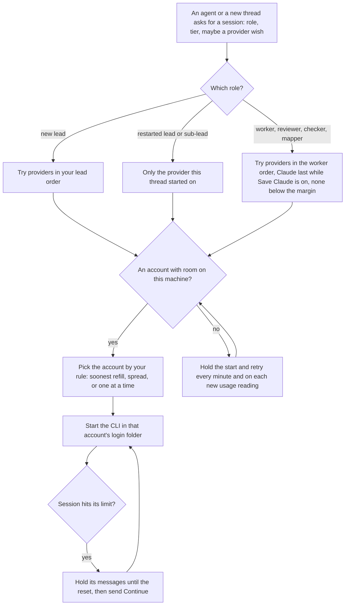

# Accounts, usage and balancing

**Idea:** `IDEA.md` — what this is for and why, in plain language. Read it first; it is
the north star this plan serves. Goal and Constraints live there, not here, so they don't
get buried as this file grows. **Map:** `MAP.md`.

## Open Questions

(none)

## Watch List

| # | Noticed | What needs looking into | Raised to user? | Outcome |
|---|---------|-------------------------|-----------------|---------|
| W1 | MAP.md | A fresh login folder lacks the user's CLAUDE.md/AGENTS.md, trust records and may show first-run screens that break the ready test | no | Settled in Spec: folder seeded with links; the service already answers Claude's trust prompt (`service.js:340-353`); first-run screens are a validation step |
| W2 | MAP.md | Style preview, Codex preflight and `model.sh` cache all read the service's own login | no | D11 |

## Decision Log

Append-only. A reversal is a new entry superseding the old, never an edit.

| # | Decision | Rationale | Source |
|---|----------|-----------|--------|
| D1 | Defaults: within a provider, soonest refill first; notify below 25% once per provider per week; leave 10% per account; Claude margin 5% | The proposal's own numbers | defaulted |
| D2 | Build several accounts, usage and balancing for Claude and Codex only. Google, OpenRouter and pay-as-you-go keys move to Not doing; the adapter is shaped so each new CLI is one later thread | Gemini CLI no longer serves Google subscriptions; a third CLI touches ~40 places; most value is on the two CLIs in use | idea-change |
| D3 | The hub picks provider and account for every session. Agents ask for role and tier only; a reviewer or verifier may ask for "not the same provider as <session or provider>", which the hub honours. `--cli` stops being a choice | Provider order, Save Claude for leads and the margin only hold if agents can't route around them | user |
| D4 | Leads and sub-leads run on Claude (the Claude lead model) while any Claude account has room; when none has, on GPT's lead model instead of waiting. The Leads panel keeps both models; the thread CLI picker goes away | Never stall a new thread; Claude stays the first choice | user |
| D5 | The hub owns the account list (id, provider, name, plan, nodes). Each account's login folder is at a fixed path on every machine, `~/.wheelchair/accounts/<id>/`, sent in the start request; each machine service reports per-account login state in `/v1/status`. Today's default login becomes an account called "default" pointing at the CLI's usual folder, so nothing changes until a second account is added | Settings already live on the hub; a fixed path makes the folder a node fact without a per-node list | defaulted |
| D6 | Supersedes D4. The Leads panel gets a provider order for new leads, set by Collin (e.g. "Claude > GPT", or "Claude, then whatever's left"). A thread keeps the provider its lead started on: a running lead never switches, and a restarted lead or a sub-lead in that thread waits for that provider to have room | Collin: switching mid-feature is worse than waiting; the order applies only to new leads | user |
| D7 | Signing in: Sign in on a machine starts a login session in tmux on that machine running the CLI's own login (`claude auth login` / `codex login --device-auth`) with the account's folder set; the app opens its terminal page on it; the account turns green when that machine reports it logged in | Works from the phone with pages that already exist | user |
| D8 | Refines D7: Sign in shows a sign-in card, not the terminal. Claude: an "Open sign-in link" button (the OAuth URL read from the login session's output) and a box to paste the code back, which the app types into the session. Codex: a link to auth.openai.com/codex/device and the device code with a copy button. The terminal page stays as a fallback link | Collin: maximum convenience, a link and a code, nothing else | user |
| D9 | Usage comes only from running sessions: Codex's `rate_limits` in its rollout transcript, Claude's `rate_limits` via a status-line command the service writes into each session's settings file. Each reading is stored per account with its time; idle accounts show their last reading "as of …"; an account never read shows "no reading yet" and the balancer treats it as full | Official, free, no terms risk; current whenever work runs | user |
| D10 | The provider bar weights each account by its plan size: Claude Pro 1, Max 5x 5, Max 20x 20; ChatGPT Plus 1, Pro 6 (Codex plan names map by `plan_type`); Collin can override an account's weight | Answers the proposal's open question with the published multipliers; overridable | defaulted |
| D11 | The style preview and `model.sh`'s Codex cache keep using the `default` account; the Codex preflight runs against the chosen account's folder at session start | Only the preflight protects a session's login; the others are account-independent | defaulted |
| D12 | "Notify below 25%" is shown in the app (an amber line on the Usage bar and a dot on Settings in the nav), not a phone push: the app has no push path today (no notification code in `viewer/app/`) | Push notifications are their own feature | defaulted |
| D13 | Several Claude and ChatGPT accounts are allowed; adding a second Claude account shows a one-line warning about Anthropic's consumer terms before it saves | Collin's accounts, Collin's risk; the warning keeps it visible | user |
| D14 | A start with no provider that has room is held by the hub as a `waiting` session and started when room appears; a running session that hits its limit is never moved: the hub marks its account full until the reset and queues "Continue." to it once the reset passes | Agents have no timer; Collin's "we'll just wait" (D6) needs something to do the waiting | defaulted |
| D15 | Workers and other agents follow a worker order set in Settings, default GPT then Claude; Save Claude for leads defaults on | The proposal's order with the two providers in scope; editable like the lead order | defaulted |
| D16 | Supersedes D3's "not the same provider as X": worker, reviewer and verifier starts may pass `--provider 
` or `--not-provider 
`; lead, sub-lead and mapper may not. Keeps today's routing (UI work to Claude, sub-lead.md:66-69; intent reviewer on Claude, lead.md:173; verifier opposite the builders, sub-lead.md:144-145) under the balancer | Round 1 found `--not-same-as` put both reviewers on GPT and couldn't express "opposite all builders"; dropping `--cli` would silently remove the UI-to-Claude rule | review-round-1 |

## Spec

Read `MAP.md` first: it traces a session from start to transcript with every pointer used
below. Decision numbers (D1…) refer to the Decision Log.

How a session start is placed (redundant with §5):

### Scope
- Providers: **Claude** (Claude Code CLI, `cli: claude`) and **GPT** (Codex CLI,
  `cli: codex`), any number of subscription accounts each (D2, D13).
- In: the provider adapter, accounts and login folders, sign-in from the app, usage
  readings, the balancer, the Accounts and Usage settings panels, the lead and worker
  orders, Save Claude for leads, the margin, waiting.
- Non-goals: Google, OpenRouter or any third CLI; pay-as-you-go keys and dollar caps; rules
  by kind of work (UI prefers Claude, Critical cross-checks, suggested rules); asides;
  phone push notifications (D12); polling undocumented usage endpoints (D9); moving a
  running session to another account or provider (D6, D14); deleting login folders from
  disk.

### 1. The provider adapter
One module per CLI on each side. A later CLI is added by writing one machine adapter, one
hub entry (with its transcript parser), and its `model.sh` provider row; the protocol
text, installer and `seen/` are not adapter-driven. Every `cli === 'claude'` / codex branch listed in MAP.md "Every
place that assumes…" under the hub, machine service and hooks moves behind these, except
the protocol text, the installer, `seen/` and `codex/model.sh`'s grammar (which keeps
`claude|gpt` as provider names).

**Machine side** — `machine/adapters/claude.js`, `machine/adapters/codex.js`, registry
`machine/adapters/index.js` keyed by `cli`. Each exports:

| Member | What it does | Today at |
|---|---|---|
| `provider` | `'claude'` or `'gpt'` | `viewer/app/sessions.js:29` |
| `loginEnv(dir)` | `{CLAUDE_CONFIG_DIR: dir}` / `{CODEX_HOME: dir}`; `{}` when `dir` is null (the default account) | new |
| `command(input, session, worktree)` | `{argv, settingsPath?, settings?}`; Claude's settings file also carries `statusLine` (§4) | `machine/service.js:266-290` |
| `firstMessage(input, rolePrompt)` | the text typed once ready | `service.js:311-315` |
| `readyText(session, pane)`, `answerPrompts(session, pane)` | ready test and the prompts the service answers itself | `service.js:326-353`, `386` |
| `findTranscript(session, dir)` | locate the session's transcript under the account's folder, or the CLI's usual folder for `default` | `service.js:538-541`, `607-613`, `622-638` |
| `hookEvent(raw)` | translate a hook payload to `{type: 'turn-ended' \| 'prompt' \| 'limit-hit', …}` or null | `machine/lib/hook-post.js:16-24` |
| `usageFrom(source)` | extract a usage reading (§4) from a transcript line or status-line payload, or null | new |
| `loginCommand(dir)` | argv for the CLI's own login: `claude auth login` / `codex login --device-auth` | new |
| `parseLogin(pane)` | `{url, code, wantsCode}` or null from the login session's screen | new |
| `loginStatus(dir)` | `{logged_in: boolean}`: Claude `claude auth status` with `loginEnv(dir)` (`service.js:709-712`); Codex `codex login status` with `loginEnv(dir)` | `service.js:703-714` |
| `seed(dir)` | prepare a fresh folder (§2) | new |

`machine/hook.sh` keeps one line per CLI to read its payload (stdin for Claude, last argv
for Codex, `hook.sh:16-28`) and hands it to `hook-post.js`, which calls the adapter's
`hookEvent`. Session recovery that guesses the CLI from pane text (`service.js:172`) reads
the persisted `session.cli` instead when present.

**Hub side** — `viewer/app/providers.js`: `{claude: {cli: 'claude', label: 'Claude'}, gpt:
{cli: 'codex', label: 'GPT'}}` plus `providerOf(cli)` and `cliOf(provider)`, used by
`sessions.js`, `ready.js`, `threads.js` and `routes.js:52-55`. `viewer/app/chat.js:90-218`
picks its transcript parser from a map keyed by `cli` instead of "Claude or else Codex",
and an unknown `cli` renders no messages with a one-line notice instead of being parsed as
Codex.

### 2. Accounts and login folders (D5)
- Hub `settings.json` gains `accounts: [{id, provider, name, plan, weight, paused}]`.
  `id` is `default-claude`, `default-gpt` for the built-ins, else a short slug generated
  on add (`[a-z0-9-]`, unique). Add `accounts` and the balancing keys (§5) to
  `defaults()` and `normalize()` in `viewer/app/settings.js` (unknown keys are dropped at
  `settings.js:150-161`). Normalize always keeps exactly one `default-<provider>` per
  provider; it can be renamed or paused, not removed.
- `plan` is one of `pro | max5 | max20` (Claude) or `plus | pro` (GPT) or `unknown`.
  `weight` defaults from plan (D10): Claude pro 1, max5 5, max20 20; GPT plus 1, pro 6;
  unknown 1. A reading's Codex `plan_type` is shown beside the chosen plan when they
  differ; it never overwrites Collin's choice.
- Folder on each machine: `default-*` → the CLI's usual folder (no env var set, behaviour
  exactly as today). Any other account → `~/.wheelchair/accounts/<id>/` in the machine
  service user's home. The hub sends `account: {id, dir}` in the start request, `dir: null`
  for a default. The service never deletes an account folder.
- `seed(dir)` on first use of a non-default folder: create it mode 0700; symlink the user's
  `CLAUDE.md` (Claude) or `AGENTS.md` (Codex) from the usual folder if it exists; for Codex
  write `config.toml` containing `cli_auth_credentials_store = "file"` if absent.
- The service sets `loginEnv(dir)` in the `env` prefix (`service.js:307`) and finds the
  transcript with `findTranscript(session, dir)`. These two ship in the same task: either
  alone leaves the thread chat empty (MAP.md "Accounts").
- Session records (hub `threads/<id>.json` and the service's) gain `account` (the id).
- `/v1/status` gains `accounts: [{id, cli, logged_in}]`: the two defaults always, plus each
  folder under `~/.wheelchair/accounts/` (the folder name is the id; the CLI is stored in a
  `wheelchair-account.json` written at seed time). The existing per-CLI `logged_in` stays,
  meaning "the default account is logged in".
- **Ready check** (`viewer/app/ready.js:26-54`): a provider is ready on a machine when at
  least one of its unpaused accounts reports `logged_in` there. The missing-items text names
  the provider, not an account.
- **Account removed** in Settings: dropped from the list and from balancing; running
  sessions on it continue; its folder stays on disk.
- **Second Claude account warning** (D13): saving an add that would make two or more Claude
  accounts first shows, once per add: "Anthropic's terms say plan limits assume ordinary,
  individual use. Several Claude accounts behind one setup may get flagged." with Add anyway
  / Cancel.

### 3. Signing in (D7, D8)
- Accounts panel, per account and per known machine (`machines.json`,
  `viewer/app/state.js:146-149`): state signed in / signed out / unknown (machine
  unreachable), and **Sign in** when not signed in.
- Sign in → hub `POST /accounts/:id/signin {machine}` → service `POST /v1/logins {account,
  cli, dir}`: seeds the folder, starts tmux session `wc-login-<id>` (replacing an existing
  one of that name) running `loginCommand(dir)` with `loginEnv(dir)`. The service exposes
  `GET /v1/logins/:id` → `{state: 'starting'|'waiting'|'done'|'failed', url, code,
  wantsCode, logged_in}` built from `parseLogin(pane)` and, after the CLI exits,
  `loginStatus(dir)`; and `POST /v1/logins/:id/code {code}`, which types the code and Enter.
  The hub proxies both at `GET /accounts/:id/signin/:machine` and `POST
  /accounts/:id/signin/:machine/code`.
- The sign-in card polls every 2 s. Claude: "Open sign-in link" button (opens `url` in a new
  tab) and a paste box shown while `wantsCode`. Codex: a link to `url` (normally
  `https://auth.openai.com/codex/device`) and `code` with a copy button. On `done` with
  `logged_in` true the card turns green and closes after 2 s. On `failed`, or no `url`
  within 30 s, it says "Couldn't read the sign-in screen" and shows **Open terminal**.
- **Open terminal** is always available as a small link. The terminal page
  (`viewer/pages/terminal.js:7`) today addresses thread sessions under
  `/wheelchair/api/sessions/<name>`; extend it to accept a login session (`?login=<id>&machine=<m>`)
  backed by pane and keys proxies for `wc-login-<id>`. Login sessions are not thread
  sessions and never appear on the Sessions page.

### 4. Usage readings (D9)
- A **reading** is `{account, machine, at, five_hour: {used, resets_at} | null, week:
  {used, resets_at} | null, plan_type?, limited_until?}`, `used` in percent 0–100,
  times in ISO.
- **Codex:** each rollout line with `payload.rate_limits` (event `token_count`) gives a
  reading. Map by `window_minutes`: 300 → `five_hour`, 10080 → `week`, from `primary` and
  `secondary` whichever carries it; `resets_at` is Unix seconds. `rate_limit_reached_type`
  non-null → `limited_until` by the **exhausted-window rule** below. The service already
  locates and copies the rollout (`service.js:502-526`, `622-638`); it scans new lines on
  each turn end.
- **Claude:** the per-session settings file gets `statusLine: {type: 'command', command:
  "<root>/machine/statusline.sh claude <session name>"}`. The script reads the status-line
  JSON from stdin, prints one short line (model and 5-hour percent) and posts
  `rate_limits.five_hour|seven_day {used_percentage, resets_at}` to the service like
  `hook-post.js` does (same spool fallback), at most once a minute per session. The
  hook list gains `StopFailure` (which Claude fires instead of `Stop` when a turn fails);
  `hookEvent` maps a payload with `error === 'rate_limit'` (also accept `error_type`, for
  older builds) to `limit-hit`, with `limited_until` by the exhausted-window rule. Any other
  `StopFailure` maps to a new `turn-failed` event: the hub sets `turn_ended = true` (so the
  queue can deliver) but does **not** run the report path (`sessions.js:165-177`), so a
  reviewer's or verifier's partial text is never delivered as its result and `finished` stays
  unset. It queues `[wc:from app] your session <name>'s turn failed: <error>` to the session's
  starter, which decides whether to restart it. A lead has no starter: the app posts its own
  `needs` card on the thread instead, posted the way `pollDead` posts one for a lead that
  ended (`sessions.js:392-400`) but with its own text: title "The lead's turn failed",
  body "<error>. The lead is still running: reply in the thread to have it try again."
  It never suggests Restart (the lead is live). The hub marks that card answered (as
  `threads.js:134-136` does for "Sessions ended") when that lead's next `turn-ended`
  arrives, or when a restart replaces the lead.
- **Exhausted-window rule** (both CLIs), from the session's latest reading: the
  **earliest** `resets_at` among windows with `used >= 95`; none that high → the earliest
  `resets_at` present; none at all → now + 1 h. Readings lag (Claude's at most once a
  minute), so this may release a session whose other window is still full: it then hits
  the limit again, a fresh reading arrives, and the rule picks the next reset. One failed
  retry is cheaper than holding an account until the weekly refill after a 5-hour limit.
- The service forwards readings to the hub (`POST` to the hub like turn events). The hub
  keeps the latest reading per account in `usage.json` in its state dir (one writer queue,
  as `State.updateSettings`, `state.js:176-194`).
- **Expired window**: once a window's `resets_at` is past, that window counts as `used 0`
  with `resets_at` unknown (null) until a new reading arrives. Everywhere a reset time is
  used (soonest sort, the first refill, elapsed time, the margin), only future `resets_at`
  values count; an account whose week reset is unknown sorts with the no-reading accounts.
  Forecast: `R` is the earliest future week reset; no future reset → no amber and the
  margin test passes.
- An account with no reading shows "no reading yet" and counts as having room (§5).

### 5. The balancer
One function, `viewer/app/balancer.js` `choose(hub, thread, role, tier, constraints)` →
`{provider, account, note?}` or `{wait: {until, reason}}`, called by `startSession`
(`sessions.js:72`) before `resolveModel`; `input.cli` is replaced by `cliOf(provider)`. The
slot is resolved from role and tier first (the logic at `sessions.js:20-27`, which does not
depend on provider), and a provider whose cell is Not used at that slot (`model.sh` exit 3)
is ineligible.

**Settings** (hub `settings.json`, edited on the Usage panel unless noted):
- `lead_order`: ordered providers, optionally ending in `any` ("then whatever's left").
  Default `['claude', 'any']`. Edited on the Leads panel next to each provider's lead model
  (`viewer/pages/settings.js:265-270`) (D6).
- `worker_order`: ordered providers. Default `['gpt', 'claude']` (D15).
- `within`: `soonest | spread | one` (default `soonest`).
- `leave`: percent left for Collin per account, default 10. `notify_below`: default 25.
- `save_claude_for_leads`: default true. `margin`: default 5.

**Room.** An account has room when: not paused; logged in on the thread's machine; no
`limited_until` in the future; and for each window with a reading, `used < 100 − leave`.
No reading → room.

**Within a provider** (`within`):
- `soonest`: the account with room whose `week.resets_at` is earliest (no reading sorts
  last); ties by most room left.
- `spread`: the account with the most weekly room left (weight-normalised), ties by fewest
  live sessions.
- `one`: the account most recently chosen while it still has room, else `soonest`.

**By role:**
- **Lead, new thread** (no `thread.provider` yet): first provider in `lead_order` with an
  account that has room; `any` means every provider not yet listed, in `worker_order`
  order. Record `thread.provider`. None → wait.
- **Lead restart and sub-lead:** `thread.provider` only, any of its accounts. None → wait
  (D6). Threads created before this change: `thread.provider = providerOf(thread.cli)`.
- **Worker, mapper, reviewer, verifier:** `worker_order`, skipping providers excluded by
  constraints, by Not used at the resolved slot (`model.sh` exit 3, `sessions.js:36`), and
  by Save Claude/margin below. None → wait.
- **Eligible** providers for a start: in the order, not excluded by a constraint, not Not
  used at the slot, with at least one account logged in on the machine.
- **Save Claude for leads** on: Claude is tried for these roles only after every other
  eligible provider has no room, whatever its position.
- **Margin:** for these roles Claude is skipped entirely when its forecast (below) puts the
  provider's combined week below `margin` percent at the earliest account's reset. Leads
  ignore the margin.
- **Constraints** from `wc.js` (D16), accepted only for worker, reviewer and verifier
  starts (400 for lead, sub-lead, mapper):
  - `--provider <claude|gpt>`: counts as "a rule asks for Claude", so Save Claude for leads
    does not skip it.
    - **Worker**: strict. No room, or no logged-in account on the machine → wait (today's
      "a family that is not logged in holds back only its own tasks"). The one exception:
      Claude below the margin → the hub ignores the constraint, picks normally, and says so
      in the start response's `note`.
    - **Reviewer, verifier**: a preference. If the provider has no room, is below the margin,
      or has no logged-in account → picked normally, with a `note`.
  - `--not-provider <claude|gpt>`: never that provider.
    - **Worker**: strict; no eligible provider left → wait.
    - **Reviewer, verifier**: a preference, like `--provider`. If excluding it leaves no
      eligible provider with room (none logged in, none with room, or only Claude and Claude
      below the margin) → picked normally, with a `note` (today's "one family: use it for
      both"). These roles wait only when no provider at all has room.
  - The two are mutually exclusive (400 if both).

**Waiting** (D14):
- A start that must wait creates the session record with `status: 'waiting', live: true,
  waiting_until, waiting_reason` and `pending_start`: the complete `startSession` input
  (role, tier, brief, constraints, started_by, attempt_id, worktree, branch, base,
  verify_ref, replaces) saved in the thread file, so a hub restart loses nothing. It returns
  the record instead of failing; `wc.js` prints "waiting for room until <time>". A repeat
  start with the same `attempt_id` returns the same waiting record.
- The hub re-runs `choose` for every waiting session every 60 s (alongside `pollDead`) and on
  every new reading, oldest first. On success it **promotes the same record**: `startSession`
  gains a path that takes the existing waiting session and keeps its `name`, `token`,
  `attempt_id`, `started_by` and `queue` (messages queued while it waited stay queued), sets
  `status: 'starting'`, `cli` and `account`, makes the machine call from `pending_start`, then
  deletes `pending_start`, `waiting_until` and `waiting_reason`. No second record is created.
  Threads are scanned at hub startup.
- `pollDead` (`sessions.js:370-395`) skips sessions with `status: 'waiting'`: they have no
  machine session yet. `stopSession` (`sessions.js:358-366`) on a waiting session skips the
  machine call and marks it `stopped`.
- **Lead waiting line** on the thread page: one line at the top of the thread, above the
  pinned cards (the Ready block at `viewer/pages/thread.js:456-466` lives inside the approval
  card, so it is not a home for this), drawn from the live lead's session record in the
  thread state: `status: 'waiting'` → "Waiting for <provider> to refill, about
  <waiting_until>"; a running lead with a future `limited_until` → "Waiting for <account
  name> to refill, about <limited_until>" (it is tied to its account). Hidden otherwise.

**A running session that hits its limit** (`limit-hit`, or a Codex reading with
`limited_until`): the hub stores `limited_until` on the account's reading and on the
session, and sets `turn_ended = true` (the turn is over). The account has no room until
then. `canDeliver` (`sessions.js:216-218`) also requires the session's `limited_until` to be
absent or past, so ordinary queued messages are held too. When `limited_until` passes (the
60 s timer) and the session is still live, the hub puts `Continue.` at the front of its queue,
clears `limited_until` and delivers. It is never moved.

**Forecast** (per provider, for the bar, the amber line and the margin), all in fractions
of the provider's combined weekly capacity, over unpaused accounts:
- `C = Σ weight × 100`; `U = Σ weight × week.used` (no reading → used 0).
- Left `L = (C − U) / C`. Used so far `F = U / C`.
- Elapsed `h` = hours since the earliest window start among accounts with a reading
  (`resets_at − 7 d`); pace `P = F / h` per hour.
- Runs out at = now + `L / P` hours. Amber when that is before the earliest `week.resets_at`
  `R`. `P = 0` or no readings → never amber.
- Margin test: Claude is below the margin when `L − P × hours(now → R) < margin / 100`.
- Check: one weight-1 account at 50% after 84 h → `L = 0.5`, `P = 0.5/84`, runs out in 84 h.
- Every account paused (`C = 0`): the bar shows "All accounts paused", no amber, no notify;
  the balancer finds no room there.

### 6. Settings panels
`viewer/pages/settings.js`: add `accounts` and `usage` to `SECTIONS` (`:8`), first and
second, a branch each in `renderPanel` (`:682-688`). Match the mocks
`docs/proposals/app-shell/design/SettingsAccounts.dc.html` and `SettingsUsage.dc.html`, minus
anything for out-of-scope providers or pay-as-you-go.

**Accounts** — grouped by provider. Each account card: name, plan (and weight), per machine
signed in / out / unknown with Sign in, this 5-hour window and this week (used, reset,
"as of …"), "in use · N agents" (live sessions with that `account`), Pause/Resume, Rename,
Change plan, Remove (not on defaults). **Add account**: provider → name → plan → saved
(warning per §2) → offers Sign in on each machine.

**Usage and balancing** — one bar per provider: combined week left (§5), amber with one line
when the forecast runs out before the first refill ("runs out Sunday night, before the first
refill Monday 14:00"), and a line when below `notify_below`. Tapping a provider opens a table
of its accounts: 5-hour used and reset, week used, full reset, which is next and why ("next:
refills soonest", "skipped: paused", "skipped: signed out on beelink", "skipped: limit until
14:00"). Below: the balancing settings of §5 except `lead_order`.

**Nav dot** (D12): Settings in the app nav shows a dot while any provider is amber or below
`notify_below`; it clears when Collin opens the Usage panel, and reappears only for a
provider newly crossing in a later week.

**Live data**: the page fetches `GET /usage` on opening the Accounts or Usage panel and every
30 s while one is shown (the page has no timer today, `:699-708`).

### 7. Hub routes
Added to `viewer/app/routes.js` and documented in `viewer/app/API.md`:
- `GET /settings` also returns `accounts` and the §5 keys.
- `POST /settings/accounts {provider, name, plan}` → the account; `PUT
  /settings/accounts/:id {name?, plan?, weight?, paused?}`; `DELETE /settings/accounts/:id`
  (400 for a default).
- `PUT /settings/balancing {lead_order?, worker_order?, within?, leave?, notify_below?,
  save_claude_for_leads?, margin?}` with validation (orders contain only known providers and
  `any` only last in `lead_order`; percents 0–100).
- `GET /usage` → per provider `{left, amber, runs_out_at, first_refill, below_notify,
  accounts: [{id, name, plan, weight, paused, machines: {<m>: signed_in|signed_out|unknown},
  reading, next, reason, live_sessions}]}`.
- Sign-in routes of §3.
- The agent start path carries `provider` and `not_provider` end to end: `wc.js` →
  service `/v1/agent/session` → hub `/machine/session` (`routes.js:156-157`) →
  `sessionRequest`, which copies them into the `startSession` input next to
  `tier` (`sessions.js:328-345`). `cli` is ignored if sent, so old briefs still work.

### 8. Thread creation and wc.js
- New-thread form: the CLI picker is removed; `threads.js:44-47` no longer requires `cli`;
  the lead's provider comes from §5 and is stored as `thread.provider`, and `thread.cli` is
  set from it for code that still reads it. Stubs inherit nothing (`threads.js:75`): a stub's
  lead is a new lead.
- `wc.js session start`: `--cli` optional and ignored with a one-line stderr notice; adds
  `--provider` and `--not-provider` (§5). `session list` shows each session's provider and
  account, so the lead and sub-lead can see which provider built what.

### 9. Protocol text
- `protocol/app/lead.md` (start command at `:47`, reviewers and verifier at `:73-76`, review
  at `:171-173`): the start command loses `--cli`. Plan reviewers: the intent-lens reviewer
  with `--provider claude` (a preference: it moves to GPT rather than wait), the
  mechanics-lens reviewer with `--not-provider <the provider the intent reviewer got>` (from
  the first start's output), so the two land on two providers whenever both have room. If
  the intent reviewer's start came back `waiting` (no provider has room at all), start the
  mechanics reviewer with no provider flag. A small-fix verifier, and an after-done
  fix verifier: `--not-provider <provider the lead runs on>` (from `session list`). The
  sentences about `command -v` and "with one family installed, use it for both" are replaced
  by: the hub drops a constraint it cannot meet and says so in the start output's note.
- `protocol/app/sub-lead.md`: the start command (`:73`) loses `--cli`. "Which family"
  (`:66-69`) becomes: interface, frontend and other taste-sensitive work is started with
  `--provider claude`; the hub holds it until Claude has room (including while Claude is
  signed out on that machine), and sends it elsewhere only when Claude is below its margin. Other work passes no provider flag. Verifier (`:144-145`):
  if every builder ran on one provider, one verifier with `--not-provider <that provider>`;
  if both providers built, one verifier per provider with `--provider claude` and
  `--provider gpt`; if the first start's output has a `note` saying its provider was not
  honoured, start no second verifier; if the second's output has such a note (it landed on
  the first's provider), stop the second at once.
- `lead.md` (in "Restarting what died") and `sub-lead.md` (beside its restart rule at
  `:93-97`), new short rule: on
  `[wc:from app] your session <name>'s turn failed: <error>`, the session is still live. Send
  it a `message` asking it to carry on (the usual fix); only if it fails again, `session stop`
  it, then replace it by that role's existing restart rule: a worker with `--replaces
  <name>` and a new `--attempt` (so it keeps its branch; a stopped worker is not live, so
  `sessions.js:341-344` accepts it), a sub-lead resumed from Implementation Tasks, a
  reviewer, verifier or mapper started fresh. Never start a replacement while the failed one
  is live.
- `sub-lead.md` remediation (`:152-153`, "Route to the same family that built the work"):
  remediation workers start with `--provider <the provider that built the task>`, read
  from `session list`.
- `lead.md:89` "Collin picks the project, the CLI and the machine" → "the project and the
  machine".
- `protocol/app/cards.md`: no change.

### Edge cases
- Only the default accounts exist → every start lands on today's folders; behaviour matches
  today apart from the provider being chosen by the order (with defaults: leads Claude,
  others GPT then Claude).
- Machine unreachable → its accounts show unknown and do not count as logged in there.
- A Codex account whose login expired → the session-start preflight (`sessions.js:75-86`)
  runs with that account's folder (D11); failure marks that account signed out on that
  machine and the balancer tries the next account once before failing.
- The style preview and `model.sh`'s Codex cache keep using the default accounts (D11).
- Two machines, account signed in on only one → only threads on that machine can use it.
- Clock skew between machines is ignored; `resets_at` values come from the providers.

### Validation
- `bash machine/test/run.sh` — add: start with `account.dir` sets the right env var in the
  tmux command; transcript found under the account folder for both CLIs; default account
  sets no env var; `/v1/status` lists account folders; login session start, `parseLogin` on
  captured sample screens for both CLIs, code typing; Codex `usageFrom` on a rollout line
  with `rate_limits`; Claude status-line script posting a reading; `StopFailure` →
  `limit-hit`.
- `node --test viewer/test/*.test.js` — add a table-driven balancer test: soonest / spread /
  one; leave share; paused and signed-out accounts; Save Claude for leads; margin skips
  workers but not leads; lead order with `any`; restart pinned to `thread.provider`; waiting
  and resuming on a new reading; `--provider` strict for workers (wait) and preferred for
  reviewers and verifiers (fallback with `note`); `--not-provider` and its one-provider
  fallback; 400 for either flag on lead, sub-lead or mapper and for both together;
  exhausted-window rule including a 5-hour limit with a stale reading; forecast and
  amber; settings normalize keeps one default per provider and drops nothing new; routes'
  validation.
- `npm --prefix viewer run test:browser` — add: Accounts panel renders accounts and the sign-in
  card (link, paste box, Codex code) against a fake service; Usage panel renders bars, amber
  line and the account table; second-Claude warning; CLI picker gone from the new-thread form; the lead waiting line for a
  waiting lead and for a limited lead, and hidden otherwise.
- `bash codex/test/run.sh`, `bash install/test/run.sh`, `bash sensitivity/test/run.sh`,
  `bash seen/test/run.sh` still pass.
- Never start a viewer by hand (AGENTS.md "Verification"); use the suites' helpers.

## Accepted Risks

| Risk | Why accepted | Round |
|------|--------------|-------|

## Review Rounds

### Round 1 — 2026-11-15

**Lanes:** Claude (intent lens); Codex (mechanics lens); cross-family: yes.

**Changed since Round N-1:** n/a (first round — whole Spec in scope)

| Lane | Reported | Finding | Lead verdict | Resolution |
|------|----------|---------|--------------|------------|
| intent (Claude) | blocking | `--not-same-as <lead>` puts both reviewers on GPT under default orders; intent-to-Claude rule lost | upheld | D16: `--provider claude` / `--not-provider claude`; §9 rewritten |
| intent (Claude) | major | Sub-lead verifier's exclusion names the wrong session and can't express "opposite all builders / one per family" | upheld | D16; §9 verifier rule |
| intent (Claude) | major | Dropping `--cli` silently removes sub-lead.md:66-69 UI-to-Claude routing; Spec doesn't say what happens to that text | upheld | D16 keeps it via `--provider claude`; §9 rewrites :66-69 |
| intent (Claude) | minor | "Two files and one registry entry" overstates; chat parser and model.sh also change | upheld | §1 wording corrected |
| mechanics (Codex) | blocking | StopFailure carries `error: "rate_limit"`, not `error_type` | upheld | §4 checks `error`, accepts `error_type` too |
| mechanics (Codex) | blocking | Forecast mixes fraction and percentage-point units | upheld | §5 forecast rewritten in fractions, with a worked check |
| mechanics (Codex) | blocking | Queue can't resume a limited session (`turn_ended` never set; no hold) | upheld | §5: set `turn_ended`, `canDeliver` holds on `limited_until`, `Continue.` at front on release |
| mechanics (Codex) | major | Waiting sessions vs `pollDead` and `stopSession` | upheld | §5 Waiting: poll skip, hub-only stop |
| mechanics (Codex) | major | Deferred start inputs not stored durably | upheld | `pending_start` in the thread file; scanned at startup |
| mechanics (Codex) | major | `choose` has no tier, can't skip Not used | upheld | tier passed; slot resolved first |
| mechanics (Codex) | major | Constraints must flow via `/v1/agent/session` → `/machine/session`, not `POST /sessions` | upheld | §7 names the real path |
| mechanics (Codex) | major | Save Claude ignores exclusions and Not used | upheld | "eligible providers" defined in §5 |
| mechanics (Codex) | major | No rule for which window's reset applies, or missing resets | upheld | §4 exhausted-window rule |

### Round 2 — 2026-11-15

**Lanes:** Claude (intent lens); Codex (mechanics lens); cross-family: yes.

**Changed since Round 1:**
- D16: `--provider` / `--not-provider` replace `--not-same-as`; allowed for worker, reviewer, verifier only (§5 Constraints, §7, §8).
- §9 rewritten: lead.md reviewer and verifier flags; sub-lead.md "Which family" and verifier rule.
- §1: what a later CLI needs, corrected.
- §4: `StopFailure` reads `error`; the exhausted-window rule.
- §5: `choose` takes the tier; "eligible providers"; Save Claude over eligible providers; Waiting with `pending_start`, poll and stop handling; limit hold in `canDeliver` and release; forecast rewritten in fractions.
- §7: constraint path through `/v1/agent/session` → `/machine/session` → `sessionRequest`.

| Lane | Reported | Finding | Lead verdict | Resolution |
|------|----------|---------|--------------|------------|
| intent (Claude) | major | Exhausted-window fallback to the latest reset holds an account until the weekly refill after a 5-hour limit | upheld | §4: earliest reset at ≥95%, accept one failed retry |
| intent (Claude) | minor | §9 UI text vs §5 rerouting when Claude signed out | upheld | Worker `--provider` strict incl. signed out; §9 matches |
| intent (Claude) | minor | Intent reviewer `--provider claude` waits while GPT has room | upheld | `--provider` is a preference for reviewers and verifiers |
| intent (Claude) | minor | Both-built verifier pair under margin gives two GPT verifiers | upheld | §9: no second verifier when the first's provider wasn't honoured |
| intent (Claude) | minor | Validation still names `--not-same-as` | upheld | Validation updated |
| intent (Claude) | minor | D16 sits above D15 | upheld | Row moved below D15, content unchanged |
| mechanics (Codex) | blocking | Promoting a waiting session through the normal start creates a second record and loses its queue | upheld | §5: promote the same record, keep name, token, attempt, queue |
| mechanics (Codex) | major | Non-limit `StopFailure` as `turn-ended` delivers partial text as a reviewer's or verifier's result | upheld | §4: `turn-failed` skips the report path, tells the starter |
| mechanics (Codex) | minor | Forecast is 0/0 when every account is paused | upheld | §5: "All accounts paused", no amber |

### Round 3 — 2026-11-15

**Lanes:** Claude (intent lens); Codex (mechanics lens); cross-family: yes.

**Changed since Round 2:**
- §4: exhausted-window rule now the earliest reset at ≥95%, accepting one failed retry; non-limit `StopFailure` → `turn-failed`.
- §5: `--provider` strict for workers (waits, including signed out) and a preference for reviewers and verifiers; waiting sessions promoted in place; all-paused forecast.
- §9: intent reviewer preference, mechanics reviewer `--not-provider` the intent reviewer's provider; no second verifier when the first's provider wasn't honoured.
- Validation updated for the flags and the window rule.

| Lane | Reported | Finding | Lead verdict | Resolution |
|------|----------|---------|--------------|------------|
| intent (Claude) | major | `--not-provider` for reviewers and verifiers waits when the only other provider has no room or is below margin | upheld | §5: a preference for these roles; they wait only when no provider has room |
| intent (Claude) | minor | Mechanics reviewer has no provider to exclude when the intent reviewer is waiting | upheld | §9: start it with no flag |
| intent (Claude) | minor | Lead's `turn-failed` has no starter to tell | upheld | §4: app `needs` card, as `pollDead` does |
| mechanics (Codex) | major | Lead `turn-failed` has no starter; enqueue to null throws | upheld | Same as the intent finding above: app `needs` card |
| mechanics (Codex) | major | Expired windows keep past reset times in sorting, forecast and margin | upheld | §4 expired-window rule: only future resets count |
| mechanics (Codex) | minor (RE-RAISE) | Second verifier can fall back onto the first's provider | upheld | §9: stop the second when its output has a note |

Three rounds since Collin's last decision without a clean one: escalated to him with a `needs` card (lead.md step 5, Budget).

Collin chose "keep going" (2026-11-15); the round budget resets.

### Round 4 — 2026-11-15

**Lanes:** Claude (intent lens); Codex (mechanics lens); cross-family: yes.

**Changed since Round 3:**
- §5 Constraints: `--not-provider` is a preference for reviewers and verifiers, strict for workers.
- §9: mechanics reviewer with no flag when the intent reviewer is waiting; stop a second verifier that landed on the first's provider.
- §4: a lead's `turn-failed` posts an app `needs` card.
- §4/§5: expired-window rule (only future resets count; forecast and margin with no future reset).

| Lane | Reported | Finding | Lead verdict | Resolution |
|------|----------|---------|--------------|------------|
| intent (Claude) | major | Starters have no rule for "turn failed" on a live session; restarting breaks | upheld | §9: message it to carry on; stop before any replacement |
| intent (Claude) | minor | Lead's turn-failed card could copy pollDead's "Restart" text | upheld | §4: own text, "reply in the thread" |
| mechanics (Codex) | major | Lead's turn-failed `needs` card never closes | upheld | §4: answered on the lead's next `turn-ended` or a restart |

### Round 5 — 2026-11-15

**Lanes:** Claude (intent lens); Codex (mechanics lens); cross-family: yes.

**Changed since Round 4:**
- §4: the lead's turn-failed `needs` card text, and when the hub marks it answered.
- §9: new rule for starters on "turn failed" (message it; stop before replacing).

| Lane | Reported | Finding | Lead verdict | Resolution |
|------|----------|---------|--------------|------------|
| intent (Claude) | major | Turn-failed replacement omits `--replaces`; a worker would lose its branch | upheld | §9: replace by each role's existing restart rule |
| intent (Claude) | minor | A running lead held at its limit shows nothing on the thread | upheld | §5: same waiting line for a limited lead |
| mechanics (Codex) | — | No findings | — | — |

### Round 6 — 2026-11-15

**Lanes:** Claude (intent lens); Codex (mechanics lens); cross-family: yes.

**Changed since Round 5:**
- §9: a failed session's replacement follows each role's existing restart rule (worker `--replaces`).
- §5: a running lead held at its limit shows the same "Waiting for <provider> to refill" line.

| Lane | Reported | Finding | Lead verdict | Resolution |
|------|----------|---------|--------------|------------|
| intent (Claude) | minor | Lead waiting line has no place, source or test; says provider for an account-bound hold | upheld | §5: thread status area, from the session record, account name when limited; browser test |
| intent (Claude) | minor | Remediation "same family that built it" not carried over | upheld | §9: `--provider <builder's provider>` |
| intent (Claude) | minor | lead.md:89 still mentions picking the CLI | upheld | §9 edit added |

## Prior Work

| Spec item | State | Evidence (file:line) | Confidence |
|-----------|-------|----------------------|------------|

## Implementation Tasks

| # | Objective | Ownership boundary | Lane | Session id | Validation | Status |
|---|-----------|--------------------|------|-----------|------------|--------|
| T1 | Machine adapters, account folders and env, transcript lookup, `/v1/status` accounts, preflight dir, `StopFailure`, status-line script, usage readings, exhausted-window rule (§1 machine, §2, §4) | `machine/` | codex standard (gpt-6.1-terra) | | `bash machine/test/run.sh`; `bash seen/test/run.sh`; `bash install/test/run.sh`; `node --test viewer/test/*.test.js` | in progress |
| T2 | Hub `providers.js`, chat parser map, accounts and balancing settings and routes, `usage.js` store, room and forecast, `GET /usage`, sign-in proxies, Ready (§1 hub, §2, §4 store, §6 data, §7) | `viewer/app/{providers,usage,settings,ready,chat}.js`, settings/accounts/usage branches of `routes.js`, `viewer/app/API.md`, `viewer/AGENTS.md`, their node tests | codex standard (gpt-6.1-terra); attempt 2 same tier, brief rewritten: attempt 1 stopped at its fails-twice guard on two failures already on the base branch and left tests thin | worker-2, worker-4 | `node --test viewer/test/*.test.js`; `bash machine/test/run.sh` | in progress (attempt 2) |
| T3 | Protocol text (§9) | `protocol/app/lead.md`, `protocol/app/sub-lead.md` | codex light (gpt-6-luna) | | grep checks in brief | in progress |
| T4 | Machine login sessions: `loginCommand`, `parseLogin`, `/v1/logins` routes (§3 service side); after T1 | `machine/` | codex standard (gpt-6.1-terra) | | `bash machine/test/run.sh` | not started |
| T5 | Balancer, waiting and promotion, limit hold, `turn-failed`, account in start request, constraints path, threads without `cli`, `wc.js` flags and list (§5, §7 start path, §8); after T2 | `viewer/app/{balancer,sessions,threads,wc,hub}.js`, sessions/threads/machine branches of `routes.js`, their node tests | codex standard (gpt-6.1-terra) | | `node --test viewer/test/*.test.js`; `bash machine/test/run.sh` | not started |
| T6 | Settings Accounts and Usage panels, Leads order, sign-in card, terminal login mode, new-thread form without CLI, thread waiting line, nav dot, browser tests (§3 UI, §5 waiting line, §6, §8 form); after T4, T5 | `viewer/pages/`, browser specs | claude standard (claude-sonnet-5-5), interface work | | `npm --prefix viewer run test:browser`; `node --test viewer/test/*.test.js` | not started |

## Log

- 2026-11-15, research (web, not code). Claude: statusline JSON `rate_limits.five_hour|seven_day`
  {used_percentage, resets_at}, Pro/Max only, after first response
  (code.claude.com/docs/en/statusline); `GET api.anthropic.com/api/oauth/usage` with OAuth
  token + `anthropic-beta: oauth-2025-04-20`, undocumented; limit hit fires `StopFailure`
  hook `error_type: rate_limit` and a synthetic transcript turn `"error":"rate_limit"`;
  weekly anchoring unconfirmed. Codex: `/status`; undocumented
  `GET chatgpt.com/backend-api/wham/usage` from `auth.json`; weekly period starts at first
  request after reset; set `cli_auth_credentials_store = "file"` per `CODEX_HOME`;
  headless login `codex login --device-auth`. Gemini CLI: subscriber access ended
  2026-06-18 (Antigravity CLI replaces it; `GEMINI_CLI_HOME` for the old CLI). OpenRouter:
  `GET openrouter.ai/api/v1/key` gives limit, remaining, usage; Claude Code works against it
  via `ANTHROPIC_BASE_URL=https://openrouter.ai/api`.
- 2026-11-15, Ready check at approval: hub and machine service answer (session list; reviewer starts passed the version check); claude and codex installed; Claude logged in; Codex preflight: token fresh. Ready.
- 2026-11-15 — Baseline: in a fresh worktree `node --test viewer/test/*.test.js` needs `viewer/node_modules` (symlinked to the clone's, untracked); with it, `lifecycle.test.js` "a starter that loses the freed port registers through the new holder" fails on the unchanged feature branch. Pre-existing, not part of this feature.
