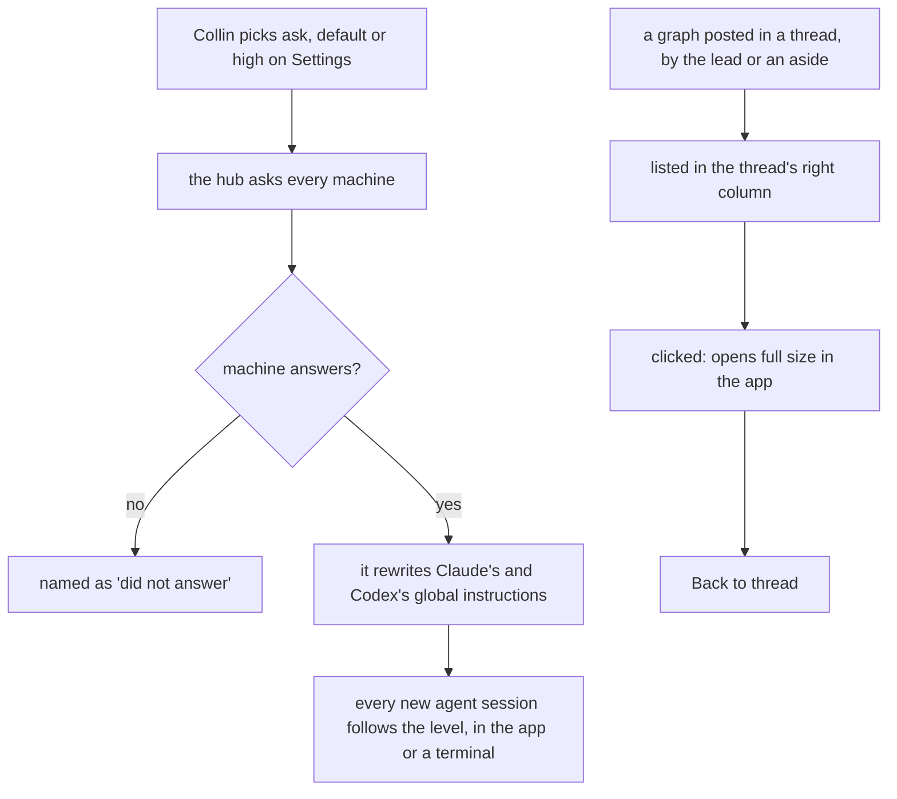

# Remove the old terminal workflow

**Idea:** `IDEA.md`. **Map:** `MAP.md`.

## Open Questions

None.

## Watch List

| # | Noticed | What needs looking into | Raised to user? | Outcome |
|---|---------|-------------------------|-----------------|---------|

## Decision Log

| # | Decision | Rationale | Source |
|---|----------|-----------|--------|
| D1 | `/graph` and `/diagram-sensitivity` are removed with the five stage commands; diagram sensitivity becomes a Settings control. Supersedes app-shell D42's keeping of both commands. | Collin: "graph should just be a thing native to the app, not in a command. diagram sensitivity should become a setting." | idea-change |
| D2 | The setting reaches every session on the machine, in the app and in a plain terminal, by writing each present CLI's global instructions as `sensitivity/set.sh` does now. | Collin picked "App and terminal" | user |
| D3 | `protocol/writing.md`, `lanes.md` and `map.md` are dropped without porting. | App roles reference none of them (MAP.md, "Sensitivity and retained app rules"); each app role states its own rules, and the app-settings proposal already drops the writing rules for all agents in favour of the lead's style | defaulted |
| D4 | Installed wrappers for the seven retired commands are removed when their text is the shape wheelchair renders (a pointer to `<some root>/protocol/<file>.md`), whichever checkout rendered them. Anything else under those names survives. | The `spine` check matches only this checkout's exact path (`install.sh:77-86`), which misses a moved clone; the rendered shape is distinctive enough | defaulted |
| D5 | `seen` cleanup: the installer removes hook handlers whose command is `<path>/seen/hook.sh <harness> ...` from Claude `settings.json` and Codex `hooks.json` (dropping a group only when emptied), the `Bash(<path>/seen/wording.sh:*)` permission, and the wording-directory write grant only when it equals wheelchair's own wording directory. Malformed files are reported and left untouched; install continues with a warning. The wording list on disk is left alone. | Ownership by path shape survives deleting `protocol/seen.md` (MAP.md notes the current check needs it); the directory grant has no marker, so only the exact wheelchair path is safe to remove; user data is not deleted | defaulted |
| D6 | The Settings control goes through the hub to the machine service, which runs `sensitivity/set.sh <level>` from its own clone. Refusals (two files at different levels, a malformed block, a Codex override) are shown on Settings in plain words. | The machine service owns per-machine state; the same route later reaches worker machines | defaulted |
| D7 | The dial's text says to move it on the app's Settings page, and its `ask` carve-out points at `protocol/app/lead.md` (Diagrams). `graphs.md` and `diagrams.md` lose their references to removed files and commands. | App-shell D42 retargets the dial; D1 removes the command it names | defaulted |
| D8 | `WHEELCHAIR_LANE=1` set by the machine service and asides stays. | Harmless once the hook is gone; removing it touches the app and is out of scope | defaulted |
| D9 | Graphs live in the thread, not in a tab: the right column lists every picture the thread has posted; a picture still shows inline in its card; clicking it (in the column or the card) opens it full size in the app, with a way back to the thread. No Graphs tab. | Collin: "on the right sidebar, show all the graphs that this thread uses. no graphs tab. graphs still open as they do within the thread and open fully when clicked and you can go back to the thread easily." | user |
| D10 | Full size is a new app page, `/wheelchair/app/picture?thread=<id>&card=<card id>`, opened in the same tab, with a Back to thread link like the document page. It covers all three formats (graph, form, html), so forms gain a full-size view too. | The graph viewer, raw form JSON and sandboxed HTML cannot each carry a back link; one app page can | defaulted |
| D11 | Phones, which have no right column, list the same pictures under the sticky header after MAP/IDEA/PLAN. | Same list wherever the thread is read | defaulted |
| D12 | Graphs a terminal agent draws keep working as today (the dial sends it to `protocol/graphs.md`, which writes under the cache root and opens the viewer); they are not listed in the app. | D9 scopes the app to the thread's graphs; terminal drawing must survive D2 | defaulted |
| D13 | The Settings control is a "Diagrams" section on the Models tab, after "Threads": three choices (ask, default, high) with one line each, showing the level the machine's files hold. | The app-settings redesign can move it; one control is all D1 needs | defaulted |
| D14 | D5 amended: the `~/.wheelchair` write grants stay. `seen/set.sh` granted `~/.wheelchair` (`seen/set.sh:49-52`), which also holds the model pins (`codex/model.sh`), so it is shared wheelchair state, not seen's alone, and may predate the hook. | Removing it could break other wheelchair writes; leaving a grant to wheelchair's own folder costs nothing | defaulted |
| D15 | IDEA.md updated with D9's outcome (graph list, full size, way back), its non-goal reworded to allow it, and the seen hook's real reach stated (terminal agents lose the wording list and gap notice). | Collin's D9 words, written into the north star; review round 1 | idea-change |
| D16 | The dial applies to every machine the hub knows. Settings shows one selected level when every machine and file agrees; otherwise none is selected and a note lists each machine's level (or "files disagree", or "did not answer"). A save that fails on some machines keeps the ones that worked and names the rest in the error note; pressing the level again retries. Supersedes the single-machine wording of D13. | D2 means every place Collin runs agents; the hub already has a machine registry (`viewer/app/state.js:146-150`) | review-round-1 |
| D17 | D5 amended: a seen handler or wording permission is wheelchair's only with ownership evidence (this root, a checkout holding `protocol/seen.md` or `protocol/app/lead.md`, or a path under the app's worktrees) and the exact command shape `seen/set.sh` writes. A stale entry from a deleted clone outside the worktrees stays (Accepted Risks). | Path suffix alone would delete another project's `seen/hook.sh`; `seen/set.sh:84-99` already refuses that | review-round-1 |
| D18 | The proposed-flow drawing trigger moves from `protocol/planning.md` into `protocol/app/lead.md` (Diagrams), adapted to the `diagram` card, before `planning.md` is removed. | The dial's `ask` carve-out points at it; without it leads lose a rule they rely on (IDEA: no role loses a rule it still uses) | review-round-2 |

## Spec

How the diagram setting moves, and how a thread's graphs open. Picking a level on Settings
asks every machine to rewrite its CLIs' global instructions; a machine that fails or does
not answer is named, and the rest keep the new level. A graph in a thread, from a card or
an aside, opens full size on a page with a way back.



The installer, separately, removes the old commands and the seen hook from a machine that
had them, touching nothing it cannot show is wheelchair's.

### 1. What goes

Source files removed (`git rm`):

- `skills/{plan,adopt,plan-review,implement,verify,graph,diagram-sensitivity}/`
- `codex/prompts/{plan,adopt,plan-review,implement,verify,graph,diagram-sensitivity}.md`
  (the directory is then empty and goes too)
- `protocol/{planning,adopt,plan-review,implementation,verification,lanes,map,writing,seen}.md`
- `protocol/templates/SEEN.md`
- `seen/` entirely (scripts, router, tests)
- `skills/` entirely, its router included: every wrapper in it is retired.
  `codex/prompts/` is empty and goes too. `codex/AGENTS.md` stays for `model.sh`,
  `preflight.sh` and `test/`, with its wrapper-convention text removed.
- `install.sh` stops rendering skills and Codex prompts (both loops go); it still runs the
  retired-wrapper removal below and `codex/model.sh init`. Root `AGENTS.md` loses the
  "Harness adapter" kind row and the "A wrapper carries no content" rule.

Kept: `protocol/graphs.md`, `protocol/diagrams.md`, `protocol/sensitivity.md`,
`sensitivity/`, `codex/model.sh`, `codex/preflight.sh`, `protocol/app/`,
every other file in `protocol/templates/` (IDEA, PLAN, MAP, COMPLETION), the graph viewer (`viewer/index.html`, `list.html`).
`docs/plans/`, `docs/proposals/` and `docs/maps/` are history and are not edited, except
this plan.

### 2. The installer removes what it rendered before (D4, D5)

`install.sh`, for each present harness:

- **Retired wrappers.** The retired list is `spine plan adopt plan-review implement verify
  graph diagram-sensitivity`. For each name: a Claude `skills/<name>/SKILL.md` or a Codex
  `prompts/<name>.md` is removed (the skill's whole directory, or the prompt file) when its
  text contains a line naming `<some absolute path>/protocol/<file>.md`, where `<file>` is
  that wrapper's protocol file: spine→spine, plan→planning, adopt→adopt,
  plan-review→plan-review, implement→implementation, verify→verification,
  graph→graphs, diagram-sensitivity→sensitivity. Any root path matches (a moved or other
  clone). A same-named file without that line is left alone. Each removal prints
  `removed old wrapper: <path>`. A symlink at that path is removed only if it points into a
  wheelchair checkout (target path ends in `/skills/<name>` or `/codex/prompts/<name>.md`).
- **The seen hook**, by a small script `install/unseen.py` (Python 3, stdlib only), run
  with the Claude home and Codex home of present harnesses:
  - **Which handlers are wheelchair's** (D17). A handler's `command`, split shell-style,
    must be exactly `<path>/seen/hook.sh <harness> <notice-arg>` as `seen/set.sh` writes it
    (`canonical_group`, `seen/set.sh:80-82`; copy its `NOTICE` values before deleting it),
    and `<path>` must be a wheelchair script: `<this root>/seen/hook.sh`; or a path whose
    checkout (the part before `/seen/hook.sh`) holds `protocol/seen.md` or
    `protocol/app/lead.md`; or whose checkout's real path is under
    `~/.local/state/wheelchair/worktrees/`. The same test, with `wording.sh`, decides a
    `Bash(<path>/seen/wording.sh:*)` permission. Another project's `seen/hook.sh` or
    `wording.sh` is never touched.
  - Claude `settings.json`: in `hooks.UserPromptSubmit`, drop each wheelchair handler; drop
    a group whose `hooks` list becomes empty; drop `UserPromptSubmit` if it becomes empty,
    and `hooks` if that becomes empty. In `permissions.allow`, drop wheelchair
    `Bash(<path>/seen/wording.sh:*)` entries. Emptied lists stay as `[]`; containers are
    never dropped except the hook ones above.
  - Write grants for `~/.wheelchair` (Claude `sandbox.filesystem.allowWrite`, Codex
    `writable_roots`) are **kept** (D14).
  - Codex `hooks.json`: the same handler and group rule.
  - A file that is missing is skipped. A file that does not parse, or a TOML shape the
    script cannot edit safely, is left untouched with a warning naming it; the install
    continues. Nothing changes when there is nothing to remove, so a second run writes no
    file (mtime unchanged).
  - Other keys, hooks and formatting in JSON are preserved (rewritten with the same indent
    `seen/set.sh` used); writes go through a temporary file and rename.
  - The wording list on disk is not deleted.
- The call to `seen/set.sh` and its `seen hook:` lines are removed. A line
  `seen hook: removed` or `seen hook: nothing to remove` is printed instead.
- The router and README text about the seen hook and the `seen/set.sh` write grant go.

### 3. The dial (D2, D6, D7, D13)

`protocol/sensitivity.md` region text changes:

- "Move the dial with `/diagram-sensitivity <level>`" becomes "Move the dial on the
  wheelchair app's Settings page (Models, Diagrams)".
- The `ask` carve-out: "a thread lead drawing a proposed flow, as
  `{{WHEELCHAIR_ROOT}}/protocol/app/lead.md` (Diagrams) has it".
- `protocol/app/lead.md`, Diagrams, gains the proposed-flow trigger, for a thread whose
  plan directory exists (before that, as in "Keep talking first", a flow is talked through
  in prose: no directory is created for it). It is the one
  `protocol/planning.md:132-150` owns today (D18): when a lead's turn discusses a proposed
  flow (a design, not a fact about current code), it writes or updates that flow's graph
  under `docs/plans/<slug>/graphs/` and posts a `diagram` card. **That fires at every dial
  level, `ask` included.** Above `ask` only, the dial's shape test also applies to a lead's
  turn like any other, so a turn choosing between two arrangements draws too, into its own
  graph file. At `ask` a choice between arrangements is not drawn unless Collin asks.
- The intro's "moved by `/diagram-sensitivity` and remembered afterwards" becomes "moved
  on the app's Settings page and remembered afterwards".
- The rest of the file: "The command" section is replaced by "Moving the dial" describing
  the Settings control and that it runs `sensitivity/set.sh <level>`; the `/graph` bullet
  under "What the dial does not govern" goes. The level line, writer's contract and
  examples stay.
- `sensitivity/test/run.sh` probes that named `protocol/planning.md` are updated to the new
  text.

Route, end to end:

```
Settings (Models > Diagrams) --GET /settings/diagram-sensitivity--> hub --GET /v1/diagram-sensitivity--> machine
   pick a level --POST /settings/diagram-sensitivity {level}--> hub --POST /v1/diagram-sensitivity--> machine runs sensitivity/set.sh <level>
```

- Machine service, two new hub-only routes (same auth as other hub routes), documented in
  `machine/API.md`:
  - `GET /v1/diagram-sensitivity` runs `<its clone>/sensitivity/set.sh --report`, and
    returns `200 {level, files:[{harness, level|null}], text}` where `level` is the agreed
    level or null when files disagree or none holds a block.
  - `POST /v1/diagram-sensitivity {level}` (`ask|default|high`, else `400`) runs
    `sensitivity/set.sh <level>` with a 30 s timeout. Exit 0: `200 {level, text}`. Non-zero:
    `422 {error: <its last non-empty stderr line>}`. Never runs two at once (a second request
    while one runs gets `409`).
  - If parsing `--report` output is fragile, add a `--json` flag to `set.sh --report`
    instead; the writer's contract is otherwise unchanged.
- Hub: a separate `GET /settings/diagram-sensitivity` returns `{machines: {<machine>:
  {level, files} | {error}}}`, read only by the Diagrams section, so no other page or
  `GET /settings` caller waits on the machines; `POST /settings/diagram-sensitivity {level}` forwards to every configured
  machine, returns `{machines: {<machine>: {level} | {error}}}`, `200` if all succeeded,
  return `502` with the per-machine map when any failed. Each machine call has a 5 s
  timeout; a machine that times out or refuses the connection is `{error: "did not
  answer"}`, on GET and POST alike, so one offline machine never stalls Settings. Documented in `viewer/app/API.md`. The hub stores nothing; the machines'
  files are the truth.
- Settings page: a "Diagrams" section after "Threads" on the Models tab. Three radio
  choices with one line each: ask "Only when you ask, or a lead draws a proposed flow";
  default "When the arrangement is the answer"; high "Whenever there is a shape".
  - **Selection** (D16): a level is selected only when every machine answered and every
    machine's files agree on it. Otherwise none is selected, and a note under the choices
    has one line per machine: "<machine>: <level>", "<machine>: its CLIs' files disagree
    (<cli> <level>, <cli> <level>)", or "<machine>: did not answer".
  - **Saving**: choosing a level saves at once. Success shows the section note (`setNote`)
    "Applies from each agent's next session". On a `502` the page shows, via
    `setNote(..., true)`, one line per failed machine with its reason; machines that
    succeeded keep the new level; choosing the level again retries all machines. Then it
    re-reads `GET /settings/diagram-sensitivity` so the selection and note show what each machine now holds.
  - The page's `api()` helper (`viewer/pages/settings.js:58-65`) only reads `error`,
    `detail` or `message` from a failed body: extend it to attach the parsed body to the
    thrown error, so the per-machine map reaches the page.

### 4. Graphs in the thread (D9-D12)

- The right column's "This thread's files" list keeps its pictures entry (already there,
  `viewer/pages/thread.js:198-206`), one per `diagram` card, now deduplicated by the
  picture's file: `plan` + `/` + `graph` + (`.html` for `format: html`, else `.json`), so
  `flow.json` and `flow.html` stay separate and a graph card and a form card naming the
  same `flow.json` count once; the latest card for that file wins, and its title, format
  and card id are used, and each link goes to the picture page in the
  same tab (no `target=_blank`).
- The `diagram` card keeps its inline picture. Its "Open full screen" link becomes "Open
  full size", goes to the picture page in the same tab, and is shown for all three formats
  (forms included).
- **Aside graphs** count as the thread's graphs too (an aside `draw` saves one per reply,
  `viewer/app/asides.js:71-82`, recorded as `graph` on that aside's history entry). The
  right column lists them after the diagram cards, one per saved graph, titled
  "Aside: <first 40 characters of the aside's quote>". Each, and the aside panel's own
  link (`viewer/pages/aside.js:56`, renamed "Open full size"), goes to the picture page
  with `?thread=<id>&aside=<aside id>&entry=<history index>`; the page draws that graph
  in the viewer iframe (`/wheelchair/?path=<graph path>`), back link as for cards.
  Data: the chat response strips aside history (`brief`, `viewer/app/asides.js:9`), so
  `brief` gains `graphs: [{entry, path}]`, one per history entry with a `graph`. The right
  column's change signature (`viewer/pages/thread.js:866`) adds `data.asides`' graphs, so
  a new aside graph appears on the next poll. The picture page reads the aside through
  `GET /threads/:id/asides/:aside` (works when archived).
- Phones: `headFilesEl` (the header strip) lists the same picture links after the plan
  files.
- New app page `viewer/pages/picture.html` + `picture.js` (`picture` added to `APP_PAGES`,
  `viewer/server.js:1700`), modelled on `doc.html`/`doc.js`: `?thread=<id>&card=<card id>`;
  a header with a Back to thread link (`/wheelchair/app/thread?id=<id>`) and the card's
  title; the body fills the viewport with the picture, drawn the way the card draws it
  (graph and html in an iframe using the same `diagramSource` URL, html sandboxed; form
  rendered by the same code as the card, moved to a shared script both pages load). It
  reads the card from the thread's chat (`GET /threads/:id/chat`). Archived threads work as
  the card does today. Unknown card or thread: a plain message and the back link.
- Browser back also returns to the thread (same-tab navigation).

### 5. Text that names removed things

Every reference outside `docs/plans/`, `docs/proposals/` and `docs/maps/` to a removed file
or command is removed or reworded (MAP.md "References to resolve" lists them):
`protocol/app/cards.md` (the `diagram` card: "Open full size", for every format, opening
the picture page), `protocol/app/AGENTS.md` (the Boundaries bullet about the wording hook: say the hook is
gone and leads follow the Settings style), `AGENTS.md` (root; Executable row loses `seen/`, the "second reach" paragraph goes, the
Where-to-go rows for `seen/` and `skills/`/`codex/` updated, verification commands lose
`seen/test/run.sh`), `protocol/AGENTS.md`, `codex/AGENTS.md`,
`protocol/graphs.md` (its three triggers become two: a thread lead's diagram, and an
ordinary turn under the dial; lanes/planning/implementation references go),
`protocol/diagrams.md` (`map.md` references point at `protocol/app/mapper.md` or go),
`protocol/templates/PLAN.md:70`, `README.md` (teaches the app, not commands),
`CONTRIBUTING.md`, `docs/known-issues.md` (a lane issue whose code is gone is deleted;
otherwise reworded). `install.sh`'s header comment and output lines.

Two checks:

1. File references, which must return only deliberate mentions in `install.sh`,
   `install/unseen.py`, `install/test/`, and router or protocol text that says a removed
   thing is gone or that the installer removes it (each such hit listed in the completion
   report):
   `git grep -nE 'protocol/(planning|adopt|plan-review|implementation|verification|lanes|map|writing|seen)\.md|seen/(hook|set|wording)\.sh|wording hook|skills/|codex/prompts' -- ':!docs/plans' ':!docs/proposals' ':!docs/maps'`
2. Slash commands in prose, which is advisory because HTTP routes such as `GET /graph`
   share the spelling:
   `git grep -nE '(^|[[:space:](\x60"])/(plan|adopt|plan-review|implement|verify|graph|diagram-sensitivity)([^A-Za-z0-9_/?-]|$)' -- '*.md' ':!docs/plans' ':!docs/proposals' ':!docs/maps'`
   Each hit is either reworded or is a kept route; the completion report lists the kept
   routes. Code and tests are not checked this way.

### 6. Routers

`AGENTS.md` (root), `protocol/AGENTS.md`, `codex/AGENTS.md`, `skills/` row removed, `install/` row (adds `unseen.py`) and `sensitivity/AGENTS.md` (the writer is now
also run by the machine service) say what is true after the change.

### 7. Tests

- `install/test/run.sh`: the `claude_wrappers_landed`/`codex_wrappers_landed`/
  `both_wrappers_landed` helpers (`install/test/run.sh:44-65`) and their uses are deleted,
  since no wrappers are rendered; in their place each case asserts no retired wrapper is
  installed. `spine_foreign_mention` is inverted: a wrapper naming another checkout's
  `protocol/spine.md` is now removed (D4). The `spine_*` cases generalise to every retired name, with:
  a seeded wrapper from this clone and one from another absolute root both removed (both
  harnesses); a same-named foreign file kept; a file mentioning a different protocol file
  kept. A `seen_removed` case seeds Claude `settings.json` with a seen handler, an unrelated
  handler in the same group, an unrelated group, the wording permission, an unrelated
  permission and the `~/.wheelchair` write grant, plus Codex `hooks.json` likewise and a
  `config.toml` with the grant; after install only the seen handlers and permission are
  gone, parsed JSON is otherwise equal, the grants remain and `config.toml` is
  byte-identical. A malformed `settings.json` is left byte-identical and install exits 0 with
  a warning. `both_idempotent` drops the seen-hook assertion and adds: no
  `UserPromptSubmit` seen handler, no retired wrapper, and the second run changes no file.
- `sensitivity/test/run.sh` updated for the new region text and passes.
- `machine/test/run.sh` gains cases for both routes: report, set, bad level 400, writer
  refusal 422, concurrent 409 — using a fake `sensitivity/set.sh` via the suite's existing
  root/fixture seam (add one if none).
- `node --test viewer/test/*.test.js` gains hub route tests (forward, partial failure
  502) and a picture-page server test (page served, unknown card).
- `npm --prefix viewer run test:browser` gains: Settings Diagrams section selects and saves;
  thread right column lists deduplicated pictures, clicking opens the picture page in the
  same tab, Back to thread returns; phone width lists pictures under the header.

### Validation commands

```bash
bash sensitivity/test/run.sh
bash codex/test/run.sh
bash install/test/run.sh
bash machine/test/run.sh
node --test test-support/test/*.test.js
node --test viewer/test/*.test.js
npm --prefix viewer run test:browser
git grep (section 5)
```

`./install.sh && ./install.sh` with `git status --porcelain` empty is run by Collin from
the canonical clone after merge (it refuses in a worktree); `install/test/run.sh`'s
idempotence case is the in-worktree proof.

### Non-goals

- No change to sessions, cards, leads or review flow.
- No redesign of Settings beyond the one section.
- No Graphs tab; terminal-drawn graphs are not listed in the app.
- `WHEELCHAIR_LANE=1` stays.
- Old plans, proposals and maps are not edited.

## Accepted Risks

| Risk | Why accepted | Round |
|------|--------------|-------|
| A seen hook entry left by a wheelchair clone that was deleted from outside the app's worktree folder is not removed | No evidence it is wheelchair's survives; `seen/set.sh` had the same limit. Collin can delete it by hand | 1 |

## Review Rounds

### Round 1 — 2026-11-15

**Lanes:** Claude (intent); GPT (mechanics); cross-family: yes.

**Changed since Round N-1:** n/a (first round — whole Spec in scope)

| Lane | Reported | Finding | Lead verdict | Resolution |
|------|----------|---------|--------------|------------|
| Claude intent | major | IDEA.md not updated for D9/D10; its non-goal rules out §4 | upheld | IDEA updated (D15) |
| Claude intent | major | Dial backend is multi-machine, Settings UI single-machine | upheld | D16; §3 Settings bullet |
| Claude intent | minor | Forms gaining a full-size view was not asked for | declined | The right column needs a target for every picture, forms included; one page covering all formats is simpler than per-format exceptions |
| Claude intent | minor | `protocol/app/AGENTS.md:24-27` still describes the wording hook; not in §5 | upheld | Added to §5 |
| GPT mechanics | blocking | Path-suffix match would delete another project's `seen/hook.sh` and wording permission | upheld | D17; §2 ownership bullet; Accepted Risk for deleted clones |
| GPT mechanics | major | Radio group undefined for differing machines or partial save; `post` helper drops the 502 body | upheld | D16; §3 Settings bullet |
| GPT mechanics | major | Dedup by plan+graph merges `flow.json` and `flow.html` | upheld | §4 dedup by resolved file |
| GPT mechanics | minor | Reference regex matches kept routes like `/wheelchair/graph` | upheld | §5 regex narrowed to slash commands |
| Claude intent | minor | IDEA says the seen hook was only the old workflow's; it reaches every turn | upheld | IDEA updated (D15) |

### Round 2 — 2026-11-15

**Lanes:** Claude (intent); GPT (mechanics); cross-family: yes.

**Changed since Round 1:**
- IDEA.md: graph list, full size and way back added; non-goal reworded; seen hook's reach stated (D15).
- Dial across every machine: Settings selection, per-machine note, partial-save handling, 502 body (D16, §3).
- Seen cleanup ownership test and exact command shape (D17, §2); Accepted Risk for deleted clones.
- Picture dedup by resolved file (§4).
- Reference-check regex narrowed; `protocol/app/AGENTS.md` added to §5.

| Lane | Reported | Finding | Lead verdict | Resolution |
|------|----------|---------|--------------|------------|
| Claude intent | major | D16 never written into §3's Settings bullet; `api()` drops the 502 map | upheld | §3 Settings bullet rewritten |
| Claude intent | major | §5 regex still matches kept `/graph` routes in code and tests | upheld | §5 split: file-reference check gates; slash-command check is markdown-only and advisory |
| Claude intent | minor | IDEA says "the machine", D16 says every machine | declined | The app knows one machine today (`machines.json` holds only this one), so IDEA holds as written; D16 only says what happens when worker machines are added |
| Claude intent | minor | No timeout on per-machine calls | upheld | §3: 5 s timeout, "did not answer" |
| Claude intent | minor | Kept list omits MAP and COMPLETION templates | upheld | §1 Kept list |
| GPT mechanics | major | `ask` carve-out points at a lead.md trigger that does not exist; `planning.md:132-150` owns it | upheld | D18; §3 lead.md bullet |
| GPT mechanics | major | Dedup key `diagramSource(card)` splits graph and form cards for the same `flow.json` | upheld | §4 key is plan + file name |
| GPT mechanics | minor (RE-RAISE) | Reference regex still matches kept routes in tests | declined | Already resolved this round: §5's slash-command check is markdown-only and advisory, and kept routes are allowed by name |

### Round 3 — 2026-11-15

**Lanes:** Claude (intent); GPT (mechanics); cross-family: yes.

**Changed since Round 2:**
- §3 Settings bullet rewritten for every machine (selection, per-machine note, partial save, `api()` body); per-machine 5 s timeout.
- §5 reference checks split: file references gate; slash commands markdown-only and advisory.
- §1 Kept list covers every template.
- D18: proposed-flow drawing trigger moves into `protocol/app/lead.md`.
- §4 picture dedup key is plan + file name.

| Lane | Reported | Finding | Lead verdict | Resolution |
|------|----------|---------|--------------|------------|
| Claude intent | major | D18 port made decision graphs fire at `ask`; the source fires them only above `ask` | upheld | §3 lead.md bullet split |
| Claude intent | major | §4 silent on graphs an aside draws in the thread | upheld | §4 aside graphs listed and opened on the picture page |
| Claude intent | minor | Putting the dial in `GET /settings` makes every caller wait on machines | upheld | §3 separate `GET /settings/diagram-sensitivity` |
| Claude intent | minor | `skills/` and `codex/prompts/` are certainly empty; consequences unstated | upheld | §1 states them |
| GPT mechanics | major | Moved trigger would demand a graph before a plan directory may exist | upheld | §3: only once the plan directory exists; prose before |
| GPT mechanics | minor | Arrangement choices could be read as firing at `ask` | upheld | Same fix as the intent finding: §3 bullet split |

### Round 4 — 2026-11-15

**Lanes:** Claude (intent); GPT (mechanics); cross-family: yes. Collin chose "keep going" after round 3; budget reset.

**Changed since Round 3:**
- §3 lead.md trigger: proposed flows draw at every level once the plan directory exists; arrangement choices only above `ask`.
- §3 separate `GET /settings/diagram-sensitivity`.
- §4 aside graphs listed and opened on the picture page (`aside` + `entry` params).
- §1 `skills/` and `codex/prompts/` removed outright; installer stops rendering both; root AGENTS.md loses the harness-adapter row.

| Lane | Reported | Finding | Lead verdict | Resolution |
|------|----------|---------|--------------|------------|
| Claude intent | major | Aside graphs not reachable: chat payload strips history | upheld | Same fix as the GPT minor below: `brief` carries `graphs`; within IDEA's graph-list scope |
| Claude intent | minor | Two §3 places still use `GET /settings` | upheld | Same fix as the GPT major below |
| Claude intent | minor | Installer test helpers and `spine_foreign_mention` break; §7 silent | upheld | §7 deletes the helpers and inverts the case |
| Claude intent | minor | Gating check does not catch `skills/` or `codex/prompts` mentions | upheld | §5 regex extended |
| Claude intent | minor | `protocol/app/cards.md` still says "Open full screen" for graphs and HTML | upheld | Added to §5 |
| Claude intent | minor | `sensitivity.md` intro still names the command | upheld | §3 bullet added |
| GPT mechanics | major | Flow diagram and post-save refresh still name `GET /settings` | upheld | §3 both use `GET /settings/diagram-sensitivity` |
| GPT mechanics | minor | Sidebar has no aside history and no refresh trigger for aside graphs | upheld | §4 `brief` carries `graphs`; signature includes them |

### Round 5 — 2026-11-15

**Lanes:** Claude (intent); GPT (mechanics); cross-family: yes.

**Changed since Round 4:**
- §3: dial reads and refresh use `GET /settings/diagram-sensitivity` throughout; `sensitivity.md` intro reworded.
- §4: aside graphs reach the pages through `brief`'s new `graphs` list; sidebar signature includes them.
- §5: gating check covers `skills/` and `codex/prompts`; `protocol/app/cards.md` added.
- §7: wrapper-landed helpers deleted; `spine_foreign_mention` inverted.

| Lane | Reported | Finding | Lead verdict | Resolution |
|------|----------|---------|--------------|------------|
| Claude intent | minor | Gating check would flag the requested "hook is gone" wording and the `install/` router row | upheld | §5 allows text stating removal, listed in the report |
| Claude intent | minor | §2 orders against a rendering step that no longer exists | upheld | §2 wording |

## Implementation Tasks

| # | Objective | Ownership boundary | Lane | Session id | Validation | Status |
|---|-----------|--------------------|------|-----------|------------|--------|
| T1 | Installer stops rendering wrappers; removes retired wrappers and the seen hook (`install/unseen.py`); git rm skills/, codex/prompts/, seen/ (§1, §2, §7) | install.sh, install/, skills/, codex/prompts/, seen/ | codex standard (gpt-6.1-terra) | wc-1cff24e4cc7d-worker | install, codex suites | done (attempt 1; commit blocked by staged git rm, unblocked by message, not an escalation) |
| T2 | Dial text and machine routes GET/POST /v1/diagram-sensitivity (§3, §7) | protocol/sensitivity.md, sensitivity/, machine/ | codex standard (gpt-6.1-terra) | wc-1cff24e4cc7d-worker-2 | sensitivity, machine, test-support suites | done |
| T3 | Hub /settings/diagram-sensitivity and Settings Diagrams section (§3, D13, D16) | viewer/app settings routes, API.md, pages/settings.js, its tests | claude standard (claude-sonnet-5-5) | wc-1cff24e4cc7d-worker-3 | viewer node + browser | in progress |
| T4 | Thread graph list, picture page, aside graphs (§4) | viewer/pages thread/aside/picture, app/asides.js brief, server.js APP_PAGES, its tests | claude standard (claude-sonnet-5-5) | wc-1cff24e4cc7d-worker-4 | viewer node + browser | done |
| T5 | Remove old stage rules, port flow trigger to lead.md, reword references and routers (§1, §3 D18, §5, §6) | protocol text, routers, README, CONTRIBUTING, known-issues | claude standard (claude-sonnet-5-5) | wc-1cff24e4cc7d-worker-5 | §5 greps, protocol-rules test | done |

## Log

- 2026-11-15 Ready check: hub and machine service answer (`wc.js session list`), review families both, Codex preflight passes (token fresh).
- 2026-11-15 — Choice: T5, protocol/app/lead.md: states that a thread has a graph home once its plan directory exists, before the ported trigger.
- 2026-11-15 — Choice: T5, protocol/diagrams.md: "see `map.md`" became "it is read in a terminal" rather than pointing at mapper.md, which does not state the Mermaid ban.
- 2026-11-15 — Choice: T5, protocol/graphs.md: lanes link example replaced with a link to AGENTS.md; run-picture intro and question-slug sentence shortened instead of naming a replacement file.
- 2026-11-15 — Choice: T5, README.md: dropped the run-picture paragraph and the SEEN.md row; kept the viewer section.
- 2026-11-15 — Choice: T5, README.md/AGENTS.md: "Sessions page" became "Agents page"; the docs row's `/adopt` reworded.
- 2026-11-15 — Choice: T5, protocol/AGENTS.md: names the removed files in one sentence saying they are gone.
- 2026-11-15 — Choice: T5, codex/AGENTS.md: retitled, "lane" replaced by "session".
- 2026-11-15 — Choice: T2, sensitivity/set.sh: added `--report --json` (the plain report has no per-harness levels and exits non-zero on disagreement).
- 2026-11-15 — Choice: T2, machine/service.js: GET runs both `--json` and `--report`; the plain report's disagreement exit counts as a successful report.
- 2026-11-15 — Choice: T2, machine/test/sensitivity.test.js: the writer path is injected through a `sensitivityScript` service constructor option.
- 2026-11-15 — Choice: T1, install/unseen.py: each JSON file is processed independently, so a malformed file does not stop cleanup of the other harness.
- 2026-11-15 — Choice: T1, install/test/run.sh: Python added to the restricted PATH fixture, since the installer now runs unseen.py.
- 2026-11-15 — Choice: T1, install/test/run.sh: the real `~/.wheelchair` guard skips `accounts/*/tmp/`, where live Codex sessions write scratch files during the run (sub-lead's direction).
- 2026-11-15 — Choice: T1, install.sh: a failing unseen.py warns and the install continues (sub-lead's direction, Spec §2).
- 2026-11-15 — Choice: T4, viewer/test/app-pictures.spec.js: the aside spec stubs `GET /threads/:id/asides/:aside` (it 500s in the browser test world without model settings) and checks `brief` through the real chat payload.
- 2026-11-15 — Choice: T4, viewer/pages/picture.html: loads `thread.css` for form styles; `picture.css` adds only layout.
- 2026-11-15 — Choice: T4, viewer/pages/thread.js: deduplicated pictures are ordered by each file's latest card, not first appearance.
- 2026-11-15 — Choice: T4, viewer/pages/thread.js: the phone strip uses the picture's title as link text, as the column does.
- 2026-11-15 — Choice: T4, viewer/pages/picture.js: an aside entry with no graph shows "This aside has no picture at that step."
- 2026-11-15 — Choice: T4, viewer/test/app-threads.spec.js: two assertions updated from "Open full screen" to the picture-page link.
- 2026-11-15 — Note: pre-existing failures seen on the feature branch without T4: lifecycle.test.js "a starter that loses the freed port registers through the new holder"; app-accounts "lead waiting line" date text (per T4's report, also on main).
