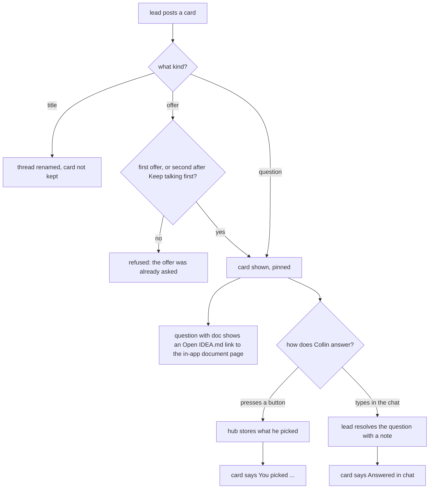

# The app's screen paper cuts

**Idea:** `IDEA.md` — what this is for and why, in plain language. Read it first; it is
the north star this plan serves. Goal and Constraints live there, not here, so they don't
get buried as this file grows.

**Map:** `MAP.md`, with detail in `docs/maps/app-thread-page.md` and
`docs/maps/viewer-serving.md`.

## Open Questions

None.

## Watch List

| # | Noticed | What needs looking into | Raised to user? | Outcome |
|---|---------|-------------------------|-----------------|---------|

## Decision Log

Append-only. A reversal is a new entry superseding the old, never an edit.

| # | Decision | Rationale | Source |
|---|----------|-----------|--------|
| D1 | Split the paper-cuts list three ways: screen fixes here; session and card cleanup, and the real smoke suite with hub risks, as stub threads | The parts touch different code and test differently | user |
| D2 | The idea-confirm question carries an optional `doc` field (a file name in the thread's plan directory, e.g. `IDEA.md`); the card shows an "Open IDEA.md" link to the in-app document page. Not the document inline | A link is one tap and keeps the card short on a phone; IDEA.md inline would push the options off screen. Collin asked for "show or link" | defaulted |
| D3 | Plan documents open in a new app page (in `APP_PAGES`, `viewer/pages/`), with the app nav and a "Back to the thread" link; it renders Markdown with `doc.js`'s renderer (tables) rather than `pages/md.js`. Archived threads' documents open on the same page, from the branch | Collin asked for the nav and a way back; the archived `<pre>` panel was the same problem in another form | defaulted |
| D4 | A press stores the pressed value on the card (`answered_value`), and an answered card marks the picked option and says "You picked <label>" | The value is already known at press time (`viewer/app/threads.js:213-225`); nothing else needs deciding | defaulted |
| D5 | "Answered in chat": `resolve` is extended to the lead's own `question` cards; the card shows "Answered in chat" and the note. `lead.md` tells the lead to resolve a question he answered by typing, as it already does for `needs` | Nothing links a typed message to a card; the lead already knows, and `resolve` is the existing way a lead closes a card | defaulted |
| D6 | Fonts are bundled from the `@fontsource/inter` and `@fontsource/jetbrains-mono` npm packages (SIL OFL), served by the viewer under its own origin, with `@font-face` in `app.css` and `font-src 'self'` added to `PAGE_CSP` | IDEA constraint: no third-party font host, strict CSP. The packages ship woff2 files and are the usual way to self-host these fonts | defaulted |
| D7 | A thread's title is set at creation from the first message's opening words, and the lead replaces it with a short name once it knows what the thread is | Never untitled, and the lasting name is short | user |
| D8 | The lead names the thread with a new never-shown card kind `title` (field `title`, lead only, may be posted again to rename). The first-message title is its first line, cut at a word boundary to at most 60 characters with an ellipsis; an empty first message leaves no title (the existing fallback applies). A stub's title is kept until a lead renames it | A card is how a lead already tells the app things; a separate route would add a second channel | defaulted |
| D9 | "Keep talking first" means not yet: the lead keeps chatting without mapping or collecting the idea, and may post the offer once more later | A button that meant the same as "Plan it" would not be a choice | user |
| D10 | Typing instead of answering an open offer still makes the thread a feature, as today; only the button means not yet | Keeps today's rule where Collin didn't ask to change it | defaulted |
| D11 | Collin's own dismiss stays limited to `needs` cards; only the lead's `resolve` reaches `question` cards | The "answered in chat" signal is the lead's to give; a dismiss button on questions is not asked for | defaulted |

## Spec

The settled design. Six independent fixes to the app (`viewer/app/`, `viewer/pages/`,
`viewer/server.js`) and the protocol files that describe it (`protocol/app/cards.md`,
`protocol/app/lead.md`, `viewer/app/API.md`). Each fix ships with a test that fails on
`7246e90` (the commit this plan was mapped against) and passes after. File:line pointers
are from `MAP.md` and `docs/maps/`; re-check them against the code before editing.

How a card moves after this change: the lead posts it and the hub checks it (a `title`
card renames the thread and is not stored; a third offer, or a second one not preceded by
"Keep talking first", is refused). The page draws it, with an "Open IDEA.md" link when it
carries `doc`. Collin either presses a button, and the hub stores what he picked, or types
an answer, and the lead resolves the question with a note. The page then shows "You picked
…" or "Answered in chat".



### S1. Thread titles (D7, D8)

**From the first message.** `createThread` (`viewer/app/threads.js:41-58`) sets
`thread.title` from `input.message` when it is a non-empty string: take the first line,
trim it, collapse runs of whitespace to one space; if longer than 60 characters, cut at
the last space at or before character 60 (or hard at 60 when there is no space) and append
`…`. An empty or whitespace-only message, or no message, sets no `title`; the pages'
existing fallback (`title || slug || project basename`) applies. Stub threads keep the
title from their stub card (`threads.js:72`) and are not touched by this rule.

**Named by the lead.** A new card kind, `title`:

| Field | Type | Required |
|---|---|---|
| `title` | string | yes |

- Emitted by the lead only; never shown; not stored in `thread.cards` (like `resolve`, it
  is an instruction). Accepting it sets `thread.title` to the trimmed value, capped at 80
  characters by the same word-boundary rule. It may be posted again to rename.
- Validated in `viewer/app/card.js` (`fields`, `roles`, not in `shown`) and handled in
  `acceptCard` (`viewer/app/cards.js`) next to `resolve`; a `delivery_id` duplicate is a
  no-op as for every other kind. Refused on an archived thread, like every card.
- `protocol/app/cards.md` documents the kind (in "Which kinds exist", and a section under
  "The kinds never shown"). `protocol/app/lead.md` step 1 says: in your first turn, post a
  `title` card with a short name for the thread (a few words, in Collin's terms); post it
  again if the thread's subject changes, for example when a split leaves this thread with
  only part of the original ask. A stub's lead renames only if the stub's title no longer
  fits.

Both pages already read `thread.title`; no page change is needed beyond the existing
fallback. `viewer/app/API.md` notes that `POST /threads` sets `title` from `message`.

**Tests (fail first):** `viewer/test/app-hub.test.js` — creating a thread with a long
multi-line message stores the cut first line; with no message stores no title; a lead's
`title` card sets and later renames it, is absent from `cards`, and a non-lead's is
refused. `viewer/test/app-threads.spec.js` — a thread created with a message shows that
title in the list (not the project name).

### S2. The idea question carries IDEA.md (D2)

- `question` gains an optional field `doc`: a file name, one of `MAP.md`, `IDEA.md`,
  `PLAN.md` (anything else is refused by `card.js`).
- The thread page's question renderer (`viewer/pages/thread.js:393-413`) adds, under the
  question text and above the options, a link "Open <doc>" to the in-app document page
  (S3) for this thread and that file. When the thread has no known slug yet, the link is
  omitted (the card still renders). The chat render signature
  (`viewer/pages/thread.js:578`) gains the slug, so the link appears on the next poll once
  the slug becomes known, without a reload.
- `cards.md` documents the field. `lead.md` step 4.1 says to set `doc: "IDEA.md"` on the
  card that confirms IDEA.md, and to commit IDEA.md before posting that card so an
  archived thread can still open it.

**Tests:** `card.js` validation accepts `doc: "IDEA.md"` and refuses `doc: "x.md"`
(`viewer/test/app-hub.test.js` or the card validation test that exists); the browser
spec shows an "Open IDEA.md" link on a question with `doc` whose href is the S3 page for
that thread, and none on a question without it; a question with `doc` posted before the slug is
known gains its link once the slug appears, without a reload.

### S3. Plan documents open inside the app (D3)

**A new app page `doc`.** Add `'doc'` to `APP_PAGES` (`viewer/server.js:1830`) and
create `viewer/pages/doc.html` + `viewer/pages/doc.js` (served by the existing asset
pattern). URL: `/wheelchair/app/doc?thread=<thread id>&file=<MAP.md|IDEA.md|PLAN.md>`.

- The page has the app nav (`viewer/pages/nav.js`, as the other app pages inject it), a
  "← Back to the thread" link to `/wheelchair/app/thread?id=<thread id>` (use the same
  query form the Threads list uses to link a thread), and the rendered document. No
  tabs or file switcher: each file is one tap from the thread page.
- It learns where the documents live from `GET /wheelchair/api/threads/<id>/chat` (the
  same call the thread page makes): live thread → `worktree` + `slug`, read via the
  existing `/wheelchair/doc?plan=<worktree>/docs/plans/<slug>&file=` route (the plan is
  already registered by `findSlug`); archived thread → `GET
  /wheelchair/api/threads/<id>/doc?file=`.
- Unknown thread, no slug yet, a file outside the three, or a missing file: the page shows
  a plain message ("No IDEA.md in this thread yet") with the back link; never a blank page
  or a stack trace.
- **Rendering.** Move the Markdown renderer out of `viewer/doc.js`'s IIFE into a shared
  browser script (for example `viewer/pages/markdown.js` exposing one function that takes
  a Markdown string and returns a DOM fragment, frontmatter handled as `doc.js` does
  today). It also takes a link resolver, so each page decides where a relative link goes:
  `viewer/doc.js` passes today's `resolveLink` behaviour (`viewer/doc.js:277-300`, every
  relative `.md` to `/wheelchair/docs`), unchanged. The new page resolves a relative link
  whose resolved name is exactly `MAP.md`, `IDEA.md` or `PLAN.md` (optionally with a
  `#fragment`, which is dropped) to `/wheelchair/app/doc?thread=<id>&file=<name>`; any
  other relative link renders as plain text, not a live link. `http(s)` links stay
  external (new tab, `rel="noopener"`), other schemes stay dead, as in `doc.js` today. The old `/wheelchair/docs` page
  keeps working unchanged for the graph viewer's list; `md.js` (chat) is not changed.
- Styled with `app.css` tokens, readable on a phone (no horizontal page scroll; wide
  tables scroll inside their own box).

**Links that change.** On a live thread, `fileLinks` (`viewer/pages/thread.js:141-152`)
links MAP/IDEA/PLAN to the new page instead of `/wheelchair/docs`. On an archived thread
the buttons that opened the `#docview` `<pre>` panel become links to the same page; the
`#docview` panel and `showArchivedDoc` are removed. S2's link uses the same page.

**Tests:** `viewer/test/app-pages.test.js` — `/wheelchair/app/doc` is served behind the
cookie like the other app pages. `viewer/test/app-threads.spec.js` — the test at `:421`
that pins `/wheelchair/docs` is changed to expect the in-app URL; a new spec opens the page
for a live thread and for an archived thread, sees the nav, the rendered heading of the
document and a table rendered as a `<table>`, and follows "Back to the thread" to the
thread page. A PLAN.md fixture containing `[the map](MAP.md)` and
`[elsewhere](../other/PLAN.md)` renders the first as a link to the in-app MAP.md page and
the second as plain text. `node --test` for the shared renderer if it is loadable outside a browser;
otherwise covered by the browser spec.

### S4. Answered cards say what was picked (D4, D5, D11)

**Pressed.** `press` (`viewer/app/threads.js:213-225`) stores the pressed value on the
card alongside `answered = true`: `card.answered_action = input.action` and
`card.answered_value = input.value ?? null`. (Approval "Talk about this" still leaves the
card open and stores nothing.) The thread page, for an answered `question` or `offer`,
marks the picked option (a "picked" class and a ✓) and replaces the generic "✓ Answered"
tag with "You picked <label>". Matching: a `question` press sends the option's `label`
verbatim (`viewer/pages/thread.js:400`), so the option whose `label` equals
`answered_value` exactly is the picked one. The offer's buttons send fixed lowercase
values, so the page keeps one explicit map from value to button label —
`take it into planning` → "Take it into planning", `keep talking first` → "Keep talking
first" — used both to render the buttons and to mark the picked one. An unmatched value
shows "You picked <value>" with no option marked. Cards answered before
this change have no `answered_value` and keep the generic tag.

**Answered in chat.** `resolvable` (`viewer/app/card.js:130-140`) takes the caller: a
lead's `resolve` may target an open `needs` card a lead posted (as today) **or** an open
`question` card a lead posted in the same thread. Collin's dismiss route keeps calling it
in needs-only mode, so the dismiss rules and the refusal reasons for needs stay exactly as
today. A resolved question renders dimmed, buttons disabled, with "Answered in chat" and
the note. `cards.md` (`resolve` section) and `lead.md` ("A needs card stays open…" and
step 4.4) say: when Collin answers a question card by typing instead of pressing, resolve
it with a one-line note of his answer, then carry on as if he had pressed.

**Tests:** `app-hub.test.js` — a press stores `answered_action`/`answered_value`; a lead
resolve of its own open question succeeds and sets `resolved_note`; a resolve of an
answered question, of another thread's question or of an app-posted card is refused; a
dismiss of a question is still refused. `app-threads.spec.js` — after pressing an option
the card says "You picked <label>" and marks that option; a resolved question shows
"Answered in chat" and the note.

### S5. "Keep talking first" on the offer (D9, D10)

- The offer renders a second button, "Keep talking first", beside "Take it into planning"
  (`viewer/pages/thread.js:358-368`). It presses `picked` with value `keep talking first`;
  no new press action, no hub change beyond S4 storing the value. The offer is then
  answered (both buttons disabled) and shows "You picked Keep talking first".
- `cards.md` (offer) documents the second button and its press form
  `[card <id>] picked: keep talking first`.
- `lead.md` steps 1–2 change to: "Take it into planning", or typing instead of answering,
  makes the thread a feature (as today). "Keep talking first" means not yet: keep talking,
  do not create the plan directory, start mapping or post an idea card. You may post the
  offer once more later, when what he has said makes the case clearer; after that second
  offer, never again. A small fix stays possible: if the talk shows it is small, just do it.
- Posting a second offer replaces the first in the pin (existing singleton behaviour).
- **The hub enforces the limit**, so it survives a lead restart (the restart context holds
  only unreplaced cards, `viewer/app/threads.js:105-112`). `acceptCard` counts every offer
  in `thread.cards`, replaced or not (replaced cards stay in the array,
  `viewer/app/cards.js:22-24`). A new offer is accepted only when there is none, or
  exactly one and it was answered with `answered_value` `keep talking first`. Otherwise
  it is refused with 422 and the reason "the offer was already asked". `cards.md` and
  `lead.md` say so.

**Tests:** `app-hub.test.js` — a first offer is accepted; a second after "keep talking
first" is accepted and replaces the pin; a second after "take it into planning", a second
while the first is unanswered, and a third are each refused with 422.
`app-threads.spec.js` — the offer shows both buttons; pressing "Keep talking
first" posts `{action:'picked', value:'keep talking first'}` and leaves both buttons
disabled with "You picked Keep talking first".

### S6. Fonts load from the app (D6)

- Add `@fontsource/inter` and `@fontsource/jetbrains-mono` to `viewer/package.json`
  `dependencies` (exact versions, at least two weeks old; `install.sh` already installs the
  viewer's dependencies).
- Serve the needed woff2 files under `/wheelchair/assets/fonts/<name>.woff2` from
  `handleAsset` (`viewer/server.js:1833-1847`): an explicit allowlist mapping each
  served name to its file under `viewer/node_modules/@fontsource/...` (Inter 400, 600, 700;
  JetBrains Mono 400 — the weights `app.css` uses; latin subset), content type
  `font/woff2`. No other path under `node_modules` is servable; an unlisted font name is a
  404.
- `app.css` gets `@font-face` rules for those files with `font-display: swap`. Nothing
  else about the type scale changes.
- `PAGE_CSP` (`viewer/server.js:46`) gains `font-src 'self'`; `APP_PAGE_CSP` inherits it.
  No other CSP directive changes.
- The terminal page's xterm font and the old graph viewer's fonts are out of scope.

**Tests:** `viewer/test/routes.test.js` — the CSP on an app page and on `/docs` includes
`font-src 'self'`; `/wheelchair/assets/fonts/inter-400.woff2` (whatever names the
allowlist uses) returns 200 with `font/woff2`; an unlisted name and a `..` path return 404.
`viewer/test/app-ui.spec.js` (or a new spec), in Chromium and Firefox — after load and
`await document.fonts.ready`, `document.fonts` contains a `FontFace` whose family is
`Inter` with status `loaded` and one whose family is `JetBrains Mono` with status
`loaded` (after rendering an element in each), the page received a 200 `font/woff2`
response for each, and no CSP violation is logged. (Not `document.fonts.check`: it
returns true when no `@font-face` matches, so it passes before the fix.)

### Boundaries and non-goals

- Not changed: the session and card cleanup items and the smoke suite (stub threads), chat
  Markdown (`md.js`), the graph viewer, the terminal page, Settings, permission modes.
- Card shapes stay in `cards.md`; `card.js` validation must match it field for field.
- No new runtime dependency beyond the two font packages. Node 20 compatible.

### Validation

```bash
node --test viewer/test/*.test.js
npm --prefix viewer run test:browser
bash machine/test/run.sh
./install.sh && ./install.sh && git status --porcelain   # stays empty
```

Never check the viewer by starting a server on the default port; the suites start their
own with `--port` and `--cache-root` (see `AGENTS.md`, Verification).

## Accepted Risks

| Risk | Why accepted | Round |
|------|--------------|-------|

## Review Rounds

### Round 1 — 2026-11-14

**Lanes:** Claude (intent lens); GPT via Codex (mechanics lens); cross-family: yes.

**Changed since Round 0:** n/a (first round — whole Spec in scope)

| Lane | Reported | Finding | Lead verdict | Resolution |
|------|----------|---------|--------------|------------|
| intent (Claude) | major | S3: links inside a rendered document still go to the old viewer | upheld — `viewer/doc.js:16-18`, `:277-300` send every relative `.md` to `/wheelchair/docs` | S3: renderer takes a link resolver; the app page links MAP/IDEA/PLAN in-app, other relative links are plain text |
| intent (Claude) | major | S6: `document.fonts.check` passes before the fix | upheld — `check` is true when no face matches the family, which is today's state (`app.css:15`, no `@font-face`) | S6 test asserts loaded `FontFace` entries and the `font/woff2` responses |
| intent (Claude) | minor | S3: tabs for the three files reach past the non-goal | upheld | Dropped; the back link is the way to the other files |
| mechanics (GPT) | major | S3: renderer link context and destination undefined | upheld — same defect as the intent lane's first finding | Same S3 change |
| mechanics (GPT) | major | S5: "never a third offer" can't survive a lead restart | upheld — restart context drops replaced cards (`viewer/app/threads.js:105-112`) | S5: the hub refuses a third offer, or a second unless the first was "keep talking first"; tests added |
| mechanics (GPT) | minor | S4: offer values are lowercase, labels capitalised; exact match fails | upheld — `viewer/pages/thread.js:364-365` | S4: explicit value→label map for the offer; questions match label verbatim |
| mechanics (GPT) | minor | S2: link doesn't appear when the slug arrives later | upheld — chat signature at `viewer/pages/thread.js:578` excludes slug | S2: slug added to the signature; test added |

### Round 2 — 2026-11-14

**Lanes:** Claude (intent lens); GPT via Codex (mechanics lens); cross-family: yes.

**Changed since Round 1:**
- S3: the shared renderer takes a link resolver; the app page links MAP/IDEA/PLAN in-app, other relative links plain text; no file tabs.
- S6: the font test asserts loaded `FontFace` entries and `font/woff2` responses instead of `document.fonts.check`.
- S5: the hub refuses a third offer, or a second unless the first was answered "keep talking first".
- S4: offer value→label map; question options match by label.
- S2: slug added to the chat render signature.

| Lane | Reported | Finding | Lead verdict | Resolution |
|------|----------|---------|--------------|------------|

## Prior Work

| Spec item | State | Evidence (file:line) | Confidence |
|-----------|-------|----------------------|------------|

## Implementation Tasks

| # | Objective | Ownership boundary | Lane | Session id | Validation | Status |
|---|-----------|--------------------|------|-----------|------------|--------|
| T1 | S3: in-app document page, shared Markdown renderer, thread page links | `viewer/pages/doc.{html,js,css}`, `viewer/pages/markdown.js`, `viewer/doc.{js,html}`, `viewer/server.js` (APP_PAGES only), `viewer/pages/thread.{js,html,css}` (fileLinks and #docview only), `viewer/test/app-pages.test.js`, `app-threads.spec.js`/`app-doc.spec.js`, fixtures, `viewer/test/render.spec.js` (one line: mockRoutes serves pages/markdown.js, lead-approved), `viewer/AGENTS.md` | Claude Sonnet | wc-1f02c3554935-worker (branch wc-1f02c3554935-w1) | `node --test viewer/test/*.test.js`; `npm --prefix viewer run test:browser` | done |
| T2 | S1, S2, S4, S5 hub, card validation and protocol text | `viewer/app/{card,cards,threads}.js`, `viewer/app/API.md`, `protocol/app/{cards,lead}.md`, `viewer/test/app-hub.test.js` | GPT terra (gpt-5.6-terra) | wc-1f02c3554935-worker-2 (branch wc-1f02c3554935-w2) | `node --test viewer/test/*.test.js`; `bash machine/test/run.sh` | in progress (wave 1) |
| T3 | S1, S2, S4, S5 thread page: title spec, Open IDEA.md link, You picked / Answered in chat, Keep talking first | `viewer/pages/thread.{js,css}`, `viewer/test/app-threads.spec.js`, test helpers | Claude Sonnet | — | `node --test viewer/test/*.test.js`; `npm --prefix viewer run test:browser` | not started (wave 2, after T1+T2) |
| T4 | S6: self-hosted fonts | `viewer/package{,-lock}.json`, `viewer/server.js` (handleAsset, PAGE_CSP), `viewer/pages/app.css`, `viewer/test/routes.test.js`, new font spec, `viewer/AGENTS.md` | Claude Sonnet | wc-1f02c3554935-worker-3 (branch wc-1f02c3554935-w3) | `node --test viewer/test/*.test.js`; `npm --prefix viewer run test:browser`; `./install.sh && ./install.sh` | in progress |

## Log

2026-11-14, Ready check at approval: hub and machine service answer (`wc.js session list`); Claude Code 2.1.325 and codex-cli 0.169.0 installed; Codex preflight passes (token fresh). Preflight heads-up: gpt-6.1-terra is newer than the pinned gpt-5.6-terra; not acted on.
2026-11-14 — Decomposition: four tasks. T1 and T2 disjoint (wave 1); T3 needs T1's page and T2's stored values and owns thread.js after T1; T4 shares server.js with T1 so follows it. Frontend to Claude; T4 also to Claude because the browser suite under the Codex sandbox is untested here.
2026-11-14 — T1 ownership widened by the lead: one-line edit to `viewer/test/render.spec.js` (mockRoutes serves pages/markdown.js) so the old docs page tests pass on the shared renderer. No other task owns that file.
2026-11-14 — T1 accepted after re-run: node 248/249 and browser 376 passed; the remaining failures (`lifecycle.test.js` "a starter that loses the freed port…", `browser.spec.js:2395` arrow test in both browsers) also fail on the feature branch at 3808ae5 without T1, checked by the sub-lead.
- 2026-11-14 — Choice: T1, render.spec.js: lead-approved two-line mock serving pages/markdown.js.
- 2026-11-14 — Choice: T1, markdown.js: the rendered fragment carries the frontmatter block (`div#frontmatter`); doc.html lost its empty placeholder div, ids and `.row` structure unchanged.
- 2026-11-14 — Choice: T1, markdown.js: a resolver result may carry `newTab` (sets target=_blank); doc.js never sets it.
- 2026-11-14 — Choice: T1, pages/doc.js: slug read from the chat's `thread.slug` only, not the diagram-card fallback, since only a discovered slug has a registered plan.
- 2026-11-14 — Choice: T1, pages/doc.js: a 403 (plan not registered) shows "No <file> in this thread yet", like a 404.
- 2026-11-14 — Choice: T1, pages/doc.js: unknown thread → "This thread was not found."; a file outside the three → "“x” is not one of MAP.md, IDEA.md or PLAN.md."
- 2026-11-14 — Choice: T1, app-threads.spec.js: the `:410` slug test's hrefs also moved to the in-app URL.
- 2026-11-14 — Choice: T1, pages/doc.html: nav marks Threads as current.
- 2026-11-14 — Choice: T1, app-doc.spec.js: builds its own temp git repos; app-threads-world.js unchanged.
