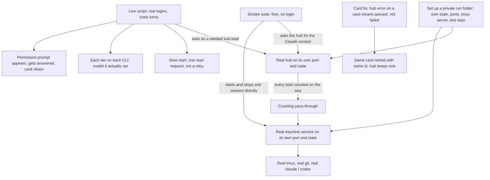

# Close the app's remaining risks

**Idea:** `IDEA.md` — what this is for and why, in plain language. Read it first; it is
the north star this plan serves. Goal and Constraints live there, not here, so they don't
get buried as this file grows. **Map:** `MAP.md`.

## Open Questions

None.

## Watch List

| # | Noticed | What needs looking into | Raised to user? | Outcome |
|---|---------|-------------------------|-----------------|---------|

## Decision Log

Append-only. A reversal is a new entry superseding the old, never an edit.

| # | Decision | Rationale | Source |
|---|----------|-----------|--------|
| D1 | Scope: smoke suite, live tier check, live permission-prompt check, duplicate-card fix, slow-start test. `projects.json`/D4 and the other 5-second calls are out | MAP.md shows starts already get 60 s with one retry (`viewer/app/sessions.js:74-85`) and the picker scans the projects folder (`viewer/app/routes.js:88-115`) | user (IDEA confirmed) |
| D2 | Duplicate-card fix: on the direct relay path the machine treats a hub 500 like 502/503/504 — it keeps the spool item and tells the agent the card is accepted for later delivery. The drain then redelivers with the same delivery id, which the hub already deduplicates | The duplicate comes only from the agent resending with a new id (`machine/service.js:685-690,1019-1028`); the spool already retries 5xx in order (`:703-735`). No new id scheme needed | defaulted |
| D3 | The slow-start check lives in the smoke suite (moved to the live script by D9): a real git origin whose fetch takes longer than 5 s and well under 60 s, and the start must succeed in one request | No fix is expected; the test pins the 60 s behaviour so a regression to 5 s fails | defaulted |
| D4 | The smoke suite is a separate, opt-in command, not part of `machine/test/run.sh`; it skips with a clear message (non-zero exit) when `tmux`, `git` or `claude` is missing | It needs real tools; the existing suites must keep running anywhere | defaulted |
| D5 | The live checks (model tiers, permission prompt) are a rerunnable script on the smoke suite's isolated hub and machine, run by hand, not part of any automated suite | Only form that can be rerun after the next change; leaves live services and Settings alone | user (Q1) |
| D6 | The live script keeps the real `HOME`, so the CLIs use their logged-in default accounts; everything else (hub, machine state, ports, tmux server) stays isolated. Its transcripts land in the CLIs' own folders | A temporary `HOME` has no CLI login (`loginEnv` is empty for the default account, `machine/adapters/*.js`); transcripts are data, not config | defaulted |
| D7 | Tiers checked: light, standard, heavy and critical, each on Claude and on GPT (8 sessions), as pinned by `codex/model.sh` | "One worker per tier" across both families; a one-line prompt keeps the cost to a few turns | defaulted |
| D8 | The permission prompt is forced by an `ask` rule in the test origin's project `.claude/settings.json`, not by hoping `auto` mode prompts | `auto` may approve a harmless command on its own; an `ask` rule prompts every time | defaulted |
| D9 | The smoke suite starts and stops sessions at the machine directly, with the hub's own request; the slow-start check moves to the live script, measured by a counting proxy between hub and machine (one start request, not two). Hub state is seeded with a thread and a sub-lead record so the live script can make session requests as that sub-lead | Review round 1: the hub refuses to start a CLI that is not logged in, so the free smoke suite cannot go through it; elapsed time alone cannot catch a timeout regression because the retry joins the finished start | review-round-1 |
| D10 | The live script's private hub alone turns off the usage protections: Settings `held_back.worker: false`, `margin: 0`, `leave: 0`, seeded into the harness hub's state before it starts. Collin's real Settings are not changed | Live run 1 showed the hub's margin rule moving Claude workers to GPT. A rerun after the refill might not clear it, because the hold-back comes from the margin forecast, not a reset. Accepted cost: the live check spends past the reserve, about 9 one-word turns | user |

## Spec

Three deliverables. Nothing here changes what Collin sees in the app.



### Shared harness

A small Node module, `test-support/smoke/harness.js`, used by both scripts below. It:

1. Makes one run folder (via `test-support/run-dir.js`) holding: the hub's state folder,
   the hub's cache root, the machine's state folder, a `TMUX_TMPDIR`, a local bare git
   origin with a seed commit, and a clone of it that is the thread's project. For the live
   script, the clone also gets a local branch `wc/<thread-id>` at the seed commit, because
   every worker start uses the thread's branch as its base (`viewer/app/sessions.js:468`,
   `machine/service.js:383-388`).
2. Picks three free loopback ports: hub, machine, and a counting proxy.
3. Writes the hub's starting state **before** the hub starts, using the hub's own
   `viewer/app/state.js` so the records are valid: `machines.json` naming one machine whose
   URL is the counting proxy and whose secret is the harness's; and, for the live script
   only, one thread (project = the clone, machine = that machine, branch
   `wc/<thread-id>`) whose sessions hold one sub-lead record (`role: sub-lead`, a known
   name and token, `live: true`, `status: ready`). No tmux session backs that sub-lead and
   no model turn is spent on it.
4. Starts the real hub: `node viewer/server.js --port <hub> --cache-root <dir>
   --state-dir <hub state>` with `WHEELCHAIR_NO_BROWSER=1`. `--state-dir` is mandatory: the
   hub otherwise opens `~/.local/state/wheelchair` (`viewer/server.js:2241`), and the live
   script runs with the real `HOME`.
5. Starts the real machine service (`machine/service.js`) with its own state folder, port,
   host `127.0.0.1`, the harness's secret, and `hub_url` pointing at the harness hub, with
   `TMUX_TMPDIR` set to the run folder so every tmux call (including through
   `systemd-run --user --scope`) talks to a private tmux server. `TMUX` and `TMUX_PANE`
   are removed from every harness process's environment, since tmux follows `$TMUX` to the
   caller's own server when it is set.
   Environment for the three processes: the smoke suite sets a temporary `HOME` and removes
   `CLAUDE_CONFIG_DIR`, `CODEX_HOME` and every `WHEELCHAIR_*` variable, so no CLI reads the
   user's real config (`machine/adapters/claude.js:5`, `machine/adapters/common.js:24`).
   The live script keeps `HOME`, `CLAUDE_CONFIG_DIR` and `CODEX_HOME` (D6) and removes
   every `WHEELCHAIR_*` variable.
6. Runs the counting proxy: a few lines of Node forwarding every request from hub to
   machine unchanged and counting `POST /v1/sessions` requests per session name.
7. Exposes helpers: call a hub route; make an agent session request the way the machine
   relays one, `POST <hub>/api/machine/session` with the machine-secret header and
   `calling_session: <sub-lead name>` (`machine/service.js:815`); call the machine's own
   routes with the secret; list the private tmux server's sessions; wait for a condition
   with a timeout.
8. On exit (pass, fail or signal): stops every session it started, kills the private tmux
   server (never the user's default server), stops all three processes, and lets
   `run-dir.js` remove the run folder.

If the hub or service lacks a flag or env var needed for any isolation point above (state
folder, port, host, hub URL, secret), add it, defaulting to today's behaviour, with a unit
test in that component's existing suite. The harness asserts at startup, before starting
anything, that no port is 7374 or the viewer's default port, and that **every** state,
cache and spool path it uses (including each process's effective default, not just the
paths it passes) is inside the run folder.

### 1. Smoke suite — `bash test-support/smoke/run.sh`

Requires `tmux`, `git` and `claude` on `PATH`; if one is missing it prints which and exits 2
without starting anything (D4). Uses a temporary `HOME` and runs no model turn. Because the
hub will not start a session for a CLI that is not logged in (`viewer/app/usage.js:19-21`,
`viewer/app/sessions.js:125-139`), the smoke suite starts sessions at the machine directly,
with the same request the hub sends (D9). Each check prints a named pass/fail line; exit 0
only if all pass:

1. **Readiness through the hub:** the hub's view of the machine reports Claude installed
   with the same version string `claude --version` prints directly
   (`machine/service.js:893-896`).
2. **Start:** a start request to the machine (secret header, as `viewer/app/sessions.js`
   sends it) for a `lead` on thread `smoke` with `project_dir` = the clone creates a
   worktree on branch `wc/smoke` (`machine/service.js:369`) from the origin and a live
   tmux session on the private server, and the machine lists the session. The CLI launched
   is the real `claude`; it may sit at its login screen.
3. **Stop:** a stop request removes the tmux session; the machine no longer reports it
   running.
4. **Clean:** after teardown, the private tmux server is gone and the run folder is
   removed.

### 2. Live checks — `bash test-support/smoke/live.sh`

Same harness, with the real `HOME` (D6) and the seeded thread and sub-lead. Costs real
model turns; never run by any other suite. Every start and stop is an agent session request
from the seeded sub-lead (harness step 7), so it takes the hub's real provider choice,
timeout and retry path. Exit 0 only if every check passes; prints a table.

**Slow start (D3).** The clone's `origin` is reached through git's `ext::` transport
(with `protocol.ext.allow=always` set only in the clone's own git config) wrapping
`git-upload-pack` behind an 8-second sleep, so every worker start's fetch takes over 8 s.
For the first tier start, check: the request returns success, took over 5 s, and the
counting proxy saw **exactly one** `POST /v1/sessions` for that session name. A hub on a
5-second start timeout retries (`viewer/app/sessions.js:74-85`) and the proxy counts two.
Demonstrate once by temporarily setting the start timeout to 5000 and recording the failing
output in the build report; do not commit that change.

**Model tiers (D7).** For each tier in light, standard, heavy, critical and each provider
in claude, gpt: start a worker with `tier: <tier>` and `provider: <p>` and the brief "Reply
with the single word ok and stop." Wait for its turn to end (the hub's session status), then
read the model the CLI actually used from its own transcript. Claude: the `model` field of
the assistant message in the session's JSONL under the effective Claude config folder
(`$CLAUDE_CONFIG_DIR`, else `~/.claude`; `machine/adapters/claude.js:5`) in `projects/`,
found by its `cli_session_id`. Codex: the model in the rollout file for its thread id under
the effective Codex home (`$CODEX_HOME`, else `~/.codex`) in `sessions/`. Compare with the
pin `codex/model.sh <provider> <tier>` returns. A provider whose CLI is not logged in is
reported `skipped (not logged in)` and fails the run. Stop each session afterwards; a
stopped session stays in the hub's list with `live: false` and `status: stopped`
(`viewer/app/sessions.js:502-514`), which is what the stop check asserts.

**Permission prompt (D8).** The origin's seed commit includes `.claude/settings.json` with
`{"permissions":{"ask":["Bash(touch:*)"]}}`. With the harness hub's Settings
`permission_mode` set to `auto` (harness hub only), start a Claude worker whose brief is
"Run the shell command `touch smoke-ok` and then stop." Check, in order:

1. the hub marks the session `permission_open` and its thread gains an open system
   `needs` card for the permission prompt;
2. the script answers by sending the approve keys to the pane on the private tmux server;
3. within 30 s the hub clears `permission_open` and the card is marked answered;
4. `smoke-ok` exists in the worker's worktree.

Record a run's output in the build's report; that is the "seen on a live run" evidence.

### 3. Duplicate cards (D2)

In `machine/service.js` (`/v1/agent/cards`, around `:1016-1030`), a hub answer of 500 on
the direct relay is treated like 502/503/504: the spool item stays, the agent gets
`202 { ok: true, spooled: true }`, and the periodic drain redelivers it with the same
delivery id. 4xx handling is unchanged (rejected, reported to the agent). The drain already
keeps 5xx items in order (`:703-735`), and the hub already drops a repeated delivery id
(`viewer/app/cards.js:38-46`).

Test in `machine/test/service.test.js`: a fake hub that stores the card and answers 500 on
its first delivery, 200 after. `card.js` exits 0 reporting it queued; after one drain the
fake hub has stored the card once and has seen the same delivery id twice. Run the test
against the code before the fix and record that it fails (agent gets 500).

### Docs

- Root `AGENTS.md` Verification: add both commands, each marked "hearth only"; the live one
  "costs model turns". Add `test-support/smoke/` to the `test-support/` row.
- `docs/proposals/app-followups/proposal.md` "Risks to close": mark each item closed or out
  of scope, pointing at this plan.

### Non-goals

`projects.json` and the picker (D1); other 5-second hub calls (D1); any change to the
app's screens; running either script in CI or from `install.sh`.

### Validation

```bash
bash machine/test/run.sh
node --test viewer/test/*.test.js
node --test test-support/test/*.test.js
bash test-support/smoke/run.sh        # on hearth
bash test-support/smoke/live.sh       # on hearth, costs model turns (9 sessions)
```

## Accepted Risks

| Risk | Why accepted | Round |
|------|--------------|-------|

## Review Rounds

### Round 1 — 2026-11-15

**Lanes:** gpt / gpt-6.1-sol (intent); gpt / gpt-6.1-sol (mechanics); cross-family: no (Claude unavailable for reviewers).

**Changed since Round N-1:** n/a (first round — whole Spec in scope)

| Lane | Reported | Finding | Lead verdict | Resolution |
|------|----------|---------|--------------|------------|
| mechanics | blocking | Hub started without `--state-dir` opens live state under the live script's real HOME | upheld | Harness step 4 makes `--state-dir` mandatory; startup assertion covers effective defaults (`viewer/server.js:2241`) |
| mechanics | blocking | Smoke worker cannot start through the hub with an unlogged temp HOME | upheld | D9: smoke starts at the machine directly; hub-routed starts live in the live script (`viewer/app/usage.js:19-21`) |
| mechanics | major | No authenticated caller for `wc.js` | upheld | Harness seeds a sub-lead record and calls the hub's `/api/machine/session` with the secret, as the machine does (`machine/service.js:815`) |
| mechanics | major | Workers branch as `wc-<thread>-w<N>`, not `wc/` | upheld | Smoke start uses a `lead`, which gets `wc/<thread>` (`machine/service.js:369-372`) |
| mechanics | major | Stopped sessions stay listed | upheld | Asserts `live:false`, `status:stopped` (`viewer/app/sessions.js:502-514`) |
| mechanics | major | Slow start passes even on a 5 s timeout, via retry join | upheld | Counting proxy asserts one start request (`viewer/app/sessions.js:74-85`, `machine/service.js:412-418`) |

### Round 2 — 2026-11-15

**Lanes:** gpt / gpt-6.1-sol (intent); gpt / gpt-6.1-sol (mechanics); cross-family: no (Claude unavailable for reviewers).

**Changed since Round 1:**
- Harness: hub gets a mandatory `--state-dir`; hub state is seeded (machines.json pointing at a counting proxy, and for the live script a thread with a sub-lead record); session requests go to the hub's `/api/machine/session` as that sub-lead; startup assertion covers effective default paths.
- Smoke suite: starts and stops at the machine directly (a `lead` start, branch `wc/smoke`); slow-start check removed from it.
- Live script: slow-start check moved here, measured by the counting proxy (exactly one start request); stop asserts `live:false`/`status:stopped`.
- Decision D9.

| Lane | Reported | Finding | Lead verdict | Resolution |
|------|----------|---------|--------------|------------|
| mechanics | blocking | Thread branch `wc/<thread-id>` never created, so worker starts fail | upheld | Harness step 1 creates it at the seed commit (`viewer/app/sessions.js:468`, `machine/service.js:383-388`) |
| mechanics | major | Inherited `CLAUDE_CONFIG_DIR`/`CODEX_HOME` defeat the temp HOME | upheld | Harness step 5 lists the environment per script; also strips `TMUX`/`TMUX_PANE` and `WHEELCHAIR_*` (`machine/adapters/claude.js:5`) |

### Round 3 — 2026-11-15

**Lanes:** gpt / gpt-6.1-sol (intent); gpt / gpt-6.1-sol (mechanics); cross-family: no (Claude unavailable for reviewers).

**Changed since Round 2:**
- Harness step 1: the live clone gets a local `wc/<thread-id>` branch at the seed commit.
- Harness step 5: per-script environment (temp HOME and cleared CLI config overrides for smoke; real CLI config for live); `TMUX`, `TMUX_PANE` and `WHEELCHAIR_*` removed for both.

| Lane | Reported | Finding | Lead verdict | Resolution |
|------|----------|---------|--------------|------------|
| mechanics | major | Claude transcript lookup ignores a retained `CLAUDE_CONFIG_DIR` | upheld | Lookup now uses the effective config folder for both CLIs (`machine/adapters/claude.js:5`) |

### Round 4 — 2026-11-15

**Lanes:** gpt / gpt-6.1-sol (intent); gpt / gpt-6.1-sol (mechanics); cross-family: no (Claude unavailable for reviewers).

Budget reset: Collin chose "Keep going" after three rounds.

**Changed since Round 3:**
- Live model check: transcripts are looked up under the effective config folder (`$CLAUDE_CONFIG_DIR` / `$CODEX_HOME`, else the defaults).

| Lane | Reported | Finding | Lead verdict | Resolution |
|------|----------|---------|--------------|------------|

## Prior Work

| Spec item | State | Evidence (file:line) | Confidence |
|-----------|-------|----------------------|------------|

## Implementation Tasks

| # | Objective | Ownership boundary | Lane | Session id | Validation | Status |
|---|-----------|--------------------|------|-----------|------------|--------|
| T1 | Duplicate-card fix: hub 500 on direct relay = spooled; test fails before | `machine/service.js` cards route 5xx branch; `machine/test/service.test.js` | GPT standard (gpt-6.1-terra) | wc-0958e89051d8-worker | `bash machine/test/run.sh` | done (a0bb356) |
| T2 | Shared harness (smoke + live modes, proxy, slow origin) and free smoke suite | `test-support/smoke/` (not live.sh); isolation flags only if missing | GPT standard (gpt-6.1-terra) | wc-0958e89051d8-worker-2 | `bash test-support/smoke/run.sh`; test-support, machine, viewer suites; free live-mode check | done (3be9258) |
| T3 | Live script (slow start, tiers, permission prompt) and docs | `test-support/smoke/live.sh` + driver; root `AGENTS.md`; `docs/proposals/app-followups/proposal.md` | GPT standard (gpt-6.1-terra) | wc-0958e89051d8-worker-3 | free suites; `live.sh --only slow-start` ≤2 runs, `--only permission` ≤1 run | done (4df845c) |
| T3b | Fix live script: GPT transcript id wait, waiting-start reporting, `--provider`/`--tier` filters | `test-support/smoke/live.js`, `live.sh`; `harness.js` (slow-origin switch helper only, added by addendum) | GPT standard (gpt-6.1-terra); rung: brief rewritten, same tier (first failure, found by the full live run) | wc-0958e89051d8-worker-4 | free suites; one `live.sh --only tiers --provider gpt --tier light` run | done (61e2ff8, 07a1868) |
| R1-T1 | Remediation 1: harness path assertion derived from the real argv/env, read-back after start, unit test that it can fail | `test-support/smoke/harness.js`; `test-support/test/smoke-harness.test.js` | GPT standard (gpt-6.1-terra); remediation attempt 1, brief sharpened, same tier | wc-0958e89051d8-worker-5 | test-support suite; smoke; `--check-live`; one shown assertion failure | done (c5e32f2) |
| R2-T1 | Remediation 2: teardown waits for this run's own processes (HOME/TMUX_TMPDIR/cwd match) before removing the run folder; clean check re-looks after 5 s | `test-support/smoke/harness.js` teardown; `smoke.js` clean check; matcher test | GPT standard (gpt-6.1-terra); remediation attempt 1 for this gap | wc-0958e89051d8-worker-6 | 3 smoke runs leave no new /tmp folder; test-support suite; `--check-live` | dispatched |

## Log

- 2026-11-15 Ready check: hub and machine service answer (`wc.js session list`); Claude logged in; Codex preflight passes; tmux, git, claude, codex on PATH. Ready.
- 2026-11-15 — Choice: T1, test fixture: `hubServer` gained a `failAfterStore` option (store, answer 500 once) and exposes its `delivered` set; the worker reported none, this is the one visible in the diff and the brief allowed it.
- 2026-11-15 — Choice: T2, smoke readiness check: the Claude version is read from the machine's `/v1/status` answer as the counting proxy relays it to the hub, because the hub's agents route reports reachability but not the version.
- 2026-11-15 — Choice: T2, harness: the seeded thread id is `smoke` and the seeded caller is `wc-smoke-sub-lead`.
- 2026-11-15 — Choice: T2, smoke clean check: the private tmux server is checked before its socket folder is removed, so tmux cannot fall back to the default server.
- 2026-11-15 — Note: T2 first stopped short of committing, reading the brief's 7374 ban as covering its own wc.js/card.js calls; the lead clarified the ban covers only what the harness points at, and T2 committed unchanged work.
- 2026-11-15 — Choice: T3, `live.js`: `--only` accepts both repeated flags and comma lists.
- 2026-11-15 — Choice: T3, `live.js`: the permission prompt is approved with Enter (the dialog's selected default is the approve option).
- 2026-11-15 — Choice: T3, `live.js`: a model turn or permission prompt gets 180 s to appear; clearing gets the Spec's 30 s.
- 2026-11-15 — Choice: T3, `live.js` (seen in the diff, not reported): a start that lands on a provider other than the one asked fails its tier row and the slow-start row; the logged-out check reads `accounts[].logged_in` from the machine's `/v1/status`, added after the budgeted live runs.
- 2026-11-15 — Sub-lead fix: T3 replaced the proposal's "Risks to close" bullets with one-liners; restored the original wording and appended the closed / out-of-scope marks.
- 2026-11-15 — Full live run (sub-lead, commit `291243e`, 1m38s): slow-start PASS (10.08 s, 1 start request); light/claude PASS (claude-haiku-5-5); light/gpt and standard/gpt FAIL (script read the Codex thread id before the hub had it; the rollout shows gpt-6-luna); standard/claude and permission FAIL (hub margin rule moved Claude workers to GPT); heavy/critical × both FAIL (hub answered with a waiting session, "no account has room"). Script bugs → T3b. Usage protections → asked the lead whether to rerun after refill or override them on the harness hub only.
- 2026-11-15 — Diagnosis (free, no turns): heavy/critical were held because the machine service runs a start's `git fetch` synchronously (`machine/service.js:380`, `spawnSync`). With every start's fetch slowed by 8 s, a `/v1/status` sent during a start took 6789 ms, past the hub's 3 s timeout (`viewer/app/usage.js:48-62`). The machine was cached as unreachable for 15 s, so every account read as signed out. The test hub's seeding was fine. T3b addendum: slow origin only for the slow-start check, then a 16 s wait. Product finding (the live machine freezes during a slow fetch) sent to the lead as out of scope.
- 2026-11-15 — Choice: T3b, `live.js`: with only slow-start selected, the check still starts light/claude; `--provider`/`--tier` narrow only the tier loop.
- 2026-11-15 — Choice: T3b, `live.js`: a transcript timeout carries the last lookup error.
- 2026-11-15 — Choice: T3b, `live.js` (seen in the diff, not reported): the harness is created with the slow wrapper ready, then the origin is switched to fast at once; it is turned slow only around the slow-start request.
- 2026-11-15 — T3b evidence: one live run `--only tiers --provider gpt --tier light` → PASS, `gpt-6-luna` (before the addendum). Free timing after the addendum: `/v1/status` during a start took 7.619 s with the slow origin, 0.392 s with the fast one. The addendum has not run live; the full rerun at verification covers it.
- 2026-11-15 — Lead: the machine-service freeze during a slow fetch goes to Collin (this thread or its own); `machine/service.js` is untouched until the lead answers. The full rerun waits for Collin's (a)/(b).
- 2026-11-15 — D10 folded into T3b by the sub-lead: `harness.js` gains a `hubSettings` option (written with the hub's own `State.saveSettings` before the hub starts); `live.js` seeds the unprotected values and asserts the test hub reports them before any start.
- 2026-11-15 — Full live run 2 (sub-lead, commit `b09e538`, 2m50s): all 10 rows PASS: slow-start (12.93 s, 1 start request), all 8 tier × provider rows with the transcript model equal to the pin, and permission (prompt opened, Enter approved, card answered, file created). Output in `reports/live-run.md`.
- 2026-11-15 — COMPLETION.md written (freeze handed to its own thread, as residual risk); status verifying at `d258bd8`. Verifier attempt 1: `wc-0958e89051d8-verifier`, claude / claude-opus-5-5 (`--not-provider gpt`; every builder was GPT). Told not to run `live.sh`; it judges the live checks from the code and the recorded runs.
- 2026-11-15 — Verification 1: FAIL, 1 gap (startup path assertion could never fail). REMEDIATION-1.md written; R1-T1 to GPT with a sharper brief. Sub-lead fixed its own evidence error (live run 2's header and slow-start row had been cut from `reports/live-run.md` and COMPLETION.md).
- 2026-11-15 — Choice: R1-T1, `harness.js`: the resolved state and cache paths must also equal the intended ones, because in smoke mode HOME is inside the run folder and a dropped flag would otherwise still pass.
- 2026-11-15 — Choice: R1-T1, `harness.js`: an omitted port resolves to the service default (7373 hub, 7374 machine), so the assertion rejects it.
- 2026-11-15 — Choice: R1-T1, `harness.js` (seen in the diff, not reported): a failure after teardown is defined now runs the full teardown instead of only `cleanupNow()`.
- 2026-11-15 — Verifier attempt 2: `wc-0958e89051d8-verifier-2`, claude / claude-opus-5-5 (`--not-provider gpt`), at `c40302f`.
- 2026-11-15 — Verification 2: gap 1 confirmed closed; FAIL on a new gap: smoke runs leak their run folder because the real `claude` writes into the temp HOME after removal. 10 leaked folders listed in REMEDIATION-2.md, not deleted. R2-T1 to GPT.
