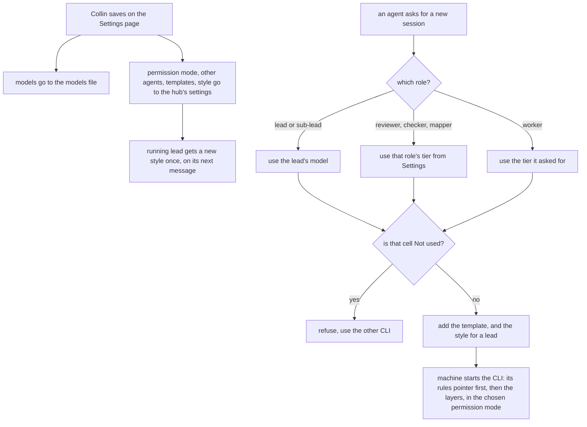

# A Settings page for how agents run and behave

**Idea:** `IDEA.md` — what this is for and why, in plain language. Read it first; it is
the north star this plan serves. Goal and Constraints live there, not here, so they don't
get buried as this file grows.

Map: `MAP.md` (sessions, thread page, serving), with detail in `docs/maps/app-sessions.md`.
Source proposal: `docs/proposals/app-settings/proposal.md`.

## Open Questions

None.

## Watch List

| # | Noticed | What needs looking into | Raised to user? | Outcome |
|---|---------|-------------------------|-----------------|---------|
| W1 | The running app refuses the `title` card kind, the `doc` field on question cards, and `resolve` on question cards, all of which `protocol/app/cards.md` and `viewer/app/API.md` on main allow | The installed services likely predate main; not this feature | yes (in chat) | waved off: outside this feature, raised to Collin |
| W3 | What Claude's pane shows in bypass mode, and whether it asks for a one-time confirmation in an interactive session | The implementer must check against the installed CLI and handle both in the ready test | no | settled into the Spec as a requirement |
| W2 | The heads-up from `/v1/preflight` is discarded by the hub (`viewer/app/ready.js:17-24`) | Needed for the switch/skip on the page | no | settled: the hub runs `model.sh check --json` itself (Spec, heads-up) |

## Decision Log

Append-only. A reversal is a new entry superseding the old, never an edit.

| # | Decision | Rationale | Source |
|---|----------|-----------|--------|
| 1 | Asides are not built here; the side-conversations thread owns them | They need none of the settings work; avoid building them twice | user |
| 2 | Accounts, usage, balancing and providers beyond Claude and GPT split into their own stub thread ("Accounts, usage and balancing") | Nothing reads usage today and accounts need per-account login folders; the rest has a slot ready (`role_prompt`) | user |
| 3 | The lead's model is a setting, defaulting to Claude Opus 5.5, not a fixed rule | Collin: "that's my preference … not a global rule" | user |
| 4 | Settings sidebar entries without a design here (Accounts, Usage, Nodes, Diagrams, Notifications) are left out of the sidebar until their thread builds them | Nothing to show; dead links read as broken | defaulted |
| 5 | Templates and the writing style reach an agent through the machine service's existing `role_prompt` (`machine/service.js:245`, `283-286`), composed by the hub as built-in pointer, then template, then (leads only) style | The slot exists and is fixed at start, matching "applies to agents started after saving" | defaulted |
| 6 | Rename the tiers everywhere: Luna→Light, Terra→Standard, Sol→Heavy, Astra→Critical in the app, `protocol/`, `codex/model.sh`, the pins file and tests; the old names stay accepted as aliases | One vocabulary; aliases keep existing pins files and old plan docs readable | user |
| 7 | One models file: the Settings page reads and writes the hub machine's models file (`~/.wheelchair/models`), extended to hold Claude's cells, "Not used" and the lead's model; `codex/model.sh` (or its successor) stays its only parser and writer, used by both the hub and the terminal workflow | Follows from 6: one vocabulary and one source, so the terminal workflow and the app never disagree | defaulted |
| 8 | The Models screen here builds the tier table (Claude, GPT), the lead's model, and "Other agents" (plan reviewers, checker, code mapping). Worker provider order, Save Claude for leads, the margin, rules by kind of work (UI, critical marking, suggested rules) and the asides row go to the "Accounts, usage and balancing" thread | Everything kept here works without usage data; the deferred parts are about running low, which needs the balancer | user |
| 9 | Critical here means only that the tier is startable and resolves through the table (fixing today's refusal of Astra); marking parts critical and the cross-check by another provider's Critical model are rules by kind of work, so they go with decision 8 to the accounts thread | Follows from 8 | defaulted |
| 10 | Claude sessions get a permission mode setting: auto (today's) or bypass. Codex is unchanged (`-a never`, sandboxed to its worktree) | Bypass is what Collin assumed sessions did; auto stays as the tested fallback | user |
| 11 | A saved writing style reaches running leads too: the next message the hub delivers to each live lead after the save carries the new style once. IDEA's Not doing gains this one exception | Threads live for days; waiting for a lead restart would hide the change. Collin agreed to the IDEA change on the card | idea-change |
| 12 | The style preview is a real rewrite of a fixed sample by Claude's Light model, run when Collin presses Preview, not live on every change | Honest preview of his own words without a model call per keystroke | user |
| 13 | The lead's model is one `lead` slot per provider in the models file (defaults Claude Opus 5.5, GPT Heavy); the thread's CLI still picks the provider | Decision 3 without the balancing-dependent fallback choices | defaulted |
| 14 | Reviewer, checker and mapper tiers come from Settings ("Other agents"); the cross-family rule for which provider stays in `lead.md` | The design's "two providers" / "not the provider that built it" is already the lead's rule | defaulted |
| 15 | Effort is a per-cell option for Claude only (`--effort`); GPT cells take none | The design's only effort choice is "Opus 5.5, highest effort" | defaulted |
| 16 | `codex/model.sh` keeps its path while covering Claude too | Moving it touches every protocol reference for no behavior gain | defaulted |
| 17 | Running leads get a new style as a `[wc:style]` trailer at the end of their next delivered message, stripped from the chat | A trailer keeps start-of-message markers working and stays out of Collin's bubble | defaulted |
| 18 | IDEA narrowed: the newer-model notice is GPT only (Claude cells offer "Latest" family aliases instead), and Critical here means startable, not parts marked critical | Round 1 intent findings; follows decision 9 | idea-change |
| 19 | The "when the brief doesn't settle something" switch is offered on worker templates only, and `worker.md` names its escalation rule as the one built-in rule a template may change; decided questions are flagged in the report | Collin designed the switch; the alternative (no effect) would make it a dead control | defaulted |
| 20 | "Pick, record it, keep going" really lets workers decide: `worker.md`'s escalation rule is the one built-in rule a worker template may change, and IDEA's constraint names that exception | Collin, on the card | user / idea-change |
| 21 | Supersedes 5: the hub sends `role_layers` and the machine service composes its own role-file pointer first, so remote machines with a different clone path work | Round 3 mechanics finding | review-round-3 |

## Spec

The settled design. A fresh agent with no conversation history implements from this section.

How a new session picks up what Settings says: Collin saves a choice; the models go to the
models file and everything else to the hub's settings. When any agent asks for a session,
the hub picks the model from the session's role (lead's model, the Other agents tier, or the
worker's requested tier) and stops if that cell is Not used. It then adds the template and,
for a lead, the writing style, and the machine starts the CLI in the chosen permission mode
with its own pointer to the role rules first. A lead that is already running gets a newly
saved style once, at the end of its next message.



### Scope

Builds: a Settings page in the hub app with three sections (Models and preferences,
Behavior templates, Writing style), the settings store and API behind it, the tier rename,
the hub's per-role model resolution, the permission mode, templates and style reaching
agents, and the style preview. Follows `docs/proposals/app-shell/design/SettingsModels`,
`SettingsTemplates` and `SettingsWriting` (`.dc.html`) for layout and wording, minus the
parts listed as non-goals.

Non-goals (do not build, do not stub in the UI): Accounts, Usage and balancing, Nodes,
Diagrams and Notifications sections; provider rows other than Claude and GPT and the "Add a
coding CLI" buttons; the "Providers covering it" row; Leads' provider fallback choices
("Claude, then GPT heavy", "Either"); Save Claude for leads; the Claude margin; "Workers try
these in order"; rules by kind of work, including critical marking and suggested rules; the
Asides row of Other agents; account counts ("2 accounts") on provider rows; anything about
asides. Running agents are not changed, except the style delivery below.

### Tier names

- Four tiers, everywhere: **Light** (was Luna), **Standard** (Terra), **Heavy** (Sol),
  **Critical** (Astra). Every file that names a tier uses the new name: `viewer/app/sessions.js`,
  `viewer/app/API.md`, `codex/model.sh`, `protocol/lanes.md`, `protocol/app/sub-lead.md`,
  `protocol/app/lead.md`, `protocol/implementation.md`, `protocol/verification.md`,
  `protocol/plan-review.md`, `protocol/templates/COMPLETION.md`, and the codex, installer and
  hub test suites (full list: `docs/maps/app-sessions.md`, "Every place the tier names …").
- Old names are accepted on input wherever a tier is read and mean the new tier:
  `luna|terra|sol|astra` → light/standard/heavy/critical for any CLI, and Claude's current
  `haiku|sonnet|opus` → light/standard/heavy. These old names now mean slots, not models:
  `--tier opus` runs whatever the Heavy cell holds. `viewer/app/API.md` and `sub-lead.md`
  say so in their alias line. Output always uses the new name. Old plan
  documents under `docs/plans/` are history and are not edited.
- GPT model names (`gpt-6-luna` …) are model names, not tier names, and are unchanged.
- `top` stays accepted and means Heavy for a worker (see resolution below).
- Terminal workflow Claude lanes follow the table too. `protocol/lanes.md`'s Claude lane
  section (`:153-167`) and ladder (`:208`) change to: launched from a shell,
  `WHEELCHAIR_LANE=1 claude --model "$(<root>/codex/model.sh claude <tier>)" -p …` (adding
  `--effort` when `model.sh effort claude <tier>` prints one); launched with Claude Code's
  Agent tool, which takes only family aliases, the family of that tier's model
  (`haiku`/`sonnet`/`opus`/`fable`, from `model.sh family claude <tier>`). Review lanes use
  the Heavy tier. When `model.sh family` exits 3 (an "Other…" model with no family word),
  or the cell names an exact version or an effort that matters, the lane is launched from
  a shell instead, so it runs the exact model; `lanes.md` says the Agent tool path follows
  the family only. A tier set to `none` for Claude means the terminal workflow uses the GPT
  lane for it.

### The models file

- One file, the hub machine's `~/.wheelchair/models` (`WHEELCHAIR_MODELS` overrides, as
  today). `codex/model.sh` stays its only parser and writer (the path is kept to avoid
  churn); the hub calls it, never parses the file itself.
- Format, one entry per line, `#` comments allowed:
  - `<provider>.<slot> = <model>` or `<provider>.<slot> = none` ("Not used"), where provider
    is `claude` or `gpt` and slot is `light`, `standard`, `heavy`, `critical` or `lead`.
  - A Claude entry may end in ` @<effort>` with effort one of `low medium high xhigh max`
    (Claude's `--effort` values). GPT entries take no effort.
  - `skip = <model>` as today.
  - Legacy lines `<tier> = <model>` (old or new tier name, no provider) mean `gpt.<tier>`.
    A file with only legacy lines (every pins file today) reads correctly. `lead` and `none`
    are not valid in legacy lines.
  - Any other line makes the file malformed, as today: readers fall back to the shipped
    defaults and the heads-up says so.
- Shipped defaults: `claude.light = claude-haiku-5-5`, `claude.standard = claude-sonnet-5-5`,
  `claude.heavy = claude-opus-5-5`, `claude.critical = claude-fable-5-2`,
  `claude.lead = claude-opus-5-5`; `gpt.light = gpt-6-luna`, `gpt.standard = gpt-5.6-terra`,
  `gpt.heavy = gpt-6.1-sol`, `gpt.critical = gpt-6-astra`, `gpt.lead = gpt-6.1-sol`. (The
  proposal named Fable 5.1; Fable 5.2 is the current model.)
- Writing always renders the new form, every provider and slot, plus skips, under the
  existing lock and atomic replace.
- `model.sh` commands (old forms keep working and act on `gpt`):
  - `model.sh <tier>` → GPT model for that tier, as today (`none` exits 3 with
    "gpt is not used at <tier>").
  - `model.sh <provider> <slot>` → the model; exits 3 with "<provider> is not used at
    <slot>" when `none`.
  - `model.sh effort <provider> <slot>` → the effort, or nothing.
  - `model.sh family claude <slot>` → `haiku`, `sonnet`, `opus` or `fable`, the first of
    those words found in the model name (exit 3 if none).
  - `model.sh set <provider> <slot> <model|none> [effort]`; `set <tier> <model>` = gpt.
  - `model.sh skip <model>`, `init`, `check` as today; `check --json` prints
    `[{kind:"newer"|"available"|"tierless"|"malformed", tier, model, current}]` with the same
    rules the text form uses; the text form is unchanged apart from tier names.
  - `model.sh show --json` prints `{claude:{light:{model,effort}|null,…,lead},gpt:{…},
    malformed:bool}` for the Settings page.
- Validation: model values match the existing `VALUE` pattern.

### How the hub picks a session's model

`resolveModel` (`viewer/app/sessions.js:21-35`) becomes per role:

| Role | Model |
|---|---|
| lead, sub-lead | the CLI's `lead` slot; the request's tier is ignored |
| reviewer | the Settings "Plan reviewers" tier (default Heavy) |
| verifier | the Settings "Checker" tier (default Heavy) |
| mapper | the Settings "Code mapping" tier (default Standard) |
| worker | the request's tier (`top` = Heavy) |

- The tier is looked up for the session's CLI (`claude` → provider `claude`, `codex` →
  `gpt`) through `model.sh <provider> <slot>` and passed to the machine as `model`, plus
  `effort` for Claude when set. Claude no longer starts without `--model`.
- A slot set to `none` refuses the start with 400: "<provider> is not used at <tier>; use the
  other CLI". An unknown tier is 400 with the list of valid ones.
- Critical is startable on both CLIs (today `astra` is refused).
- The machine service passes `effort` as `--effort <value>` to Claude only.
- `protocol/app/lead.md` and `sub-lead.md` are updated: lead keeps passing `--tier top` (now
  ignored for the roles above, and documented as such); the sub-lead's tier list becomes
  `light`, `standard`, `heavy`, `critical` (or `top`) for both CLIs, and its ladder text
  uses the new names; reviewer, verifier and mapper tiers are named as coming from Settings.

### Settings store

- `<hub state dir>/settings.json` (beside `machines.json`, `viewer/app/state.js:45-46`),
  written atomically through `State.queued`, mode 0600. Missing file = defaults. Holds:
  `permission_mode` (`auto` | `bypass`, default `auto`), `other_agents`
  (`{reviewer, verifier, mapper}` tiers, defaults heavy/heavy/standard), `templates`
  (below), `style` (below) and `style_version` (integer, bumped on each style save).
- Model choices are not in it; they are in the models file.
- `other_agents` governs app sessions only. The terminal stages (`/plan-review`,
  `/verify`, mapping) keep the tiers their protocol documents name. The Other agents panel
  says so in one line: "For threads in the app. Terminal commands keep their own rules."

### Permission mode

- Claude only: **Auto** (default) or **Bypass**. Shown on Models and preferences under the
  lead's model, with one line: "Codex never asks: it runs sandboxed to its worktree."
- Applies to sessions started after saving. The hub sends `permission_mode` on
  `POST /v1/sessions`; the machine service passes `--permission-mode auto` or
  `--permission-mode bypassPermissions` (`machine/service.js:254`). Missing = auto.
- Readiness (`machine/service.js:297-300`) recognises the bypass pane as ready the way it
  recognises "auto mode on" today. Any one-time confirmation Claude shows on entering
  bypass must not block the start: the implementer checks the installed Claude CLI's pane
  in bypass mode and either answers it the way the service answers the folder-trust prompt
  or suppresses it through the per-session settings file, and records which in the Log.

### Behavior templates

- A template: `{id, name, role, scope, switches, text}`. `role` is one of `lead`, `sub-lead`,
  `worker`, `reviewer`, `verifier` (shown as "Checker"), `mapper`. `scope` is `all` or a
  project path from `projects.json`. `switches`, all optional:
  - `save_every_step` (bool), `full_tests_before_done` (bool),
  - `packages`: `ask` | `go` | `never` ("Ask the lead first", "Go ahead", "Never"),
  - `unsettled`: `ask` | `decide` ("Ask the lead", "Pick, record it, keep going"), offered
    on worker templates only. `protocol/app/worker.md`'s "When the plan did not settle
    something" (`:25-33`) is the one built-in rule a template may change, and it says so:
    with `decide`, the worker picks the option it judges best, keeps going, and lists the
    question, the options and its pick under its report's choices, flagged "decided under
    the template, not asked"; with `ask` or no template, the rule stands as written.
    `protocol/app/sub-lead.md:105-109` keeps that flag when it copies the choice into
    PLAN.md's Log (`Choice (decided under the template): …`).
  - The Templates page's layer stack keeps the design's three layers but its footer reads
    "Where they disagree, the lower layer wins. Nothing overrides layer 1." for every role,
    and on a worker template adds "…except this template's 'Pick, record it, keep going'". Layer 1's caption drops "can't be turned off"
    for workers.
  - `file_limit`: integer ≥ 1 or absent.
  `text`: free text, at most 4000 characters.
- In use: per role, at most one template is in use for `all` and one per project. Marking a
  template in use clears the previous one for the same role and scope. A project-scoped
  template in use beats the `all` one for sessions in that project. A role with none in use
  gets no template layer. The page lists templates grouped by role with "in use" tags, as
  the design does; New template, Save, Duplicate and Delete act on them.
- Each switch renders to one fixed English sentence (the implementer writes them, plain,
  one per value; e.g. `packages: ask` → "Before installing a new package, ask whoever
  started you."). The template layer is those sentences, then `text` as is.
- "N <role>s are using this now": live sessions in any thread whose recorded
  `template_id` is this template. The hub records `template_id` (or null) on each session at
  start.
- "See it in full" shows the exact composed starting instructions for that role (below).

### What an agent is told at start

The session may run on another machine whose wheelchair clone lives elsewhere, so the hub
never writes a path. It sends a new optional field `role_layers` (text) on
`POST /v1/sessions`; the machine service composes the starting instructions itself, in
order:
1. The service's own pointer, as today (`machine/service.js:245`, `283`), with its local
   root: `Read <its root>/protocol/app/<role>.md before responding. It is wheelchair's
   built-in rules for your role.` The second sentence is new and goes on every session's
   pointer, layers or not (today it is only `Read <roleFile> before responding.`);
   `machine/test/run.sh`'s expected pointer text changes with it.
2. `role_layers`, when present, appended after a blank line. The hub composes it as:
   - one line: "Nothing below overrides the built-in rules above" (for a worker whose
     template has `unsettled: decide`: "…above, except where your template says to decide
     unsettled questions yourself");
   - if a template applies: a heading line naming it as Collin's behavior template for this
     role, its sentences and text, then "Where the template and the brief you are given
     disagree, the brief wins.";
   - for a lead only, always (the defaults below until Collin saves one): a heading line
     naming it as Collin's writing style for everything he reads (thread replies and the
     text of cards), then its rendering (below).
   The brief itself still arrives as the first message, as today.
- The service's existing `role_prompt` override (never sent by the hub) is left as is;
  `role_layers` is ignored when `role_prompt` is given. For Codex the composed text goes in the first `[wc:role]` message
  (`service.js:284-286`), as the pointer does today.
- "See it in full" shows the composition with the hub's own root in line 1.
- The cap below applies to `role_layers`.
Total `role_layers` length is capped at 12000 characters; the API refuses a template or
style save that would exceed it. Templates and style apply to sessions started after
saving.

### Writing style

- Leads only. The section's "Covers" line lists thread messages, question cards, and the
  Plan approved and Done cards; it omits the design's "Phone notifications", which belong to
  the deferred Notifications section.
- `style`: `length` (`short` | `balanced` | `thorough`), `lists`
  (`prose` | `when-helpful` | `always`), `terms` (`build-up` | `freely` | `avoid`),
  `never_say` (list of phrases), `text` (free text, at most 2000 characters). Defaults are
  Collin's starting style: short, when-helpful, build-up, never say "It's worth noting" and
  "load-bearing", and the two sentences of free text in `SettingsWriting.dc.html`.
- Rendering: one fixed sentence per choice, the never-say list as one sentence listing the
  phrases, then `text`. The same rendering is used at start, on delivery and in the preview.
- Delivery to running leads: `style_version` starts at 0 (the defaults) and each save
  increments it. When `deliver` (`viewer/app/sessions.js:208-233`) submits a message to a
  live `lead` session whose `style_version` is lower than the current one (a missing value,
  such as on a lead started before this feature, counts as 0, so it owes nothing until the
  first save), it appends to that message's text a
  trailer: a blank line, `[wc:style]`, and the rendering, saying it replaces any earlier
  style; then sets the session's `style_version`. A lead started after the save records the
  current version at start and owes nothing. The `sent` record keeps the text as submitted.
- The chat (`viewer/app/chat.js`) strips a trailing `[wc:style]` block from human items
  before display, so Collin's bubble shows only what he typed or pressed, and the existing
  start-of-message markers (`[wc:from …]`, `[card …]`) keep working because the trailer is
  at the end.
- `protocol/app/cards.md`'s marker table gains the `[wc:style]` trailer; `lead.md`'s "How
  you talk to Collin" says to follow the writing style in the starting instructions, a
  later `[wc:style]` trailer replacing it, under the rules of `lead.md` and `cards.md`.
  `protocol/app/AGENTS.md:23-25` is updated to say leads follow Collin's style while the
  wording hook stays off.

### Style preview

- The Writing style section shows "Without your style" (a fixed sample, the design's
  text) and "With your style" (empty until previewed) and a **Preview** button.
- Preview sends the unsaved style to `POST /wheelchair/api/settings/style/preview`; the hub
  calls the hub machine's new `POST /v1/preview` `{prompt, model}`, which runs
  `claude -p --model <model> --permission-mode dontAsk` with `WHEELCHAIR_LANE=1`, the prompt
  on stdin (no tool is needed; `dontAsk` denies any that would prompt), a 60 s timeout, and returns `{text}`. Model = the `claude.light`
  slot, or `claude-haiku-5-5` if it is `none`.
- The prompt asks for the sample rewritten under the rendered style, output only.
- The hub's machine client times requests out after 5 s (`viewer/app/machine-client.js:28`,
  `:42`). The preview call passes a per-request timeout of 75 s (the client gains an optional
  timeout argument; every other call keeps 5 s).
- While running the button shows a spinner and is disabled. Errors (Claude not installed or
  not logged in, timeout, non-zero exit) show one plain line under the panel; nothing is
  saved by previewing.

### The newer-model heads-up

- `GET /settings` includes the heads-up from `model.sh check --json`, run by the hub on the
  hub machine. Models and preferences shows each item as one line on the GPT row's tier
  with **Switch** (`model.sh set gpt <tier> <model>`) and **Skip** (`model.sh skip <model>`),
  then reloads. Tierless items list the model with **Skip** only. A malformed file shows one
  line with **Reset to defaults** (writes the shipped defaults).

### Settings page

- Route `/wheelchair/app/settings` (`APP_PAGES`, `viewer/server.js:1830`), files
  `viewer/pages/settings.html|js|css`, and a fourth nav link "Settings" (`viewer/pages/nav.js:38-42`).
- Desktop: the design's left section list with the three sections only; phone width: the
  list becomes a row of tabs above the section, no horizontal page scroll. The section is in
  the URL hash so a reload keeps it.
- Models and preferences: the tier table (rows Claude "Claude Code" and GPT "Codex"; columns
  Light, Standard, Heavy, Critical with the design's one-line descriptions); each cell a
  picker of the provider's models plus "Not used", and for Claude an effort picker (default
  "CLI default"). Claude's list: "Latest Haiku", "Latest Sonnet", "Latest Opus", "Latest Fable" (stored as
  the CLI aliases `haiku`, `sonnet`, `opus`, `fable`, which the Claude CLI resolves to the
  newest model of that family), then `claude-haiku-5-5`, `claude-sonnet-5-5`,
  `claude-opus-5-5`, `claude-fable-5-2`. GPT's list: models visible in the Codex models
  cache plus the current values. Both lists end with "Other…", a text entry validated by
  the models file's `VALUE` pattern. The current value always appears in the list even when
  unknown. The newer-model heads-up is GPT only; Claude's way to stay current is a "Latest"
  alias. Then "Leads and
  sub-leads run on": one picker per provider (same lists, no Not used). Then Permission
  mode. Then Other agents: Plan reviewers, Checker, Code mapping, each a tier picker, with
  the design's explanatory lines (reviewers and checker keep the cross-family rule from
  `lead.md`, so the lines say "two providers when both are installed" and "not the provider
  that built it"). Each change saves at once and shows "Saved, applies to new sessions".
- Behavior templates and Writing style as in their designs, with explicit Save.

### Settings API (browser routes, `viewer/app/routes.js`, documented in `viewer/app/API.md`)

| Route | Request | Response |
|---|---|---|
| `GET /settings` | — | `{models, model_options, heads_up, permission_mode, other_agents, templates, in_use, style, projects}` |
| `PUT /settings/models` | `{provider, slot, model\|null, effort?}` | the new `models` |
| `POST /settings/models/heads-up` | `{action:"switch"\|"skip"\|"reset", tier?, model?}` | `{models, heads_up}` |
| `PUT /settings/preferences` | `{permission_mode?, other_agents?}` | the saved values |
| `POST /settings/templates` | template without `id` | the template with `id` |
| `PUT /settings/templates/:id` | template fields, `in_use?` | the template |
| `DELETE /settings/templates/:id` | — | `{ok:true}` |
| `PUT /settings/style` | style | `{style, style_version}` |
| `POST /settings/style/preview` | style | `{before, after}` |
| `GET /settings/prompt?role=&project=` | — | `{text}`, the composed starting instructions |

Invalid input is 400 with the reason; unknown template 404. Writes follow the existing
browser-route rules (remember cookie, origin check).

### Edge cases

- Models file missing: shipped defaults; the first write creates it.
- A legacy pins file is rewritten in the new form on the first Settings write, keeping its
  GPT values and skips.
- Deleting a template that is in use: allowed; the role falls back to the `all` template or
  none. Running sessions are unaffected.
- A project removed from `projects.json`: its templates stay, shown as "project no longer
  listed".
- A lead with a queued message when the style changes gets the trailer on that message.
- Codex leads get the same composed instructions through their first `[wc:role]` message
  (`service.js:284-286`) and the same trailer.

### Validation

```bash
bash codex/test/run.sh                # new file format, legacy read, aliases, none, effort, check --json, show --json
bash machine/test/run.sh              # permission_mode argv and bypass readiness, effort, role_layers composed after the local pointer, /v1/preview
bash install/test/run.sh              # renamed tier names in installer assertions
node --test viewer/test/*.test.js     # resolveModel per role, none refusal, critical startable, settings routes, templates in use, role_layers composition and cap, style trailer once, chat strips trailer
npm --prefix viewer run test:browser  # Settings page: three sections, table edit saves, phone width tabs, template save, preview button states
grep -rnE '\b(luna|terra|astra)\b|\bSol\b' protocol viewer/app codex machine --include=*.md --include=*.js --include=*.sh | grep -v 'gpt-'   # only alias tables and tests remain
```

### Handed to the "Accounts, usage and balancing" thread

Its stub summary predates decisions 8 and 9. Besides accounts, usage and balancing, that
thread also owns, from `SettingsModels`: worker provider order, Save Claude for leads, the
Claude margin, rules by kind of work (UI and front end, critical marking and its
cross-check, suggested rules), and the providers beyond Claude and GPT as rows of the
table built here.

## Accepted Risks

| Risk | Why accepted | Round |
|------|--------------|-------|

## Review Rounds

### Round 1 — 2026-11-15

**Lanes:** Codex / Heavy (gpt-6.1-sol), mechanics; Claude / CLI default, intent; cross-family: yes.

**Outcome:** not clean (1 blocking, 4 major upheld, all fixed in the Spec). Round 2 to follow.

**Changed since Round N-1:** n/a (first round — whole Spec in scope)

| Lane | Reported | Finding | Lead verdict | Resolution |
|------|----------|---------|--------------|------------|
| Claude intent | major | Decision 7's "one source" is not met for Claude: the Spec never makes terminal Claude lanes read the models file (`protocol/lanes.md:155-157`, `:208`) | upheld | Spec "The models file" and "Tier names": `lanes.md` Claude lanes launched from a shell use `model.sh claude <tier>`; Agent-tool lanes use the family alias of the cell's model |
| Claude intent | major | Claude's model list is fixed and the heads-up is GPT-only, so a new Claude release needs a code change | upheld | Claude picker gains "latest of family" aliases (`haiku`, `sonnet`, `opus`, `fable`, which the CLI resolves to the newest); both pickers gain "Other…" free entry. IDEA's heads-up line narrowed to GPT: idea-change, asked on a card |
| Claude intent | minor | IDEA's "A Critical part of a build actually runs on a Critical model" implies critical marking, which decision 9 moved out | upheld | IDEA line reworded with the same card |
| Claude intent | minor | Writing style design lists "Phone notifications" under Covers; the Spec is silent | upheld | Spec: the Covers line lists thread messages and cards only; notifications are part of the deferred Notifications section |
| Codex mechanics | blocking | Preview uses `--permission-mode default`, which the installed CLI rejects | upheld | Checked `claude --help`: choices are acceptEdits, auto, bypassPermissions, manual, dontAsk, plan. Spec uses `dontAsk` |
| Codex mechanics | major | Preview allows 60 s but the hub's machine client aborts after 5 s | upheld | Confirmed `viewer/app/machine-client.js:28,42`; Spec adds a per-request timeout of 75 s for the preview only |
| Codex mechanics | major | Live leads have no `style_version`, and `undefined < n` is false, so they never get the style | upheld | Spec: missing counts as owing; version starts at 0 = defaults; new leads always get the style (defaults until saved) |

### Round 2 — 2026-11-15

**Lanes:** Codex / Heavy (gpt-6.1-sol), mechanics; Claude / CLI default, intent; cross-family: yes.

**Outcome:** not clean (2 major upheld, fixed in the Spec).

**Changed since Round 1:**
- Terminal Claude lanes read the models file (`model.sh claude <tier>`, `model.sh family claude <tier>`); lanes.md Claude section changes ("Tier names").
- Claude picker: "Latest Haiku/Sonnet/Opus/Fable" aliases; both pickers gain "Other…" free entry; heads-up is GPT only (IDEA narrowed, decision 18).
- IDEA: Critical means startable; heads-up GPT only.
- Writing style "Covers" line omits phone notifications.
- Preview runs `claude -p --permission-mode dontAsk`; preview request gets a 75 s machine-client timeout.
- style_version starts at 0 (defaults); a missing value counts as owing; new leads always get the style.

| Lane | Reported | Finding | Lead verdict | Resolution |
|------|----------|---------|--------------|------------|
| Claude intent | major | "Other agents" tiers live only in `settings.json`, so terminal `/plan-review` and `/verify` don't follow them, against decision 7 | upheld | Decision 7 covers models per tier; role tiers are app-only. Spec "Settings store" says so and the panel states it in one line |
| Claude intent | minor | Missing `style_version` counted as owing sends the default style to every running lead on deploy, beyond IDEA's exception | upheld | Missing counts as 0; owes only after the first save |
| Claude intent | minor | Agent-tool lane behaviour undefined when `family` exits 3, and exact version/effort are lost on that path | upheld | Spec: such lanes launch from a shell; `lanes.md` documents the Agent path follows family only |
| Claude intent | minor | Old tier names `haiku/sonnet/opus` now mean slots, which can surprise next to the "Latest" aliases | upheld | Spec: alias lines in `API.md` and `sub-lead.md` say old names mean slots |
| Codex mechanics | major | `unsettled: decide` contradicts `worker.md:27-33`, which no template may override | user-decision | It also collides with IDEA's constraint that templates never override built-in rules; Collin picked "Really pick" (decision 20); Spec as decision 19, IDEA constraint gains the named exception |

### Round 3 — 2026-11-15

**Lanes:** Codex / Heavy (gpt-6.1-sol), mechanics; Claude / CLI default, intent; cross-family: yes.

**Outcome:** not clean (1 major upheld, fixed in the Spec).

**Changed since Round 2:**
- Other agents tiers are app-only; the panel says so ("Settings store").
- `style_version`: missing counts as 0; owes only after the first save.
- Agent-tool Claude lanes fall back to a shell launch when the cell has no family word, an exact version or an effort ("Tier names").
- Old tier names `haiku/sonnet/opus` documented as slots, not models.
- `unsettled: decide` on worker templates only; `worker.md`'s escalation rule is the one rule a template may change; IDEA constraint names the exception (decisions 19, 20).

| Lane | Reported | Finding | Lead verdict | Resolution |
|------|----------|---------|--------------|------------|
| Claude intent | minor | IDEA "What good looks like" still says templates can never override | upheld | IDEA line points to the Constraints exception |
| Claude intent | minor | Design's layer-stack text "nothing overrides layer 1" becomes false | upheld | Spec gives the page's replacement footer and caption |
| Claude intent | minor | The composed prompt never says template vs brief precedence | upheld | Spec adds the design's "lower layer wins" line to the composed prompt |
| Claude intent | minor | `sub-lead.md` drops the "decided under the template" flag when logging choices | upheld | Spec: `sub-lead.md:105-109` keeps the flag |
| Codex mechanics | major | A hub-composed `role_prompt` carries the hub's path to the role file, wrong on a machine whose clone lives elsewhere | upheld | Checked `machine/service.js:244-245` and `viewer/app/hub.js:17`. Spec: hub sends only `role_layers`; the service writes the pointer with its own root |

### Round 4 — 2026-11-15

**Lanes:** Codex / Heavy (gpt-6.1-sol), mechanics; Claude / CLI default, intent; cross-family: yes.

**Outcome:** clean (mechanics: no findings; intent: three minors, upheld and fixed).

**Changed since Round 3:**
- Starting instructions: hub sends `role_layers`; the machine service writes the role-file pointer with its own root ("What an agent is told at start").
- Precedence lines: built-in rules first (worker `decide` exception), template, "the brief wins" over the template.
- Templates page layer-stack footer and caption text replaced; `sub-lead.md` keeps the "decided under the template" flag.
- IDEA "What good looks like" points at the Constraints exception.

| Lane | Reported | Finding | Lead verdict | Resolution |
|------|----------|---------|--------------|------------|
| Claude intent | minor | The pointer's new second sentence is a change to every session's prompt, not a move | upheld | Spec says so and names the test change |
| Claude intent | minor | "the hub no longer sends `role_prompt`" implies a call that never existed | upheld | Reworded: the service override is untouched and wins over `role_layers` |
| Claude intent | minor | The layer-stack footer's worker exception was page-wide | upheld | Footer exception shown on worker templates only |

## Prior Work

| Spec item | State | Evidence (file:line) | Confidence |
|-----------|-------|----------------------|------------|

## Implementation Tasks

| # | Objective | Ownership boundary | Lane | Session id | Validation | Status |
|---|-----------|--------------------|------|-----------|------------|--------|
| T1 | Models file: `codex/model.sh` both providers, new format, commands, aliases, `check --json`, `show --json`, `reset` | `codex/`, `install/test/run.sh` (models-file assertions) | Codex / Terra (gpt-5.6-terra) | wc-983d91c069d3-worker | `bash codex/test/run.sh`; `bash install/test/run.sh` | done (coverage gap → T1b) |
| T1b | Restore the ~45 `codex/test/run.sh` assertions T1 dropped, ported to the new names and file format | `codex/test/run.sh` | Codex / Light (gpt-6-luna) | wc-983d91c069d3-worker-4 | `bash codex/test/run.sh` | done |
| T2 | Machine service: `permission_mode` + bypass readiness, `effort`, `role_layers` after the local pointer, `/v1/preview` | `machine/` | Claude / Sonnet | wc-983d91c069d3-worker-2 | `bash machine/test/run.sh` | done |
| T3 | Hub: per-role `resolveModel`, settings store and routes, template/style composition and cap, style trailer, chat stripping, machine-client timeout, `API.md` | `viewer/app/`, `viewer/test/*.test.js` | Codex / Terra (gpt-5.6-terra) | wc-983d91c069d3-worker-5 | `node --test viewer/test/*.test.js` | done (defects → T3b) |
| T3b | Serialize settings read-modify-write; Claude-only `haiku/sonnet/opus` aliases; missing hub tests (cap, 75 s preview timeout, `scope_missing`, trailer once incl. Codex lead) | `viewer/app/settings.js`, `routes.js`, `state.js`, `sessions.js`, `viewer/test/*.test.js` | Codex / Standard (gpt-5.6-terra) | wc-983d91c069d3-worker-6 | `node --test viewer/test/*.test.js` | done |
| T4 | Settings page (three sections), nav link, `APP_PAGES`, browser tests | `viewer/pages/settings.*`, `viewer/pages/nav.js`, `viewer/server.js` (APP_PAGES), `viewer/test/*settings*.spec.js` | Claude / Sonnet | wc-983d91c069d3-worker-7 | `npm --prefix viewer run test:browser` | done |
| T5 | Protocol: tier rename and rule edits | `protocol/` (ten files named in its brief) | Claude / Sonnet | wc-983d91c069d3-worker-3 | rename grep over `protocol/` | done |

## Log

- 2026-11-15 — Sub-lead: the running hub predates the tier rename, so workers are started with today's tier names (`terra`, `sonnet`); the lane column uses the new names.
- 2026-11-15 — Sub-lead decision: `model.sh show --json` also returns `visible` (GPT models in the Codex models cache, newest first), so the hub never reads the cache itself; `model.sh reset` added as the writer behind "Reset to defaults".
- 2026-11-15 — Sub-lead decision: `/v1/preview` errors are 400 bad input, 503 Claude not installed, 504 timeout, 502 non-zero exit.
- 2026-11-15 — Sub-lead: T1, T2, T5 run in parallel; T3 starts once T1 is merged (its tests call the new `model.sh` commands); T4 once T3 is merged.
- 2026-11-15 — Choice: T5, `protocol/lanes.md`: one alias line, after the GPT tier list, not repeated in the Claude section.
- 2026-11-15 — Choice: T5, `protocol/lanes.md`: the Claude ladder has the same four rungs as GPT.
- 2026-11-15 — Choice: T5, `protocol/implementation.md`: "a Claude lane's entry needs no model" became "same form, with the model `model.sh claude <tier>` resolved".
- 2026-11-15 — Choice: T5, `protocol/verification.md`: Claude verifier "Opus" became "Heavy"; the YAML example `checks: sonnet` left as a family name.
- 2026-11-15 — Choice: T5, `protocol/templates/COMPLETION.md`: lane example became `"standard (lead: fable)" or "sonnet, standard"`.
- 2026-11-15 — Choice: T5, `protocol/app/sub-lead.md`: the verifier start line keeps "top tier"; the Settings sentence sits in Tiers.
- 2026-11-15 — Sub-lead: T5 accepted; the GPT measurement notes in `lanes.md` now read "Light"/"Heavy" for what was measured on Luna/Sol models; accepted, since the model names beside them stay.
- 2026-11-15 — Bypass readiness (Spec "Permission mode"): installed Claude Code 2.1.325's pane in bypass mode shows `bypass permissions on`; no confirmation appeared, because `~/.claude/settings.json` already sets `skipDangerousModePermissionPrompt`. The service does both: the per-session settings file sets that key for bypass sessions, and `checkReady` answers a "Yes, I accept" dialog with Down, Enter. Neither was seen against a live dialog (residual risk).
- 2026-11-15 — Choice: T2, `machine/service.js`: the skip-prompt key is set only for bypass sessions.
- 2026-11-15 — Choice: T2, `machine/service.js`: a session with no recorded `permission_mode` is auto for readiness.
- 2026-11-15 — Choice: T2, `machine/service.js`: `role_layers` is trimmed; whitespace-only counts as empty; non-string is 400.
- 2026-11-15 — Choice: T2, `machine/service.js`: `null` `effort`/`permission_mode` count as missing; any other invalid value, including `""`, is 400.
- 2026-11-15 — Choice: T2, `machine/service.js`: `/v1/preview` validates `model` against `[A-Za-z0-9._:[]-]+` and requires a non-blank prompt.
- 2026-11-15 — Choice: T2, `machine/service.js`: the 504 body always says "60 s"; a timed-out child is killed with SIGKILL; the timeout is an instance field tests shorten.
- 2026-11-15 — Choice: T2, `machine/service.js`: a spawn error other than ENOENT is 502 with its message.
- 2026-11-15 — Choice: T2, `machine/test/service.test.js`: the fake `claude -p` saves stdin to `<log>.stdin`.
- 2026-11-15 — Choice: T1, `codex/model.sh`: the rendered file's header reads "# wheelchair's model pins. Change them with codex/model.sh."
- 2026-11-15 — Sub-lead: T1's rewrite of `codex/test/run.sh` dropped about 45 existing assertions (numeric version order, malformed handling, skip dedupe, exit codes, cache edge cases, preflight exit codes). Behaviour re-checked by hand and correct; T1 merged to unblock T3, and the lost coverage is a new task T1b on the old file as the pattern to copy.
- 2026-11-15 — Choice: T1b, `codex/test/run.sh`: the preflight fixture symlinks a sibling `model.sh`, because `preflight.sh` calls it relative to its own directory.
- 2026-11-15 — Choice: T1b, `codex/test/run.sh`: the unparseable-pin fixture used `gpt-8.2-heavy`, following T1's behaviour. That exposed a T1 regression: a hand-set GPT pin's family fallback had become the new tier name (`heavy`), which no GPT model carries. The sub-lead fixed it in `codex/model.sh` (fallback = the tier's shipped family word, `sol`, as before the rename) and changed the fixture to `gpt-8.2-sol`; 70/70 pass.
- 2026-11-15 — Choice: T3, `viewer/app/settings.js`: the switch and style sentences are short imperatives the worker wrote (Spec left the wording to the implementer).
- 2026-11-15 — Sub-lead: T3 accepted with three viewer suite failures re-checked: the font-route and port-race lifecycle tests fail identically on the feature branch without T3 (worktree environment), and the global write-lock test passes on rerun (flaky under load). The real `~/.wheelchair/models` checksum was unchanged across the suite.
- 2026-11-15 — Sub-lead: T3 review found settings saves not serialized (load outside `State.queued`, so two quick saves from the page can lose one), `haiku/sonnet/opus` accepted for Codex too, and untested cap, 75 s preview timeout and `scope_missing`; merged to unblock T4, fixes in T3b.
- 2026-11-15 — Choice: T3b, `viewer/test/app-settings.test.js`: the 12000-character cap cannot be reached through valid fields (one 4000-character template plus a 2000-character style per role), so the template-cap test goes through the store's update seam and the style-route test uses a stored oversized legacy template.
- 2026-11-15 — Sub-lead: T3b accepted; 259/261 with only the two known environment failures; models checksum unchanged.
- 2026-11-15 — Choice: T4, `settings.js` tier table and lead pickers: changing a model keeps the cell's existing effort; lead pickers have no effort picker, so a lead's saved effort is preserved.
- 2026-11-15 — Choice: T4, `settings.js` Other agents: plain tier pickers; "Two providers when both are installed" and "Not the provider that built it" sit under the row names.
- 2026-11-15 — Choice: T4, `settings.js` Code mapping line reads "Maps how the existing code works before planning" (the design's "Same order as workers" belongs to a non-goal).
- 2026-11-15 — Choice: T4, `settings.js` Models section: a one-line hint under the table explains "Not used" and "CLI default", replacing the non-goal "Providers covering it" note; the lede drops "rules for a kind of work".
- 2026-11-15 — Choice: T4, `settings.js` heads-up: newer/available items sit in the GPT cell for their tier; tierless and malformed lines above the table.
- 2026-11-15 — Choice: T4, `settings.js` template switches: checked saves true, unchecked is omitted (never false); packages and unsettled always show a value, starting at "Ask the lead first" / "Ask the lead".
- 2026-11-15 — Choice: T4, `settings.js` template list: one group per role (Checker and Mapper separate, unlike the design's combined group); empty groups hidden; a project template in use shows "in use here".
- 2026-11-15 — Choice: T4, `settings.js` templates: added a "Mark in use" / "Stop using" footer button (the design has no control); it sends only `in_use`.
- 2026-11-15 — Choice: T4, `settings.js` Duplicate saves "<name> copy" at once from the editor's contents and opens it.
- 2026-11-15 — Choice: T4, `settings.js` Delete is a two-step inline "Delete" then "Really delete".
- 2026-11-15 — Choice: T4, `settings.js` layer stack: non-worker layer 1 keeps "can't be turned off"; layer 3 reads "The brief / What it is asked to do each time it starts".
- 2026-11-15 — Choice: T4, `settings.js` See it in full shows the saved composition, not unsaved edits.
- 2026-11-15 — Choice: T4, `settings.js` project labels: folder name plus "only", or the full path when two share a folder name.
- 2026-11-15 — Choice: T4, `settings.js` Writing style: the design's "Rewritten live …" line became "Preview rewrites the message under the style above, saved or not. It saves nothing."; a never-say phrase typed but not yet added is included on Save and Preview.
- 2026-11-15 — Choice: T4, `settings.js` save notes: templates "Saved. Changes apply to agents started after you save."; style "Saved" beside "Leads pick it up on their next message.".
- 2026-11-15 — Choice: T4, `settings.css` phone width: section tabs wrap labels instead of scrolling; the tier table becomes stacked cards.
- 2026-11-15 — Sub-lead: T4 accepted. Browser suite 428 passed, 2 failed: both are "no drawn arrow's line passes through either box …", which fails identically on main (`fb9e244`), so it predates this feature.
- 2026-11-15 — Sub-lead: all tasks merged; full validation on the integrated branch passes apart from three failures that also fail without this work (see COMPLETION.md). Routers `viewer/AGENTS.md` and root `AGENTS.md` updated by hand (highways not installed). Status set to verifying.
- 2026-11-15 — Verification attempt 1 (commit `10bf75b`): Claude verifier PASS; Codex verifier FAIL, 2 gaps (false switch values dropped by the page; `show --json` `visible` omitting models without a family word). Both upheld; REMEDIATION-1.md, tasks R1-1 (Claude Light) and R1-2 (Codex Light). The Claude verifier's minor notes (any non-empty template `scope` accepted by the API; `none` accepted for the `lead` slot by the API though the page never sends it) are not gaps and are left as is.
- 2026-11-15 — Remediation 1: R1-2 accepted (`listed_models` feeds `show --json`; check unchanged; codex suite 72/72). Choice: none beyond the brief.
