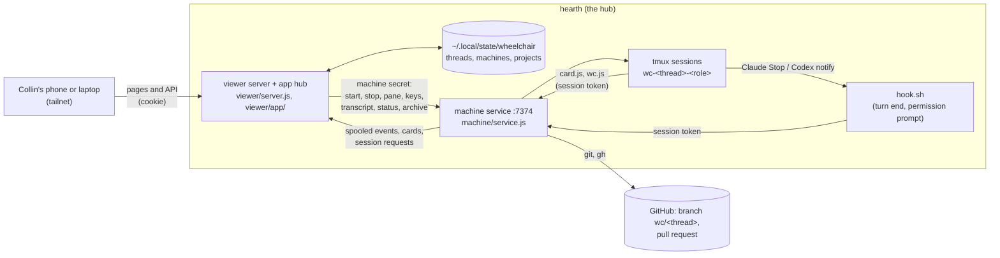

# Completion Report — Wheelchair as an app on the hub (slice 1)

Written for a hostile reviewer: every claim checkable, no claim without evidence. Line
numbers are at the commit that adds this file.

## What the change does



Collin talks to a lead in a thread. The hub starts every session through the machine
service, which runs it in tmux, so sessions outlive both services. Agents reach the hub only
through the service, with a per-session token; the hub reaches the service with the machine
secret. Chat is assembled from transcript copies the service keeps. The diagram leaves out
the Features and Sessions pages, the browser terminal and the stub watcher.

## Spec coverage

One row per Spec item. "Acceptance N" refers to the Spec's `### Acceptance` list; all 13
were run on hearth on 2026-11-14 against the throwaway repo `brilliantshine/wc-sandbox`
(PRs #1–#5).

| Spec item | Origin | Implemented at (file:line) | Validated by |
|---|---|---|---|
| Scope: slice 1 only, three follow-ups as proposals | this run | `docs/proposals/app-cutover/`, `docs/proposals/app-worker-machines/`, `docs/proposals/app-diagrams-uploads/` | lead review |
| Build step 1: transcript spike T1 | pre-existing | `docs/plans/app-shell/spike-transcripts.md:1-121` | lead review |
| Build step 1b: trust live check T1b | this run | `docs/plans/app-shell/spike-transcripts.md:123-213` | lead review |
| App server grows from the viewer: same port, prefix, cookie, origin check | this run | `viewer/server.js:2175-2188`, `viewer/server.js:1830-1863` | `app-pages.test.js` "an app page without the remember cookie gets the sign-in page", "the bookmark token signs a new browser in on an app page, and a wrong one does not" |
| Vendored xterm.js, no runtime npm deps | this run | `viewer/vendor/xterm/xterm.js`, `viewer/pages/terminal.html:6-9`, `viewer/server.js:1833` | `app-pages.test.js` "asset names outside pages/ and vendor/, or climbing out, are refused" |
| Machine service and hook as the `wheelchair-machine` user unit | this run | `machine/service.js:96`, `machine/hook.sh:1-30`, `install.sh:316-336` | `install/test/run.sh` "--serve enables and restarts the machine service with the viewer", "the machine unit gives agent sessions the installing PATH" |
| Sessions start with `WHEELCHAIR_LANE=1`; role files reference no old communication files | this run | `machine/service.js:249` | lead review |
| `protocol/app/` role files and cards.md | this run | `protocol/app/lead.md`, `sub-lead.md`, `mapper.md`, `worker.md`, `reviewer.md`, `verifier.md`, `cards.md` | lead review |
| Routers updated | this run | `AGENTS.md:36`, `AGENTS.md:58`, `machine/AGENTS.md`, `protocol/app/AGENTS.md`, `viewer/AGENTS.md:15-19`, `protocol/AGENTS.md:35` | lead review |
| Feature state in `docs/plans/<slug>/` | this run | `protocol/app/lead.md:99`, `protocol/app/lead.md:123-124` | Acceptance 3 |
| Maps per project, checked with `git diff --stat` | this run | `protocol/app/mapper.md:20-22` | lead review; Acceptance 3 |
| App state directory, atomic writes, threads/ at 0700 | this run | `viewer/app/state.js:21-30`, `viewer/app/state.js:49-51`, `viewer/app/threads.js:20-38` | `app-hub.test.js` "keeps initialized hub state on disk across a new Hub instance" |
| machines.json holds the hub and its secret file, mode 0600 | this run | `viewer/app/state.js:52-61`, `viewer/app/state.js:104-121`, `install.sh:146-161` | `install/test/run.sh` "machine state directory and files have private modes"; `app-machines.test.js` "\"hub\" names the installer-registered entry for this host's own service" |
| projects.json lists the projects | this run | `viewer/app/state.js:123-137`, `viewer/app/threads.js:49`, `viewer/app/routes.js:39-41`, `viewer/pages/threads.js:60-61` | `app-hub.test.js` "projects.json records each thread project once and GET /projects lists them"; `app-views.spec.js` "the New thread form offers the projects in projects.json" |
| App restart rereads state; nothing lives only in memory | this run | `viewer/app/hub.js:27-38`, `viewer/app/state.js:86-96` | `app-hub.test.js` "keeps initialized hub state on disk across a new Hub instance"; Acceptance 4 |
| Listens on the Tailscale IPv4 at 7374, never 0.0.0.0 | this run | `machine/service.js:52-55`, `machine/service.js:113-114`, `machine/service.js:610` | `install/test/run.sh` "an absent tailscale falls back to localhost in machine.json" |
| Two credentials by caller; the secret never in a session's environment | this run | `machine/service.js:152-166`, `machine/service.js:587-603`, `machine/service.js:249` | `service.test.js` "hub route refuses a session token", "agent route refuses the machine secret", "archive route refuses a session token" |
| Operations: start, stop, list, pane, submit, raw keys, transcript, status, preflight | this run | `machine/service.js:236-267`, `:341-348`, `:173-178`, `:326-340`, `:433-452`, `:564-581` | `service.test.js` "submit is bracketed paste followed by one Enter", "raw keys add no Enter" |
| Commit mismatch shows "out of date" in the Ready check | this run | `viewer/app/ready.js:23-26`, `viewer/app/ready.js:48` | `app-hub.test.js` "rechecks an approval in place and gates Start building on the fresh result" |
| No new sessions while out of date | this run | `viewer/app/sessions.js:73-76` | `app-hub.test.js` "no session starts while the machine service runs another commit" |
| Session naming `wc-<thread>-<role>[-n]`; only those stopped or typed into | this run | `machine/service.js:168-172`, `machine/service.js:179-185`, `viewer/app/sessions.js:57-66`, `viewer/app/routes.js:120` | `app-hub.test.js` "reads an unrecorded service pane but refuses its keys" |
| Other tmux sessions listed read-only | this run | `machine/service.js:564-568`, `viewer/app/views.js:114-115`, `viewer/pages/sessions.js:33-44` | `service.test.js` "status lists other tmux sessions read-only and typing into them is refused"; `app-views.spec.js` "an unmanaged tmux session is listed read-only, with no terminal link" |
| Sessions outlive the service | this run | `machine/service.js:259-261`, `install.sh:333` | `install/test/run.sh` "the machine unit preserves sessions across service restarts"; Acceptance 4 |
| Permissions: Claude auto mode; Codex workspace-write with network; reviewers read-only | this run | `machine/service.js:219-232`, `protocol/app/reviewer.md:3-4` | `service.test.js` "Claude command line has session, hooks, auto permission, and appended role prompt", "Codex command line has session-name notify and inline projects trust" |
| Verifier in its own detached worktree at the thread branch, removed when stopped | this run | `machine/service.js:198-210`, `machine/service.js:347`, `viewer/app/sessions.js:265-270` | `service.test.js` "a verifier gets its own detached worktree at the lead's unpushed commit"; `app-hub.test.js` "a verifier the lead starts is pointed at the thread branch" |
| Git goes through the service via `wc.js git`; commits need paths and a message | this run | `machine/service.js:520-543`, `viewer/app/wc.js:48-59` | `service.test.js` "git refuses paths outside the calling worktree", "git commit refuses no paths", "a commit with no message is refused rather than titled for the agent"; `app-machines.test.js` "wc.js passes worktree-remove through…" |
| Agents start, stop and list sessions through the hub; the hub mints each token | this run | `machine/service.js:544-563`, `viewer/app/sessions.js:240-273`, `viewer/app/sessions.js:77` | `app-hub.test.js` "allows a lead to start only its permitted roles" |
| Working directory by role | this run | `viewer/app/sessions.js:265-270`, `machine/service.js:186-214` | `app-hub.test.js` "a mapper works in the thread worktree; a worker branches from the thread branch" |
| Who may start and stop what; one live sub-lead | this run | `viewer/app/sessions.js:47-50`, `:247-257`, `:275-286` | `app-hub.test.js` "refuses a second live sub-lead", "allows a lead to stop a session it started" |
| Hub down: 90-second retry, "hub unavailable", attempt dedupe; refusals not retried | this run | `viewer/app/wc.js:87-99`, `machine/service.js:544-563`, `viewer/app/sessions.js:250-254` | `service.test.js` "agent session forward retries then reports hub unavailable", "a hub refusal reaches the agent at once, without retries", "a hub 500 reaches the agent at once; a 502 is retried"; `app-hub.test.js` "deduplicates a live start attempt" |
| Worktrees under the state directory; Codex trusted inline; branches track nothing | this run | `machine/service.js:200-212`, `machine/service.js:230` | `service.test.js` "a thread branch made from origin/main tracks nothing" |
| Claude trust: Down then Enter; ready rules for both CLIs | this run | `machine/service.js:268-271`, `machine/service.js:277-307` | `service.test.js` "Claude trust dialog is answered Down then Enter" |
| Stuck after 30 s: needs card, keep polling; only starting sessions watched | this run | `machine/service.js:301-316`, `viewer/app/sessions.js:213-234` | `service.test.js` "session is stuck after 30 seconds then becomes ready", "a stopped session is not reported stuck while it shuts down"; `app-hub.test.js` "posts and clears a stuck-session need" |
| Permission prompt raises a needs card (with a terminal link) and holds the queue | this run | `machine/lib/hook-post.js:17-18`, `machine/service.js:484-486`, `viewer/app/sessions.js:181-183`, `viewer/pages/thread.js:347-353` | `service.test.js` "hook posts a permission prompt", "hook ignores an idle prompt"; `app-hub.test.js` "posts a permission need and holds the session queue while the prompt is open"; `app-threads.spec.js` "cards: every kind renders…" |
| Prompt cleared at the next turn end or when the pane shows input again | this run | `machine/service.js:314-325`, `viewer/app/sessions.js:224-234` | `service.test.js` "a relayed permission prompt is reported cleared when the pane shows input again"; `app-hub.test.js` "a turn ending after a permission prompt clears the hold and the card" |
| Claude start command, settings hooks, no prompt suggestions, `--model` from tier | this run | `machine/service.js:213-228` | `service.test.js` "Claude command line has session, hooks…", "a Claude session gets the model the hub chose, and none when it chose none" |
| Claude transcript found by session id before the first Stop | this run | `machine/service.js:443-447`, `machine/service.js:489-496` | `service.test.js` "a Claude transcript is found by session id before any Stop hook" |
| Codex start command, `[wc:role]` first message, context after the bound turn | this run | `machine/service.js:229-233`, `machine/service.js:253-257`, `viewer/app/sessions.js:127` | `app-hub.test.js` "creates an unstarted stub and opens it after a role turn ends" |
| Codex rollout binding rule | this run | `machine/service.js:477-483`, `machine/service.js:497-505` | `service.test.js` "Codex binding rejects title notify and requires literal role marker plus rollout" |
| hook.sh posts turn-ended or prompt, spools if the service is down | this run | `machine/hook.sh:16-30`, `machine/lib/hook-post.js:16-37`, `machine/service.js:616` | `service.test.js` "hook posts a turn-ended event", "down-service hook is spooled and drained when service starts", "a Codex notify payload is posted as turn-ended, keeping its last message" |
| Chat from transcript copies, read through the service | this run | `viewer/app/chat.js:16-48`, `viewer/app/chat.js:150-183` | `app-chat.test.js` "renders a Claude human turn after unwrapping pasted content", "ignores Codex injected entries before turn_context", "a line without a timestamp takes the previous one…"; `app-hub.test.js` "the chat reads the lead transcript through the machine service" |
| Hidden turns, context lines, card bubbles | this run | `viewer/app/chat.js:132-148` | `app-chat.test.js` "hides a Claude role turn and its reply", "replaces a stub context marker…", "replaces a restart context marker…", "renders a card press as a short Collin bubble"; Acceptance 13 |
| Tool calls collapse to one line with the result folded in | this run | `viewer/app/chat.js:59-130`, `viewer/pages/thread.js:217-220` | `app-chat.test.js` "folds a Claude tool result into its call, cut at 2000 characters", "folds a Codex function_call_output into its call"; `app-threads.spec.js` "a tool line expands to its input and result, as text" |
| Message typed only after the turn ends; a fresh session with no first message takes it at once | this run | `viewer/app/sessions.js:156-197` | `app-hub.test.js` "holds a queued message until both readiness and a turn end", "a fresh Claude lead with no first message takes its queue without a turn-ended event" |
| Cards: validated, spooled, relayed in order, retried on a timer | this run | `viewer/app/card.js:103-174`, `machine/service.js:453-473`, `machine/service.js:600`, `machine/service.js:611-613` | `service.test.js` "card spool keeps order and retries until acknowledged", "the spool is retried on a timer until the hub acknowledges" |
| Card kinds shown and hidden; only `result` finishes a task | this run | `viewer/app/card.js:9-33`, `viewer/app/cards.js:44-50`, `viewer/pages/thread.js:388-390` | `app-hub.test.js` "marks a result task finished and relays it to its starter" |
| Reviewer and verifier report = last assistant message, delivered as `result` | this run | `viewer/app/sessions.js:138-154` | `app-hub.test.js` "a verifier report from its transcript reaches the lead as its result", "a Codex verifier report comes from the notify payload when present, once"; Acceptance 1, 3 |
| Invalid card refused with the reason | this run | `viewer/app/card.js:103-126`, `viewer/app/cards.js:36-37` | `app-hub.test.js` "refuses a card with an unknown field", "refuses a card a role may not emit" |
| Agent authentication: per-session token, own thread only | this run | `viewer/app/sessions.js:77`, `viewer/app/cards.js:30-37`, `viewer/server.js:2180-2185` | `app-hub.test.js` "refuses a card envelope with a session from another thread", "refuses a machine callback without its secret" |
| Card press becomes a typed `[card <id>] …` message | this run | `viewer/app/threads.js:171-204` | `app-hub.test.js` "queues a card press as a lead message" |
| Session-to-session `message` through the queue | this run | `viewer/app/cards.js:40-43` | `app-hub.test.js` "routes a session message to the named target queue" |
| One piece of work per thread: worktree and `wc/<id>` cut from origin | this run | `machine/service.js:192-212`, `viewer/app/sessions.js:130-133` | Acceptance 1, 3 |
| Fixes during review in the original thread (D55) | this run | `protocol/app/lead.md:239-271` | Acceptance 10 |
| Archive: stop, WIP commit, mid-merge, mid-rebase kept, worktrees removed, branches kept | this run | `machine/service.js:371-412`, `viewer/app/threads.js:127-135` | `service.test.js` archive tests (three); Acceptance 9 |
| Archived thread readable: chat, documents, graphs | this run | `machine/service.js:433-442`, `viewer/app/threads.js:137-169`, `viewer/app/routes.js:79-85`, `viewer/pages/thread.js:117-128`, `:377-385` | `service.test.js` "an archived session's kept transcript is still served; an unknown one is not"; `app-hub.test.js` "reads archived ${file} with git show from the thread branch"; `app-chat.test.js` "GET /threads/:id/graph reads an archived thread graph from its branch, and nothing else"; Acceptance 9 |
| Worker worktrees removed once merged | this run | `machine/service.js:506-527`, `viewer/app/wc.js:49`, `protocol/app/sub-lead.md:108-110` | `service.test.js` "worktree-remove: only a merged, finished worker of the same thread, called by a sub-lead"; `app-machines.test.js` "wc.js passes worktree-remove through…" |
| Transcript copies with dedupe when the source shrinks | this run | `machine/service.js:413-442` | `service.test.js` "transcript copy dedupes content after source shrinks" |
| Small fix: verified silently, PR, done card, no plan docs | this run | `protocol/app/lead.md:80-87` | Acceptance 1 |
| Feature docs committed on the feature branch; slug found from the branch | this run | `protocol/app/lead.md:99`, `viewer/app/views.js:50-78` | `app-slug.test.js` "a plan directory committed on the thread branch is found against its upstream" |
| One writer per worktree after Start building | this run | `protocol/app/sub-lead.md:10-11` | lead review |
| Feature status at fixed moments; Features view grouping | this run | `protocol/app/lead.md:316-327`, `viewer/app/views.js:11-45` | `app-hub.test.js` "groups features by the current plan status and lists open needs"; `app-views.spec.js` "features are grouped by status" |
| Models per role | this run | `viewer/app/sessions.js:14-36`, `viewer/app/sessions.js:72`, `viewer/app/threads.js:50`, `:85`, `:106`, `machine/service.js:227`, `machine/service.js:232`, `protocol/app/sub-lead.md:50-75` | `app-hub.test.js` "models per role: …" (three tests); `service.test.js` "a Claude session gets the model the hub chose…" |
| Lifecycle 1–2: small fix vs one offer; offer pins; idea bullets | this run | `protocol/app/lead.md:76-105`, `viewer/app/cards.js:8-28`, `viewer/pages/thread.js:272-278` | `app-threads.spec.js` "idea fold: newest two past three, expandable"; Acceptance 1, 2 |
| Lifecycle 3–5: mapping, planning questions on cards, silent review | this run | `protocol/app/lead.md:107-184`, `protocol/app/mapper.md`, `protocol/app/reviewer.md` | Acceptance 3 |
| Lifecycle 6: approval card, Ready check across both families and logins, Start building gate | this run | `viewer/app/ready.js:39-67`, `machine/service.js:570-581`, `viewer/app/threads.js:175-190` | `app-hub.test.js` "the Ready check covers the other family and takes Codex login from the preflight", "rechecks an approval in place…"; `service.test.js` "Claude login comes from claude auth status" |
| Lifecycle 8–10: build via sub-lead and workers, progress line, verifying, done card | this run | `protocol/app/sub-lead.md:27-154`, `protocol/app/worker.md`, `viewer/pages/thread.js:334-366` | Acceptance 3, 4, 11 |
| Lifecycle 11: after done, questions and in-place fixes only | this run | `protocol/app/lead.md:239-251` | Acceptance 8, 10 |
| Stub threads: stub card, no session until opened, `[wc:context stub]` | this run | `viewer/app/threads.js:62-89`, `viewer/pages/thread.js:138-180` | `app-hub.test.js` "creates an unstarted stub and opens it after a role turn ends"; Acceptance 7 |
| Waiting for the parent: `gh pr list` in the project clone, then "ready" | this run | `viewer/app/threads.js:206-226`, `viewer/app/hub.js:36-38` | `app-hub.test.js` "opens a waiting stub after the 10-minute check finds its parent merged"; `app-threads.spec.js` "stub: a dependent stub waits by itself; start now anyway opens the lead"; Acceptance 12 |
| Collin hears only through cards and replies; waiting questions are cards | this run | `protocol/app/lead.md:15-34` | Acceptance 3 |
| Views: Features with Needs you, Threads, Sessions, terminal; phone width | this run | `viewer/pages/*.js`, `viewer/app/views.js:92-122`, `viewer/app/routes.js:114-135` | `app-views.spec.js`, `app-threads.spec.js` at 390x844 and 1280x800; Acceptance 5, 6 |
| Thread page links its pull request and what a stub builds on; nav stays visible | this run | `viewer/app/chat.js` (`pr_url`, `parent_pr_url`), `viewer/pages/thread.js:82`, `:131-136`, `viewer/pages/app.css:16` | `app-threads.spec.js` "stub: a dependent stub waits by itself…", "the nav stays at the top of a long thread" |
| `diagram` card embeds the graph page | this run | `viewer/pages/thread.js:386-395`, `viewer/server.js:1832` | `app-pages.test.js` "app pages may frame this origin, for diagram cards" |
| Tailnet only: viewer on 127.0.0.1 behind Tailscale Serve | pre-existing | `viewer/server.js:2134`, `install.sh:162-200` | Acceptance 1–13 from a phone |
| Browser writes pass the origin check | this run | `viewer/server.js:1422-1435` | `app-hub.test.js` "refuses a browser write from the wrong origin" |
| Edge cases: lead dies, any session dies, app or service restart mid-build, two threads on one project, one CLI | this run | `viewer/app/sessions.js:288-331`, `viewer/app/threads.js:91-125`, `machine/service.js:118-145` | `app-hub.test.js` "raises Sessions ended when the lead dies", "starts a replacement lead after the old lead ends", "reports a dead worker to its starter"; `service.test.js` "a live wc-* tmux session missing from sessions.json is rebuilt and tokenless"; Acceptance 4, 11 |
| Validation commands | this run | `machine/test/run.sh`, `viewer/test/app-*`, `install/test/run.sh` | the suites below |

## Deviations from plan

- **No wait-or-start question on a dependent stub.** The Spec asks one when Collin opens a
  stub that depends on an unmerged parent. During the acceptance run Collin said leaving
  the stub alone already means waiting. Now the hub watches every unopened dependent stub
  (`viewer/app/threads.js:206-226`, every minute), and the page says what the stub builds
  on and links that pull request. Its only button is "Start now anyway"
  (`viewer/pages/thread.js:138-180`).
- **The hub doesn't store each session's transcript path.** It reads transcripts through
  the service's `GET /v1/sessions/:name/transcript` (`viewer/app/chat.js:173-183`), which
  also serves an archived thread's kept copies. The path lives in the service's record.
- **Waiting stubs are checked every minute, not every ten.** That's within the Spec's
  "within ten minutes" (`viewer/app/hub.js:36-38`).
- **No choices were struck** on the run picture, so there are no replacement tasks.

## Routers

highways not installed; routers not maintained by a sweep. By hand: the root `AGENTS.md`
lists `machine/` in its Executable row and its "Where to go" table. `machine/AGENTS.md`
and `machine/API.md` cover the new routes (`worktree-remove`, unmanaged sessions).
`protocol/app/AGENTS.md`, `protocol/AGENTS.md:35` and `viewer/AGENTS.md:15-19` were
updated during T2–T7.

## Validation evidence

Run on `app-shell-proposal` after the last code commit (see the commit that adds this
file):

```text
bash sensitivity/test/run.sh       RESULT 62 passed, 0 failed
bash codex/test/run.sh             RESULT 45 passed, 0 failed
bash seen/test/run.sh              RESULT 18 passed, 0 failed
bash install/test/run.sh           RESULT 87 passed, 0 failed
bash machine/test/run.sh           # tests 40 / # pass 40 / # fail 0
node --test viewer/test/*.test.js  # tests 211 / # pass 210 / # fail 1
  not ok - a starter that loses the freed port registers through the new holder   (known, docs/known-issues.md)
npm --prefix viewer run test:browser   322 passed, 2 failed, 2 skipped
  ✘ [chromium] / [firefox] no drawn arrow's line passes through either box it connects   (known, docs/known-issues.md)
./install.sh && ./install.sh       both exit 0; git status --porcelain shows only
                                   docs/plans/model-pins/graphs/run.json (modified before this run)
```

The node suite sometimes also fails "the global write lock serializes concurrent writes…"
in `viewer/test/server.test.js`. That's a race in the test itself, which this branch didn't
touch, and it's diagnosed in `docs/known-issues.md`.

**Acceptance run (T8),** on hearth from Collin's phone and laptop, against
`brilliantshine/wc-sandbox`:

| # | Result | Evidence |
|---|---|---|
| 1 | pass | small fix, no offer, verifier PASS on `cbd916f`, done card → PR #1 |
| 2 | pass | one offer, then idea card with two bullets, pinned |
| 3 | pass | mapping, four planning questions, silent review, approval, Start building, done → PR #2; no round counts shown |
| 4 | pass | viewer and machine services restarted mid-build; all four `wc-*` sessions still in `tmux ls`; progress 0/1 → 1/1; done card arrived |
| 5 | pass | typed into the due-dates lead from the Sessions view terminal; exchange shown in the thread |
| 6 | pass | `ssh hearth -t tmux attach -t wc-34c215bc0e84-lead` showed the same session |
| 7 | pass | stub appeared with no new tmux session; opening it started a lead; chat opens "Started from …" with the stub's title and summary |
| 8 | pass | question after done: `git status` empty, HEAD `68e3a78` before and after |
| 9 | pass | archived: sessions gone, worktree gone, branch `wc/34c215bc0e84` kept, chat and MAP/IDEA/PLAN still open |
| 10 | pass | two fixes on PR #3's branch (`2765526`, `800bfad`), each with its verifier PASS naming the commit and its own done card; after the merge, a third request became a stub whose PR #4 targets `main` |
| 11 | pass | worker killed 20 s in (17:57:45); the sub-lead started `worker-2` (attempt `t1-a2`) 15 s later; build finished → PR #5 |
| 12 | pass | dependent stub, no session or worktree while waiting; marked ready once the parent's PR merged; its worktree history contains `e11c0be Merge pull request #1` |
| 13 | pass | a message typed over `tmux attach` shows as Collin's bubble with the lead's reply after it |

**Bugs the acceptance run found, fixed in place, each with a test:**

1. App pages turned away a new browser's `?token=` link (`ff09ce2`).
2. Threads named the hub machine `hub`, but the installer registered it as `hearth` (`79aa163`).
3. A refused start left a session at "starting" forever (`79aa163`).
4. systemd's bare PATH hid `claude` and `codex` from sessions (`03deca8`).
5. A restarted lead asked for a new worktree (`03deca8`).
6. A fresh lead never took its queue (`bd65316`).
7. Restart copied queued messages instead of moving them (`bd65316`).
8. "Sessions ended" cards stayed open after a restart (`bd65316`).
9. `wc.js` and `card.js` called `127.0.0.1` while the service listens on the tailnet address (`e3baf40`).
10. Verifiers were given the lead's worktree path (`028de20`).
11. Hub refusals were retried, so one start became 64, and later 128, failed sessions (`028de20`, `510fc66`).
12. Commit messages were dropped and replaced with "Update" (`028de20`).
13. Chat was always empty, because the hub never learned a transcript path (`3227396`).
14. Reviewer and verifier reports were never delivered to their starter (`3227396`).
15. Thread branches tracked `main`, so a plain push was refused (`d41f611`).
16. Claude's prompt suggestion could be sent with one Enter (`83d016b`).
17. Mapper, reviewers and sub-lead weren't put in the thread's worktree (`510fc66`).
18. Workers were cut from `main` instead of the feature branch (`510fc66`).
19. Untimed transcript lines pulled every card to the top of the chat (`f69e16b`).
20. Codex's notify `type` overwrote `turn-ended`, so no Codex turn end ever registered (`5a4385a`).
21. The sticky nav scrolled away (`bd5d5ce`).
22. Archiving emptied a thread's chat (`9f65f3d`).
23. The merge check ran `gh -C`, which gh refuses, so no stub could become ready (`128d919`).
24. A stopped session was reported "stuck at startup" (`b36695f`).
25. A permission hold never cleared from the hub's side (`2a2059e`).

**Gaps the coverage pass found after the run,** closed by T9, T10 and T11 and the lead
(`a2f97b9`, `b7fee2a`, `cc4cf60`, `caec4cf`, `9f45030`): models per role, the out-of-date
gate, unmanaged sessions, prompt clearing from the pane, the Claude transcript before its
first Stop, the spool retry timer, tool results, archived diagrams, worker worktree
removal, projects.json, the Ready check across both families and logins, rebuild from
tmux, and the root router.

## Known gaps / residual risks

- **The fakes hid real bugs.** Bugs 1–25 all passed the suites before the acceptance run.
  The fixes added tests, but a smoke test against the real CLIs, git and systemd would
  catch the next class sooner. It's in `acceptance-followups.md`.
- **Model tiers are new.** They haven't been exercised in a live build since T10. A worker
  started with `--tier terra` should run `gpt-5.6-terra`, but no acceptance run has
  watched one.
- **Archived diagrams open as raw JSON** read from the branch, not as the drawn graph.
- **A session rebuilt from tmux has no token.** That only happens when `sessions.json` is
  lost while sessions live on. Its `card.js`, `wc.js` and hook calls are refused until it
  is restarted.
- **A restarted worker gets a fresh worktree** (`-w2`), so commits on the first worker's
  branch don't carry over. That differs from `protocol/app/sub-lead.md`'s "same worktree
  and branch".
- **Smaller follow-ups** from Collin and from watching the run are listed in
  `docs/plans/app-shell/acceptance-followups.md`: Markdown in chat, own-words answers,
  thread titles, Archive placement, in-app documents, a permission-mode setting, Escape not
  ending a turn for the hub, and leads not hearing that their PR merged.

## Remediation rounds

Appended by Stage 4 loops; never erase earlier content.

## Remediation 1

Verification round 1 at 2738897 failed. Opus and Sol between them found 35 gap lines, 30
distinct, all listed verbatim in `REMEDIATION-1.md` with the lead's triage. One was declined
because the Spec doesn't define it (closing agent-raised needs and typed answers; now a
follow-up). The wait-or-start deviation is now recorded as D72, in Collin's words.

| Task | Lane | Merged | What changed |
|---|---|---|---|
| R1 | GPT / Terra | 8edf85c | Spooled hook events are rebound to their session and run through the live hook handler. A card is relayed at once, and the hub's refusal goes back to the agent. Refused spool items move to `spool/rejected/` and no longer block. Delivery ids. One drain at a time. Boot-time version. The project's default branch. A dead worker restarts in its worktree. Transcripts copy only whole lines. The kept copy is served when the original is gone. The trust dialog is checked every 500 ms. 9 new tests. |
| R2 | GPT / Terra | 1b99a8b | A per-thread lock around every read-modify-write, plus serialized file writes. A message leaves the queue only after the submit lands. Delivery-id dedupe. Codex preflight before any Codex start. Boot-time version. `wc.js git` passes git's flags through. `--replaces` for worker restart. Stop by role for lead and sub-lead. Opened stubs listed in Features. Needs come from every thread. Plans are found on untracked branches. Unreachable sessions are listed without tokens. A terminal Enter marks the session busy. A kept rebase raises a needs card and leaves the thread open. Stub commits reach the new lead. Codex human turns start only at `turn_context`. A diagram card registers its plan. `/api/sessions` returns no tokens. 12 new tests. |
| R3 | Claude / Sonnet | a4f6852 | Terminal `;` is sent as `\;`, proven on a real private tmux. Hub sessions are marked `hub: true`, so the hub shows the plain attach command. "Start a thread about it" appears on every Done-card entry. Archived diagrams are drawn read-only in the graph page from the branch, with no writes. |

The lead's own changes during integration:
- Fixed R1's stale spool test.
- Kept cards in order behind a spool.
- Fixed R2's lock-chain rejection.
- Resolved the `views.js` merge, with hub-recorded threads matched to the hub's registry
  entry.

Codex resumes ran in the wrong directory twice; `docs/known-issues.md` explains why.

**Validation after remediation:**

| Suite | Result |
|---|---|
| sensitivity | 62/0 |
| seen | 18/0 |
| codex | 45/0 |
| install | 87/0 |
| machine | 49/49 |
| node | 230 tests, 229 pass; the one failure is the known port race |
| browser | 330 passed, 2 failed (the known "no drawn arrow"), 2 skipped |
| `./install.sh && ./install.sh` | both exit 0; no new changes |

The install pair restarted the live hub and machine services on the remediated code.

## Remediation 2

Verification round 2 at 9aa03cb failed. Gaps are verbatim in `REMEDIATION-2.md`. The
lead's own fixes (ba2c84f) came first, because the live viewer could crash:
- A refused card no longer ends the viewer. Round 1's write queue left a rejection
  uncaught. A new test fails without the fix.
- `--replaces` is taught in `protocol/app/sub-lead.md` and documented in
  `viewer/app/API.md`.
- D72 now says correctly that the hub marks a stub ready and doesn't start it.

| Task | Lane | Change |
|---|---|---|
| R4 | GPT / Terra, xhigh, fresh | A delivery id is recorded only once its event or card is fully applied, so a retry after a failed submit delivers. A diagram card registers its graph as well as its plan. The version is read when the viewer server starts and passed to the hub. Codex turn filtering resets each turn. Sessions on a kept worktree stay `archived_pending`, so archiving again removes it. |
| R5 | Claude / Sonnet, fresh | Opening a child on an archived picture requests the child's file. The breadcrumb returns to the parent, still read-only. |

Still declined: closing a question card when Collin types an answer instead of pressing
one. `cards.md` lets a typed answer reach the lead as an ordinary message, but nothing
says the card closes, and a typed message names no card. Collin decides this together
with the side-conversations follow-up.

**Validation after remediation 2:**

| Suite | Result |
|---|---|
| sensitivity | 62/0 |
| seen | 18/0 |
| codex | 45/0 |
| install | 87/0 |
| machine | 50/50 |
| node | 237 tests, 235 pass; the failures are the known port race and the intermittent write lock |
| browser | 334 passed, 2 failed (the known "no drawn arrow"), 2 skipped |
| `./install.sh && ./install.sh` | both exit 0 |

The live services run this code.
