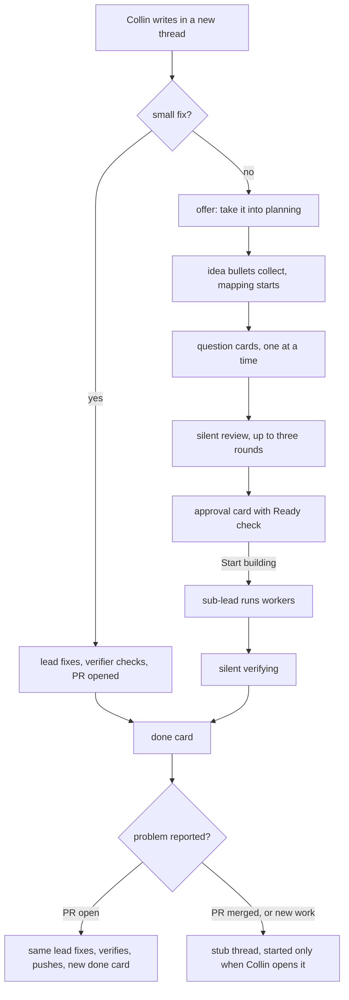

# Wheelchair as an app on a server

**Idea:** `IDEA.md` is what this is for and why, in plain language. Read it first: it's the
north star this plan serves. Goal and Constraints live there, not here, so they don't
get buried as this file grows.

The source document is copied verbatim to `SOURCE.md`. The screen designs live in
`docs/proposals/app-shell/design/` (Design canvas artboards, not plain pages) and on the
canvas at https://claude.ai/artifact/RRWYSCz681JTHiRCD8dkwo.

## Open Questions

Ordered by leverage; discussed one at a time. A settled question moves to the Decision
Log and is deleted from here. Rebuilt 2026-11-14 after the idea was confirmed. Questions
with a defensible default were decided and logged as `defaulted` (D22–D28).

None open.

## Watch List

| # | Noticed | What needs looking into | Raised to user? | Outcome |
|---|---------|-------------------------|-----------------|---------|
| W1 | Adoption | The viewer binds 127.0.0.1 and reaches the tailnet through Tailscale Serve (`install.sh:162-200`). A hub that talks to worker nodes may need a different exposure model. | yes | Settled by D36. |
| W2 | Adoption | The ChatGPT refresh token is single-use and `codex exec` takes no lock (`codex/preflight.sh:1-20`). Long-lived interactive Codex sessions on several nodes, each with its own login, change that risk. | yes | Settled by D37. |
| W3 | Adoption | An agent can type into a lead's terminal, and the browser can now type into any agent's terminal. That's a much bigger write surface than the viewer's graph `PUT`. The auth model (remember cookie, origin check) needs re-reading against it. | yes | Promoted to an Open Question, settled by D41 (accepted risk). |
| W4 | Adoption | The diagram-sensitivity dial and the `seen/` hook reach outside the clone into global harness files (root `AGENTS.md`). Dropping the communication rules means deciding what `install.sh` stops installing and removes. | yes | Partly settled by D32: the cutover removes `seen/` and its installer step. Still open: the diagram-sensitivity dial, which D18 does not mention. Promoted to an Open Question, settled by D42. |
| W5 | Adoption | The source says "The app grows out of the existing viewer server." `server.js` is 2,335 lines with no runtime dependencies. Is that still the case once a terminal-in-browser feature arrives (e.g. xterm.js, node-pty)? | yes | Settled by D38. |
| W6 | Queue rebuild | D24 relies on each CLI's transcript file format, which neither CLI documents as stable. A short spike should confirm both carry enough to render chat and detect a turn ending. | yes | Settled by D39. |
| W7 | Queue rebuild | The tailnet also has a Windows machine (daybreak) and an Android phone. Worker machines are assumed to be Linux with tmux, so the app should list only those as nodes. | yes | Settled by D40. |

## Decision Log

Append-only. A reversal is a new entry superseding the old, never an edit.

| # | Decision | Rationale | Source |
|---|----------|-----------|--------|
| D1 | One hub server runs the app and the leads; other servers are worker nodes. The app grows out of the existing viewer server. | Settled designing the screens 2026-11-09 | adopted |
| D2 | Every agent, workers included, is a full interactive Claude or Codex session in its own tmux window. Headless `exec` and `-p` are retired. Sessions outlive the app. | Settled 2026-11-09 | adopted |
| D3 | Slash commands keep working in a terminal; the app is a second way in, not the only one. | Settled 2026-11-09 | adopted |
| D4 | The hub holds every project; the app lists the repos it has cloned. | Settled 2026-11-09 | adopted |
| D5 | A thread is a lead session in tmux, shown as chat. Collin picks the project, Claude or Codex, and the node. | Settled 2026-11-09 | adopted |
| D6 | No slash commands in the app. The lead does small fixes directly (same "small patch" rule implementation uses). When something looks like a feature, it offers "Take it into planning?" once. | Settled 2026-11-09 | adopted |
| D7 | Ideation: if Collin keeps talking instead of answering, the offer pins to the top of the thread and is never asked again. It collects "Your idea so far": bullets close to his own words, each removable. Side questions are left out. Collection starts when the lead decides it's a feature. More than 3 bullets fold to the newest 2. The lead may suggest splitting into two features. | Settled 2026-11-09 | adopted |
| D8 | Mapping starts in the background as soon as the offer pins. Maps are kept per project and reused; an area whose code changed is re-checked before it's trusted. | Settled 2026-11-09 | adopted |
| D9 | Planning: one question at a time, as cards in the thread with options and a "leaning" pick. Map, Idea and Plan documents are always one click away. | Settled 2026-11-09 | adopted |
| D10 | Plan review is silent: no round counts or summaries; the lead decides when the plan is done. Recurring objections are diagnosed as a choice for Collin (ask), a vague part (rewrite), or a repeat (reject with a reason). A hidden budget turns a review that won't settle into a Needs you item. | Settled 2026-11-09 | adopted |
| D11 | Approval: a "Plan approved, N objections" card lists every serious objection the lead disagreed with and why, each with "Talk about this". Building starts only on Start building. | Settled 2026-11-09 | adopted |
| D12 | Before building, the lead checks logins and installs on the nodes it will use and shows "Ready" or exactly what's missing. | Settled 2026-11-09 | adopted |
| D13 | Start building hands the plan to a sub-lead session, leaving the lead free. The sub-lead talks to the lead, not Collin; the lead answers or passes questions on. | Settled 2026-11-09 | adopted |
| D14 | Worker done signal: the worker's own end-of-turn hook (Claude Code Stop hook, Codex notify) tells the hub; its report goes in a file the lead reads. | Settled 2026-11-09 | adopted |
| D15 | During a build: one slim pinned line (progress, which nodes, amber "choice for you" when needed). A new idea started meanwhile pins below it as its own feature. | Settled 2026-11-09 | adopted |
| D16 | Verifying is silent like review; a gap surviving two fix attempts comes to Collin as a plan question. | Settled 2026-11-09 | adopted |
| D17 | Done: a "Built and checked" card (what he can do now, what was left as is, each with "Start a thread about it", and Review pull request). Sub-lead and worker sessions close; the thread stays. | Settled 2026-11-09 | adopted |
| D18 | The writing rules, the SEEN.md record and the per-turn wording hook are dropped for the first version. | Settled 2026-11-09 | adopted |
| D19 | Diagrams: the lead picks the form (timeline, before and after, layers, side by side, boxes and arrows). Each form is a data format the app draws; hand-written HTML in a sandbox only when no format fits. Boxes-and-arrows stay for proposals Collin approves or strikes. | Settled 2026-11-09 | adopted |
| D20 | Uploads: paste, drop or attach in a thread; the file is stored on the node where that thread's session runs. | Settled 2026-11-09 | adopted |
| D21 | Landed at `planning`. | Collin took the recommendation: the source doesn't say how the hub reaches nodes, how a session becomes chat, where state lives, or what v1 ships, and it has no validation commands | adopted |
| D22 | IDEA.md confirmed as written, including the four inferred lines. | Collin: "it looks good" | user |
| D23 | No access from outside the tailnet in the first version. | IDEA confirmed this non-goal; it matches the Tailscale-only constraint | user |
| D24 | A thread's chat is rendered by reading the lead session's own transcript file (Claude Code under `~/.claude/projects/`, Codex under `~/.codex/sessions/`); Collin's messages go in with `tmux send-keys`; a turn ending is detected with the same end-of-turn hooks as D14. | Keeps every session a real interactive CLI (D2) with no wrapper process; both transcript directories exist on the hub today. See W6 | defaulted |
| D25 | Per-feature state stays in `docs/plans/<slug>/`; thread state (messages are the transcript, plus pinned offer, idea bullets, Needs you items, node list) lives in a state directory on the hub, written atomically, so an app restart loses nothing. | Keeps the plan directory the single source of truth for features, as today | defaulted |
| D26 | A stuck worker asks the lead; the lead passes on only what it can't answer. | The source's own leaning, and it matches "hear only when a decision is needed" | defaulted |
| D27 | When a machine is asleep or offline, its sessions show as unreachable rather than vanishing; if a running build has a worker there, that becomes a Needs you item. No automatic moving (out of scope). | The least surprising behaviour; nothing silently disappears | defaulted |
| D28 | Uploads go to a per-thread folder in that node's wheelchair state directory and are kept until the thread is deleted. | Simple, and keeps files with the session that needs them (D20) | defaulted |
| D29 | Diagram data formats are design work for the Spec, not a question for Collin; the forms themselves are already decided (D19). | Ask about the decision, not the design | defaulted |
| D30 | Ship in slices within this plan. Slice 1, on the hub only: threads with a lead, the whole lifecycle in chat through Done, the Features and Sessions views, the browser terminal, workers as interactive tmux sessions on the hub. Slice 2: workers on other machines. Slice 3: the four new diagram forms and uploads. | Collin picked (b): the main win soonest, with the two biggest unknowns deferred until the core works | user |
| D31 | IDEA.md changed: the slash-command workflow is not kept once the app works; the app becomes the only way to drive a feature, and a terminal is for watching or typing into a session. | Collin: "i won't be using it after the app is made"; keeping two workflows is more work | idea-change |
| D32 | Supersedes D3. One workflow, the app's. The app workflow is written in its own protocol files during slice 1 while the current commands stay untouched and build it. After slice 1 is verified, a cutover task removes the Claude and Codex slash-command wrappers, the old stage protocol files, the writing rules, SEEN.md and the wording hook (`seen/`), and the installer steps for them. `tmux attach` to any session keeps working. D6 (no slash commands in the app) stands. | The current commands are how this plan gets built, and rewriting stage files under a running build changes its rules mid-run | user |
| D33 | Silent plan review keeps today's budget: three triaged rounds since the last user decision, then a Needs you item with the objections that keep recurring. "Serious" = a finding a reviewer rated blocking or major that the lead declined or downgraded; every such finding goes on the approval card (D11). | Collin picked (a): today's tested cap and severity line, now hidden | user |
| D34 | Each worker machine runs a small always-on wheelchair service (systemd user service, like the viewer). The hub asks it to start and stop worker sessions in that machine's tmux, list its sessions, read and type into them; the worker's end-of-turn hook reports to its local service, which passes the done signal and report on to the hub. | Collin picked (b) over SSH | user |
| D35 | The hub runs the same machine service for its own sessions, so slice 1 uses the one code path and slice 2 only adds machines. | One way to start a session, whichever machine it is on | defaulted |
| D36 | Hub and machine services authenticate each other with a per-machine secret created when a machine is added, and services listen only on the tailnet. A machine whose service is unreachable or a different version than the hub's shows in the Ready check (D12) as "service down" or "out of date". | W1 and version skew between machines | defaulted |
| D37 | The Ready check runs `codex/preflight.sh` on each machine before Codex sessions start there, as dispatch does today; each machine keeps its own CLI logins. | W2: several Codex sessions on one machine share one refresh token | defaulted |
| D38 | No native runtime modules: the browser terminal uses a vendored xterm.js page asset, reading the pane with tmux and typing with `tmux send-keys`. | W5: keeps the server installable with plain Node, as today | defaulted |
| D39 | The W6 transcript spike is slice 1's first task; if either CLI's transcript can't carry chat and turn-end, the plan comes back to planning before more of slice 1 is built. | W6 | defaulted |
| D40 | Only Linux machines with tmux and wheelchair installed are worker machines. | W7 | defaulted |
| D41 | Any signed-in browser on the tailnet may type into sessions and the chat box, with no extra step. Recorded as an accepted risk. | Collin picked (a): only his devices are on the tailnet, and every extra step would land on the phone | user |
| D42 | The diagram-sensitivity dial, `/graph` and `/diagram-sensitivity` survive the cutover, retargeted to the app's diagram rules; app leads follow the dial. | Collin picked (a): one setting for how readily to draw, in the app and in other projects | user |
| D43 | Review-round-1 fixes: per-thread worktree and branch; small fixes verified silently and shipped as a PR; `status:` written at fixed moments and mapped to the Features stages; models per role, with `codex/model.sh` kept; sessions start with explicit permission modes and leftover prompts become Needs you items; agent posts relayed by the machine service with a per-session token; `result` cards mark task completion; hook events spooled when the service is down; separate message and raw-key input; markers hide internal traffic from the thread; slice 2 moves code through `origin`. | Fourteen upheld round-1 findings; each is a gap a worker would have had to ask about | review-round-1 |
| D44 | This plan delivers slice 1 only. The cutover, slice 2 (worker machines) and slice 3 (diagram forms and uploads) become three follow-up features started from the app, with their settled design moved to `docs/proposals/app-cutover/`, `app-worker-machines/` and `app-diagrams-uploads/`. Supersedes D30's "slices within this plan" and D32's cutover timing. IDEA.md still describes the whole app; this plan builds its first piece. | Collin picked (a): the old commands build and verify slice 1, and the app is the only way in from then on, as IDEA.md says | user |
| D45 | Review-round-2 fixes: worktrees per feature or fix with one writer each; git writes through the machine service; read-only reviewers report through their last message; worktrees pre-trusted; offer accepted or pinned both start a feature; Ready check before approval, gating Start building; spooled cards; Features read from thread files; `WHEELCHAIR_LANE=1` on app sessions; card presses shown as Collin's bubbles. | Twelve upheld round-2 findings | review-round-2 |
| D46 | Supersedes D15's "a new idea pins below it as its own feature" and round-2's per-feature worktrees within a thread. A thread is one small fix or one feature; its lead runs inside the thread's own worktree. New work the lead spots becomes a stub thread: listed in Threads and shown as a card with "Go to it", with no session started until Collin opens it, then starting a lead from the stub's context. A done thread stays open only for questions or problem reports; anything needing changes becomes a stub thread with context. Archiving a thread removes its worktree. | Collin picked (a) and added the stub behaviour: nothing should start until he goes into it, and a finished thread is for questions, not new work | user |
| D47 | Review cap reset by D46; review continues with round 4. | `protocol/plan-review.md` Exit: the cap counts rounds since the last user decision | defaulted |
| D48 | Review-round-4 fixes: agents start and stop sessions through `wc.js session`, with role-based working directories and permissions; fix stubs for unmerged work branch from the parent; any thread can be archived, which stops its sessions, pushes unpushed work, keeps a read-only copy of its plan documents and removes its worktree; detached verifier worktrees; worker branches `wc-<thread-id>-w<n>`; `done` committed before the PR push. | Eleven upheld round-4 findings | review-round-4 |
| D49 | Review-round-5 fixes: every session is started by the hub, including agent requests forwarded by the service; two credentials by caller; archiving commits uncommitted work as WIP and pushes before removing worktrees; archived documents read from the branch with `git show`; transcripts kept (3650-day retention, copied on archive); fix PRs rebased onto the default branch and retargeted once the parent merges; the sub-lead verifies features; sessions stop only what they started. | Twelve upheld round-5 findings | review-round-5 |
| D50 | Supersedes round-4/5's stacked fix PRs. A stub fixing a done thread whose PR isn't merged is cut from the parent's branch tip; once verified, the service fast-forwards the parent's branch to it and pushes, so the parent's open PR gains the fix and the stub opens no PR. A refused fast-forward raises a `needs` item. After the parent merges, fix stubs start from the default branch with their own PR. | Collin picked (a): he hasn't reviewed the parent yet, so one PR with the work and its fix is what he would read anyway, and it removes the part that kept breaking | user |
| D51 | Review-round-6 fixes: the service keeps its own copy of every transcript; `wc.js session` retries two minutes when the hub is down; stop rights by role within the thread; archive commits locally only; mapping sessions finish with a `result` card. Review cap reset by D50. | Six upheld round-6 findings; `protocol/plan-review.md` Exit | review-round-6 |
| D52 | Review-round-7 fixes: `join-parent` re-checks the parent PR is open, cuts from and merges the remote parent tip, fast-forwards the local parent after a join, and offers its own PR when it can't join; vanished sessions detected and restarted by their starter, with a Needs you item if the starter is gone; in-progress merges committed as they stand on archive; sub-lead `result`; 90-second idempotent session retries. | Nine upheld round-7 findings | review-round-7 |
| D53 | Review-round-8 fixes: `fix`/`new` stubs, with only `fix` stubs joining; joins resolve to the root PR; post-push re-check with an own-PR fallback that cherry-picks only the thread's commits and re-verifies; the lead resolves join conflicts and may start re-check verifiers; the hub, not the service, detects dead sessions; dead workers restart in place; brief-derived request ids. | Eleven upheld round-8 findings | review-round-8 |
| D54 | Review-round-9 fixes outside the join: `--attempt` ids for `wc.js session start`; a lone dead lead raises "Sessions ended". | Two upheld round-9 findings | review-round-9 |
| D55 | Supersedes D50, D52 and D53's join machinery, and narrows D46's "a done thread makes no changes" to "a done thread takes no new work". While a done thread's PR is open, its own lead fixes reported problems in the same worktree and pushes them to that PR; a verifier re-checks. If the PR was merged or closed by the time of the push, the fix becomes a stub. Every stub starts from the default branch with its own PR; no thread pushes to another's branch. | Collin picked (a): it is how a PR normally gets fixed during review, and it removes the part that broke in every round since round 4 | user |
| D56 | Review cap reset by D55; review continues with round 10. | `protocol/plan-review.md` Exit | defaulted |
| D57 | Review-round-10 fixes: in-thread review fixes are committed, verified, then pushed, and capped at the small-fix bar; merge detection compares the merged head with the pushed commit; stubs opened before their parent merges say so; `--attempt` ids scoped per requesting session. | Five upheld round-10 findings | review-round-10 |
| D58 | Review-round-11 fixes: the in-thread review-fix flow as four steps (check PR first; the lead fixes any size itself, never a sub-lead; commit, verify with two attempts then a question; fetch-merge-reverify, push, and a `done` card per fix); a missed fix's commit carried to its stub; the parent-not-merged notice for any parent; `session list` before starting a sub-lead. | Nine upheld round-11 findings; the GPT lane reported none | review-round-11 |
| D59 | Supersedes D57's small-fix cap with D58's rule: while the PR is open the lead fixes any size itself, and only a fix needing parallel workers becomes a stub. Review-round-12 fixes: `wc.js git fetch` and `cherry-pick`; the app asks about an unmerged parent before a stub opens, and "wait" keeps it unopened until the parent merges; closed-PR rules aligned; the hub enforces one sub-lead per thread; review-fix verifiers briefed with the problem and Spec, and dropped fixes reverted. | Nine upheld round-12 findings; both lanes agreed on the two majors | review-round-12 |
| D60 | After round 12 hit the cap with only mechanical findings (all fixed), run one more round scoped to the round-12 fixes; approve if it upholds nothing blocking or major. Resets the review cap. | Collin picked (a): the waiting-stub behaviour is new and unreviewed | user |
| D61 | Round 13 was clean (no blocking or major findings upheld). Its minor findings were fixed: the parent-dependence flag on stubs, the hub's waiting-stub check, `wc.js git revert`, the push-as-is path, and acceptance checks 7 and 12. | `protocol/plan-review.md` Exit; D60 | review-round-13 |

## Spec

The settled design. Decision numbers (Dn) point into the Decision Log for the reasoning.
Where this section and the source proposal (`SOURCE.md`) differ, this section wins.

### The flow at a glance

Drawn at approval. The lifecycle and stub sections below say everything this shows. The
plan's one graph (`graphs/hub-to-machines.json`) compares two designs for worker machines,
which moved to a follow-up (D44), so it isn't drawn here. It has no rejected entries.



### Scope and order (D30, D39, D44)

This plan delivers slice 1 only: the app on the hub. Three follow-up features, started from
the app once this plan is done, carry the rest (D44):
`docs/proposals/app-cutover/` (retire the slash-command workflow),
`docs/proposals/app-worker-machines/` (workers on other machines) and
`docs/proposals/app-diagrams-uploads/` (four new diagram forms, and uploads). The old
commands stay untouched throughout this plan, because they build and verify it.

Build order:

1. **Transcript spike (D39).** Start one interactive Claude Code and one Codex session
   in tmux, send each a one-line message and a multi-line message (typed as a bracketed
   paste, below), and confirm from their transcript files alone: a multi-line message
   arrives as one turn, each user and assistant message can be told apart and read
   in order, tool calls can be told from prose, and the end of a turn is signalled by
   the end-of-turn hook (Claude Code `Stop` hook passed with `--settings`; Codex
   `notify` passed with `-c notify=[...]`), and a session started in a freshly created,
   freshly trusted worktree shows no trust prompt. Write the findings to
   `docs/plans/app-shell/spike-transcripts.md`. If either CLI fails any check, stop
   and set the plan back to `planning` with the finding as an Open Question.
2. Machine service on the hub, app server routes, state directory.
3. Threads view and thread page, with chat rendered from the transcript.
4. The app protocol (`protocol/app/`) and the full lifecycle in chat.
5. Features and Sessions views, browser terminal.
6. Acceptance (below).

### Where the code lives

- **App server:** the viewer's server process grows into the app (D1). It keeps its port
  (7373), `/wheelchair` prefix, systemd unit, token and remember-cookie sign-in, and
  origin check. New code goes in new files under `viewer/app/`, loaded by `server.js`
  with `require`. Still no native modules and no runtime npm dependencies, except
  page assets vendored into the tree: xterm.js for the terminal (D38).
- **Machine service:** `machine/service.js` plus `machine/hook.sh`, run as the systemd
  user unit `wheelchair-machine.service` on every machine that runs agents, the hub
  included (D34, D35).
- **The old communication rules stay out of app sessions (round-2).** Until the cutover
  follow-up removes `seen/`, the machine service starts every session with
  `WHEELCHAIR_LANE=1`, which makes the user-level wording hook do nothing there
  (`seen/hook.sh:166-167`). The `protocol/app/` files never reference `writing.md` or
  `seen.md`.
- **App protocol:** `protocol/app/`, one file per role: `lead.md`, `sub-lead.md`,
  `mapper.md`, `worker.md`, `reviewer.md`, `verifier.md`, plus `cards.md`, the card formats every role
  emits. The existing `protocol/` stage files stay untouched by this plan, because they
  are building it (D32, D44).
- **Routers:** `viewer/AGENTS.md`, a new `machine/AGENTS.md` and `protocol/app/AGENTS.md`,
  and the root `AGENTS.md` are updated in the same change that adds each directory.

### State (D25)

- **Feature state** stays in each project's `docs/plans/<slug>/` (IDEA.md, PLAN.md,
  MAP.md, graphs), committed with the project. `status:` stays the state machine.
- **Maps** are kept per project in `docs/maps/<area>.md`. Each records the commit it was
  checked against and the files it covers. Before a map is trusted, the lead runs
  `git diff --stat <that commit> origin/<default branch> -- <its files>` after a fetch, and any change means re-checking those
  parts first (D8).
- **App state** lives on the hub in `~/.local/state/wheelchair/`, every file written
  atomically (temp file plus rename, as `atomicWrite` does today):
  - `threads/<id>.json` (directory mode 0700): project, CLI, machine, whether it is a
    stub (below), the stub's context text, whether it depends on its parent and is
    waiting on it, every session the thread has had (name, role,
    which role started it, transcript path, token), the thread's one piece of work (small fix or feature slug, branch,
    worktree path, last known `status:`),
    pinned items (the offer, the idea bullets, the build progress line), the cards shown
    and their answers, the queue of messages waiting for the lead's turn to end, the
    parent thread (for a stub), and whether it is archived.
  - `machines.json`: name, tailnet address, service port, and the path of each
    machine's secret file (mode 0600). In this plan it holds only the hub.
  - `projects.json`: the repos cloned on the hub that the app lists (D4).
- An app restart rereads this directory and each service's session list. No state lives
  only in memory.

### Machine service on the hub (D34–D38)

- Listens on that machine's Tailscale IPv4 address (`tailscale ip -4`), port 7374, never
  on 0.0.0.0. **Two credentials, by caller (round-5):** requests from the hub carry the
  machine's secret; requests from agents on that machine (`card.js`, `hook.sh`,
  `wc.js git`, `wc.js session`) carry the calling session's `WHEELCHAIR_SESSION_TOKEN`,
  which the service matches against the sessions it started to learn who is calling.
  Each route accepts only its own kind, and the machine secret is never put in a session's
  environment.
- What it does: start a session (role, CLI, model, project directory, initial prompt);
  stop one; list its own sessions; read a pane (`tmux capture-pane`); **submit a message**
  (`tmux load-buffer` then `tmux paste-buffer -p`, a bracketed paste so embedded newlines
  stay in one message, then one Enter); **send raw keys** (`tmux send-keys`, literal text
  or tmux key names such as `C-c` or `Up`, never an added Enter), used only by the browser
  terminal; return a transcript's new lines from a byte offset;
  report its version and whether each CLI is logged in; run `codex/preflight.sh` (D37).
- The service and app run from the same clone. If the service's reported commit differs
  from the app's (one restarted after a pull, the other not), the Ready check shows it as
  "out of date" and no new sessions start until both are restarted (D36).
- Sessions are named `wc-<thread-id>-<role>[-<n>]` and are the only tmux
  sessions it will stop or type into. Others are listed read-only in the Sessions view.
- **Sessions outlive the service.** The unit runs with `KillMode=process`, or the service
  starts tmux through `systemd-run --user --scope`. Otherwise systemd kills the tmux
  server along with the service on every restart. The acceptance check below tests this.
- **Permissions (review-round-1, round-2).** No session may stop at a permission prompt
  silently. Claude sessions start with `--permission-mode auto`; Codex sessions with
  `-s workspace-write -a never -c sandbox_workspace_write.network_access=true`, the
  sandbox today's write-lanes use. Reviewer sessions are read-only (`-s read-only` for
  Codex; for Claude, `--permission-mode auto` plus a brief that forbids edits). Verifier
  sessions run in their own throwaway worktree, checked out detached at the tip of the
  branch they check (git refuses one branch in two worktrees), with the same
  write-and-network settings as other sessions, so they can run test suites that start
  servers and write fixtures, as today's verifier does (`protocol/verification.md:44-46`);
  that worktree is removed when the verifier stops (round-3).
- **Git goes through the service (round-2).** Codex's sandbox keeps `.git` read-only, so
  no role runs git writes itself. Every role uses `node <root>/viewer/app/wc.js git
  <fetch|commit|merge|cherry-pick|revert|push|pr> ...`, which asks the local machine service to run that git
  operation in the calling session's own worktree and nowhere else; the sub-lead's
  `merge` may also take a worker's branch. Reading git (`git diff`, `git log`) stays direct.
- **Agents start and stop sessions through the service (round-4).** `node
  <root>/viewer/app/wc.js session start --role <role> --cli <claude|codex> --tier <tier>
  --brief-file <path>`, plus `session stop <name>` and `session list`. The service does not
  start the session itself: it forwards the request to the hub, which checks the rules
  below, mints the new session's token, records it in the thread file, and then asks the
  service to start the session exactly as it does for a lead, so every session is started
  by the hub and every token is known to both (round-5). The service decides
  the working directory from the role: mapping session and sub-lead in the thread's
  worktree; reviewer in the thread's worktree, read-only; verifier in a fresh detached
  worktree; worker in a new worktree on branch `wc-<thread-id>-w<n>` cut from the thread's
  branch (no slash, so it never collides with the `wc/<thread-id>` ref). Who may start
  what: a lead may start mapping, reviewer and sub-lead sessions for its own thread, and a
  verifier for a small fix or for a fix made during review in a done thread (D55); a sub-lead may start worker and verifier sessions for its
  thread, so a feature's verification, its two fix attempts and any escalation run under
  the sub-lead, which passes a surviving gap to the lead as a `message`; workers,
  reviewers, verifiers and mapping sessions start nothing. A session may stop only
  sessions its role started in its own thread (so a restarted lead can stop what the old
  lead started); the lead stops the sub-lead, and the lead and sub-lead stop each
  reviewer, verifier and worker, once its `result` arrives. Anything else is refused with the reason. `stop` and `list` also go
  through the hub, which holds the record. **When the hub is down (round-6),** `wc.js
  session` retries for up to 90 seconds (under the CLIs' two-minute tool timeout), then
  exits non-zero with "hub unavailable". Each `start` takes an `--attempt <id>`, scoped to
  the requesting session (so two sessions' ids never collide), which the agent chooses
  once per intended session (a restart or a re-verify is a new attempt; before starting a
  sub-lead, nothing extra: the hub itself refuses a second live sub-lead in a thread) and
  reuses when re-running the same command after "hub unavailable"; the hub de-duplicates
  on it while the session it started is alive, so a retry never starts a session twice
  and a restart always starts a new one (round-9); the
  role files tell agents to wait a minute and try again, never to work around it.
- **Worktrees and trust (round-2).** The service creates every worktree under
  `~/.local/state/wheelchair/worktrees/<project>/<branch>/` and, when it creates one,
  marks that path trusted for both CLIs before any session starts there. The project's
  own clone on the hub is marked trusted when the project is added. If a session still ends up
  waiting on a prompt (Claude Code's `Notification` hook fires), the service reports it and
  the app raises a `needs` item linking to that session's terminal.
- Starting a Claude session: `claude --session-id <uuid> --settings <json>
  --append-system-prompt <...>`. The settings carry a `Stop` hook running
  `machine/hook.sh claude <session-name>`, and the appended prompt tells it to read its
  role file in `protocol/app/`. Codex: `codex -c 'notify=["<root>/machine/hook.sh",
  "codex","<session-name>"]'` with the role instruction as its first message. Exact
  flags are confirmed by the spike.
- `hook.sh` posts "turn ended" for that session to the local service. If the post fails
  (service down), it appends the event to `~/.local/state/wheelchair/spool/` instead,
  and the service drains that spool when it starts. The service tells the hub, which
  delivers the next queued message, if any. "Turn ended" only drives message delivery: it
  never means a task is finished (see Cards).
### How the app reads and drives a session (D24)

- A thread's messages are the lead's transcript, read incrementally through the machine
  service and turned into chat bubbles. Tool calls collapse to one line each, expandable.
- Collin's message is typed into the lead's pane only when its last turn has ended. Until
  then it waits in the thread's queue and shows as "queued".
- **Cards:** a role emits a card by running `node <root>/viewer/app/card.js <kind>
  <json-file>`, which validates it against `protocol/app/cards.md` and posts it to its
  **local machine service**. The service writes it to its spool before answering, so
  `card.js` succeeds once the card is on disk; it then relays spooled cards to the hub
  over the hub–service channel, in order, retrying until the hub acknowledges each one.
  A card emitted while the hub is down is delivered when it comes back. A session on any
  machine reaches the hub the same way. Kinds shown in the thread:
  `offer`, `idea` (the idea bullets), `question`, `approval` (carries the Ready result),
  `progress`, `needs`, `stub`,
  `done`, `diagram`. Kinds never shown: `message` (to another session, below) and `result`
  (a worker's, mapping session's or sub-lead's finished task, carrying its report; the
  sub-lead sends one to the lead when the build has passed verification). Only a
  `result` marks such a task finished. Reviewers and verifiers, of either family, never run `card.js`: their report
  is the last assistant message of their turn, which the service reads from the transcript
  when their turn ends and delivers as their `result` (round-2, round-3). A read-only Codex
  reviewer couldn't post a card anyway. An invalid card is refused with the reason, so the role
  can fix it and send it again.
- **Agent authentication (review-round-1, round-5).** Every session is started by the
  hub (agent requests are forwarded to it), and for each one the hub mints a random token, which the service puts in that session's
  environment as `WHEELCHAIR_SESSION_TOKEN`. `card.js` sends it. The hub accepts a card
  only for the thread or feature that session belongs to. These are not browser requests:
  they arrive on the hub–service channel, not through the browser routes, so the browser
  origin check does not apply to them.
- A card press (an option picked, "Talk about this", Start building, removing a bullet)
  reaches the lead as a typed message in a fixed form, e.g. `[card <id>] picked: <option>`
  or `[card <id>] talk about: <objection>`, queued like any other message.
- Messages between sessions (sub-lead to lead, worker to lead) use the same queue: the
  sender emits a `message` to a named session, and the app types it in when that session's
  turn ends.
- **What the thread shows (review-round-1, round-2).** A message from another session is
  typed in starting with `[wc:from <session>]`. The thread hides those messages and the
  lead's whole turn that answers one, so worker reports, review traffic and sub-lead
  questions never appear as chat. Collin's own messages carry no marker and are also
  recorded in the thread file. A card press is Collin's action: the card shows its
  answered state, the press shows as a short bubble from Collin ("Picked B", "Talk about:
  <objection>"), and the lead's answering turn is shown like any reply.

### Branches and checkouts (review-round-1)

- **One piece of work per thread (D46).** A thread is exactly one small fix or one
  feature, ending in one pull request. When a thread's lead starts, the service first
  creates the thread's worktree and branch `wc/<thread-id>`, cut from
  `origin/<default branch>` right after a `git fetch` (round-3), and starts the lead
  *inside* that worktree. The lead, its mapping session and its sub-lead all run there, so
  each one's sandbox, trust and git scope is simply its own working directory, with no
  extra grants.
- **Fixes during review happen in the original thread (D55, round-10, round-11).** When
  Collin reports a problem in a done thread:
  1. The lead first checks `gh pr view --json state`. `MERGED`: the fix becomes a stub
     (below). `CLOSED`: the lead says the PR was closed and makes no change unless Collin
     asks for a stub.
  2. `OPEN`: the lead fixes it itself, in the thread's own worktree and branch, whatever
     the size; it never starts a sub-lead after `done`, so the status stays `done`. If
     the fix would need parallel workers, the lead says so in a `question` card offering
     a stub instead.
  3. The lead commits the fix, then starts a verifier on that commit, briefed with the
     reported problem and the plan's Spec (for a small fix, what Collin asked for); the
     verifier's `result` names the commit it checked. A failed check gets one more
     attempt; a gap surviving two attempts comes to Collin as a `question` card (push the
     fix as it is, or drop it). Dropping it reverts the fix's commits with
     `wc.js git revert`,
     so nothing unverified reaches the PR later.
  4. On a pass, or when Collin chose "push it as it is" (then step 4 does no re-verify
     and the `done` card says the fix failed its check and was pushed at his request),
     the lead runs `wc.js git fetch`; if `origin/wc/<thread-id>` has commits this branch lacks
     (Collin updated the PR branch), it merges them in with `wc.js git merge` and
     re-verifies first. Then it pushes and checks `gh pr view --json state,headRefOid`:
     `OPEN`, or `MERGED` with `headRefOid` equal to the pushed commit, means the fix is
     in, and the lead emits a new `done` card for the fix (what changed, re-checked, link
     to the PR), so Collin always sees it. `MERGED` with an older head means it missed:
     the lead emits a `stub` naming the fix's own commits (not merge commits), which the
     stub's lead re-applies
     with `wc.js git cherry-pick`. `CLOSED` by then: as step 1, the lead says so and
     makes no stub unless Collin asks.
  Every stub starts from `origin/<default branch>` and opens its own PR. No thread ever
  pushes to another thread's branch.
- **Commits name their paths (round-3).** `wc.js git commit` takes the exact paths to
  commit and refuses a commit without them, so one session's commit never sweeps in
  another's half-written files. Before Start building, the mapping session commits only
  `docs/maps/` and the plan's MAP.md, and the lead only IDEA.md, PLAN.md and the plan's
  graphs.
- **Worktree lifetime and archiving (round-3, D46, round-4, round-5).** The branch is
  pushed when its pull request is opened. Worker worktrees are removed once the sub-lead
  has merged them; verifier worktrees when the verifier stops. The thread's worktree stays
  while the thread is open, so the lead can still answer questions about the work. Any
  thread can be archived from its page: a stub, one abandoned partway, or a done one.
  Archiving, in order: stops every session of the thread; in each of its remaining
  worktrees (the thread's and any workers'), commits whatever is uncommitted as
  `WIP: archived` on that worktree's branch, locally only (nothing new is pushed, so an
  open pull request is untouched). A merge in progress is committed as it stands,
  conflict markers and resolution edits included, so nothing is thrown away; a rebase in
  progress (there should be none, since nothing rebases) is left in place and its
  worktree is kept, with a `needs` item. Then the other worktrees are removed. The branches stay
  in the hub's clone. An archived thread stays readable: its chat from the transcript
  copies (below),
  and its documents and diagrams read with `git show wc/<thread-id>:docs/plans/<slug>/<file>`
  in the project's clone. The document and graph routes gain this read-only,
  read-from-branch mode for archived threads.
- **Transcript copies (round-5, round-6).** Claude Code deletes transcripts after
  `cleanupPeriodDays` (default 30), and the cleanup can be run by any other `claude`
  process on the machine. So the service appends every transcript line it reads to
  `~/.local/state/wheelchair/transcripts/<thread-id>/<session-name>.jsonl` as it reads
  it, and thread pages always render from these copies, never from the CLI's own files.
  If the CLI's file shrinks or is replaced, the service rereads it from the start and
  appends only lines whose content hash isn't already in the copy.
- A small fix is committed on its branch. A verifier session checks it silently against
  what Collin asked for, then the lead opens a pull request and shows a `done` card. Small
  fixes write no plan documents.
- A feature's `docs/plans/<slug>/` and any new `docs/maps/` files are written and committed
  on that feature's branch, so they ship in its pull request.
- **One writer per worktree.** From Start building until the sub-lead sends its
  `result`, the feature's worktree belongs to the sub-lead: it alone writes there, including the `implementing` to
  `verifying` status change. The lead writes nothing in it during that time. Each
  write-worker gets its own worktree on a branch cut from the feature branch, and the
  sub-lead merges finished work back, as today's Stage 3 integrates lanes.

### Feature status (review-round-1)

`status:` in PLAN.md stays the state machine, written at fixed moments: `planning` (lead)
when IDEA.md is confirmed and PLAN.md is created; `ready-for-review` (lead) when the last
planning question is settled; `approved` (lead) when the approval card is shown;
`implementing` (sub-lead, its first act) when Collin presses Start building; `verifying`
(sub-lead) when the build is finished; `done` (lead, after the verifier passes and the
sub-lead stops), committed before the push that opens the pull request, so the PR
carries it. The Features view groups them: a feature whose plan directory has no
PLAN.md yet is **idea**; `planning` is **planning**; `ready-for-review` and `approved` are
**review**; `implementing` is **building**; `verifying` is **verifying**; `done` is
**done**.

The Features view reads the feature list from the thread files (each feature's project,
worktree and last known status) and the current `status:` from each feature's PLAN.md in
its worktree. After a feature's worktree is removed, it shows the last status recorded in
the thread file. Plans not started from the app are not listed, and a stub thread is not a
feature until it is opened and its lead takes it into planning.

### Models per role (review-round-1)

`codex/model.sh` and its pins survive the cutover. A lead and its sub-lead run on the
family Collin picked for the thread, at the top tier (Claude's default model; GPT Sol).
Reviewers and verifiers run at the same tier. When both CLIs are present, one of the two
reviewers and the verifier use the other family from the lead's.
Workers get today's tier rules (Luna or Haiku for transcription, Terra or Sonnet
otherwise, escalation only on evidence), which move into `protocol/app/sub-lead.md`.

### The lifecycle of a feature in a thread (D6–D17, D26, D33)

1. **Starting.** Collin picks the project, Claude or Codex, and the machine, then writes in
   plain words. A small fix (a couple of files, nothing to parallelize, the same bar as
   today's small-patch bypass, `protocol/implementation.md:25`) is just done, and the lead
   says what changed. Anything bigger gets one `offer` card: "Take it into planning?"
2. **Ideation (D7).** Saying yes to the offer, or keeping talking instead of answering it,
   both make it a feature (round-2). Either way the lead picks the slug, creates
   `docs/plans/<slug>/` in the thread's existing worktree, and starts mapping. If he kept talking, the offer pins to the top of the thread and is never asked
   again. The lead keeps an `idea` card pinned with
   "Your idea so far": bullets close to his own words, each removable. Side questions are
   left out. Collection starts once the lead decides it is a feature. More than three
   bullets fold to show the newest two. The lead may suggest splitting into two features;
   the second becomes a stub thread (below).
3. **Mapping (D8).** As soon as it becomes a feature, the lead starts a mapping session in
   the feature's worktree that writes `docs/maps/` and the plan's MAP.md, reusing maps that
   are still valid.
4. **Planning (D9).** IDEA.md is confirmed through a card, then one `question` card at a
   time, each with options and a "leaning" pick. Links to MAP.md, IDEA.md and PLAN.md are
   always one click from the thread (the existing document page).
5. **Review, silent (D10, D33).** Two reviewer sessions, cross-family when both CLIs are
   present. No round counts or summaries reach the thread. Recurring objections are sorted
   into a choice for Collin (becomes a `question` card), a vague part (rewritten), or a
   repeat (rejected with a reason). Three triaged rounds since his last decision without a
   clean one makes a `needs` item carrying the recurring objections.
6. **Approval and Ready check (D11, D12, D36, D37; round-2, as the PlanApproved design
   shows).** When review is clean, the lead runs the Ready check: the service is reachable
   and the same version, the needed CLIs are installed and logged in, and the Codex
   preflight passes. Then one `approval` card: "Plan approved, N objections". It lists
   every finding a reviewer rated blocking or major that the lead declined or downgraded,
   with the lead's reason and a "Talk about this" button each, and the Ready result:
   "Ready", or exactly what is missing with a Re-check button, which reruns the check and
   updates the same card. Start building is enabled only when the result is Ready.
   Pressing it reruns the check first; if the result has changed, the card updates and
   nothing starts. Nothing builds until Collin presses it.
7. *(merged into step 6)*
8. **Building (D13–D15, D26).** Start building opens a sub-lead session that runs the
   build: it decomposes, briefs and starts worker sessions, and reviews their work by the
   same rules as today's Stage 3 (two write-workers never share a checkout). The sub-lead
   talks only to the lead. A worker that hits something the plan didn't settle asks the
   lead, which answers or passes on only what it can't answer. A worker finishes by
   committing its report as `docs/plans/<slug>/reports/<task>.md` on its branch and
   emitting a `result` card. The
   thread shows one pinned `progress` line (tasks done of total, which machines) that turns
   amber with "choice for you" when a question is waiting. A new idea raised during a
   build becomes a stub thread (below), not part of this one.
9. **Verifying, silent (D16).** A verifier session checks the work against the Spec. The
   same gap surviving two fix attempts comes to Collin as a `question` card.
10. **Done (D17).** A `done` card: what he can do now, what was left as is (each with
    "Start a thread about it"), and a Review pull request link. The lead opens the PR,
    never merges. Sub-lead and worker sessions are stopped; their transcripts stay.
11. **After done (D46, D55).** The thread stays open, with its lead, for questions about
    this work and reports that something is wrong. While its pull request is open, the
    lead fixes reported problems in this thread and pushes them to the same PR. It never
    takes new work here: new work, a fix that would need parallel workers, and any fix
    after the PR is merged, becomes a stub thread carrying context from this one (after
    a closed PR, only if Collin asks).

### Stub threads (D46)

When the lead decides something belongs in its own thread (a new idea mid-build, the
second half of a split, a problem found after done that D55 doesn't fix in place (it
needs parallel workers, or the PR is already merged, or Collin asks after a closed PR), a
"Start a thread about it" press on
a done card), it emits a `stub` card: a short title, a context summary written for the
next lead (what was asked, what this thread already knows, links to its plan documents
and pull request). Every stub starts from `origin/<default branch>` and ends in its own
pull request (D55). The card also says whether the stub **depends on the parent's work**
(round-13): an after-done fix does; a new idea or a split usually doesn't. The app then:

- adds a stub thread to the Threads list, marked as a stub, in the same project, CLI and
  machine as its parent, with a link back to the parent;
- shows the `stub` card in the current thread with a "Go to it" button.

No session starts for a stub. Its worktree and lead are created only when Collin opens it
(from the button or the Threads list) and it starts. The new lead's first message is the
stub's context summary. A stub never started just stays in the list until Collin archives
it. Archiving an unstarted stub has nothing to stop or remove.

**Waiting for the parent (round-12, round-13).** When Collin opens a stub that depends on
its parent, and the parent's work isn't on the default branch yet (its PR is open, or it
has none yet), the app asks before creating anything: wait for the parent to merge, or
start now without it. Stubs that don't depend on their parent just start. "Wait" leaves
the stub unstarted, with no worktree and no session; its thread file records it as
waiting on the parent thread. Every 10 minutes the hub runs
`gh pr list --head wc/<parent-id> --state merged` in the project's clone for each
waiting stub, and once that finds the parent's PR, marks the stub "ready" in the Threads
list. Nothing starts until Collin opens it again; its worktree is then cut from the new
default branch, which has the parent's work.

Short-lived sessions stop when their job ends, stopped by the session that started them: a
mapping session once it has committed MAP.md and emitted a `result` card, a reviewer once its `result` arrives (each review
round starts fresh reviewers), a verifier once its verdict arrives.

Collin hears from the workflow only through `question`, `needs`, `approval`, `done` and
`stub` cards, and the amber progress line.

### Views

From any device on the tailnet, one address (the served `/wheelchair/` origin) shows
three views. Each has to work at phone width (390 px):

- **Features:** every feature started from the app, in every project, grouped by stage (idea, planning, review,
  building, verifying, done), with a Needs you strip at the top listing every open
  `question` or `needs` card, and every `approval` card whose Start building hasn't been
  pressed, across threads, each linking to its card.
- **Threads:** the list of threads, newest activity first, with stubs marked and archived
  threads hidden behind a filter; a thread page with the chat,
  pinned items, cards, a message box, and New thread (project, CLI, machine).
- **Sessions:** every session on every machine, grouped by machine. Each shows role,
  thread or feature, and running or unreachable, and opens a live terminal page (xterm.js
  over pane reads and the raw-keys operation, so each keystroke goes through as typed)
  that can be typed into. A copyable attach command is
  shown: `tmux attach -t <name>` on the hub, `ssh <machine> -t tmux attach -t <name>`
  elsewhere.

### Diagrams (D19, D29, D42)

- A `diagram` card embeds the existing boxes-and-arrows graph page inside the thread,
  with a link to open it full screen.
  Proposals Collin approves or strikes keep using it. The four new forms are a follow-up
  feature (D44).
- App leads follow the diagram-sensitivity dial (D42), and `protocol/app/lead.md` says so.
  Retargeting the dial's rendered text happens in the cutover follow-up.

### Security (D23, D36, D41)

- Reachable only on the tailnet. No public route.
- Any browser holding the remember cookie may read, type into sessions and send messages
  (accepted risk, D41). Every browser write, typing included, still has to pass today's
  origin check (`viewer/server.js:1418-1431`). Agent posts use the per-session token
  instead (Agent authentication, above).
- Machine services listen only on the tailnet address and accept the hub only with the
  machine secret, and local agents only with their session token (Machine service, above).

### Not doing

In this plan: removing the old slash-command workflow, workers on other machines, the four
new diagram forms, and uploads (each a follow-up feature, D44). In the app at all: moving a
running worker off a sleeping machine; merging automatically; showing review or
verification rounds, step counts or per-round summaries in the app; slash commands inside
the app; access from outside the tailnet.

### Edge cases

- **Message while the lead is mid-turn:** queued, shown as queued, delivered at turn end.
- **Lead session dies** (its tmux session is gone): the thread shows "session ended" with
  a Restart button that starts a new lead with the thread's plan and cards as context,
  and, since nothing else will restart it, raises a "Sessions ended" `needs` item so it
  shows in the Needs you strip (round-9). Messages queued for the dead lead are delivered
  to the new one.
- **Any session dies (round-7, round-8).** The **hub** detects it, because only the hub
  holds the record: on every 10-second poll and on every reconnect, it compares the
  sessions its thread files say are running against the service's `tmux` list. A missing
  one is reported to the session that started it (as a `message`). A sub-lead restarts a
  dead worker on the same brief, in the same worktree and branch, so committed partial
  work carries on; a dead verifier is started fresh. A lead restarts a dead sub-lead, mapping session or reviewer; a new
  sub-lead resumes as today's Stage 3 resumes an interrupted run: it reads PLAN.md's
  Implementation Tasks and the committed `reports/`, trusts the tree over the table, and
  carries on. If the session that should restart it is itself gone (a hub reboot kills
  everything, and the hub sees every recorded session missing when it comes back), the
  thread raises a `needs` item, "Sessions ended", with Restart, which starts the lead,
  which restarts the rest.
- **App restart during a build:** no session stops. Turn-ended signals that arrived while
  the app was down, and cards emitted then, are held in the machine service's spool and
  delivered in order when the hub reconnects.
- **Machine service restart:** sessions keep running (KillMode check). The service
  rebuilds its session list from tmux.
- **Two threads on one project:** each feature and small fix has its own worktree and
  branch, and each write-worker its own worktree, so no two writers share a checkout.
- **Only one CLI installed:** everything works. Review runs both reviewers on the one
  family, as today.
- **Invalid card:** refused with the reason. The thread is not changed.

### Acceptance

This plan is done when all of these pass on the hub, checked from a phone:

1. Open the app, start a thread, ask for a one-line fix. It is made with no offer card, and
   a `done` card links to its pull request on that thread's `wc/<thread-id>` branch.
2. Describe a feature. Exactly one offer appears. Keep talking: it pins, and idea bullets
   collect.
3. Carry that feature through planning cards, silent review, the approval card, the Ready
   check, Start building, and a `done` card with a PR link. Never see a round count.
4. During the build, run `systemctl --user restart wheelchair-viewer` and
   `systemctl --user restart wheelchair-machine`. Every session is still in
   `tmux ls`, the progress line keeps advancing, and the `done` card still arrives.
5. Open a worker's terminal in the Sessions view and type into it.
6. Run `tmux attach` to the lead from a terminal and see the same session.
7. During the build, raise an unrelated new idea. A `stub` card appears and a stub is
   listed in Threads, and `tmux ls` shows no new session. Open it with "Go to it": with
   no wait question, a lead starts and its first message is the stub's context.
12. After a feature's `done` card, report a problem that needs parallel workers. Its stub
    depends on the parent, so opening it asks wait-or-start. Choose wait: no session or
    worktree appears. Merge the parent's PR; within ten minutes the stub shows "ready".
    Open it: a lead starts in a worktree whose history contains the parent's merge.
8. After the `done` card, ask the lead a question about the work. It answers, and
   `git status` in the thread's worktree shows no change and `git rev-parse HEAD` is the
   same as before the question.
9. Archive the done thread. Its sessions are gone from `tmux ls`, its worktree is gone,
   `git branch` in the project's clone still lists its branch, and its plan documents and
   chat still open from the
   thread page.
10. Before merging a feature's pull request, report two problems in its done thread.
    The same lead fixes both; each fix lands on the open pull request's branch after a
    verifier's `result` named that commit, and each produces its own `done` card. Merge the PR,
    then report a third: the lead emits a stub, and opening it gives a thread whose pull
    request targets the default branch.
11. Kill a worker's tmux session mid-build. The sub-lead restarts it and the build
    finishes.

### Validation commands

```bash
bash sensitivity/test/run.sh
bash codex/test/run.sh
bash seen/test/run.sh
bash install/test/run.sh                 # gains machine-service install cases
bash machine/test/run.sh                 # new: service API against a fake tmux on PATH
./install.sh && ./install.sh             # git status --porcelain stays empty
node --test viewer/test/*.test.js        # gains app routes, state files, card validation
npm --prefix viewer run test:browser     # gains the three views at 390x844 and desktop
```

Tests start
their own server with `--port` and `--cache-root` (and a temp state directory), never the
running service, per the root router.

## Accepted Risks

| Risk | Why accepted | Round |
|------|--------------|-------|
| A device that ever signed in (remember cookie, 400 days) can type into every session on every machine until the token is rotated. | Only Collin's devices are on the tailnet, and the alternatives (a periodic re-check or a device list) would add steps on the phone (D41) | planning |

## Review Rounds

### Round 1 — 2026-11-14

**Lanes:** GPT / Sol (gpt-6.1-sol), mechanics lens; Claude / default reviewer model, intent lens; cross-family: yes.

**Changed since Round N-1:** n/a (first round — whole Spec in scope)

| Lane | Reported | Finding | Lead verdict | Resolution |
|------|----------|---------|--------------|------------|
| GPT | major | Remote workers have no way to get the code or send results back | upheld | Slice 2 now moves code through the project's `origin` remote and carries reports in the `result` card |
| GPT | major | "Turn ended" is used as "task done", but a worker asking a question also ends a turn | upheld | New `result` card kind is the only task-finished signal; turn-end only drives message delivery |
| GPT | major | A hook firing while the machine service is down is lost, and the hub waits forever | upheld | `hook.sh` spools to disk on a failed post; the service drains the spool on start |
| GPT | major | The browser terminal needs raw keystrokes, but the only input operation adds Enter | upheld | Split into "submit a message" (bracketed paste plus Enter) and "send raw keys" (no Enter) |
| GPT, Claude | major | Sessions would stall on permission and trust prompts; nothing sets a permission mode | upheld | Claude `--permission-mode auto`, Codex workspace-write with no approvals, reviewers read-only, projects pre-trusted; a leftover prompt becomes a Needs you item |
| GPT | major | The lead's transcript would show injected worker and review messages as chat | upheld | Marker on everything the app types in; marked messages and the turns answering them are hidden |
| GPT, Claude | blocking | The cutover deletes `/implement` and `/verify` while slice 1 still needs verifying and slices 2 and 3 are unbuilt | user-decision | Collin chose D44: this plan is slice 1 only; the rest are follow-up features |
| Claude | major | No rule for which branch or checkout a lead works in, or how a small fix lands | upheld | New "Branches and checkouts": a worktree and branch per thread; small fixes verified silently and shipped as a PR |
| Claude | major | No mapping from `status:` values to the Features view's stages, and no rule for when each is written | upheld | New "Feature status" section |
| Claude | major | Agent posts from `card.js` would fail the browser origin check; the session token is undefined | upheld | Agent posts go through the local machine service with a per-session token; the origin check is for browser writes only |
| Claude | major | No model per role, and the cutover deletes the tier rules in `lanes.md` | upheld | New "Models per role"; `codex/model.sh` kept; tier rules move to `protocol/app/sub-lead.md` |
| Claude | major | D41 and D42 cited but missing from the Decision Log; the accepted risk's rationale reads as if a prompt exists | upheld | Rows restored; rationale reworded |
| Claude | major | The spike doesn't test multi-line messages, which `send-keys` would split into several turns | upheld | Spike now sends a multi-line message by bracketed paste |
| Claude | minor | No lifecycle for mapping, reviewer and verifier sessions | upheld | Short-lived sessions stop when their job ends |
| Claude | minor | `message` isn't in the card kinds list | upheld | Listed as a never-shown kind, with `result` |

### Round 2 — 2026-11-14

**Lanes:** GPT / Sol (gpt-6.1-sol), mechanics lens; Claude / default reviewer model, intent lens; cross-family: yes.

**Changed since Round 1:**
- Scope: this plan is now slice 1 only (D44). Slices 2 and 3 and the cutover moved to `docs/proposals/app-cutover/`, `app-worker-machines/`, `app-diagrams-uploads/`. "Scope and order" replaces "Slices and order"; Offline machines, Uploads, Cutover and machine pairing left the Spec.
- Machine service: permission modes, a spooled hook, "submit a message" vs "send raw keys", and a same-clone version check.
- How the app reads and drives a session: cards go through the local machine service; `message` and `result` kinds; per-session token; markers that hide internal traffic.
- New sections: Branches and checkouts, Feature status, Models per role.
- Lifecycle: short-lived sessions stop when their job ends.
- Spike: now tests multi-line messages sent by bracketed paste.
- Decision Log: D41 and D42 restored; D43, D44 added.

| Lane | Reported | Finding | Lead verdict | Resolution |
|------|----------|---------|--------------|------------|
| Claude, GPT | blocking | One worktree per thread, but a thread can hold several features and fixes, so two writers and two features would share one branch and one PR | upheld | Worktrees and branches now belong to each feature or small fix; one writer per worktree, with the sub-lead owning a feature's worktree during a build |
| GPT | blocking | Codex sessions can't commit or merge, because their sandbox keeps `.git` read-only | upheld | All git writes go through the machine service via `wc.js git`, limited to the session's worktree |
| GPT | blocking | Read-only Codex reviewers can't run `card.js` (no writes, no network) | upheld | A reviewer's or verifier's report is the last message of its turn, which the service reads from the transcript |
| Claude | major | New worktrees would hit trust prompts; only project clones were pre-trusted | upheld | The service marks each worktree trusted when it creates it; the spike checks this |
| Claude | major | Accepting the offer (rather than ignoring it) had no defined effect, and MAP.md had no plan directory to go in yet | upheld | Yes or keep talking both make it a feature; the slug, worktree and plan directory are created then |
| Claude | major | The Ready check came after Start building, unlike the approved screen design, with no way back if it failed | upheld | The Ready check runs before the approval card and gates Start building |
| Claude, GPT | major | Cards, including `result`, emitted while the hub is down would be lost | upheld | The service spools cards before acknowledging and delivers them in order |
| Claude | major | The Features view had no data source once plans live on feature branches | upheld | It reads features from thread files and status from each feature's worktree |
| Claude | major | The wording hook would fire in every app session, against IDEA's non-goal | upheld | Sessions start with `WHEELCHAIR_LANE=1`; `protocol/app/` never cites the old communication rules |
| GPT | major | Hiding every marked turn would hide the lead's answer to "Talk about this" | upheld | Only messages from other sessions are hidden; card presses show as Collin's bubbles with the lead's reply |
| Claude | minor | Coherence nits: Needs you strip vs approved plans, tokens missing from the thread file, which family is "cross", acceptance checks 1 and 4 vague, diagram card links instead of embedding | upheld | All fixed |

### Round 3 — 2026-11-14

**Lanes:** GPT / Sol (gpt-6.1-sol), mechanics lens; Claude / default reviewer model, intent lens; cross-family: yes.

**Changed since Round 2:**
- Branches and checkouts: worktrees per feature or small fix, not per thread; one writer per worktree; the lead runs in the project clone.
- Machine service: git writes through `wc.js git`; worktrees created under the state directory and pre-trusted; card spool.
- Cards: reviewers and verifiers report through their last assistant message; `approval` carries the Ready result; the `ready` kind is gone.
- What the thread shows: only messages from other sessions are hidden; card presses show as Collin's bubbles.
- Feature status: who writes each value; the Features view's data source.
- Lifecycle: offer accepted or pinned both start a feature; Ready check merged into approval, gating Start building; workers finish with a committed report plus a `result` card.
- Where the code lives: `WHEELCHAIR_LANE=1` on every app session.
- Spike: adds a trust-prompt check. Acceptance 1 and 4 sharpened. Edge cases: spooled cards.

| Lane | Reported | Finding | Lead verdict | Resolution |
|------|----------|---------|--------------|------------|
| Claude, GPT | blocking | A Codex lead in the project clone can't write into feature or fix worktrees outside it; `workspace-write` covers only its working directory | user-decision | Collin chose D46: one piece of work per thread, with the lead running inside its worktree |
| Claude, GPT | blocking | `wc.js git` limits the lead to its own checkout, so it can't commit plans or fixes or open their PRs | user-decision | Resolved by D46: the lead's own checkout is the thread's worktree |
| Claude, GPT | major | Read-only verifiers can't run test suites, unlike today's verifier | upheld | Verifiers run in their own throwaway worktree with write and network access |
| Claude | major | Before Start building, the lead and the mapping session both write in the feature's worktree with no rule for whose commit includes what | upheld | Commits name their paths; mapping and the lead each commit only their own files |
| Claude | minor | The two-threads edge case still describes per-thread worktrees | upheld | Fixed |
| Claude | minor | Views says "every plan", but Feature status says only app-started plans are listed | upheld | Fixed |
| Claude | minor | Unclear whether Claude reviewers report through their last message too | upheld | All reviewers and verifiers report through their last message |
| Claude | minor | Worktree removal, the branch base, and map checks against a stale clone are unspecified | upheld | Branches cut from `origin/<default>` after a fetch; worktree removed at `done`; maps checked against `origin/<default>` |
| Claude | minor | Re-check's result is undefined, and a Ready result can go stale | upheld | Re-check updates the same card; Start building reruns the check |

### Round 4 — 2026-11-14

**Lanes:** GPT / Sol (gpt-6.1-sol), mechanics lens; Claude / default reviewer model, intent lens; cross-family: yes.

**Changed since Round 3:**
- D46: a thread is one small fix or one feature; the lead, mapping session and sub-lead run inside the thread's worktree (`wc/<thread-id>`), and `wc.js git` acts only on the calling session's worktree.
- New "Stub threads" section and `stub` card kind; lifecycle steps 2, 8 and the new step 11 (after done) point at it.
- Worktree lifetime: kept while the thread is open; archiving removes it. Threads view gains stubs and an archive filter.
- Round-3 fixes: verifiers in their own throwaway worktree with write and network access; all reviewers and verifiers report through their last message; commits name their paths; branches cut from `origin/<default>` after a fetch; maps checked against `origin/<default>`; Re-check updates the card and Start building reruns the check; edge-case and Views wording fixed.

| Lane | Reported | Finding | Lead verdict | Resolution |
|------|----------|---------|--------------|------------|
| Claude, GPT | major | Ideation still has the lead create a feature worktree, though D46 creates the thread's worktree first | upheld | Step 2 now creates only `docs/plans/<slug>/` in the existing worktree |
| Claude, GPT | major | A fix stub for a done, unmerged PR would branch from the default branch and not contain the work | upheld | Such stubs branch from the parent's branch and target it with their PR |
| Claude | major | No way for an agent to start or stop another session | upheld | `wc.js session start/stop/list` through the service, with roles, working directories and who-may-start-what |
| Claude | major | Archive is only on done threads, yet stubs and abandoned threads need it too | upheld | Any thread can be archived; archiving stops its sessions, pushes unpushed work, removes the worktree |
| GPT | major | Archiving removes the files that an archived thread's documents and diagrams read from | upheld | Archiving copies the plan directory to `<cache-root>/archive/<thread-id>/`, served read-only |
| Claude | minor | A verifier can't check out a branch already checked out elsewhere; nested worker branch names collide with `wc/<thread-id>` | upheld | Verifier worktrees are detached; workers use `wc-<thread-id>-w<n>` |
| Claude | minor | `status: done` written after the PR's push, so the PR carries `verifying` | upheld | `done` is committed before the push that opens the PR |
| Claude | minor | The thread file still lists plural plan slugs | upheld | Fixed |
| Claude | minor | `wc.js git worktree` has no meaning under D46 | upheld | Removed; worker worktrees come from `wc.js session start` |
| Claude | minor | No acceptance check covers stubs, after-done questions or archiving | upheld | Acceptance checks 7–9 added |
| Claude | minor | The uploads follow-up says files are deleted with the thread, but threads are archived, not deleted | upheld | That proposal now says archiving deletes them |
| Claude | minor | "Start a thread about it" could create the stub directly instead of via the lead | declined | The stub's context summary is what the next lead starts from, and only the current lead can write it; one extra press is the cost |

### Round 5 — 2026-11-14

**Lanes:** GPT / Sol (gpt-6.1-sol), mechanics lens; Claude / default reviewer model, intent lens; cross-family: yes.

**Changed since Round 4:**
- Machine service: new `wc.js session start/stop/list` (roles, working directories, who may start what); `wc.js git` loses `worktree`; detached verifier worktrees.
- Branches and checkouts: fix stubs for unmerged work branch from the parent; archiving any thread (stop sessions, push unpushed work, archive copy of plan docs, remove worktree); read-only archive reads.
- Feature status: `done` committed before the PR push.
- Lifecycle step 2 wording; stub archiving; thread file fields.
- Acceptance checks 7–9 added.
- `docs/proposals/app-diagrams-uploads/proposal.md`: uploads deleted when the thread is archived.

| Lane | Reported | Finding | Lead verdict | Resolution |
|------|----------|---------|--------------|------------|
| Claude | major | Agent-started sessions have no defined token or registration with the hub | upheld | `wc.js session start` forwards to the hub, which checks the rules, mints the token, records it, and starts the session |
| Claude | major | The service demands the machine secret on every request, but agent calls carry only a session token | upheld | Two credentials by caller: the secret for the hub, session tokens for local agents; the secret never enters a session |
| Claude, GPT | major | Archiving a thread stopped mid-build doesn't say what happens to uncommitted files; worker worktrees are never removed | upheld | Archiving commits uncommitted work as `WIP: archived`, pushes, then removes every worktree; worker worktrees are removed after merge |
| GPT | major | A fix PR has no retargeting rule if its parent merges during the build | upheld | `rebase-onto` and retarget once the parent is merged, at PR time or later |
| Claude | minor | The archive copy in the cache directory conflicts with the state directory and the document route; `git show` from the kept branch is simpler | upheld | Archived documents read from the branch with `git show`; no copy |
| Claude | minor | Claude Code deletes transcripts after 30 days | upheld | Sessions set `cleanupPeriodDays` to 3650; archiving copies transcripts into the state directory |
| Claude | minor | Fix stubs have no end state once the parent merges, and "not merged" detection is unspecified | upheld | Covered by the retargeting rule; detection by `gh pr view` |
| Claude | minor | Both lead and sub-lead may start verifiers; unclear who verifies a feature | upheld | The sub-lead verifies features; the lead verifies only small fixes |
| Claude | minor | No rule for who stops sessions | upheld | A session stops only sessions it started; lead and sub-lead stop theirs once results arrive |
| Claude | minor | Acceptance 8 can pass even if the lead commits | upheld | Also checks the branch tip is unchanged |
| Claude | minor | Session names still say thread-or-feature id | upheld | Now `wc-<thread-id>-…` |
| GPT | minor | No role file for mapping sessions | upheld | `protocol/app/mapper.md` added to the list |

### Round 6 — 2026-11-14

**Lanes:** GPT / Sol (gpt-6.1-sol), mechanics lens; Claude / default reviewer model, intent lens; cross-family: yes.

**Changed since Round 5:**
- Machine service: two credentials by caller; `wc.js session start` forwarded to the hub, which mints the token; who may start and stop what (the sub-lead verifies features); session names `wc-<thread-id>-…`; `mapper.md` role file; `rebase-onto` git op.
- Branches and checkouts: fix-stub retargeting; archiving commits WIP, pushes, copies transcripts and removes all worktrees; archived documents read from the branch; worker worktrees removed after merge; transcript retention.
- Lifecycle: short-lived sessions stopped by their starter. Acceptance 8 checks the branch tip.

| Lane | Reported | Finding | Lead verdict | Resolution |
|------|----------|---------|--------------|------------|
| GPT | blocking | The retarget recipe rebases onto a possibly stale `origin/<default>` and never pushes the rewritten branch | user-decision | Collin chose D50: a fix to unmerged work joins the parent's PR; no rebase or retarget |
| Claude, GPT | major | Retargeting clashes with done threads making no changes, needs a force-push, has no conflict rule, and has no path once the child is archived | user-decision | Resolved by D50 |
| Claude | major | `cleanupPeriodDays` in app sessions doesn't stop other `claude` processes deleting app transcripts | upheld | The service keeps its own copy of every transcript as it reads it; threads render from the copies |
| Claude | major | `wc.js session` behaviour while the hub is down is undefined | upheld | Retries for two minutes, then fails with "hub unavailable"; agents wait and retry; `stop` and `list` go through the hub |
| Claude | minor | The Security section still says services accept only the machine secret | upheld | Reworded to the two-credential rule |
| Claude | minor | The mapping session has no finish signal | upheld | It commits MAP.md and emits a `result` card |
| Claude | minor | A restarted lead can't stop sessions the old lead started; the thread file holds one transcript | upheld | Stop rights are by role within the thread; the thread file lists every session |
| Claude | minor | Pushing on archive sends WIP to `origin` and can alter an open PR; mid-merge commits undefined | upheld | Archive commits locally only, aborting any merge or rebase first; acceptance 9 checks the local branch |

### Round 7 — 2026-11-14

**Lanes:** GPT / Sol (gpt-6.1-sol), mechanics lens; Claude / default reviewer model, intent lens; cross-family: yes.

**Changed since Round 6:**
- D50: stacked fix PRs replaced by "a fix to unmerged work joins the parent's pull request" (`wc.js git join-parent`, a fast-forward push); `rebase-onto` removed.
- Round-6 fixes: transcript copies kept by the service and used for rendering; `wc.js session` hub-down behaviour; stop rights by role within the thread; thread file lists every session; archive commits locally only and aborts in-progress merges; mapping sessions emit a `result` card; Security wording; acceptance 9 checks the local branch.

| Lane | Reported | Finding | Lead verdict | Resolution |
|------|----------|---------|--------------|------------|
| Claude, GPT | blocking | `join-parent` would push a fix onto an already-merged PR's branch, where it is lost | upheld | The service re-checks the parent PR is `OPEN` right before pushing; `MERGED` or `CLOSED` parents get their own PR |
| Claude, GPT | major | After one fix joins, the local parent branch is stale, so the next fix stub fails with no way forward | upheld | Stubs cut from `origin/wc/<parent-id>`; a non-ancestor parent is merged in and re-verified; local branch and parent worktree fast-forwarded after a join; a refused join offers "Open its own pull request instead" |
| Claude | major | Only a dead lead can be recovered; dead sub-leads, workers and verifiers stall silently | upheld | The service detects vanished sessions; the starter restarts them; a new sub-lead resumes from Implementation Tasks and reports; if the restarter is gone too, a "Sessions ended" Needs you item |
| Claude, GPT | major | Aborting a merge on archive discards conflict-resolution edits | upheld | An in-progress merge is committed as it stands |
| Claude | minor | The sub-lead has no finish signal | upheld | It sends the lead a `result` when the build passes verification |
| Claude | minor | No acceptance check exercises `join-parent` | upheld | Acceptance 10 added (and 11, for session recovery) |
| Claude | minor | After a join, the parent's worktree and local branch miss the fix | upheld | Both fast-forwarded after the push |
| Claude | minor | A two-minute retry equals the tool timeout; retries can start a session twice | upheld | 90-second retry; request ids de-duplicated by the hub |
| Claude | minor | `done` timing doesn't cover `join-parent`; transcript copies don't handle a shrunk or replaced file | upheld | Both covered |

### Round 8 — 2026-11-14

**Lanes:** GPT / Sol (gpt-6.1-sol), mechanics lens; Claude / default reviewer model, intent lens; cross-family: yes.

**Changed since Round 7:**
- Branches and checkouts: the D50 join rewritten (open-PR checks at stub open and before push, cut from `origin/wc/<parent-id>`, merge-and-reverify when the parent moved, local fast-forward after a join, "Open its own pull request instead"); archive commits an in-progress merge as it stands.
- Machine service: 90-second `wc.js session` retry with de-duplicated request ids; transcript copies survive a shrunk or replaced file.
- Cards: the sub-lead sends a `result`. Feature status: `done` before a join too.
- Edge cases: recovery of any dead session. Acceptance 10 and 11 added.

| Lane | Reported | Finding | Lead verdict | Resolution |
|------|----------|---------|--------------|------------|
| Claude | blocking | Every stub from a done thread with an open PR would join it, including new work | upheld | The `stub` card says `fix` or `new`; only `fix` stubs join |
| Claude | blocking | The service can't detect sessions lost in a hub reboot, because it rebuilds its list from an empty tmux | upheld | The hub detects dead sessions by comparing its thread records with each service's list |
| GPT, Claude | blocking | A fix stub from a thread that itself joined a PR targets an unpublished branch | upheld | Joins resolve to the root PR, recorded in each thread file |
| GPT | blocking | Collin merging between the open check and the push strands the fix | upheld | Post-push re-check; a missed merge falls back to the thread's own PR; residual risk recorded |
| Claude | major | The lead may not start the verifier the join's re-check needs | upheld | The lead may start a verifier for a fix stub's re-check |
| Claude | major | A join conflict goes to Collin, and its "own PR" option would carry the parent's unmerged work | upheld | The lead resolves conflicts itself; the fallback cherry-picks only this thread's commits onto the default branch |
| GPT | major | The own-PR fallback merges the default branch without re-verifying | upheld | The fallback re-verifies before opening the PR |
| Claude | minor | Restarting a dead worker leaves its worktree and partial work behind | upheld | Restart reuses the same worktree and branch |
| Claude | minor | The sub-lead is missing from the stop rules; one-writer ends at the `done` card | upheld | The lead stops the sub-lead; the sub-lead's ownership ends at its `result` |
| Claude | minor | Request ids only de-duplicate within one call | upheld | Ids derived from role and brief hash, de-duplicated for ten minutes |
| Claude | minor | Joining assumes the parent still has a worktree | upheld | Skipped when the root thread has none |

### Round 9 — 2026-11-14

**Lanes:** GPT / Sol (gpt-6.1-sol), mechanics lens; Claude / default reviewer model, intent lens; cross-family: yes.

**Changed since Round 8:**
- The D50 join rewritten as four steps (open, join, after the push, fallback), with `fix`/`new` stubs and root-PR resolution; a new accepted risk.
- Machine service: lead may start re-check verifiers; the lead stops the sub-lead; brief-derived request ids.
- One writer per worktree ends at the sub-lead's `result`.
- Edge cases: the hub detects dead sessions; dead workers restart in place.

| Lane | Reported | Finding | Lead verdict | Resolution |
|------|----------|---------|--------------|------------|
| Claude, GPT | blocking | A fix to a thread that took the own-PR fallback is cut from and pushed to a branch that was never published | user-decision | Collin chose D55: fixes during review happen in the original thread; the join is gone |
| Claude, GPT | major | Step 3 doesn't say what a merge that already includes the fix means, or a `CLOSED` PR; step 4 contradicts it | user-decision | Resolved by D55 |
| Claude | major | Where the fallback branch is checked out and how the lead resolves cherry-pick conflicts with its tools | user-decision | Resolved by D55 |
| Claude | minor | Step 2's "done is committed" has no meaning for small-fix stubs; `CLOSED` parents and not-done parents have no rule; "re-check after joining" never happens | user-decision | Resolved by D55 |
| Claude, GPT | blocking | Brief-derived request ids would stop a dead worker or verifier being restarted within ten minutes | upheld | `--attempt` id per intended session, de-duplicated only while that session is alive |
| Claude | major | A lead dying alone raises no Needs you item, so a stalled build is invisible | upheld | A dead lead raises "Sessions ended" and its queued messages go to the new lead |

### Round 10 — 2026-11-14

**Lanes:** GPT / Sol (gpt-6.1-sol), mechanics lens; Claude / default reviewer model, intent lens; cross-family: yes.

**Changed since Round 9:**
- D55: the four-step join is replaced by "Fixes during review happen in the original thread"; `join-parent` removed; `fix`/`new` stub marking and root-PR tracking removed; every stub starts from the default branch; lifecycle step 11, the stub section, Feature status, the lead's verifier rule and acceptance 10 rewritten; the round-8 accepted risk removed.
- Round-9 fixes: `--attempt` ids for `wc.js session start`; a lone dead lead raises "Sessions ended".

| Lane | Reported | Finding | Lead verdict | Resolution |
|------|----------|---------|--------------|------------|
| Claude, GPT | blocking | D55 has the verifier check before the fix is committed, so it tests the old code | upheld | Commit, then verify that commit, then push |
| Claude | major | "Starts a sub-lead again" for a big fix after done has no defined status, ownership or approval | upheld | In-thread fixes are capped at the small-fix bar; anything bigger becomes a stub |
| Claude, GPT | minor | `MERGED` after the push can't tell whether the fix made it in | upheld | Compare the merged `headRefOid` with the pushed commit |
| Claude | minor | The stub list still sends every after-done problem to a stub; a stub opened before its parent merges lacks the parent's work silently | upheld | Qualified; the new lead's first card says the parent isn't merged yet |
| Claude | minor | Acceptance 10 counts commits; `--attempt` ids have no scope | upheld | Acceptance 10 checks each fix was verified; ids scoped to the requesting session |

### Round 11 — 2026-11-14

**Lanes:** GPT / Sol (gpt-6.1-sol), mechanics lens; Claude / default reviewer model, intent lens; cross-family: yes.

**Changed since Round 10:**
- D55 text: commit, verify, push order; small-fix cap with bigger problems going to stubs; `headRefOid` merge check.
- Stub threads: qualified reason list; a stub opened before its parent merges says so.
- `--attempt` ids scoped per requesting session. Acceptance 10 reworded.

| Lane | Reported | Finding | Lead verdict | Resolution |
|------|----------|---------|--------------|------------|
| Claude | blocking | A successful review fix is pushed in a hidden turn and Collin is never told | upheld | Each pushed fix gets its own `done` card |
| Claude | major | A large fix on an unmerged PR can only become a stub that lacks the parent's code; a closed PR still spawns a stub | upheld | The lead fixes any size itself (no sub-lead) while the PR is open, or offers a stub by `question`; a closed PR gets no stub unless asked |
| Claude | major | No retry cap or escalation for a failed re-check | upheld | Two attempts, then a `question` card, as in step 9 |
| Claude | minor | PR state checked only after the push | upheld | Checked before starting the fix too |
| Claude | minor | A non-fast-forward push (Collin updated the PR branch) has no rule | upheld | Fetch, merge, re-verify, push |
| Claude | minor | A missed fix's commit isn't carried to the stub | upheld | The stub names the commit for the new lead to merge |
| Claude | minor | The "parent not merged" notice ignores parents with no PR, and its card kind is unstated | upheld | Triggered by the parent's work not being on the default branch; a `question` card |
| Claude | minor | `--attempt` ids don't de-duplicate across a lead restart | upheld | A lead checks `session list` before starting a sub-lead |
| Claude | minor | Acceptance 10's verifier check has no record | upheld | The verifier's `result` names the commit it checked |

### Round 12 — 2026-11-14

**Lanes:** GPT / Sol (gpt-6.1-sol), mechanics lens; Claude / default reviewer model, intent lens; cross-family: yes.

**Changed since Round 11:**
- "Fixes during review happen in the original thread" rewritten as four steps (PR state checked first; the lead fixes any size itself, never a sub-lead, or offers a stub; commit, verify, two attempts then a `question`; fetch-merge-reverify, push, `done` card per fix; a missed fix's commit named in its stub).
- Stub threads: the parent-not-merged `question` for any parent whose work isn't on the default branch.
- `session list` before starting a sub-lead.

| Lane | Reported | Finding | Lead verdict | Resolution |
|------|----------|---------|--------------|------------|
| GPT, Claude | major | The review-fix fetch has no allowed command, since Codex can't write `.git` | upheld | `wc.js git fetch` added |
| GPT, Claude | major | "Wait for the parent to merge" has no detection or resume rule, and the stub's worktree already exists | upheld | The app asks before creating anything; "wait" leaves the stub unopened until its parent merges, then marks it ready |
| GPT, Claude | minor | Step 11 and the stub list still send fixes after a closed PR to a stub | upheld | Aligned with step 1: only if Collin asks |
| Claude | minor | The stub list still says "too big"; D58 doesn't say it supersedes D57's cap | upheld | Reason is now "needs parallel workers"; D59 records the supersession |
| Claude | minor | A PR closed between check and push has no rule | upheld | Same as step 1 |
| Claude | minor | A missed fix may be several commits, and merging a parent sha drags in its history | upheld | The stub names the commits and re-applies them with `wc.js git cherry-pick` |
| Claude | minor | Only the lead enforces one sub-lead per thread | upheld | The hub refuses a second live sub-lead |
| Claude | minor | Acceptance 10 doesn't check each fix's `done` card | upheld | Added |
| Claude | minor | What a review-fix verifier checks against, and what happens to failed attempts if dropped | upheld | Briefed with the problem and the Spec; dropping reverts the fix's commits |

### Round 13 — 2026-11-14

**Lanes:** GPT / Sol (gpt-6.1-sol), mechanics lens; Claude / default reviewer model, intent lens; cross-family: yes.

**Changed since Round 12:**
- `wc.js git` gains `fetch` and `cherry-pick`; the hub refuses a second live sub-lead.
- Review-fix flow: verifier briefing; two attempts then push-or-drop, with a revert on drop; `wc.js git fetch`; `CLOSED` after the push; a missed fix's commits re-applied by cherry-pick.
- Stub threads: "Waiting for the parent": the app asks before creating anything; "wait" keeps the stub unopened until the parent's PR merges.
- Step 11 and the stub reasons aligned with the closed-PR rule. Acceptance 10 checks each fix's `done` card.

| Lane | Reported | Finding | Lead verdict | Resolution |
|------|----------|---------|--------------|------------|
| Claude | minor | The 10-minute PR check and the waiting state aren't defined anywhere else | upheld | The hub's `gh pr list` check and the thread-file fields are spelled out |
| Claude | minor | The waiting paragraph sits mid-section and makes "first opens it" false | upheld | Moved below the bullets; "opens it and it starts" |
| Claude, GPT | minor | Acceptance 7 skips the wait question; nothing tests the wait path | upheld | Acceptance 7 uses an unrelated idea; acceptance 12 tests the wait path |
| Claude | minor | Every unmerged-parent stub would ask wait-or-start, though most don't depend on the parent | upheld | The `stub` card says whether it depends; only those ask |
| Claude | minor | "Push it as it is" has no defined path through step 4 | upheld | Step 4 covers it: no re-verify, and the `done` card says so |
| Claude | minor | Cherry-picking a missed fix can hit a merge commit | upheld | The stub names only the fix's own commits |
| GPT | minor | Dropping a fix needs `revert`, which isn't a `wc.js git` op | upheld | `revert` added |

## Prior Work

Mostly unbuilt. These are the pieces of today's tree the Spec builds on. None of them is a
Spec item done as described, so every row is `partial` and nothing is marked `pre-existing`.

| Spec item | State | Evidence (file:line) | Confidence |
|-----------|-------|----------------------|------------|
| Reachable over Tailscale from any device | partial: the viewer is served to tailnet devices through Tailscale Serve with a remember-cookie sign-in. The app's views don't exist yet. | `install.sh:162-200`, `viewer/server.js:2096-2099` (binds 127.0.0.1), `viewer/signin.html` | high |
| Restarting the app doesn't stop agents | partial: the viewer already runs as an always-on systemd user service, but there are no agent sessions for it to manage | `install.sh:22` | high |
| Features view | partial: the list page shows registered plans with their `status`. No stages-as-columns, no Needs you strip. | `viewer/server.js:1796` (`handleList`), `viewer/list.js:98` | high |
| Map/Idea/Plan one click away | partial: the document page renders a plan's Markdown from `docs/plans/<slug>/` | `viewer/doc.html`, `viewer/doc.js` | high |
| Boxes-and-arrows proposals Collin approves or strikes | partial: the graph viewer with `proposed`/`agreed`/`rejected` origins exists. The other four diagram forms don't. | `viewer/server.js:59`, `viewer/index.html` | high |
| Needs you items | partial: run graphs already carry a `needs-you` status with required needs text | `viewer/server.js:62`, `viewer/server.js:231-235` | low (a graph-node status, not an app-level inbox) |
| Sessions view | partial: the server can read its own tmux session name to label graphs. There's no enumeration across nodes. | `viewer/server.js:1968-1971` | high |
| Ready check (logins on nodes) | partial: the Codex login preflight exists for the local machine only | `codex/preflight.sh`, `protocol/lanes.md:232-273` | high |
| Small-fix rule | partial: the small-patch bypass exists inside Stage 3, not as a front-door triage | `protocol/implementation.md:25-29` | high |
| Threads, ideation, cards, silent review/verify, sub-lead, worker hooks, multi-node, uploads, the four new diagram forms, browser terminal | not started | none found | high |

## Implementation Tasks

| # | Objective | Ownership boundary | Lane | Session id | Validation | Status |
|---|-----------|--------------------|------|-----------|------------|--------|

## Log

- 2026-11-14: adopted from `docs/proposals/app-shell/proposal.md` on branch
  `app-shell-proposal`. Landed at `planning` (D21).
- 2026-11-14: planning finished. Open Questions and the Watch List are empty, the final Spec pass is written, and status is now `ready-for-review`. The one graph (`graphs/hub-to-machines.json`) has no rejected entries.
- 2026-11-14: plan review finished after 13 rounds (cross-family each round). Round 13 upheld no blocking or major findings, the Spec diagram is drawn, and status is now `approved`.
