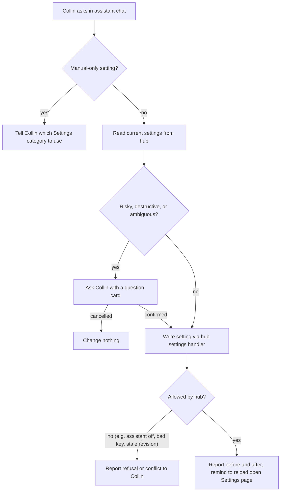

# Let the personal assistant change settings

**Idea:** `IDEA.md` — what this is for and why, in plain language. Read it first; it is
the north star this plan serves. Goal and Constraints live there, not here, so they don't
get buried as this file grows.

## Open Questions

None.

## Watch List

| # | Noticed | What needs looking into | Raised to user? | Outcome |
|---|---------|-------------------------|-----------------|---------|

## Decision Log

Append-only. A reversal is a new entry superseding the old, never an edit.

| # | Decision | Rationale | Source |
|---|----------|-----------|--------|
| 1 | Skip designer mockups for this feature | No new screen or visual layout changes; uses existing assistant chat, existing question cards, and existing Settings page controls | defaulted |
| 2 | Include read-only inspection of current settings (excluding secret values) | The assistant needs to check current values to answer questions and report accurate before/after summaries | defaulted |
| 3 | Route all assistant setting reads and writes through the hub's existing validation and write handlers via `wc.js assistant`, with no automatic retry on writes | Preserves every Settings page invariant and matches existing assistant action transport and safety rules | defaulted |
| 4 | Keep browser-only "Enter to send" out of assistant writes; assistant tells Collin where to toggle it | Stored only in browser `localStorage`; hub cannot change another browser's local preference | defaulted |
| 5 | Allow assistant to change hub-stored settings only (You except browser-only "Enter to send", Models, Usage & balancing, Threads, Agent behavior templates & lessons, Assistant & project leads, AI provider enable/disable & account metadata, Shared tools repo); keep logins, CLI installs, API keys/secrets, and Project tools PR edits manual | Gives chat control over normal settings without putting secrets, interactive sign-ins, or surprise repo PRs into assistant chat | user |
| 6 | Apply normal preference changes right away; require a `question` card confirmation before high-impact or destructive changes (loosening session permissions or aside access, enabling auto-merge or branch deletion, turning off the personal assistant or disabling an AI provider, removing an account/template/lesson, or resetting model pins) | Keeps everyday tweaks fast while guarding against accidental safety-boundary changes, deletions, or shutting off the assistant | user |
| 7 | Forbid the personal assistant from turning itself off (enforced by the hub and documented in `protocol/app/assistant.md`); turning the personal assistant off stays manual on Settings → Assistant and project leads | Prevents the assistant from killing its own session or locking itself out | user |
| 8 | Refresh an already-open Settings page automatically when settings change externally, without clobbering unsaved edits or focused inputs | Makes changes requested in the assistant popup visible right away on an open Settings page without disrupting active form edits | user |
| 9 | Invoke `handleSettings` directly through a lightweight exported `invokeSettings` adapter in `viewer/app/routes.js` (and `background.commit`/`background.metadata` directly) instead of extracting a new `settings-ops.js` module | Guarantees 100% identical validation, status codes, and side effects without duplicating or relocating ~300 lines of route code | review-round-1 |
| 10 | Require confirmation before turning off `project_leads` or discarding a waiting lesson (`lesson-waiting` with `action: "discard"`), and require the approved `revision` on `background` removal | Turning off project leads stops live sessions; discarding a waiting lesson has no history entry; tying background removal to the approved revision prevents deleting a newer image | review-round-1 |
| 11 | Support optional `--section` and `--include-history` on `wc.js assistant settings`, omitting `lesson_history` by default | Keeps routine setting lookups compact in the assistant's context while still allowing full history inspection when needed | review-round-1 |
| 12 | Supersedes #11 on `--section`: drop `--section` and keep `--include-history` only; poll a lightweight hub `GET /settings/revision` counter before fetching full `GET /settings`; use one uniform clean-repaints / dirty-keeps-draft-with-note rule across Settings blocks instead of per-field draft rebasing | Eliminates underspecified section key maps, avoids spawning `model.sh` subprocesses every 5 s on idle Settings tabs, and removes brittle per-field merge logic while fully meeting Decision 8 | review-round-2 |
| 13 | Supersedes #8 and the live-refresh part of #12: split automatic live refresh on an already-open Settings page into its own follow-up thread ("Auto-refresh an open Settings page when settings change"); this thread ships assistant-controlled settings (Settings page shows changes on reload or next visit) | Ships the core feature cleanly without Settings-page draft/refresh edge cases holding it up | idea-change |

## Spec



### 1. Overview & Boundaries

Let the personal assistant read and update hub-stored settings through `wc.js assistant`, reusing the hub's existing Settings handlers and side effects. Changes appear on the Settings page on reload or next visit (automatic live refresh of an already-open Settings page is out of scope and tracked in a separate follow-up thread).

- **In scope (personal assistant only; project leads never have access):**
  - Read current hub settings (`settings` action), returning `GET /settings` + `diagram_sensitivity` + `background` metadata, omitting `lesson_history` unless `--include-history` is passed. Never exposes secret values (project keys, shared keys, sign-in tokens).
  - Write hub-stored settings (`setting` action) across the 19 supported targets below:
    - **You**: `user_name`, writing `style`, `diagram-sensitivity`, `background` (opacity change or remove image; not raw image upload).
    - **AI providers (metadata only)**: enable/disable `harness`, `account-add`, `account-update`, `account-remove`, `account-restore`.
    - **Usage and balancing**: `balancing`.
    - **Models**: `model` (per-provider slot/model/effort), `models-heads-up` (`switch`, `skip`, `reset`), plus `preferences` fields (`other_agents`, `provider_orders`, `review_families`, `escalation`, `lead_tier_notice_dismissed`).
    - **Assistant and project leads**: `project_leads` on/off via `preferences`.
    - **Threads**: `tool_steps`, `auto_merge`, `auto_merge_delete_branch`, `default_project_folder`, `permission_mode`, `codex_mode`, `aside_access`, `lead_name_list`, `lead_names` via `preferences`.
    - **Agent behavior**: `template-create`, `template-update`, `template-delete`, `lessons-update`, `lesson-restore`, `lesson-keep`, `lesson-waiting`.
    - **Shared tools (repo only)**: `shared_tools_repo` via `preferences`.
- **Out of scope / Excluded (refused by hub if attempted; assistant directs Collin to the Settings page):**
  - Turning the personal assistant itself off (`preferences` payload containing `assistant` is refused with HTTP 403).
  - Unknown or excluded preference keys (such as `enter_to_send`) — refused with HTTP 400 at the assistant boundary.
  - Browser-local "Enter to send" (`localStorage` only).
  - AI provider machine sign-ins / login codes and CLI installations.
  - Project tools (adding/editing/removing tools opens PRs, Windows switch, Unity prep) and Project keys.
  - Shared tools keys (machine-local secrets).
  - Background image file uploads.
  - Saved directories (`saved-dirs`), lesson export/import, style preview, and prompt preview are not write targets.
  - Automatic live refresh of an already-open Settings page (split into follow-up stub).

### 2. CLI Surface (`viewer/app/wc.js`)

Extend `assistantRequest(operation, tail, projectLead)` in `viewer/app/wc.js`:

- Add `'settings'` and `'setting'` to the personal assistant allowlist ONLY (when `projectLead` is false). `projectLead === true` MUST continue to reject `'settings'` and `'setting'` with `'unsupported assistant action'`.
- **`wc.js assistant settings [--include-history]`** (read-only):
  - Optional boolean flag `--include-history` (filtered out before `flags()` just like `--archived`).
  - Sends `POST /assistant` with `{ action: 'settings', ...(includeHistory ? { include_history: true } : {}) }`.
  - Retries on HTTP 503 ("hub unavailable") using `postSessionWithRetry`, the same as `projects`, `threads`, and `thread`.
  - Prints one JSON line.
- **`wc.js assistant setting <target> --file <json-file>`** (write):
  - Requires positional `<target>` (`parsed._[0]`) and `--file <json-file>` (`parsed.file`). If either is missing, throw `'setting requires <target> and --file'`.
  - Reads `<json-file>` as UTF-8 and parses JSON; if invalid JSON or not a plain JSON object (null, array, or primitive), throw `'setting --file must contain a JSON object'`.
  - Sends `POST /assistant` with `{ action: 'setting', target: parsed._[0], payload }`.
  - **Never retries automatically on 503** (only `settings` is added to the read-retry allowlist in `wc.js`).
  - Prints one JSON line (`{"ok":true,...}` on success; `{"ok":false,"error":...}` on failure, exit 0, matching existing `wc.js assistant` behavior).

### 3. Direct Settings Handler Adapter (`viewer/app/routes.js`)

Export a lightweight helper `invokeSettings(hub, method, relPath, body)` from `viewer/app/routes.js` that invokes `handleSettings(hub, fakeRequest, fakeResponse, fakeUrl, bits, body)` directly and returns `{ status, body }`:

- `relPath` is the path under `/settings` (for example `''`, `'/preferences'`, `'/harnesses/claude'`, `'/accounts'`, `'/accounts/abc/restore'`, `'/lessons/lead'`, `'/diagram-sensitivity'`). `bits` is `['settings', ...segments]`.
- `fakeRequest` provides `{ method }`; `fakeUrl` is `new URL('http://localhost/wheelchair/api/settings' + relPath)`; `fakeResponse` captures `statusCode`, headers (no-op `setHeader`), and the JSON body written by `send(...)`.
- Existing HTTP routes in `routes.js` are unchanged.
- Background reads and writes call `background.metadata(hub)` and `background.commit(...)` directly (`viewer/app/background.js`).

### 4. Hub Assistant Dispatcher (`viewer/app/assistant-actions.js`)

- In `dispatch(hub, input)` (personal assistant only), pass `allowSettings: true` in `policy`. Project-lead callers (`viewer/app/project-lead-actions.js:76`) already reject `'settings'` and `'setting'` with HTTP 400 (`unsupported project lead action`) before reaching `assistant-actions.run`; as defense-in-depth, `run` also requires `policy.allowSettings === true` (throwing `appError(403, 'only the personal assistant may do that')` otherwise).
- In `run(hub, input, policy)`:
  - If `action === 'settings'` or `action === 'setting'`:
    - Require `policy.allowSettings === true`; otherwise throw `appError(403, 'only the personal assistant may do that')`.
    - Do not require `input.thread`.
  - **`action === 'settings'`**:
    - Fetch base snapshot via `routes.invokeSettings(hub, 'GET', '')` (same payload as `GET /wheelchair/api/settings`, including `reserved_provider`), plus `diagramSensitivity.read(hub)` and `background.metadata(hub)`.
    - Return `{ ...base, diagram_sensitivity, background }`, omitting `lesson_history` unless `input.include_history === true`.
  - **`action === 'setting'`**:
    - Require `typeof input.target === 'string' && input.target.trim()` and `input.payload` to be a plain non-null, non-array object; otherwise throw `appError(400, 'target and object payload are required')`.
    - Map each allowed `target` through one compact lookup table plus three custom handlers (`preferences`, `diagram-sensitivity`, `background`), propagating any `appError` thrown by `handleSettings`:
      - **Custom handlers:**
        1. `preferences`:
           - If `Object.hasOwn(payload, 'assistant')`, throw `appError(403, 'the assistant cannot change its own on/off setting; change it under Settings → Assistant and project leads')`.
           - Validate that every key in `payload` is in the allowed preference key set: `lead_names`, `lead_name_list`, `permission_mode`, `shared_tools_repo`, `codex_mode`, `aside_access`, `project_leads`, `auto_merge`, `auto_merge_delete_branch`, `review_families`, `tool_steps`, `escalation`, `default_project_folder`, `user_name`, `other_agents`, `provider_orders`, `lead_tier_notice_dismissed`. Reject any unknown or excluded key (for example `enter_to_send`) with `appError(400, \`unsupported preference key: ${key}\`)` and require at least one key (`appError(400, 'preferences payload must name at least one setting')`).
           - Call `invokeSettings(hub, 'PUT', '/preferences', payload)` and return `{ ok: true, result: res.body }`.
        2. `diagram-sensitivity`: `POST /diagram-sensitivity` with `payload`. Invalid `level` throws `appError(400, ...)`. On `res.status === 200`, return `{ ok: true, result: res.body }`. On non-200 (partial/all machine failure, e.g. 502), return `{ ok: false, error: 'one or more machines did not update diagram sensitivity', result: res.body }` (HTTP 200 so the assistant receives the full `machines` map and can report which machine failed).
        3. `background`: accept `payload.action === 'opacity'` (requires integer `payload.opacity` 0–100; optional integer `payload.revision` — if omitted, reads current `background.metadata(hub)` revision; if `!current.image_id`, throw `appError(400, 'no background image is set')`; calls `background.commit(hub, rev, payload.opacity, current.image_id, current.media_type, null)`) or `payload.action === 'remove'` (**requires** non-negative safe integer `payload.revision`, matching the revision the user approved removing; if missing or invalid, throw `appError(400, 'background remove requires revision')`; calls `background.commit(hub, payload.revision, 35, null, null, null)`). If `background.commit` throws 409 (`Background changed elsewhere`), propagate the 409 error so the CLI prints `{"ok":false,"error":"Background changed elsewhere"}`. Any other `action` throws `appError(400, 'background action must be opacity or remove')`. Return `{ ok: true, result }`.
      - **Route lookup table** (each entry maps `target` → `{ method, path(payload), body(payload) }`, calling `invokeSettings(hub, method, path, body)` and returning `{ ok: true, result: res.body }`; path helpers require a non-empty string for the path parameter (`provider`, `id`, or `role`) and URL-encode it, letting `handleSettings` perform all remaining validation and return its own 400/404/409 errors):
        - `style` → `PUT /style`, body: `payload`
        - `harness` → `PUT /harnesses/:provider`, body: `{ enabled: payload.enabled }`
        - `account-add` → `POST /accounts`, body: `payload`
        - `account-update` → `PUT /accounts/:id`, body: `payload` without `id`
        - `account-remove` → `DELETE /accounts/:id`, body: `{}`
        - `account-restore` → `POST /accounts/:id/restore`, body: `{}` (restores removed `default-<provider>` accounts only; `handleSettings` rejects non-default ids with 404)
        - `balancing` → `PUT /balancing`, body: `payload`
        - `model` → `PUT /models`, body: `payload`
        - `models-heads-up` → `POST /models/heads-up`, body: `payload`
        - `template-create` → `POST /templates`, body: `payload`
        - `template-update` → `PUT /templates/:id`, body: `payload` without `id`
        - `template-delete` → `DELETE /templates/:id`, body: `{}`
        - `lessons-update` → `PUT /lessons/:role`, body: `{ edits: payload.edits, removals: payload.removals }`
        - `lesson-restore` → `POST /lessons/:role/restore`, body: `{ id: payload.id, vid: payload.vid }`
        - `lesson-keep` → `POST /lessons/:role/keep`, body: `{ id: payload.id }`
        - `lesson-waiting` → `POST /lessons/:role/waiting`, body: `{ wid: payload.wid, action: payload.action }`
      - Any other `target` throws `appError(400, 'unsupported setting target')`.

### 5. Assistant Protocol Rules (`protocol/app/assistant.md`) & Rollout

Update `protocol/app/assistant.md`:

- **Scratch files for action payloads:** In the opening rule (`protocol/app/assistant.md:11`), explicitly permit writing temporary JSON/text files outside any project repository (for example under `/tmp` or the session's scratch directory) when preparing inputs for `wc.js assistant` (`start --message-file`, `message --text-file`, `setting <target> --file`) and `card.js`, while continuing to forbid editing files in any project or running git writes.
- **Settings rule block** (replacing `"Do not change Settings."`):
  - You can inspect and change hub settings when Collin asks in chat using `wc.js assistant settings [--include-history]` (read) and `wc.js assistant setting <target> --file <json-file>` (write).
  - Read `settings` first when you need current values, ids (accounts, templates, lessons), or revisions (background), and report clearly what changed (before → after). After any write, remind Collin to reload any already-open Settings page before editing that block. Note that `account-restore` only restores a removed default account (`default-<provider>`), never a removed custom account.
  - **Preserve untouched fields on replacement payloads:**
    - `model`: read the current slot first; when changing only `model` for a provider that supports effort, carry forward the slot's existing `effort` if compatible with the new model (or omit/adjust only if incompatible, and say so); when changing only `effort`, carry forward the slot's existing `model`.
    - `style`: read current `style` first and send the full style object with only the requested field(s) changed.
    - `balancing`: send only the changed balancing key(s); when changing one role in `held_back`, send the full five-role `held_back` object preserving the other roles.
    - `template-update`: send `id` plus the changed top-level field(s). Because `switches` is replaced as a whole object, when changing any switch read the current template first and send the full `switches` object preserving untouched switches; when changing `role` away from `worker` (even if Collin asked only to change the role), always include the full saved `switches` object with the worker-only `unsettled` field removed so the validator accepts it. When activating a template or moving an active template into a `(role, scope)` that already has an active template, disclose in the reply (or confirmation) that the previously active template will be turned off.
    - `account-update`: changing an account's `plan` without sending `weight` resets `weight` to the new plan's default (matching the Settings page); if Collin asks to keep a custom weight, pass `weight` explicitly alongside `plan`, otherwise mention the weight reset when it changes.
    - `preferences`: send only the changed key(s).
  - **Confirm first with a `question` card** (naming the exact change and its effect) before applying:
    - Loosening session permissions (`permission_mode: "bypass"`, `codex_mode: "unrestricted"`) or broadening aside access (`aside_access: "full"`).
    - Turning on `auto_merge: "on"` or `auto_merge_delete_branch: "on"`.
    - Turning off `project_leads: "off"` (stops live project-lead sessions) or disabling an AI provider (`harness` with `enabled: false`).
    - Adding an account for a provider that has a provider warning (`accountWarning`, such as Claude) when at least one account for that provider already exists — quote the warning (matching the Settings page's "Add anyway" warning).
    - Pausing an account (`account-update` with `paused: true`), clearing a model pin (`model` with `model: null` or `"none"`, or `models-heads-up switch` to `"none"`), or changing a role's tier or provider order so it has no usable model on its ladder, any of which could leave the assistant or leads unable to start on restart.
    - Removing an account (`account-remove`), deleting a template (`template-delete`), removing a lesson (`lessons-update` with non-empty `removals`), discarding a waiting lesson (`lesson-waiting` with `action: "discard"`), removing the background image (`background` with `action: "remove"`, passing the `revision` read before the card — if the CLI returns `{"ok":false,"error":"Background changed elsewhere"}` because a new image was uploaded meanwhile, re-read `settings` and ask again), or resetting model pins (`models-heads-up` with `action: "reset"`).
    - Any ambiguous request where more than one setting or value could match.
  - Apply other hub setting changes immediately and confirm what changed.
  - **Stay manual (never attempt; tell Collin which Settings category to use):**
    - Turning the personal assistant itself off (`Settings → Assistant and project leads`) — refused by the hub.
    - "Enter to send" (`Settings → You`) — browser-local only.
    - AI provider sign-ins / login codes and CLI installations (`Settings → AI providers`).
    - Project tools and Project keys (`Settings → Project tools`).
    - Shared tools keys (`Settings → Shared tools`).
    - Uploading a new background image file (`Settings → You`).
  - `settings` retries on hub unavailability; `setting` never retries automatically. After "hub unavailable" on `setting`, check `settings` before trying again. Report the returned outcome (including per-machine results on `diagram-sensitivity`).
- Add `settings [--include-history]` and `setting <target> --file <f>` rows to the **Actions** table in `protocol/app/assistant.md`, listing the supported targets.
- Update `viewer/app/API.md` to document the new `settings` and `setting` assistant actions on `/api/machine/assistant`, including the partial `diagram-sensitivity` failure returned inside an HTTP 200 response.
- **Activation / Rollout (`CONTRIBUTING.md:67`):** Role file edits reach sessions started after the edit, never an already-running session. After merging and updating, restart the personal assistant session (or toggle it off and on in Settings) so it picks up the new `protocol/app/assistant.md` rules. Verification checks the composed prompt of a fresh assistant session.

### 6. Validation Commands & Required Assertions

Targeted tests per area (whole-suite and full-run checks are run by the pusher before push):

- **CLI (`viewer/app/wc.js`):**
  ```bash
  node --test viewer/test/wc-cli.test.js
  ```
  Required assertions: `wc.js assistant settings` (with and without `--include-history`) retries on 503; `wc.js assistant setting <target> --file <f>` rejects missing target/file or non-object JSON, never retries on 503, and prints `{"ok":false,"error":"Background changed elsewhere"}` when the hub returns 409; `wc.js project-lead` rejects both `settings` and `setting`.
- **Machine relay & name guard (`machine/service.js`):**
  ```bash
  node --test machine/test/name-guard.test.js machine/test/assistant.test.js
  ```
  Required assertions (in `machine/test/assistant.test.js`): partial `diagram-sensitivity` result (`{ ok: false, error, result: { machines } }`) passes through `/v1/agent/assistant` intact, and a fresh assistant session's composed startup prompt includes the Settings action rules and scratch-file rule and no longer contains `"Do not change Settings."`.
- **Hub settings adapter, routes, and assistant actions (`viewer/app/routes.js`, `viewer/app/assistant-actions.js`):**
  ```bash
  node --test viewer/test/assistant.test.js viewer/test/app-settings.test.js viewer/test/app-shared-tools-setting.test.js viewer/test/app-diagram-sensitivity.test.js viewer/test/background.test.js
  ```
  Required assertions: live personal assistant reads settings (omitting `lesson_history` by default, including it with `include_history: true`) and writes across supported targets, with independent browser-facing read-backs confirming persisted state (`GET /wheelchair/api/settings` for hub settings — including seeding a model notice before `models-heads-up skip`, confirming it appears before the write and disappears after — `GET /wheelchair/api/settings/background` for background changes, and `GET /wheelchair/api/settings/diagram-sensitivity` for diagram sensitivity); `project-lead-actions.dispatch` rejects `settings`/`setting` with 400 and `assistant-actions.run` without `allowSettings` rejects with 403; `preferences` containing `assistant` is refused with 403; `preferences` containing an unknown or excluded key (such as `enter_to_send`) or empty object is refused with 400; unknown target is refused with 400; `diagram-sensitivity` partial machine failure returns `{ ok: false, error, result: { machines } }`; `background` `remove` requires `revision` and returns 409 (`Background changed elsewhere`) on stale revision.
- **Assistant popup UI (`viewer/test/app-assistant-popup.spec.js`):**
  ```bash
  npm --prefix viewer run test:browser -- app-assistant-popup.spec.js
  ```
- **Protocol (`protocol/app/assistant.md`) & API doc (`viewer/app/API.md`):**
  - Review rendered prose for consistency with `viewer/app/wc.js` and `viewer/app/assistant-actions.js`, and verify activation guidance and `viewer/app/API.md` endpoint entries.

## Accepted Risks

| Risk | Why accepted | Round |
|------|--------------|-------|
| Simultaneous browser edit on Settings during the few seconds while the assistant reads and writes a replacement payload (`style`, `held_back`, or a model slot) can overwrite the concurrent browser save | Rare path per `protocol/app/realism.md`: requires Collin to manually edit and save the same setting block in the browser mid-command right after asking the assistant to change it | review-round-4 |

## Check Once Built

| # | What to check | Round |
|---|---------------|-------|

## Review Rounds

### Round 1 — 2026-11-28

**Lanes:** claude / claude-opus-5-5 (intent); gpt / gpt-6.2-sol (mechanics); cross-family: yes.

**Changed since Round 0:** n/a (first round — whole Spec in scope)

| Lane | Reported | Finding | Lead verdict | Resolution |
|---|---|---|---|---|
| intent | minor | Call `handleSettings` directly via allowlist + stub response instead of extracting `settings-ops.js` | upheld | Replaced `settings-ops.js` with `routes.invokeSettings` adapter in Spec §3–§4 (Decision 9) |
| intent | minor | Reuse `window.wcPoller` (`viewer/pages/nav.js:6`) instead of custom `setInterval` + `visibilitychange` | upheld | Later moot (live refresh split off in Decision 13) |
| intent | minor | Add `project_leads: "off"` to confirmation list since it stops live sessions | upheld | Added `project_leads: "off"` to confirm list in Spec §5 (Decision 10) |
| intent | minor | `settings` read returns large `settings.describe` blob including `lesson_history` | upheld | Added optional `--include-history`, omitting `lesson_history` by default in Spec §2, §4, §5 (Decision 11, refined in Decision 12) |
| mechanics | blocking | Templates editor is open by default; skipping whenever open leaves templates stale | upheld | Later moot (live refresh split off in Decision 13) |
| mechanics | major | Deferred repaints consumed when snapshot advances while skipped | upheld | Later moot (live refresh split off in Decision 13) |
| mechanics | major | `balDraft` and `styleDraft` persist after blur; whole-form save risks stale or lost edits | upheld | Later moot (live refresh split off in Decision 13) |
| mechanics | major | External lesson removal during edit silently clears typed text on Save | upheld | Later moot (live refresh split off in Decision 13) |
| mechanics | major | `renderSharedTools` rebuilds key inputs and can erase unsaved key drafts | upheld | Later moot (live refresh split off in Decision 13) |
| mechanics | major | Refresh GETs not ordered against local browser saves | upheld | Later moot (live refresh split off in Decision 13) |
| mechanics | major | Accounts uses `/usage` snapshot and Harnesses uses `/harnesses` (`hz.data`) | upheld | Later moot (live refresh split off in Decision 13) |
| mechanics | major | Background removal confirmation not tied to approved revision | upheld | Required `revision` on `background` `remove` and re-confirm on 409 conflict in Spec §4, §5 (Decision 10) |
| mechanics | major | `lesson-waiting` `discard` removes pending lesson without history or confirmation | upheld | Added `lesson-waiting` `action: "discard"` to confirmation list in Spec §5 (Decision 10) |
| mechanics | minor | `renderConversations` (not `renderAssistants`) owns `project_leads` toggle | upheld | Later moot (live refresh split off in Decision 13) |
| mechanics | minor | Rollout must note restarting already-running assistant session for new role rules | upheld | Added Activation / Rollout note in Spec §5 |
| mechanics | minor | Playwright command must use `npm --prefix viewer run test:browser -- ...` for Firefox coverage | upheld | Updated Playwright command in Spec §6 |
| mechanics | minor | Validation list omitted `node --test machine/test/name-guard.test.js` | upheld | Added `node --test machine/test/name-guard.test.js` to Spec §6 |
| mechanics | minor | Validation list should specify required assertions for new actions and refresh behavior | upheld | Added required test assertions per suite in Spec §6 |

### Round 2 — 2026-11-28

**Lanes:** claude / claude-opus-5-5 (intent); gpt / gpt-6.2-sol (mechanics); cross-family: yes.

**Changed since Round 1:** Replaced `settings-ops.js` with `routes.invokeSettings`; added `--section`/`--include-history`; required background `revision` and added `project_leads`/`lesson-waiting discard` confirmation; rewrote live refresh; added rollout note and updated validation.

| Lane | Reported | Finding | Lead verdict | Resolution |
|---|---|---|---|---|
| intent | minor | Polling full `GET /settings` every 5 s runs two `model.sh` subprocesses; poll a cheap revision counter instead | upheld | Later moot (live refresh split off in Decision 13) |
| intent | minor | `--section` had 11 names with incomplete key maps; omitting `lesson_history` by default already meets Decision 11 | upheld | Dropped `--section` and kept `--include-history` only in Spec §2, §4, §5 (Decision 12) |
| intent | minor | Reuse existing `accountsBusy()` and `refreshUsage()` instead of restating a second Accounts guard | upheld | Later moot (live refresh split off in Decision 13) |
| intent | minor | Replace ~15 per-block merge rules with uniform clean-repaints / dirty-keeps-draft-with-note | upheld | Later moot (live refresh split off in Decision 13) |
| mechanics | blocking | `nameDraft` and `folderDraft` clean value is `null`, not `''` | upheld | Later moot (live refresh split off in Decision 13) |
| mechanics | blocking | Shared tools `<select>` must also add missing repo option and refresh key metadata when clean | upheld | Later moot (live refresh split off in Decision 13) |
| mechanics | major | Template draft needs saved `draftBaseline` | upheld | Later moot (live refresh split off in Decision 13) |
| mechanics | major | Lessons and Templates share one repaintable block (`behavior`) | upheld | Later moot (live refresh split off in Decision 13) |
| mechanics | major | DOM-only edits ("Never say" input in Style, custom "Other" model input in Tiers) missed by draft guards | upheld | Later moot (live refresh split off in Decision 13) |
| mechanics | major | Balancing `held_back` object needs per-role merge under field-by-field rebasing | upheld | Later moot (live refresh split off in Decision 13) |
| mechanics | major | Lesson import raw `fetch` and `reload()` bypass `localWriteGen`/`inFlightWrites` | upheld | Later moot (live refresh split off in Decision 13) |
| mechanics | major | Harness-only change must also refresh Accounts | upheld | Later moot (live refresh split off in Decision 13) |
| mechanics | major | Lead names uses a dropdown and file upload, not a text editor | upheld | Later moot (live refresh split off in Decision 13) |
| mechanics | minor | `project-lead-actions.js:76` rejects new actions with 400 before reaching `assistant-actions.run`'s 403 | upheld | Clarified 400 at `project-lead-actions.dispatch` and 403 defense-in-depth at `assistant-actions.run` in Spec §4 & §6 |
| mechanics | minor | Omitted `section` wasn't normalized to `'all'` before supplemental fetches | upheld | Eliminated by dropping `--section` (Spec §2, §4) |
| mechanics | minor | Section key maps incomplete and `retired_accounts` is not returned by `settings.describe` | upheld | Dropped `--section` and removed `retired_accounts` watch (Spec §4) |
| mechanics | minor | Targeted checks lacked a machine-relay test for partial diagram results and a fresh-session prompt check | upheld | Added `machine/test/assistant.test.js` relay and fresh-session prompt assertions in Spec §6 |

### Round 3 — 2026-11-28

**Lanes:** claude / claude-opus-5-5 (intent); gpt / gpt-6.2-sol (mechanics); cross-family: yes.

**Changed since Round 2:** Added `GET /settings/revision`; dropped `--section`; simplified live refresh; clarified project-lead 400 vs 403 and added machine-relay/prompt tests.

| Lane | Reported | Finding | Lead verdict | Resolution |
|---|---|---|---|---|
| intent | minor | `pollSettings` still calls `GET /settings/diagram-sensitivity` every 5 s on `you` | upheld | Removed live refresh (split off in Decision 13) |
| intent | minor | In-memory `hub.settingsRevision` starting at 1 can repeat after hub restart | upheld | Removed revision counter & live refresh (split off in Decision 13) |
| intent | minor | Per-block `renderedSlices` / `flushDeferredRepaints` could be simplified | upheld | Removed live refresh (split off in Decision 13) |
| mechanics | blocking | `protocol/app/assistant.md:11` restricts assistant to `wc.js`/`card.js`/read-only; explicitly authorize writing scratch JSON payload files outside any project | upheld | Authorized temporary scratch files outside any project repo in Spec §5 |
| mechanics | major | Read/stamp `settingsRevision` before `settings.describe()` async reads | upheld | Removed revision counter & live refresh (split off in Decision 13) |
| mechanics | major | Hub restart reuses revision `1` | upheld | Removed revision counter & live refresh (split off in Decision 13) |
| mechanics | major | Deferred slices can overwrite a newer local save after clearing draft | upheld | Removed live refresh (split off in Decision 13) |
| mechanics | major | `reload()` and account-save GETs bypass `localWriteGen` | upheld | Removed live refresh (split off in Decision 13) |
| mechanics | major | External lesson removal causes 409 on `saveLessons()` with no draft-preserving recovery | upheld | Removed live refresh (split off in Decision 13) |
| mechanics | major | Behavior clean check uses `lessonDirty()` even when a template is selected | upheld | Removed live refresh (split off in Decision 13) |
| mechanics | major | Shared tools `readKeys()` response can overwrite key inputs typed while pending | upheld | Removed live refresh (split off in Decision 13) |
| mechanics | major | Accounts has a second repaint guard for connected waiting sign-in | upheld | Removed live refresh (split off in Decision 13) |
| mechanics | major | Protocol does not specify preserving existing fields on replacement payloads (e.g. model effort, style, balancing) | upheld | Specified partial-payload preservation rules for `model`, `style`, `balancing`, `preferences`, and `template-update` in Spec §5 |
| mechanics | minor | Focus guard should include focusable buttons and Background repaint | upheld | Removed live refresh (split off in Decision 13) |
| mechanics | minor | Use `youShown()` instead of `section === 'you'` for diagram polling | upheld | Removed live refresh (split off in Decision 13) |
| mechanics | minor | Validate allowed preference keys at assistant boundary so excluded keys like `enter_to_send` are rejected | upheld | Added explicit preference key allowlist + non-empty check in Spec §4 & §6 |
| mechanics | minor | Add `app-diagram-sensitivity.spec.js` and `viewer/test/background.test.js` to Spec §7 | upheld | No longer modifying `settings.js`, `background.js`, or diagram polling after Decision 13 split; updated Spec §6 accordingly |

### Round 4 — 2026-11-28

**Lanes:** claude / claude-opus-5-5 (intent); gpt / gpt-6.2-sol (mechanics); cross-family: yes.

**Changed since Round 3:**
- Split automatic live refresh on an already-open Settings page (and the hub `GET /settings/revision` counter) out of this plan into a follow-up stub ("Auto-refresh an open Settings page when settings change"), per Collin's decision (Decision 13, `IDEA.md` Not doing updated).
- Authorized writing temporary JSON/text payload files outside any project repository in `protocol/app/assistant.md` (Spec §5).
- Specified partial-payload preservation semantics for `model` (carrying forward compatible `effort`), `style`, `balancing` (`held_back`), `preferences`, and `template-update` in `protocol/app/assistant.md` (Spec §5).
- Added explicit preference key allowlist + non-empty check in `assistant-actions.js` so excluded keys like `enter_to_send` are refused with HTTP 400 (Spec §4, §6).
- Narrowed Spec §6 validation commands to the touched areas (removed `app-settings.spec.js` since `viewer/pages/settings.js` is no longer modified).

| Lane | Reported | Finding | Lead verdict | Resolution |
|---|---|---|---|---|
| intent | minor | Replace 19 hand-written target branches in §4 with one lookup table + 3 custom handlers | upheld | Replaced 19 branches with route lookup table + 3 custom handlers (`preferences`, `diagram-sensitivity`, `background`) in Spec §4 |
| mechanics | major | `template-update` partial `switches` replaces whole object and role change away from `worker` must omit `switches.unsettled` | upheld | Specified reading current template and sending full `switches` (omitting `unsettled` when leaving `worker`) in Spec §5 |
| mechanics | major | Simultaneous browser edit while assistant prepares replacement payload (`style`, `held_back`, model slot) can overwrite concurrent save | accepted-risk | Rare path per `realism.md` (Collin editing same setting in browser mid-command); recorded in Accepted Risks (`review-round-4`) |
| mechanics | major | Adding an account for a provider with `accountWarning` (Claude) skips Settings page's "Add anyway" confirmation | upheld | Added provider `accountWarning` (such as Claude) to confirmation list in Spec §5 |
| mechanics | minor | Background removal rule cited HTTP 409, while CLI prints `{"ok":false,"error":"Background changed elsewhere"}` | upheld | Specified the CLI-visible error string in Spec §5 & §6 |
| mechanics | minor | `account-restore` only restores removed `default-<provider>` accounts, not custom accounts | upheld | Stated `default-<provider>` limit in Spec §4 & §5 |
| mechanics | minor | Validation should require reading back an assistant write via browser-facing `GET /wheelchair/api/settings` | upheld | Added independent `GET /wheelchair/api/settings` read-back assertion in Spec §6 |

### Round 5 — 2026-11-28

**Lanes:** claude / claude-opus-5-5 (intent); gpt / gpt-6.2-sol (mechanics); cross-family: yes.

**Changed since Round 4:**
- Replaced 19 target branches in Spec §4 with one route lookup table plus three custom handlers (`preferences`, `diagram-sensitivity`, `background`), and noted `account-restore` applies only to `default-<provider>` accounts.
- Updated Spec §5 (`protocol/app/assistant.md`) to preserve sibling `switches` on `template-update` (omitting `switches.unsettled` when leaving `worker`), require confirmation quoting the provider warning when adding an account for a provider with `accountWarning` (such as Claude), and check for `{"ok":false,"error":"Background changed elsewhere"}` on background removal conflict.
- Recorded simultaneous browser/assistant edit on replacement payloads (`style`, `held_back`, model slot) as a rare-path Accepted Risk (`review-round-4`).
- Added CLI conflict assertion and independent `GET /wheelchair/api/settings` read-back assertion in Spec §6.

| Lane | Reported | Finding | Lead verdict | Resolution |
|---|---|---|---|---|
| intent | minor | Remind Collin to reload any already-open Settings page before editing that block after an assistant write | upheld | Added one-line reload reminder rule to Spec §5 |
| mechanics | major | Role-only `template-update` moving a worker template to another role must include full saved `switches` with `unsettled` removed | upheld | Required full saved `switches` without `unsettled` whenever changing `role` away from `worker` in Spec §5 |
| mechanics | major | Pausing an account or clearing a model pin (`model: null`) could remove the assistant's last eligible startup option | upheld | Added `account-update` with `paused: true` and `model` with `model: null` to confirmation list in Spec §5 |
| mechanics | minor | `accountWarning` confirmation applies when at least one account for that provider already exists (matching Settings UI) | upheld | Added account-count condition ("when at least one account for that provider already exists") in Spec §5 |
| mechanics | minor | Independent read-back should also check `GET /settings/background` and `GET /settings/diagram-sensitivity` | upheld | Added both browser-facing read-backs to Spec §6 |
| mechanics | minor | Document `settings` and `setting` (including partial diagram failure in HTTP 200) in `viewer/app/API.md` | upheld | Added `viewer/app/API.md` update to Spec §5 & §6 |

### Round 6 — 2026-11-28

**Lanes:** claude / claude-opus-5-5 (intent); gpt / gpt-6.2-sol (mechanics); cross-family: yes.

**Changed since Round 5:**
- Updated Spec §5 (`protocol/app/assistant.md`): added one-line reload reminder for open Settings pages; required sending full saved `switches` without `unsettled` whenever changing a template's `role` away from `worker`; added `account-update` (`paused: true`) and `model` (`model: null`) to the confirmation list; scoped `accountWarning` confirmation to when at least one account for that provider already exists; added `viewer/app/API.md` update for `settings` and `setting` (including partial diagram failure in HTTP 200).
- Updated Spec §6 validation assertions to include independent read-backs from `GET /wheelchair/api/settings/background` and `GET /wheelchair/api/settings/diagram-sensitivity`, plus `viewer/app/API.md` check.

| Lane | Reported | Finding | Lead verdict | Resolution |
|---|---|---|---|---|
| mechanics | major | Literal `"none"` can also clear a model pin via `model` or `models-heads-up switch` | downgraded | Minor (assistant clears pins via `model: null` per `routes.js:356` and picks real models from `heads_up`); still added `"none"` to the confirmation list in Spec §5 |
| mechanics | major | Changing a role's tier or provider order to one with no usable model on its ladder can leave it unable to start | downgraded | Minor (reversible setting change requested by Collin, loses no user work); still added to the confirmation list in Spec §5 |
| mechanics | major | Moving an active template into an occupied `(role, scope)` deactivates the incumbent | downgraded | Minor (`routes.js:542` enforces one active template per role/scope without deleting the incumbent, matching Settings UI); still added disclosure rule in Spec §5 |
| mechanics | major | Changing an account's `plan` without `weight` resets `weight` to the new plan's default | downgraded | Minor (matches `routes.js:339` and Settings UI `settings.js:1971`); still added explicit weight-preservation / disclosure guidance in Spec §5 |
| mechanics | minor | Seed a model notice before `models-heads-up skip` read-back assertion so persistence is observable | upheld | Added seeded notice check to Spec §6 |
| mechanics | minor | Include `viewer/test/app-diagram-sensitivity.test.js` and `viewer/test/background.test.js` in targeted validation | upheld | Added both suites to Spec §6 |

## Prior Work

| Spec item | State | Evidence (file:line) | Confidence |
|-----------|-------|----------------------|------------|

## Implementation Tasks

| # | Objective | Ownership boundary | Lane | Session id | Validation | Status |
|---|-----------|--------------------|------|-----------|------------|--------|
| T1 | Add assistant `settings` and `setting` CLI commands and tests | `viewer/app/wc.js`, `viewer/test/wc-cli.test.js` | standard / gpt-6.1-terra | `wc-166421be9826-worker` | `node --test viewer/test/wc-cli.test.js` | done |
| T2 | Export `invokeSettings` adapter, add hub assistant settings dispatcher and tests | `viewer/app/routes.js`, `viewer/app/assistant-actions.js`, `viewer/test/assistant.test.js` | standard / gpt-6.1-terra | `wc-166421be9826-worker-2` | `node --test viewer/test/assistant.test.js viewer/test/app-settings.test.js viewer/test/app-shared-tools-setting.test.js viewer/test/app-diagram-sensitivity.test.js viewer/test/background.test.js` | done |
| T3 | Update assistant protocol rules, API docs, and machine relay/prompt tests | `protocol/app/assistant.md`, `viewer/app/API.md`, `machine/test/assistant.test.js` | standard / gpt-6.1-terra | `wc-166421be9826-worker-3` | `node --test machine/test/name-guard.test.js machine/test/assistant.test.js` | done |

## Log

- 2026-11-28: IDEA.md confirmed (`mode: thorough`). Checked `session leads`: only one active thread (`75365a4c3d07`, "Add account button under each provider", verifying a small UI fix in `renderAccounts`); no overlap.
- 2026-11-28: All Open Questions settled; checked `session leads` again before `ready-for-review` (`75365a4c3d07` still the only active thread, now Verified; no overlap). Set `status: ready-for-review`.
- 2026-11-28: Round 1 triaged (18 findings upheld: 1 blocking, 8 major, 9 minor; 0 declined). All 18 resolved in Spec and logged; starting Round 2.
- 2026-11-28: Round 2 triaged (17 findings upheld: 2 blocking, 7 major, 8 minor; 0 declined). Simplified Spec §4 & §5 (Decision 12) and resolved all 17 findings; starting Round 3.
- 2026-11-28: Round 3 hit review budget (17 findings upheld). Collin chose to split automatic live refresh into its own follow-up thread (Decision 13). Resolved all remaining findings, posted live-refresh stub, budget reset, starting Round 4.
- 2026-11-28: Round 4 triaged (6 upheld, 1 rare-path accepted-risk); resolved and started Round 5.
- 2026-11-28: Round 5 triaged (6 upheld); resolved and started Round 6.
- 2026-11-28: Round 6 clean (intent: No findings; mechanics: 4 downgraded to minor and fixed, 2 minor upheld and fixed). Drew Spec Mermaid diagram, set `status: approved`. Ready check passed: `wc.js session list` ok, `codex/preflight.sh` fresh (134h remaining), Claude/GPT/Gemini CLIs working.
- 2026-11-28 — Dispatched T1, T2, T3 in parallel (`gpt-6.1-terra`, standard tier).
- 2026-11-28 — T1 accepted (band: scout): added assistant `settings` and `setting` CLI commands and unit tests (`wc-cli.test.js` 8/8 passing).
- 2026-11-28 — T3 accepted (band: scout): updated `protocol/app/assistant.md`, `viewer/app/API.md`, and `machine/test/assistant.test.js` (`name-guard.test.js` + `assistant.test.js` 4/4 passing).
- 2026-11-28 — Choice: T2, assistant-actions.js: validate optional background opacity revision as a non-negative safe integer, matching background revision semantics.
- 2026-11-28 — T2 accepted (band: scout): exported `invokeSettings` in `viewer/app/routes.js`, implemented assistant `settings`/`setting` in `viewer/app/assistant-actions.js`, and added tests in `viewer/test/assistant.test.js` (62/62 passing across the 5 validation suites).
