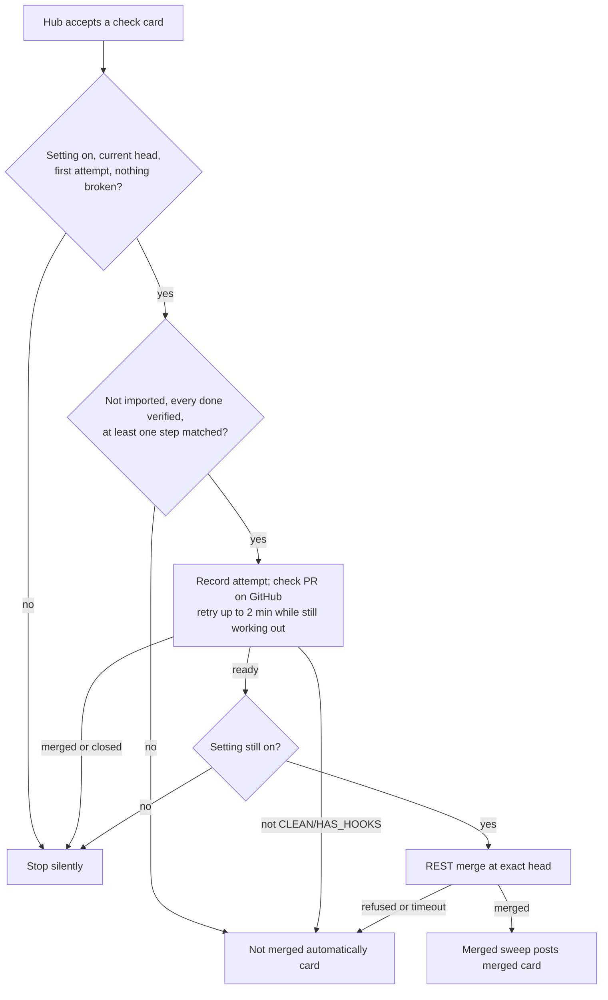

# Auto-merge finished pull requests

**Idea:** `IDEA.md` — what this is for and why, in plain language. Read it first; it is
the north star this plan serves. Goal and Constraints live there, not here, so they don't
get buried as this file grows.

## Open Questions

Ordered by leverage; discussed one at a time. A settled question moves to the Decision
Log and is deleted from here.

(none)

## Watch List

Things noticed that need looking into — not yet decisions for the user. Written down the
moment they're spotted so they can't be forgotten, surfaced to the user one line at a
time as they appear, and emptied before Stage 1 exits.

Each item ends up settled by the agent (noted in the Log), promoted to an Open Question,
promoted to a Constraint or Accepted Risk, or waved off by the user.

| # | Noticed | What needs looking into | Raised to user? | Outcome |
|---|---------|-------------------------|-----------------|---------|

## Decision Log

Append-only. A reversal is a new entry superseding the old, never an edit.

| # | Decision | Rationale | Source |
|---|----------|-----------|--------|
| 1 | Merge method: GitHub merge commit (`gh pr merge --merge`), matching how this repo's PRs are merged today | Keeps history the same as manual merges | defaulted |
| 2 | Applies to every path that ends in a `done` card: planned builds, small fixes, after-done fixes on an open PR | All three end in the same finishing procedure (MAP.md 3) | defaulted |
| 3 | The lead reads the setting at the moment it would merge, not when it started, so turning it off stops merges in running threads | A switch that doesn't take effect until new threads would surprise | defaulted |
| 4 | If GitHub refuses the merge (review required, branch protection, head moved), the PR stays open, the lead says so in one line, and nothing retries the merge | Never bypass GitHub's rules (IDEA Constraints) | defaulted |
| 5 | Merge only after the check agent has tried the Check it yourself steps and the check card has no broken step; a broken step keeps the PR open so Fix it now fixes it in place | One more look before main; fixes stay in the same thread | user |
| 6 | After a broken check, "Leave it" does not merge; the PR stays open for Collin. A later fix that passes its check merges as usual | "Leave it" leaves the decision with Collin | defaulted |
| 7 | One global switch on the Settings page | Matches the other settings; simplest | user |
| 8 | The hub decides whether a merge is allowed; the machine service runs `gh pr merge` in the thread's worktree | The hub holds the setting and the cards; the machine has the credentials that already push and open the PR (MAP.md 6) | defaulted |
| 9 | The check card's `update` text is phrased to work whether or not the merge is automatic ("Once the pull request is merged, …") | The lead writes it before the merge happens | defaulted |
| 10 | Supersedes #8 and #3's mechanism: the hub itself merges, triggered when it accepts a `check` card; there is no lead command. The setting is still read at that moment | Removes the lead command, machine endpoint, restart branch and stale-token path that drew four review findings; the hub already holds the setting, the cards and a `gh` | review-round-1 |
| 11 | Readiness is re-checked against GitHub right before merging, with the same rules as the done gate | Checks can fail on the same commit after done | review-round-1 |
| 12 | One attempt per done head, recorded before `gh` runs; never retried | Decision 4; makes restarts and repeated sweeps safe | review-round-1 |
| 13 | A done card for a fix pushed after it failed its check carries `unverified: true`, and the hub never merges it | Collin's "push it as it is" is permission to push, not to land | review-round-1 |
| 14 | Repositories whose base branch uses a merge queue are not auto-merged | `gh pr merge` would queue instead of merge, and the queue could land it after the switch is turned off | review-round-1 |
| 15 | Merge only when the check card has at least one step `agent: "matched"` and none `broken`; otherwise no merge | Collin: merge only after an agent actually tried it | user |
| 16 | Supersedes #13: the lead marks a done card `verified: true` only when it holds a passing check of this exact change; the hub merges only if **every** done card in the thread carries it. Old leads, restarted leads that can't tell, and "push it as it is" all omit it, so they never auto-merge | Positive evidence instead of a warning flag; one unverified push holds the PR for good | review-round-2 |
| 17 | Supersedes #14 and the `gh pr merge` call: merge through GitHub's REST merge endpoint with the exact `sha`, which merges immediately or refuses, never queues or turns on GitHub auto-merge | Removes the merge-queue lookup, the post-merge state check and `--disable-auto` | review-round-2 |
| 18 | "Still working out" from GitHub is re-checked every 20 s for up to 2 minutes before giving up | It is a passing state right after main moves | review-round-2 |
| 19 | With the switch on, a check card with no `matched` step also gives the "Not merged automatically" card | Collin should not wait for a merge that won't come | review-round-2 |
| 20 | Only `CLEAN` or `HAS_HOOKS` proceed to the merge; `BLOCKED` (for example a review still required) does not, even with checks passing | The hub's login may be exempt from branch protection; auto-merge must not use that | review-round-3 |
| 21 | The "Not merged automatically" card closes itself when the `merged` card is posted or a newer done card is accepted | Otherwise it sits in Needs you forever | review-round-3 |
| 22 | A lead never sets `verified` in a thread where the user ever chose to push something that failed its check; the question card answer is the durable record a restarted lead reads | One push-as-is holds the PR for good, whatever happens next | review-round-3 |
| 23 | Imported threads are never auto-merged | Their earlier push-as-is answers and checks can't be established after a handoff | review-round-4 |
| 24 | Supersedes the committed-pass part of #22's §2 wording: only a `result` the lead holds counts; a lead restarted before `done` omits `verified` | No committed record ties a pass to the pushed head; the cost is today's manual merge | review-round-4 |
| 25 | After four review rounds, keep the design (later verified fixes can still auto-merge) and run another round | Collin chose "One more round" over "first finish only" | user |
| 26 | A pass covers the done head when the commit the pass names, and the done head, differ only in files under `docs/plans/` (checked with `git diff --name-only <passed> <head>`); anything else omits `verified` | The planned build's `status: done` commit and Accepted Risks records follow verification; someone else's fast-forwarded commits do not count | review-round-5 |
| 27 | The hub's delivered `result` message carries the result's `commit` | The lead needs the verified commit to apply #26 | review-round-5 |
| 28 | If `card.js` refuses a done card with `unknown field: verified`, the lead posts it again without the field | An older hub must not stop the thread from finishing | review-round-5 |
| 29 | Imported threads get the `held` card too; the "Not merged automatically" card can be dismissed by Collin | Nobody waits for a merge that won't come; a card for a PR closed by hand can be cleared | review-round-5 |

## Spec

### Behaviour in one paragraph

A new global preference `auto_merge` (`off` | `on`, default `off`) is shown on the Settings
page. When the hub accepts a `check` card and the switch is on, the hub decides whether
that thread's pull request may merge (gates below). If so, it re-checks the pull request
on GitHub and merges it at exactly that commit. A success
shows up as the existing `merged` card; anything else gives one app `needs` card saying it
was not merged and why (§3 lists the cases that end without a card). With the switch off, nothing happens and threads end exactly as
today. Leads never merge.

### 1. The setting

- `viewer/app/settings.js`: add `auto_merge` to defaults (`'off'`), normalization (anything
  other than `'on'` becomes `'off'`) and the preferences response.
- `viewer/app/routes.js` PUT preferences: accept `body.auto_merge` in `['off','on']`, else
  400 `auto_merge must be off or on`; include `auto_merge` in the response object.
- `viewer/pages/settings.js`: one on/off control, label "Merge pull requests when done",
  help text: "When on, a thread merges its own pull request once an agent has seen at least one
  Check it yourself step work and none broke. A thread where you chose to push something
  that failed its check, or a thread handed over from another machine, is never merged
  automatically. It applies to pull requests checked after it is turned on. It never merges past failing checks, conflicts or
  GitHub's rules." Saved like the other preference controls.
- Nothing is written into agents' instructions.

### 2. The `done` card's new field

`verified` (boolean, optional; `cards-lead.md` done table; `card.js` validation accepts it).
The lead sets `verified: true` only when both hold:

- it holds, in its own context, a passing check naming a commit: the sub-lead's build
  `result` and its `commit` (planned build), or a passing verifier `result` and the commit
  it names (small fix, after-done fix or repair; a lead-check pass whose only gaps were rare
  paths counts);
- `git diff --name-only <that commit> <done head>` lists only files under `docs/plans/`
  (for example the `status: done` commit or an Accepted Risks record). Commits brought in
  without a verifier (such as a fast-forward in Making the pull request mergeable step 6)
  fail this;
- no `question` card in this thread was ever answered with "push it as it is" or with
  shipping a gap that survived its checks. Deferring hardening ("Defer them and finish" in
  a lighter mode) is not shipping a surviving gap.

Otherwise, and whenever it cannot tell (for example a restarted lead with no such result in
its context), it omits it. If `card.js` refuses the done card with `unknown field: verified`
(an older hub), the lead posts it again without the field.

`viewer/app/cards.js` result delivery (the `kind === 'result'` branch): when the result has
a `commit`, the delivered text is `[wc:from <session>] result (commit <sha>): 
`;
otherwise unchanged.

### 3. The hub's auto-merge (new module `viewer/app/auto-merge.js`)

Called right after a `check` card is saved in `viewer/app/cards.js` (the `kind === 'check'`
branch), without delaying the card post's response. Under `hub.withThread`, reload the
thread and check, in order:

1. `auto_merge` setting is `on`. Else stop, silently.
2. The check card's `head` equals the current done card's `head` (`currentDone`). Else stop,
   silently.
3. `thread.auto_merge_attempts` has no entry for this `head`. Else stop, silently.
4. The check card has no step `agent: "broken"`. Else stop, silently (the check card's
   own Fix it now / Leave it already asks Collin).
5. The thread was not imported (`thread.imported` absent). Else outcome `held`, reason
   "this thread was handed over from another machine, so its earlier checks can't be
   confirmed".
6. Every done card in the thread has `verified: true`. Else outcome `held`, reason "not
   every change in this pull request has a recorded passing check".
7. The check card has at least one step `agent: "matched"`. Else outcome `held`, reason "no
   agent could try any of the Check it yourself steps".

A `held` outcome is recorded and noticed as in Finishing below, without contacting GitHub.
Otherwise record `thread.auto_merge_attempts[head] = { at, outcome: 'started' }`, save, and
leave the lock. Then:

8. `gh pr view <pr_url> --json state,mergeStateStatus,headRefName,baseRefName,headRefOid,statusCheckRollup`,
   judged by `judgePr` (`viewer/app/pr-gate.js`). `MERGED`: outcome `already-merged`
   (no card). `CLOSED`: outcome `closed` (no card). While the reason is "GitHub is still
   working out…" or `gh` could not be reached, repeat every 20 s, at most 2 minutes. Any
   other not-ok, or still not ok after 2 minutes: outcome `not-ready` with the reason.
   `judgePr` ok but `mergeStateStatus` not `CLEAN` or `HAS_HOOKS` (that is, `BLOCKED`):
   outcome `not-ready`, reason "GitHub needs something before it can merge, such as a
   review".
9. Read the `auto_merge` setting again. `off`: outcome `switched-off`, no card.
10. `gh api -X PUT repos/<owner>/<repo>/pulls/<number>/merge -f sha=<head> -f merge_method=merge`,
   timeout 60 s. Exit 0 with `"merged": true`: outcome `merged`. A non-zero exit: outcome
   `failed`, reason the API's `message` (for example a required review, branch protection,
   a merge queue, or the head having moved) or the first stderr line. A timeout: outcome
   `unknown`.

**Finishing.** Under `hub.withThread`, reload the thread, set the outcome on
`auto_merge_attempts[head]` (`{ at, outcome, reason }`) and, for `held`, `not-ready`,
`failed` and `unknown`, unless the reloaded thread already has a `merged` card for this
PR or a current done at a different head, add an app `needs` card (`{ system: true }`) in the same save:
title "Not merged automatically", body the reason in plain words, then "The pull request is
still open; you can merge it on GitHub." (`unknown`: "GitHub didn't answer in time; check
the pull request on GitHub."). Its id is stored on the attempt record. Success adds
nothing: the merged sweep posts the `merged` card.

The card is stored with `auto_merge: true` and shows a Dismiss button; the existing
dismiss route (`viewer/app/threads.js` `dismiss`) accepts it (today `resolvable` refuses
system needs cards; allow those with `auto_merge: true` on the user's dismiss route only;
a lead's `resolve` card is still refused). It also closes itself (marked
answered with a note) when the merged
sweep posts the `merged` card for this thread (note "Merged") or a done card at a
different head is accepted (note "Replaced by a newer version").

A hub restart while an attempt is `started` leaves it as is: it is not retried. The hub's
own `gh` login is used; if it cannot merge, step 10 fails and the card says so.

### 4. Lead protocol (`protocol/app/lead.md`, `cards-lead.md`)

- Step 8: replace "Never merge." with "Never merge: the app merges finished pull requests
  itself when the user's auto-merge setting is on."
- Every place the lead posts `done` (steps 1, 8, 9, and Making the pull request mergeable)
  states the `verified` rule from §2, including the repost without it on an older hub.
- On `[card <id>] dismissed` for a "Not merged automatically" card, the lead says nothing
  beyond one line.
- Check card `update` text: phrase the merge so it holds either way ("Once the pull
  request is merged, …"), never "merge the pull request".
- A "Not merged automatically" card is the app's own; the lead does not resolve it and
  need not react.
- `cards-lead.md` done table gets the `verified` row.

### 5. Not changed

Planning, review, verification, the done gate, `pr-wait.py`, the merged sweep, and after-done
handling of merged pull requests (stubs). A broken check never merges; "Fix it now" fixes
the open pull request, and that fix's own done and check card go through the same gates.
"Leave it" leaves it open.

### Edge cases

- Switch turned off before the check card: nothing happens.
- Every step `not-tried`: gate 7, `held` card; the PR stays open.
- PR head moved after the check: `judgePr` or the API's `sha` stops it; card.
- PR already merged or closed by Collin: step 8 stops without a card.
- Branch protection, required review or merge queue: step 10 fails; card.
- A check failing on the same commit after done: step 8's `judgePr` stops it.
- Check card posted while the hub is down (queued): the merge happens when the hub accepts
  the card, since the trigger is the hub's acceptance.
- PR closed by hand after a "Not merged automatically" card: Collin dismisses it.
- A thread with any earlier done lacking `verified` (pushed as is, or posted by an older
  lead): gate 6 holds it for the rest of the thread.

### Validation

- `cd viewer && npm test` passes, including new tests (stubbed `gh` on PATH) for:
  preferences round-trip and validation of `auto_merge`; gates 1–4 stop with no
  `gh` call and no card; gates 5, 6 and 7 give a `held` record and card with no `gh` call;
  one attempt per head; step 8 retries "still working out" then gives `not-ready`; step 8
  `MERGED`/`CLOSED` give no card; step 8 `BLOCKED` gives `not-ready` and no merge call;
  switching the setting off during the step 8 wait gives no merge call; the card closes
  when the `merged` card is posted and when a done at another head is accepted (not at the
  same head); an imported thread never merges; no card is added when the reloaded thread already
  has the `merged` card or a done at another head; step 10 argv exactly
  `api -X PUT repos/<o>/<r>/pulls/<n>/merge -f sha=<head> -f merge_method=merge`; a step 10
  failure gives the card with the API message; finishing keeps a card saved by another
  writer during the GitHub calls; `done` card `verified` accepted by validation.
- `grep -n "auto_merge" viewer/app/settings.js viewer/app/routes.js viewer/pages/settings.js`
  shows the setting in all three.

## Accepted Risks

Real issues consciously not fixed, each with the reason. Part of the spec, not review
scaffolding — an implementer should read these, and later review rounds must not
re-raise them. Rare paths per `protocol/app/realism.md` land here in every mode, with round
`review-round-N`, `verification-N` or `lead-check`.

| Risk | Why accepted | Round |
|------|--------------|-------|
| `gh` with `GH_HOST` set to another host could send the REST merge to a mirror with the same owner, repo, PR number and head | Rare path: needs a non-default `GH_HOST` on the hub and an identical mirror | review-round-3 |
| A thread handed off during the up-to-2-minute readiness wait could still be merged by the source hub | Rare path: a handoff inside that short window; the merge itself is still gated on a passing check | review-round-4 |
| A fast-forward that renames a file into `docs/plans/` shows only the new path in `git diff --name-only`, so the lead could count it as bookkeeping | Rare path: someone else pushes a rename into the plan folder during the finishing wait | review-round-6 |

## Check Once Built

Review findings only the built code can settle, per `protocol/app/realism.md`. Verifiers
check each row against the build; a listed row is settled for later review rounds and
stays as review history.

| # | What to check | Round |
|---|---------------|-------|

## Review Rounds

### Round 1 — 2026-11-21

**Lanes:** claude / opus 5.5 (intent); gpt / gpt-6.2-sol (mechanics); cross-family: yes.

Written for every round, including one where the table below stays empty. The table gets a row
per finding, so a clean round would otherwise leave no record of which gate ran — which is the
round where knowing it matters most.

<!-- Round 2+: list what changed since the previous round; that list scopes the reviewers. -->

**Changed since Round N-1:** n/a (first round — whole Spec in scope)

| Lane | Reported | Finding | Lead verdict | Resolution |
|------|----------|---------|--------------|------------|
| intent | major | All-`not-tried` check merges, against Decision 5 | user-decision | Collin: leave it open (#15) |
| intent | minor | Restart retries a refused merge | upheld | No lead restart branch: hub records one attempt per head (#12) |
| intent | minor | Hub could merge itself | upheld | Adopted (#10); credentials concern handled by the `needs` card |
| intent | minor | Say why the gate can skip GitHub | upheld | Moot: hub re-checks readiness (#11) |
| mechanics | blocking | All-`not-tried` merges | user-decision | #15 |
| mechanics | blocking | Checks can fail after done; `gh` merges UNSTABLE | upheld | Re-check with `judgePr` before merge (#11) |
| mechanics | blocking | Merge queue / auto-merge reports success while open | upheld | No merge-queue repos; verify MERGED after, else `--disable-auto` (#14) |
| mechanics | blocking | A person's PR from the thread branch could be merged | declined | The `wc/<thread>` branch is the thread's own; the done gate already binds branch, base and head (pr-gate.js:8-14). IDEA excludes PRs not from wheelchair threads, which this is not |
| mechanics | major | Pushed-as-is fix would merge | upheld | `unverified` done flag (#13) |
| mechanics | major | Restart can't tell what happened | upheld | Hub records one attempt per head (#12) |
| mechanics | major | Queued check card | upheld | Trigger is the hub's acceptance |
| mechanics | blocking (rare path) | Stale lead token could merge | upheld | No lead command (#10); permission issues are always fixed |

Reported severity is the reviewer's opinion; the lead verdict
(`upheld`/`downgraded`/`declined`/`accepted-risk`/`check-once-built`/`user-decision`) is what gates the
exit. Downgrades and declines cite evidence.

### Round 2 — 2026-11-21

**Lanes:** claude / opus 5.5 (intent); gpt / gpt-6.2-sol (mechanics); cross-family: yes.

**Changed since Round 1:** The merge moved from a lead command to the hub, triggered when it accepts a check card (§3, Decisions 10–15): readiness re-check with `judgePr`, merge-queue refusal, one attempt per head, post-merge state check with `--disable-auto`, app `needs` card on failure; new `unverified` done-card field (§2); lead protocol changes reduced (§4); merge requires at least one `matched` step.

| Lane | Reported | Finding | Lead verdict | Resolution |
|------|----------|---------|--------------|------------|
| intent | major | A later verified fix merges an earlier unverified push | upheld | Every done must be `verified` (#16) |
| intent | major | One "still working out" read ends the merge | upheld | Re-check for 2 minutes (#18) |
| intent | minor | No notice when no step was tried | upheld | `held` card (#19) |
| mechanics | blocking | Same as intent's first | upheld | #16 |
| mechanics | blocking | Restarted lead loses the push-only decision | upheld | `verified` is positive; a lead that can't tell omits it (#16) |
| mechanics | blocking | Old leads post done without the flag | upheld | Absent `verified` holds (#16) |
| mechanics | major | `--disable-auto` cancels Collin's own auto-merge | upheld | No `--disable-auto`; REST merge never enables it (#17) |
| mechanics | major | Saving after GitHub calls can overwrite | upheld | Finishing reloads under the lock, outcome and card in one save |
| mechanics | blocking (rare path) | Queue enabled between lookup and merge | upheld | Moot: REST merge never queues (#17) |
| mechanics | minor | Notice always says "open" | upheld | Closed/merged give no card; timeout has its own wording |

### Round 3 — 2026-11-21

**Lanes:** claude / opus 5.5 (intent); gpt / gpt-6.2-sol (mechanics); cross-family: yes.

**Changed since Round 2:** §2 replaced: `unverified` became a positive `verified` done-card field, required on every done in the thread (#16). §3 rewritten: gate order (4 verified, 5 broken, 6 matched) with `held` cards; GitHub's REST merge endpoint replaces `gh pr merge`, the merge-queue lookup and `--disable-auto` (#17); "still working out" re-checked for 2 minutes (#18); finishing reloads under the lock. §4 lead rule for `verified`. Edge cases and Validation updated.

| Lane | Reported | Finding | Lead verdict | Resolution |
|------|----------|---------|--------------|------------|
| intent | major | "Not merged" card never closes | upheld | Closes on merged or newer done (#21) |
| intent | minor | Planned-build restart could use the committed pass | upheld | §2 allows the committed verification |
| intent | minor | Help text omits the push-as-is hold | upheld | Help text extended |
| intent | minor | Gate 4 ignores the import cutoff | upheld | Uses `currentDone`'s cutoff |
| mechanics | blocking | Push-as-is before any done, then a passing repair | upheld | Lead reads the question answers (#22) |
| mechanics | blocking | `BLOCKED` merged with an exempt hub login | upheld | Only CLEAN/HAS_HOOKS (#20) |
| mechanics | blocking (rare path) | `GH_HOST` mirror | accepted-risk | Rare path; Accepted Risks |
| mechanics | major | Switch off during the wait | upheld | Step 7b re-reads it |
| mechanics | minor | Card never closes | upheld | #21 |

### Round 4 — 2026-11-21

**Lanes:** claude / opus 5.5 (intent); gpt / gpt-6.2-sol (mechanics); cross-family: yes.

**Changed since Round 3:** §2 `verified` rule (committed plan pass counts; never after a push-as-is answer, #22). §3: gate 4 uses the import cutoff; step 7 only `CLEAN`/`HAS_HOOKS` proceed (#20); step 7b re-reads the setting; the card closes itself (#21). §1 help text. Accepted Risks: `GH_HOST`. Validation extended.

| Lane | Reported | Finding | Lead verdict | Resolution |
|------|----------|---------|--------------|------------|
| intent | minor | "Defer them and finish" vs shipping a gap | upheld | §2 says deferring is not shipping |
| intent | minor | Summary says every other outcome gets a card | upheld | Summary points to §3 |
| mechanics | blocking | Push-as-is lost on import | upheld | Imported threads never auto-merge (#23) |
| mechanics | blocking | Handoff during the wait | accepted-risk | Rare path; Accepted Risks |
| mechanics | minor | Card added after its closing event | upheld | Finishing checks the reloaded thread |
| mechanics | minor | Same-head repost closes the card | upheld | Only a different head closes it |
| mechanics | minor | Committed-pass record undefined | upheld | Cut: only a held `result` counts (#24) |

### Round 5 — 2026-11-21

**Lanes:** claude / opus 5.5 (intent); gpt / gpt-6.2-sol (mechanics); cross-family: yes.

**Changed since Round 4:** §2: only a `result` the lead holds counts (#24); "Defer them and finish" is not shipping a gap. §3: imported threads never merge (gate 3, #23); gate 4 counts every non-retracted done; Finishing skips the card when the reloaded thread already has the `merged` card or a done at another head; only a done at a different head closes the card. Summary paragraph points to §3. Accepted Risks: handoff during the wait. Decision 25 (Collin).

| Lane | Reported | Finding | Lead verdict | Resolution |
|------|----------|---------|--------------|------------|
| intent | minor | Fast-forwarded commits counted as verified | upheld | Diff rule (#26) |
| intent | minor | `held` reason untrue for restarts | upheld | Reworded |
| intent | minor | Imported threads stop silently | upheld | `held` card and help text (#29) |
| mechanics | minor | Done cards can't be retracted | upheld | "non-retracted" removed |
| mechanics | blocking | Planned build head ≠ verified commit; result omits commit | upheld | #26, #27 |
| mechanics | major | Older hub refuses `verified` | upheld | Repost without it (#28) |
| mechanics | minor | Card stays after PR closed by hand | upheld | Dismissable (#29) |

### Round 6 — 2026-11-21

**Lanes:** claude / opus 5.5 (intent); gpt / gpt-6.2-sol (mechanics); cross-family: yes.

**Changed since Round 5:** §2: the pass names a commit and the diff to the done head may touch only `docs/plans/` (#26); result delivery carries the commit (#27); repost without `verified` on an older hub (#28). §3: imported threads give `held` (gate 4, #29); gate 4a wording; the card is dismissable. §4 lines for the above. Help text, edge cases and validation updated.

| Lane | Reported | Finding | Lead verdict | Resolution |
|------|----------|---------|--------------|------------|
| intent | minor | Broken check plus `held` gives two prompts | upheld | Broken gate (3a) now before 4/4a |
| intent | minor | Turning it on doesn't cover already-checked PRs | upheld | Help text says so |
| intent | minor | Edge case names gate 4 | upheld | Now 4a |
| intent | minor | Where the verifier's commit is read | upheld | `COMMIT:` line; `deliverReport` unchanged; delivery test added |
| mechanics | blocking (rare path) | Rename into `docs/plans/` hides a source path | accepted-risk | Rare path; Accepted Risks |
| mechanics | minor | Verifier delivery header | upheld | Same as intent's |
| mechanics | minor | "Defer them and finish" result | upheld | Counts as a pass |
| mechanics | minor | Dismiss exception scope | upheld | User route only |
| mechanics | minor | Imported plus broken | upheld | Same as intent's first |

## Prior Work

Parts of the Spec already built before this plan reached Stage 3 — adopted from outside
with work already done, or left behind by an implementation run that died partway.

Stage 3 does not re-implement `pre-existing` items and does not touch their code. Stage 4
verifies them exactly as rigorously as everything else: this code has never been through
the gate, so skipping it would leave the least-trustworthy part of the change as the only
part nobody checked.

Ambiguous evidence means **not done**. A wrong "done" is a silent hole; a wrong "not done"
costs a worker one look.

| Spec item | State | Evidence (file:line) | Confidence |
|-----------|-------|----------------------|------------|
|           | pre-existing / partial | | high / low |

`partial` items are implemented by Stage 3 — the brief names what exists so the worker
completes it instead of restarting it.

## Implementation Tasks

Filled by Stage 3. One row per worker brief.

| # | Objective | Ownership boundary | Lane | Session id | Validation | Status |
|---|-----------|--------------------|------|-----------|------------|--------|
| T1 | `auto_merge` preference: settings, PUT preferences, Settings page row (Spec §1) | viewer/app/settings.js, viewer/app/routes.js, viewer/pages/settings.js, viewer/test/app-settings.test.js | light / claude-haiku-5-5 | wc-91de6c1c2eb1-worker | `node --test test/app-settings.test.js`; full `node --test test/*.test.js`; grep auto_merge; app-settings.spec.js | done |
| T2 | tricky: hub auto-merge module, check trigger, `verified` validation, result commit delivery, card closing and dismiss (Spec §2 hub parts, §3) | viewer/app/auto-merge.js (new), viewer/app/cards.js, viewer/app/card.js, viewer/app/threads.js, viewer/pages/thread.js, viewer/test/app-auto-merge.test.js | standard / gpt-6.1-terra; rung 2: effort xhigh (attempt 1 hit its fails-twice guardrail) | wc-91de6c1c2eb1-worker-3, wc-91de6c1c2eb1-worker-4 | `node --test test/app-auto-merge.test.js`; full suite; needs/check-card/merged specs | done |
| T3 | Lead protocol text (Spec §4) | protocol/app/lead.md, protocol/app/cards-lead.md | standard / claude-sonnet-5-5 | wc-91de6c1c2eb1-worker-2 | greps for verified / Never merge / Not merged automatically | done |

Session id = the `thread_id` of a `codex exec` lane, so remediation can resume it.

## Log

Free-form running notes: deviations discovered mid-implementation, scope events,
anything a future session needs that fits nowhere above.

- 2026-11-21 — Choice: T3, lead.md §1/§8/§9: the full `verified` rule is written once in Making the pull request mergeable step 3; the other done sites point to it ("setting `verified` as that section says").
- 2026-11-21 — Choice: T3, lead.md §10 Writing: lead-in "Otherwise phrase it so it holds either way" for the `update` merge wording.
- 2026-11-21 — Choice: T3, lead.md §10 Posting: the "Not merged automatically" line sits after the `leave it` sentence.
- 2026-11-21 — Choice: T3, lead.md:139: line left unwrapped to keep the diff small.
- 2026-11-21 — T3 accepted (band: scout): all §4 edits present; one-line reply on dismissed is consistent with cards-lead.md's older dismissed rule. Sub-lead added "or nothing" to rule (b) so an empty diff (small fix, done head = verified commit) counts as passing; Spec §2's "both hold" introduces three bullets, read as all three.
- 2026-11-21 — Choice: T1, viewer/pages/settings.js: `AUTO_MERGE_HINT` defined inside the render function beside `asideHint`.
- 2026-11-21 — Choice: T1, viewer/test/app-settings.test.js: the 400 check matches the error detail with `assert.match`; it omitted the status assertion, which the sub-lead added.
- 2026-11-21 — T1 accepted (band: scout): matches the brief; re-ran app-settings.test.js (16 pass) and the full suite (780 pass). Report's "not committed" line was stale (commit 943b12e0).
- 2026-11-21 — T2 attempt 1 (worker-3) not accepted (band: self): implementation in 5ef2cab1 reads as matching §3, but it stopped at its fails-twice guardrail on a test bug (stub `else ; fi` syntax error made every `gh` call exit 2) and left eight required tests unwritten. Choices it reported: auto-merge.js caps the last retry sleep at the remaining wait; pages/thread.js Dismiss uses the existing card error display and poll/refresh. Rewrote the brief (cherry-pick 5ef2cab1, fix the stub, add the missing tests) and stepped up one rung: same tier, effort xhigh.
- 2026-11-21 — Choice: T2, viewer/app/auto-merge.js step 8: the last retry sleep is capped at the remaining wait (from attempt 1, carried into attempt 2).
- 2026-11-21 — Choice: T2, viewer/pages/thread.js: Dismiss uses the existing card error display and poll/refresh pattern (from attempt 1).
- 2026-11-21 — T2 accepted (band: self): attempt 2 (worker-4) cherry-picked 5ef2cab1 as 8e6c424a unchanged, fixed the stub and added eight tests; re-ran app-auto-merge.test.js (12 pass) and the full suite (792 pass). Attempt 2 reported no choices of its own; none seen in the diff. No browser test for the Dismiss button (not in the Spec's validation).
