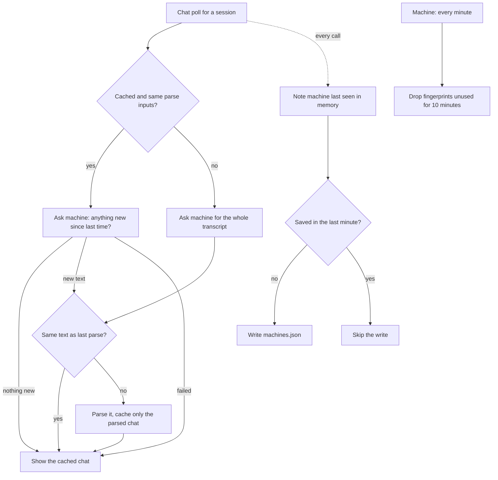

# Chat refresh: three leftovers from the duplicate thread

**Idea:** `IDEA.md` — what this is for and why, in plain language. Read it first; it is
the north star this plan serves. Goal and Constraints live there, not here, so they don't
get buried as this file grows.

Map: `MAP.md` (checked against `6e89dfb4`). Background: `docs/plans/cheap-chat-refresh/`
(main's design, PR #122). Reference only: closed duplicate PR #125, branch
`origin/wc/76fb8f56e690`, plan `docs/plans/chat-transcripts/` on that branch.

## Open Questions

None.

## Watch List

| # | Noticed | What needs looking into | Raised to user? | Outcome |
|---|---------|-------------------------|-----------------|---------|
| 1 | Mapping | Main already keeps dedupe hashes in memory (cheap-chat-refresh D1 text is stale) | yes, in chat | Item 3 shrinks to an idle sweep timer (Decision 5) |

## Decision Log

| # | Decision | Rationale | Source |
|---|----------|-----------|--------|
| 1 | Mode `thorough` | Collin picked it | user |
| 2 | Item 3 is only the idle sweep; the rest of D1 is already on main (`machine/service.js:1487-1515`, test `machine/test/service.test.js:1818-1842`) | Found by mapping; Collin confirmed IDEA.md with this scope | user |
| 3 | When the chat read fails and a cached entry exists, serve its parsed items even if the parse key has since changed | Matches today's "never empty for one poll" behaviour; the next successful read reparses. Same as the duplicate's Decision #19 | defaulted |
| 4 | Last-seen: memory every call, disk at most once a minute per machine, no flush on hub shutdown; a failed write still rejects the call as today and frees the slot so the next call retries | Disk value is only read at hub start; losing up to a minute there is harmless | defaulted |
| 5 | Machine: a 60 s unref'd sweep timer drops hash sets unused for `COPY_HASHES_IDLE_MS`; the on-copy sweep stays. A copy finishing just after stop re-inserting a set is left to the sweep | Bounded memory without new locking; the re-insert is a sub-second race and self-heals within ~11 minutes | defaulted |

## Spec

Three independent changes. Validation for all: `node --test viewer/test/*.test.js` and
`bash machine/test/run.sh` pass.

### S1. Hub chat cache keeps only parsed items (`viewer/app/chat.js`)

Today `sessionTranscript(..., { keepLast: true })` stores `{ text, gen, end, parsed,
parsedKey, lastRead, thread }` in `hub.transcripts`, and `chat()` reparses when `text` or
`parsedKey` differ (`viewer/app/chat.js:329-354`, `:430-441`). The only `keepLast` caller is
`chat()`.

New behaviour:

1. Add `sessionChatItems(hub, thread, session)` in `chat.js`, exported. `chat()` calls it per
   lead session instead of `sessionTranscript` + the reparse block, and pushes the returned
   items. `sessionTranscript` loses its `keepLast` option and cache code; its `strict` path
   and its plain path (single `hub.call`, `data` or local-file fallback, no cache) are
   unchanged.
2. Cache entry in `hub.transcripts` (same key `${thread.machine}/${session.name}`) is exactly
   `{ gen, end, hash, parsedKey, parsed, lastRead, thread }`, where `hash` is the sha256 hex of
   the `data` the items were parsed from. No raw text is stored anywhere in the hub's cache.
3. `parsedKey = session.cli + JSON.stringify([thread.parent_title])` (unchanged formula).
4. Request: if an entry exists, has a `gen`, and `entry.parsedKey === parsedKey`, call the
   transcript route with `?known=<gen>:<end>`; otherwise call it with no `known` (full reply).
5. Reply `unchanged` whose `gen`/`end` match the entry as it is in `hub.transcripts` after
   the await (re-read it: pruning may have removed it meanwhile): set `lastRead`, return `entry.parsed`.
   `unchanged` that does not match: make one full request (no `known`) and continue at 6.
6. Reply with non-empty `data`: compute `hash`. If an entry exists with the same `hash` and
   `parsedKey`, reuse its `parsed` (this keeps today's reuse for machines whose replies carry
   no `gen`); otherwise `parsed = module.exports.transcriptItems(session.cli, data, thread,
   session.name)`. Store a fresh entry with the reply's `gen`, `end`, `hash`, this
   `parsedKey`, `parsed`, `lastRead = now`; return `parsed`.
7. Anything else (a throw, empty or missing `data`): if an entry exists, set `lastRead` and
   return `entry.parsed`, whatever its `parsedKey` (Decision 3). With no entry: read
   `session.transcript_path` locally if set (errors → `''`); if the text is non-empty
   return its parsed items without caching them; otherwise return `[]`.
8. `chat()` keeps today's rule that a session with an empty transcript and a known parser
   contributes nothing, and that a CLI with no parser contributes its "no transcript reader"
   notice: step 7's `[]` applies only when `Object.hasOwn(PARSERS, session.cli)`; otherwise
   return `transcriptItems(session.cli, '', ...)`.
9. Cached `parsed` arrays are shared between polls; `chat()` and its callers must not mutate
   them or their items (today they already don't: `items.push(...parsed)`, `withPeerItems`
   slices).
10. Pruning (`hub.pruneTranscripts`, 10 minutes on `lastRead`, skipped while
    `transcriptPending`) is unchanged.

Tests (`viewer/test/app-chat.test.js`): rewrite "a failed transcript read keeps the last
copy for the chat, not for a report" (`:371`) onto `sessionChatItems` (failure after a good
read returns the same parsed items; plain `sessionTranscript` still returns `''`). Move "stamped chat polls share parsed items…" (`:384`) and "old machines, missing
entries, empty replies and failures follow transcript fallback rules" (`:404`) onto
`sessionChatItems`/`chat()`, keeping every case they cover (gen-less replies, empty
replies, failures, mismatched `unchanged`, parent-title reparse). Add: an
entry never has a `text` property; repeated gen-less replies with identical `data` parse once; a changed `parent_title` (or `cli`) makes the next request
carry no `known` and reparses; a failure after a parse-key change returns the old parsed
items; a mismatched `unchanged` leads to one full request.

### S2. Last-seen saved at most once a minute (`viewer/app/hub.js`)

Today `hub.call` awaits `markMachineSeen`, which writes `machines.json` on every success
(`viewer/app/hub.js:108-113`, `:160-163`). `lastSeen` from disk is read only in `init`
(`:77-80`).

New `markMachineSeen(name, at = new Date().toISOString())`:

1. `this.lastSeen.set(name, at)` always.
2. Synchronously, before any `await`: if `this.seenSaved` (a `Map` created in the
   constructor) has `name` and `this.now() - saved < 60_000`, return `at` without writing.
   Otherwise `this.seenSaved.set(name, this.now())` (the reservation).
3. `await this.state.markMachineSeen(name, at)`. On failure, delete the reservation if it is
   still the one set in step 2, and rethrow (so `hub.call` rejects as today).
4. Return `at`.

Concurrent calls for one name in the same minute therefore produce one write. The hub's own
machine is reached both as `hub` and as its registry name (`state.resolveMachine`), so its
entry may be written twice a minute (Accepted Risks). No flush on shutdown.

Tests (`viewer/test/app-hub.test.js`): update "returns every machine session and persists
its last-seen time" (`:899`) so it asserts the disk `last_seen` is a timestamp no later than
the response's `last_seen` (they may differ because only the first call in the minute is
written). Add a unit test on the hub with a controlled `now`: two calls within 60 s write
once and memory holds the later time; a call at +60 s writes again; a failed write rejects
and the next call writes.

### S3. Machine sweeps idle dedupe hashes on a timer (`machine/service.js`)

Today idle hash sets (`this.copyHashes`, `COPY_HASHES_IDLE_MS` = 10 min) are only dropped
when some copy starts (`machine/service.js:1470-1471`).

1. Move that loop into a method `sweepCopyHashes()` (no-op when `copyHashes` is unset);
   `copyTranscriptNow` calls it where the loop was.
2. In the service start-up beside the other sweep timers (`:453-469`), add
   `this.copyHashesTimer = setInterval(() => this.sweepCopyHashes(), 60000)` with
   `.unref()`, and clear it in the server `close` handler (`:2453`).
3. Nothing else about copying, dedupe, stop or end changes.

Tests (`machine/test/service.test.js`): add to or beside the busy-hashes test (`:1818`): after
the service starts, `copyHashesTimer` is set; invoking its registered callback (not the
method directly) with no copy running drops an entry aged past 10 minutes and keeps a fresh
one; after the server closes, the timer is cleared (e.g. stub `clearInterval` or check
`copyHashesTimer` was passed to it).

### Non-goals

- No change to the hub↔machine transcript protocol (`known`, `unchanged`, `gen`, `end`).
- No change to report reads (`strict`), parsers, or the machine's copy/dedupe logic.
- No merging of `origin/wc/76fb8f56e690`.

## Accepted Risks

| Risk | Why accepted | Round |
|------|--------------|-------|
| The hub's own machine entry in `machines.json` can be written twice a minute (once as `hub`, once under its hostname) | Still at most two writes a minute instead of one per call; folding the aliases needs an async lookup before the reservation | review-round-1 |
| A transcript copy finishing just after `stop` re-inserts that session's hash set | Sub-second race; the S3 sweep drops it within about 11 minutes | planning |

## Review Rounds

### Round 1 — 2026-11-22

**Lanes:** claude (intent); other family (mechanics); cross-family: yes.

**Changed since Round N-1:** n/a (first round — whole Spec in scope)

| Lane | Reported | Finding | Lead verdict | Resolution |
|------|----------|---------|--------------|------------|
| intent | minor | Gen-less replies would reparse every poll without raw text to compare | upheld (minor) | S1.2/S1.6: keep a sha256 of `data`; reuse parse on match |
| intent | minor | Tests at `:384` and `:404` also drive the removed `keepLast` cache | upheld (minor) | S1 Tests: move both onto `sessionChatItems`, keeping their cases |
| mechanics | blocking | Reservation keyed by name; `hub` and hostname alias the same entry | accepted-risk (minor) | Worst case two small writes a minute for one machine, not a wrong build (`state.js:209-219`); Accepted Risks |
| mechanics | blocking | Second `keepLast` test not migrated; entry may vanish during conditional read | downgraded (minor) | Test migration already fixed from intent finding; added re-read of the entry to S1.5 |
| mechanics | minor | S3 test could pass without the timer registered or cleared | upheld (minor) | S3 Tests: drive the registered callback; assert close clears it |

## Implementation Tasks

| # | Objective | Ownership boundary | Lane | Session id | Validation | Status |
|---|-----------|--------------------|------|-----------|------------|--------|
| T1 | S1: hub chat cache keeps only parsed items (`sessionChatItems`) — tricky | `viewer/app/chat.js`, `viewer/test/app-chat.test.js`, `docs/plans/chat-refresh-leftovers/reports/T1.md` | standard, gpt-6.1-terra | wc-4bb7c88a92d9-worker | `node --test viewer/test/*.test.js`; `bash machine/test/run.sh` | running |
| T2 | S2 + S3: last-seen written at most once a minute; machine idle-hash sweep timer | `viewer/app/hub.js`, `viewer/test/app-hub.test.js`, `machine/service.js`, `machine/test/service.test.js`, `docs/plans/chat-refresh-leftovers/reports/T2.md` | standard, gpt-6.1-terra | wc-4bb7c88a92d9-worker-2 | `node --test viewer/test/*.test.js`; `bash machine/test/run.sh` | done (eb33858e) |

## Log

- Ready check 2026-11-22: hub and machine service answer; claude and codex installed; Codex preflight passed.
- 2026-11-22 — Choice: T2, machine/service.js: `copyHashesTimer` sits after `agyToolsTimer`; its clearInterval is last in the close list; `sweepCopyHashes` keeps `Date.now()` from the original loop.
- 2026-11-22 — Choice: T2, machine/test/service.test.js: the timer test invokes `copyHashesTimer._onTimeout()` and wraps global `clearInterval` to see the close handler clear it.
- 2026-11-22 — Choice: T2, viewer/test/app-hub.test.js: the throttle test builds a bare `Hub({ now, codeVersion: '' })` and stubs `hub.state.markMachineSeen` (no state dir is written).
- 2026-11-22 — T2 accepted (band: scout): diff matches S2/S3; worker reported "none" for choices, the scout listed 3, logged above. service.test.js 130/130 and app-hub.test.js 119/119 re-run by the sub-lead; 16+ machine Windows-bridge tests (win.test.js, `wslpath` ENOENT) fail identically on the base branch, so they come from this machine's environment.
