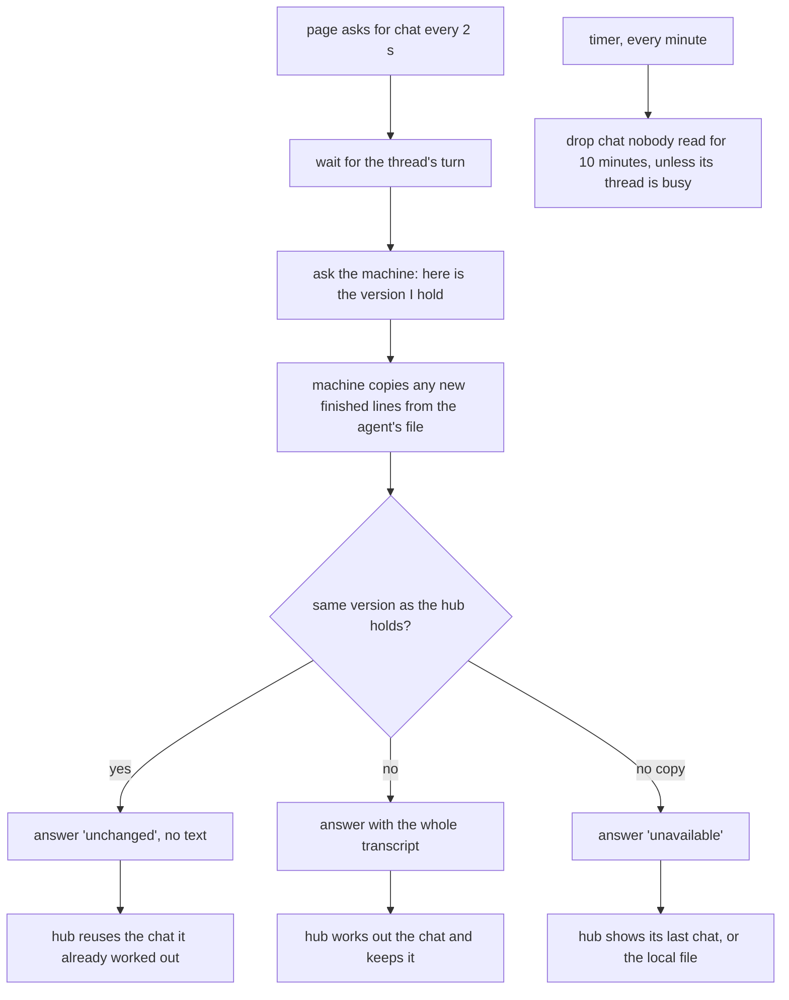

# Chat: less memory, cheap unchanged transcripts

**Idea:** `IDEA.md` — what this is for and why, in plain language. Read it first; it is
the north star this plan serves. Goal and Constraints live there, not here, so they don't
get buried as this file grows.

Background: `MAP.md` (this folder), `docs/maps/chat-transcripts.md`, and the parent plan
`docs/plans/lighter-server/PLAN.md` (section "Moved to the chat follow-up"; Decisions #24,
#29, #32, #36, #50–#60).

## Open Questions

None. Every design point had a defensible default (Decision Log, source `defaulted` or
`adopted`).

## Watch List

| # | Noticed | What needs looking into | Raised to user? | Outcome |
|---|---------|-------------------------|-----------------|---------|

## Decision Log

Append-only. A reversal is a new entry superseding the old, never an edit.

| # | Decision | Rationale | Source |
|---|----------|-----------|--------|
| 1 | Mode two-part: build what makes memory flat and unchanged transcripts cheap; rare-corner hardening goes to `## Deferred` | Collin's pick | user |
| 2 | No byte-offset deltas. The hub tells the machine which version it holds (`known=<gen>:<end>`); the machine answers `unchanged` (no data), `full` (the whole transcript) or `unavailable` | Parent #32: deltas caused splice, bootstrap and two-tab hazards; a whole reply is always coherent and most polls happen while the lead is idle | adopted |
| 3 | `gen` is the kept file's inode and birth time; `end` is its size; both from one `fstat` of one open handle, and a `full` reply's data is read from that same handle up to `end` | The machine owns the kept file and only appends to it, so same gen + same size means same content; one handle avoids mixing two versions | adopted |
| 4 | The machine replies in the new form only when the request carries a `known` parameter (`known=-` when the hub holds nothing). Without it, the reply is exactly today's `{offset, data}` | An older hub never sends `known` and keeps working unchanged; report readers keep using the legacy form | defaulted |
| 5 | A reply with no `status` (an older machine) is treated as `full`; empty `data` in any reply is treated as `unavailable` | Older machines ignore `known` (MAP.md); parent #59: an empty reply means fall back, never "empty chat" | adopted |
| 6 | The hub keeps per lead session only the parsed chat, the `gen`/`end` it came from, the parse key and `lastRead`. It no longer keeps the raw text | Parsed chat is enough for both reuse and fallback; dropping the raw text roughly halves what each entry holds. A parse-key change asks for a `full` reply, so the text is never needed again | defaulted |
| 7 | Parent #50, #52, #53, #58: an entry is dropped only after 10 minutes unread, no size cap; `lastRead` is set for all of a thread's lead entries when `hub.chat` is called (before the lock) and when an entry is used; never dropped while a chat request for that thread is pending | Collin's earlier pick in the parent thread; an open chat re-reads every 2 s so it is never dropped | adopted |
| 8 | Report readers (`viewer/app/sessions.js`) never send `known`, never read and never fill the hub's entries; they fall through to the local `transcript_path` as today | A stale copy could hand them an earlier message as the report (parent S3) | adopted |
| 9 | On the machine, a copy that finds no new complete line in the source does not read the kept file and does not save the session registry (unless the bound source path, inode or offset changed) | This is the work every unchanged poll does today (`machine/service.js:1217-1225`) | defaulted |
| 10 | On the machine, the dedupe hashes of the kept file live in memory per session: built from the kept file the first time a copy has new lines, updated only after a successful append, dropped after 10 minutes with no copy for that session and when the session is stopped or archived | Avoids rehashing the whole file on every new line without an unbounded set; committing after the append means a failed append cannot hide lines from the next try | defaulted |
| 11 | The `known`/`full`/`unchanged` answer is computed inside the per-session copy queue (`copyTranscript`), after that read's copy | A hook-triggered copy appending at the same moment cannot leave a half-written tail in a reply | defaulted |
| 12 | Kept as the parent split it: the thread lock, the 2-second poll, the page and the parsers do not change | IDEA "Not doing" and Constraints | adopted |
| 13 | Refines #6: no text hash. A reply from an older machine is parsed every time, as today | Only mattered while hub and machine are on different versions; simpler entry | review-round-1 |
| 14 | Idle drops on both hub and machine run from an `unref`'d timer, not only on traffic | Otherwise closing the last tab leaves everything held (round-1 finding) | review-round-1 |
| 15 | The machine's dedupe set holds only non-empty lines and is dropped after a failed append | Matches today's rebuild-from-disk results exactly, including blank lines across batches and partial appends | review-round-1 |
| 16 | `machines.json`'s `last_seen` is written at most once a minute per machine; the in-memory value updates every call | It is read from disk only at hub start; otherwise every chat poll rewrites the file | review-round-1 |
| 17 | An `unchanged` reply is matched against the entry before any empty-data check; empty data means fall back only for `full` and older-machine replies | Refines #5, which read as covering `unchanged` too | review-round-2 |
| 18 | Pending protection for a thread's entries starts before joining the thread lock, both in `hub.chat` and the aside route | Supersedes the `chat()` part of S4.1 from round 1 | review-round-2 |
| 19 | Supersedes #18 and the pending-count and before-lock `lastRead` parts of #7: the sweep skips any entry whose thread has an entry in `hub.threadLocks`; entries record their thread id | Same protection with no counter or wrappers, and it covers any future direct `chat()` caller | review-round-3 |
| 20 | A dedupe set built from a kept file with a half-written last line is used for that copy only, not kept | Keeps today's behaviour exactly in that state without pulling in D1 | review-round-3 |

## Spec



The diagram repeats S1-S4: a version check on the machine, reuse on the hub, the
fallbacks, and the idle drop. It leaves out older machines (S3.2) and report readers.

### S0. Words used here

- **Kept file**: the machine's copy of a session's transcript,
  `<stateDir>/transcripts/<thread_id>/<session>.jsonl`, appended to only by
  `copyTranscriptNow` (`machine/service.js:1203`).
- **Entry**: what the hub holds for one lead session, keyed `${thread.machine}/${session.name}`
  as today (`viewer/app/chat.js:272`).
- **Parse key**: `session.cli`, `session.name` and `thread.parent_title` (the only thread
  field `renderTurn` reads today, `viewer/app/chat.js:125-130`), joined into one string.
  The worker confirms no other thread field reaches the parsers and adds any it finds.

### S1. Machine: the transcript route

`GET /v1/sessions/:name/transcript` (`machine/service.js:1929`, `transcript()` at ~1227).

1. **No `known` parameter**: behaviour and reply are byte-for-byte today's
   (`{offset, data}`, honouring `offset`). This is what an older hub and the hub's report
   readers send.
2. **With `known`** (value `-`, or `<gen>:<end>` where `gen` is `<ino>-<birthtimeMs>` and
   `end` a non-negative integer; anything else is `400`):
   - The session lookup, source binding and copy happen as today (`transcript()` lines
     ~1236-1241), including the archived-thread path that reads a kept file of a
     forgotten session.
   - Then, still inside that session's copy queue (Decision #11; the archived path also
     waits on the queue entry for that session name, if one is running, so a copy that
     started before the archive cannot be read half-written), open the kept file once, `fstat` the
     handle: `gen = ${ino}-${birthtimeMs}`, `end = size`.
   - Kept file missing, or `end` is 0 → `{ status: 'unavailable' }`.
   - `known` equals `${gen}:${end}` → `{ status: 'unchanged', gen, end }`, no data, and
     nothing else read from the kept file.
   - Otherwise → `{ status: 'full', gen, end, data }`, `data` read from that handle,
     bytes `0..end`, as UTF-8.
   - An unknown session with no kept file fails as today (error status).
3. `machine/API.md` documents both forms.

### S2. Machine: cheap copies

In `copyTranscriptNow` (`machine/service.js:1203`), keeping today's binding, reset,
Kimi and incomplete-line rules exactly:

1. When the source yields no new complete line (`lines` empty): do not read the kept file,
   do not hash, do not append. Save the session registry only if `transcript_path` or
   `transcript_source` (`path`, `offset`, `ino`) actually changed.
2. When there are new lines: get the session's dedupe set from memory, building it from
   the kept file (as today's hashing, non-empty lines only) if absent. If the kept file
   does not end with a newline (a half-written line left by an earlier failed append),
   build the set for this copy only and do not keep it in memory, so that state behaves
   exactly as today's rebuild-every-copy code. Filter the new
   lines exactly as today (within one batch a repeated line, including a repeated blank
   line, is dropped). After the append succeeds, add the hashes of the appended
   **non-empty** lines to the set, so the set always equals what a rebuild from the kept
   file would give. If the append throws, drop the session's set (the next copy rebuilds
   it from the kept file, as today's code does on every copy).
3. Dedupe sets are dropped when a session's set has not been used (by a copy with new
   lines) for 10 minutes, by an
   `unref`'d timer that runs at least once a minute (so the drop happens with no further
   traffic) and is stopped when the service closes; and when the session is stopped or
   its thread archived. A dropped set is rebuilt on the next copy with new lines.
4. Duplicate filtering results are identical to today's for every sequence of source
   contents (existing tests `machine/test/service.test.js:259`, `:412`, `:421` keep
   passing).

### S3. Hub: chat reads

`sessionTranscript` (`viewer/app/chat.js:271`) is split so chat and report readers no
longer share a cache.

**Report readers** (`keepLast` false, used by `viewer/app/sessions.js:428`): request
without `known`, use `data` when non-empty, else the local `session.transcript_path`, as
today. They never read, write or refresh entries.

**Chat** (`chat()`, `viewer/app/chat.js:318`), per lead session, in today's order and
under today's thread lock:

1. Entry present and its parse key matches → request with `known=<entry.gen>:<entry.end>`
   (or `known=-` if the entry came from an older machine and has no `gen`). Otherwise →
   request with `known=-`.
2. Reply handling, checked in this order:
   - `status: 'unchanged'` (has no `data` by design) → if the reply's `gen`/`end` match
     the entry, use `entry.parsed` and update `lastRead`; if they do not match (or no
     entry), treat as unavailable below. The empty-data rule never applies to it.
   - `full` with non-empty `data`, or a reply with no `status` and non-empty `data` (older
     machine): parse with `transcriptItems` and store `{parsed, gen, end, parseKey,
     lastRead: now}` (`gen`/`end` absent for an older machine, which is then parsed on
     every poll, as today).
   - `unavailable`, a `full` or no-`status` reply with empty `data`, an unknown
     `status`, a thrown error or timeout → fallback: if an entry exists,
     use its `parsed` (whatever its parse key) and update `lastRead`; else read the local
     `session.transcript_path` as today and parse it without storing it; if that is empty
     too, the session contributes nothing, as today (`chat.js:325`), except that a
     session whose CLI has no parser still gets today's "no transcript reader" notice
     (`chat.js:265`, `:325`).
3. The items chat returns are the same, in the same order, as today's for the same
   transcript text. Reused `parsed` arrays are never mutated by later code: the worker
   checks every consumer of `items` in `chat()` and either confirms none mutates or
   copies at the point of mutation.

### S4. Hub: dropping idle entries

1. Each entry also records its `threadId` (entries stay keyed `${machine}/${session}`).
   `lastRead` is set when an entry is stored and whenever chat uses it (`unchanged`
   reuse or fallback).
2. A sweep drops entries whose `lastRead` is more than 10 minutes ago, unless
   `hub.threadLocks` currently has an entry for their `threadId`. `withThread`
   (`viewer/app/hub.js:117`) sets that entry synchronously when a request joins the
   queue and deletes it only when the chain settles, so a chat poll or an aside creation
   (`viewer/app/routes.js:480`, `viewer/app/asides.js:34`) waiting behind the lock keeps
   its thread's entries. Unrelated work on the same thread only delays a drop, which is
   harmless. The sweep runs from an `unref`'d timer at least once a minute, so entries
   are dropped after the last tab closes with no further traffic; the timer is stopped
   when the hub stops.
3. No size cap.

### S4b. Hub: machine "last seen" writes

Every `hub.call` today rewrites `machines.json` through `markMachineSeen`
(`viewer/app/hub.js:105`, `viewer/app/state.js:241`), so each chat poll writes a file per
lead even when the transcript is unchanged. Change `hub.markMachineSeen`: always update
the in-memory `lastSeen` (what every reader uses: `agents.js:140`, `views.js:164`), but
write it to `machines.json` only when the last write for that name was 60 seconds or
more ago. The check and the reservation (recording "written now" for that name) happen
synchronously before any `await`, so overlapping calls do not queue duplicate writes.
Two names for the same machine (for example `hub` and its hostname) may each write once a
minute; that is fine. `machines.json`'s `last_seen` is only read at hub start to seed `lastSeen`
(`viewer/app/hub.js:76`), so it may lag by up to a minute.

### S5. Tests

Update test route matchers that match a literal `/transcript` suffix so they match the
path with or without a query (`viewer/test/app-handoff.test.js:377`,
`viewer/test/app-asides.test.js:133`, and any other found by
`grep -rn "transcript'" viewer/test machine/test`). `viewer/test/app-handoff.test.js:373`
(a mutation waits for chat's transcript request) keeps passing. The fake machine
(`viewer/test/helpers/app-machine.js:125`) gains an option to answer in the new form.

New tests, at least:

- Machine (`machine/test/service.test.js`): no `known` → today's exact reply; `known=-` →
  `full` with `gen`/`end`; repeat with those → `unchanged`, and the kept file was not
  read (spy on `fsp.readFile`/handle reads) and `sessions.json` was not rewritten (mtime
  and a spy on `persistSessions`); a new source line → `full` with the larger `end`;
  missing copy → `unavailable`; malformed `known` → 400; archived thread with `known`
  works; after a failed append the next copy appends exactly the lines not already in
  the kept file; blank lines across separate batches are kept as today's code keeps
  them; a dedupe set is dropped after 10 idle minutes (fake clock) and rebuilt correctly.
- Hub (`viewer/test/app-chat.test.js`): second poll on an unchanged transcript sends
  `known` and does not call the parser; `full` re-parses; an older-machine reply (no
  `status`) works; `unavailable`, empty and thrown
  replies fall back to the held parsed chat, else the local path; a `parent_title` change
  re-requests with `known=-` and re-parses; an entry unread for 10 minutes is dropped
  (fake clock) but not while a chat request for its thread is pending; report readers
  never send `known` and neither use nor fill entries (extend `app-chat.test.js:362`);
  entries are dropped by the timer with no further chat calls; an aside created at the
  idle cutoff still finds its message (prime the entry, make the fake machine
  unavailable, hold the thread lock, queue the aside, run the sweep past the cutoff, then
  release; without the lock check the aside must fail); an unknown CLI still shows its notice; two
  `hub.call`s within a minute write `machines.json` once while `machineSeen` reflects
  both. Update `viewer/test/app-hub.test.js:898` ("persists its last-seen time"): with
  throttling, the in-memory time can be newer than the persisted one; assert the
  persisted value is a valid time no later than the reported one.

### S6. Validation

```bash
bash machine/test/run.sh
node --test viewer/test/*.test.js
npm --prefix viewer run test:browser
```

All pass. Informational, no pass bar: after install, Collin's live hub RSS over an hour
and CPU-seconds per minute with a thread page open, recorded in the Log against the
parent's baseline (Log of `docs/plans/lighter-server/PLAN.md`).

### Non-goals

Everything in IDEA.md "Not doing". Also: no change to the Ready check, to transcript
discovery (`findTranscript`), to the parsers, or to the hub's other per-thread maps.

## Deferred

| # | Item | Why it can wait | Source | Notes for the follow-up |
|---|------|-----------------|--------|-------------------------|
| D1 | Cut a half-written last line off the kept file before the next append | Only happens if an append fails partway (disk full, crash); today's code has the same behaviour | planning | Parent review note: "truncate a partial line before rebuilding". In `copyTranscriptNow`, before appending, if the kept file does not end in `\n`, truncate to after its last newline |
| D2 | Retry a failed session-registry save | After S2.1 a failed save is retried only when the next new line arrives; the worst case is a restart re-reading source lines that dedupe then drops | planning | Mark the registry dirty on a failed `persistSessions` and save again on the next copy |
| D3 | Measure and, if needed, cache transcript discovery for sessions with no bound source | Lead sessions are bound by a hook or rollout soon after start; unbound polls call `findTranscript` each time | planning | `machine/service.js` `transcript()` ~1236; measure first |

## Accepted Risks

| Risk | Why accepted | Round |
|------|--------------|-------|
| If a thread is archived while a chat poll is still finding a session's transcript, one archived read may show a half-written last line | Needs an archive at that exact moment; the next poll sees the file changed and reads it whole | 3 |
| If the parent thread's title changes while the machine is unreachable, the stub's "Started from" line shows the old title until the next successful read | Needs an outage at the moment of a rename and fixes itself on the next read; keeping the raw text for this would double each entry | 1 |
| If the filesystem reports no birth time (`birthtimeMs` 0), `gen` falls back to the inode alone, so a kept file deleted and recreated with the same inode and same size would read as `unchanged` | The machine never deletes and recreates a kept file of a live session; only archive cleanup removes them | planning |

## Review Rounds

### Round 1 — 2026-11-19

**Lanes:** intent (claude); mechanics (other family); cross-family: yes.

**Changed since Round 0:** n/a (first round — whole Spec in scope)

| Lane | Reported | Finding | Lead verdict | Resolution |
|------|----------|---------|--------------|------------|
| intent | minor | In-memory dedupe set (S2.2-S2.3) only speeds copies with new lines; could be deferred | declined | Hook-triggered copies run the same code for every session on every hook event (MAP.md: `machine/service.js:1307`), so while agents work, today's whole-file rehash happens per event, not per poll; the set is what makes an active agent cheap. Kept |
| intent | minor | Text hash only helps older-machine replies; drop it | upheld | Decision #13; S3.2 and tests simplified |
| mechanics | blocking | Idle drops only on traffic leave memory held after the last tab closes; same for machine dedupe sets | upheld | Decision #14; S2.3, S4.2 |
| mechanics | blocking | In-memory dedupe set would suppress blank lines across batches, unlike today (`machine/service.js:1218` rebuild skips blanks) | downgraded (minor) | CLIs write JSONL, so blank source lines are practically absent; still fixed: Decision #15, S2.2 |
| mechanics | major | Every poll still rewrites `machines.json` via `hub.call` → `markMachineSeen` | upheld | Confirmed `viewer/app/hub.js:144`, `state.js:241`; disk value only read at start (`hub.js:76`). Decision #16, S4b |
| mechanics | minor | Unknown-CLI notice must survive an empty read | upheld | S3.2 |
| mechanics | minor | Fallback after a parent-title change shows the old title | accepted-risk | Accepted Risks |
| mechanics | minor | Aside creation calls `chat()` directly, bypassing pending protection | upheld | Confirmed `asides.js:34`; S4.1 |
| mechanics | minor | After a failed append the kept set could let lines be appended twice | upheld | Decision #15, S2.2 |

### Round 2 — 2026-11-19

**Lanes:** intent (claude); mechanics (other family); cross-family: yes.

**Changed since Round 1:**
- S2.2: dedupe set holds only non-empty lines; dropped after a failed append (Decision #15).
- S2.3, S4.2: idle drops run from an `unref`'d timer (Decision #14).
- S3.2: unknown-CLI notice kept on empty reads; text hash removed (Decision #13).
- S4.1: `chat()` itself also counts as pending (aside creation).
- S4b (new): `machines.json` last-seen write throttled to once a minute (Decision #16).
- S5 tests for the above; one new Accepted Risk.

| Lane | Reported | Finding | Lead verdict | Resolution |
|------|----------|---------|--------------|------------|
| intent | — | No findings | — | — |
| mechanics | blocking | `unchanged` has no data, so Decision #5's empty-data rule overlaps it | upheld | Decision #17, S3.2 reordered |
| mechanics | major | Last-seen throttle must be atomic across overlapping calls and names | downgraded (minor) | At worst one extra small write a minute; no wrong result. Still specified: S4b |
| mechanics | minor | Existing last-seen test expects equal times | upheld | S5 |
| mechanics | minor | Aside queued behind the lock can lose its fallback | upheld | Decision #18, S4.1 |
| mechanics | minor | Archived read can overlap a copy started before archive | upheld | S1.2 |

### Round 3 — 2026-11-19

**Lanes:** intent (claude); mechanics (other family); cross-family: yes.

**Changed since Round 2:**
- S3.2: reply handling reordered; `unchanged` matched before any empty-data check; unknown `status` falls back (Decision #17).
- S4.1: pending protection starts before the thread lock in `hub.chat` and the aside route, via one helper (Decision #18).
- S4b: throttle check and reservation synchronous, keyed by the name passed.
- S1.2: archived read waits on that session's copy queue.
- S5: last-seen test update; aside test behind a held lock.

| Lane | Reported | Finding | Lead verdict | Resolution |
|------|----------|---------|--------------|------------|
| intent | minor | Use `hub.threadLocks` instead of a pending counter and wrappers | upheld | Confirmed `hub.js:117-125`. Decision #19, S4 |
| mechanics | blocking | Kept set records a line fused onto a half-written tail, later dropping a valid line | downgraded (minor) | Needs a failed append and then a source rewind; still fixed: Decision #20, S2.2 |
| mechanics | minor | Archive can race a read still discovering its source | accepted-risk | Accepted Risks |
| mechanics | minor | Stopped session's set kept alive by polls | upheld | S2.3: idle measured from last use of the set |
| mechanics | minor | Queued-aside test could pass without protection | upheld | S5 test steps |

## Implementation Tasks

| # | Objective | Ownership boundary | Lane | Session id | Validation | Status |
|---|-----------|--------------------|------|-----------|------------|--------|

## Log
- 2026-11-19 Ready check at approval: hub and machine service answer (`wc.js session list`); Claude CLI installed; Codex preflight passed (token fresh).
- 2026-11-19 Build accepted: approval fc33ce31-cebd-4f1a-a656-d9741c8d9707
