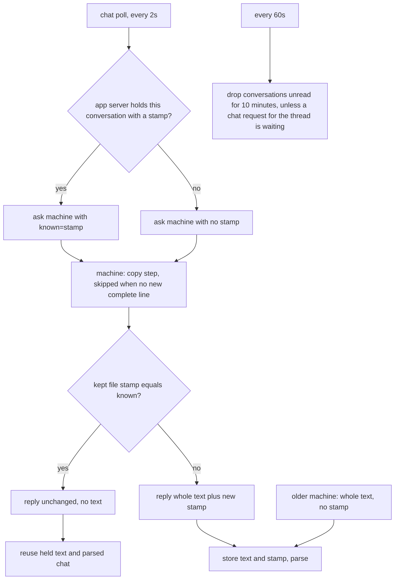

# Cheaper chat refresh on the thread page

**Idea:** `IDEA.md` — what this is for and why, in plain language. Read it first; it is
the north star this plan serves. Goal and Constraints live there, not here, so they don't
get buried as this file grows.

Current code: `MAP.md` and `docs/maps/chat-transcript-refresh.md` (file:line).
Background: `docs/plans/lighter-server/PLAN.md` (merged in PR #120), Decisions #32, #36,
#50, #52, #53, #58, #59, #60 and its section "Moved to the chat follow-up". Those are
history; this file's Decision Log and Spec are the contract.

## Open Questions

None.

## Watch List

| # | Noticed | What needs looking into | Raised to user? | Outcome |
|---|---------|-------------------------|-----------------|---------|

## Decision Log

Append-only. A reversal is a new entry superseding the old, never an edit.

| # | Decision | Rationale | Source |
|---|----------|-----------|--------|
| 1 | Mode is two-part | Collin's pick | user |
| 2 | Scope adds the hub transcript memory fix (idle drop after 10 minutes, parsed reuse) handed over by lighter-server #60; the stub's "parent adds a 64 MB budget" premise was wrong (MAP.md) | The parent moved it here; IDEA.md confirmed with it | user |
| 3 | No byte-offset deltas. The hub sends `known=<gen>:<end>` for the text it holds; the machine answers `unchanged` (no data) or the whole kept transcript with its `gen` and `end` | Carries lighter-server #32: deltas caused splice, bootstrap and two-tab hazards; idle polls get nearly all the saving from `unchanged` | defaulted |
| 4 | `gen` is the kept file's `dev`, `ino` and `birthtimeMs`; `end` is its byte size; both and the returned bytes come from one open file handle (fstat, then read exactly `end` bytes) | The machine only appends whole lines to its kept file, so a new file means a new generation and size marks a complete-line boundary; one handle makes data and stamp coherent | defaulted |
| 5 | Compatibility needs no version check: an old machine ignores `known` and returns `{offset, data}` (no `gen`), which the hub treats as a whole reply it cannot stamp; an old hub sends no `known` and gets a whole reply as today, with extra fields it ignores | Additive fields in both directions | defaulted |
| 6 | The machine's copier returns early, with no kept-file read, no hashing and no registry write, when the source is unchanged (same path and inode, size equal to the stored offset) | Removes the idle cost on the machine for every poll and hook | defaulted |
| 7 | Report readers (`viewer/app/sessions.js` `deliverReport`) never send `known` and never use the hub's held text; they behave exactly as today | Rare calls; keeps the "never stale" guarantee obvious | defaulted |
| 8 | Hub entries are dropped after 10 minutes unread, with no size cap, and never while a chat request for their thread is pending (lighter-server #50, #52, #53, #58) | Collin's earlier pick in the parent thread; an open chat re-reads every 2s | defaulted |
| 9 | Keeping per-session dedupe hashes in memory (so an active lead's new lines don't re-hash the whole kept copy) is Deferred D1 | Only matters while a lead is writing; idle polls are the goal | defaulted |
| 10 | The machine cuts a partial last line from the kept file before appending, and serves stamped reads inside the per-session copy queue | Makes "size = complete-line boundary" (#4) true after a crash and during hook copies | review-round-1 |
| 11 | A failed registry write keeps the session off the idle fast path until a write succeeds | Otherwise the fast path would never retry it | review-round-1 |
| 12 | Only the pending count protects held entries; no `lastRead` refresh when chat starts. Aside creation counts as pending too | The refresh was redundant; asides reach the same assembler | review-round-1 |

## Spec

In short: the app server tells the machine which version of a conversation it already holds; the machine answers "unchanged" without reading or sending it, or sends the whole conversation with its new version stamp (S2, S3). The machine's copy step does nothing when the source has no new complete line (S1). The app server reuses parsed chat for unchanged text (S4) and lets a conversation go after 10 minutes unread (S3).



### S1. Machine: cheap idle copy (`machine/service.js` `copyTranscriptNow`)

- For a non-Kimi session: after the existing `fsp.stat(source)`, if `session.transcript_source` exists with the same `path` and `ino` and `stat.size === transcript_source.offset`, and `session.transcript_path` is set, return `{ offset, lines: [] }` immediately: do not open the source, read the kept file, hash, or call `persistSessions`.
- For Kimi: the same early return after its existing handle checks pass, when `stat.size === begin` (the stored offset), before reading.
- The early return also requires the session not to be marked `transcript_unsaved` (below), so a failed registry write is retried on the next copy.
- When the source read yields no complete line (`lines` empty, for example an unfinished tail after the last newline), do not read or hash the kept file; only update `transcript_source` if it changed.
- When a copy leaves `transcript_source` and `transcript_path` unchanged, skip `persistSessions`. When it changes them, call `persistSessions`; if that throws, set an in-memory `session.transcript_unsaved = true` (not persisted; delete it before writing so it never lands on disk) and rethrow as today; a later successful `persistSessions` from the copier clears it.
- Before appending, if the kept file is non-empty and does not end with `\n` (a crash mid-append), truncate it to just after its last `\n` (or to 0 if none) first. The copier already holds the kept file's text on that path. Because the source offset is persisted only after the append, the cut row is re-read from the source and re-added whole.
- Hooks calling the copier get the same short cuts.

### S2. Machine: `known` on the transcript route

- `GET /v1/sessions/:name/transcript` accepts an optional `known=<gen>:<end>` query parameter (alongside the existing `offset`, which keeps working as today).
- For a live session, the stamp-and-read below runs inside the same per-session queue as copies (`copyTranscript`'s `this.copying` chain, `machine/service.js:1193-1202`), right after this request's copy, so it never reads a half-finished append from a hook-triggered copy. For a forgotten archived session's kept file no copies run, so it reads directly.
- The machine opens the kept file once, `fstat`s the handle and computes `gen = "<dev>-<ino>-<birthtimeMs>"` and `end = size`.
  - If `known` equals `gen:end` exactly: reply `200 { unchanged: true, gen, end }`; read no bytes.
  - Otherwise read exactly `end` bytes from that handle and reply `200 { offset: end, data, gen, end }` (`data` sliced by `offset` as today when `offset` is given).
- No kept file (missing, `ENOENT`): reply as today (`{ offset: 0, data: '' }`), no `gen`; `known` is ignored. A forgotten session with no kept file still errors as today.
- A malformed `known` is ignored (whole reply), never an error.
- Update `machine/API.md`'s row for the route.

### S3. Hub: transcript store (`viewer/app/chat.js` `sessionTranscript`)

Replace `hub.transcriptCache` (a Map of text) with `hub.transcripts`: a Map keyed `<machine>/<session name>` of `{ text, gen, end, parsed, parsedKey, lastRead }`.

- **Chat reads** (`keepLast: true`, used by `chat.chat` and through it by aside creation):
  1. If an entry with a `gen` exists, call the machine route with `?known=<gen>:<end>` (URL-encoded); otherwise with no query.
  2. `unchanged: true` with `gen`/`end` equal to the entry's: return the entry's text (and let `chat.chat` reuse `parsed`, S4). If `unchanged` arrives but no matching entry exists (dropped meanwhile), call again once without `known` and handle that reply as below.
  3. A reply with non-empty `data`: store `{ text: data, gen, end }` (gen/end `undefined` from an old machine, so the next read sends no `known`). Keep the entry's `parsed`/`parsedKey` when `data === entry.text` (an old machine resending identical text), otherwise clear them. Return the text.
  4. A failed or timed-out call, or empty `data`: return the entry's text if present (as today's `keepLast`), else today's local `session.transcript_path` fallback, else `''`. Never store empty data (lighter-server #59).
- **Report reads** (no `keepLast`, `viewer/app/sessions.js` `deliverReport`): call with no query, never read or write `hub.transcripts`, fall back only to `session.transcript_path`, exactly as today (D7).
- `lastRead` is set to now when an entry is stored, returned, or served as fallback.
- **Dropping:** an entry whose `lastRead` is more than 10 minutes old is deleted, unless a chat request for its thread is pending. A per-thread pending count is incremented before waiting for the thread lock and decremented in `finally`, by both `hub.chat` (`viewer/app/hub.js:250`) and aside creation (the `POST` asides route, `viewer/app/routes.js:480-486`, which reaches `chat.chat` through `viewer/app/asides.js:34-37`); put this in one hub helper both use. Pruning runs from a 60-second interval started and `unref()`ed beside the hub's other timers (`viewer/app/hub.js:80-95`); like them it is never cleared (the hub has no close). Store the thread id in each entry to find its thread.

### S4. Hub: reuse parsed chat (`viewer/app/chat.js` `chat`)

- `parsedKey` is `session.cli` plus a JSON string of every thread field the parsers read (for example `parent_title`; the worker lists them all in the Log by reading `parseClaude`, `parseCodex`, `parseAgy`, `parseKimi`).
- When the entry returned for a session has `parsed` and its `parsedKey` equals the current key, use `parsed` instead of calling `transcriptItems`; otherwise parse and store `parsed`/`parsedKey` on the entry. Text returned from the local-file fallback is parsed and not stored.
- Parsed items are treated as read-only: `chat.chat` and its callers must not mutate them (the current code only filters and spreads; keep it so). Deep-freezing is not required.

### S5. Unchanged behaviour

- Chat keeps holding the thread lock through assembly (`viewer/test/app-handoff.test.js:373-381`).
- The chat route's JSON for the same transcripts and thread equals today's.
- Two tabs polling the same thread are serialized by the thread lock and share one entry; each gets a coherent whole transcript.

### S6. Tests

- Update test route matchers that compare the path with a literal `endsWith('/transcript')` (`viewer/test/app-handoff.test.js:377`, `viewer/test/app-asides.test.js:133`, any other found by `grep -rn "/transcript'" viewer/test machine/test`) to match the path before `?`.
- Machine tests (`machine/test/service.test.js`): an unchanged source does no kept-file read and no registry write (spy `fsp.readFile` on the kept path and `persistSessions`); a source with only an unfinished tail does no kept-file read; a failed `persistSessions` is retried by the next copy of an unchanged source; a kept file ending in a partial line is cut back and the row re-added whole; `known` matching returns `unchanged` with no `data` and reads no kept-file content (the test fails on any content read of the kept file, by `readFile` or a handle `read`, while allowing open and stat); non-matching, malformed or stale-gen `known` returns the whole file with `gen`/`end`; a kept file replaced by a new file of the same size gets a new `gen`; an archived forgotten session supports `known`; Kimi early return.
- Hub tests (`viewer/test/app-chat.test.js`): second poll sends `known` and reuses parsed items (spy the parser); an old-machine reply without `gen` sends no `known` next time; `unchanged` with no entry triggers one whole re-read; empty `data` and failures fall back to the held text; report reads never send `known` and never use held text (extend `viewer/test/app-chat.test.js:362-370`); idle drop after 10 minutes with a fake clock, and no drop while a chat request for the thread is pending.

### Validation

```bash
bash machine/test/run.sh
node --test viewer/test/*.test.js
npm --prefix viewer run test:browser
```

## Deferred

| # | Item | Why it can wait | Source | Notes for the follow-up |
|---|------|-----------------|--------|-------------------------|
| D1 | Keep each session's dedupe hashes in memory so new lines from an active lead don't re-hash the whole kept copy | Only costs while a lead is writing; idle refreshes are already cheap after S1 | planning | Today `copyTranscriptNow` rebuilds a sha256 set from the whole kept file on every copy with new data (`machine/service.js:1219-1220`). S1 already adds the partial-line cut and the persist retry. Remaining lessons from lighter-server round 4: add hashes only after `appendFile` succeeds; rebuild the set after a cut; drop a session's set after it ends or after a period unused. |

## Accepted Risks

| Risk | Why accepted | Round |
|------|--------------|-------|
| On filesystems without birth time (`birthtimeMs` 0), a kept file deleted and recreated with the same inode and exactly the same size between two polls would read as unchanged until it grows | The machine never deletes or rewrites kept files during a session's life; needs outside interference plus an exact size match | planning |

## Review Rounds

### Round 1 — 2026-11-19

**Lanes:** intent (claude / opus); mechanics (other family); cross-family: yes.

**Changed since Round 0:** n/a (first round — whole Spec in scope)

| Lane | Reported | Finding | Lead verdict | Resolution |
|------|----------|---------|--------------|------------|
| intent | minor | Pending count and `lastRead` refresh on entry overlap | upheld | Dropped the refresh (#12) |
| intent | minor | Unfinished source tail still re-reads and hashes the kept file | upheld | S1: no kept-file read when no complete line |
| intent | minor | Old machine replies re-parse identical text | upheld | S3 step 3 keeps parsed when text is identical |
| mechanics | blocking | Crash mid-append leaves a fragment; size is not a line boundary; reads may see in-progress appends | downgraded to minor | Needs a crash at an exact moment or a hook copy overlapping a poll; pre-existing. Still fixed: S1 cuts the partial line, S2 reads inside the copy queue (#10) |
| mechanics | blocking | Failed registry write skipped by the fast path | downgraded to minor | Needs a failed disk write; dedupe prevents data loss on re-copy. Still fixed: `transcript_unsaved` (#11) |
| mechanics | minor | Same as intent's unfinished tail | upheld | As above |
| mechanics | minor | Aside creation not counted as pending | upheld | S3 helper shared by chat and aside creation (#12) |
| mechanics | minor | Hub has no close for the prune timer | upheld | S3: unref'd, never cleared, like the others |
| mechanics | minor | Test could pass while the kept file is read | upheld | S6 test fails on any content read |

## Prior Work

None.

## Implementation Tasks

| # | Objective | Ownership boundary | Lane | Session id | Validation | Status |
|---|-----------|--------------------|------|-----------|------------|--------|
| T1 | tricky. Machine: S1 cheap idle copy, S2 `known` on the transcript route, machine tests, API.md | `machine/service.js`, `machine/API.md`, `machine/AGENTS.md`, `machine/test/` | standard (gpt-6.1-terra) | wc-2e6dde9e5e6a-worker | `bash machine/test/run.sh` | done |
| T2 | Hub: S3 transcript store and idle drop, S4 parsed reuse, S5, viewer tests | `viewer/app/`, `viewer/test/`, `viewer/AGENTS.md` | standard (gpt-6.1-terra) | wc-2e6dde9e5e6a-worker-2 | `node --test viewer/test/*.test.js`; `npm --prefix viewer run test:browser` | running |

## Log

- Build accepted: approval 3cf623f3-c106-4883-9140-67c11f064754

- 2026-11-19 Ready check at approval: hub and machine service answer (`wc.js session list`); Claude CLI 2.1.328 logged in; Codex preflight passed (token fresh, 115h).
- 2026-11-19 — Choice: T1, `machine/service.js` `copyTranscript`: takes a follow-up callback so a request's copy and its stamped read share one queue entry.
- 2026-11-19 — Also seen in the T1 diff, not in its Choices: the Kimi early return also checks path and inode; the partial-line cut runs only when new lines arrive; a kept file that shrinks mid-read throws; `persistSessions` drops `transcript_unsaved` with a JSON replacer.
- 2026-11-19 — T1 accepted (band: self): machine suite re-run, 349/349 pass; diff matches S1/S2 and the machine half of S6.
