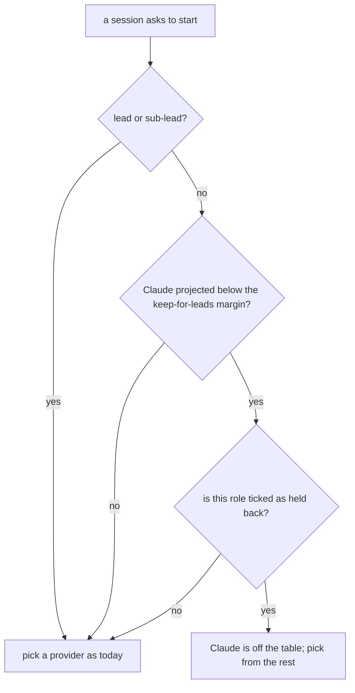

# Separate Claude reserve settings for workers and reviewers

**Idea:** `IDEA.md` — what this is for and why, in plain language. Read it first; it is
the north star this plan serves. Goal and Constraints live there, not here, so they don't
get buried as this file grows.

**Map:** `MAP.md` and `docs/maps/app-provider-placement.md`.

## Open Questions

None.

## Watch List

| # | Noticed | What needs looking into | Raised to user? | Outcome |
|---|---------|-------------------------|-----------------|---------|

## Decision Log

Append-only. A reversal is a new entry superseding the old, never an edit.

| # | Decision | Rationale | Source |
|---|----------|-----------|--------|
| 1 | Existing saved settings migrate so behaviour is unchanged: every role held back today stays held back until Collin edits the new settings. | IDEA.md Constraint. | defaulted |
| 2 | "Save Claude for leads" stays an ordering preference only (non-lead sessions without a provider preference try GPT before Claude); its hint is reworded to say it does not turn the reserve on or off. The reserve is governed only by the new settings. | Fixes the confusion IDEA.md names without removing a setting he uses. | defaulted |
| 3 | Leads and sub-leads stay exempt from the reserve; forecast math is unchanged. | IDEA.md Not doing. | defaulted |
| 4 | API.md, protocol/app/lead.md and protocol/app/sub-lead.md wording about "the Claude margin exception" is updated to match. | Docs must not describe the old single rule. | defaulted |
| 5 | Keep one margin; add one tick per role (worker, reviewer, verifier, mapper) choosing who is held back from Claude when it runs short. | The margin is how much Claude leads need, one amount; the per-role choice is who gives way. | user |
| 6 | `held_back` is saved and sent as a whole object of four booleans; anything else is rejected on PUT and replaced by the all-true default on load. | Matches how every other balancing key is validated as a unit; all-true default satisfies Decision 1. | defaulted |
| 7 | The margin row is relabelled "Keep for leads (%)" with a hint naming the ticks; the ticks sit directly under it. | Makes the two halves of the rule read together. | defaulted |

## Spec

### Behaviour



When the week's Claude forecast says the share left at the next refill will be under the
margin (unchanged `usage.belowMargin`), Claude is excluded **only for roles whose tick is
on**. Unticked roles pick Claude exactly as they would when Claude is not running short.
Leads and sub-leads are never held back. Nothing else about choosing a provider or account
changes.

Example: margin 5%, ticks `worker: true, reviewer: false, verifier: false, mapper: false`,
Claude forecast below margin. A worker goes to GPT (an explicit `--provider claude` worker
falls back to GPT with a note, as today). A reviewer started with `--provider claude` gets
Claude. A mechanics reviewer started with `--not-provider gpt` then also gets Claude.

### Settings store — `viewer/app/settings.js`

- New balancing key `held_back`: `{ worker, reviewer, verifier, mapper }`, each a boolean.
  Add `'held_back'` to `BALANCING`.
- Default (in `defaults()`): all four `true`. A saved file without the key, or with an
  invalid value, loads as the default (the existing per-key fallback in `normalize`). This
  keeps current behaviour for everyone until they edit it (IDEA.md Constraint).
- `validBalancing('held_back', v)`: true only for a plain object whose keys are exactly
  those four, each a boolean. Extra, missing or non-boolean keys are invalid.
- `PUT /settings/balancing` needs no route change: it already validates each key with
  `validBalancing` and returns all `BALANCING` keys, so `held_back` is accepted and echoed.

### Placement — `viewer/app/balancer.js`

- Line 40 becomes: `margin[p] = PROVIDERS[p].saveForLeads && !['lead','sub-lead'].includes(role) && settings.held_back[role] === true && usage.belowMargin(...)`.
- `save_claude_for_leads` still only reorders Claude last in `normal()`; it does not
  affect `margin[p]`. No other line changes; the fallback, note and wait paths already key
  off `margin[p]`, so an unticked role simply never sees Claude as margined.

### Settings page — `viewer/pages/settings.js` (Usage → Balancing)

- Add `'held_back'` to the key list in `ensureDraft()` (deep copy via `structuredClone`)
  and to the Save button's `saveBalancing([...])` list.
- Relabel the margin row: label "Keep for leads (%)", hint "When Claude is projected to
  have less than this left at refill, ticked roles go to GPT". Keep id `bal-margin`.
- Directly under it, a row "Held back when Claude runs short" with four labelled
  checkboxes: Workers, Reviewers, Verifiers, Mappers, ids `bal-held-worker`,
  `bal-held-reviewer`, `bal-held-verifier`, `bal-held-mapper`, each with an
  `aria-label`. Each toggles `balDraft.held_back[role]`; nothing saves until Save.
- Reword the "Save Claude for leads" hint to: "Sessions with no provider preference try
  GPT before Claude. Does not hold anyone back; the ticks below do."
- Layout must not scroll sideways at phone width (existing `noSideScroll` check).

### Docs

- `viewer/app/API.md`: list `held_back` among the `GET /settings` balancing keys with its
  shape; in the session-start paragraph replace "subject to the Claude margin exception"
  with "subject to the Claude reserve when `held_back.worker` is on".
- `protocol/app/sub-lead.md:68`: "only when Claude is below its margin" → "only when Claude
  is below its margin and workers are ticked as held back in Settings".
- `protocol/app/lead.md`: no margin wording exists; no change.

### Non-goals

Forecast math, lead/sub-lead selection, per-account or per-thread reserves, other-agent
tiers, the alert/`notify_below` path.

### Validation

New or updated tests:
- `viewer/test/app-balancer.test.js`: below margin with `held_back` all true, a worker,
  reviewer, verifier and mapper all avoid Claude (existing behaviour). With
  `held_back.reviewer: false`, a reviewer with `{provider:'claude'}` gets Claude and no
  note; a worker with `{provider:'claude'}` still falls back to GPT. With
  `save_claude_for_leads: false` and the role ticked, Claude is still excluded (the
  reserve is independent of the checkbox). A lead still gets Claude.
- `viewer/test/app-usage.test.js` (validation list): `held_back` rejected for a missing
  key, an extra key, a non-boolean value, an array; accepted for a full valid object;
  a saved file without `held_back` loads all-true.
- `viewer/test/app-accounts.spec.js`: the exact saved key list includes `held_back`;
  unticking Reviewers and saving sends `held_back.reviewer === false`; no side scroll.

Commands (all must pass):

```bash
node --test viewer/test/*.test.js
npm --prefix viewer run test:browser
```

## Accepted Risks

| Risk | Why accepted | Round |
|------|--------------|-------|

## Review Rounds

### Round 1 — 2026-11-15

**Lanes:** intent: GPT; mechanics: GPT; cross-family: no (Claude was held back from reviewers by the rule this plan changes).

Clean: no findings from either lane.

**Changed since Round N-1:** n/a (first round — whole Spec in scope)

| Lane | Reported | Finding | Lead verdict | Resolution |
|------|----------|---------|--------------|------------|

## Prior Work

| Spec item | State | Evidence (file:line) | Confidence |
|-----------|-------|----------------------|------------|

## Implementation Tasks

| # | Objective | Ownership boundary | Lane | Session id | Validation | Status |
|---|-----------|--------------------|------|-----------|------------|--------|
| T1 | Whole Spec: held_back setting, balancer gate, settings page, API.md, sub-lead.md, three test files | viewer/app/settings.js, viewer/app/balancer.js, viewer/pages/settings.js, viewer/app/API.md, protocol/app/sub-lead.md, viewer/test/app-balancer.test.js, viewer/test/app-usage.test.js, viewer/test/app-accounts.spec.js | Standard, asked claude, placed on GPT gpt-6.1-terra (Claude below margin) | wc-ce2c2126fc85-worker | node --test viewer/test/*.test.js; npm --prefix viewer run test:browser | in progress |

## Log
