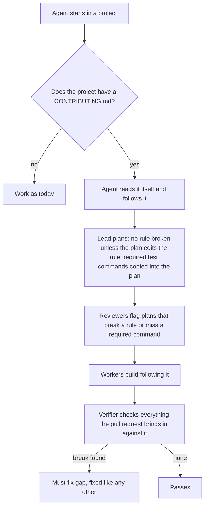

# Follow a project's CONTRIBUTING.md as repo law

**Idea:** `IDEA.md` — what this is for and why, in plain language. Read it first; it is
the north star this plan serves. Goal and Constraints live there, not here, so they don't
get buried as this file grows.

## Open Questions

(none)

## Watch List

| # | Noticed | What needs looking into | Raised to user? | Outcome |
|---|---------|-------------------------|-----------------|---------|

## Decision Log

Append-only. A reversal is a new entry superseding the old, never an edit.

| # | Decision | Rationale | Source |
|---|----------|-----------|--------|
| 1 | Mode is two-part. | Collin's pick. | user |
| 2 | "CONTRIBUTING.md" means the first of `CONTRIBUTING.md`, `.github/CONTRIBUTING.md`, `docs/CONTRIBUTING.md` at the repository root, the order GitHub uses. Files with other casing or names are not law. | Matches where GitHub finds it; one file per project. | defaulted |
| 3 | Where CONTRIBUTING.md clashes with wheelchair's role rules on how agents coordinate (how to commit, push, open PRs, start sessions, cards), the role rules win and the agent names the clash in its report. On the project's code, files, layout, tests and docs, CONTRIBUTING.md wins. | Agents cannot run outside wheelchair's mechanics (e.g. Codex cannot write `.git`); everything else is the project's call. | defaulted |
| 4 | The verifier judges only what this thread changed against CONTRIBUTING.md, not breaks already on the default branch. | A thread should not inherit unrelated cleanup. | defaulted |
| 5 | A CONTRIBUTING.md break in the change is must-fix: added to `realism.md`'s always-fixed list, never deferred as hardening. | "Repo law" means it is not optional. | defaulted |
| 6 | Steps-only verifiers (Check it yourself) and asides are unchanged. | They judge steps or answer questions; they change nothing. | defaulted |
| 7 | No mockups: nothing on screen changes. | Protocol-only change. | defaulted |
| 8 | Agents get CONTRIBUTING.md through a rule in their role file telling them to read it from their own checkout; the machine does not paste it in. | Same for every provider, reads the copy being worked on, no machine change. | user |
| 9 | Validation commands CONTRIBUTING.md requires are copied into the Spec by the lead while planning; verifiers run the Spec's list as today, not CONTRIBUTING.md's list on their own. A required command missing from the Spec is a reviewer finding. | Collin's pick: one list, decided once, predictable check time. | user |
| 10 | Overlap with 8bfbebc2e0d5: the shared work is verifier.md, sub-lead.md, lead.md and worker.md, which that thread is editing (in final checks) to decide which tests verifiers run. Decision 9 makes this plan leave test selection to verifier.md as it stands, so the only overlap left is text in the same files; whichever merges second merges by hand. Moot, no question asked. | This thread's own decision removed the behavioural overlap. | defaulted |
| 11 | The user may set aside a CONTRIBUTING.md rule for one thread; the lead logs it as a Decision starting `CONTRIBUTING.md exception:` (source `user`), and verifiers and reviewers honour it. Agents never set a rule aside on their own. | Law needs a visible, owner-made way out; without it an agent would either break it silently or stall. | defaulted |
| 12 | The shared law rule lives once in `protocol/app/repo-law.md`, composed by the machine into all seven roles like `realism.md`; role files carry only their role's part. Supersedes the per-role copies in the first draft. | Keeps rules in one place (`CONTRIBUTING.md:42`). | review-round-1 |
| 13 | The verifier compares from a change base the brief names (where this thread's work started), not the default branch. | A thread taking on someone else's PR must not be blamed for its earlier commits. | review-round-1 |
| 14 | Wheelchair's own files (`docs/plans/`, `docs/maps/`, mockups, reports) keep their role-rule formats over CONTRIBUTING.md. A small fix has no exceptions; one needing one is taken into planning. | Mockups must render in the app; a small fix has no Decision Log to record an exception. | review-round-1 |
| 15 | Supersedes 13: the verifier's range is the merge-base of the checked commit with the default branch, up to that commit. A thread that takes on someone else's PR is checked on the whole PR. | That is the motivating case (Junjie's ROUTER.md files); it also excludes default-branch merges and needs nothing recorded. | review-round-2 |
| 16 | Supersedes the small-fix half of 14: "push it as it is" on a CONTRIBUTING.md gap counts as Collin's exception. | He decides on the card with the rule named; logged on a planned thread. | review-round-2 |
| 17 | Supersedes 11 and 16: no waivers. A CONTRIBUTING.md rule is changed only by editing the file in the same change, as a Spec item Collin approves (or a small fix he asked for). "Push it as it is" keeps its existing meaning in `lead.md` and is not a waiver. | Collin's pick after waivers drew findings in three rounds; the law is always just the file. | user |

## Spec



### S1. One source: `protocol/app/repo-law.md`
A new file `protocol/app/repo-law.md` holds the whole shared rule, once:
- **Which file is law:** the first that exists of `CONTRIBUTING.md`, `.github/CONTRIBUTING.md`, `docs/CONTRIBUTING.md` at the root of the agent's own checkout. None: the rest of this file and every role rule that refers to it is a no-op.
- **Read it yourself** before changing or judging anything, and follow it. Not through a scout or helper.
- **Precedence:** on the project's code, files, layout, tests and documentation, it wins over the agent's own judgement and over any role rule. Three things are wheelchair's: how agents coordinate (commits through `wc.js git`, pushes, the mechanics of opening a PR, sessions, cards, and each task's ownership boundary: an edit CONTRIBUTING.md needs outside a worker's boundary goes to the sub-lead as a `message`); which validation commands run and when (S2, `verifier.md`, `sub-lead.md`); and the format of wheelchair's own files (`docs/plans/`, `docs/maps/`, mockups, reports). There the role rules win; an agent meeting such a clash follows them and names the clash in its report or result, and a verifier does not report it as a gap. A PR's title, description and checklist follow CONTRIBUTING.md as far as `wc.js git pr` allows; what it cannot do is named in the done card's `note`.
- **Steps-only verifier work** (Check it yourself) skips this file.
- **Changing the law:** there are no waivers. The law for a change is the law file at the change's base (S5's merge-base), as amended by edits the plan's Spec names as its own items (on a small fix, edits Collin's request asks for). The lead plans, reviewers review, and workers and verifiers work and check against that. Adding, loosening or removing a rule happens only as such a named edit; other upkeep of the file (for example adding a new suite to its validation list) follows the file's own rules.

The machine composes `repo-law.md` into the starting instructions of `lead`, `sub-lead`, `worker`, `mapper`, `designer`, `reviewer` and `verifier`, the same way it adds `realism.md` (`machine/service.js:199-208`, as `--- repo-law.md ---`). Asides and any `role_prompt` override are unchanged. `protocol/app/AGENTS.md` lists the new file and its delivery. Each of the seven role files' "If you opened ... by its path" fallback line also says to read `repo-law.md` beside it. The Settings "See it in full" preview (`viewer/app/settings.js` `fullPrompt`, around line 255) lists `[full text of protocol/app/repo-law.md]` after `realism.md`'s place for those seven roles. Role files do not repeat these rules; they add only their role's part below.

### S2. Lead
While planning: the Spec must not require breaking a CONTRIBUTING.md rule. Where Collin's wish needs one changed, the lead names the rule and asks; if he agrees, the Spec gains an item editing CONTRIBUTING.md (S1). Validation commands CONTRIBUTING.md requires for the areas the Spec touches go into the Spec's validation commands; how and when they run stays as `verifier.md` and `sub-lead.md` say.
A small fix follows CONTRIBUTING.md; one that would need a rule changed is taken into planning instead, unless Collin's request itself asks for that edit. Every verifier brief the lead writes outside a planned build (small fix, after-done fix, repair) adds CONTRIBUTING.md's required commands for the areas that fix touches.

### S3. Reviewer
A Spec item requiring a break of a CONTRIBUTING.md rule the Spec does not also change, or a required validation command missing from the Spec, is a finding citing the CONTRIBUTING.md line, rated on the usual ladder.

### S4. Sub-lead and worker
No role-file change beyond S1's delivery; S6 makes a CONTRIBUTING.md gap must-fix through the existing always-fixed rule.

### S5. Verifier
Every verifier except steps-only work adds one check: read the law (S1) and check the change, from `git merge-base origin/<default branch> <checked commit>` to the checked commit, against each of its rules the change can break. That range is everything the pull request would bring in, including commits of someone else's pull request this thread took on, and excludes default-branch commits merged into it. Only breaks in that range count. Rules a diff cannot show (for example "open an issue first") are skipped. The rules are the law for the change as S1 defines it. Each break is one line:
`GAP: repo law <path of the law file>:<line> — <what the change does against that rule> — <file:line evidence>`
and makes the verdict FAIL like any gap. A clash S1 settles for the role rules is not a gap. No CONTRIBUTING.md: no line.

### S6. realism.md
The "Always fixed, however rare" list gains: breaking the project's CONTRIBUTING.md in this change. So a CONTRIBUTING.md gap is never a rare path or deferred hardening.

### S7. Mapper and designer
No role-file change beyond S1's delivery: they read and follow CONTRIBUTING.md through `repo-law.md`. The mapper does not copy its rules into maps. Mockup files keep their format rules (S1 precedence).

### S8. Tests
- `viewer/test/protocol-rules.test.js`: `repo-law.md` names all three paths in order; no role file other than `repo-law.md` names `.github/CONTRIBUTING.md` (one source); `verifier.md` contains `GAP: repo law ` and `merge-base`; `realism.md`'s always-fixed paragraph names CONTRIBUTING.md; `aside.md` does not mention CONTRIBUTING.md.
- `viewer/test/protocol-rules.test.js`: each of the seven roles' fallback line names `repo-law.md`; `viewer/test/app-settings.test.js`: the full-prompt preview for a role lists `repo-law.md`.
- `machine/test/service.test.js`: the composed prompt contains `--- repo-law.md ---` for each of the seven roles, and not for a `role_prompt` override.

### Non-goals
No connector code changes; no machine or viewer change beyond adding `repo-law.md` to composition and to the Settings preview; no change to wheelchair's own CONTRIBUTING.md or any project's; no other document becomes law by this plan, beyond what a CONTRIBUTING.md itself tells agents to read; no change to which tests verifiers run; no ROUTER.md removal (thread 84f82b5fc945).

### Validation
This change touches protocol, machine and viewer tests, so it runs wheelchair's full set (`CONTRIBUTING.md:73-94`), with `install/test/run.sh` standing in for `./install.sh`, which is refused from a worktree:
```bash
node --test viewer/test/protocol-rules.test.js
bash sensitivity/test/run.sh
bash codex/test/run.sh
bash install/test/run.sh
bash machine/test/run.sh
python3 -m unittest discover -s sudo-helper/test
bash sudo-helper/test/install-test.sh
node --test viewer/test/*.test.js
npm --prefix viewer run test:browser
```
Protocol documents have no suite (`CONTRIBUTING.md:90-92`): read the composed prompt for one role (for example the verifier) and confirm `repo-law.md` follows `realism.md`, and that the sub-lead's GAP handling still parses the new GAP line form.

## Deferred

| # | Item | Why it can wait | Source | Notes for the follow-up |
|---|------|-----------------|--------|-------------------------|

## Accepted Risks

| Risk | Why accepted | Round |
|------|--------------|-------|
| A change that deletes the only CONTRIBUTING.md without a Spec item naming it. | Rare; S1's base law still applies to the change anyway. | review-round-4 |
| The changed-path check in the first draft's Validation exited 0 if `git diff` itself failed. | Needs a broken base ref; that command has been dropped anyway. | review-round-1 |

## Review Rounds

### Round 1 — 2026-11-24

**Lanes:** intent: claude / claude-opus-5-5; mechanics: gpt / gpt-6.2-sol; cross-family: yes.

**Changed since Round 0:** n/a (first round — whole Spec in scope)

| Lane | Reported | Finding | Lead verdict | Resolution |
|------|----------|---------|--------------|------------|
| intent | major | Law rules copied into seven role files breaks "keep rules in one place" | upheld | S1: one `repo-law.md`, Decision 12 |
| intent | minor | Lead's scout may read CONTRIBUTING.md, dropping rules | upheld | S1: read it yourself |
| intent | minor | Mapper copying rules into MAP.md makes a stale second copy | upheld | S7: removed |
| mechanics | blocking | Default-branch baseline blames a thread for a taken-over PR's earlier commits | upheld | S2/S5 change base, Decision 13 |
| mechanics | blocking | Precedence unclear for role rules on files, e.g. designer mockup format | upheld | S1 precedence covers wheelchair's own files, Decision 14 |
| mechanics | major | Small fix has nowhere to record an exception | upheld | S2: small fix has none, goes to planning, Decision 14 |
| mechanics | major | Worker not told of logged exceptions | upheld | S4: sub-lead copies them into briefs |
| mechanics | blocking | Validation omits wheelchair's full set and the protocol rendered check | upheld | Validation: full set and composed-prompt check |
| mechanics | minor | Rare path: changed-path command exits 0 if git diff fails | accepted-risk | Accepted Risks; command dropped |

### Round 2 — 2026-11-24

**Lanes:** intent: claude / claude-opus-5-5; mechanics: gpt / gpt-6.2-sol; cross-family: yes.

**Changed since Round 1:** the Spec was rewritten: shared rule moved to one `protocol/app/repo-law.md` composed by the machine into seven roles (S1); precedence now covers wheelchair's own files; small fixes have no exceptions; change base in verifier briefs (S2, S5); sub-lead copies exceptions into worker briefs (S4); mapper no longer copies rules (S7); tests (S8) and Validation (full set) redone. Decisions 12-14.

| Lane | Reported | Finding | Lead verdict | Resolution |
|------|----------|---------|--------------|------------|
| intent | major | Change base exempts a taken-over PR's own commits, the motivating case | upheld | S5 merge-base range, Decision 15 |
| intent | minor | PR rules stated twice | upheld | one sentence in S1 |
| intent | minor | Precedence vs role rules on code and tests unstated | upheld | S1: wins over role rules too |
| mechanics | blocking | Change-base diff includes merged default-branch commits | upheld | S5 merge-base range |
| mechanics | blocking | Verifier could flag a clash S1 settles for role rules | upheld | S1 and S5: not a gap |
| mechanics | blocking | "Push it as it is" ships a violation without an exception | downgraded (minor): Collin chooses it on a card naming the rule; nothing is lost | S1: counts as an exception, Decision 16 |
| mechanics | major | Change base not recoverable after restart or handoff | upheld | cut: no change base, Decision 15 |
| mechanics | minor | Steps-only still told to follow repo law | upheld | S1 steps-only line |
| mechanics | minor | GAP cites CONTRIBUTING.md even for .github/ or docs/ | upheld | S5 GAP names the law file path |

### Round 3 — 2026-11-24

**Lanes:** intent: claude / claude-opus-5-5; mechanics: gpt / gpt-6.2-sol; cross-family: yes.

**Changed since Round 2:** change base removed; the verifier's range is now the merge-base with the default branch (S5, Decision 15); S1 precedence also beats role rules on code and tests, clashes settled for role rules are not gaps, PR content rule moved into S1, steps-only skips repo law; "push it as it is" counts as an exception (Decision 16); GAP line names the law file path; S2 and S4 trimmed; S8 tests updated.

| Lane | Reported | Finding | Lead verdict | Resolution |
|------|----------|---------|--------------|------------|
| intent | major | "Tests" in S1 precedence lets verifiers run CONTRIBUTING.md's own test list, undoing Decision 9 | upheld | S1: which commands run is wheelchair's |
| mechanics | blocking | Precedence could let a worker edit outside its ownership boundary | upheld (major) | S1: boundaries are wheelchair's; edit goes to the sub-lead |
| mechanics | major | Planless "push it as it is" exception lost on a re-check | downgraded (minor): worst case Collin is asked again | moot: waivers removed, Decision 17 |
| mechanics | major | No handoff for logging an exception while the sub-lead owns the checkout | upheld | moot: waivers removed, Decision 17 |
| mechanics | blocking | After-done fix or repair in a new area misses that area's required commands | upheld (major) | S2: every non-build verifier brief adds them |

### Round 4 — 2026-11-24

**Lanes:** intent: claude / claude-opus-5-5; mechanics: gpt / gpt-6.2-sol; cross-family: yes.

**Changed since Round 3:** waivers removed (Decision 17): S1 "Changing the law", S2, S3, S4, S5, S6 and S8 updated to match; S1 precedence now also keeps ownership boundaries and which validation commands run with wheelchair; S2 adds required commands to every non-build verifier brief.

| Lane | Reported | Finding | Lead verdict | Resolution |
|------|----------|---------|--------------|------------|
| intent | minor | Every law-file edit counted as a rule change, blocking routine upkeep | upheld | S1: only rule changes need a Spec item |
| intent | minor | S4 restates S6 | upheld | S4 trimmed |
| mechanics | blocking | Deleting the only CONTRIBUTING.md escapes the check | accepted-risk (rare path) | Accepted Risks; S1 base law covers it anyway |
| mechanics | blocking | Which revision of the law supplies validation when the Spec edits it | downgraded (minor): a careful reader uses the Spec's edited version | S1: base law as amended by the Spec |
| mechanics | blocking | "Push it as it is" can ship a repo-law gap | declined: Decision 17, Collin's choice; the card names the gap | none |
| mechanics | minor | Role-file fallback line omits repo-law.md | upheld | S1 and S8 |
| mechanics | minor | Settings "See it in full" omits repo-law.md | upheld | S1, S8, Non-goals |

## Implementation Tasks

| # | Objective | Ownership boundary | Lane | Session id | Validation | Status |
|---|-----------|--------------------|------|-----------|------------|--------|

## Log
