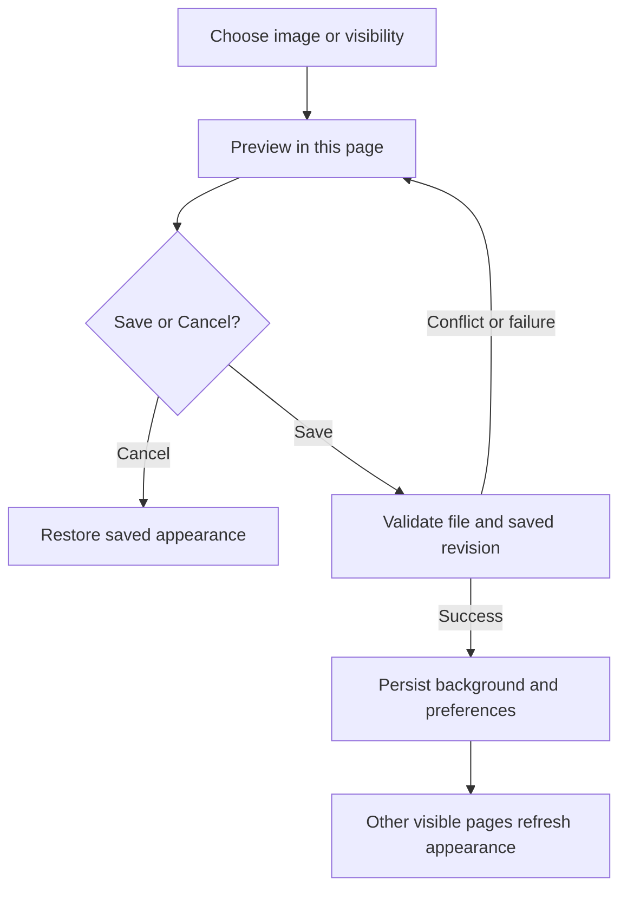

# Custom image and GIF backgrounds

**Idea:** IDEA.md is the confirmed scope. MAP.md maps the current repository.

## Open Questions

None.

## Watch List

Empty.

## Decision Log

| # | Decision | Rationale | Source |
|---|----------|-----------|--------|
| 1 | Adopt the supplied confirmed idea and plan with the realism pass. | User supplied both documents, accepted the assessment and instructed “alright now work on it”. | user |
| 2 | Retain thorough mode with explicit accepted rare risks. | Missing mode defaults to thorough; realism is not a request for deferred core behavior. | defaulted |
| 3 | Shared saved background, solid panels, local preview then Save, Cancel restores saved state. | Decisions recorded in the supplied plan. | adopted |
| 4 | Center/cover; default opacity 35%; 25 MiB upload; ten-second visible polling; stale-save conflicts; infinite GIF looping. | Adopt supplied implementation defaults. | adopted |
| 5 | Treat the explicit instruction to work on the reviewed plan as build authorization. | User authorization persists; no repeated approval question. | user |

## Spec

A local edit previews only in its current document. Save validates the revision and publishes the image/preferences; visible documents refresh saved appearance. Cancel discards the local preview and restores the latest saved appearance.

### Scope and observable behavior
Add a Settings section named Background Customization, hash #background, following the current section/editor conventions. Include a native file picker (PNG, JPG/JPEG, WEBP, GIF), selected filename and size while drafting, an integer 0–100% visibility slider with its current percentage, Save, Cancel, and Remove background. Explain briefly that previews are local and Save applies across devices. Existing Settings sections retain their behavior and order; append Background Customization. Use current controls, spacing, error/status messages and mobile conventions. Do not put implementation terms in the product copy.

The full current page previews the selected image and opacity immediately after the browser has read and decoded the candidate; slider input changes only the background opacity on the next render frame, without a request, rerendering the editor, or remounting the image. GIFs animate using the browser's native image display, never canvas snapshots. Choosing another file replaces the candidate only after it is valid and decoded. Invalid/unsupported/oversized/undecodable files show a useful inline error and preserve the previous valid draft and saved background. A zero opacity image remains selected and saved (not equivalent to removal).

Opening the section loads the current saved metadata into a clean editor; it does not acquire preview ownership or freeze a revision. While clean, image, slider, and baseline follow remote saves just like other pages. The first valid local file selection, opacity change, or removal starts a dirty draft and captures the latest observed saved revision, acquiring preview ownership then. Invalid selections alone do not make a clean editor dirty or block remote updates. Save is disabled while unchanged, decoding, loading the baseline, or submitting. Cancel is available for a dirty or conflicted draft and discards it in favor of the latest known saved state, fetching current metadata before restoring when necessary. Remove background changes the draft to no image with opacity 35, shows the original appearance immediately, and requires Save to publish. Cancel can undo removal before Save. Without an image, disable the slider; an initial empty state has no active background layer.

Save disables draft edits while the request is in flight. A confirmed success updates shared saved-state knowledge. If the submitting editor generation is still current, it ends that dirty draft, establishes the new clean baseline, and shows Saved without changing sections. Every entry/exit/discard has an editor-generation token; all asynchronous decode, save, error, status, and cleanup callbacks are scoped to the generation that started them. Leaving the section during Save does not cancel or roll back a server commit. Its late response may update shared saved-state knowledge in revision order but must not navigate, show status in another section, release a new preview owner, replace a newer draft, revoke its resources, or regress a newer saved revision. The controller accepts saved metadata only in nondecreasing revision order across Save and poll responses; a delayed older poll cannot overwrite a successful Save. If newer remote metadata arrived before Save completion, releasing its preview restores the newest accepted saved state, not the older Save response. Reopening creates a new clean editor, whose subsequent edits belong to a new generation. A renderPanel/DOM rebuild while the same section remains active is not a section exit or new editor generation: retain that visit’s draft, pending request, preview token and resources in state outside the rebuilt DOM, and rebuild controls from that state. Only an actual section transition or explicit discard ends the visit/draft ownership. A failure retains the draft for retry and reports the error; it never claims success or changes the client baseline. For 409 show that the background changed elsewhere and instruct Cancel to load the saved version; do not silently retry over a newer revision. The user can cancel then choose their desired image/settings again. Failed responses after a committed server write are handled by the same refresh/conflict mechanism, not an implicit rollback of the successful server commit.

A draft is not uploaded before Save, is not stored in localStorage/sessionStorage, and is not broadcast to other tabs. Section navigation discards it before rendering another section. Full document navigation/reload naturally discards it; browser back/forward cache restoration must clear any old draft and refresh saved state on pageshow, including persisted restores. Teardown removes preview URLs and returns display ownership to the saved-state renderer. A failed attempt to read the saved state must not turn Cancel into a shared write.

While a clean editor is loading a newly observed saved image, disable its opacity slider until that saved image is displayed (or no image is available), so the slider never edits an unseen replacement. A local file selection and explicit Remove may still start a draft against the latest observed revision. Give each candidate selection/removal a monotonically increasing operation token within the visit: Remove invalidates any in-progress file decode, clears its pending state and previews removal immediately; an older decode must not restore the removed image.

### Shared metadata and persistence
Extend viewer/app/settings.js defaults/normalization with background: { image_id: null, media_type: null, opacity: 35, revision: 0 }. A saved image ID is the lowercase SHA-256 of its stored, normalized bytes, never a client filename/path. Allowed media types are image/png, image/jpeg, image/webp, and image/gif; image ID/type must be jointly valid or jointly null. Opacity is a finite integer in [0,100], revision a nonnegative safe integer. Absent or malformed background data in older settings falls back to the default without dropping other settings. settings.describe may expose this small metadata field but never image bytes. Existing unrelated settings updates must preserve it through normalization.

Use a new focused viewer/app/background.js module to own validation, bounded body reads, files, metadata response construction, updates and cleanup. One running viewer/hub process is the supported writer of a hub stateDir; concurrency guarantees below cover requests through that process/State instance, including multiple browsers and devices. Running separate viewer processes against the same stateDir is unsupported; do not claim cross-process revision/cleanup safety. Document this requirement with the background API and test-server guidance. Tests using separate servers must use separate stateDir values except sequential restart tests that stop the first server before starting the second. Cross-process locking or a new general state service is outside this feature (Accepted Risks). Keep files under <hub stateDir>/backgrounds/, directory mode 0700 and files mode 0600, independent of a thread, worktree and graph cache root. No machine-service or installer change is needed. Store only metadata under settings.json; do not create a second preference store.

Use immutable image files named by generated validated content IDs; make the filename/path rule internal to this module and consistently serve from the fixed background directory. Publish saves under the existing settings read-modify-write queue: compare revision to the current normalized background; for uploads, validate/normalize bytes and atomically install the immutable file before atomically committing the new metadata; increment revision only on an actual successful save. Preserve all unrelated settings fields. Metadata rename is the commit point: in state.js atomicWrite, apply the requested file mode to the temporary file before rename, rather than awaiting chmod on the published file afterward. Any fallible permission step must precede the commit; once rename succeeds the settings write is successful. Cleanup after commit cannot turn it into an error. A revision mismatch returns 409 and the current metadata. Invalid requests and disk errors preserve the committed metadata/file and do not publish a partial appearance. Reuse a current file when the normalized bytes hash to its ID.

Cleanup may delete only unreferenced files belonging to this module. Perform the reference decision and cleanup serialized with appearance commits through the settings queue, avoiding races with in-flight publishers. Cleanup always rereads the committed metadata reference under the queue, including after errors, and must never classify the newly committed file as unused merely because a later cleanup operation failed. Remove temporary/unused files on failed upload/metadata commits where possible and reconcile orphan files during hub initialization before serving requests. After a successful replacement/reset keep only the current referenced image, plus any files temporarily open by an in-flight response; already-read responses may finish normally. Cleanup failure is logged and retried on the next initialization or successful save; it must not turn a committed save into a reported failure. Existing open documents with an older image URL can receive 404 after replacement and must refresh metadata without dropping a successfully displayed image until the new state is ready. If a referenced file is unavailable, keep the app usable with its default appearance and a useful error; allow ordinary removal or replacement. Do not add a dedicated external-file-loss repair state machine, promise exact-content recovery across already open browsers, or silently rewrite unrelated preferences. External deletion/corruption is an accepted risk below.

### HTTP contract and security
Routes below are under /wheelchair/api. Apply the current browser read authentication and same-origin write checks in server.js. Never serve image bytes via the public assets tree. Use no-store metadata and image responses, explicit correct image Content-Type and X-Content-Type-Options: nosniff. Do not accept SVG, remote URLs, filenames, directories, or path fragments from a client as a storage location.

Route	Request	Result
GET /settings/background	No body	200 metadata { image_id, media_type, opacity, revision, image_url, missing_image }; image_url is null or a server-derived same-origin URL.
GET /settings/background/image/<id>	Valid 64-hex ID, no body	200 current image bytes; 404 for noncurrent/missing IDs, 400 for malformed IDs.
POST /settings/background/upload?revision=<n>&opacity=<n>	Raw image body, with its image Content-Type	200 new metadata after one atomic preference commit.
PUT /settings/background	JSON { revision, image_id, opacity }	200 metadata; image_id may only be the currently saved image or null. Null means reset: validate opacity as an integer in [0,100], then accept it and store 35 regardless of the valid supplied value; invalid opacity still returns 400.
Reject unknown body/query keys or ambiguous repeated parameters for these write routes, invalid integers, unsupported types, and attempts to attach another image ID. A same-file upload is still allowed; an unchanged JSON save may return the existing metadata without incrementing revision. Clients use the metadata-only PUT for opacity-only saves; a locally chosen file uses the binary POST. Metadata comparison, image ID validation against current state, and the actual commit belong in the same settings queue transaction. Recheck the expected revision after upload reading/validation, not only at request arrival.

Dispatch both background binary POST and bounded JSON PUT before routes.js's generic JSON reader. Enforce the 25 MiB input limit both from declared Content-Length (when present) and actual streamed byte count, including chunked requests; return 413 without buffering past the limit or leaving request/connection errors unhandled. Small background JSON bodies have a separate 4 KiB streamed limit. Empty/truncated bodies and aborted reads cannot commit or leave a partially installed file. Return 400 for invalid metadata, 415 for unsupported/mismatched image type, and 422 for structurally invalid GIF/container or browser-recognized undecodable image errors reported before upload; return bounded, useful errors without local paths or raw bytes. Browser decode errors are client-side messages, not a fabricated server response.

Verify upload signatures and minimum container/header structure for PNG/JPEG/WEBP/GIF; do not trust extension or Content-Type alone. Content-Type must be an accepted type matching detected bytes; browser supplies detected type even when File.type is empty. Bound container traversal/declared lengths and require image payload rather than accepting a signature-only file; reject obvious truncation. Do not implement a general image decoder. Full server-side pixel decoding of PNG/JPEG/WEBP is not required: native browser decoding gates UI Save and native rendering is the only consumer. Header spoofing never causes bytes to be served as HTML or SVG. The server's type and size checks apply equally to direct API callers.

### GIF preservation and looping
Preserve native compressed frame data, palette data, frame delays, disposal settings, transparency and dimensions. Do not transcode animations through canvas, video, thumbnails or still images. Normalize GIF playback to infinite repetition, including animated GIFs with no loop extension or a finite loop count. Implement a small pure, bounded GIF block walker: check GIF87a/GIF89a header and logical screen/color tables, traverse extension and image blocks with length bounds and a trailer, replace recognized NETSCAPE2.0/ANIMEXTS1.0 loop extensions with one standard infinite-loop application extension without changing frame bytes or timings. Reject malformed/truncated block structures. When adding an application extension to GIF87a, promote its header to GIF89a; frame/palette/timing bytes remain unchanged. A static GIF stays static. This follows the required-version rule in the GIF89a specification, Version Numbers and Application Extension. This is metadata normalization, not pixel decoding or image editing.

Use the same pure validation/loop normalization helper for local preview and hub save, for example a CommonJS/browser-compatible viewer/pages/background-format.js that the server requires and the browser loads as an external script. Bound the input before running it; allow at most the small fixed loop-extension overhead beyond the 25 MiB input limit. The browser decodes the normalized candidate before applying it, but retains and uploads the bounded original selected bytes; the hub independently normalizes them. This avoids counting the added loop-extension overhead against the original upload limit twice. Test finite-loop, no-loop, and animated GIF87a fixtures, not only an already-looping GIF. Assert the normalized served animated bytes have exactly one recognized infinite-loop application extension and a GIF89a header when promoted. Repeated metadata polling, opacity changes, and unchanged Save results must not recreate image nodes or reassign identical image URLs. A full page navigation is allowed to restart the animation; continuously visible documents must not freeze or restart it every poll.

### Shared rendering and page coverage
Create one shared browser renderer/controller, e.g. viewer/pages/background.js, and minimal shared background.css, loaded as external assets in every signed-in page: features, threads, thread, new, agents, settings, terminal, app doc, app picture, and legacy document viewer/doc.html. Standalone graph viewer/index.html is exempt from appearance initialization, scripts/styles, polling and image decode: its toolbar, explanation and full canvas already form an entirely opaque interface. Load the pure format helper before the Settings editor needs it. Reuse server.js's existing narrowly validated pages assets rather than exposing arbitrary state paths or widening public reads. Update viewer/AGENTS.md and relevant existing ROUTER.md descriptions for new ownership.

Use one fixed viewport layer with centered cover, no repeat and no stretching, with pointer-events: none and aria-hidden. The layer has no focusable children. Its opacity alone follows the setting. Establish a deliberate stacking context that puts it after the default page base and before all content, while retaining sticky/fixed headers, dialogs, menus, terminals, scrolling, graph drag, and focus outlines. No opacity/filter is applied to body, a content ancestor, text, or controls. Gate custom painting rules on an active custom image; at no image/reset, remove the layer and active class/variables so original computed painting/layout returns exactly. No horizontal overflow is introduced at 390px or 1280px viewport widths.

Audit each page's transparent content regions, not only generic .card: text headings/filter areas, thread messages/composer/asides, lists, settings panel/navigation, doc content/file navigation, terminal surfaces, graph explanation/controls, and empty/error/loading states. Keep visible background gutters around the Settings controls at desktop and phone widths; do not make the navigation and full main-column wrappers jointly cover the viewport. Use opaque content-bearing inner surfaces, with existing padding/gaps exposed to the image. Give content-bearing surfaces solid existing palette backgrounds while an image is active; use existing spacing rather than redesigning layouts. Embedded terminals, static HTML diagram content, and form/graph content containers stay opaque. The graph canvas is itself a content panel: keep its existing solid background, nodes, groups, edge/arrow colors, geometry and drag targets unchanged. Its full-viewport layout covers the custom image completely, so do not load the background assets or perform any appearance work on the standalone graph page; do not redesign it or make connections compete with a user image. In framed documents (window.self !== window.top), disable background initialization entirely before any appearance fetch, polling, image decode, layer, or active class. Inline graph cards therefore remain solid while the parent thread owns the surrounding background. The same framed-document guard applies when app picture embeds a graph; top-level app picture still uses the shared renderer. Do not transmit drafts into frames or modify static HTML iframe contents.

The renderer fetches only lightweight metadata at load and at 10-second intervals while visible; refresh on focus/visibility return/pageshow. Only one metadata request is active per document, schedule rather than overlap; abort metadata reads after 15 seconds, release the in-flight slot in finally, and let the next scheduled/focus/pageshow refresh retry. An aborted or superseded response cannot update state, and guard against stale async image loads changing the displayed revision. Stop timers while hidden/disposed and release resources on real unload; resume after back/forward cache restoration. No API failures should block existing navigation/page initialization. On initial failure keep the default appearance; on later failure keep the last successfully displayed saved state (never a preview) and retry on the next normal refresh. Empty/reset metadata removes the image. Preload/decode a replacement before swapping it in; bound saved-image loading to 60 seconds, invalidate a timed-out attempt and retry on the next normal refresh without indefinitely disabling the clean editor. This is a cosmetic background: a failed/slow image must not hold navigation or unrelated controls.  a decode/fetch failure keeps the last valid saved display and retries metadata on the normal cadence, including when its revision is unchanged. Track last successfully displayed saved state separately from every local preview. Cancel, section exit, and pageshow restoration must immediately remove a discarded preview even if metadata fetch or replacement decode fails: restore a reusable last successfully displayed saved image at its saved opacity, or the default appearance if none is safely available. Do not keep/reapply a discarded preview as an error fallback. Explicit reset/missing-image metadata always chooses default, rather than resurrecting an older saved image. Invalidate older preview/decode callbacks on discard so they cannot put the preview back.

Expose a small documented controller API for Settings to acquire/release preview ownership and publish a local candidate/opacity; an initialization promise or equivalent must prevent Settings starting before the controller is ready. Share one renderer rather than writing a separate Settings implementation. Maintain latest remotely observed saved metadata separately from the active dirty draft. Clean editors follow remote metadata and renderer changes without becoming dirty. Polls continue during a dirty preview, but may not replace its image or slider values. Preview ownership and release are token-scoped so a late old editor cannot release a newer owner. Cancel/leaving the section releases the preview and restores the newest saved version, not the old baseline. Save compares against the baseline revision captured when the draft began; other devices update to a committed replacement/reset within 10 seconds plus request/decode time when visible, or on next focus when hidden. A transient image load failure can retry through the normal saved-state refresh. Exact-content repair after external file loss has no additional cross-browser recovery guarantee. Revision-only opacity changes with unchanged available image URL update style alone and do not reassign/restart the image.

For local previews, object URLs are acceptable only if server.js's existing PAGE_CSP permits blob: narrowly in img-src (inherited by app/legacy docs); do not relax script-src, frame-src, or any origin boundary. Revoke superseded/invalid/discarded object URLs after they are no longer displayed, and release candidates on teardown. If data URLs are used instead, keep bounded memory and do not add blob: unnecessarily. The renderer never writes arbitrary user strings into HTML or CSS selectors/markup.

### Integration boundaries
Expected implementation touches viewer/app/background.js, settings.js, state.js for pre-rename permission application, routes.js, hub.js initialization, API.md, server.js CSP/assets only as required, shared pages/background* assets, settings page/editor/styles, page entry-point HTML and scoped per-page solid surface styles, legacy doc integration (standalone graph excluded), viewer tests and their server helper, and ownership routers. Avoid changing agents, model pins, provider placement, thread lifecycle, machine uploads, sudo-helper, installer and unrelated Settings semantics. The untracked ROUTER.md bootstrap files predate this feature; preserve them and include/update those that now document this work when preparing the final implementation commit(s), never sweep unrelated files into a commit.

### Verification
Use isolated temporary state/cache roots. Before enabling new page requests, make the shared test-server helper always allocate and pass a temporary stateDir unless explicitly supplied; check that two default servers are independent. Never test against live user state.

Required focused checks:
- Save/serve PNG, JPEG, WEBP and animated GIF; reject unsupported/mismatched types, invalid metadata and IDs, unauthenticated or wrong-origin requests. Enforce binary and JSON streamed size limits; an interrupted upload must not publish partial settings.
- Save, opacity change, removal and sequential server restart preserve the intended shared state and unrelated preferences. Concurrent same-revision saves produce one success and one conflict. A failed pre-commit write preserves saved preferences; cleanup after a committed write must not change success into failure.
- Two authenticated browser contexts demonstrate private previews, shared Save/reset, a clean editor following remote saves, and stale-save conflict followed by Cancel. Exercise section navigation, reload and pageshow draft discard. One delayed Save across navigation/reopening and one stale poll test cover asynchronous ownership/order. One same-section rebuild preserves a draft.
- Slider values 0/35/100 affect only the image. An invalid file preserves the draft. Cancel removes previews even when replacement loading fails. A rapid-file-selection test verifies that an older decode cannot replace the latest choice.
- Unit-test GIF normalization for no-loop, finite-loop and GIF87a inputs, frame/timing preservation, and bounded rejection of truncated structures. In both browsers, use a representative finite-loop animation and observe frame changes beyond its original stopping point, including an unchanged metadata poll and an opacity change. Do not repeat every parser fixture as a timed screenshot test.
- Cover page integration with a lightweight parameterized check for shared assets/layer and opaque content surfaces. Use representative desktop and phone interaction checks on Settings, thread/composer and agents/terminal, plus document rendering. Confirm no horizontal overflow, working input/scroll/focus, no duplicate layers, and original appearance after removal. Keep standalone/framed graph zero-appearance-request assertions and existing graph interaction coverage; do not duplicate every page × viewport × image format × failure combination.

Run node --test viewer/test/*.test.js and npm --prefix viewer run test:browser. Both Chromium and Firefox must execute. Record actual results. No installation or model-consuming live smoke suite is needed.

## Accepted Risks

Additional decisions from this realism pass supersede earlier requirements and historical review resolutions where they conflict:

| Risk / reduced guarantee | Why accepted | Remaining behavior |
|---|---|---|
| External deletion/corruption of stored images, including same-ID repair in already open browsers | Not produced by normal background use on a healthy machine. A restart alone does not delete the immutable image. | Default fallback and ordinary remove/replacement; no specialized repair protocol or fault matrix. |
| Multiple hub writers sharing one state directory | Unsupported deployment; cross-process coordination is a general architecture project. | One writer, queued requests, multi-device conflict protection and sequential restart persistence. |
| A crash may leave an unreferenced temporary/upload file until next cleanup | An orphan consumes disk but does not publish a partial preference or lose the saved reference. | Best-effort cleanup on initialization and successful saves; no immediate crash-perfect reclamation or fsync durability guarantee. |
| Filesystem permission behavior outside normal healthy operation | Preserve a simple correct commit boundary without expanding into recovery from changing permissions or post-commit filesystem faults. | Apply permissions before rename, do not delete the committed image, log cleanup errors; targeted write/cleanup tests, not exhaustive syscall fault injection. |
| Exhaustive browser/failure combinations are not tested | Many combinations repeat the same controller and provide little extra confidence. | Security and bounded parser tests, representative async lifecycle cases, shared page coverage, both browser suites. |

| A metadata read can overlap replacement/cleanup in a sub-second window and briefly report its old image missing | Narrow read/commit race without loss of saved preferences; ordinary subsequent refresh restores current appearance. Do not expand this feature into snapshot coordination. | Normal queued writes and polling remain required. |

| Large uncached image downloads can repeat on full navigation | Background is cosmetic; keep navigation usable and limit requests to actual image changes within a document. A browser media cache subsystem is outside this feature. | No-store policy retained; small images load promptly. |

## Check Once Built

| # | What to check | Round |
|---|---------------|-------|

## Review Rounds

The supplied document records two completed review rounds and an empty third-round table in another thread. They are provenance, not a claim that this thread ran those checks. Current review checks the adopted plan and realism changes against this checkout.

### Round 1 — 2026-11-19

Lanes: intent gpt/gpt-6.2-sol; mechanics gpt/gpt-6.2-sol; cross-family: no (hub could not satisfy provider preferences).

| Lane | Reported | Finding | Lead verdict | Resolution |
|---|---|---|---|---|
| intent | major | Slow remote image load can make slider edit an unseen new image. | upheld | Disable clean-editor slider until new saved display is ready; local file selection/removal remain available. Checked Spec editor baseline and preload rules. |
| mechanics | major | Remove can be overwritten by an earlier pending decode in the same visit. | upheld | Candidate/removal operation token invalidates pending decode. Checked Spec lifecycle and rapid-selection requirements. |
| mechanics | major | A hung single metadata request blocks later refreshes. | upheld | Fifteen-second abort and finally release; next normal refresh retries. Checked Spec single-in-flight rule and nav.js poller behavior in MAP. |
| mechanics | major | Minimum format checks could accept signature-only input. | downgraded (minor) | Spec already requires minimum container structure and explicitly excludes full pixel decoding; clarify bounded lengths/payload checks without adding a decoder. No user design decision is needed. |
| mechanics | minor | Metadata file-availability check can race replacement cleanup. | accepted-risk (rare path) | Sub-second read/commit coincidence, transient display only; normal refresh recovers. Recorded Accepted Risk; no new snapshot subsystem. |

Changed since supplied plan: external-file-loss repair reduced to safe fallback and ordinary removal/replacement; verification matrix reduced; accepted risks explicit. Whole-spec coherence remains in scope.

### Round 2 — 2026-11-19

Changed since round 1: clean-slider readiness, decode invalidation on Remove, bounded metadata request lifetime, minimum format check clarification; narrow metadata/cleanup race accepted. Review these changes in depth and whole-Spec coherence.

Lanes: intent gpt/gpt-6.2-sol; mechanics gpt/gpt-6.2-sol; cross-family: no (hub preferences unavailable).

| Lane | Reported | Finding | Lead verdict | Resolution |
|---|---|---|---|---|
| intent | minor | Whole opaque Settings wrappers could hide the preview at desktop width. | upheld | Keep visible gutters and solid inner surfaces. Verified settings.css:2-8 and app.css:28. |
| intent | minor | No-store image reads can repeat a large transfer on each navigation. | accepted-risk | Cosmetic background may load slowly on constrained links; preserve current no-store contract and nonblocking navigation rather than introduce persistent browser media storage. |
| mechanics | minor | A stalled image load could indefinitely disable a clean slider. | upheld | Sixty-second saved-image load timeout, invalidate late loads and retry normal cadence. |
| mechanics | minor | JSON PUT could be buffered before its bounded reader. | upheld | Both writes explicitly dispatch before generic JSON read. Verified routes.js:19-26,63-64,92. |

Clean: no upheld blocking/major finding and no user decision remains. Minor resolutions are above.

## Prior Work

At adoption no background implementation existed. T1 attempt 1 and T2 attempt 1 are now integrated partial work, not accepted completion: persistence/parser and renderer/editor baseline code exist; missing focused coverage, lifecycle/readability review and final suites remain. Their reports candidly record guardrail stops. New attempts must complete these partial implementations. Shared Settings, state queues and browser infrastructure are reusable.

## Implementation Tasks

Backend and frontend run in disjoint checkouts. T1 owns the shared format helper: CommonJS export and browser global `wcBackgroundFormat`, `normalize(Uint8Array, optionalMediaType)` returns `{bytes: Uint8Array, mediaType}`; it enforces the original 25 MiB bound, detects signatures, validates structure, and normalizes GIF looping. Frontend uploads original bytes using the detected mediaType. T1 alone owns server.js (including narrow img-src blob: permission). The sub-lead owns routers, test helper isolation, PLAN and COMPLETION.

| # | Objective | Ownership boundary | Lane | Session id | Validation | Status |
|---|-----------|--------------------|------|-----------|------------|--------|
| T0 | Isolate test state and preserve bootstrap routers | viewer/test/helpers/server.js, server-isolation.test.js; routers | sub-lead gpt/gpt-6.1-sol | sub-lead | node --test viewer/test/server-isolation.test.js | done |
| T1 | tricky: persistence, bounded HTTP and shared format parser | viewer/app/background.js, settings.js, state.js, routes.js, hub.js, API.md; viewer/server.js; pages/background-format.js; test/background*.test.js; test/fixtures/background/ | standard gpt/gpt-6.1-terra | wc-7108adfdf9ea-worker | node --test viewer/test/background*.test.js; full Node suite | partial, integrated; next attempt needed |
| T2 | tricky: shared renderer, Settings editor, page surfaces and browser checks | viewer/pages except background-format.js; viewer/doc.html; test/background*.spec.js; test/fixtures/background-browser/ | standard gpt/gpt-6.1-terra (Claude unavailable) | wc-7108adfdf9ea-worker-2 | focused browser tests; full browser suite | partial, integrated; next attempt needed |

| T3 | tricky: complete backend/parser and focused missing checks; T1 hit twice-failed environment gate | T1 boundary and report T3.md | standard gpt/gpt-6.1-terra, xhigh (effort step) | pending | private TMPDIR node --test viewer/test/background*.test.js | dispatched |
| T4 | tricky: complete renderer/editor lifecycle and surfaces; T2 hit twice-failed incomplete gate | pages source excluding format helper, legacy doc; report T4.md | standard gpt/gpt-6.1-terra, xhigh (effort step) | pending | JS syntax, diff check, focused Chromium | dispatched |
| T5 | tricky: complete representative browser checks | test/background*.spec.js, fixtures/background-browser, app-settings.spec.js section expectation only; report T5.md | standard gpt/gpt-6.1-terra | pending | private TMPDIR focused Chromium then integrated both browsers | dispatched |

## Log

2026-11-19: Adopted user attachments and the requested realism changes. User explicitly authorized implementation. Source review history remains in the uploaded original. No feature implementation has started.

2026-11-19: Focused adoption review is clean after minor resolutions. Build accepted: user chat “alright now work on it”; no repeated permission question.

- 2026-11-19 — T0 accepted: two default isolated servers passed (1/1); every start now passes its own temporary stateDir. Bootstrap ROUTER.md files preserved in explicit preparation commit.

- 2026-11-19 — T1 attempt 1 not accepted (band: self, tricky; 184 code lines); partial commit 7cf0bcb2 integrated as Prior Work. Report matches partial diff. Root rerun of 2 focused tests passes, but JPEG/WEBP, limits/interruption, faults and GIF variants remain untested. Two full-gate failures triggered guardrail; next attempt is a sharper completion brief with effort escalation.
- 2026-11-19 — Choice: T1, HTTP conflicts: current metadata is returned beside error at the top level.
- 2026-11-19 — Choice: T1, reset: already-empty valid reset is unchanged.
- 2026-11-19 — T2 attempt 1 not accepted (band: self, tricky; 284 code lines); partial commit 2b1b1a63 integrated as Prior Work. Report accurately names missing backend integration and coverage; integrated root Chromium baseline is 3/3 passing.
- 2026-11-19 — Choice: T2, rendering: fixed native image with object-fit cover.
- 2026-11-19 — Choice: T2, file size copy: two-decimal MiB.
- 2026-11-19 — Test environment: isolate each validation command with a private TMPDIR to prevent shared /tmp sweeps between separate PID namespaces. Full Node commands use command-local init.defaultBranch=main for existing slug fixtures. No live/user state is used.
