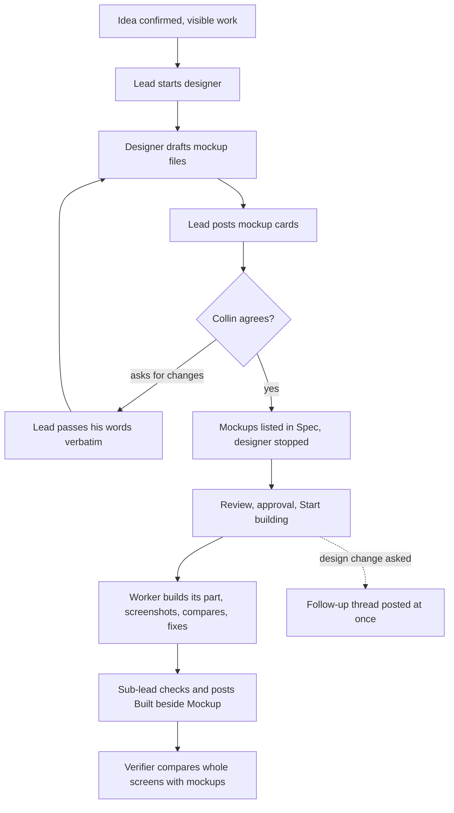

# Design work inside a thread

**Idea:** `IDEA.md` — what this is for and why, in plain language. Read it first; it is
the north star this plan serves. Goal and Constraints live there, not here, so they don't
get buried as this file grows.

**Map:** `MAP.md` and `docs/maps/thread-visual-design.md`.

## Open Questions

Ordered by leverage; discussed one at a time.

## Watch List

| # | Noticed | What needs looking into | Raised to user? | Outcome |
|---|---------|-------------------------|-----------------|---------|

## Decision Log

Append-only. A reversal is a new entry superseding the old, never an edit.

| # | Decision | Rationale | Source |
|---|----------|-----------|--------|
| 1 | Plan mode two-part | Collin's pick: core flow first, hardening in a follow-up thread | user |
| 2 | No dedicated Claude Design import path; the build-follows-the-mockup part folds into the screenshot check | Collin: B can go if making designs here and seeing them early are good | user |
| 3 | The agreed mockup is a file in `docs/plans/<slug>/` that the Spec points to; workers build against the file, and a visible difference from it is a gap the verifier reports | Prose paraphrase of a design is where the 20-30% loss happens | defaulted |
| 4 | User feedback on mockups is given in chat (no tap-to-comment on the picture) | Simplest; tap-to-comment is hardening | defaulted |
| 5 | A new design agent role drafts and revises mockups; the lead starts it during planning, briefs it, and posts what it makes | Collin's pick: mockups get a focused agent and the lead stays free to talk | user |
| 6 | Mockup frame size depends on what is being worked on: "it should depend on what you're working on" (Collin usually views wheelchair in a laptop browser) | Collin's answer; a phone app gets a phone-sized frame, a desktop web page a desktop-sized one | user |
| 7 | Mockups show live (the HTML page itself, not a rendered picture), scaled to fit the viewer's screen; "Open full size" shows it instead of downloading | Works on every machine without a headless browser; Collin did not object to live, only to a fixed phone shape | defaulted |
| 8 | During the build, a screenshot of each finished visible task is posted to the thread as it lands, next to its mockup, by the sub-lead directly | Collin's pick: see it take shape and steer early | user |
| 9 | Workers compare their screenshot with the mockup and fix differences before reporting | Catch drift per task, not only at the end | review-round-1 |
| 10 | "Agree the mockups" is an Open Question while a designer runs, so review waits for agreement | Planning gate must not close on unagreed mockups | review-round-1 |
| 11 | Mockup changes asked during the build are applied right after it as an after-done fix in the same open pull request | The sub-lead owns the worktree during the build | review-round-1 |
| 12 | A design change Collin asks for once Start building is accepted becomes a follow-up thread, posted at once; the build finishes as agreed. Supersedes 11 | Collin's pick ("Follow-up thread"): simple and reliable; pausing a build could be its own thread later | user |

## Spec

Bar: a fresh agent with no conversation history can implement from this section alone.
A Mermaid diagram of the flow is added at approval.

### Flow



### Overview

Three pieces:

1. **Mockups during planning.** A new `designer` agent, started by the lead, drafts static
   HTML mockups of the screens a feature changes. The lead shows each version in the thread
   as a new `mockup` diagram format, framed at the size of the device being designed for and
   scaled to fit. Collin asks for changes in chat; the lead relays them; the designer revises.
2. **The agreed mockups are the source of truth.** The Spec of a plan with visible work lists
   each agreed mockup file. Workers build to match it, and verifiers compare the build with it.
3. **Screenshots during the build.** Workers screenshot each finished visible task at the
   mockup's size; the sub-lead posts each one as an `image` card, shown beside its mockup.

### Mockup files

- A mockup is one self-contained static HTML file at
  `docs/plans/<slug>/graphs/mockup-<name>.html`: HTML, inline `<style>`, inline SVG and
  `data:` images only, no scripts, nothing loaded from the network (the existing HTML diagram
  rules and the server's existing CSP and empty sandbox apply unchanged:
  `viewer/server.js:1690-1694`, `viewer/pages/diagram.js:70-77`).
- Each file shows one screen in one state, laid out for one device size (`width` x `height`
  CSS pixels, each from 200 to 2560, the screen tool's capture limit: `machine/lib/screen-args.js:31`). The lead picks the size from what the thread builds: for example 390x844 for a
  phone screen, 1440x900 for a desktop web page, the app's window size for a desktop app.
  Several states or sizes are several files.
- A mockup file is at most 2 MiB (the archived-file read limit, `viewer/app/threads.js:295`).
  For a `mockup` diagram card, `card.js` checks the file exists under the named plan's
  `graphs/` and is at most 2 MiB before posting. For `image.mockup` (which names no plan),
  the hub makes the same checks against the resolved thread plan, in the update that stores
  the card, and refuses the card if they fail.
- A new version of a mockup is written as a new file (`mockup-<name>-v2.html`, ...), never
  over an old one, so older cards in the thread still show what they showed.

### The `mockup` diagram format

- `diagram` cards gain `format: "mockup"`, which loads `graphs/<graph>.html` like `html`,
  and two fields: `width` and `height`, integers from 200 to 2560, required when `format`
  is `mockup` and refused for any other format (`viewer/app/card.js` validation;
  `protocol/app/cards-lead.md` diagram section).
- **In the thread:** the card draws a sandboxed iframe sized exactly `width` x `height`,
  scaled with a CSS transform to the card's content width (never scaled up past 1), inside a
  box whose height is `height` x scale, so the whole screen is visible with no inner
  scrolling. It rescales when the card width changes. A thin border marks the screen edge.
- **"Open full size"** (`viewer/pages/picture.js`) draws the same sandboxed iframe at its
  true `width` x `height` inside the page's scrolling container (scrolling both ways when the
  window is smaller), never downloads it in place of showing it. A separate Download link
  for the HTML file may stay. Plain `html` cards keep today's behaviour.
- Archived threads load the file the same way `html` cards do today
  (`viewer/pages/diagram.js:12-24`).

### `image` cards beside a mockup

- `image` cards gain an optional `mockup` object `{graph, width, height}` naming a mockup
  file of the thread's own plan (the hub uses `thread.slug`, the same plan the archived
  reader uses; when it is unset, the hub first discovers it the way the thread page does
  (`viewer/app/routes.js:507-517` / `viewer/app/chat.js:433-439`) but without that path's own
  save, because card acceptance already holds the thread's write queue
  (`viewer/app/cards.js:57`, `viewer/app/state.js:137`); the slug is set in the same update
  that stores the card; it then
  registers the plan as for a diagram card, and refuses `mockup` only when the thread still
  has no plan), with the same rules as a mockup diagram card. When present, the card shows the
  screenshot and the mockup side by side, labelled "Built" and "Mockup", each scaled to half
  the card width; under 599px card width they stack, Built first. Each half has its own
  "Open full size": the screenshot opens as an image at true size; the mockup opens the
  picture page, which accepts an `image` card with `mockup` (`?card=<id>`) and draws the
  mockup exactly as for a mockup diagram card. Without `mockup`, image
  cards behave as today.
- `image` cards may now be posted by `lead` and `sub-lead` (`viewer/app/card.js:42`;
  `protocol/app/cards.md` kind table; `cards-lead.md` image section moves the "only the
  lead" sentence). The machine's copy-into-uploads step is unchanged.
- Archiving keeps `image` and `file` uploads posted by sub-leads as well as leads (the keep
  list in `viewer/app/threads.js:219-220` today keeps only lead-authored ones), so both
  halves of a comparison still load in an archived thread.
- The `image` card section moves from `protocol/app/cards-lead.md` to the shared
  `protocol/app/cards.md` (which the sub-lead receives), and the kind table lists
  `lead, sub-lead` as emitters. `protocol/app/sub-lead.md:5-7` ("never post cards meant for
  the user except the `progress` line") gains `image` as the second exception, and its
  screenshot relay sentence (`sub-lead.md:179`, "pass them on to the lead") is replaced by
  the posting rule in "Build and verify rules".

### The `designer` role

Plumbing (a new role alongside `mapper`; evidence from the scout):
`viewer/app/sessions.js:127-139` (`SESSION_ROLES`, and the lead's `ALLOWED_START`; not the
sub-lead's), `viewer/app/sessions.js:765-768` (shares the thread worktree and branch, like
the mapper), `viewer/app/balancer.js:14` and `viewer/app/settings.js:13-23,54` (an Other
agents tier and role card files: `cards.md`, no `realism.md`), `viewer/app/routes.js:403`,
`viewer/pages/settings.js:28,614` (label "Designer", Other agents row),
`viewer/pages/agents.js:57` (short label), `viewer/app/quiet.js:3` (watched like a mapper),
`machine/service.js:195-203` (`ROLE_CARDS` gets `cards.md`; prompt from
`protocol/app/designer.md`), `viewer/app/card.js:50-51,86` and `viewer/app/cards.js:67`
(may post `message` and `result`; lessons may be saved *for* it by a lead, it saves none),
`viewer/pages/settings.js:842,1765`, `viewer/pages/thread.js:3`, `viewer/app/settings.js:187,193`
(lesson role lists), `protocol/app/AGENTS.md`, and the tests that enumerate roles
(`viewer/test/protocol-rules.test.js`, `app-lessons.*`, `app-settings.test.js`,
`app-balancer.test.js`, `app-harnesses.test.js`, `app-sudo.test.js`, `app-switch.test.js`,
`machine/test/service.test.js`, `switch-http.test.js`, `pi.test.js`). The screen tool
already allows every role but reviewers (`machine/lib/screen.js:261`); no change.

Rules, in a new `protocol/app/designer.md`:

- Its brief names the slug, the screens and states to draw, each one's device size, what the
  user has said they want, and paths to read (IDEA.md, the project's existing screens or
  styles where they exist, so mockups match the real app's look).
- It writes and commits (with `wc.js git commit`, exact paths) only
  `docs/plans/<slug>/graphs/mockup-*.html`, never overwriting an earlier version. Each file
  follows "Mockup files" above: static, at most 2 MiB, sizes from 200 to 2560.
- Where the project already has a look (styles, components, screenshots), the mockup uses
  it: same colours, type, spacing and components. It may read the project's code to get them.
- Before reporting, it looks at its own work when it can: renders each file at its size to a
  PNG with the machine's headless Chromium (Playwright, as the viewer's browser tests use)
  and checks it with its image-reading tool. If no browser is available it says so in its
  result and carries on.
- It reports each set of versions with a `result` (task `mockups`) listing every file, its
  screen/state and its `width`x`height`, then waits: the lead may send revision requests as
  `message`s, each answered by a new version and a new `result`. It never talks to the user
  and posts no shown cards.

### Lead rules (`protocol/app/lead.md`, `cards-lead.md`)

- **When:** in a feature (not a small fix) whose idea changes something people see, the lead
  starts one designer once IDEA.md is confirmed, alongside asking design questions. It may
  skip it when the visible part is trivial, saying so in a line.
- **Showing:** for each `result`, the lead posts one `mockup` diagram card per file.
  Collin's feedback is passed to the designer as a `message` quoting his words verbatim,
  with the paths of any files he attached (`[attached: <path>]`), not a paraphrase.
- **Gate:** when the lead starts a designer it adds an Open Question "Agree the mockups" to
  PLAN.md, so status stays `planning` (the existing gate: Open Questions empty) until Collin
  agrees them. It is settled by a Decision naming the agreed files; the lead then stops the
  designer. If the lead skips the designer, it logs that as a `defaulted` Decision instead.
- **Changes during review or after approval** (before Start building is accepted): the
  lead first retracts any open approval card (as `lead.md` step 6 does for a Spec change),
  then in one commit sets `status: planning` and re-adds the "Agree the mockups" Open
  Question, and starts a fresh designer briefed with the current files and Collin's words.
  This is a new allowed move in the `status:` table of `lead.md` (back to `planning` from
  `ready-for-review` or `approved`, only for this). Planning rules then apply unchanged: no
  approval card exists or is posted from `planning`, and a restarted lead resumes planning
  (and the designer restart rule below). Once Collin agrees, the new files are a Spec change:
  status `ready-for-review` and the change is in the next round's "Changed since" list. If Start
  building was already recorded when he asks, it is a change after Start building.
- **Changes after Start building:** the build finishes against the agreed mockups. When
  Collin asks for a design change once Start building is accepted (including after `done`),
  the lead posts a `stub` card at once (durable, so a lead restart loses nothing):
  `depends_on_parent: true`, summary quoting his words verbatim, the current mockup file
  paths (on the parent branch) and, when a screenshot prompted it, a one-line description of
  that screenshot. If Collin attached files with the request, the summary describes each in a line and
  says they may be gone once the parent is archived, so the stub's lead asks him to attach
  them again if it needs them. The stub's lead
  plans it from step 1 with its own mockups. Nothing in this thread changes.
- **Designer dies:** like a dead mapper, it is started fresh (`lead.md`, "Restarting what
  died", gains `designer` in its list), briefed with the newest mockup files and any of
  Collin's feedback not yet reflected in a file.
- **Restart:** a restarted lead stops any live designer (its results would go to the dead
  lead) and, if the "Agree the mockups" question is still open, starts a fresh one briefed
  with the newest mockup files and any of Collin's feedback in the restart context's recent
  messages not yet reflected in a file.
- **Recording:** agreed mockups are listed in the Spec under a "Mockups" heading: one row per
  file with its path, the screen/state it shows and its size. Choosing which version is
  agreed is a Decision Log entry.
- The template `protocol/templates/PLAN.md` Spec guidance gains one line: a plan with visible
  work lists its agreed mockups there instead of describing the look in prose.

### Build and verify rules

- **Worker** (`protocol/app/worker.md`): a task whose brief names a mockup builds its part
  to match it (layout, content, hierarchy, colours, type, spacing). The brief says which
  parts of the mockup the task owns; parts owned by other tasks are not its differences. When the task finishes, it
  screenshots the built screen at the mockup's `width` x `height`: a web page with headless
  Chromium (an isolated server per the project's rules); a desktop app or game with its
  invisible screen (`wc.js screen`). It then looks at its screenshot beside the mockup (rendering the mockup at its size with
  headless Chromium) and fixes any difference in its own
  parts by the verifier's bar below before reporting. If it cannot render the mockup, it
  still reports the screenshot and says the comparison was not done and why. It lists each screenshot path with the mockup it
  matches in its report, and any difference it chose to leave, with why. A task with visible work but no mockup still reports a screenshot. If it
  cannot take one, it says why; this does not block the task.
- **Sub-lead** (`protocol/app/sub-lead.md`): briefs name the mockup files and sizes from the
  Spec's Mockups list for each task that touches those screens, and which parts of each
  mockup that task owns. The whole screen is expected to match once all its tasks are
  merged, which the verifier checks. When it checks a
  worker's `result`, a difference from the mockup the worker left without a good reason is
  a reason to send the task back, like any other mismatch with the brief. When it accepts a
  task whose report has screenshots, it posts one `image` card per screenshot (with `mockup`
  set when the report names one) before merging. The card's `title` names the task and the
  parts of the mockup it built ("Built: header and filters (rest comes in later tasks)"),
  so a part-built screen reads as part-built. It does not relay screenshots to
  the lead.
- **Verifier** (`protocol/app/verifier.md`): each Spec mockup is a Spec item. The verifier
  screenshots the built screen at the mockup's size and compares the two. A difference a user
  would notice (missing or extra element, wrong order or grouping, wrong text, clearly
  different colour, size or spacing) is a gap; anti-aliasing, font rendering and sub-pixel
  differences are not. It names the screenshot paths it compared. Where no capture path
  exists (for example a desktop app on a machine without the screen tool), the comparison is
  not a gap and does not change the verdict: it is named in the sentences after the verdict
  ("visual comparison not tried for <mockup>: <reason>"), whichever half could not be
  produced.

### Not in this thread

- Importing from Claude Design or other tools; clickable prototypes (IDEA.md, Not doing).
- Tap-to-comment on a mockup (Decision 4).
- Mockups and other diagram files for threads whose worktree is on another machine: a
  limitation of every diagram card today, tracked by the unopened thread "Pictures from
  threads on another computer".

### Validation

```bash
node --test viewer/test/*.test.js
bash machine/test/run.sh
npm --prefix viewer run test:browser
```

New tests at minimum: `card.js` accepts a `mockup` diagram with `width`/`height` and refuses
them on other formats or out of range; accepts `image.mockup` and an `image` from a sub-lead,
refuses `image` from a worker; refuses a mockup file over 2 MiB (both paths, including an `image.mockup` posted while
`thread.slug` is still unset); archiving keeps a
sub-lead's image upload; a lead may start a `designer`, a sub-lead may not; the designer
gets `cards.md` and `designer.md` in its prompt and an Other agents tier; a browser test that
a 390x844 mockup card shows the whole screen without inner scrolling at phone and laptop
widths, that "Open full size" shows (not downloads) a mockup, and that an `image` with
`mockup` shows both side by side on a wide card and stacked on a narrow one.

## Deferred

Optional; present only in the lighter modes.

| # | Item | Why it can wait | Source | Notes for the follow-up |
|---|------|-----------------|--------|-------------------------|
| D1 | Tap on a mockup to leave a comment on that spot | Chat feedback works for normal use | planning | Decision 4; comments would need to reach the designer as messages |
| D2 | Download a mockup as a PNG from "Open full size" | Viewing works without it; needs a browser-side render of the iframe | planning | `viewer/pages/picture.js` offers PNG for graphs and forms today |

## Accepted Risks

Real issues consciously not fixed, each with the reason. Part of the spec, not review
scaffolding — an implementer should read these, and later review rounds must not
re-raise them. Rare paths per `protocol/app/realism.md` land here in every mode, with round
`review-round-N`, `verification-N` or `lead-check`.

| Risk | Why accepted | Round |
|------|--------------|-------|
| A queued approval retract arriving after Collin presses Start building leaves a build accepted on a plan reopened for design | Rare path: a connection drop and a press inside that window together | review-round-4 |
| A lead that dies after Collin asks for a build-time design change and before it posts the stub loses the request | Rare path: posting the stub is the lead's first act on the request; Collin sees no stub and can ask again | review-round-3 |
| `card.js`'s mockup file check does not confirm the resolved file stays inside the plan's `graphs/` directory | Rare path: needs a crafted `..` or symlinked graph name from a local agent; the hub's image check and the server's read both enforce containment | verification-1 |

## Check Once Built

Review findings only the built code can settle, per `protocol/app/realism.md`. Verifiers
check each row against the build; a listed row is settled for later review rounds and
stays as review history.

| # | What to check | Round |
|---|---------------|-------|

## Review Rounds

### Round 1 — 2026-11-22

**Lanes:** claude / claude-opus-5-5 (intent); gpt / gpt-6.2-sol (mechanics); cross-family: yes.

Written for every round, including one where the table below stays empty. The table gets a row
per finding, so a clean round would otherwise leave no record of which gate ran — which is the
round where knowing it matters most.

<!-- Round 2+: list what changed since the previous round; that list scopes the reviewers. -->

**Changed since Round N-1:** n/a (first round — whole Spec in scope)

| Lane | Reported | Finding | Lead verdict | Resolution |
|------|----------|---------|--------------|------------|
| intent | major | No one compares a task's screenshot with its mockup during the build | upheld | Worker compares and fixes before reporting; sub-lead sends back unexplained differences |
| intent | minor | Lead paraphrases feedback; attachments not passed to designer | upheld | Pass words verbatim plus attachment paths |
| intent | minor | Half-width comparison too small; no full size for the mockup half | upheld | Each half gets Open full size; picture page accepts image+mockup |
| mechanics | blocking | Mockups fail for threads on a remote machine | declined | Same for every existing diagram card (`viewer/server.js:1673` reads the hub's own disk); tracked by the unopened thread "Pictures from threads on another computer"; noted under Not in this thread |
| mechanics | major | Archive drops sub-lead screenshots | downgraded (minor) | Real but only affects archived history; keep list now includes sub-lead uploads |
| mechanics | major | Live HTML has no size cap, archived read caps at 2 MiB | downgraded (minor) | Only large embedded images, only after archive; 2 MiB checked by card.js at post time |
| mechanics | major | Planning gate can close while mockups are unagreed | upheld | "Agree the mockups" Open Question holds status at planning; review-time changes go into the next round |
| mechanics | major | No path for mockup changes after Start building | upheld | Fixed during the build; applied as an after-done fix in the same open PR |
| mechanics | major | Allowed sizes exceed screen capture limit; no Windows capture | downgraded (minor) | Range now 200-2560; no capture path is could-not-try, not a gap |
| mechanics | major | Restarted lead and surviving designer | downgraded (minor) | Worst case is resent feedback; restart stops the designer and starts a fresh one |
| mechanics | major | Designer waits forever on an OpenRouter-only machine | declined | Pre-existing for every Other-agents role (mapper, reviewer, verifier) via `worker_order` (`viewer/app/balancer.js:88`); not introduced here |
| mechanics | minor | Image section lives in cards-lead.md, sub-lead may only post progress | upheld | Moved to cards.md; sub-lead exception updated |

Reported severity is the reviewer's opinion; the lead verdict
(`upheld`/`downgraded`/`declined`/`accepted-risk`/`check-once-built`/`user-decision`) is what gates the
exit. Downgrades and declines cite evidence.

### Round 2 — 2026-11-22

**Lanes:** claude / claude-opus-5-5 (intent); gpt / gpt-6.2-sol (mechanics); cross-family: yes.

**Changed since Round 1:** worker self-check against the mockup and sub-lead send-back (Build and verify rules); verbatim feedback and attachments, the "Agree the mockups" gate, changes during review, changes after Start building, designer on lead restart (Lead rules); size range 200-2560 and 2 MiB file limit checked by card.js (Mockup files, mockup format); full size for each half and picture page accepting image cards, archive keeping sub-lead uploads, image section moved to cards.md and sub-lead exception (image cards); could-not-try when no capture path (verifier); remote-machine limitation noted (Not in this thread).

| Lane | Reported | Finding | Lead verdict | Resolution |
|------|----------|---------|--------------|------------|
| intent | major | A change Collin asks for after a build screenshot waits until done, so early steering is lost | user-decision | Asked Collin: change during the build vs follow-up |
| intent | major | After-done mockup change: no new mockup, verifier treats the change as a gap | user-decision | Same fork; settled by the answer |
| intent | minor | Screenshots posted before the sub-lead's own check | upheld | Posted when the sub-lead accepts the task, before merging |
| intent | minor | Designer not told the 2 MiB limit | upheld | Designer rules restate the file rules |
| intent | minor | "Opening the HTML's own render" names no step | upheld | Removed; headless Chromium only |
| mechanics | blocking | After-build change: after-done path vs return to review conflict, baseline unclear | user-decision | Same fork; settled by the answer |
| mechanics | major | Revision during review has no gate | upheld | Re-opens "Agree the mockups"; no approval while open |
| mechanics | major | Approval card open while a change is asked | upheld | Retract the approval first; a recorded Start building makes it an after-build change |
| mechanics | major | Build-time change promised only in chat, lost on restart | user-decision | Same fork; settled by the answer |
| mechanics | minor | "Could not try" has no place in the verdict | upheld | Named after the verdict; not a gap |
| mechanics | minor | image.mockup plan can differ from the archived plan | upheld | `plan` dropped; always the thread's own plan |

### Round 3 — 2026-11-22

**Lanes:** claude / claude-opus-5-5 (intent); gpt / gpt-6.2-sol (mechanics); cross-family: yes.

**Changed since Round 2:** Decision 12 (changes after Start building become a follow-up stub; the after-done path is gone); changes during review or after approval (retract approval, re-open "Agree the mockups", no approval while open); screenshots posted when the sub-lead accepts a task; designer told the file rules; worker self-check uses headless Chromium only; could-not-try named after the verdict; `image.mockup` drops `plan` and always uses the thread's plan.

| Lane | Reported | Finding | Lead verdict | Resolution |
|------|----------|---------|--------------|------------|
| intent | major | Attachments cited in a follow-up stub are deleted when the parent is archived | upheld | Lead posts each as a `file` card (kept on archive) and the summary names both paths |
| intent | minor | Stub cites a screenshot card id the next lead can't use | upheld | One-line description instead |
| mechanics | major | Reopened agreement leaves status `approved`; restart could post Start building | upheld | Status returns to `planning` in the same commit; new allowed move |
| mechanics | major | Lead dies between a change request and posting the stub | accepted-risk | Rare path: the stub is the lead's first act on the request; needs a crash inside that window |
| mechanics | major | Attachments lost before the follow-up starts (same as intent major) | upheld | As above |
| mechanics | major | `thread.slug` can be unset when a sub-lead posts a comparison | upheld | Hub runs plan discovery before refusing |
| mechanics | major | Tasks compared against the whole mockup though they own only part | upheld | Briefs name owned parts; whole screen checked by the verifier |
| mechanics | minor | No worker fallback when the mockup can't be rendered | upheld | Report screenshot, say comparison not done; verifier note covers either half |

### Round 4 — 2026-11-22

**Lanes:** claude / claude-opus-5-5 (intent); gpt / gpt-6.2-sol (mechanics); cross-family: yes.

**Changed since Round 3:** a mockup change before Start building returns status to `planning` (new allowed move); follow-up stub posts attachments as `file` cards and describes the screenshot; hub resolves the plan before refusing `image.mockup`; briefs name which parts of a mockup each task owns; worker fallback when the mockup can't be rendered; verifier note covers either half.

| Lane | Reported | Finding | Lead verdict | Resolution |
|------|----------|---------|--------------|------------|
| intent | minor | Part-built screenshot beside the whole mockup reads as drift | upheld | Image title names the task and the parts it built |
| mechanics | blocking | Attachments can't be posted as `file` cards from uploads; kept name unknown | upheld | Cut: the stub describes attachments and its lead asks Collin to re-attach if needed |
| mechanics | blocking | Slug discovery inside card acceptance would deadlock on the write queue | downgraded (minor) | Any test of the new path hangs at once, so it can't ship unnoticed; Spec now says discover without the nested save |
| mechanics | major | Queued approval retract can lose to a Start building press | accepted-risk | Rare path: needs a connection drop and a press inside that window; same pattern as the existing mode-change rule |

### Round 5 — 2026-11-22

**Lanes:** claude / claude-opus-5-5 (intent); gpt / gpt-6.2-sol (mechanics); cross-family: yes.

**Changed since Round 4:** follow-up stub no longer posts attachments (describes them; re-attach on request); slug discovery for `image.mockup` happens without a nested save, in the card's own update; screenshot card titles name the task and the parts it built.

| Lane | Reported | Finding | Lead verdict | Resolution |
|------|----------|---------|--------------|------------|
| mechanics | major | Designer dying while the lead lives has no restart rule | downgraded (minor) | The hub already tells the lead a session died; adding designer to the restart list is one line |
| mechanics | minor | `image.mockup` file check has no plan at card.js time | upheld | Hub checks against the resolved plan in the card's update |
| mechanics | minor | Stub requires a screenshot description even when none exists | upheld | Conditional |

## Prior Work

Parts of the Spec already built before this plan reached Stage 3 — adopted from outside
with work already done, or left behind by an implementation run that died partway.

Stage 3 does not re-implement `pre-existing` items and does not touch their code. Stage 4
verifies them exactly as rigorously as everything else: this code has never been through
the gate, so skipping it would leave the least-trustworthy part of the change as the only
part nobody checked.

Ambiguous evidence means **not done**. A wrong "done" is a silent hole; a wrong "not done"
costs a worker one look.

| Spec item | State | Evidence (file:line) | Confidence |
|-----------|-------|----------------------|------------|
|           | pre-existing / partial | | high / low |

`partial` items are implemented by Stage 3 — the brief names what exists so the worker
completes it instead of restarting it.

## Implementation Tasks

Filled by Stage 3. One row per worker brief.

| # | Objective | Ownership boundary | Lane | Session id | Validation | Status |
|---|-----------|--------------------|------|-----------|------------|--------|
| T1 | Card checker and hub: `mockup` diagram format, `image.mockup`, image from sub-lead, 2 MiB checks, slug discovery, archive keep list, designer card permissions | `viewer/app/card.js`, `cards.js`, `threads.js`, `views.js` (helper only), `API.md`, card/archive tests | gpt standard / gpt-6.1-terra | wc-346c5c688e9d-worker (t1-a1) | `node --test viewer/test/*.test.js` | done |
| T4 | Protocol: `designer.md`, lead/cards/cards-lead/sub-lead/worker/verifier rules, PLAN template, protocol router | `protocol/**`, `viewer/test/protocol-rules.test.js` | gpt standard / gpt-6.1-terra | wc-346c5c688e9d-worker-2 (t4-a1) | `node --test viewer/test/protocol-rules.test.js` | done (gaps go to T5) |
| T3 | `designer` session role plumbing (after T4) | `viewer/app/sessions.js`, `balancer.js`, `settings.js`, `routes.js` (other_agents line), `quiet.js`, `viewer/pages/settings.js`, `agents.js`, `machine/service.js`, role-enumerating tests | gpt standard / gpt-6.1-terra | wc-346c5c688e9d-worker-3 (t3-a1) | `node --test viewer/test/*.test.js`; `bash machine/test/run.sh` | done |
| T5 | Protocol fixes after T4: designer in the lead's start/stop/provider/tier/lesson lists, restored rules, worker section, quotes and wrapping | `protocol/app/lead.md`, `sub-lead.md`, `worker.md`, `designer.md`, `cards.md` | gpt light / gpt-6-luna | wc-346c5c688e9d-worker-4 (t5-a1) | `node --test viewer/test/protocol-rules.test.js` | done |
| T2 | tricky: thread and picture page display of mockups and image-beside-mockup (after T1) | `viewer/pages/diagram.js`, `thread.js`, `thread.css`, `picture.js`, `picture.css`, `viewer/test/app-mockups.spec.js` | claude standard / claude-sonnet-5-5 | wc-346c5c688e9d-worker-5 (t2-a1) | `npm --prefix viewer run test:browser`; `node --test viewer/test/*.test.js` | done |

Session id = the `thread_id` of a `codex exec` lane, so remediation can resume it.

## Log

Free-form running notes: deviations discovered mid-implementation, scope events,
anything a future session needs that fits nowhere above.

- 2026-11-22 — Ready check: hub and machine service answer; Claude and GPT CLIs signed in (both ran reviewers this thread); codex/preflight.sh passed (token fresh). Approval card 91b87475-b335-49cf-b025-fe2f89fc3529 posted.
- 2026-11-23 — Build accepted: approval 91b87475-b335-49cf-b025-fe2f89fc3529
- 2026-11-23 — T4 accepted (band: scout): protocol rules for designer, mockups, image cards and build screenshots; scout found gaps (designer missing from the lead's start/stop/provider/tier/lesson lists, "not a small fix" dropped, recorded-Start-building tie-break missing, lead's general screenshot rule narrowed, worker rule under the desktop heading, curly quotes and long lines) sent to T5 rather than redoing T4.
- 2026-11-23 — Worker didn't report its choices (T4 said "none"); I listed 7 from the scout: lead.md adds "pick sizes for the devices the thread builds"; designer restart text placed in the dead-verifier and "If you yourself died" paragraphs of lead.md; worker.md line 45 rewritten; cards.md image upload copy "on the posting machine"; verifier mockup rule placed under "How to check" (so not in steps-only checks; accepted, steps-only is the user's after-done check); PLAN template line placed above the Spec paragraph; designer.md copies the mapper's "Chain routine commands" and "Never end a turn on a status message" paragraphs.
- 2026-11-23 — Choice: T5, sub-lead.md: verifier screenshot paths are posted by the sub-lead as image cards (with mockup when named), since the Spec removed the relay to the lead and named no other path.
- 2026-11-23 — Choice: T3, designer start: no --provider/--not-provider flags, like a mapper; Other agents default tier standard, held back like a mapper.
- 2026-11-23 — T1 accepted (band: scout): mockup diagram and image.mockup validation, CLI 2 MiB check, hub slug discovery without a nested save, sub-lead uploads kept on archive, designer card permissions. Untested refusal paths (hub no-slug 422, missing file, symlink escape) noted; the full viewer suite has unrelated timing flakes (server.test.js:579, register-plan grace) that passed on rerun.
- 2026-11-23 — Worker didn't report its choices; I listed 5: card.js CLI mockup check builds the path from plan/graph without its own traversal check and maps every stat error to "does not exist" (the hub re-checks with containment); cards.js registers the plan before the file checks, as the diagram branch does; cards.js maps realpath errors to "does not exist"; threads.js keeps the variable name `leads` for lead and sub-lead names; API.md wording.
- 2026-11-23 — T5 accepted (band: scout): designer in the lead's start/stop/provider/tier/lesson lists, restored rules, verifier screenshots posted by the sub-lead, `## Matching a mockup` in worker.md. Leftovers fixed by the sub-lead directly (one-line edits): the WSL and Store-app paragraphs moved back under "Seeing a desktop app", the duplicate screenshot paragraph removed, "visible work without a mockup still reports a screenshot" added, sub-lead step 3 reads as one step, lead.md says "Nothing in this thread changes". Some new protocol lines remain longer than the files' usual width (cosmetic).
- 2026-11-23 — Worker didn't report its choices; I listed 4: lead.md restored image-card rule for agent screenshots uses new wording; designer.md lesson sentence placed in the Mockups rules (now its own paragraph break); cards.md image paragraph reflowed with straight quotes on "Built"/"Mockup"; lead.md one curly apostrophe made straight outside the asked range.
- 2026-11-23 — T3 accepted (band: scout): designer role in sessions, balancer, settings, routes, quiet watch, Settings and Agents pages, machine role cards; lead may start it, sub-lead may not. Viewer suite 908/908. `bash machine/test/run.sh` fails 19 on both this branch and the feature branch before it (18 `win.test.js` tests need `wslpath`, absent on this Linux machine; one timing flake, different each run), so none are from T3. The lead authorized two out-of-boundary test updates (`app-usage.test.js`, `app-lessons-history.test.js`). Leftovers fixed by the sub-lead: `app-lessons.spec.js` role list and `API.md` role sentences gain designer.
- 2026-11-23 — Worker didn't report its choices; I listed 3: settings.js migrates an older four-key `held_back` keeping saved values and adding `designer: true`; settings.js `held_back` validation now requires all five keys (the Settings page always sends all); test shapes in app-balancer (designer tier set through `PUT /settings/preferences`), app-usage and app-lessons. The machine test mocks' card `allowed` tables do not list designer (no test posts a designer card through them).
- 2026-11-23 — T2 accepted (band: self): mockup diagram cards scaled to fit, image cards with Built and Mockup halves, picture page drawing mockups at true size; new `app-mockups.spec.js` passes in Chromium and Firefox. Sub-lead fix: the mockup box is capped at the mockup's width (`diagram.js`), so its border marks the screen edge when a phone mockup is narrower than the card (seen in the worker's laptop screenshot).
- 2026-11-23 — Choice: T2, image card layout: thread cards are about 535px wide in a 1280px window, so Built and Mockup stack on a laptop and sit side by side only in windows wider than about 1700px (the Spec's 599px rule taken literally); the test of side by side uses an 1800px window.
- 2026-11-23 — Choice: T2, mockup box: 1px border on a content-box outer box (height is height x scale + 2px).
- 2026-11-23 — Choice: T2, image card: the Built half's "Open full size" shows only while the image file is still available.
- 2026-11-23 — Choice: T2, mockup iframe: `scrolling="no"` and a white background.
- 2026-11-23 — Choice: T2, picture page: an image card's mockup with no thread plan shows "Mockup not found."
- 2026-11-23 — All five tasks done; full validation at d064ee6c (viewer node 911/911, browser 1420 passed, machine 18 pre-existing wslpath failures only). COMPLETION.md written; status verifying.
