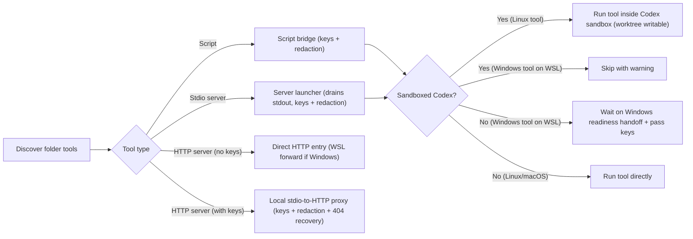

# Make folder tools solid

**Idea:** `IDEA.md` — what this is for and why, in plain language. Read it first; it is
the north star this plan serves. Goal and Constraints live there, not here, so they don't
get buried as this file grows.

## Open Questions

(None — all planning questions settled.)

## Watch List

| # | Noticed | What needs looking into | Raised to user? | Outcome |
|---|---------|-------------------------|-----------------|---------|

## Decision Log

Append-only. A reversal is a new entry superseding the old, never an edit.

| # | Decision | Rationale | Source |
|---|----------|-----------|--------|
| 1 | Skip mockups for this thread. | Almost all work is machine/connector/CLI behavior; any Tools page change is a single status text update on the existing read-only list (`viewer/pages/project-tools.js:314`). | defaulted |
| 2 | Fix the keyless launcher output-drain race in `machine/lib/tool-launch.js` by waiting for `process.stdout` to flush before exiting, and verify both keyless and keyed drain paths under load in `machine/test/folder-tools-run.test.js`. | `child.on('close')` currently calls `process.exit(code)` while piped `process.stdout` still has buffered bytes under load. | defaulted |
| 3 | Support Windows-side folder tools from WSL for stdio servers, scripts, and Windows-marked localhost HTTP servers by reusing the existing Windows readiness file, `win-tool-proxy.js`, and `this.win.forwards`. | Matches existing `.mcp.json` WSL behavior and `IDEA.md`. | defaulted |
| 4 | Enable both unkeyed and keyed folder tools over MCP in sandboxed Codex sessions. The bridge/launcher runs outside the sandbox to load keys and redact output, and confines each tool process inside `codex sandbox` with the worktree as writable root and matching `CODEX_HOME` and worktree trust. | Gives sandboxed Codex full folder-tool parity without exposing raw keys in the agent's config or environment. | user |
| 5 | Route keyed HTTP folder tools through a local stdio-to-HTTP proxy (`machine/lib/http-tool-proxy.js`) that loads declared keys from the project/shared key store, injects header values on outbound HTTP requests, and redacts any leaked key values from responses so raw keys never appear in the agent's MCP config or environment. | Matches how script and stdio server folder tools protect keys and works uniformly across Claude, Codex, and Antigravity with zero open local ports. | user |
| 6 | Support `--lang node` (default) and `--lang python` (stdlib-only Python 3) for `wc.js tool new --kind server`. | Covers the main non-Node MCP server language with zero extra dependencies and passes `wc.js tool check` out of the box. | user |
| 7 | Use `codex sandbox -P wc -C <worktree>` with explicit `permissions.wc.filesystem` and `permissions.wc.network.enabled` overrides plus the worktree `projects={...}` trust override (verified against `codex-cli 0.172.0`). | `codex-cli 0.172.0` requires `--permission-profile <NAME>` and a `[permissions]` table; probing confirmed this preserves injected env vars, allows writes in `<worktree>` and `/tmp`, and blocks writes outside them. | defaulted |
| 8 | Skip Windows-side stdio and script folder tools in sandboxed Codex sessions on WSL with a warning instead of running them unconfined. | Linux `bwrap` cannot confine Windows executables, and `machine/lib/win.js:454` already rejects Windows `run`/`start` in sandboxed sessions to preserve the worktree write boundary. | review-round-1 |

## Spec



### Non-goals
- Do not change folder-tool discovery roots (`.wheelchair/tools/<name>`), project-over-shared precedence, or the Settings shared-repo pinning flow.
- Do not change `TOOL_ROLES` (`machine/lib/project-mcp.js:9`) or enable folder tools for reviewers, mappers, or project leads.
- Do not change the project/shared key store format or key-redaction algorithm (`machine/lib/shared-keys.js`, `machine/lib/key-redact.js`); the only `machine/lib/project-keys.js` change is adding `WSLENV` to `isReserved`.
- Do not add a web editor on the Tools page for creating or editing folder tools.

---

### S1. Launcher output-drain fix (`machine/lib/tool-launch.js`)

**Problem:** In keyless mode (`machine/lib/tool-launch.js:51-54`), `child.stdout.pipe(process.stdout)` runs asynchronously while `child.on('close', ...)` immediately calls `process.exit(code)`, truncating buffered stdout under load.

**Required behavior:**
1. In `machine/lib/tool-launch.js` keyless mode:
   - Extract and export a small `pipeKeyless({ child, stdin, stdout, kill, exit })` helper (called from `start()` when `require.main === module`):
     - Pipe `stdin` to `child.stdin` (ignoring `child.stdin` errors) and `child.stdout` to `stdout` with `{ end: false }`.
     - Handle `EPIPE` on `stdout` (`stdout.on('error', e => { if (e.code === 'EPIPE') { kill(); exit(0); } })`) so a closed consumer pipe exits cleanly without crashing or hanging.
     - On `stdin` `'end'`: call `kill()` and `exit(0)`.
     - On `child` `'close'` (`code`, `signal`): call `kill()`, pause and unref `stdin` (if supported), and exit only after `stdout` has flushed its buffered bytes via `stdout.write('', () => exit(signal ? 1 : (code ?? 1)))` (if `stdout.writableEnded || stdout.destroyed`, call `exit` directly).
   - Keep `SIGINT`/`SIGTERM`/`SIGHUP` process-group cleanup unchanged.
2. In `machine/test/folder-tools-run.test.js`:
   - Keep `launcher drains output and propagates child exit` testing 1,000,000 bytes of stdout and exit code 7.
   - Add a deterministic unit test calling `pipeKeyless` directly with a fake `stdout` whose `write` holds its callback pending until the test explicitly releases it *after* emitting `child` `'close'`, proving `exit(7)` is NOT invoked while `stdout` still has pending writes and IS invoked once the pending write completes.
   - Add a matching 1,000,000-byte drain test for the keyed launcher path (`server-relay.js`) confirming all bytes arrive cleanly.

---

### S2. Windows-side folder tools from WSL

**Goal:** Folder tools that run Windows programs (or point to Windows-marked localhost HTTP servers) work from WSL sessions (except Windows executables in sandboxed Codex — see S5) with the same readiness handoff, `WHEELCHAIR_WINDOWS_PROJECT`/`WSLENV` env passing, `tools/list` caching (for unkeyed servers), and localhost port forwarding as `.mcp.json` project tools.

**Required behavior:**
1. **Detection (`machine/lib/folder-tools.js`, `machine/service.js`):**
   - Add a helper `resolveProgram(argv0, toolDir, pathText)` in `machine/lib/folder-tools.js` that finds the first existing executable path (matching `findProgram` at `machine/lib/folder-tools.js:37-39`: `path.resolve(toolDir, argv0)` when `argv0` includes `/`, otherwise searching `pathText` entries) and resolves symlinks via `fs.realpathSync` (falling back to the candidate path on error), returning `null` if none exists.
   - Classify Windows executability separately from proxy wrapping:
     - `isWindowsExecutable(row, pathText, mount)` is true for a folder `script` or stdio `server` on WSL when `isWindowsProgram(resolveProgram(argv0, row.dir, pathText) || argv0, mount)` is true (covering explicit paths, `PATH`-resolved `.exe` programs, and symlinks to Windows executables, including `mcp-for-unity`).
     - `shouldWrapWindowsProxy(row, pathText, mount)` is true for a stdio `server` when `isWindowsExecutable(...)` is true AND `!row.tool.start.slice(1).includes('mcp-for-unity')`.
   - An HTTP folder server (`kind: 'server'` with `url`) is Windows-side on WSL when `tool.windows === true` (see S4).
2. **Readiness & proxy wiring (`machine/service.js`, `machine/lib/folder-tools.js`, `machine/lib/tool-launch.js`, `machine/lib/tool-bridge.js`, `machine/lib/win-tool-proxy.js`):**
   - When `wsl && tools && connectors.manifest(input.cli).wrapProjectTools`:
     - Compute `readyFile = path.join(this.stateDir, 'win-ready', name)` and `commonDir` (same git-common-dir lookup as `.mcp.json` at `machine/service.js:1043-1047`, even when `.mcp.json` is absent).
     - **Stdio folder servers:**
       - If the session is sandboxed Codex (`adapter.sandboxed?.(session)`) and `isWindowsExecutable(...)` is true (including `mcp-for-unity`), skip the server with a warning: `tool <name>: skipped in sandboxed Codex (Windows programs cannot run inside Codex's Linux sandbox; set Codex to unrestricted in Settings to use it)`.
       - Otherwise, if `isWindowsExecutable(...)` is true:
         - Always set `windows: true` (and `unity: true` when `row.tool.start.slice(1).includes('mcp-for-unity')`) on the returned `extraServers` object (so even unwrapped Windows servers like `mcp-for-unity` still trigger Windows project sync, the Unity prompt instruction, and Codex `WSLENV` passthrough) and pass `--win` to `tool-launch.js`.
         - If `shouldWrapWindowsProxy(...)` is true, also set `wrapped: true` and pass `--win-ready-file <readyFile>` (and `--win-list-cache <cacheFile>` **only when `row.tool.keys.length === 0`**, keyed with `cacheKey(commonDir, row.name, { command: resolvedProgram, args: row.tool.start.slice(1) })` — keyed servers omit `--list-cache` so unredacted tool lists are never written to disk before `server-relay.js` sees them) to `tool-launch.js`; otherwise set `wrapped: false`.
       - Update `machine/lib/win-tool-proxy.js` so `--list-cache` is optional: when omitted, it never reads or writes a cache file AND it holds `tools/list` requests in stand-in mode (just like `tools/call`) until `--ready-file` settles (`ready` -> forward to the spawned Windows server; `failed` -> return JSON-RPC error), instead of replying with an empty `[]` list.
       - Inside `tool-launch.js`:
         - Whenever `--win` or `--win-ready-file` is set on a keyed server, append each declared key name in `keys` to `env.WSLENV` (colon-delimited, without duplicates) so WSL passes those key env vars to both wrapped and unwrapped Windows processes.
         - When `--win-ready-file` is set, spawn `process.execPath` with `[PROXY, '--ready-file', winReadyFile, ...(winListCache ? ['--list-cache', winListCache] : []), '--name', tool.name, '--', program, ...tool.start.slice(1)]` (keeping `cwd: dir`, `env`, and keyed `server-relay.js` redaction intact).
     - **Folder scripts:**
       - If the session is sandboxed Codex (`adapter.sandboxed?.(session)`), exclude every script where `isWindowsExecutable(...)` is true from `scriptRows` and add a warning per skipped script: `tool <name>: skipped in sandboxed Codex (Windows programs cannot run inside Codex's Linux sandbox; set Codex to unrestricted in Settings to use it)`.
       - Otherwise, mark each Windows-side script row (`row.windows = true`). If any script in `scriptRows` has `row.windows === true`, `bridgeEntry` passes `--win-ready-file <readyFile>` to `tool-bridge.js`, passes `--win` right after each Windows script's `--tool <dir>` (so `tool-bridge.js` uses the service's exact classification rather than re-running `isWindowsProgram` with a default mount), and sets `windows: true, wrapped: true` on the returned bridge `extraServers` object.
       - Export `waitReady(readyFile, { timeoutMs, signal })` from `machine/lib/win-tool-proxy.js` reusing its ready-file polling (`waiting` / `ready` / `failed`). If `readyFile` stays missing or `waiting` past `timeoutMs` or `signal` aborts, reject with a timeout/cancelled error.
       - When `tool-bridge.js` runs a script flagged `--win`, it awaits `waitReady(winReadyFile, { timeoutMs: tool.timeout_seconds * 1000 })`, deducts elapsed wait time from the script's remaining `timeout_seconds` (failing with an MCP error if readiness fails or time runs out), sets `WHEELCHAIR_WINDOWS_PROJECT` from the ready file's Windows path, and appends bare `WHEELCHAIR_WINDOWS_PROJECT` (matching `machine/lib/win.js:426-430` and `machine/lib/win-tool-proxy.js:97-105`, since the value is already a Windows path) plus each declared key name in `entry.keys` to `env.WSLENV` (colon-delimited, without duplicates) before calling `runScript`.
     - **Windows-marked HTTP folder servers (gated on `this.win?.detected?.kernel && tools && connectors.manifest(input.cli).wrapProjectTools`, independent of `wsl` interop — matching `.mcp.json` at `machine/service.js:1049`):**
       - When `row.tool.windows === true`, resolve `target = windowsTarget({ type: 'http', url: row.tool.url })`, acquire `port = await this.win.forwards.get(target.port)`, rewrite the URL with `rewriteUrl(row.tool.url, port)`, and pass the rewritten URL (for unkeyed HTTP entries directly; for keyed HTTP entries via `--url-override <rewrittenUrl>` to `http-tool-proxy.js`), marking `windows: false, wrapped: false` on the `extraServers` object (matching `.mcp.json` HTTP forwards at `connectors/common.js:21-22`, which do not trigger Windows worktree sync). If forwarding fails, leave that server out and add a problem line (`tool <name>: couldn't reach Windows (<reason>); left out of this session`).
3. **Connector `loaded`, Windows Unity prompt, `WSLENV` reservation & Codex passthrough:**
   - Add `WSLENV` to `isReserved` in `machine/lib/project-keys.js` so no folder tool can declare `WSLENV` as a key name and collide with WSL environment forwarding.
   - Propagate `windows: !!extra.windows`, `wrapped: !!extra.wrapped`, and `unity: !!extra.unity` from `extraServers` into `built.loaded` in `connectors/claude/machine.js:86`, `connectors/codex/machine.js`, and `connectors/agy/machine.js`, triggering Windows project sync and ready-file creation in `machine/service.js:1072-1073`.
   - Update `machine/lib/win-prompt.js` and `machine/service.js:1135` so the Windows Unity project-selection instruction is included when either `.mcp.json` has a loaded Unity server or `built.loaded` has an entry with `unity: true`.
   - In `connectors/codex/machine.js`, when `wsl` is true and an `extraServers` entry has `extra.windows === true`, ensure `WHEELCHAIR_WINDOWS_PROJECT` and `WSLENV` are included in its `env_vars` passthrough (same as wrapped `.mcp.json` entries at `connectors/codex/machine.js:83-88`).
4. **Tests:**
   - Extend `machine/test/win-tool-proxy.test.js` to cover optional `--list-cache` (holding `tools/list` until ready without writing a cache file) and `waitReady` timeout/failure behavior.
   - Extend `machine/test/win-tool-service.test.js` to cover WSL folder tools: wrapped stdio server, unwrapped `mcp-for-unity` server (including keyed `WSLENV` forwarding and `windows: true`), symlinked Windows executable detection, bridge `--win` + `WSLENV` key forwarding, and Windows-marked HTTP forwarding.

---

### S3. Non-Node server templates (`wc.js tool new --kind server --lang`)

**Required behavior:**
1. **CLI parsing (`viewer/app/tool-cli.js`):**
   - Syntax: `wc.js tool new <name> --kind script|server [--lang node|python]`.
   - Allow `--kind <kind>` and `--lang <lang>` in any order after `<name>`, rejecting duplicate flags or extra positional arguments with `usage: wc.js tool new <name> --kind script|server [--lang node|python]`.
   - If `--lang` is passed with `--kind script`, fail with `--lang is only supported with --kind server`.
   - If `--kind server` and `--lang` is omitted, default to `node`.
   - If `--lang` is not `node` or `python`, fail with `unsupported --lang "<value>"; supported: node, python`.
2. **Templates (`machine/templates/tools/`):**
   - `--lang node`: existing `machine/templates/tools/server/` + copied `machine/lib/mcp-stdio.js` (unchanged).
   - `--lang python`: new `machine/templates/tools/server-python/` containing:
     - `tool.json`:
       ```json
       {
         "name": "__NAME__",
         "description": "Echoes text back (starter MCP server — replace with your own tools).",
         "kind": "server",
         "start": ["python3", "server.py"]
       }
       ```
     - `server.py`: executable (`0o755`), Python 3 standard library only (`sys`, `json`), implementing newline-delimited JSON-RPC 2.0 matching `machine/lib/mcp-stdio.js` (`initialize` returning `protocolVersion`, `capabilities: {"tools": {}}`, `serverInfo: {"name": "__NAME__", "version": "1"}`; `ping` returning `{}`; ignoring notifications without `id`; `tools/list` returning one `echo` tool with `{ text: string }` inputSchema; `tools/call` for `echo` returning `{"content": [{"type": "text", "text": ...}], "isError": false}`; `-32601` for unknown methods and `-32603` for errors), flushing stdout after every line.
   - Do NOT copy `mcp-stdio.js` when `--lang python` is used.
3. **Tests & documentation (`viewer/test/wc-tool.test.js`, `protocol/tools.md`):**
   - Extend `viewer/test/wc-tool.test.js` to test `wc.js tool new <name> --kind server --lang python` (verifying `server.py` and `tool.json` are created without `mcp-stdio.js`, and running `wc.js tool check <name>` to verify the Python starter passes handshake when `python3` is available), `--lang node`, `--lang` with `--kind script` error, and unknown `--lang` error.
   - Update `protocol/tools.md` to document `--lang python` alongside the default Node.js server starter and note that `python3` must be on `PATH`.

---

### S4. HTTP MCP folder tools (with local key-hiding proxy)

**Required behavior:**
1. **`tool.json` schema (`machine/lib/folder-tools.js`, `machine/lib/project-tools.js`):**
   - For `kind: "server"`, require **exactly one** of `start` (non-empty array of non-empty strings) or `url` (string parsing as an `http:` or `https:` URL with no whitespace or control characters). If both are present, fail with `tool.json cannot have both "start" and "url"`; if neither is present, fail with `tool.json is missing "start"` (keeping existing test expectations intact).
   - When `url` is present:
     - Record `tool.url` and `tool.transport = 'http'` (`start` servers get `tool.transport = 'stdio'`).
     - Optional `headers`: plain object (not array/null), at most 20 entries; every key is a non-empty valid HTTP header token (`/^[!#$%&'*+\-.^_`|~0-9A-Za-z]+$/`) with no case-insensitive duplicates; every value is a non-empty string with no `\r` or `\n` that passes Node's `http.validateHeaderValue(key, value)` (rejecting NUL and non-Latin-1 characters at discovery time). Reject reserved transport headers `accept`, `content-type`, `mcp-protocol-version`, and `mcp-session-id` (case-insensitively) with `tool.json has an invalid "headers"`.
     - Placeholder check on `headers` values: every `${...}` occurrence must match `\$\{([A-Za-z_][A-Za-z0-9_]*)\}` (embedded placeholders like `Bearer ${API_KEY}` are allowed). Every referenced key name must appear in `tool.keys`; any unclosed `${`, invalid placeholder syntax, or undeclared key fails validation with `tool.json has an invalid "headers"`.
     - Optional `windows`: boolean (`true` or `false`). If `true`, `windowsTarget({ type: 'http', url: tool.url })` must succeed (localhost HTTP URL); otherwise fail validation with `tool.json has an invalid "windows"`.
   - Reject `headers` or `windows` on `kind: "script"` or on `start` servers.
   - Skip executable checks for HTTP servers (`row.tool.transport === 'http'`) in **both** `machine/lib/folder-tools.js` (`discover`) and `machine/lib/project-tools.js:102-113` (`folderRows`, the Git-tree reader for the Tools page).
2. **Unkeyed HTTP folder servers (`tool.keys.length === 0`):**
   - `serverEntry` returns `{ name: row.name, folder: 'server', windows: false, wrapped: false, entry: { type: 'http', url: effectiveUrl, ...(tool.headers ? { headers: tool.headers } : {}) } }`.
   - Connectors (`claude`, `codex`, `agy`) already handle `{ type: 'http', url, headers }` entries with literal headers.
3. **Shared HTTP MCP client (`machine/lib/mcp-http.js`) & keyed proxy (`machine/lib/http-tool-proxy.js`):**
   - Extract shared HTTP MCP transport logic into `machine/lib/mcp-http.js` (used by both `http-tool-proxy.js` and `viewer/app/tool-cli.js`, matching `machine/lib/mcp-stdio.js`):
     - Sends HTTP `POST` via Node's `http`/`https` without following redirects (any `3xx` status returns an error `HTTP server returned redirect (<status>); redirects are not followed` so headers are never forwarded to another origin).
     - Attaches `Content-Type: application/json`, `Accept: application/json, text/event-stream`, plus `MCP-Protocol-Version` and `Mcp-Session-Id` when set.
     - Enforces a maximum response/event buffer size of `LINE_LIMIT` (32 MiB, imported from `machine/lib/server-lines.js`): if exceeded, destroys the response stream and reports an oversized error (`{ oversized: true, prefixBuf }`).
     - Parses `202 Accepted` (no messages), `application/json` (single JSON message), and `text/event-stream` (full blank-line-delimited SSE events: buffers lines until `\n\n` or `\r\n\r\n`, joins all `data:` lines per event with `\n`, ignores `:` comments and non-`data` fields), delivering each parsed message **incrementally** via an `onMessage(msg)` callback as soon as its event delimiter arrives (never waiting for EOF so server-initiated requests on an open SSE stream can be answered immediately).
     - Exposes `deleteSession(url, headers, { timeoutMs: 1000 })` for best-effort bounded HTTP `DELETE` teardown when a `Mcp-Session-Id` was assigned (ignoring errors).
     - Exposes `httpHandshake({ url, headers, timeoutMs, signal })` performing `initialize` -> capture `Mcp-Session-Id` & negotiated `protocolVersion` -> `notifications/initialized` -> `tools/list` (if `capabilities.tools` is present) -> best-effort `deleteSession` on normal completion or timeout in `finally` (immediate signal termination in `tool-cli.js:111` stays unchanged).
   - For keyed HTTP folder servers (`tool.keys.length > 0`), `serverEntry` returns a stdio entry launching `process.execPath` with `[path.join(__dirname, 'http-tool-proxy.js'), '--project-dir', worktree, '--tool', row.dir, '--state-dir', stateDir, '--key-store', row.key_store, ...row.tool.keys.flatMap(k => ['--key', k]), ...(urlOverride ? ['--url-override', urlOverride] : [])]` (and `env: {}`).
   - `machine/lib/http-tool-proxy.js` behavior:
     - Validates `tool.json` at startup (same 32 KiB / regular-file / `validateToolJson` checks as `tool-launch.js`), confirms `kind === 'server'` and `transport === 'http'`, and checks that `--key` args match `tool.keys` (exiting non-zero with the same "its keys changed" message if not).
     - Rejects startup if any of `debuglog('child_process').enabled`, `debuglog('http').enabled`, `debuglog('https').enabled`, or `debuglog('net').enabled` is true.
     - Reads declared keys from `readSharedKeys(stateDir)` or `readKeyStore(stateDir, await projectIdentity(projectDir))` (failing with the standard missing-key error if any key is missing/unusable).
     - Uses `machine/lib/mcp-http.js` to POST each newline-delimited JSON-RPC message from `process.stdin` to `urlOverride || tool.url` with `${KEY}` placeholders substituted in memory, forwarding each incrementally delivered SSE or JSON message through `checker.line(buf)` as it arrives. On the first `initialize` response, capture and save `sessionId` (from `Mcp-Session-Id`) and `protocolVersion` (from `result.protocolVersion`, falling back to `'2025-06-18'`) before forwarding `notifications/initialized`. For a request with an `id`, the request settles (and releases any gate waiting on it) as soon as an SSE or JSON response with that matching `id` arrives, without waiting for stream EOF (and once settled, stream EOF never emits a second error for that `id`); `notifications/initialized` (no `id`) settles as soon as its HTTP response status/headers arrive (`202` or `2xx`).
     - Gates ordinary requests on initialization with a single 30-second deadline (started when `initialize` is sent) and tracks `initialized` (set `true` only after `initialize` and any sent `notifications/initialized` succeed): track the in-flight `initialize` promise and, if `notifications/initialized` has been sent, its in-flight promise (`initGate`), awaiting whichever is currently in flight (never blocking for a `notifications/initialized` the client never sent) and any in-flight `recovering` promise before POSTing ordinary requests (`tools/list`, `tools/call`, etc.). If `initGate` fails or exceeds its 30-second deadline, leave `initialized = false`, clear `initGate`, and reply to queued requests with a JSON-RPC `-32603` error. On any subsequent ordinary request while `!initialized` (and saved `initialize` params exist), run the single-flight `recovering` path below (with `expiredId: sessionId || null` and a best-effort `deleteSession` if a prior `sessionId` existed) to re-establish a complete initialized session before sending the request.
     - Remembers the client's original `initialize` request params. If a subsequent request that sent `sentSessionId` receives HTTP `404`:
       - First, if `recovering` is already in flight, await `recovering.promise` before checking `sessionId`.
       - Next, if the proxy's current `sessionId` has already changed (`sessionId !== sentSessionId`), skip starting a new recovery and retry the request once with the current `sessionId` (unless the original request was `notifications/initialized`, which recovery already satisfied).
       - Otherwise, start a single shared recovery (`recovering = { expiredId: sentSessionId, promise }`, with one shared 30-second deadline covering both legs) that leaves `sessionId` and `protocolVersion` unchanged until recovery completes: POST `initialize` with no `Mcp-Session-Id` header, settle as soon as its matching reply arrives to capture `newSessionId` and `newVersion`, POST `notifications/initialized` using `Mcp-Session-Id: newSessionId` and `MCP-Protocol-Version: newVersion`, then publish `sessionId = newSessionId`, `protocolVersion = newVersion`, `initialized = true`, and clear `recovering` so affected requests retry once with the new session ID (if the 404 was on `notifications/initialized`, recovery's `notifications/initialized` satisfies it without re-sending). If recovery fails or exceeds its 30-second deadline, leave `initialized = false`, clear `recovering`, and reply to waiting requests with a JSON-RPC `-32603` error.
     - Redaction uses `const checker = createLineChecker({ name: tool.name, values })` from `machine/lib/server-lines.js:160`:
       - For each response JSON message (compacted to one JSON line `buf`), call `const res = checker.line(buf)`; for an oversized body/event (`LINE_LIMIT` exceeded), call `const res = checker.oversized(prefixBuf)` and mark the originating request settled only when `res.out` is emitted with a matching `id` (guaranteeing at most one terminal reply per request `id`, so stream EOF/error never emits a second error).
       - If `res.out` is non-null, write `res.out` + `\n` to `process.stdout`; if `res.toServer` is non-null, POST `res.toServer` back to the HTTP server (ignoring its body) without forwarding to `process.stdout`; if `res.note` is non-null, log `res.note` to `process.stderr` (never raw keys).
     - If an SSE stream ends for a request with an `id` before any response matching that `id` arrives, or on non-2xx / redirect / network error for a request with an `id`, reply with a JSON-RPC error (`code: -32603`, redacted message naming HTTP status or error code; never raw keys).
     - On `process.stdin` close or `SIGINT`/`SIGTERM`/`SIGHUP`, abort in-flight requests, run best-effort `deleteSession` (bounded 1s timeout) if a `Mcp-Session-Id` is active, and exit cleanly.
4. **CLI `wc.js tool check` for HTTP folder tools (`viewer/app/tool-cli.js`):**
   - For an HTTP server with `row.tool.windows === true` on WSL (`process.platform === 'linux'` and `/proc/version` indicates WSL), skip live network handshake and print `<name>: ok (Windows localhost HTTP tool — live check runs through the Windows forward at session start)`.
   - For all other HTTP servers, call `httpHandshake` from `machine/lib/mcp-http.js` with only literal (non-`${...}`) headers and remaining check deadline/signal. Print `<name>: <serverInfo.name> tools: ...` (appending ` (checked without its keys)` if `row.tool.keys.length > 0`) on success, or `<name>: <error>` plus `it ran without its keys; that may be why` when keyed on failure.
5. **Tests, Tools page & docs:**
   - Add `machine/test/http-tool-proxy.test.js` testing: keyed header injection + `createLineChecker` redaction (safe string redaction and held-back structural leak), `3xx` redirect refusal, concurrent 404 session recovery (both in-flight and late-arriving 404), multi-line SSE parsing + incomplete stream error, `LINE_LIMIT` oversized handling, best-effort `DELETE` on shutdown, and `httpHandshake` in `wc.js tool check`.
   - Keep `kind: 'server'` in `wc.js tool list` and Tools page API; include `transport: 'http' | 'stdio'` on the tool object.
   - Update `protocol/tools.md` to document HTTP folder servers (`url`, `headers`, `keys`, `windows`).

---

### S5. Folder tools over MCP in sandboxed Codex sessions

**Goal:** Sandboxed Codex sessions in `TOOL_ROLES` connect to folder tools (scripts via bridge, stdio servers via launcher, and HTTP servers) directly over MCP, with local Linux tool execution confined inside `codex sandbox` to the worktree and matching the session's `CODEX_HOME` and worktree trust.

**Required behavior:**
1. **Remove sandboxed-Codex exclusion (`connectors/codex/machine.js`, `machine/service.js`, `machine/lib/project-tools.js`, `viewer/pages/project-tools.js`, `protocol/tools.md`):**
   - In `connectors/codex/machine.js`:
     - Remove `shellToolsOnly` and `keyedToolsReason` (so `machine/service.js` includes both unkeyed and keyed folder tools for sandboxed Codex sessions). Because those methods are removed, sandboxed Codex sessions no longer receive the shell-only startup prompt line (`machine/service.js:1136`), no longer set `keyed_unavailable` on `/v1/agent/tools` (`machine/service.js:2433`), and no longer filter keyed scripts out of `wheelchair-tools` (`machine/service.js:1009-1013`).
     - Remove the `if (extras.length && module.exports.sandboxed(session))` skip branch in `command(...)` (`connectors/codex/machine.js:169-171`). Register all `extraServers` via `codexOverrides` (preserving `tool_timeout_sec=260` on `wheelchair-tools` and the `PROJECT_OVERRIDE_BUDGET` check).
   - Keep `TOOL_ROLES` (`machine/lib/project-mcp.js:9`) and existing role gating in `machine/service.js:974-976,994` unchanged (reviewers, mappers, and project leads remain gated as today).
   - Update `viewer/pages/project-tools.js:314` from `"server tools don't work on Kimi, Pi or sandboxed Codex"` to `"server tools don't work on Kimi or Pi"`.
   - Update `machine/lib/project-tools.js:160` from `'uses keys: not available to sandboxed Codex, Kimi or Pi'` to `'uses keys: not available over MCP on Kimi or Pi'` (distinguishing MCP from shell availability on Kimi and Pi).
2. **Dedicated folder-tool sandbox wrapper (`connectors/codex/machine.js`, `connectors/contract.js`, `connectors/README.md`, `machine/lib/folder-tools.js`, `machine/service.js`):**
   - Leave `sandboxWrap(command)` (`connectors/codex/machine.js:126`) completely unchanged so `machine/lib/screen.js:225` and `machine/test/screen.test.js:102-110` continue to work untouched.
   - Add optional `sandboxWrapTool(command, { worktree, toolDir })` to `connectors/contract.js` and document it in `connectors/README.md` alongside `sandboxWrap`, implemented in `connectors/codex/machine.js`:
     - Filesystem TOML table: `permissions.wc.filesystem={"/"="read",${tomlString(worktree)}="write","/tmp"="write"}`.
     - Network TOML override: `permissions.wc.network.enabled=true`.
     - Trust TOML table: `projects={${tomlString(worktree)}={trust_level="trusted"}}`.
     - Returned argv:
       `['codex', 'sandbox', '-P', 'wc', '-C', worktree, '-c', fsOverride, '-c', 'permissions.wc.network.enabled=true', '-c', trustOverride, '--', '/bin/sh', '-c', 'cd "$1" && shift && exec "$@"', '--', toolDir, ...command]`.
   - When `adapter.sandboxed?.(session)` is true (sandboxed Codex session in `TOOL_ROLES`):
     - Resolve `codexHome` once in `machine/service.js` (`session.account_dir ? loginEnv(session.account_dir).CODEX_HOME : adapter.usual()`, always a concrete path since `adapter.usual()` already checks `process.env.CODEX_HOME` before `~/.codex`) and apply it explicitly to BOTH the main Codex launch env (`launchEnv`, on start and resume) and the folder-tool MCP entries (`env.CODEX_HOME`), so both processes always share the exact same `CODEX_HOME`.
     - `machine/service.js` passes `{ sandbox: { cli: input.cli, codexHome } }` when building `bridgeEntry` and stdio `serverEntry`.
     - `bridgeEntry` and stdio `serverEntry` pass `--sandbox-cli <cli>` (and set `CODEX_HOME` in the entry's `env` when `codexHome` is set) to `tool-bridge.js` and `tool-launch.js`.
     - `tool-bridge.js` (via `tool-run.js`) and `tool-launch.js` dispatch through the connector registry (`require('../../connectors').machine(sandboxCli).sandboxWrapTool([program, ...args], { worktree: projectDir, toolDir: dir })`, never importing `connectors/codex/machine.js` directly, keeping `machine/test/name-guard.test.js` green). They run **outside** `codex sandbox` so they can read the machine key store (`stateDir`) and perform output redaction, and wrap only the spawned child tool command with `cwd: projectDir`.
     - HTTP folder servers (both direct unkeyed entries and `http-tool-proxy.js`) are registered normally for sandboxed Codex sessions, matching `.mcp.json` HTTP behavior.
3. **Real Codex sandbox test (`machine/test/folder-tools-codex-sandbox.test.js`), `test-support/run-dir.js`, & router update (`machine/AGENTS.md`):**
   - Uses the real `codex` binary (skipped with a clear skip reason only when `codex` is not installed on the host; runs unconditionally when `codex` is present).
   - Add an optional `base` root parameter to `test-support/run-dir.js` (defaulting to `os.tmpdir()` as today) so the test creates a managed per-process run directory **outside `/tmp`** (under `path.join(os.homedir(), '.cache', 'wheelchair-test-runs')`), preserving `run-dir.js`'s exit cleanup and dead-owner sweeping while ensuring neither `worktree/` nor `outside/` falls under the `/tmp` write grant. Before invoking the sandbox, assert that the test process itself can create and delete a probe file in `outside/`.
   - Tests both `tool-bridge.js` (script tool) and `tool-launch.js` (stdio server tool), including a keyed tool:
     1. Tool can create a file inside `worktree/` and read its injected key (and stdout redaction masks the key).
     2. Tool attempting to write a file inside `outside/` fails with a permission/read-only error and does not create the file.
     3. Named account `CODEX_HOME`: verifies the sandboxed invocation receives the configured `CODEX_HOME`.
   - Update `machine/AGENTS.md` to note the real-Codex sandbox test exception (runs when `codex` is installed using isolated `run-dir.js` temp directories, skips otherwise).
4. **Update existing tests & docs:**
   - Update `machine/test/folder-tools-launch.test.js` and `machine/test/project-mcp-codex.test.js:145-160` to assert that sandboxed Codex sessions register folder MCP entries with `--sandbox-cli` and `CODEX_HOME`, preserve ordering and `tool_timeout_sec=260`, retain the `PROJECT_OVERRIDE_BUDGET` check, and skip Windows executables on WSL.
   - Update `machine/test/project-tools.test.js:478` and `viewer/test/app-project-tools.spec.js:1518` for the updated Tools page / API status strings, and add a Git-tree HTTP folder tool test in `machine/test/project-tools.test.js`.
   - Update `protocol/tools.md` to document that sandboxed Codex runs folder tools over MCP confined to the worktree and `/tmp` (noting that servers cannot write under `$HOME` and should place caches/state in `/tmp` or the worktree).

---

### Validation

Targeted validation commands (full run is executed separately before push):
```bash
node --test machine/test/folder-tools.test.js
node --test machine/test/folder-tools-run.test.js
node --test machine/test/folder-tools-launch.test.js
node --test machine/test/folder-tools-codex-sandbox.test.js
node --test machine/test/http-tool-proxy.test.js
node --test machine/test/win-tool-proxy.test.js
node --test machine/test/win-tool-service.test.js
node --test machine/test/win-launch.test.js
node --test machine/test/project-keys.test.js
node --test machine/test/project-tools.test.js
node --test machine/test/project-mcp-codex.test.js
node --test machine/test/screen.test.js
node --test machine/test/name-guard.test.js
node --test test-support/test/*.test.js
node --test viewer/test/wc-tool.test.js
npm --prefix viewer run test:browser -- test/app-project-tools.spec.js
```
Also review the rendered `protocol/tools.md` edits per `CONTRIBUTING.md:93-95` to confirm all sections and examples are consistent.

## Accepted Risks

| Risk | Why accepted | Round |
|------|--------------|-------|
| Adding a new folder-based `mcp-for-unity` server mid-session and then hitting an account switch does not re-inject the startup Unity prompt line (`machine/service.js:1137,1143`) | Rare path (requires adding a folder Unity server after session start and then hitting a usage-limit switch); matches existing `.mcp.json` resume behavior | review-round-7 |
| Oversized (>32 MiB) server-initiated JSON-RPC request on an SSE stream whose `method` field appears after the 32 MiB prefix could collide with a client request ID in `checker.oversized` | Rare path (requires a >32 MiB server-initiated JSON-RPC request with `method` serialized after 32 MiB of params) | review-round-8 |

## Check Once Built

| # | What to check | Round |
|---|---------------|-------|
| 1 | Start a keyed Windows stdio folder server against a slow ready file in Codex and Claude to verify whether holding `tools/list` without `--list-cache` exceeds client startup timeout | 5 |

## Review Rounds

### Round 1 — 2026-11-28

**Lanes:** intent: claude / claude-opus-5-5; mechanics: gpt / gpt-6.2-sol; cross-family: yes.

**Changed since Round N-1:** n/a (first round — whole Spec in scope)

| Lane | Reported | Finding | Lead verdict | Resolution |
|------|----------|---------|--------------|------------|
| intent | major | S5.2 changes `sandboxWrap` signature, breaking `machine/lib/screen.js:225` | upheld | S5.2 keeps `sandboxWrap(command)` untouched and adds dedicated `sandboxWrapTool(command, opts)` |
| intent | major | S5.2 skips HTTP folder tools in read-only Codex sessions for an invalid reason | upheld | S5.2 removes the HTTP skip; HTTP tools register normally as in `.mcp.json` |
| intent | minor | S5.2 runs Windows folder tools unconfined in sandboxed Codex without a Decision | upheld | Decision 8 + S2/S5: skip Windows stdio/script folder tools in sandboxed Codex on WSL |
| mechanics | blocking | S5 runs Windows folder executables outside sandbox for sandboxed Codex (`win.js:454` forbids it) | upheld | Decision 8 + S2/S5: skip Windows stdio/script folder tools in sandboxed Codex on WSL |
| mechanics | blocking | S5 changes `sandboxWrap` signature, breaking `machine/lib/screen.js:225` | upheld | Same fix: keep `sandboxWrap` untouched, add `sandboxWrapTool` |
| mechanics | major | S5 read-only handling for reviewers/project leads is unreachable under `TOOL_ROLES` | upheld | Non-goals + S5.1: keep `TOOL_ROLES` gating unchanged |
| mechanics | major | S2 keyed Windows stdio server writes unredacted tool list to `win-tool-proxy.js` disk cache | upheld | S2.2: omit `--list-cache` for keyed Windows stdio servers; make `--list-cache` optional in `win-tool-proxy.js` |
| mechanics | major | S2 keyed Windows tools only forward `WHEELCHAIR_WINDOWS_PROJECT` in `WSLENV`, not declared keys | upheld | S2.2: append declared key names to `env.WSLENV` for keyed Windows scripts and stdio servers |
| mechanics | major | S2 mentions attempt-token logic absent from ready file, and script waiter lacks timeout | upheld | S2.2: removed attempt-token claim; `waitReady(readyFile, { timeoutMs, signal })` enforces script timeout |
| mechanics | major | S4 skips executable check in `discover`, but `machine/lib/project-tools.js:103` still dereferences `tool.start[0]` | upheld | S4.1: skip executable check for `transport === 'http'` in `project-tools.js` (`folderRows`) too |
| mechanics | major | S4 omits `MCP-Protocol-Version` header and `tool check` session ID retention | upheld | S4.3 & S4.4: send negotiated `MCP-Protocol-Version` and retained `Mcp-Session-Id` on all follow-up requests |
| mechanics | major | S4 treats HTTP 404 after session ID as generic failure instead of reinitializing | upheld | S4.3: on HTTP 404 with active session ID, clear ID, transparently re-run `initialize` + `notifications/initialized`, and retry once |
| mechanics | major | S4 redaction wording risks leaking structural keys or corrupting JSON-RPC framing | upheld | S4.3: reuse `createLineChecker` from `machine/lib/server-lines.js` |
| mechanics | major | S4 rejects `debuglog('http')` but leaves `debuglog('https')` enabled | upheld | S4.3: reject `child_process`, `http`, `https`, and `net` debuglogs |
| mechanics | major | S4 `tool check` hits raw localhost URL for Windows-marked HTTP tools on WSL | upheld | S4.4: skip live localhost handshake on WSL for `windows: true` HTTP tools with clear message |
| mechanics | minor | S1 slow-reader test does not prove launcher stdout still has pending writes when child closes | upheld | S1.2: deterministic unit test |
| mechanics | minor | S5 omits `machine/lib/project-tools.js:160` string and existing test assertions | upheld | S5.1 & S5.4 + Validation: update `project-tools.js:160` and all affected tests |
| mechanics | minor | S5 adds real CLI test to machine glob without updating `machine/AGENTS.md` or requiring temp dirs | upheld | S5.3: document real-Codex exception in `machine/AGENTS.md` |

### Round 2 — 2026-11-28

**Lanes:** intent: claude / claude-opus-5-5; mechanics: gpt / gpt-6.2-sol; cross-family: yes.

**Changed since Round 1:** S1.2 drain test; S2.2 Windows proxy/WSLENV/waitReady; S4.1/S4.3/S4.4 HTTP proxy/check/`project-tools.js`; S5 `sandboxWrapTool`/status strings/router/Validation.

| Lane | Reported | Finding | Lead verdict | Resolution |
|------|----------|---------|--------------|------------|
| intent | major | S2 omitting `--list-cache` makes `win-tool-proxy.js` answer `tools/list` with `[]` while waiting | upheld | S2.2: when `--list-cache` is omitted, hold `tools/list` (like `tools/call`) until ready file settles |
| intent | minor | S5.2 adds unused `read-only` mode, `--codex-trust` flag, and read-only real-Codex test | upheld | S5.2 & S5.3: simplified to fixed workspace-write/trusted `sandboxWrapTool(command, { worktree, toolDir })` and boolean `--sandbox` |
| intent | minor | S5.1 does not state effect on `shellToolsOnly`/`keyedToolsReason` consumers in `machine/service.js` | upheld | S5.1 explicitly names the three affected consumers (`service.js:1009-1013,1136,2433`) |
| mechanics | blocking | S1 marker test can deadlock or race | upheld | S1.1 & S1.2: extract `pipeKeyless` and unit-test pending `stdout.write` directly against `child` `'close'` |
| mechanics | blocking | S4 calls `createLineChecker(values)` instead of `createLineChecker({ name, values })` and omits `out`/`toServer` handling | upheld | S4.3 specifies `createLineChecker({ name: tool.name, values })` and handling of `out`, `toServer`, and `note` |
| mechanics | major | S2 misses `PATH`-resolved Windows executables and conflates Unity exclusion with sandbox denial | upheld | S2.1 & S2.2: add `resolveProgram`, separate `isWindowsExecutable` from `shouldWrapWindowsProxy` |
| mechanics | major | S2 script bridge re-classifies with default mount instead of service classification | upheld | S2.2: `bridgeEntry` passes per-tool `--win` flag from service classification |
| mechanics | major | S4 does not coordinate concurrent 404 session recoveries | upheld | S4.3: single shared in-flight recovery promise per expired session ID |
| mechanics | major | S4 SSE parser assumes single-line `data:` and ignores incomplete streams | upheld | S4.3 & S4.4: full blank-line-delimited SSE event parsing; incomplete stream returns JSON-RPC error |
| mechanics | major | S4 leaves redirect handling open for keyed HTTP requests | upheld | S4.3: reject `3xx` redirects without forwarding headers |
| mechanics | major | S5 real Codex sandbox test under `/tmp` is already inside writable `/tmp` | upheld | S5.3: fixture outside `/tmp`, with pre-sandbox write probe on `outside/` |
| mechanics | minor | S5 omits updating `machine/test/project-mcp-codex.test.js:145-160` | upheld | S5.4 explicitly includes updating `project-mcp-codex.test.js:145-160` |
| mechanics | minor | Targeted browser command doesn't use `viewer/playwright.config.js` | upheld | Validation uses `npm --prefix viewer run test:browser -- test/app-project-tools.spec.js` |

### Round 3 — 2026-11-28

**Lanes:** intent: claude / claude-opus-5-5; mechanics: gpt / gpt-6.2-sol; cross-family: yes.

**Changed since Round 2:** S1.1/S1.2 `pipeKeyless`; S2.1/S2.2 `resolveProgram`, `--win`, holding `tools/list`; S4.3/S4.4 `createLineChecker`, serialized 404 recovery, multi-line SSE, redirect rejection; S5.1–S5.4 simplified `sandboxWrapTool`, fixture outside `/tmp`, Playwright command.

| Lane | Reported | Finding | Lead verdict | Resolution |
|------|----------|---------|--------------|------------|
| intent | minor | S2, S3, S4.3 lack explicit test requirements and validation commands for IDEA.md criteria | upheld | Added explicit test specs in S2.4, S3.3, S4.5 and added `http-tool-proxy.test.js`, `win-tool-proxy.test.js`, `win-tool-service.test.js` to Validation |
| intent | minor | S4.3 and S4.4 duplicate HTTP MCP client and SSE parsing | upheld | Extracted shared `machine/lib/mcp-http.js` reused by both `http-tool-proxy.js` and `tool-cli.js` |
| mechanics | blocking | S4.3 calls `checker.check()`, but `createLineChecker()` exposes `line()` and `oversized()` | upheld | S4.3 updated to `checker.line(buf)` and `checker.oversized(prefixBuf)` |
| mechanics | major | S4.3 late 404 arriving after recovery can clear the replacement session | upheld | S4.3 compares `sentSessionId` against current `sessionId`; if already changed, skips recovery and retries once |
| mechanics | major | S2.2 sets `windows: true` only on wrapped stdio servers, missing unwrapped `mcp-for-unity` | upheld | S2.2 sets `windows: true` for every `isWindowsExecutable` server (`wrapped: false` when unwrapped) |
| mechanics | major | S2.1 checks path spelling, missing symlinks to Windows executables | upheld | S2.1 `resolveProgram` resolves symlinks via `fs.realpathSync` before `isWindowsProgram` |
| mechanics | minor | S4.3 and S4.4 leave stateful HTTP sessions without teardown | upheld | S4.3 & S4.4 add bounded 1s best-effort HTTP `DELETE` teardown when `Mcp-Session-Id` is active |
| mechanics | minor | S4 accepts reserved transport headers (`Accept`, `Content-Type`, `MCP-Protocol-Version`, `Mcp-Session-Id`) in `tool.json` | upheld | S4.1 rejects those four headers case-insensitively in `tool.json` |
| mechanics | minor | S4.3 lacks the keyed relay's 32 MiB (`LINE_LIMIT`) response buffer cap | upheld | S4.3 enforces `LINE_LIMIT` from `server-lines.js` and routes oversized responses through `checker.oversized` |
| mechanics | minor | S5.3 standalone home-cache fixture bypasses `test-support/run-dir.js` sweeping | upheld | S5.3 adds optional `base` root to `test-support/run-dir.js` so the fixture outside `/tmp` is still managed and swept |

### Round 4 — 2026-11-28

**Lanes:** intent: claude / claude-opus-5-5; mechanics: gpt / gpt-6.2-sol; cross-family: yes.

**Changed since Round 3:**
- S2.1, S2.2 & S2.4: `resolveProgram` resolves symlinks (`fs.realpathSync`); set `windows: true` for unwrapped `mcp-for-unity` servers too; added explicit S2 test cases and validation commands.
- S3.3: added explicit Python starter + `wc.js tool check` test cases in `viewer/test/wc-tool.test.js`.
- S4.1, S4.3, S4.4 & S4.5: extracted shared `machine/lib/mcp-http.js`; fixed `checker.line()`/`checker.oversized()`; added `LINE_LIMIT` (32 MiB) cap; rejected reserved transport headers in `tool.json`; handled late-arriving 404 after recovery; added bounded best-effort `DELETE` teardown; added `machine/test/http-tool-proxy.test.js`.
- S5.3 & Validation: added optional `base` root to `test-support/run-dir.js` for the real-Codex sandbox fixture outside `/tmp` and added `test-support/test/*.test.js` plus the new S2/S4 test files to Validation.

| Lane | Reported | Finding | Lead verdict | Resolution |
|------|----------|---------|--------------|------------|
| mechanics | blocking | S4.3 clears `sessionId` mid-recovery, letting a second 404 retry before replacement session is ready | upheld | S4.3 keeps `sessionId` unchanged until recovery completes, awaits `recovering` before comparing IDs, and holds new requests |
| mechanics | major | S4.3 allows `tools/list` to POST while `notifications/initialized` is still in flight | upheld | S4.3 adds `initGate` so ordinary requests await `initialize` and `notifications/initialized` completion |
| mechanics | major | S2.2 only adds declared keys to `WSLENV` when `--win-ready-file` is set, missing unwrapped keyed Windows servers | upheld | S2.2 passes `--win` to `tool-launch.js` for all Windows stdio servers and adds unwrapped keyed case to `win-tool-service.test.js` |
| mechanics | minor | S4.4 best-effort `DELETE` in `finally` conflicts with immediate signal termination in `tool-cli.js:111` | upheld | S4.3/S4.4 narrowed to run best-effort `DELETE` on normal completion or timeout; immediate signal handler stays unchanged |

### Round 5 — 2026-11-28

**Lanes:** intent: claude / claude-opus-5-5; mechanics: gpt / gpt-6.2-sol; cross-family: yes.

**Changed since Round 4:**
- S2.2 & S2.4: pass `--win` to `tool-launch.js` for all Windows stdio servers (wrapped and unwrapped) so `WSLENV` key forwarding applies to both; added unwrapped keyed server test case in `win-tool-service.test.js`.
- S4.3: added `initGate` to wait for `initialize` + `notifications/initialized` before ordinary requests; kept `sessionId` unchanged until 404 recovery succeeds, awaiting `recovering` before comparing IDs and holding new requests; narrowed `httpHandshake` best-effort `DELETE` to normal completion or timeout (keeping `tool-cli.js:111` signal handler unchanged).

| Lane | Reported | Finding | Lead verdict | Resolution |
|------|----------|---------|--------------|------------|
| intent | minor | Check once built: keyed Windows stdio server holding `tools/list` against a slow ready file may hit Codex startup timeout | check-once-built | Added to Check Once Built row 1 |
| mechanics | major | S4.3 `initGate` and `recovering` have no deadline or failure behavior for queued requests | upheld | S4.3 adds 30 s per-request timeout, clears gate on failure/timeout, and replies `-32603` to queued requests |
| mechanics | major | S4.3 recovery `notifications/initialized` needs replacement `Mcp-Session-Id` and `MCP-Protocol-Version` before publishing state | upheld | S4.3 specifies passing `newSessionId` and `newVersion` on recovery `notifications/initialized` before publishing |
| mechanics | major | S4.3 SSE parsing must deliver events incrementally while stream is open to avoid server-request deadlock | upheld | S4.3 specifies incremental `onMessage(msg)` delivery on blank-line event delimiters |
| mechanics | major | S2.2 folder-based `mcp-for-unity` servers miss Windows Unity prompt instruction | upheld | S2.3 updates `win-prompt.js` and `service.js:1135` to include folder `mcp-for-unity` servers |
| mechanics | major | S5.2 propagates `CODEX_HOME` only for named accounts, missing inherited `process.env.CODEX_HOME` on default account | upheld | S5.2 falls back to `process.env.CODEX_HOME || null` and passes it in entry `env` |
| mechanics | minor | S2.2 `WSLENV` is not in `isReserved`, allowing key-name collision | upheld | S2.3 & Non-goals: add `WSLENV` to `isReserved` in `machine/lib/project-keys.js` |
| mechanics | minor | S5.2 `sandboxWrapTool` lacks connector registry dispatch and `connectors/README.md` contract entry | upheld | S5.2 dispatches via `connectors.machine(sandboxCli).sandboxWrapTool` (`--sandbox-cli`) and documents it in `connectors/README.md` |
| mechanics | minor | Validation omits `machine/test/name-guard.test.js` | upheld | Added `node --test machine/test/name-guard.test.js` to Validation |

### Round 6 — 2026-11-28

**Lanes:** intent: claude / claude-opus-5-5; mechanics: gpt / gpt-6.2-sol; cross-family: yes.

**Changed since Round 5:**
- S2.3 & Non-goals: reserved `WSLENV` in `machine/lib/project-keys.js`; included folder `mcp-for-unity` servers in `win-prompt.js` / `service.js:1135`.
- S4.3: incremental `onMessage` SSE delivery; 30 s timeout + failure/clearing on `initGate` and `recovering`; recovery `notifications/initialized` uses `newSessionId` and `newVersion` before publishing.
- S5.2 & Validation: `CODEX_HOME` fallback to `process.env.CODEX_HOME`; connector-registry dispatch (`--sandbox-cli` -> `connectors.machine(cli).sandboxWrapTool`) + `connectors/README.md` entry; added `node --test machine/test/name-guard.test.js` to Validation.
- Check Once Built: added row 1 for keyed Windows stdio `tools/list` hold against slow ready file.

| Lane | Reported | Finding | Lead verdict | Resolution |
|------|----------|---------|--------------|------------|
| mechanics | major | Unity prompt check inspects connector args (`tool-launch.js`), missing `tool.start` `mcp-for-unity` | upheld | S2.2 & S2.3: carry `unity: true` on `extraServers` and `built.loaded`, check `loaded.some(e => e.unity)` in `win-prompt.js` |
| mechanics | major | Windows HTTP forwarding sits inside `wsl` guard instead of independent `kernel` guard | upheld | S2.2: gate Windows-marked HTTP forwarding on `this.win?.detected?.kernel` independently of `wsl` interop |
| mechanics | major | Incremental SSE reply must settle matching `id` request and release gates before stream EOF | upheld | S4.3: settle request & gates on matching `id` event (no second EOF error); settle notification on HTTP headers/202 |
| mechanics | major | Default-account `CODEX_HOME` fallback could diverge from tmux-inherited env on main Codex launch | upheld | S5.2: resolve `codexHome` once in `service.js` and pass explicitly to both main Codex `launchEnv` (start/resume) and MCP entries |
| mechanics | minor | `initGate` deadline per leg and missing `notifications/initialized` behavior unspecified | upheld | S4.3: single 30 s gate deadline; await `notifications/initialized` only if already in flight |
| mechanics | minor | `sandboxWrapTool` missing explicit `connectors/contract.js` optional-member update | upheld | S5.2: add optional `sandboxWrapTool` to `connectors/contract.js` alongside `connectors/README.md` |
| mechanics | minor | `machine/lib/project-tools.js:160` string conflates MCP and shell availability on Kimi/Pi | upheld | S5.1: updated string to `'uses keys: not available over MCP on Kimi or Pi'` |
| mechanics | minor | Validation omits `machine/test/win-launch.test.js` and `machine/test/project-keys.test.js` | upheld | Added both targeted commands to Validation |

### Round 7 — 2026-11-28

**Lanes:** intent: claude / claude-opus-5-5; mechanics: gpt / gpt-6.2-sol; cross-family: yes.

**Changed since Round 6:**
- S2.2 & S2.3: carried `unity: true` through `extraServers` and `built.loaded` for `win-prompt.js`; gated Windows-marked HTTP forwarding on `this.win?.detected?.kernel` independently of `wsl`.
- S4.3: settled requests and gates on matching `id` SSE event (without waiting for EOF); single 30 s deadline for `initGate` and `recovering`; await `notifications/initialized` only when already in flight.
- S5.1, S5.2 & Validation: updated `project-tools.js:160` wording for Kimi/Pi MCP; added optional `sandboxWrapTool` to `connectors/contract.js`; applied resolved `codexHome` explicitly to both main Codex `launchEnv` (start/resume) and MCP entries; added `win-launch.test.js` and `project-keys.test.js` to Validation.

| Lane | Reported | Finding | Lead verdict | Resolution |
|------|----------|---------|--------------|------------|
| intent | minor | S2.2 and S4.2 mark forwarded Windows HTTP folder servers `windows: true`, triggering unnecessary Windows worktree sync | upheld | S2.2 & S4.2 mark forwarded HTTP folder servers `windows: false, wrapped: false` matching `.mcp.json` |
| mechanics | major | S5.2 resolves default account `CODEX_HOME` to `null` when service env is unset, letting tmux env diverge | upheld | S5.2 falls back to concrete `adapter.usual()` and passes it explicitly to both main Codex `launchEnv` and MCP entries |
| mechanics | major | Adding a new folder Unity server mid-session before an account switch misses the startup Unity prompt | accepted-risk | Rare path (mid-session addition + account switch), matches `.mcp.json` resume; recorded in Accepted Risks |
| mechanics | major | S4.3 clears `initGate` after failed `notifications/initialized` without re-initializing on later calls | upheld | S4.3 tracks `initialized` boolean; subsequent ordinary requests while `!initialized` trigger `recovering` |
| mechanics | minor | S4.3 oversized SSE event can emit two replies for one request `id` | upheld | S4.3 marks request settled when `checker.oversized` emits `out`, guaranteeing at most one terminal reply per `id` |
| mechanics | minor | S2.2 marks forwarded HTTP folder entries `windows: true` | upheld | Same fix as intent finding 1 (`windows: false, wrapped: false`) |
| mechanics | minor | Validation omits rendered-output review of `protocol/tools.md` per `CONTRIBUTING.md:93` | upheld | Added rendered `protocol/tools.md` review line to Validation |

### Round 8 — 2026-11-28

**Lanes:** intent: claude / claude-opus-5-5; mechanics: gpt / gpt-6.2-sol; cross-family: yes.

**Changed since Round 7:**
- S2.2 & S4.2: marked Windows-marked HTTP folder forwards `windows: false, wrapped: false` (matching `.mcp.json`).
- S4.3: added `initialized` flag so failed `notifications/initialized` triggers `recovering` on the next ordinary request; marked request settled on `checker.oversized` `out` reply to prevent duplicate terminal replies.
- S5.2: resolved default-account `codexHome` to concrete `adapter.usual()` when `process.env.CODEX_HOME` is unset, applied to both main Codex `launchEnv` and MCP entries.
- Validation & Accepted Risks: added rendered `protocol/tools.md` review line; recorded mid-session Unity server + account switch in Accepted Risks.

| Lane | Reported | Finding | Lead verdict | Resolution |
|------|----------|---------|--------------|------------|
| intent | minor | S5.2 `process.env.CODEX_HOME \|\| adapter.usual()` is redundant with `adapter.usual()` | upheld | S5.2 simplified to `adapter.usual()` |
| intent | minor | S4.3 `!initialized` recovery omits best-effort `DELETE` for prior session and `expiredId` value | upheld | S4.3 sends best-effort `deleteSession` if prior `sessionId` exists and uses `expiredId: sessionId \|\| null` |
| mechanics | major | S4.3 omits explicit save of `sessionId`/`protocolVersion` on proxy's first `initialize` | downgraded | Minor per lead.md: S4.3 already required sending both once negotiated from `initialize`; stated explicitly before `notifications/initialized` |
| mechanics | major | S4.3 404 on original `notifications/initialized` could re-send notification after recovery | downgraded | Minor per lead.md (worst outcome is a repeated notification, and requires expiry in ms window); fixed so recovery satisfies it without re-sending |
| mechanics | major | S4.3 oversized >32 MiB server-initiated request with `method` after 32 MiB prefix could collide in `checker.oversized` | accepted-risk | Rare path per realism.md; recorded in Accepted Risks (and tightened `res.out` matching-`id` check) |
| mechanics | minor | S2.2 `WHEELCHAIR_WINDOWS_PROJECT/p` conflicts with bare `WHEELCHAIR_WINDOWS_PROJECT` in `win.js:426-430` | upheld | S2.2 updated to bare `WHEELCHAIR_WINDOWS_PROJECT` |
| mechanics | minor | S4.1 header validation allows NUL / non-Latin-1 values rejected by Node HTTP | upheld | S4.1 validates header values with `http.validateHeaderValue` |

## Prior Work

| Spec item | State | Evidence (file:line) | Confidence |
|-----------|-------|----------------------|------------|

## Implementation Tasks

| # | Objective | Ownership boundary | Lane | Session id | Validation | Status |
|---|-----------|--------------------|------|-----------|------------|--------|
| T1 | Fix keyless launcher output-drain race (`pipeKeyless`) and add drain tests (S1) | `machine/lib/tool-launch.js`, `machine/test/folder-tools-run.test.js` | standard (gpt / gpt-6.1-terra) | `wc-75ffcfd42cfb-worker` | `node --test machine/test/folder-tools-run.test.js` | in-progress |
| T2 | Add Python MCP server starter template and `wc.js tool new --lang` (S3) | `viewer/app/tool-cli.js`, `machine/templates/tools/server-python/*`, `viewer/test/wc-tool.test.js` | standard (gpt / gpt-6.1-terra) | `wc-75ffcfd42cfb-worker-2` | `node --test viewer/test/wc-tool.test.js` | in-progress |
| T3 | tricky: Implement HTTP folder tool schema, `mcp-http.js`, `http-tool-proxy.js`, and tests (S4 core) | `machine/lib/folder-tools.js`, `machine/lib/mcp-http.js`, `machine/lib/http-tool-proxy.js`, `machine/test/folder-tools.test.js`, `machine/test/http-tool-proxy.test.js` | standard (gpt / gpt-6.1-terra) | `wc-75ffcfd42cfb-worker-3` | `node --test machine/test/folder-tools.test.js && node --test machine/test/http-tool-proxy.test.js` | in-progress |
| T4 | Implement WSL/sandbox building blocks (`win-tool-proxy`, `project-keys`, `win-prompt`, `run-dir`, `connectors/contract` & `README`) (S2/S5 base) | `machine/lib/win-tool-proxy.js`, `machine/test/win-tool-proxy.test.js`, `machine/lib/project-keys.js`, `machine/test/project-keys.test.js`, `machine/lib/win-prompt.js`, `machine/test/win-launch.test.js`, `test-support/run-dir.js`, `test-support/test/run-dir.test.js`, `connectors/contract.js`, `connectors/README.md` | standard (gpt / gpt-6.1-terra) | `wc-75ffcfd42cfb-worker-4` | `node --test machine/test/win-tool-proxy.test.js && node --test machine/test/project-keys.test.js && node --test machine/test/win-launch.test.js && node --test test-support/test/*.test.js && node --test machine/test/connectors-contract.test.js` | in-progress |
| T5 | Implement HTTP `wc.js tool check`, Tools page/API updates, and `protocol/tools.md` docs (S4 CLI + S5 UI/docs) | `viewer/app/tool-cli.js`, `viewer/test/wc-tool.test.js`, `machine/lib/project-tools.js`, `machine/test/project-tools.test.js`, `viewer/pages/project-tools.js`, `viewer/test/app-project-tools.spec.js`, `protocol/tools.md` | standard (claude) | — | `node --test viewer/test/wc-tool.test.js && node --test machine/test/project-tools.test.js && npm --prefix viewer run test:browser -- test/app-project-tools.spec.js` | pending |
| T6 | tricky: Wire WSL Windows-side folder tools across `folder-tools.js`, `service.js`, `tool-launch.js`, `tool-bridge.js`, and connectors (S2) | `machine/lib/folder-tools.js`, `machine/service.js`, `machine/lib/tool-launch.js`, `machine/lib/tool-bridge.js`, `connectors/{claude,codex,agy}/machine.js`, `machine/test/win-tool-service.test.js` | standard | — | `node --test machine/test/win-tool-service.test.js && node --test machine/test/win-tool-proxy.test.js && node --test machine/test/win-launch.test.js` | pending |
| T7 | tricky: Enable folder tools over MCP in sandboxed Codex with `sandboxWrapTool`, real Codex sandbox test, and `machine/AGENTS.md` (S5) | `connectors/codex/machine.js`, `machine/service.js`, `machine/lib/folder-tools.js`, `machine/lib/tool-launch.js`, `machine/lib/tool-bridge.js`, `machine/lib/tool-run.js`, `machine/AGENTS.md`, `machine/test/folder-tools-codex-sandbox.test.js`, `machine/test/folder-tools-launch.test.js`, `machine/test/project-mcp-codex.test.js` | standard | — | `node --test machine/test/folder-tools-codex-sandbox.test.js && node --test machine/test/folder-tools-launch.test.js && node --test machine/test/project-mcp-codex.test.js && node --test machine/test/screen.test.js && node --test machine/test/name-guard.test.js` | pending |

## Log

- 2026-11-28: Checked `session leads` right after creating PLAN.md; no overlapping active threads.
- 2026-11-28: Probed real `codex sandbox` (`codex-cli 0.172.0`): confirmed `-P wc -C <worktree>` with `permissions.wc.filesystem` and `permissions.wc.network.enabled` preserves env vars, allows writes in `<worktree>` and `/tmp`, and blocks writes outside them.
- 2026-11-28: Checked `session leads` before setting `status: ready-for-review`; still no overlapping active threads.
- 2026-11-28: Completed Round 1 triage (18 findings, all upheld and resolved); advancing to Round 2.
- 2026-11-28: Completed Round 2 triage (13 findings, all upheld and resolved); advancing to Round 3.
- 2026-11-28: Completed Round 3 triage (10 findings, all upheld and resolved); paused at 3-round review budget and posted `needs` card.
- 2026-11-28: User chose to keep all five items together and continue review; budget reset, starting Round 4.
- 2026-11-28: User pressed Keep going after Round 6 budget pause; budget reset, starting Round 7.
- 2026-11-28: Round 8 clean (0 blocking, 0 major upheld; 2 majors downgraded to minor and fixed, 1 major rare-path accepted risk, 4 minors fixed). Added Spec Mermaid diagram, set `status: approved`. Ready check passed (`wc.js session list` ok, `claude`/`codex`/`agy`/`python3` installed, `codex/preflight.sh` fresh 132h).
