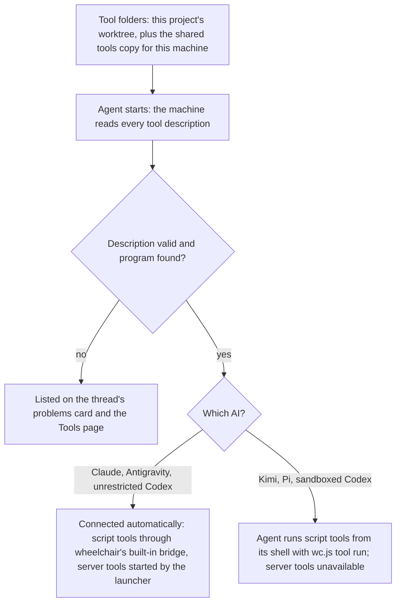

# Easy, standard tools for agents

**Idea:** `IDEA.md` — what this is for and why, in plain language. Read it first; it is
the north star this plan serves. Goal and Constraints live there, not here, so they don't
get buried as this file grows.

## Open Questions

Ordered by leverage; discussed one at a time. A settled question moves to the Decision
Log and is deleted from here.

## Watch List

Things noticed that need looking into — not yet decisions for the user. Written down the
moment they're spotted so they can't be forgotten, surfaced to the user one line at a
time as they appear, and emptied before Stage 1 exits.

Each item ends up settled by the agent (noted in the Log), promoted to an Open Question,
promoted to a Constraint or Accepted Risk, or waved off by the user.

| # | Noticed | What needs looking into | Raised to user? | Outcome |
|---|---------|-------------------------|-----------------|---------|

## Decision Log

Append-only. A reversal is a new entry superseding the old, never an edit.

| # | Decision | Rationale | Source |
|---|----------|-----------|--------|
| 1 | Plan mode: two-part | Settle how tools are written and connected first; hardening follows | user |
| 2 | Cover both per-project tools and tools shared across all projects, with one way of writing a tool | Some tools fit one project, others everywhere | user |
| 3 | Either Collin or agents make tools, following one standard; asking an agent should be easy | Agents follow a tight standard reliably; the same rules guide a person | user |
| 4 | A tool is a folder holding a short description (what it does, its inputs) plus a script in any language. Wheelchair runs one built-in MCP server per agent session that offers every tool and runs the script when called. No hand-written server | No server to write, any language, simplest for agents; each AI's MCP quirks handled once in the bridge | user |
| 5 | Tools connect automatically: any valid tool in the project's tools folder or the shared tools folder is offered at session start; invalid ones go on the thread's problems card | "Connecting" should be a non-step; explicit lists recreate the .mcp.json chore | defaulted |
| 6 | Shared tools live in their own git repository, added to wheelchair as an ordinary project. Threads in that project make and fix shared tools through the usual pull request; each machine offers the merged version | History, review and the normal thread flow; works across machines | user |
| 7 | Settings names which project holds the shared tools (one per hub, or none). At session start the machine fetches that project's default branch and reads the tools from it, falling back to the last fetched copy if the fetch fails | Agents get the merged version without anyone pulling by hand; a network drop does not lose tools | defaulted |
| 8 | When a project tool and a shared tool have the same name, the project tool wins and the problems card notes the shared one was hidden | The project knows its own needs best; the clash is visible | defaulted |
| 9 | Supersedes 4 in part: a tool folder holds either a script tool (as in 4) or a server tool, a real MCP server made from a wheelchair template. Wheelchair starts and connects both kinds automatically; no hand-editing .mcp.json | Servers keep state, answer fast and use all of MCP; template + automatic connection removes the setup-and-connect chore that prompted this idea | user |
| 10 | Keys: a tool's description lists the key names it needs; wheelchair passes only those to the tool's script or server process at start, never to the agent. Project tools read the project's keys; shared tools read a machine-wide set of shared keys typed once per machine in Settings | Keys out of the agent's reach; a shared tool's key typed once | user |
| 11 | Tools are requested by asking in any thread; no new button. Every lead gets the tool guide. Shared tools are made in a thread of the shared tools project (the assistant can start one) | Reuses how Collin already asks for changes | user |
| 12 | The Tools page lists every folder tool read-only: name, script or server, project or shared, and working or the reason not. Settings also gains the shared tools project picker and shared keys | Seeing what exists and what is broken, from a phone; read-only keeps it small (changes go through a thread) | user |
| 13 | Folder layout `.wheelchair/tools/<name>/tool.json` (+ the tool's files), in a project repo and in the shared tools repo alike; `<name>` is letters, digits, `_`, `-`, at most 40 characters and must equal `name` in tool.json | One layout for both homes; a hidden folder avoids clashing with a project's own `tools/` | defaulted |
| 14 | Script tool protocol: wheelchair runs the tool's `run` command in its folder with the inputs as JSON on stdin; stdout is the result text; a non-zero exit returns an error carrying stderr; default time limit 120 s, a tool may set up to 600 s | Works in any language with no library | defaulted |
| 15 | Folder tools reach agents through the existing project-tools path: the machine adds synthetic stdio entries (one `wheelchair-tools` bridge for script tools, one entry per server tool) to the servers it already passes to connectors, so each AI's existing translation and limits apply unchanged | Reuses tested per-AI wiring instead of a second one | defaulted |
| 16 | `wc.js tool new|list|check|run` commands; `run` also lets Kimi and Pi agents use script tools from the shell | A scaffold and a test command make "follow the standard" concrete for agents; shell access comes almost free | defaulted |
| 17 | The tool guide lives at `protocol/tools.md` (canonical, per CONTRIBUTING.md); role rules for lead, sub-lead and worker point to it; the README gets a short section pointing to it | protocol/ holds canonical rules | defaulted |
| 18 | One server template, Node.js, using a small zero-dependency MCP stdio helper shipped with wheelchair; other languages can still write a server by hand | One well-tested template beats several thin ones; Node is already required | defaulted |
| 19 | Mockups agreed: mockup-tools-mixed-phone, mockup-tools-empty-phone, mockup-tools-mixed-desktop, mockup-shared-none-phone, mockup-shared-chosen-phone (designer's single version, commit 2e82b6fe) | Collin agreed them | user |
| 20 | Windows-side folder tools and server templates in other languages go to Deferred (follow-up thread) | Hardening and reach, not needed for the feature to work | defaulted |
| 21 | Supersedes 10: key handling for folder tools (tool-only keys, shared keys, keeping keys out of agent-visible output, the Shared keys section) is split into its own follow-up thread. This plan passes no keys to folder tools | Three review rounds kept finding problems only there; the rest had settled | user |
| 22 | Simplify both safety rules: tool programs are stopped only on timeout or when the program that started them exits (no per-session tracking or session-end cleanup); tools get the agent's environment minus only the wheelchair login (no key-name stripping) | Review kept finding gaps in both; the agent can already read those keys and run tools from its shell | user |
| 23 | Supersedes 14's limit: a script tool's `timeout_seconds` is 1 to 240 (default 120) | Codex ends MCP calls at 300 s; a longer script would finish after the agent was told it timed out | review-round-7 |
| 24 | Keep reviewing with the full scope (no cut of shared tools or Codex) | Remaining findings are small runtime details; the design is stable | user |
| 25 | Sandboxed Codex sessions get no folder MCP entries: script tools run from the shell with `wc.js tool run` (inside the agent's sandbox), server tools are unavailable there; unrestricted Codex, Claude and Antigravity unchanged. Supersedes the S9 sandbox-wrapper rules from rounds 9-12 | Keeping MCP-launched tools inside Codex's sandbox drew a serious finding four passes in a row | user |

## Spec

A plan with visible work lists its agreed mockups under “Mockups” (path, screen/state, size) instead of describing the look in prose.

The settled design, grown as decisions land. Bar: a fresh agent with no conversation
history can implement from this section alone — behavior, boundaries, edge cases,
non-goals, and concrete validation commands.

How a tool reaches an agent (S2, S3, S8, S9, S10):

### S1. What a tool is
A tool is a folder with a description file and one of two kinds of body:
- **Script tool:** the description gives the name, a one-line purpose and named inputs with
  types and descriptions, plus a script in any language. When an agent calls the tool,
  wheelchair runs the script with the inputs and returns its output. Each call is a fresh run.
- **Server tool:** a real stdio MCP server, for tools that keep state between calls, are
  called often, or use MCP features beyond tools. It is either written from the wheelchair
  template, or an existing server ("connect this one"): its `start` command may launch any
  stdio MCP server, such as `npx -y some-mcp-server`. Wheelchair starts it for the session
  and connects it. HTTP MCP servers stay in `.mcp.json` (Deferred).
No author edits `.mcp.json` for either kind. Kimi and Pi load no MCP servers, and sandboxed Codex sessions (every Codex session not set
to unrestricted, per `connectors/codex/machine.js` `sandboxed`) are given no folder entries
(Decision 25), so server tools are unavailable there (the problems card says so) and script
tools are run from the shell with `wc.js tool run`, inside the agent's own sandbox. File names and formats: S7.

### S2. Connecting
No connect step. At each agent session start, wheelchair finds every tool in the project's
tools folder (from the thread's own worktree) and in the shared tools folder, and offers the
valid ones: script tools through one built-in MCP server for that session, server tools
each as their own MCP server. A broken tool is named, with
the reason, on the thread's existing "Project tools problem" card. Existing `.mcp.json`
servers keep working unchanged.

### S3. Shared tools
Shared tools live in their own git repository that Collin adds to wheelchair as an ordinary
project. Settings (one choice for the whole hub) names the shared tools project (or none),
stored as its GitHub repository (`owner/repo`, as `machine/lib/project-tools.js` `repoName`
reads it), not as a path. On each machine, the shared tools come from the first of the hub's
saved projects (in their saved order) whose path is a git repository on that machine with
that origin. If the machine has no such project, it offers
no shared tools and the problems card says "the shared tools project isn't added on this
machine". Threads in
that project make and change shared tools like any other work, ending in a pull request.
At each agent session start the machine fetches that project's default branch and updates
a machine-owned copy of that commit under the machine state directory
(`<state dir>/shared-tools/<project identity>/<commit>/`, made from the project's local
clone's object store and never touching Collin's own working copy). A session reads and
runs shared tools from the commit copy it started with, for its whole life: the copy's full
path (project identity and commit), or an explicit "no shared copy", is recorded in the
session's saved record, and a resume, account switch or `wc.js tool` lookup for that session
uses that saved reference, never the current Settings choice. A newer commit gets a new copy, built in a temporary folder and made read-only (and renamed into place) only when complete, so no session or page ever sees a partial copy. Refreshes of one shared repository run one at a time (an in-memory lock per repository inside the machine service, the only process that refreshes, a waiting lock, unlike `machine/lib/try.js`'s refuse-when-busy locks; a start that finds one running waits for it within its own 20-second deadline, then uses the newest complete copy). "Newest" means the commit named in a per-repository pointer file, which only a finished refresh updates, under that lock, to the tip it fetched; it is never chosen by folder date. Copies are read-only for every tool, sandboxed or not, so no tool can change what other sessions run; the guide says tools keep their state in `WHEELCHAIR_PROJECT_DIR` or a temp folder, and deletion makes a copy writable first. A copy is deleted only when it is not the newest
and no session record that has not ended (including ones found after a machine service
restart, and starts in progress) names it. If the fetch fails the newest existing copy is used; if there is none, no shared
tools are offered and the problems card says "shared tools couldn't be fetched: <reason>". A project tool
with the same name as a shared tool hides the shared one, and the problems card says so.
Inside the shared tools project's own threads, its tools come from the thread's worktree
(as project tools), so a tool being built can be tried before merge; the shared copy is not read for those sessions. One 20-second deadline covers the whole refresh (finding the default branch, fetching it and building the copy); past that the git process group is killed, its pipes are not waited on, and it counts as failed. Any failed refresh (including a failed copy) falls back to the newest complete copy as above and never stops the session's launch; the machine keeps the last refresh's outcome for the Tools page.

### S4. Keys: not in this plan
Key handling for folder tools was split into its own follow-up thread (Decision 21).
Here wheelchair passes no keys to folder tools: `tool.json` has no `keys` field, and nothing
reads the key store for them. The bridge, the server launcher and `wc.js tool run`/`check`
give a tool program the environment they themselves received, minus only
`WHEELCHAIR_SESSION_TOKEN` (the agent's wheelchair login, as the screen launcher already
strips it). That environment differs by AI and path (Codex forwards only its default set to
MCP servers; `wc.js` gets the agent's shell), so the guide says a tool may rely only on
`PATH`, `HOME`, `WHEELCHAIR_PROJECT_DIR` and variables it sets itself, and never on keys it happens to find: keys
already in the agent's environment are not removed (Decision 22), but they exist only on some
AIs and projects. The bridge, the launcher and `wc.js tool run`/`check` set
`WHEELCHAIR_PROJECT_DIR` to the session's worktree (outside a session, to the top of the
current git checkout), so a shared tool can act on the project it is used in; the guide says
for the project's files tools use it, never a path climbing out of their own folder (their own helper files are reached relative to the tool folder as usual). For an existing server that takes the project as an argument or works on its current folder, the guide shows `"start": ["sh", "-c", "cd \"$WHEELCHAIR_PROJECT_DIR\" && exec some-server \"$WHEELCHAIR_PROJECT_DIR\""]`. The guide also says a key must never be written into `tool.json` or any file in the tool folder
(they are committed); a tool that needs a token waits for key support, or is listed in
`.mcp.json` with project keys as today.

### S5. Asking agents for a tool
There is no new button. Every thread lead (and the sub-leads and workers it briefs) can read one
tool guide that says how to make, connect and test both kinds of tool. A request like
"make me a tool that does X" in a project's thread is handled like any other change there
and ends in a pull request. A lead asked for a shared tool from another project's thread
says it belongs in the shared tools project and names that project; the tool is made in
a thread there, which Collin opens (or asks the assistant to open, using what the
assistant can already do; no assistant change in this plan).

### S6. What you see
The Tools page in Settings (`viewer/pages/project-tools.js`) gains a read-only list of
folder tools for the chosen project, including shared tools: each with its name, script
or server, project or shared, and whether it can be used or the reason it cannot (the same
reasons the problems card gives). "Can be used" means these launch-time checks pass: valid
`tool.json`; its `run`/`start` program found (in the tool folder or on the session's PATH);
not hidden. A server tool that passes these shows "server tools don't
work on Kimi, Pi or sandboxed Codex" as its status (this wording replaces the mockup's "Kimi or Pi"; layout as in the mockup) (a fixed fact about the kind). The page lists tools from the project's default branch
(read-only: it needs only a GitHub fetch origin, not the matching push destination the
`.mcp.json` editor requires; for a project without a GitHub origin the list says
"folder tools can only be listed for GitHub projects" for its own tools, and launch still works) plus the newest shared copy (if a shared tools project is chosen, it is on this machine and no copy exists yet, the list says "no shared copy on this machine yet" and, if the last refresh failed, "last refresh failed: <reason>"; listed for every project, GitHub or not; for a non-GitHub project its rows add "not checked against this project's own tools", since a project tool of the same name would hide it) (not added when the
page's project is the shared tools project itself), and checks programs
against the selected machine's PATH as the machine service sees it, so it can differ from a
thread that changed a tool. Per-AI limits and Codex's budget are reported only on the
thread's problems card, for the AI that session runs on. Whether a server actually answers is only checked by `wc.js tool check`. A
script tool that fails when called returns its error to the agent (S9); a server tool whose
launcher cannot start its program logs the reason to the machine log and exits non-zero,
so the AI reports the server as failed. Settings gains a picker for the shared tools project (or
none). The shared keys section and key statuses shown in the mockups are not built here
(S4). Existing
`.mcp.json` editing is unchanged. Look: see Mockups. In the invalid-description example, the reason names the field actually missing (`start` for a server tool), per S7.

### S7. The description file and folder
Every tool is `.wheelchair/tools/<name>/` holding `tool.json` and the tool's own files, in a
project repository or in the shared tools repository. `<name>` matches `^[A-Za-z0-9_-]{1,40}$`
and equals `tool.json`'s `name`. The name `wheelchair-tools` is reserved for the bridge
(S8) and refused. `tool.json` fields:
- `name` (string), `description` (one line, shown to agents), `kind` (`script` or `server`).

- Script only: `inputs`, an object of input name to `{type, description, required}` with
  `type` one of `string`, `number`, `boolean`, `object`, `array`; `run`, an argv array whose
  first element is a program on PATH or a path relative to the tool folder; `timeout_seconds`
  (optional, 1 to 240, default 120; 240 stays under Codex's 300-second MCP call deadline, Decision 23).
- Server only: `start`, an argv array as `run` above, launching a stdio MCP server.
A file that fails these rules makes that tool unusable with a reason on the problems card
and the Tools page; other tools are unaffected. Unknown fields are ignored.

### S8. How tools reach an agent
At session start, for the roles that get project tools today (lead, sub-lead, worker,
verifier; not reviewers, mappers, assistants or project leads), the machine reads folder
tools from the thread's worktree and from the shared tools copy (S3), applies S3's name
rule, and passes stdio entries to connectors as a new "extra servers" input alongside
the `.mcp.json` servers (`machine/service.js` `prepareLaunch`). This works when the
project has no `.mcp.json` at all. Each connector that loads project tools today
(Claude, Codex, Antigravity) gains support for that input in its own existing format:
Claude through its `--mcp-config` file, Codex as `project_<name>` overrides, Antigravity
in its per-session plugin. The entries are:
- one `wheelchair-tools` entry running a wheelchair bridge that offers every usable script
  tool as an MCP tool (name, description, input schema from `inputs`) and runs it per S9;
- one entry per usable server tool, running a wheelchair launcher that starts the tool's
  `start` command in its folder, in its own process group; when the launcher exits or its
  stdin closes, it sends that group SIGTERM, then SIGKILL after 5 seconds.
The Codex translation gives the `wheelchair-tools` entry `tool_timeout_sec = 260` (the 240 s script limit plus cleanup grace), since Codex's default call deadline is shorter on some versions. Each connector applies its existing per-AI limits to these entries (Kimi and Pi load no
servers and say so). A sandboxed Codex session gets no folder entries at all; when it has at least one usable
folder tool it is not getting through MCP, its problems card says (and the line goes when there is none, like any other warning) "folder tools run from the shell here (`wc.js tool run`); server tools need Codex
set to unrestricted".  Folder entries never displace
`.mcp.json` entries: where a connector has a size budget (Codex's argument budget,
`connectors/codex/machine.js` `codexOverrides`), `.mcp.json` entries are measured first, then
folder entries are added one at a time (bridge first, then server tools by name) while they
fit; any that do not fit are left out and named on the problems card. A `.mcp.json` server with the same
name as one of these entries wins and the folder tool is reported hidden. Tools are read
once per agent start (a new session, a resume or an account switch); a tool changed mid-session reaches the next agent start.

### S9. Running a script tool
The bridge runs `run` with the tool folder as working directory, the inputs as one JSON
object on stdin, and the environment S4 describes. Script files are run live from the
worktree, so edits can be tried at once; only the offered description is fixed for the
session (see the `tool.json` check below). stdout (cut at 1 MiB, saying so)
is the result; a non-zero exit, a timeout or a launch failure returns an MCP error with the
exit code and the last 4 KiB of stderr. Both streams are drained to the end; stdout keeps its first 2 MiB and stderr a rolling
last 4 KiB.
The script runs in its own process group; on timeout, or when the bridge exits or its stdin
closes (the normal MCP shutdown; the bridge then exits too), the whole
group gets SIGTERM, then SIGKILL after 5 seconds. `wc.js tool run`/`check` do the same for
their child on timeout, on exit and on SIGINT, SIGTERM or SIGHUP. Nothing else tracks tool
programs: one whose starter is killed outright may keep running until the machine restarts
(Decision 22). Before each call the bridge re-reads the
tool's `tool.json`; if it differs from what this bridge offered when it started, the call returns
an error saying the tool changed and to try it with `wc.js tool run` now or through MCP after the next agent start (a new session, a resume or an account switch). A resume or account switch of the same session re-discovers project tools from the worktree (the agent process restarts anyway), so it offers their current descriptions; only the shared copy stays pinned (S3). Calls may run in parallel; the bridge never runs the
same call twice.

### S10. The `wc.js tool` commands
`node <root>/viewer/app/wc.js tool <command>`. Tools are read from the session's current worktree files plus
the shared copy the session is pinned to (S3), so a tool just made with `new` can be
checked straight away.
- `new <name> --kind script|server`: writes a working example tool from the template into
  `.wheelchair/tools/<name>/` of the current worktree (in the shared tools project, that
  makes a shared tool). If that folder already exists it is refused and nothing is written.
  The script template is a short shell script; the server template is Node.js.
- `list`: the tools found, kind, source and status (S6's checks).
- `check [<name>]`: validates description files; for a server tool, starts it and confirms
  it answers the MCP handshake and, if it advertises tools, lists them, with a 30-second deadline for
  the whole check; the server and its child processes are killed on success, failure,
  deadline or when `wc.js` exits.
- `run <name> --input '<json>'`: runs a script tool as the bridge would (S9) and prints the
  result. Kimi, Pi and sandboxed Codex agents call script tools this way; on any AI it also tries a tool
  just made.
All four commands run inside the caller's own process (so inside its sandbox, if any); the machine service runs
nothing for them. They learn the session's pinned shared copy (S3) from the machine service,
authenticated by the session token; outside a session they read only the current folder. Only `new` writes
files, and the agent commits them as usual.

### S11. The guide
`protocol/tools.md` is the one guide for people and agents: what a tool is, both kinds,
`tool.json` fields with a full example of each, that keys are not supported yet (S4), project versus shared, the
`wc.js tool` commands, how to test before asking for review, and per-AI limits (including that sandboxed Codex sessions run script tools from the shell and have no server tools). The lead,
sub-lead and worker role rules gain one line pointing to it for any request to make or
change a tool. Agents on Kimi, Pi or sandboxed Codex with at least one usable script tool get one added
line in their starting instructions saying that `wc.js tool list` shows their tools and `wc.js tool run` runs one, and that the shell call needs a timeout above the tool's `timeout_seconds` (the list is read live, so a resume needs no new line). After a resume or account switch, the machine's ready event carries the rediscovered tool problems and the hub applies them to the problems card as it does on a start.
README.md's project tools section gains a short paragraph pointing to it.

### Not doing (this plan)
- No change to how `.mcp.json` servers are read, edited or launched.
- Folder tools run where sessions run: Linux, WSL's Linux side and macOS. Windows-side
  folder tools: Deferred.
- No editing tools from the app; the Tools page list is read-only.

### Mockups
All under `docs/plans/easy-tools/graphs/`:
| File | Screen / state | Size |
|---|---|---|
| mockup-tools-mixed-phone.html | Tools page, folder tools with mixed statuses (the "needs key" status is not built here, S4) | 390x844 |
| mockup-tools-empty-phone.html | Tools page, no folder tools yet | 390x844 |
| mockup-tools-mixed-desktop.html | Tools page, mixed statuses, wide screen (same layout, wider frame) | 1280x900 |
| mockup-shared-none-phone.html | Settings, Shared tools, none chosen | 390x844 |
| mockup-shared-chosen-phone.html | Settings, Shared tools, project chosen (its Shared keys part is not built here, S4) | 390x844 |

### Validation
Each item ships with tests; verifiers run, for the commits checked, the commands
`node test-support/pick-tests.js --base <comparison commit>` prints, plus:
- S1, S7 (description rules, both kinds, invalid files): `node --test machine/test/folder-tools.test.js` (new).
- S2, S3, S8 (discovery from worktree and shared copy, name rules, fetch fallback, entries handed to connectors, `.mcp.json` precedence, roles): `node --test machine/test/folder-tools-launch.test.js` (new; must cover a repo with folder tools and no `.mcp.json` on each of Claude, Codex and Antigravity, every folder tool invalid with no `.mcp.json` (card shows them, then clears after a clean start), Codex budget leaving `.mcp.json` entries in place, a sandboxed Codex session getting no folder entries and the problems card line only when it has a usable folder tool (no line with none) while an unrestricted one gets them, the problems card updated after an account switch, per-commit shared copies kept for a live session and reused on resume or account switch, including after the Settings choice changes or is cleared, the shared project's own threads skipping the shared copy, the 20 s limit covering branch discovery and fetch with a stalled git child, Codex's bridge entry carrying `tool_timeout_sec = 260`, a failed or partial copy build falling back without stopping launch, two concurrent starts running only one refresh, a later refresh advancing the pointer, and a resume or account switch offering edited project tool descriptions while keeping the pinned shared copy), `node --test machine/test/project-mcp.test.js machine/test/project-mcp-codex.test.js machine/test/project-mcp-agy.test.js machine/test/project-tools-service.test.js`.
- S9 (stdin/stdout, errors, timeout killing the whole process group, the group killed when the bridge or launcher exits or its stdin closes, 240 s timeout limit, `WHEELCHAIR_PROJECT_DIR` set to the worktree, shared copies read-only after building, session token stripped, a changed `tool.json` mid-session, output cap): `node --test machine/test/folder-tools-run.test.js` (new).
- S10 (`wc.js tool new|list|check|run`, including `check` on the server template answering the MCP handshake, `check` killing a stalled server at the deadline and when `wc.js` gets SIGTERM, `run`/`check` stripping the session token, `new` refusing an existing folder): `node --test viewer/test/wc-tool.test.js` (new).
- S6, Mockups (list and Shared tools project picker): `node --test viewer/test/app-project-tools.test.js viewer/test/app-settings.test.js`, `npm --prefix viewer run test:browser -- app-project-tools.spec.js app-settings.spec.js`.
- S5, S11 (guide and role-rule pointers): no suite (protocol documents); verifiers read `protocol/tools.md` against S1-S10 and confirm the pointers in `protocol/app/lead.md`, `sub-lead.md`, `worker.md` and README.md.
- Routers: `machine/AGENTS.md` and `viewer/AGENTS.md` (and any other router whose file-to-role list changes) are updated in the same change.

## Deferred

Optional; present only in the lighter modes.

| # | Item | Why it can wait | Source | Notes for the follow-up |
|---|------|-----------------|--------|-------------------------|
| 1 | Windows-side folder tools (a script or server tool that runs on Windows from WSL) | The feature works on the Linux side; Windows needs the go-between and readiness wiring from MAP.md | planning | Reuse `machine/lib/win-tool-wrap.js` and the readiness file; see MAP.md "Windows wiring" |
| 2 | Server templates in languages other than Node.js (for example Python) | One template is enough to follow the standard; others are convenience | planning | Keep `wc.js tool new --kind server` the entry point, add a `--lang` option |
| 3 | Folder tools that are HTTP MCP servers (a `url` instead of `start`) | Existing HTTP servers keep working in `.mcp.json`; stdio covers making and wrapping servers | review-round-1 | Needs header keys; depends on the key-handling thread (Decision 21) |
| 4 | Folder tools connected through MCP in sandboxed Codex sessions (script and server tools wrapped in the agent's sandbox) | Script tools work there from the shell; unrestricted Codex gets them through MCP | review-round-12 | Rounds 9-12 findings: writable root must be the worktree, same `CODEX_HOME` and trust override as the agent, enforcement needs a real Codex test (Decision 25) |

## Accepted Risks

Real issues consciously not fixed, each with the reason. Part of the spec, not review
scaffolding — an implementer should read these, and later review rounds must not
re-raise them. Rare paths per `protocol/app/realism.md` land here in every mode, with round
`review-round-N`, `verification-N` or `lead-check`.

| Risk | Why accepted | Round |
|------|--------------|-------|
| A tool program whose bridge, launcher or `wc.js` is killed outright (or whose session crashes hard) may keep running until the machine restarts | Collin chose simple cleanup (Decision 22) | review-round-6 |
| Folder tools can read keys already in the agent's environment, including a shared tool in another project's session | The agent can read them anyway; Collin chose not to strip them (Decision 22) | review-round-6 |

## Check Once Built

Review findings only the built code can settle, per `protocol/app/realism.md`. Verifiers
check each row against the build; a listed row is settled for later review rounds and
stays as review history.

| # | What to check | Round |
|---|---------------|-------|
| 2 | Superseded by Decision 25 (no folder entries in sandboxed Codex sessions): nothing to check | review-round-12 |
| 1 | Claude's and Antigravity's MCP call deadlines are at least 260 s for the bridge, or the guide's per-AI limits state the lower limit; the guide also states Codex's default call deadline for server tools | review-round-8, review-round-9 |

## Review Rounds

### Round 1 — 2026-11-25

**Lanes:** intent: claude / claude-opus-5-5; mechanics: gpt / gpt-6.2-sol; cross-family: yes.

Written for every round, including one where the table below stays empty. The table gets a row
per finding, so a clean round would otherwise leave no record of which gate ran — which is the
round where knowing it matters most.

<!-- Round 2+: list what changed since the previous round; that list scopes the reviewers. -->

**Changed since Round N-1:** n/a (first round — whole Spec in scope)

| Lane | Reported | Finding | Lead verdict | Resolution |
|------|----------|---------|--------------|------------|
| intent | major | Reusing the project-tools path would put keys in the agent's environment (env-launch) | upheld | S4: bridge/launcher read the key store themselves; no injectProjectKeys, no keys in MCP configs |
| intent | major | Claude loads only `.mcp.json` names; no-`.mcp.json` repos would get no folder tools | upheld | S8: new "extra servers" connector input, per connector, works without `.mcp.json` |
| intent | major | Where the shared tools' last fetched files live is unstated | upheld | S3: machine-owned per-commit copies under the state dir |
| intent | major | "Connect this one" has no route | upheld | S1: `start` may launch any existing stdio MCP server; HTTP to Deferred row 3 |
| intent | minor | S1 "to be settled" contradicts S7/S10 | upheld | S1 points to S7 |
| intent | minor | `--shared` flag adds nothing | upheld | Removed |
| intent | minor | "only read and run" vs `new` writing | upheld | Reworded |
| intent | minor | Kimi/Pi agents can't discover script tools | upheld | S11: one line in their starting instructions |
| intent | minor | Assistant role in Decision 11 not in Spec | upheld | S5: Collin or the existing assistant opens the thread; no assistant change |
| mechanics | blocking | Claude registration of extra entries | upheld | Same fix as intent finding 2; launch test added to Validation |
| mechanics | blocking | Codex budget could drop `.mcp.json` entries | upheld | S8: `.mcp.json` measured first, folder entries added while they fit, rest named on card |
| mechanics | blocking | Key boundary overstated; shared keys with `.mcp.json` | downgraded (minor) | Wording only: same-account file access is the same as project keys today (realism: tampering by a local agent is a rare path). S4 now states the exact boundary |
| mechanics | blocking | Tool output/stderr can leak keys | downgraded (major) | Not wrong-build; S4/S9: exact key values redacted from script output; guide warns server authors |
| mechanics | major | Shared project identity on a second machine | upheld | S3: hub-wide choice stored as GitHub repo; each machine matches its own project; card message when absent |
| mechanics | major | In-place refresh breaks running sessions | upheld | S3: per-commit copies pinned per session, cleaned when unused |
| mechanics | major | `check`/`run` unscoped by role | upheld | S10: through the machine service, refused for roles without project tools |
| mechanics | major | `new` could overwrite existing work | upheld | S10: refuses an existing folder |
| mechanics | major | What "can be used" verifies is undefined | upheld | S6: launch-time checks listed; runtime failures path defined |
| mechanics | minor | Problem card with no `.mcp.json` | upheld | Validation: test it shows and clears |
| mechanics | minor | Platforms unclear | upheld | Not doing: Linux, WSL Linux side, macOS |

### Round 2 — 2026-11-25

**Lanes:** intent: claude / claude-opus-5-5; mechanics: gpt / gpt-6.2-sol; cross-family: yes.

**Changed since Round 1:** S1 (existing servers as server tools; HTTP deferred), S3 (hub-wide choice by GitHub repo; per-commit machine copies), S4 (key boundary, redaction, no agent-env injection), S6 (what "can be used" checks), S8 (extra-servers connector input; Codex budget order), S10 (role gate, `new` refuses existing folder, no `--shared`), S11 (Kimi/Pi line), S5 (assistant), Not doing (platforms), Validation, Deferred row 3.

| Lane | Reported | Finding | Lead verdict | Resolution |
|------|----------|---------|--------------|------------|
| intent | minor | Tools page source and PATH unstated | upheld | S6: default branch plus newest shared copy, machine's PATH; per-AI limits only on the card |
| intent | minor | Shared tools project's threads would show "hidden" for every tool | upheld | S3: shared copy not read there |
| intent | minor | Fetch has no time limit | upheld | S3: 20 s limit |
| intent | minor | "Supported by at least one AI" always true | upheld | Removed from S6; per-AI on the card (S8) |
| intent | minor | Project leads have no guide pointer | upheld | S5 scoped to thread leads |
| mechanics | blocking | `run`/`check` through the service escape Codex's sandbox | upheld | S10: `new`/`list`/`check` run in the caller's process without keys; `run` only on Kimi/Pi (no MCP, no sandbox) |
| mechanics | blocking | `wheelchair-tools` folder name clashes with the bridge | upheld | S7: name reserved |
| mechanics | major | Redaction after clipping lets key fragments through | upheld | S9: redact whole capture before cutting |
| mechanics | major | Account switch or restart could change or delete the pinned shared copy | upheld | S3: commit recorded on the session; cleanup honours unended records |
| mechanics | major | Tool source for `list`/`check`/`run` unclear | upheld | S10: current worktree plus pinned shared copy |
| mechanics | major | `check` has no deadline | upheld | S10: 30 s, children killed |
| mechanics | minor | Which local project matches the shared repo | upheld | S3: first saved project with that origin |
| mechanics | minor | Keys for shared tools tested before merge | upheld | S3: shared keys in the shared project's threads |
| mechanics | minor | Settings page source revision | upheld | Same fix as intent round-2 finding 1 (S6) |

### Round 3 — 2026-11-25

**Lanes:** intent: claude / claude-opus-5-5; mechanics: gpt / gpt-6.2-sol; cross-family: yes.

**Changed since Round 2:** S3 (20 s fetch limit; shared project's own threads skip the shared copy and use shared keys; pin recorded on the session and kept across resume, switch and restart; matching local project), S5 (thread leads), S6 (page source and PATH; per-AI limits only on the card), S7 (`wheelchair-tools` reserved), S9 (redact before cutting), S10 (rewritten: where each command runs, `run` only on Kimi/Pi, `check` deadline), Validation.

| Lane | Reported | Finding | Lead verdict | Resolution |
|------|----------|---------|--------------|------------|
| mechanics | blocking | A key split at the 2 MiB capture limit escapes redaction | upheld | S9: streaming redaction with hold-back; always fixed (secret leak) |
| mechanics | major | `check` on keyed servers | upheld | Same fix as intent round-3 finding 2; guide: confirm through MCP next session |
| mechanics | major | Bridge offers old schema while running edited script | upheld | S9: re-read `tool.json` per call; changed tool returns an error |
| mechanics | major | Timed-out script's children keep running | upheld | S9: own process group, TERM then KILL |
| mechanics | minor | Page in the shared project shows tools twice | upheld | Same fix as intent round-3 finding 4 |
| mechanics | minor | Mockup server status vs S6 | upheld | S6: server tools show the Kimi/Pi note, as in the mockup |
| intent | minor | No way to try a script tool just made on Claude/Codex/Antigravity | upheld | S10: keyless `run` in the caller's process on those AIs |
| intent | minor | `check` without keys gives misleading failures for keyed servers | upheld | S10: output says it ran without keys |
| intent | minor | `list` key status vs never receiving values | upheld | S10: names-only lookup |
| intent | minor | Page shows shared project's tools twice | upheld | S6: shared copy not added for the shared project itself |

### Round 4 — 2026-11-25

**Lanes:** intent: claude / claude-opus-5-5; mechanics: gpt / gpt-6.2-sol; cross-family: yes.

**Changed since Round 3:** Key handling split into its own thread (Decision 21): S4 replaced, `keys` removed from S7, S6 (no key status, no Shared keys section), S9 (no redaction; bridge environment), S10 (all commands in the caller's process; no role refusal; pinned commit lookup), S3 (no shared keys), S11, Mockups notes, Validation. Round 3 fixes also landed in S6, S9 and S10.

| Lane | Reported | Finding | Lead verdict | Resolution |
|------|----------|---------|--------------|------------|
| intent | minor | Folder tools inherit `.mcp.json` keys on Claude/Codex | upheld | Superseded by mechanics finding 1's fix: those names are removed from the tool environment |
| mechanics | blocking | Folder tools inherit project keys from the agent's environment | upheld | S4: key names referenced by `.mcp.json` removed before spawning (names only passed) |
| mechanics | major | Script edits run live while description is fixed | downgraded (minor) | Intended; S9 now says scripts run live, description fixed |
| mechanics | major | Children survive a crashed bridge or killed `wc.js` | upheld | S9: per-session process-group record, cleaned by the machine service at session end |
| mechanics | major | Page cannot read non-GitHub projects | downgraded (minor) | One message line; S6 states it |
| mechanics | minor | stderr tail lost after the cap | upheld | S9: drain both; rolling stderr tail |
| intent | minor | Agents may commit tokens in the tool folder | upheld | S4: guide forbids it, points to `.mcp.json` |
| intent | minor | Deferred row 3 points to removed S4 | upheld | Row now points to Decision 21 |

### Round 5 — 2026-11-25

**Lanes:** intent: claude / claude-opus-5-5; mechanics: gpt / gpt-6.2-sol (restarted after the lead restart); cross-family: yes.

**Changed since Round 4:** S4 (tool environment strips `.mcp.json` key names; guide forbids committing tokens), S6 (non-GitHub projects), S9 (scripts run live, description fixed; both streams drained; process-group record and cleanup at session end), Deferred row 3 note, Validation.

| Lane | Reported | Finding | Lead verdict | Resolution |
|------|----------|---------|--------------|------------|
| intent | major | Cleanup on machine service stop would kill live sessions' tools | upheld | S9: cleanup only at session end, including recovered sessions; service stop kills nothing |
| intent | minor | Shared tools listing unclear for non-GitHub projects | upheld | S6: shared copy listed for every project |
| mechanics | blocking | `wc.js tool run`/`check` don't strip launch-time key names | upheld | S4: names passed as `WHEELCHAIR_TOOL_STRIP`, stripped by bridge, launcher and CLI |
| mechanics | blocking | CLI process-group records can't be written from a Codex sandbox | upheld | S9: CLI writes no record; kills its child's group itself |
| mechanics | major | Standalone `wc.js` killed leaves child running | upheld | S9: CLI cleans up on exit and signals; SIGKILL case accepted (rare path) |
| mechanics | major | Session token passed to tool programs | upheld | S4: `WHEELCHAIR_SESSION_TOKEN` stripped from tool environments |
| mechanics | major | Rare path: reused process-group id killed at cleanup | accepted-risk | Rare path: needs a crashed launcher, an exited child and id reuse before session end |
| mechanics | minor | Non-GitHub page can't check shared-name collisions | upheld | S6: rows say not checked against the project's own tools |

### Round 6 — 2026-11-25

**Lanes:** intent: claude / claude-opus-5-5; mechanics: gpt / gpt-6.2-sol; cross-family: yes.

**Changed since Round 5:** S4 (`WHEELCHAIR_TOOL_STRIP` names and `WHEELCHAIR_SESSION_TOKEN` stripped by bridge, server launcher and `wc.js tool run`/`check`), S6 (shared tools listed for non-GitHub projects, with an unchecked-collision note), S9 (cleanup only at session end, never on service stop; CLI commands write no record and clean up their own child on exit and signals), Accepted Risks (two rare paths), Validation.

| Lane | Reported | Finding | Lead verdict | Resolution |
|------|----------|---------|--------------|------------|
| intent | minor | Stripping key names adds little; goal unstated | upheld | S4 states the narrow goal |
| intent | minor | Page empty with no reason before the first shared copy | upheld | S6: "appear after the first agent session" line |
| mechanics | major | No cleanup when a pane exits on its own | upheld | S9: pane gone counts as session end, live and after restart |
| mechanics | major | Old server survives an account switch | upheld | S8: launcher kills its group on exit; S9: switch cleans old groups |
| mechanics | major | Changing the Settings choice loses a live session's copy | upheld | S3: full copy reference (or none) saved per session |
| mechanics | minor | Strip list could remove `PATH` | upheld | S4: uses project-key reference rules |
| mechanics | minor | Fork-push clones fall into keys-only | upheld | S6: list needs only a GitHub fetch origin |

### Round 7 — 2026-11-25

**Lanes:** intent: claude / claude-opus-5-5; mechanics: gpt / gpt-6.2-sol; cross-family: yes.

**Changed since Round 6:** Decision 22 (Collin): S4 now strips only `WHEELCHAIR_SESSION_TOKEN` (no `WHEELCHAIR_TOOL_STRIP`, keys in the agent's environment stay); S8/S9 cleanup is only timeout and starter exit (no per-session process-group records, no session-end or account-switch cleanup); this supersedes those parts of the Round 5 and 6 fixes. Accepted Risks rewritten (two rows, Decision 22). Also from Round 6: S3 saved copy reference, S6 fetch-origin-only listing and first-copy line, Validation.

| Lane | Reported | Finding | Lead verdict | Resolution |
|------|----------|---------|--------------|------------|
| intent | minor | Bridge stdin close not a cleanup trigger | upheld | Same fix as mechanics finding 2 |
| intent | minor | Agents may build tools on inherited keys | upheld | S4: guide says tools rely only on `PATH`, `HOME` and their own variables |
| mechanics | major | Codex passes MCP servers a smaller environment | upheld | S4: environment is what the bridge/launcher received; guide limits what tools rely on |
| mechanics | major | Bridge doesn't stop children on stdin EOF | upheld | S9: stdin close kills groups and exits |
| mechanics | major | Script limit 600 s exceeds Codex's 300 s call deadline | upheld | S7: limit 240 s (Decision 23) |
| mechanics | minor | "Appear after first session" shown when the real cause differs | upheld | S6: shown only when chosen, present and no copy yet |
| mechanics | minor | `check` fails servers offering no tools | upheld | S10: lists tools only if advertised |

### Round 8 — 2026-11-25

**Lanes:** intent: claude / claude-opus-5-5; mechanics: gpt / gpt-6.2-sol; cross-family: yes.

**Changed since Round 7:** S4 (tool environment is what the bridge/launcher received, minus the token; guide limits what tools rely on), S7 and Decision 23 (240 s limit), S9 (stdin close stops scripts and the bridge), S10 (`check` on servers without tools), S6 (first-copy line conditions), Validation.

| Lane | Reported | Finding | Lead verdict | Resolution |
|------|----------|---------|--------------|------------|
| intent | major | Shared tools can't find the project they're used in | upheld | S4: `WHEELCHAIR_PROJECT_DIR` set to the worktree; guide says to use it |
| intent | minor | No per-AI deadline stated for Claude and Antigravity | check-once-built | Verifiers record each AI's MCP call deadline in the guide |
| mechanics | major | RE-RAISE: Codex deadline shorter than 240 s on older versions | upheld | S8: Codex bridge entry gets `tool_timeout_sec = 260` |
| mechanics | major | 20 s limit doesn't cover branch discovery; stalled git child | upheld | S3: one deadline for the whole refresh, process group killed |
| mechanics | minor | RE-RAISE: first-copy message points to a card that may not exist | upheld | S6: message names the first session in another project |

### Round 9 — 2026-11-25

**Lanes:** intent: claude / claude-opus-5-5; mechanics: gpt / gpt-6.2-sol; cross-family: yes.

**Changed since Round 8:** S4 (`WHEELCHAIR_PROJECT_DIR`), S3 (one 20 s deadline for the whole refresh), S8 (Codex bridge `tool_timeout_sec = 260`), S6 (first-copy message), Check Once Built row 1, Validation.

| Lane | Reported | Finding | Lead verdict | Resolution |
|------|----------|---------|--------------|------------|
| intent | minor | Existing servers can't get the project path | upheld | S4: guide shows an `sh -c` start using `WHEELCHAIR_PROJECT_DIR` |
| intent | minor | "Never relative paths" contradicts the tool folder's own files | upheld | S4 wording narrowed |
| intent | minor | Codex server entries' call deadline unstated | check-once-built | Check Once Built row 1 extended |
| mechanics | blocking | Folder MCP tools escape the Codex sandbox | upheld | S9: bridge and launcher wrap tool programs with `sandboxWrap` |
| mechanics | major | Failed or partial copy build undefined | upheld | S3: built aside, renamed when complete; failure falls back, never stops launch |
| mechanics | minor | RE-RAISE: first-copy message wrong after a failed refresh | upheld | S6: "no shared copy yet" plus the last refresh failure |

### Round 10 — 2026-11-25

**Lanes:** intent: claude / claude-opus-5-5; mechanics: gpt / gpt-6.2-sol; cross-family: yes.

**Changed since Round 9:** S3 (copy built aside and renamed when complete; the deadline covers building it; a failed refresh never stops launch and its outcome is kept for the page), S4 (narrowed wording on paths; `sh -c` example for existing servers), S6 (no-copy message and last refresh failure), S9 (`sandboxWrap` for tool programs in sandboxed sessions), Check Once Built row 1, Validation.

| Lane | Reported | Finding | Lead verdict | Resolution |
|------|----------|---------|--------------|------------|
| intent | major | Sandbox root follows the tool folder, so tools can't write the project | upheld | S9: wrapper starts in the worktree, then changes to the tool folder |
| mechanics | blocking | RE-RAISE: same sandbox root problem | upheld | Same fix; Validation checks both write boundaries |
| mechanics | major | Overlapping refreshes can publish an older copy last | upheld | S3: per-repository lock and pointer file updated only by a finished refresh |

### Round 11 — 2026-11-25

**Lanes:** intent: claude / claude-opus-5-5; mechanics: gpt / gpt-6.2-sol; cross-family: yes.

**Changed since Round 10:** S9 (sandbox wrapper starts in the worktree, then changes to the tool folder), S3 (one refresh at a time per repository; pointer file names the newest copy), Validation.

| Lane | Reported | Finding | Lead verdict | Resolution |
|------|----------|---------|--------------|------------|
| intent | minor | Lock file could go stale on a service restart | upheld | S3: in-memory lock in the machine service |
| intent | minor | Codex sandbox stops servers caching under `HOME` | upheld | S11: guide's per-AI limits say so, with the workaround |
| mechanics | blocking | Refresh ordering test impossible under the lock | upheld | Validation: two concurrent starts, one refresh; later refresh advances pointer |
| mechanics | blocking | "Any write outside the worktree fails" contradicts Codex's temp roots | upheld | Validation: denial test writes under `HOME` |
| mechanics | major | RE-RAISE: wrapper may load the default account's sandbox policy | upheld | S9: Codex entries carry the session's `CODEX_HOME`; test with a named account |
| mechanics | major | Account switch re-discovery unspecified | upheld | S9: resume/switch re-discovers project tools; shared copy stays pinned |

### Round 12 — 2026-11-25

**Lanes:** intent: claude / claude-opus-5-5; mechanics: gpt / gpt-6.2-sol; cross-family: yes.

**Changed since Round 11:** S3 (in-memory refresh lock), S9 (resume/switch re-discovers project tools; Codex entries carry `CODEX_HOME`; bridge compares against its own start), S11 (Codex sandbox write limit for servers), Validation (refresh, sandbox and switch cases).

| Lane | Reported | Finding | Lead verdict | Resolution |
|------|----------|---------|--------------|------------|
| intent | minor | "Next session" wording vs resume re-discovery | upheld | S8/S9: "next agent start (session, resume or switch)" |
| intent | minor | `try.js` locks don't wait | upheld | S3: a waiting lock, unlike `try.js` |
| mechanics | blocking | RE-RAISE: wrapper's effective policy differs from the agent's | upheld | S9: same `CODEX_HOME` and trust override as the agent launch; S11 wording |
| mechanics | blocking | Sandbox enforcement untestable with the fake Codex | upheld | Validation tests wiring; enforcement moved to Check Once Built row 2 on real Codex |
| mechanics | major | Shared servers can write into the shared copy | upheld | S3: copies read-only; guide: state in the project or temp |

### Round 13 — 2026-11-25

**Lanes:** intent: claude / claude-opus-5-5; mechanics: gpt / gpt-6.2-sol; cross-family: yes.

**Changed since Round 12:** Decision 25 (Collin): sandboxed Codex sessions get no folder MCP entries; script tools there run via `wc.js tool run`; the S9 sandbox-wrapper, `CODEX_HOME` and trust-override rules are removed and moved to Deferred row 4; S1, S8, S10, S11 and Validation follow; Check Once Built row 2 superseded. Also from Round 12: S3 read-only copies and waiting lock, "next agent start" wording.

| Lane | Reported | Finding | Lead verdict | Resolution |
|------|----------|---------|--------------|------------|
| intent | minor | Sandboxed Codex warning shows on every Codex thread | upheld | S8: only when a usable folder tool is skipped |
| intent | minor | Page status omits sandboxed Codex | upheld | S6 wording (replaces mockup text) |
| intent | minor | Shell timeout shorter than the tool's | upheld | S11: starting-instructions line says to set a longer shell timeout |
| mechanics | minor | Resumed sandboxed Codex agent unaware of new tools | upheld | S11: line points to `wc.js tool list` (read live) |
| mechanics | minor | Problems card stale after an account switch | upheld | S11/S8: ready event carries tool problems; hub applies them |
| mechanics | minor | Sandboxed Codex warning has no condition | upheld | Same fix as intent finding 1 |

Reported severity is the reviewer's opinion; the lead verdict
(`upheld`/`downgraded`/`declined`/`accepted-risk`/`check-once-built`/`user-decision`) is what gates the
exit. Downgrades and declines cite evidence.

## Prior Work

Parts of the Spec already built before this plan reached Stage 3 — adopted from outside
with work already done, or left behind by an implementation run that died partway.

Stage 3 does not re-implement `pre-existing` items and does not touch their code. Stage 4
verifies them exactly as rigorously as everything else: this code has never been through
the gate, so skipping it would leave the least-trustworthy part of the change as the only
part nobody checked.

Ambiguous evidence means **not done**. A wrong "done" is a silent hole; a wrong "not done"
costs a worker one look.

| Spec item | State | Evidence (file:line) | Confidence |
|-----------|-------|----------------------|------------|
|           | pre-existing / partial | | high / low |

`partial` items are implemented by Stage 3 — the brief names what exists so the worker
completes it instead of restarting it.

## Implementation Tasks

Filled by Stage 3. One row per worker brief.

| # | Objective | Ownership boundary | Lane | Session id | Validation | Status |
|---|-----------|--------------------|------|-----------|------------|--------|
| T1 | Core library: S7 rules, discovery, script runner, MCP stdio helper, bridge, launcher (S1, S7, S9) | `machine/lib/{folder-tools,tool-run,mcp-stdio,tool-bridge,tool-launch}.js`, `machine/test/folder-tools{,-run}.test.js` | standard / gpt-6.1-terra | wc-7fac691ef321-worker | done (fixes in T1b) |
| T1b | Fixes and missing tests for T1 (launcher drain, errors, ENOTDIR, leftover grandchild, wording; brief-listed tests) | T1 files only | standard / gpt-6.1-terra, effort xhigh (rung 1: missing tests) | wc-7fac691ef321-worker-4 | in progress |
| T2 | Shared tool copies: find, refresh with lock and deadline, pointer, read-only copies, cleanup (S3) | `machine/lib/shared-tools.js`, `machine/test/shared-tools.test.js` | standard / gpt-6.1-terra | wc-7fac691ef321-worker-2 | done (fixes in T2b) |
| T2b | Fixes for T2 (ref cleanup, cleanup race, errors, lastRefresh, origin, gc, tests) | T2 files only | standard / gpt-6.1-terra, effort xhigh (rung 1) | wc-7fac691ef321-worker-6 | done |
| T3 | Connectors take folder entries: Claude, Codex (budget, sandboxed none, 260 s), Antigravity, Kimi/Pi warnings (S8) | `connectors/{claude,codex,agy,kimi,pi}/machine.js`, `connectors/common.js`, `machine/test/project-mcp{,-codex,-agy}.test.js` | standard / gpt-6.1-terra | wc-7fac691ef321-worker-3 | done |
| T4 | tricky: Launch wiring: service discovery, shared pin per session, problems card and ready event, instructions line, `/v1/agent/tools`, hub setting and start body (S2, S3, S8, S11) | `machine/service.js`, `machine/lib/project-mcp.js`, `viewer/app/{sessions,settings,routes}.js` (setting only), `machine/test/folder-tools-launch.test.js`, `machine/test/folder-tools-run.test.js` (read-only copy case) | standard | | `node --test machine/test/folder-tools-launch.test.js` + S8 list | not started |
| T5 | `wc.js tool new/list/check/run` and the two templates (S10) | `viewer/app/wc.js`, `viewer/app/tool-cli.js`, `machine/templates/tools/`, `viewer/test/wc-tool.test.js` | standard / gpt-6.1-terra | wc-7fac691ef321-worker-5 | in progress |
| T6 | Tools page folder list and Settings Shared tools picker (S6, Mockups) | `viewer/pages/{project-tools,settings}.js`, css, `machine/lib/project-tools.js`, page tests | standard (claude) | | S6 Validation line | not started |
| T7 | Guide `protocol/tools.md`, role pointers, README, routers (S5, S11) | `protocol/tools.md`, `protocol/app/{lead,sub-lead,worker}.md`, `README.md`, routers | standard (claude) | | read against S1-S10 | not started |

Session id = the `thread_id` of a `codex exec` lane, so remediation can resume it.

## Log

Free-form running notes: deviations discovered mid-implementation, scope events,
anything a future session needs that fits nowhere above.

- Build accepted: approval 9c07c588-a51a-4d7e-b218-673ec512a49a
- 2026-11-25 — Choice: T1 (sub-lead, brief), server launcher: a launcher that can't start its program writes the reason to its own stderr (the AI's MCP log) and exits non-zero; it is started by the AI, not the machine service, so it cannot write the service log (S6 "machine log").
- 2026-11-25 — Choice: T3, connectors loaded list: folder entries are marked `windows: false, wrapped: false` (they run wheelchair's Node bridge or launcher).
- 2026-11-25 — Choice: T3, Codex: a folder entry failing `codexEntryReason` is warned as `tool <name>: skipped on Codex: <reason>`; `tool_timeout_sec` counts against the launch budget; folder overrides use default WSL context (folder entries run Node, Windows-side folder tools are Deferred row 1).
- 2026-11-25 — Choice: T3, Antigravity: folder entries go through its existing name, header and `${...}` checks ("skipped on Antigravity") and are appended after `.mcp.json` servers.
- 2026-11-25 — Choice: T3, Kimi/Pi: the server tools warning joins names with ", " and follows the existing project tools warning.
- 2026-11-25 — T3 accepted (band: scout): targeted tests 36/36; the worker's broad suites were interrupted under load, my re-run passed (machine 762/0, viewer node 1014/0).
- 2026-11-25 — Choice: T1, process groups: a short-lived detached reaper process sends SIGKILL 5 s after SIGTERM, so the kill still lands after the bridge, launcher or `wc.js` has exited (same code in `tool-run.js`, `mcp-stdio.js`, `tool-launch.js`). A pid reused as a group leader inside those 5 s could be signalled: rare path (needs the group gone and a reuse within 5 s), not chased.
- 2026-11-25 — Choice: T1, folder-tools.js: `inputs` and each input's `required` are mandatory; empty executable names and blank input descriptions are refused; a shared tool is hidden by a same-named project row even when that project row is invalid; rows sorted with `localeCompare`.
- 2026-11-25 — Choice: T1, bridge: tools that are invalid or not scripts at bridge start are skipped silently (the machine reports them); the changed-tool check compares the normalized tool as JSON; failure text `Tool failed (exit code X, signal Y[, timed out]).` plus stderr; cut notice `[output cut at 1 MiB]`; stderr dropped on success; `handshake` sends `clientInfo {name: 'wheelchair', version: '1'}` and returns `tools: null` without a tools capability.
- 2026-11-25 — T1 accepted (band: bigger-scout) with follow-up T1b: core modules match the interface and pass 12/12 and the machine suite; the scout found a launcher output-loss bug (exit before stdout drained), raw launcher errors, no `--project-dir` check, `readToolsDir` throwing on ENOTDIR, a script's leftover grandchild holding the call open, and brief-listed tests missing or vacuous (oversize, bridge stdin close, launcher round trip, entry shapes). Escalation rung 1 for T1b: rewritten brief, effort raised to xhigh (worker came back with missing tests the brief listed).
- 2026-11-25 — Choice: T2, shared-tools.js: identity is the SHA-256 of the real git common directory; the fetch goes to a temporary private ref (no FETCH_HEAD) with `--no-tags --no-write-fetch-head` and a forced refspec; git is SIGKILLed at the deadline with no SIGTERM first; files with an exec bit become 0555, others 0444; copy folders must be named by a 40-64 hex commit; temp folders use a `.tmp-` prefix; a waiter that the holder finishes for in time gets the holder's result (including its error); `repoName` exported from `project-tools.js` (authorized boundary extension).
- 2026-11-25 — T2 accepted (band: bigger-scout) with follow-up T2b: 6/6 and the machine suite pass; the scout found the temporary ref left in the user's clone after a timeout or failure, a cleanup/refresh race, terse error text, `lastRefresh` gaps, origin read without `insteadOf`, possible gc in the clone, and two weak tests. Escalation rung 1 for T2b: rewritten brief, effort xhigh.
- 2026-11-25 — Interface amendment (sub-lead, raised by T5 via the lead): `handshake` in `mcp-stdio.js` takes an optional AbortSignal `signal`; abort kills the server group and resolves `{ ok: false, error: 'cancelled' }`. Built in T1b; `wc.js tool check` (T5) aborts it on deadline, exit and signals.
- 2026-11-25 — Choice: T2b, shared-tools.js: final ref cleanup has its own 3 s bound; cleanup and refresh serialize both ways (a `cleaning` map; a refresh waits within its own deadline, error `cleanup was still running after N s`, recorded unconditionally); outcomes are compared and written synchronously; origin falls back to the config value when `remote get-url` gives a non-GitHub URL; a failed start-of-refresh ref sweep fails that refresh; error text names the git step and the full deadline. Locks are in-process only, which is enough because the machine service is the only refresher (S3).
- 2026-11-25 — T2b accepted (band: bigger-scout): all seven fixes done, interface unchanged, 12/12; the refresh-waits-for-cleanup direction has no test (logged, not sent back).
