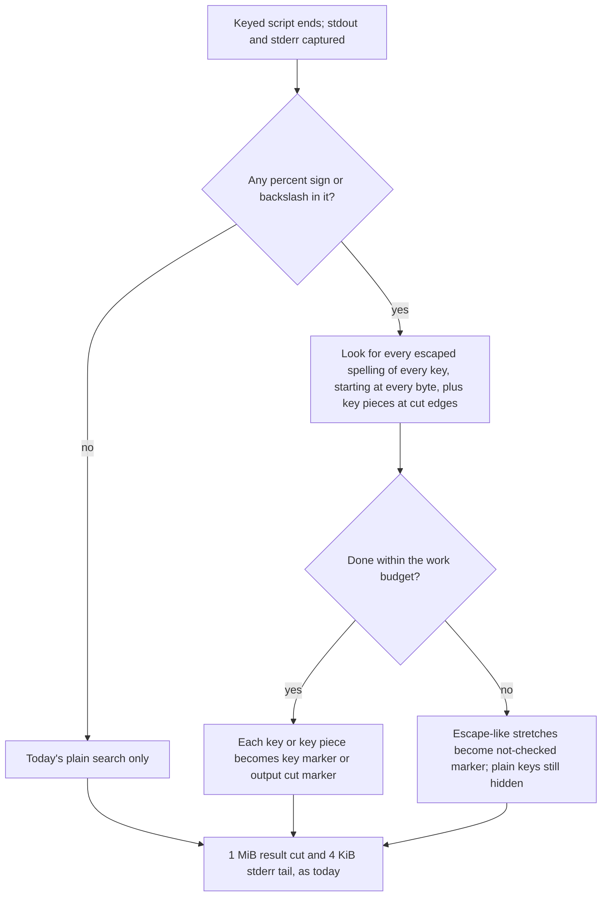

# Hide keys printed in escaped form

**Idea:** `IDEA.md` — what this is for and why, in plain language. Read it first.
**Map:** `MAP.md`. **Parent plan:** `docs/plans/tool-keys/PLAN.md` (K4; Decisions 17, 19, 20, 23; Review Rounds 4-7).

## Open Questions

## Watch List

| # | Noticed | What needs looking into | Raised to user? | Outcome |
|---|---------|-------------------------|-----------------|---------|

## Decision Log

Append-only. A reversal is a new entry superseding the old, never an edit.

| # | Decision | Rationale | Source |
|---|----------|-----------|--------|
| 1 | Escape forms caught: `\uXXXX` (hex any case), `\xXX`, a backslash before any character (covers `\/` and `\\`), and `%XX` (hex any case). HTML entities (`&#43;`) and other forms are not caught; the guide says so | Collin's limit in the parent (Decision 20): JSON/backslash and percent escapes | defaulted |
| 2 | Layers: each key character may be spelled as itself or by one of those escapes, and each character of that spelling may in turn be escaped, up to three layers deep, mixed in any order | Covers `%252B`, `\\u002B`, `%5Cu002B`; Collin's three-layer limit | defaulted |
| 3 | Matching runs per key, looking for a spelling starting at every position, never by decoding the whole stream first | Whole-stream decoding misses a key after a stray `%` (parent round 7, `progress=100%41CD%2BEFGH`) | defaulted |
| 4 | At a cut edge, trimming also passes over `%` and `\` (not only usable key characters), so no piece of an escaped key survives at a cut | `%` and `\` are separators today, so an escaped fragment can survive a cut (MAP.md) | defaulted |
| 5 | An escaped key is replaced with `[key]` like a plain one; the rest of the output is kept (the parent's withhold-the-stream design is dropped) | Collin: just that part | user |
| 6 | A capture with no `%` or `\` byte takes today's plain-only path; matching must stay fast enough for a 2 MiB capture (time limits in E1) | Escaped spellings always contain one of these; keeps ordinary output as fast as today | defaulted |
| 7 | Supersedes 4: cut edges keep K4's trim and additionally drop only a stretch that is part of a cut-off spelling | 4 would drop key-free text and whole captures with no other separator | review-round-1 |
| 8 | A capture too costly to check (past a fixed work limit) is withheld whole, never passed unchecked | Pathological escape-heavy output must not hang the bridge or leak; ordinary output stays well under the limit | review-round-1 |
| 9 | Supersedes 8: past the budget only escape-like runs become `[not checked for keys]`, not the whole capture; one budget covers all searching | Keeps Collin's Decision 5 (just that part) and bounds the cut-edge search too | review-round-2 |
| 10 | Spellings and cut-off pieces are found on the capture as captured, then combined | Trimming first hid the rest of a key that overlapped a cut-off piece | review-round-2 |
| 11 | Both edges cut and the capture one escape-like run: dropped whole | A spelling can be longer than the stderr window | review-round-2 |
| 12 | The fallback's unchecked runs and plain keys are found on the capture as captured and rendered once with the cut edges; each cut edge shows one `[output cut]` | Finding them after trimming or replacing left part of a key visible | review-round-3 |

## Spec

Builds on the merged K4 of `docs/plans/tool-keys/PLAN.md`. Only keyed script tools change
(`runKeyedScript` in `machine/lib/tool-run.js`); `runKeylessScript`, server tools and key
storage are untouched.

### E1. Escaped spellings (`machine/lib/key-redact.js`)

**Escapes of one character.** For an ASCII character `c` with code `p`, its escapes are:
- `\u` followed by `p` as 4 hex digits (`\u002B`);
- `\x` followed by `p` as 2 hex digits (`\x2B`);
- `\` followed by `c` itself (`\/`, `\\`, `\+`);
- `%` followed by `p` as 2 hex digits (`%2B`).

Hex letters may be upper or lower case, independently per digit. The `u` and `x` are lower
case only.

**Layers.** `spell0(c)` is just `c`. `spellN(c)` (N = 1, 2, 3) is every string made by
picking `c` itself or one of its escapes `e`, then writing each character of that choice as
any string in `spell(N-1)` of that character. So `spellN(c)` contains `spell(N-1)(c)`.
Examples of `spell3('+')`: `+`, `%2B`, `%252B`, `%25252B`, `\u002B`, `\\u002B`,
`%5Cu002B`, `\u005Cu002B`, `%5C%5Cu002B`, `\x25\x32B`.

**A key's spellings.** For a key value `k1 k2 … kL`, a spelling is `s1 s2 … sL` with each
`si` in `spell3(ki)`. The plain value is one of them. Nothing may stand between the `si`.

**Finding and replacing.** `redactCapture` finds every spelling of every one of the tool's
key values that starts at any byte of the whole capture as captured (before any cut-edge trimming, E2; order in E3), including spellings that overlap
each other, overlap plain keys, or begin inside text that looks like another escape (for
`41CD+EFGH`, `progress=100%41CD%2BEFGH` has the spelling `41CD%2BEFGH`, which must be
found). It must never work by decoding the capture first. Every byte of every spelling found
is marked, and each run of marked bytes becomes one `[key]`, exactly as plain keys do today.
Unmarked bytes are passed through unchanged.

**Speed and the work limit.** A capture with no `%` and no `\` byte gives exactly today's
result by today's plain search. Otherwise all searching for one capture (complete spellings
here and cut-off pieces in E2) shares one work budget, counted by the implementation and
fixed so that cases (o), (c) and (d) below and the 64 KiB stderr runner fixture in Validation finish within it without the fallback. If the budget runs out, the
search stops and the **fallback** applies to that capture. All of it is found on the
capture as captured: plain keys as today, K4's cut-edge trim, E2's both-edges-cut rule
(so such a capture still gives `[output cut][output cut]`), and every run of bytes made
only of usable key characters, `%` and `\` that contains at least one `%` or `\` (an
**unchecked run**). These are combined and rendered once (E3). Every escaped spelling, and
every piece of one at a cut edge, lies inside one such run, so nothing unchecked gets
through, and the rest of the output is kept. A capture is never passed on
unchecked.

Pinned fixtures, each through `redactCapture` with a timer on the test machine (random
keys come from a fixed seed, using only usable key characters):
- (o) ordinary JSON: 2 MiB of repeated `JSON.stringify` lines such as
  `{"msg":"line 1 says \"hi\"\n","path":"a\/b"}`, lines joined by newlines, 5 random 32-character keys, each placed
  once as a two-layer spelling on a line of its own (right after a newline, followed by one). Under 1 second, no fallback, all 5 replaced, everything else
  unchanged.
- (a) noise: 2 MiB of repeats of `%5C%25\\u00%2`, 5 random 4096-character keys. Under
  3 seconds; the result is unchanged or the fallback.
- (b) late failures: 2 MiB of repeats of `%41`, 5 keys of 4095 `A`s followed by `1`, `2`,
  `3`, `4`, `5`. Under 3 seconds; the result is unchanged or the fallback.
- (c) many keys: 2 MiB of the noise in (a) with 20 random 64-character keys, every 1000 bytes
  holding one three-layer spelling of one of them. Under 3 seconds, no fallback, all
  spellings replaced.
- (d) cut edges: (o)'s JSON text with (c)'s 20 keys, one three-layer spelling of one of
  them on a line of its own after the first newline past every 1000 bytes; the capture starts with the last 40 bytes of a three-layer spelling
  of key 1 followed by a space, and ends with a space followed by the first 40 bytes of one
  of key 2, each spelling chosen so every character is escaped (so each 40-byte piece holds
  a `%` or `\`); both `cutStart` and `cutEnd` set. Under 3 seconds, no fallback; the result is
  exactly `[output cut] ` + the JSON text with every spelling replaced by `[key]` +
  ` [output cut]`.

### E2. Cut edges

At a cut edge, `redactCapture` removes (and shows as `[output cut]`):
- what K4 step 1 removes today (back to the nearest separator), and
- **cut end:** the longest stretch ending at the real end of the capture that is the
  beginning (not the whole) of a spelling of any of the tool's keys;
- **cut start:** the longest stretch starting at the real start that is the ending (not the
  whole) of a spelling of any of the tool's keys;
- **both edges cut** and the capture made only of usable key characters, `%` and `\`: the
  whole capture (it may be the middle of one long spelling, which can exceed the 64 KiB
  stderr window).

Each edge removes the larger of its stretches. Spellings contain only usable key characters,
`%` and `\`, so beyond K4's trim this only ever removes text next to a `%` or `\`. Each cut
edge shows exactly one `[output cut]`, even when nothing else is left (both edges cut and
nothing left gives `[output cut][output cut]`, as today). Output of repeated `%41` with an
unrelated key keeps all but its last few bytes.

Key-free output changes in only three places: text at a cut edge that looks like the start or
end of an escaped key (for example a trailing lone `%`); a capture cut at both edges that is
all escape-like text, which is dropped whole; and the fallback in E1.

### E3. Order in `redactCapture`

1. Search the capture as captured: complete spellings (E1) and cut-off pieces (E2), within
   one budget.
2. Build the result once, from ranges all found on the capture as captured: removed edges
   become one `[output cut]` each; in what remains, each maximal run of bytes inside any
   complete spelling or unchecked run (E1 fallback) becomes `[not checked for keys]` if any
   of its bytes is in an unchecked run, else `[key]`. A spelling that overlaps a removed edge
   still marks its remaining part, so with keys `ABCDEFGH` and `EFGHIJKLM`, a cut start
   `42%43DEFGHIJKLM rest` gives `[output cut][key] rest`.
3. Unchanged in `tool-run.js`: then the 1 MiB result cut and the 4 KiB stderr tail. stdout
   and stderr are each processed on their own.

### E4. The guide (`protocol/tools.md`)

Replace the sentence about what is caught (`protocol/tools.md:70`) so it says: keys printed
as-is or with common escapes (JSON or backslash escapes such as `\u002B`, `\x2B` or `\/`,
and percent-encoding such as `%2B`), up to three layers, are replaced with `[key]`; base64,
hashing, splitting and web-page codes such as `&#43;` are not caught, and deeper escaping
may not be. A backslash right before a key is hidden with it. Text at a cut edge that looks like part of an escaped key is dropped (a cut-off stretch that is all escape-like text can be dropped whole), and very escape-heavy output can show `[not checked for keys]` in place of its escape-like stretches. Keep
"Never print or log a key in any form." Drop "(escaped forms not yet)".

### Not doing (this plan)

As IDEA.md, plus: `\U`, `\u{…}`, octal escapes and HTML entities are not escapes here.

### Validation

- `node --test machine/test/key-redact.test.js machine/test/folder-tools-run.test.js machine/test/name-guard.test.js`, with
  `machine/test/key-redact.test.js` changed and extended to show, for key `ABCDEFGHIJKL`
  and others:
  - the old expectation that `%41…` and `\u0041…` stay visible now expects `[key]`;
  - each escape form alone; mixed upper/lower hex; `\/` in a key containing `/`;
  - two and three layers, mixed in different orders (examples from E1);
  - the `progress=100%41CD%2BEFGH` case with key `41CD+EFGH`;
  - a spelling glued to other text on both sides keeps that text;
  - overlapping plain and escaped spellings become one `[key]`;
  - the fixture `%2525252BABCDEFGHIJK` (four layers of `+`) with key `+ABCDEFGHIJK` is
    left unchanged (pins the limit for that case; three layers is the guarantee);
  - `dir\ABCDEFGHIJKL` gives `dir[key]` (the backslash rule swallows it, by design);
  - output with `%` and `\` but no key is unchanged; keyless runs unchanged;
  - `redactCapture` cut edges: with key `ABCDEFGHIJKL`, a cut end `safe text %41%42%` gives
    `safe text [output cut]`; a cut start `42%43DEFGHIJKL rest` gives `[output cut] rest`
    (exact output; nearby text kept); `%41` repeated with an unrelated key keeps all but the
    last few bytes; `progress 100%` at a cut end gives `progress 100[output cut]`;
  - the two-key overlap case in E3 step 2;
  - both edges cut on a capture made only of a spelling's middle: `[output cut][output cut]`;
  - the fallback, forcing a tiny budget (a test-only option), key `ABCDEFGHIJKL`:
    `ok %41%42 then ABCDEFGHIJKL` gives `ok [not checked for keys] then [key]`; cut start
    `%41BCDEFGHIJKL rest` gives `[output cut][not checked for keys] rest`; cut start
    `1%44EFGHIJKL rest` gives `[output cut][not checked for keys] rest`; both edges cut on
    `%41%42%43` gives `[output cut][output cut]`; `x ABCDEFGHIJKL%4D`
    with keys `ABCDEFGHIJKL` and `GHIJKLMN` gives `x [not checked for keys]`;
  - `runScript` exact output, each failing with today's redactor: a script that writes
    `safe done %41%42%43` to stdout and `safe tail %41%42` to stderr, then hangs past a
    1-second timeout, gives text `safe done [output cut]` and stderr `safe tail [output cut]`;
    with key `'A'.repeat(4096)`, a script writing to stderr `'x '.repeat(10)`, then
    `\u005Cu005Cu0041` 4096 times (a three-layer spelling of the key, exactly 64 KiB), then
    ` tail`, and exiting, gives stderr exactly `[output cut] tail` (the 64 KiB window starts
    5 bytes into the spelling);
  - the speed cases in E1, run through `redactCapture` with a timer;
  - one end-to-end `runScript` case with key `AB+CD/EF=GH`, failing with today's redactor: a
    script prints to stdout `encodeURIComponent('https://x.test/?t=' + key)` (the key shows as
    `AB%2BCD%2FEF%3DGH`) and to stderr `JSON.stringify('t=AB\\u002BCD/EF=GH')` (the key shows
    as `AB\\u002BCD/EF=GH`); `text` contains `[key]` and no `CD%2FEF`, and `stderr` is
    exactly `"t=[key]"`.
- E4: `grep -n -i "never print or log a key" protocol/tools.md` finds the rule;
  `grep -n "not yet" protocol/tools.md` finds nothing about escaped forms; read the rendered
  guide.

## Accepted Risks

| Risk | Why accepted | Round |
|------|--------------|-------|
| Today's plain-key scan can take tens of seconds on 2 MiB of one repeated character with many long overlapping keys made of it, also in the fallback | Rare path: needs keys and output built from one repeated character; unchanged from today | review-round-4 |

## Review Rounds

### Round 1 — 2026-11-26

**Lanes:** intent: claude / claude-opus-5-5; mechanics: gpt / gpt-6.2-sol; cross-family: yes.

**Changed since Round 0:** n/a (first round — whole Spec in scope)

| Lane | Reported | Finding | Lead verdict | Resolution |
|------|----------|---------|--------------|------------|
| intent | minor | IDEA "key-free output as today" vs E2 trimming more at cuts | upheld | E2 rewritten, exception stated (Decision 7) |
| intent | minor | No speed bound for ordinary JSON output | upheld | E1 case (o) |
| intent | minor | Backslash-any rule swallows a backslash before a key | upheld | Kept; test and guide line |
| mechanics | blocking | E2 drops whole key-free captures with no other separator | upheld | E2 rewritten (Decision 7) |
| mechanics | minor | "Deeper escaping not caught" is false at any start | upheld | E4 wording; pinned four-layer fixture |
| mechanics | minor | Speed fixtures unpinned; no late-failure case | upheld | E1 pinned fixtures (a)-(c), work limit (Decision 8) |
| mechanics | minor | Cut-edge tests could pass by dropping everything | upheld | Exact-output tests in Validation |

### Round 2 — 2026-11-26

**Lanes:** intent: claude / claude-opus-5-5; mechanics: gpt / gpt-6.2-sol; cross-family: yes.

**Changed since Round 1:** E1 speed rewritten (work limit and withholding, pinned fixtures (o), (a)-(c); Decision 8); E2 rewritten (K4 trim kept, plus removal of cut-off spelling pieces; Decision 7); E4 wording (three layers a guarantee, backslash before a key); Validation (pinned four-layer fixture, backslash case, exact cut-edge outputs for `redactCapture` and `runScript`).

| Lane | Reported | Finding | Lead verdict | Resolution |
|------|----------|---------|--------------|------------|
| intent | minor | Whole-capture withholding reverses Decision 5 | upheld | Fallback replaces only escape-like runs (Decision 9) |
| intent | minor | E2 "one place" contradicts E1's limit | upheld | E2: two places named |
| intent | minor | Guide silent on cut-edge drops and fallback | upheld | E4 sentence |
| mechanics | blocking | Trimming first hides the rest of an overlapping key | upheld | E3 order (Decision 10); test |
| mechanics | blocking | Window inside one long spelling, both edges cut | upheld | Leak, always fixed (realism.md): E2 both-cut rule (Decision 11) |
| mechanics | blocking | stderr runner fixture cannot give the stated output | downgraded: major | Fixture error, not design; fixture rewritten |
| mechanics | major | Work limit does not cover the cut-edge search | upheld | One budget (Decision 9); fixture (d) |

### Round 3 — 2026-11-26

**Lanes:** intent: claude / claude-opus-5-5; mechanics: gpt / gpt-6.2-sol; cross-family: yes.

**Changed since Round 2:** E1 work limit now one shared budget with a per-run fallback (`[not checked for keys]`, Decision 9) and fixture (d); E2 rewritten as removals found on the capture as captured, plus the both-edges-cut rule (Decisions 10, 11) and the two places key-free output changes; E3 now the order inside `redactCapture` (search, then build, overlap example); E4 sentence on cut-edge drops and fallback; Validation (overlap, both-cut, fallback, stderr runner fixture).

| Lane | Reported | Finding | Lead verdict | Resolution |
|------|----------|---------|--------------|------------|
| intent | major | Fallback cut start leaves a key piece with no escape byte | upheld | Already fixed by Decision 12 (runs found before trimming); test added |
| intent | major | stdout runner fixture cannot give its output | upheld | Already replaced by the timeout fixture |
| intent | minor | Both-edges-cut rule is a third change to key-free output | upheld | E2 and E4 list it |
| intent | minor | Marker count when nothing is left | upheld | Same fix as mechanics (E2) |
| intent | minor | E1 points to E3 for cut rules | upheld | Reference fixed |
| mechanics | blocking | Fallback runs found after trimming/replacing leave part of a key | upheld | E1 fallback and E3 step 2 on original bytes (Decision 12); tests |
| mechanics | minor | Fixture (d) need not exercise edge searches | upheld | (d) rewritten with separators and exact result |
| mechanics | minor | Marker count when nothing is left | upheld | E2: one per cut edge, as today |
| mechanics | minor | Runner fixtures pass with today's redactor | upheld | Runner fixtures pinned to fail today |
| mechanics | minor | name-guard test missing from targeted command | upheld | Added |

### Round 4 — 2026-11-26

**Lanes:** intent: claude / claude-opus-5-5; mechanics: gpt / gpt-6.2-sol; cross-family: yes.

**Changed since Round 3:** E1 fallback now finds unchecked runs and plain keys on the capture as captured and renders once (Decision 12); fixture (d) rewritten; E2 one `[output cut]` per cut edge and three places key-free output changes; E3 step 2 rendering rule; E4 sentence; Validation (fallback cut-start cases, runner fixtures via timeout and a 64 KiB stderr spelling, name-guard test). Collin chose to keep going after three rounds (budget reset).

| Lane | Reported | Finding | Lead verdict | Resolution |
|------|----------|---------|--------------|------------|
| intent | minor | End-to-end case may exercise no escape | upheld | Pinned key with `+ / =` and exact printed forms |
| mechanics | minor | Fixture spellings can land after a JSON backslash | upheld | (o) and (d): spellings on their own lines |
| mechanics | minor | Budget not sized for the 64 KiB stderr fixture | upheld | Added to the budget's list |
| mechanics | major | Plain-key scan in fallback can stall on repeated-character keys | accepted-risk | Rare path; existing behaviour (Accepted Risks) |
| mechanics | minor | Fallback skips the both-edges-cut rule | upheld | E1 fallback includes it; test |
| mechanics | minor | Fixture (d) edge pieces may hold no escape byte | upheld | Edge spellings pinned |

## Implementation Tasks

| # | Objective | Ownership boundary | Lane | Session id | Validation | Status |
|---|-----------|--------------------|------|-----------|------------|--------|

## Log

- After round 3, budget card: Collin chose Keep going (budget reset).
