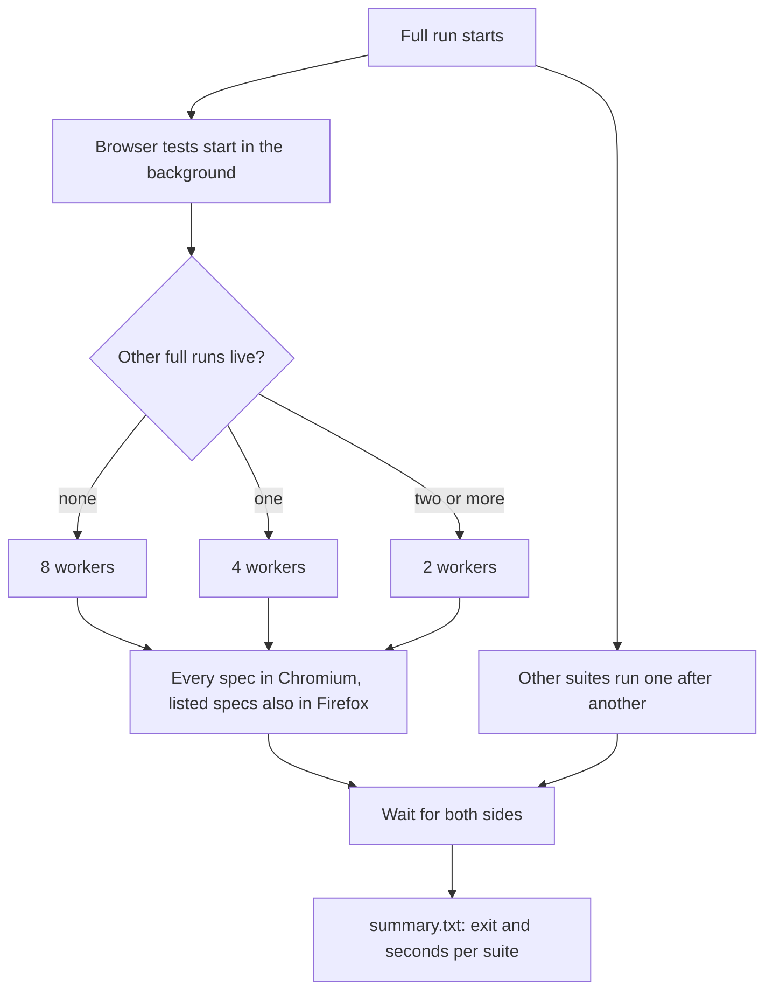

# Faster full test runs

**Idea:** `IDEA.md` — what this is for and why, in plain language. Read it first.
**Map:** `MAP.md`, plus `docs/maps/full-test-runs.md`.

## Open Questions

_None._

## Watch List

| # | Noticed | What needs looking into | Raised to user? | Outcome |
|---|---------|-------------------------|-----------------|---------|

## Decision Log

| # | Decision | Rationale | Source |
|---|----------|-----------|--------|
| D1 | Mode two-part, chosen before PLAN.md existed. | Time savings now; smaller leftovers later. | user |
| D2 | `full-run.sh` runs the browser suite and the other suites side by side instead of one after another. | Logs show browser ~10 min and machine ~6 min running in sequence, with nothing making them wait for each other. | defaulted |
| D3 | Fix the free-port race in `viewer/test/helpers/server.js` (probe closes before the viewer binds, `:15-23`, `:73-76`). | Pre-existing flake that grows with more workers; blocks raising the worker count. | defaulted |
| D4 | After the port fix, the lone full-run browser worker cap is set from a measured comparison rather than kept at 6. | The cap of 6 was chosen because parallel servers clashed. | defaulted |
| D5 | `summary.txt` records each suite's seconds (old Deferred row 3). | Small, and needed to aim further speedups. | defaulted |
| D6 | Qualify lead.md repair step 7's full-run phrase with the `Test picker and full run` heading (old Deferred row 5). | Protocol edits all map to every suite; batch it here. | defaulted |
| D7 | A build runs one full run, only after its verifiers pass, on the final commit; remediation rounds rely on the picked tests. A failing full run is handled as a failed verification (one more round). | Six full runs in the Settings rework; the picker already checks each round. | user |
| D8 | Every browser spec runs in Chromium; only specs marked browser-sensitive (graph geometry, touch, pixel sampling and the like) also run in Firefox. | Running everything twice is about half the browser suite's time. | user |
| D9 | When full runs overlap (another thread's full run is live), browser workers are shared fairly across them instead of dropping each to 2. | `test-support/browser-workers.js:8` drops overlapping runs to 2 workers, likely why runs feel like 30 minutes. | defaulted |
| D10 | Supersedes D7: the full run keeps today's timing, started alongside the verifiers on each verification and remediation commit. No role-rule change for timing. | Collin: the slow part is the wait after verification passes; starting late would make that wait the whole run. | user |
| D11 | CONTRIBUTING.md (the repo law), AGENTS.md and viewer/AGENTS.md are edited to say the browser suite runs every spec in Chromium and only the listed specs in Firefox. | Follows D8; the law currently says the suite runs in both browsers (`CONTRIBUTING.md:94`). | user |
| D12 | Supersedes D9: browser workers are a shared budget, not split "fairly". Each full run registers its worker count; a new full run takes `max(2, top − workers held by other live full runs)`. Counts are fixed at start, so a run that started first keeps its share. | Playwright cannot change workers mid-run; D9's formula let staggered runs exceed the budget (review round 1). | review-round-1 |
| D13 | The worker measuring `CAP` also times a whole full run before and after the change on the same machine. | IDEA's first goal had no check (review round 1). | review-round-1 |
| D14 | Supersedes D4, D12 and D13. No benchmarking: `CAP` is 8 (half of 16 cores). A full run takes `max(2, floor(top / (others + 1)))` at start, `others` the count of other live full runs. Counts are fixed at start: a run that started alone keeps 8 and one starting beside it gets 4, so two staggered runs can use 12 workers on 16 cores; accepted. | D12 gave a second run 2 workers, the same as today, so it fixed nothing; benchmarking needs full runs a worker may not run. The earlier cap of 6 was set because of the port clash S1 fixes. | review-round-2 |
| D15 | Goal 1 (a faster full run) is checked by the sub-lead: COMPLETION.md records the build's full-run per-suite seconds and total beside the before figures in this plan (15–20 min, 2026-11-25 logs), noting what else was running. | Replaces D13's before run; the full run is the starter's. | review-round-2 |
| D16 | IDEA updated: the goal is shorter full runs and a shorter wait after the checks pass, not fewer runs per build. | Follows D10. | idea-change |
## Spec



Goal: shorten one full run and the wait after verification passes, without missing what a
full run catches today. Full-run timing in the build is unchanged (D10). This project has a
`Test picker and full run` heading: commands below are targeted; the pusher's full run covers
the whole set.

### S1. Port clash fix (D3) — `viewer/test/helpers/server.js`

- Today `freePort()` (`:15-23`) closes its probe before the spawned viewer binds, so two
  parallel `startServer` calls can get the same port; the loser exits with "Refused to use a
  port held by a process it cannot identify." (`viewer/server.js:2287-2310`).
- When `startServer` chose the port itself (no `port` argument) and the child exits before
  printing its URL with stderr containing `Refused to use a port held by a process it cannot
  identify` or `EADDRINUSE`, it picks a fresh port and starts again, up to 5 attempts in all,
  then throws the last error unchanged. Any other startup failure throws at once, as today.
- An explicit `port` argument (sequential restart tests) never retries.
- Each failed attempt's child is killed and awaited before the next starts, as the existing
  error path does; temp and state directories are reused across attempts.
- `startServerWithEnv` in `viewer/test/routes.test.js` becomes a call to `startServer` with `env` (and `open`, `cacheRoot`), so it gets the same retry; both its callers (`routes.test.js:101-115`, `:235`) drop the explicit port.
- Callers: every `startServer(...)` call in `viewer/test/` that passes `port: await freePort()` inline (the port is not kept for later use) drops the `port` argument and reads `ctx.port` where it needs the port, so it gets the retry. A caller that keeps the port in a variable for a later start on the same port stays explicit.
- For the test, `startServer` accepts an optional `nextPort` function (default `freePort`);
  only tests pass it.
- Test: new `viewer/test/server-port-retry.test.js`. (a) `nextPort` returns first a port held
  by a plain `net` listener in the test, then a free one: the server starts on the second
  port. (b) With an explicit `port` held by such a listener, `startServer` rejects without
  retrying. (c) A failure without either message is not retried.

### S2. Suites side by side, with timings (D2, D5) — `test-support/full-run.sh`

- `viewer-browser` starts in the background, writing its log as today. Meanwhile the other
  suites run one after another in today's order (viewer-node, machine, test-support,
  sensitivity, codex, install, sudo-helper). The script waits for the browser suite before
  writing the summary.
- `summary.txt`: first line `commit <sha>` as today, then one line per suite in today's
  fixed order (viewer-browser first), whatever order they finish in:
  `suite <name> exit <n> seconds <s>`, `<s>` the suite's wall time in whole seconds. The
  printed progress lines gain the same seconds.
- Stopping: the browser suite runs in its own process group. On `TERM` or `HUP` the script kills that group and its current foreground suite, waits for those two child processes, and exits non-zero without claiming success. Browser processes Playwright starts in their own groups are not chased (Accepted Risks). Today a stopped run leaves its whole current suite running, so this is no worse.
- Exit status, the dirty-worktree refusal, `WHEELCHAIR_FULL_RUN=1`, log file names and the
  sudo-helper pair's combined result are unchanged.
- Anything that reads `summary.txt` keeps working: it only looks at the `commit` line and
  each suite's exit. Update the format sentence in `AGENTS.md:85`.
- Test: new `test-support/test/full-run.test.js`. In a temp git repo containing a copy of
  `full-run.sh` and stub suites at the paths it calls (each stub records start and end
  times and exits with a chosen code; the browser stub sleeps longer than the rest), assert:
  the browser stub's run overlaps the machine stub's; summary lines appear in the fixed order
  with the `seconds` field; the script exits 1 when one stub fails and 0 when all pass, including a case where the browser stub is the only failure (its line shows its exit and the script exits 1); sending `TERM` or `HUP` to the script mid-run stops both stub suites it started; the
  dirty-tree refusal still exits 2.

### S3. Browser workers (D14) — `test-support/browser-workers.js`

- `CAP = 8`, a named constant. `chooseWorkers({ full, others, cpus })`: a non-full run gets
  2. A full run gets `max(2, floor(top / (others + 1)))`, `top = min(CAP, floor(cpus / 2))`,
  `others` the number of other live full runs found by `liveOthers` (unchanged). On 16 cores:
  alone 8; beside one other 4; beside two or more 2. Decided once at start (D14).
- `decide()` passes the count instead of a yes/no; the env override and registration are
  unchanged. Update the `viewer/playwright.config.js:10` comment and `viewer/AGENTS.md:57`.
- Test: `test-support/test/browser-workers.test.js` covers alone, beside one, beside two,
  low-CPU machines (8, 4, 2, 1 cores) and non-full runs.
- Timing record (D15): the sub-lead puts its full run's `summary.txt` (with seconds) and total
  wall time in COMPLETION.md beside the before figures (2026-11-25 logs: total 14–21 min,
  browser 8–11 min, machine about 6 min, run alone), saying what else was running, and the
  minutes between the verifiers passing and the full run passing. Reported to Collin, not a
  gate: the build's run overlaps the verifiers, so it is not a like-for-like comparison.

### S4. Firefox only where it matters (D8, D11)

- `viewer/playwright.config.js`: the `chromium` project runs every `*.spec.js` as today. The
  `firefox` project runs only the files in one exported list,
  `viewer/test/firefox-specs.js` (an array of file names), initially: `browser.spec.js`
  (graph rendering and geometry), `touch.spec.js` (touch gestures),
  `background-rendering.spec.js` (pixel sampling), `background-editor.spec.js`,
  `app-mockup-png.spec.js`, `app-screenshot-view.spec.js`, `app-spot-comment.spec.js`,
  `app-chat-stability.spec.js` (drawing, images and scroll behaviour), `app-views.spec.js`
  (pointer-anchored zoom after scrolling), `app-ui.spec.js` (sticky header while scrolling),
  `render.spec.js` (horizontal scroll containment), `app-picture-download.spec.js` (PNG
  pixels), `app-agents-decks.spec.js` (wheel scrolling), `app-threads.spec.js` and
  `app-assistant-phone.spec.js` (scrolling and jump to bottom). This list is the Spec's;
  specs not on it lose Firefox coverage by D8 (see Accepted Risks). Each entry has a
  one-line comment saying why it needs Firefox.
- `npm --prefix viewer run test:browser` still fails loudly if either browser is missing.
- Edit the law and routers to match: `CONTRIBUTING.md:94` ("runs in both Chromium and
  Firefox"), `AGENTS.md:67`, `viewer/AGENTS.md:57` and `:94`, and the config's top comment.
  Each says: every spec in Chromium, the specs in `viewer/test/firefox-specs.js` also in
  Firefox, and that a spec testing drawing, touch, pixels or scroll belongs on that list.
- Test: new `viewer/test/playwright-projects.test.js` loads the config with
  `WHEELCHAIR_FULL_RUN` removed from its environment (so it registers nothing) and asserts the
  firefox project selects exactly the listed files, every listed file exists, and the
  chromium project is unrestricted.

### S5. lead.md wording (D6)

- `protocol/app/lead.md` repair step 7: "and start the full run alongside it unless the
  commit is covered" becomes "and, with that heading, start the full run alongside it unless
  the commit is covered". No other protocol change. Validation: read the rendered step 7 and check it still tells a
  lead in a project without the heading nothing about full runs (`protocol/app/lead.md:119`, the edit at `:736-741`).

### Validation commands

```bash
node --test viewer/test/server-port-retry.test.js viewer/test/server.test.js viewer/test/app-new-thread.test.js viewer/test/routes.test.js
node --test test-support/test/full-run.test.js test-support/test/browser-workers.test.js
node --test viewer/test/playwright-projects.test.js
npm --prefix viewer run test:browser -- --list   # firefox lists only the files in firefox-specs.js
npm --prefix viewer run test:browser -- touch.spec.js app-new-thread.spec.js
git diff --check
```

### Non-goals

- No change to when full runs start or what gates a push (D10).
- No change to test content beyond S1's helper; no tests deleted.
- Picker changes stay deferred.

## Deferred

| # | Item | Why it can wait | Source | Notes for the follow-up |
|---|------|-----------------|--------|-------------------------|
| 1 | Follow imports transitively so picks are smaller | The fallback already runs more, never less | planning | `test-support/pick-tests.js:55-74` reads only direct relative imports in non-browser test files |
| 2 | Flag test-map.json entries pointing at missing files or globs matching nothing | A stale entry only makes picks larger or falls back | planning | Missing targets are skipped silently (`test-support/pick-tests.js:33`, `:76-80`); could live in pick-tests.test.js against the real tree |

## Accepted Risks

| Risk | Why accepted | Round |
|------|--------------|-------|
| Tests that keep a `freePort()` port in a variable for a later start on the same port keep the probe-then-bind race | Few such tests; the inline callers that make up most starts get the retry | review-round-1 |
| Two full runs starting within the same instant can both see no other and take 8 each | Sub-second race between two actors (realism.md) | review-round-1 |
| After `TERM`/`HUP`, browser processes Playwright started in their own process groups may outlive a stopped full run briefly | Extra load for a while, never a wrong result; today a stopped run leaves its whole suite running | review-round-3 |
| A Firefox-only bug in a spec not on `viewer/test/firefox-specs.js` is not caught | Collin's trade in D8; the list covers drawing, touch, pixels and scroll known today | review-round-2 |

## Review Rounds

### Round 1 — 2026-11-25

**Lanes:** intent: claude / claude-opus-5-5; mechanics: gpt / gpt-6.2-sol; cross-family: yes.

**Changed since Round 0:** n/a (first round — whole Spec in scope)

| Lane | Reported | Finding | Lead verdict | Resolution |
|------|----------|---------|--------------|------------|
| intent | minor | CAP measured with browser suite alone, not under S2's mixed load | upheld | S3 measures whole full runs |
| intent | minor | D9 "fair" sharing isn't, counts fixed at start | upheld | D12 budget |
| intent | minor | No check of IDEA goal 1 (faster run) | upheld | D13 before/after timing |
| mechanics | blocking | Explicit `port: await freePort()` callers skip the retry | upheld | S1 callers drop inline ports; variable-held ports an Accepted Risk |
| mechanics | blocking | Staggered overlap exceeds worker budget | upheld (major) | D12 budget; tests cover staggered start |
| mechanics | blocking | Firefox list drops app-views, app-ui, render scroll tests | upheld | Added to list |
| mechanics | major | Stopping the runner leaves background browser suite alive | upheld | S2 process group + signal trap, tested |
| mechanics | major | No CAP rule when benchmarks fail | upheld | Retry once, else CAP 6 |
| mechanics | minor | Config test registers as a full run | upheld | Test clears WHEELCHAIR_FULL_RUN |
| mechanics | minor | Background exit path untested | upheld | Browser-only failure case |
| mechanics | minor | No before/after full-run timing | upheld | D13 |

### Round 2 — 2026-11-25

**Lanes:** intent: claude; mechanics: not claude; cross-family: yes.

**Changed since Round 1:** S1 inline `freePort()` callers drop `port`; S2 stopping (process group, signal trap) and browser-only-failure test; S3 replaced by a held-worker budget (D12), registration stores counts, measurement times whole full runs before/after with a failure rule (D13); S4 adds app-views, app-ui, render specs and the config test clears `WHEELCHAIR_FULL_RUN`; two Accepted Risks.

| Lane | Reported | Finding | Lead verdict | Resolution |
|------|----------|---------|--------------|------------|
| intent | blocking | Workers may not run the full-run benchmarks | upheld | D14 drops benchmarking; D15 timing by sub-lead |
| intent | major | D12 gives a second run 2 workers, same as today | upheld | D14 start-time split |
| intent | minor | IDEA still promises fewer runs per build, against D10 | user-decision | Collin: update IDEA (D16) |
| intent | minor | Rare path: legacy empty registration file counted as 2 | declined | Moot: D14 removes counts |
| intent | minor | S3 heading cites D9; no rule if another run is live while measuring | upheld | Moot after D14 rewrite |
| mechanics | blocking | INT cannot be trapped in a background bash run | downgraded (minor): only TERM/HUP are how runs get stopped | INT dropped from the promise; TERM/HUP remain |
| mechanics | blocking | Benchmarks assigned to a worker | upheld | D14/D15 (same as intent) |
| mechanics | blocking | Firefox list omits four scroll/pixel specs | upheld (major) | Added; list declared authoritative, residual in Accepted Risks |
| mechanics | minor | `startServerWithEnv` bypasses retry | upheld | S1 routes it through `startServer` |
| mechanics | minor | Legacy fallback counts 6-worker run as 2 | declined | Moot: D14 |
| mechanics | minor | Benchmark command lacks log dir; baseline has no seconds | declined | Moot: benchmark removed |
| mechanics | minor | S5 lacks rendered-protocol check | upheld | Added to S5 |

### Round 3 — 2026-11-25

**Lanes:** intent: claude; mechanics: not claude; cross-family: yes.

**Changed since Round 2:** S3 rewritten (D14: CAP 8, start-time split, no benchmarking; D15 timing record by the sub-lead); S1 routes `startServerWithEnv` through `startServer`; S2 promises cleanup on TERM/HUP only; S4 list grows to 12 files and is declared authoritative, with an Accepted Risk; S5 gains a rendered-protocol check; IDEA goals updated (D16).

| Lane | Reported | Finding | Lead verdict | Resolution |
|------|----------|---------|--------------|------------|
| intent | minor | D15 timing record has no judge and is not like-for-like | upheld | Reported, not a gate; wait time added |
| intent | minor | "beside two" case missing | upheld | S3 wording and test |
| intent | minor | S5 cites the wrong line | upheld | Fixed citation |
| intent | minor | `docs/maps/full-test-runs.md` goes stale | declined | Maps record the commit they were checked against; the next mapper re-checks before reuse |
| mechanics | blocking | Stopping cannot guarantee Playwright workers and browsers are gone | downgraded (minor): worst case is temporary load, never a wrong result, and today a stopped run leaves its whole suite running | S2 promise narrowed to its own children; Accepted Risk |
| mechanics | minor | Second `startServerWithEnv` caller keeps its port | upheld | Both callers drop it; routes.test.js validated |
| mechanics | minor | No evidence for the shorter wait | upheld | Wait minutes in D15 record |

## Log

- 2026-11-25 — Build accepted: approval 97655c29-d192-4e91-9f3a-da2fcd79aac9
