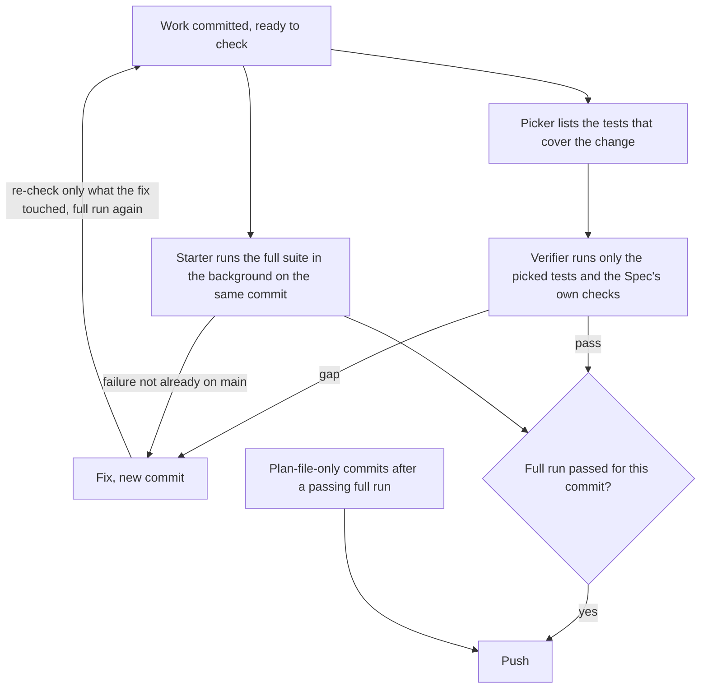

# Faster verification checks

**Idea:** `IDEA.md` — what this is for and why, in plain language. Read it first; it is
the north star this plan serves. Goal and Constraints live there, not here, so they don't
get buried as this file grows.

## Open Questions

## Watch List

Things noticed that need looking into — not yet decisions for the user. Written down the
moment they're spotted so they can't be forgotten, surfaced to the user one line at a
time as they appear, and emptied before Stage 1 exits.

Each item ends up settled by the agent (noted in the Log), promoted to an Open Question,
promoted to a Constraint or Accepted Risk, or waved off by the user.

| # | Noticed | What needs looking into | Raised to user? | Outcome |
|---|---------|-------------------------|-----------------|---------|

## Decision Log

Append-only. A reversal is a new entry superseding the old, never an edit.

| # | Decision | Rationale | Source |
|---|----------|-----------|--------|
| 1 | Mode is two-part (chosen before PLAN.md existed). | Collin picked it. | user |
| 2 | The flaky harness test (viewer/test/app-harnesses.test.js:298-319) stops relying on a 1000 ms wall-clock deadline: it asserts the route answers while the never-resolving machine request is still pending, with a generous safety timeout only. | MAP.md: the never-resolving promise already proves non-blocking; the deadline only measures load. | defaulted |
| 3 | A failure seen during a check is compared with main by re-running only the failing test files on main, never the whole suite. | The whole-suite comparison was most of the doubled time. | defaulted |
| 4 | Browser workers: a run that finds no other cooperating browser run active (machine-wide lock in the test-run area) and a 1-minute load average below half the cores uses up to 6 workers; otherwise 2. An explicit --workers still wins. | Keeps S7's cap for concurrent runs (Constraint); 16 cores leave room solo. Collin offered lock or load check; both together cover non-cooperating runs. | defaulted |
| 5 | Tests are picked by a selector script: changed files -> tests from names, direct imports and a small hand-kept table; config, shared helpers or anything unmapped falls back to the full suite. | Predictable, errs toward running more. | user |
| 6 | The full run before a push is done by the session about to push or hand off (sub-lead at build end, lead for small fixes, after-done fixes and repairs), on the exact commit, in the background; verifiers run only picked tests. | Results do not depend on who runs them; removes the full run from every check. | user |
| 7 | Superseded Decision 4: browser workers are chosen by the registration lock only (no load average); a run alone uses min(6, cpus/2), later runs 2; full-run.sh runs the browser suite first. | Round 1: the run's own Node suite and the parallel verifier defeated the load check. | review-round-1 |
| 8 | A conflict-free merge of the default branch into work whose full run passed gets the picker's targeted run, not a full run; the Constraint is worded to match. | Collin's original ask (idea 3, also IDEA What good looks like); round 1 found the Spec contradicting it. | review-round-1 |
| 9 | The picker and full-run rules are opt-in per project through a `Test picker and full run` heading in the project's AGENTS.md; other projects keep today's flow. | Role rules serve every project; round 1. | review-round-1 |
| 10 | Verifier briefs name a picker base and a separate comparison commit (merge-base with the default branch); the main comparison uses `git archive` into scratch. | Round 1: a retry's base is not main; verifiers cannot add git worktrees. | review-round-1 |
| 11 | Superseded Decision 7's worker rule: only full runs (started by full-run.sh) may take the larger worker count, and only when no other full run is live; all other runs use 2. | Round 2: a short picked run must not hold a 10-minute full run at 2. | review-round-2 |
| 12 | Full-run evidence carries to descendant commits the picker selects nothing for, and to a conflict-free default-branch merge whose picked check passed. Verifiers switch to picked-only mode only when the brief gives a picker base and says the starter runs the full run. | Round 2: bookkeeping commits and rollout handshake. | review-round-2 |
| 13 | The verifier handshake has two forms (`Full run: by the starter` / `not needed: clean merge of the default branch`); with the first, verifiers skip whole suites the picker selects. Coverage carries across picker-empty descendants of any covered commit. A full-run failure confirmed on main (same test, same error) does not fail the gate. | Round 3. | review-round-3 |
| 14 | Superseded D8's, D12's and D13's clean-merge parts: a conflict-free merge of the default branch gets a picked verifier check plus the usual full run in the background before the push; there is no clean-merge exemption. IDEA "What good looks like" and Constraint reworded. | Collin chose to simplify after three review rounds kept finding holes in the exemption. | idea-change |

## Spec

Mode: two-part. Read `MAP.md` first; it has the file:line evidence for today's flow.

### Today and the change

Verifiers run whatever validation commands the Spec and brief name, which are usually the
whole suites, and often re-run them on main to compare failures (MAP.md, Verification flow).
After this change, in a project that declares a test picker and a full run (S5.0; this
repository does): verifiers run only the tests the picker selects for the change they check
(S1); one full run covers each pushed commit's code (S5.6), done by the session
about to push or hand off (S2, S5); full browser runs use more workers when no other full run
is going (S3); the flaky harness assertion stops measuring load (S4). Projects that declare
neither keep today's flow.

Rollout: this thread is built and checked under the installed rules, which run this Spec's
validation commands as written. The new rules take effect for threads started after the pull
request is merged and installed.

### S1. Test picker: `test-support/pick-tests.js`

`node test-support/pick-tests.js --base <commit> [--head <commit>] [--json]`, run from the
repository root. `--head` defaults to `HEAD`. Changed files are
`git diff --name-status -M <base> <head>` (two-commit form). With `--full` instead of
`--base`, it selects every suite.

Output: one shell command per line (or with `--json`,
`{ "changed": [...], "suites": [{ "suite", "command", "files", "reason" }] }`). Every
command runs from the repository root. Suites:

| Suite | Full command | Narrowed command |
|---|---|---|
| viewer-node | `node --test viewer/test/*.test.js` | `node --test <files>` |
| viewer-browser | `npm --prefix viewer run test:browser` | `npm --prefix viewer run test:browser -- <spec basenames>` |
| machine | `bash machine/test/run.sh` | `node --test <files>` |
| test-support | `node --test test-support/test/*.test.js` | (always full) |
| sensitivity | `bash sensitivity/test/run.sh` | (always full) |
| codex | `bash codex/test/run.sh` | (always full) |
| install | `bash install/test/run.sh` | (always full) |
| sudo-helper | `python3 -m unittest discover -s sudo-helper/test` and `bash sudo-helper/test/install-test.sh` | (always full) |

Full commands match AGENTS.md's Verification section exactly. Smoke, live and `./install.sh`
are never selected.

Rules, applied to each changed path; a test file is selected once even if several rules pick
it. **Only paths that exist at `<head>` are ever put in a command.**

0. **Deletions and renames.** A rename is treated as a change to both its old and its new
   path (so a moved fixture still selects the tests mapped to its old path). A deleted test
   file selects nothing. A deleted non-test file is treated like a changed file of the same
   path (rules 2–5), so tests that still import it at head are found, else the fallback runs.
1. A changed test file (`viewer/test/*.test.js`, `viewer/test/*.spec.js`,
   `machine/test/*.test.js`) selects itself.
2. A changed source file (anywhere outside `*/test/` and `docs/`) selects every test file in
   `viewer/test/` **and** `machine/test/` (both components, at head) that names it in a
   `require(...)`/`import` path resolved relative to the test file, plus every test file of
   its own component (`viewer/` or `machine/`) whose basename starts with the source file's
   basename (without extension) followed by `.` or `-`.
3. `test-support/test-map.json`, a hand-kept list of `{ "glob", "tests" }` entries, adds
   tests for paths the import rule cannot see: served pages, scripts, protocol files read by
   tests (`viewer/test/protocol-rules.test.js`, `viewer/test/server.test.js`,
   `viewer/test/app-settings.test.js`, `machine/test/aside-turns.test.js`,
   `machine/test/service.test.js`, `machine/test/char-lib-argv.test.js`), and fixtures under
   `docs/` read by tests (for example `docs/plans/openrouter-harness/samples/**`, read by
   `viewer/test/app-openrouter-hub.test.js` and `machine/test/pi-login.test.js`, and
   `docs/plans/*/graphs/**`, which `viewer/test/browser.spec.js` finds with `git ls-files`). `tests`
   may be test paths or a suite name meaning that whole suite. The builder seeds it by
   grepping the test files for every repository path they read (`git ls-files`, `readFileSync`, `path.join`
   with `__dirname`, served URLs); it need not be complete, because of rule 5.
4. Files that fan out select whole suites: anything under `viewer/test/helpers/` or
   `viewer/test/fixtures/` (if present), `viewer/playwright.config.js`, `viewer/package.json`
   and `viewer/package-lock.json` select viewer-node and viewer-browser; non-test files in
   `machine/test/` select machine; `test-support/run-dir.js` selects viewer-node,
   viewer-browser, machine and test-support (all of them use it); any other file under
   `test-support/`, `sensitivity/`, `codex/`, `install/`, `sudo-helper/` selects that
   directory's suite. `install.sh` selects install.
5. **Fallback:** a changed source file under `viewer/` or `machine/` that rules 2–3 map to no
   test selects its component's whole suites (viewer: viewer-node and viewer-browser;
   machine: machine). Any other changed path outside `docs/` that no rule or map entry
   covers (including root files other than `README.md`, `CONTRIBUTING.md`, `AGENTS.md` and
   `.gitignore`) selects every suite. Paths under `docs/`, and `*.md` files, that no map
   entry names select nothing.
6. Viewer front-end files (`viewer/app/pages/**`, `viewer/app/**/*.html`, `*.css` and
   client-side scripts) select browser specs only through `test-map.json`; unmapped ones fall
   back by rule 5. Rule 2 never selects browser specs, since they reach the app over HTTP.
7. If nothing is selected, the picker prints nothing and exits 0; `--json` gives
   `suites: []`.

Exit 1 with a one-line reason if `--base` is not a commit or git fails. The picker is
deterministic.

`test-support/test/pick-tests.test.js` covers each rule with a temp git repository built from
fixture files (it never depends on the real tree's map), including a cross-component import,
a deleted and a renamed test, a deleted source file, a `docs/` fixture entry, the fallback and
a docs-only change.

### S2. Full run: `test-support/full-run.sh`

`bash test-support/full-run.sh <log-dir>` runs every full command from S1's table,
**viewer-browser first** (so its worker choice in S3 is not affected by this run's own
earlier suites), then the rest in table order, each into `<log-dir>/<suite>.log`,
continuing past failures. It writes `<log-dir>/summary.txt`: first line
`commit <full sha of HEAD>`, then one line per suite `suite <name> exit <n>`. It refuses
(exit 2) when `git status --porcelain --untracked-files=no` is not empty. It exits 0 only
when every suite exited 0. It does not run smoke, live or `./install.sh`. A full run
**passes** for a commit when `summary.txt` names that commit and every suite exit is 0, or
when every failure in it was confirmed already on main (S5.5) and those failures are
written down with the commit (COMPLETION.md for the sub-lead; for the lead, a
`baseline.txt` beside `summary.txt` written before the push, repeated in the `done` card's
note afterwards).

### S3. Browser workers when alone

`viewer/playwright.config.js` chooses workers through `test-support/browser-workers.js`,
which exports a pure `chooseWorkers({ full, othersFull, cpus })` and the registration handling:

- The decision is made once, in the Playwright runner's main process, and passed to its
  worker processes (for example through an environment variable set on first load), so
  worker processes re-loading the config neither register nor decide again.
- A run is **full** when started by `full-run.sh`, which sets `WHEELCHAIR_FULL_RUN=1`; any
  other run (a picked run, a worker's run) is not.
- A machine-wide directory `wheelchair-browser-tests` under `os.tmpdir()` holds one file per
  running full browser run, named by its process id. Files whose process is gone are ignored
  and removed. A full run adds its own file and removes it at exit.
- `chooseWorkers`: a full run with no other live full run registered →
  `min(6, floor(cpus / 2))`, at least 2; every other case → 2. There is no load-average check
  (a run's own earlier suites would defeat it). Picked runs are short, so they keep 2, and a
  short run never holds a full run down.
- The choice is made at start and kept. So the browser load is at most one larger full run
  plus 2 per other run.
- Runs that do not register (checkouts without this change) are not seen; they use their
  own cap of 2.
- `--workers` on the command line still overrides, as today. Node test concurrency is
  unchanged.
- `test-support/test/browser-workers.test.js` covers `chooseWorkers`, the stale-file handling
  and registration/removal.

### S4. Flaky harness test

In `viewer/test/app-harnesses.test.js` (the "switching a harness off … without waiting" test,
around lines 298-319), keep the never-resolving, rejected and 409 machine requests. Replace
`assert.ok(Date.now() - started < 1000)` and the first 100 ms sleep: assert the route answers
200 **while the never-resolving request is still pending**, and wait for all three DELETEs by
an observed event (a promise resolved when the third call arrives). One safety timeout of at
least 10 seconds covers both the route's response and the DELETE observation, and fails the
test instead of hanging. The switch-on half (the second
sleep and `assert.deepEqual(calls, [])`) stays as it is. `viewer/app/routes.js` does not
change.

### S5. Rules: who runs what

Edit `protocol/app/lead.md`, `protocol/app/sub-lead.md`, `protocol/app/verifier.md`,
`protocol/app/worker.md` as needed, `AGENTS.md` (Verification) and `CONTRIBUTING.md`:

0. **Opt-in per project.** The role rules apply to every project. A project opts in by
   naming, in its root `AGENTS.md` under a heading `Test picker and full run`, a picker
   command (taking a base commit) and a full-run command (taking a log directory, writing a
   summary that names the commit and passes as S2 defines). Wheelchair's `AGENTS.md` names
   `node test-support/pick-tests.js --base <commit>` and
   `bash test-support/full-run.sh <log-dir>`. Rules 3–6 below apply only in an opted-in
   project, and rule 2 too; elsewhere today's rules stand.
   **Handshake:** a verifier uses rules 2–3 only when its brief gives a picker base and a
   line `Full run: by the starter`; a brief without both gets today's behaviour. So a lead or sub-lead still
   on older rules never gets a verifier that skips the full suite.
1. **Spec validation commands** (lead.md, step 4.6): in an opted-in project the lead writes
   targeted commands per Spec item and does not list whole-suite or full-run commands as
   validation; the full run is the pusher's (5, 6). Verifiers always run every Spec
   validation command as written, so older plans that list whole suites still get them.
2. **Comparing a failure with main** (verifier.md): run only the failing test files at the
   **comparison commit** the brief names (default: `git merge-base origin/<default branch>
   HEAD`), never the whole suite; for a suite S1 marks "(always full)" (one runner script),
   the suite command is the unit (for sudo-helper, whichever of its two commands failed), and
   the same failure means the same failing check name and message in its output; a failure
   with no check name or message, or in a different command, never counts as already on
   main. Get that tree as its own clone in a scratch directory
   outside any repository: `git clone --quiet <your checkout> <scratch>/main` then
   `git -C <scratch>/main checkout --quiet --detach <commit>` (this writes only the scratch
   clone's own metadata), and link into it the dependency folders present in your own
   checkout (for this repository `viewer/node_modules` and any top-level `node_modules`). A
   failure counts as already on main only when the same test fails there with the same
   error; a test file that does not exist at the comparison commit, or fails there for a
   different reason, is the branch's failure. Report the comparison commit.
3. **Verifiers in an opted-in project** run the Spec's commands and the commands the picker
   prints for the **picker base** the brief names; never the full-run command, and never a
   whole suite the picker did not select. When the brief says `Full run: by the starter`, a
   whole suite the picker selects is skipped (the starter's full run covers it on the same
   commit) and the report says so.
   The report names both commits and the picked commands.
4. **Which commits a verifier brief names.** The comparison commit is always the merge-base of
   the checked commit with the default branch. The picker base is: the comparison commit for
   a first check of a build, small fix or after-done fix; the commit the previous attempt
   checked, for a re-check after remediation, a failed attempt or a repair of a failed pull
   request check (so the picker covers only the fix); when the commit to check is that same
   commit (nothing changed since), the previous attempt's picker base again, and the brief
   names the commands that failed last time so they are re-run; the default-branch tip that was merged in, for a check after merging the default
   branch (lead.md Making the pull request mergeable 7), so only this branch's own changes
   are retested on top of it; this branch's last pushed commit, for a check after merging
   others' commits from the pull request branch (step 6 and the non-fast-forward rule).
5. **Sub-lead at the end of a build**: "full validation" before COMPLETION.md is replaced by
   the targeted task checks already run. When it starts verifiers it also starts the full run
   on the same commit in the background, logs in a scratch directory outside the repository.
   It sends the build `result` only when the verifiers pass **and** the full run passes for
   the commit it reports, and pastes `summary.txt` into COMPLETION.md. A full-run failure is a
   gap like a verifier gap (same remediation, counting, two-attempt rule and realism
   judgment), except a failure the starter confirms is already on main by S5.2's method (same
   test, same error at the comparison commit): that does not fail the gate and is listed in
   COMPLETION.md (or, for the lead, the `done` card's note). When a new commit replaces the one a full run is checking, stop that run first;
   after the fix, verifiers re-check with the previously checked commit as picker base, as in 4, and the full run
   repeats on the new commit.
6. **Lead before a push that adds commits** (small fix, after-done fix, repair) runs the full
   run on the exact commit, in the background alongside its verifier, stopping any full run
   whose commit was replaced. A full-run failure is a failed check under the rule that
   already governs that push: for a small fix or after-done fix it counts toward the two
   attempts and Collin's existing choice (push it as it is, or drop it and revert); for a
   repair (Making the pull request mergeable 6–8) nothing unverified is pushed and the
   budget's `needs` card applies, as today.
   The same baseline exception as 5 applies to the lead's full runs.
   **Covered:** a commit with a passing full run is covered, and so is any descendant Y of a
   covered commit X when the picker selects nothing for X..Y (so COMPLETION.md,
   `status: done` and Accepted Risks record commits stay covered). A push of a covered
   commit needs no new full run. Every other push, including a conflict-free merge of the
   default branch, gets a full run alongside its verifier's picked check.
7. **Workers** keep running their task's commands; worker.md may point them at the picker for
   their own changes. No worker runs the full run.
8. AGENTS.md's Verification section and CONTRIBUTING.md name the picker and the full run,
   keeping every existing command listed, and AGENTS.md gains the `Test picker and full run`
   heading of 0.

### Flow

The picker and full run apply only in projects whose AGENTS.md declares them (S5.0). Browser
workers: a full run alone takes up to 6, everything else 2 (S3).

### Non-goals

Speeding up individual tests other than S4; changing what tests exist or check; changing
GitHub CI (`.github/workflows/macos.yml`); changing Node test concurrency; a coverage map;
gating the app's handoff export (it pushes a thread for handoff, unchanged); other projects'
own pickers.

### Validation

These are for this thread's verifiers, which run under the installed rules.

- `node --test test-support/test/*.test.js` (picker, workers, existing tests) exits 0.
- `for i in $(seq 10); do node --test viewer/test/app-harnesses.test.js || exit 1; done`
  exits 0 while `node --test viewer/test/*.test.js` runs concurrently in another shell as
  load (the second command's own result does not matter).
- `node test-support/pick-tests.js --base <docs-only commit>~1 --head <docs-only commit> --json`
  gives `suites: []` (create the commit in a scratch clone); against this branch's merge-base
  it selects the suites this branch touches.
- `bash test-support/full-run.sh <scratch-dir>` on the final commit exits 0 and `summary.txt`
  lists all eight suites with exit 0. (For this thread the sub-lead runs it; under the
  installed rules a verifier may run it too.)
- `node --test viewer/test/protocol-rules.test.js` exits 0 after the protocol edits.
- A browser run with `WHEELCHAIR_FULL_RUN=1` and no other full run uses `min(6, floor(cpus/2))`
  workers (at least 2); a second full run started while the first runs uses 2; a run without
  the variable uses 2 and does not register, so a full run started while it is live still
  gets the larger count (check each runner's reported worker count).

## Deferred

Optional; present only in the lighter modes.

| # | Item | Why it can wait | Source | Notes for the follow-up |
|---|------|-----------------|--------|-------------------------|
| 1 | Follow imports transitively so picks are smaller | The fallback already runs more, never less | planning | Rule 2 reads only direct imports |
| 2 | A check that flags test-map.json entries pointing at missing files or globs matching nothing | A stale entry only makes picks larger or falls back | planning | Could live in pick-tests.test.js against the real tree |
| 3 | Record per-suite timings from full runs | Nice for tuning, not needed for speed | planning | summary.txt could gain a seconds column |

## Accepted Risks

Real issues consciously not fixed, each with the reason. Part of the spec, not review
scaffolding — an implementer should read these, and later review rounds must not
re-raise them. Rare paths per `protocol/app/realism.md` land here in every mode, with round
`review-round-N`, `verification-N` or `lead-check`.

| Risk | Why accepted | Round |
|------|--------------|-------|
| Two browser runs starting within the same instant can both see no other run and both take the larger worker count | Sub-second race between two actors (realism.md rare path); worst case is extra load for one run | review-round-1 |
| A sudo-helper installer failure is compared in a standalone scratch clone, where the installer guard behaves differently from a worktree | Rare path; the comparison then errs toward calling the failure the branch's | review-round-5 |
| A repair after fast-forwarding to someone else's pushed head that restores old content can get an empty picker diff | Rare path: three unlikely events together; the full run before push still runs | review-round-5 |

## Check Once Built

Review findings only the built code can settle, per `protocol/app/realism.md`. Verifiers
check each row against the build; a listed row is settled for later review rounds and
stays as review history.

| # | What to check | Round |
|---|---------------|-------|

## Review Rounds

### Round 1 — 2026-11-23

**Lanes:** intent: claude (reviewer); mechanics: gpt (reviewer-2); cross-family: yes.

Written for every round, including one where the table below stays empty. The table gets a row
per finding, so a clean round would otherwise leave no record of which gate ran — which is the
round where knowing it matters most.

**Changed since Round N-1:** n/a (first round — whole Spec in scope)

| Lane | Reported | Finding | Lead verdict | Resolution |
|------|----------|---------|--------------|------------|
| intent | major | S5.5 forced a full run on a clean merge, against IDEA "What good looks like" | upheld | D8; S5.6 exemption; Constraint reworded |
| intent | major | Load check defeated by the run's own Node suite and the parallel verifier | upheld | D7; S3 lock only; S2 browser first |
| intent | minor | Superseded full runs keep running | upheld | S5.5/S5.6 stop replaced runs |
| mechanics | blocking | Wheelchair commands in role rules used by every project | upheld | D9; S5.0 opt-in |
| mechanics | blocking | No rollout path for this build's own gate | downgraded (minor) | Normal protocol rollout: this thread runs under installed rules; Spec now says so |
| mechanics | blocking | Handoff export pushes without the gate | downgraded (minor) | Export is a handoff, not a finishing push; added as non-goal |
| mechanics | blocking | Push-as-is choice after two failures unaddressed | downgraded (minor) | Obvious reconciliation; S5.6 now states it |
| mechanics | blocking | Validation lists suites verifiers are forbidden to run | downgraded (major) | S5.1 verifiers run Spec commands as written; Validation scoped to installed rules |
| mechanics | blocking | Overlap validation contradicts launch-time choice | downgraded (major) | S3 states kept choice and bound; validation fixed; race in Accepted Risks |
| mechanics | blocking | Retry base used as main comparison commit | downgraded (major) | D10; S5.2/S5.4 separate commits |
| mechanics | blocking | Deleted test files put in commands | downgraded (major) | S1 rule 0; only head paths |
| mechanics | blocking | Cross-component imports missed | downgraded (major) | S1 rule 2 scans both components |
| mechanics | blocking | docs/plans fixtures read by tests skip the full run | downgraded (major) | S1 rule 3 docs fixtures; S5.6 exemption is "picker selects nothing" |
| mechanics | major | No supported way to get the main comparison checkout | upheld | S5.2 git archive + linked deps |
| mechanics | minor | S4 switch-on assertion underspecified | upheld | S4 keeps switch-on half unchanged |

Reported severity is the reviewer's opinion; the lead verdict
(`upheld`/`downgraded`/`declined`/`accepted-risk`/`check-once-built`/`user-decision`) is what gates the
exit. Downgrades and declines cite evidence.

### Round 2 — 2026-11-23

**Lanes:** intent: claude (reviewer-3); mechanics: gpt (reviewer-4); cross-family: yes.

**Changed since Round 1:** S1 rule 0 (deletions/renames), rule 2 (both components), rule 3 (docs fixtures), rule 5 wording; S2 browser first, no clean line; S3 lock only, kept choice, bound; S4 switch-on unchanged; S5.0 opt-in per project; S5.1 verifiers run Spec commands as written; S5.2 comparison via git archive; S5.4 two commits; S5.5/S5.6 stop replaced runs, push-as-is, exemptions (picker selects nothing; conflict-free default-branch merge); rollout paragraph; non-goals; Validation; IDEA Constraint wording; Accepted Risk (registration race).

| Lane | Reported | Finding | Lead verdict | Resolution |
|------|----------|---------|--------------|------------|
| intent | minor | A short picked run starting first holds the full run at 2 workers | upheld | D11; S3 full-run priority |
| intent | minor | Per-file main comparison applied to every project; "same failure" undefined | upheld | S5.0 rule 2 opted-in only; S5.2 same test, same error |
| intent | minor | Summary says full run per pushed commit, ignoring exemptions | upheld | Wording fixed |
| mechanics | blocking | git archive copy lacks git metadata for git-using tests | downgraded (major) | S5.2 scratch clone at the comparison commit |
| mechanics | blocking | Full-run evidence lost across bookkeeping commits and clean merges | downgraded (major) | D12; "covered" definition; merge commit covered |
| mechanics | blocking | Push-as-is choice wrongly extended to repairs | downgraded (major) | S5.6 repairs keep no-unverified-push and needs card |
| mechanics | major | No rollout handshake between old leads and new verifiers | upheld | D12; S5.0 handshake |
| mechanics | major | docs graphs read via git ls-files unmapped | upheld | S1 rule 3 entry and seeding by git ls-files |
| mechanics | minor | S5.5 vs S5.4 re-check base wording | upheld | S5.5 aligned with S5.4 |

### Round 3 — 2026-11-23

**Lanes:** intent: claude (reviewer-5); mechanics: gpt (reviewer-6); cross-family: yes.

**Changed since Round 2:** S3 only full runs (WHEELCHAIR_FULL_RUN) take the larger count; S5.0 rule 2 opted-in only and the verifier handshake; S5.2 scratch clone, same-test-same-error; S5.3 no-base sentence removed; S5.5 re-check base; S5.6 repairs vs push-as-is, "covered" definition, merge commit covered; S1 rule 3 graphs entry; summary wording; Validation S3 line.

| Lane | Reported | Finding | Lead verdict | Resolution |
|------|----------|---------|--------------|------------|
| intent | minor | Whole suites picked by the verifier duplicate the parallel full run | upheld | S5.3 skip with `by the starter` |
| intent | minor | Step 6 (PR-branch merge) cited as a default-branch merge | upheld | S5.4/S5.6 cite 7; step 6 base and not exempt |
| mechanics | blocking | Handshake blocks the clean-merge exemption | downgraded (major) | D13; second handshake form |
| mechanics | major | Coverage does not carry from a covered merge commit | upheld | D13; "Covered" rewritten |
| mechanics | major | Baseline failures on main fail the full-run gate | upheld | D13; S5.5/S5.6 baseline exception |
| mechanics | major | run-dir.js suites unnamed; browser misses | upheld | S1 rule 4 names suites |
| mechanics | minor | S4 timeout does not cover the route await | upheld | S4 one timeout for both |
| mechanics | minor | Validation misses ordinary-run-live case and floor | upheld | Validation line |

### Round 4 — 2026-11-23

**Lanes:** intent: claude (reviewer-7); mechanics: gpt (reviewer-8); cross-family: yes.

**Changed since Round 3:** Round 3 fixes (S1 rule 4 suites; S5.0 handshake; S5.3 skip whole suites with `Full run: by the starter`; S5.4 step 6 vs 7 bases; S5.5/S5.6 baseline exception; S4 timeout; Validation S3 line), then D14: clean-merge exemption removed (S5.0 handshake single form, S5.3, S5.6 "Covered"), IDEA What good looks like and Constraint reworded.

| Lane | Reported | Finding | Lead verdict | Resolution |
|------|----------|---------|--------------|------------|
| intent | minor | D12 still lists the clean-merge carry | upheld | D14 names D12 |
| intent | minor | S5.4 "never exempt" wording stale | upheld | Phrase removed |
| mechanics | blocking | Same-commit retry gets an empty picker diff | downgraded (major) | S5.4 keeps the previous base and re-runs failed commands |
| mechanics | blocking | Fixture move under docs/ looks docs-only | downgraded (major) | S1 rule 0 uses both rename endpoints |
| mechanics | major | Full run with baseline-only failures cannot establish coverage | upheld | S2 "passes" includes confirmed-and-recorded baseline failures |
| mechanics | major | No picker base for a check-only PR repair | upheld | S5.4 covers repairs |
| mechanics | major | Per-file comparison impossible for single-runner shell suites | upheld | S5.2 suite command is the unit, same check name and message |

### Round 5 — 2026-11-23

**Lanes:** intent: claude (reviewer-9); mechanics: gpt (reviewer-10); cross-family: yes.

**Changed since Round 4:** D14 names D12; S5.4 step-6 phrase removed; S1 rule 0 both rename endpoints; S2 "passes" with recorded baseline failures; S5.4 repair base and same-commit retry; S5.2 comparison unit for single-runner suites.

| Lane | Reported | Finding | Lead verdict | Resolution |
|------|----------|---------|--------------|------------|
| intent | — | No findings | — | — |
| mechanics | blocking | Lead's baseline record lives in the done card, posted only after push | downgraded (minor) | S2 `baseline.txt` before push |
| mechanics | blocking | Scratch clone makes the sudo-helper installer guard test fail on main | accepted-risk | Rare path: only matters when that suite fails on the branch and is truly baseline; the outcome errs toward treating it as the branch's |
| mechanics | major | Repair after fast-forward to another's head restores old content: empty diff | accepted-risk | Rare path: needs a fast-forwarded foreign head, a failed check and a revert-to-old fix together |
| mechanics | major | Deleting a test lets coverage carry from a run with more tests | declined | Removing a test cannot make the remaining tests fail and no code under test changed; a deleted file other tests import is handled by rule 0 |
| mechanics | minor | Two-command suite and unnamed failures in the baseline match | upheld | S5.2 names the failed command; unnamed never matches |

## Prior Work

Parts of the Spec already built before this plan reached Stage 3 — adopted from outside
with work already done, or left behind by an implementation run that died partway.

Stage 3 does not re-implement `pre-existing` items and does not touch their code. Stage 4
verifies them exactly as rigorously as everything else: this code has never been through
the gate, so skipping it would leave the least-trustworthy part of the change as the only
part nobody checked.

Ambiguous evidence means **not done**. A wrong "done" is a silent hole; a wrong "not done"
costs a worker one look.

| Spec item | State | Evidence (file:line) | Confidence |
|-----------|-------|----------------------|------------|
|           | pre-existing / partial | | high / low |

`partial` items are implemented by Stage 3 — the brief names what exists so the worker
completes it instead of restarting it.

## Implementation Tasks

Filled by Stage 3. One row per worker brief.

| # | Objective | Ownership boundary | Lane | Session id | Validation | Status |
|---|-----------|--------------------|------|-----------|------------|--------|
| T1 | S1 test picker, test-map.json, tests | test-support/pick-tests.js, test-support/test-map.json, test-support/test/pick-tests.test.js | standard, gpt-6.1-terra | wc-8bfbebc2e0d5-worker | `node --test test-support/test/*.test.js`; picker on HEAD~1, bad base, docs-only scratch commit | dispatched |
| T2 | S2 full-run.sh | test-support/full-run.sh | light, gpt-6-luna | wc-8bfbebc2e0d5-worker-2 | `bash -n`; usage and dirty-tree exit 2; stubbed loop in scratch clone | done |
| T3 | S3 browser workers | test-support/browser-workers.js, viewer/playwright.config.js, test-support/test/browser-workers.test.js | standard, gpt-6.1-terra | wc-8bfbebc2e0d5-worker-3 | `node --test test-support/test/browser-workers.test.js`; worker counts a–d on one small spec | done |
| T4 | S4 flaky harness test | viewer/test/app-harnesses.test.js (one test) | light, gpt-6-luna | wc-8bfbebc2e0d5-worker-4 | 10x loop under load; break-and-fail check | dispatched |
| T5 | tricky — S5 role rules, AGENTS.md, CONTRIBUTING.md | protocol/app/{lead,sub-lead,verifier,worker}.md, AGENTS.md, CONTRIBUTING.md, protocol/AGENTS.md | standard, claude-sonnet-5-5 | wc-8bfbebc2e0d5-worker-5 | `node --test viewer/test/protocol-rules.test.js`; S5 coverage table | done |

Session id = the `thread_id` of a `codex exec` lane, so remediation can resume it.

## Log

Free-form running notes: deviations discovered mid-implementation, scope events,
anything a future session needs that fits nowhere above.

Build accepted: approval 299c031b-af82-422d-be20-a69dc148f876

- 2026-11-23 — T5 accepted (band: self). Sub-lead integration edits after merge: kept `Test picker and full run` and `Full run: by the starter` on one line each (grep-able, copyable into briefs); sub-lead.md names the project's full-run command instead of wheelchair's script; verifier.md marks wheelchair-only examples as such; AGENTS.md "no protocol test suite" line moved back above the new heading; CONTRIBUTING.md full-run line also names the test-support suite.
- 2026-11-23 — Choice: T5, lead.md: shared full-run, baseline, Covered and picker-base rules sit in one "Picker and full run" paragraph before step 1; steps point at it.
- 2026-11-23 — Choice: T5, verifier.md: verifier runs the picker as `--base <picker base> --head <checked commit>`.
- 2026-11-23 — Choice: T5, worker.md: rule worded "Never run the full run"; workers may run the picker on their own changes.
- 2026-11-23 — Choice: T5, AGENTS.md: picker and full run under a new `## Test picker and full run` section right after Verification, not inside its code block.
- 2026-11-23 — T2 accepted (band: scout). Sub-lead added `< /dev/null` to every suite so a background full run never waits on stdin.
- 2026-11-23 — Choice: T2, full-run.sh: a relative log dir resolves against the caller's cwd.
- 2026-11-23 — Choice: T2, full-run.sh: refusal text `full-run: refusing dirty tracked worktree`; progress lines `<suite>: exit <n>` after each suite; a missing repo root or failed `cd` exits 2.
- 2026-11-23 — Choice: T2, full-run.sh: reusing a log dir overwrites its summary.txt; no signal trap (a stopped run leaves a partial summary).
- 2026-11-23 — T3 accepted (band: scout). Sub-lead fix after merge: `decide()` returns 2 for any run without `WHEELCHAIR_FULL_RUN=1` before reading an inherited `WHEELCHAIR_BROWSER_WORKERS`, so a non-full run never inherits a full run's count; checked with an inherited 6 (got 2) and a lone full run (got 6, registry empty after).
- 2026-11-23 — Choice: T3, browser-workers.js: the decision travels to Playwright's worker processes in `WHEELCHAIR_BROWSER_WORKERS`; the registry dir is created on demand; non-numeric file names in it are ignored; only ESRCH marks a file stale; other filesystem errors propagate.
- 2026-11-23 — Choice: T3, browser-workers.js exports `liveOthers`, `register`, `unregister` and `decide` beside `chooseWorkers`; `decide()` reads `os.cpus().length`.
- 2026-11-23 — Choice: T3, validation: `--repeat-each` on one small spec to make the worker count visible.
