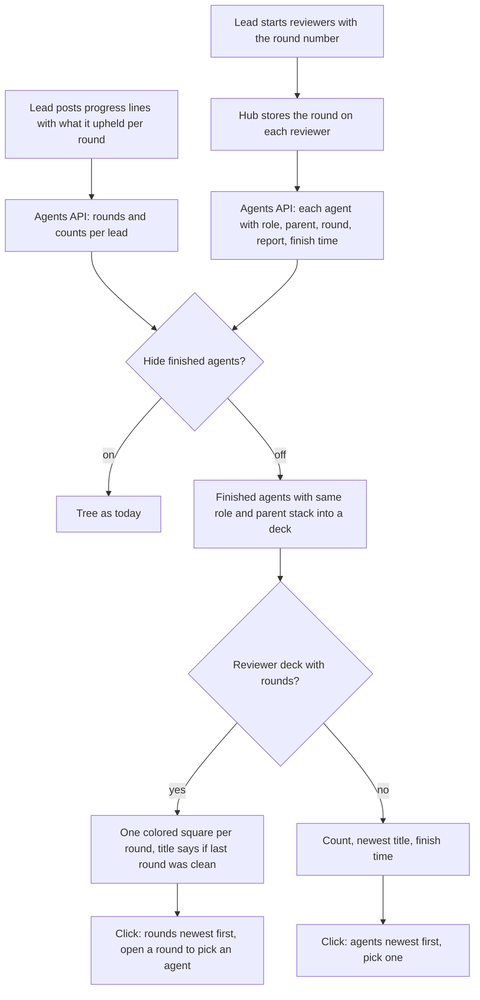

# Finished agents stack into decks on the Agents screen

**Idea:** `IDEA.md` — what this is for and why, in plain language. Read it first; it is
the north star this plan serves. Goal and Constraints live there, not here, so they don't
get buried as this file grows.

## Open Questions

Ordered by leverage; discussed one at a time. A settled question moves to the Decision
Log and is deleted from here.

(none)

## Watch List

Things noticed that need looking into — not yet decisions for the user. Written down the
moment they're spotted so they can't be forgotten, surfaced to the user one line at a
time as they appear, and emptied before Stage 1 exits.

Each item ends up settled by the agent (noted in the Log), promoted to an Open Question,
promoted to a Constraint or Accepted Risk, or waved off by the user.

| # | Noticed | What needs looking into | Raised to user? | Outcome |
|---|---------|-------------------------|-----------------|---------|

## Decision Log

Append-only. A reversal is a new entry superseding the old, never an edit.

| # | Decision | Rationale | Source |
|---|----------|-----------|--------|
| 1 | Mode: two-part | Collin picked it on the mode card | user |
| 2 | Round numbers are recorded at start: reviewer and verifier `session start` take a round number, stored on the session | MAP: no existing record ties a session to a round; attempt ids are per start, not per round (MAP.md) | defaulted |
| 3 | Objection and problem text comes from the stored report's `SEVERITY:` / `GAP:` lines | Reports already use these exact line forms | defaulted |
| 4 | Decks group only what the tree shows today; closed asides, which the tree never shows (`viewer/app/agents.js:115`), stay out | Adding them is a separate change to which agents appear | defaulted |
| 5 | A round's square is colored by the lead's upheld count for that round (the progress line's `found`), not the raw count in reports | Measures convergence, not reviewer chattiness; same number the progress line shows | user |
| 6 | A round with no counted progress line gets a grey "not counted" square | Happens for an interrupted round or one still in triage; inventing a number would mislead | defaulted |
| 7 | Objection text is shown only when the upheld count is 1 and the round's reports hold exactly one finding line; otherwise the count | Raw text can't be matched to the upheld finding otherwise | defaulted |
| 8 | Reviewer decks are titled "Plan review", verifier decks "Checks"; other decks take their newest agent's title | Agent titles vary per start; the proposal's example titles are role-based | defaulted |
| 11 | Verification attempts numbered from the highest verifier round in session list | Durable across sub-lead crashes and the all-deferred re-check, which has no remediation file | review-round-2 |
| 10 | Verifier deck title uses the newest verifier's title (supersedes the verifier half of #8) | Matches the proposal's "Checked parts 1–4" example | review-round-1 |
| 12 | Deck titles end ", last round clean" from round H's progress line, not "then approved"/"passed" (supersedes the suffix rules in Spec §3) | Approval tracking kept breaking in review; the progress line is certain | user |
| 13 | IDEA.md's example title and Constraint updated to match Decision 12 | Keeps IDEA and the proposal reference consistent with Collin's choice | idea-change |
| 14 | Round squares are for reviewer decks only; verifier decks stack like worker decks; no change to verification numbering, sub-lead.md or cards.md. Supersedes the verifier parts of Decisions 2, 10 and 11, and removes Deferred D3 | Verifier numbering caused most of the review churn; builds rarely need more than two or three checks | user |
| 15 | IDEA.md updated: verifier decks have no squares | Follows Decision 14 | idea-change |
| 16 | Clarifies 14: verifier decks keep Decision 10's newest-member title, without " · N rounds" | Matches Spec §3 | review-round-7 |
| 9 | Popover shows the latest 5 rounds (or agents) before "Show all" | Proposal says "the latest few" | defaulted |

## Spec

### Scope
Viewer hub and Agents page (`viewer/app/sessions.js`, `viewer/app/agents.js`, `viewer/app/wc.js`, `viewer/app/API.md`, `viewer/pages/agents.js`, `viewer/pages/views.css`, tests in `viewer/test/`), plus protocol text in `protocol/app/lead.md`. `protocol/app/sub-lead.md` and `protocol/app/cards.md` are not changed (Decision 14). Also add Collin's proposal files to the repo unchanged: `docs/proposals/app-shell/finished-agents.md` and `docs/proposals/app-shell/design/AgentsFinishedDecks.dc.html` (sources: the attached copies the lead hands to the build). Routers (`viewer/AGENTS.md`) updated if a file's role changes.

### 1. Round number on reviewer sessions
- `wc.js session start` accepts `--round <N>` (integer >= 1). A bare `--round` with no value (last argument, or followed by another `--flag`) is refused by `wc.js` itself before calling the hub. The hub stores it on the session as `round`. Accepted only for role `reviewer`; any other role, or a non-integer / < 1 value, is refused with a reason naming the flag. This validation runs before the attempt dedupe below, so an invalid `--round` is refused even when the attempt matches an existing session. Absent means no round.
- Retries keep today's attempt dedupe (`viewer/app/sessions.js:606-611`): a start whose `--attempt` matches a live or unanswered session returns that session (an unanswered one is retried as today); its stored `round` never changes, and the new call's `--round` is ignored; otherwise a new session is created carrying the `--round` of its own start call. No other change to dedupe.
- `round` is included in the public session and in the Agents API node.
- Protocol: lead.md step 5 tells the lead to pass `--round <N>` (the review round number, same as the progress `pass`) when starting reviewers, including restarts within a round. Verifiers are never started with `--round`.

### 2. Per-round counts and outcome in the Agents API
For each lead in `GET /wheelchair/api/agents`, add `rounds: { review: {<N>: R} }` built from the thread's `progress` cards (including replaced ones) with `stage` `review`. For each pass N, use the latest such card for that pass whose phase is `fixing` or `clean`:
- `fixing` → `found: F`.
- `clean` → `found` = its `found` if present, else 0; `clean: true`.
- Only `checking` cards for that pass → no entry (count unknown).

Per reviewer node add `report: { findings: <int>, first: <string|null> }` parsed from the newest result summary: reviewers count lines starting `SEVERITY:` or `RE-RAISE: SEVERITY:` (strip the `RE-RAISE: ` prefix before parsing) and take the finding text of the first: split on ` — `, drop the first two fields (severity, lens) and the last (evidence), and rejoin the rest with ` — `. A line with too few fields uses everything after the first field. No result → no `report`.

Every node with `state === 'finished'` gets `finished_at`: its `ended_at`, else the `created_at` of its newest result card, else its own `created_at`. The page uses only `finished_at` for finish times.

### 3. Decks on the tree (Hide finished agents OFF)
- Among one parent's children, finished nodes with the same `role` form a deck when there are 2 or more. A single finished node stays a normal box. Live (working, waiting, idle) nodes are never in a deck. Deck eligibility is exactly the node's `state === 'finished'` from the API (not `live`), the same test the page uses today.
- The deck replaces those boxes, placed at the position of its newest member in the existing creation order. The deck is a parent in its own right: the children of all its members are merged into one child list under the deck (sorted by creation), and grouping under it uses the deck as their parent. So the workers of two decked sub-leads can share one deck. This is the meaning of "same parent" for agents under a deck.
- Deck card: role, count (`×40`), one-line title, and "Finished <clock time, HH:MM, same format as `clock()` in viewer/pages/agents.js>" from the latest `finished_at` across all members (§2). Drawn with two offset outlines behind it (CSS only), dashed like finished boxes.
- Title: reviewer → "Plan review · N rounds", with the suffix ", last round clean" when `rounds.review[H]` has `clean: true`. N (the count shown) = number of distinct `round` values among members; H = the highest of them. Members with no `round` are not counted in N; if no member has a round, a reviewer deck uses the other-deck title. Other decks (including verifiers): the newest member's title (role when it has none).
  - No approval tracking: the suffix reports only what round H's progress line says.
- Hide finished agents ON: behaviour unchanged (decks never shown; a selected finished agent and needed ancestors still shown as boxes).

### 4. Round squares
- Reviewer decks with at least one member `round` show one square per distinct round, oldest to newest, wrapping to further lines.
- Color from `rounds.review[N].found`: 5+ red `#d9645a`, 3–4 orange `#e0904a`, 1–2 yellow `#d9c45a`, 0 green `#4ea87b`; no entry → grey, meaning not counted.
- The square row has an accessible label: "<N> rounds; objections went from <first counted> to <last counted>"; with fewer than two counted rounds, "<N> rounds".

### 5. Deck popover
- Clicking a deck (button, keyboard-activatable) opens a popover anchored under it; Escape, clicking outside or clicking the deck again closes it. Only one open at a time. It survives the 5-second refresh (stays open, content updates). The open popover, and any expanded round, is remembered by the name of one member session (the newest at opening); after a refresh it reopens on whichever deck now contains that session (for example after two child decks merge), with the same round expanded if it still exists and "Show all" restored if it was pressed (if the remembered round would fall past the five-row cutoff, the list opens in Show all); if no deck contains it, the popover closes.
- Reviewer decks with rounds list rounds newest first: square, "Round N", "<k> reviewers · <text>". <text> is "1 objection: <first>" when found is 1 and the round's members' reports total exactly one finding line; else "<found> objections" (singular for 1); "no objections" for 0; "not counted" with no entry. A round whose entry has `clean: true` and found > 0 appends " · round clean" (a clean round can still hold counted findings, minor or moved to Deferred, so its square may be yellow or worse while the title says "last round clean"; that is intended). Shows the latest 5 rounds, then a "Show all N rounds" button that expands in place. Members without a round are listed after the rounds as a final group "Other", always shown regardless of the cutoff.
- Opening a round lists its agents (title, finished time); each is selectable exactly like a box: sets `?agent=` and shows that agent in the right panel. The deck containing the selected agent is drawn selected.
- Other decks (verifiers included) list their agents newest first, latest 5 then "Show all N agents", each selectable the same way.
- Works at phone width (popover fits the viewport width).

### 6. Info popout
A `?` button next to "Hide finished agents" opens "How to read this tree": one line on stacked cards; the color key (four colors plus grey "not counted"); two example rows of squares, "Settling down" (red → orange → yellow → green) and "Going in circles" (orange/red alternating). Closes like the deck popover.

### Non-goals
Changing Hide finished agents ON; decking live agents; closed asides; changing how review/verification runs; backfilling rounds for agents started before this change (they show as decks without squares).

### Edge cases
- Question paths (`drawQuestionPaths`, `viewer/pages/agents.js:72-88`): every decked session resolves to its deck's element (the deck carries `data-session` for each member, or a lookup maps member names to the deck); a hop between two members of the same deck is skipped. A live worker's question path through a decked sub-lead still draws its segments to and from the deck. The same member-to-deck mapping applies to the phone path highlight (the classes set on cards and child lists, `viewer/pages/agents.js:125`, `viewer/pages/views.css:183`).
- Restarted reviewer in the same round: both members counted under that round; the reviewer count includes it.
- Dead/stopped sessions with no result count as finished members; no `report`.
- A deck whose members change (one more finishes) updates on the next refresh without closing an open popover.
- Two leads in a thread (old lead's children attach to newest lead today): unchanged; decks follow displayed parent.

### Validation
- `node --test viewer/test/*.test.js` (unquoted glob) passes, with new tests for: `--round` accepted for reviewer, refused for verifier and other roles and bad values, kept on attempt re-run; `rounds` built from progress cards (fixing, clean with and without found, checking-only); `report` parsing for reviewer summaries.
- `npm --prefix viewer run test:browser` passes, with new desktop and phone cases: 3 finished reviewers under one lead show one deck `×3` with squares in the right colors; one finished worker stays a box; 2 finished verifiers show a deck with no squares; a live reviewer is not decked; deck popover lists rounds newest first and selecting an agent opens the right panel; "Show all" expands; `?` popout opens and closes; Hide finished ON shows no decks; with a deck popover open and a round expanded, a poll that adds a finished member keeps the popover and round open and shows the new member.
- `bash machine/test/run.sh` still passes if `wc.js` changes touch machine-side forwarding.

## Deferred

| # | Item | Why it can wait | Source | Notes for the follow-up |
|---|------|-----------------|--------|-------------------------|
| D1 | Full keyboard handling in the deck popover: arrow keys between rows, focus moved into the popover and returned to the deck on close | Mouse/tap, Enter/Space to open and Escape to close already work | planning | Follow the proposal's popover; check with Playwright keyboard tests on both browsers |
| D2 | Deck squares for agents started before this change (backfilling round numbers from old cards and plans) | New threads get rounds from now on; old ones still deck, just without squares | planning | Membership can't be recovered reliably from timestamps (MAP.md); would need a best-effort match against progress `checking` cards |

## Accepted Risks

Real issues consciously not fixed, each with the reason. Part of the spec, not review
scaffolding — an implementer should read these, and later review rounds must not
re-raise them.

| Risk | Why accepted | Round |
|------|--------------|-------|
| A finding or gap whose evidence itself contains ` — ` can show part of the evidence in the one-objection text | Reports have no escaping; the line is still counted, only the shown text is longer than ideal | 5 |
| After a lead restart mid-round, a stale report's single finding can be shown as the round's one objection | Rare (restart mid-round with exactly one leftover finding); only the text is wrong, the count and color are right | 2 |

## Review Rounds

### Round 1 — 2026-11-18

**Lanes:** intent: claude / claude-opus-5-5; mechanics: gpt / gpt-6.2-sol; cross-family: yes.

Written for every round, including one where the table below stays empty. The table gets a row
per finding, so a clean round would otherwise leave no record of which gate ran — which is the
round where knowing it matters most.

<!-- Round 2+: list what changed since the previous round; that list scopes the reviewers. -->

**Changed since Round N-1:** n/a (first round — whole Spec in scope)

| Lane | Reported | Finding | Lead verdict | Resolution |
|------|----------|---------|--------------|------------|
| intent | minor | API `report` field duplicates what the page could parse from `result_summary` | declined | Parsing in the API keeps it under the Node unit tests (`viewer/test/app-agents.test.js`) and the page stays drawing-only; no extra behaviour |
| intent | minor | Accessible label says "fell" even when counts rise | upheld | §4 now says "went from X to Y" |
| intent | minor | Verifier deck title "Checks" drifts from proposal's "Checked parts 1–4" | upheld | §3 uses newest verifier's title; Decision 10 |
| intent | minor | Dropping asides from decks not approved by Collin | declined | Told to Collin in chat when the default was made, with the reason (closed asides never reach the tree, `viewer/app/agents.js:115`); IDEA Not doing covers changes to which agents appear |
| mechanics | blocking | Children of different decked parents: grouping key unclear | downgraded (minor) | Spec already said "merged and decked by the same rule"; a worker would not stop. Clarified §3: the deck is the parent for its members' children |
| mechanics | blocking | Single-objection text could come from a report discarded by a lead restart | downgraded (minor) | Only a restart mid-round with exactly one stale finding; shows wrong text, builds nothing wrong. §5 now uses only members started after the round's newest checking card |
| mechanics | blocking | "then approved" can show before approval and stay after the plan returns to review | upheld (major) | §3 defines approved/passed from approval card and later progress cards; API flags added |
| mechanics | major | Verifier round N not durable across a sub-lead crash | declined | N is the verify `pass`, defined as REMEDIATION-N's N + 1 (`protocol/app/cards.md` progress table), from committed files; a replacement restarting the same attempt reuses N correctly, and `rounds` is keyed by progress cards, not sessions, so nothing is overwritten |
| mechanics | major | Retry of a finished attempt id: what round does it get | upheld | §1 now states today's dedupe and that a new session carries its own start's round |
| mechanics | minor | Accessible label says "fell" | upheld | Same as intent finding; fixed |
| mechanics | minor | No browser case polls with a deck open | upheld | Added to Validation |

Reported severity is the reviewer's opinion; the lead verdict
(`upheld`/`downgraded`/`declined`/`accepted-risk`/`user-decision`) is what gates the
exit. Downgrades and declines cite evidence.

### Round 2 — 2026-11-18

**Lanes:** intent: claude / claude-opus-5-5; mechanics: gpt / gpt-6.2-sol; cross-family: yes.

**Changed since Round 1:**
- §1: retry/dedupe wording replaced (new session carries its own `--round`).
- §3: deck is the parent for its members' merged children; "then approved" / "passed" defined from approval and later progress cards; API `approved` / `passed` flags; verifier deck title from newest verifier's title.
- §4: accessible label "went from X to Y".
- §5: single-objection text uses only the round's current members.
- Validation: polling case with an open deck.

| Lane | Reported | Finding | Lead verdict | Resolution |
|------|----------|---------|--------------|------------|
| intent | minor | Retracted approval still earns "then approved" | upheld | §3 now requires an approval not retracted |
| intent | minor | "Current members" timestamp rule is heavier than needed | declined | Rounds normally have two reviewers; the suggested one-member rule would almost never show text, losing the proposal's "objection text when there's one" |
| mechanics | blocking | "Current members" filter excludes the normal cohort (checking is posted after starts) | upheld | Filter removed (§5); the restart case moved to Accepted Risks |
| mechanics | major (RE-RAISE) | All-deferred re-check has no REMEDIATION file, so its attempt number is ambiguous | upheld | §1 numbers attempts from the highest verifier `round` in session list and updates cards.md's `pass` wording; supersedes Round 1's decline of the related finding |
| mechanics | major | N used for both round count and outcome key | upheld | §3 separates N (count) and H (highest) |
| mechanics | major | Withdrawn approval still counts while back in review | upheld | Same fix as intent row (not retracted); discussion-only withdrawal behaviour stated in §3 |
| mechanics | major | Question paths through a decked sub-lead lose segments | upheld | Edge cases: decked sessions resolve to the deck element |
| mechanics | minor | Unanswered retry is retried, not returned unchanged | upheld | §1 wording fixed; stored round never changes |

### Round 3 — 2026-11-18

**Lanes:** intent: claude / claude-opus-5-5; mechanics: gpt / gpt-6.2-sol; cross-family: yes.

**Changed since Round 2:**
- §1: unanswered-retry wording; new verification attempt numbering rule (highest verifier `round` + 1) and cards.md `pass` wording.
- §3: N (count) vs H (highest round) separated; "then approved" needs a non-retracted approval; behaviour while an approval is being discussed.
- §5: single-objection text no longer filters by checking time; restart case in Accepted Risks.
- Edge cases: question paths through decked sessions.
- Scope adds `protocol/app/cards.md`.

| Lane | Reported | Finding | Lead verdict | Resolution |
|------|----------|---------|--------------|------------|
| intent | minor | "then approved" lingers after a Spec change during Talk about it | accepted-risk | Moved to Accepted Risks: window lasts until the next round starts |
| mechanics | blocking | A replaced approval still satisfies "then approved" | upheld | §3 now uses the current, non-replaced approval |
| mechanics | blocking | Builds straddling the update can reuse verify pass numbers | upheld (moved to Deferred) | Hardening for a one-time transition; Deferred D3 |
| mechanics | major | Invalid `--round` vs dedupe order unclear | upheld | §1: validation runs before dedupe |
| mechanics | minor | Parser skips `RE-RAISE:` findings | upheld | §2 counts and parses them |
| mechanics | minor | Phone path highlight not mapped to decks | upheld | Edge cases extended to phone classes |

### Round 4 — 2026-11-18

**Lanes:** intent: claude / claude-opus-5-5; mechanics: gpt / gpt-6.2-sol; cross-family: yes.

**Changed since Round 3:**
- §3: title suffix is now ", last round clean" from round H's progress entry (Decision 12); all approval tracking and the API `approved`/`passed` flags removed; the related Accepted Risk removed.
- §1: invalid `--round` refused before attempt dedupe.
- §2: `RE-RAISE: SEVERITY:` lines counted and parsed.
- Edge cases: phone path highlight maps members to decks.
- Deferred D3 added (builds straddling the update).

| Lane | Reported | Finding | Lead verdict | Resolution |
|------|----------|---------|--------------|------------|
| intent | minor | IDEA.md and the proposal still say "then approved" | upheld | IDEA example and Constraint updated (Decision 13) |
| mechanics | blocking | New attempt numbering could rewrite an existing REMEDIATION-N.md | upheld | §1 numbering also counts committed remediation files; D3 narrowed |
| mechanics | minor | Bare `--round` indistinguishable from absent | upheld | §1: wc.js refuses it |
| mechanics | minor | Finding text containing ` — ` truncated | upheld | §2 takes the middle fields rejoined |
| mechanics | minor | Popover anchor lost when child decks merge | upheld | §5 remembers a member session and reopens on its deck |

### Round 5 — 2026-11-18

**Lanes:** intent: claude / claude-opus-5-5; mechanics: gpt / gpt-6.2-sol; cross-family: yes.

**Changed since Round 4:**
- IDEA.md example and Constraint now say "last round clean" (Decision 13).
- §1: verification numbering also counts committed REMEDIATION-N.md files; bare `--round` refused by wc.js. D3 narrowed.
- §2: finding/gap text parsing keeps text containing ` — `.
- §5: popover remembered by a member session across refreshes and deck merges.

| Lane | Reported | Finding | Lead verdict | Resolution |
|------|----------|---------|--------------|------------|
| intent | minor | "last round clean" next to a yellow/orange square looks contradictory | upheld | §5 popover row appends " · none serious" for clean rounds with minor objections; stated as intended |
| mechanics | major | A sub-lead restart could push the first failure into attempt 2, skipping the "attempt 1 sharpens the brief" rule | upheld | §1: unreported attempt reused on sub-lead restart; sub-lead.md rule reworded to "first remediation" |
| mechanics | minor | Remembered expanded round hidden past the five-row cutoff | upheld | §5 restores Show all |
| mechanics | minor | Evidence containing ` — ` leaks into the shown text | accepted-risk | Accepted Risks; count unaffected |
| mechanics | minor | Deck finish time from newest-created member, not latest finish | upheld | §3 uses latest `ended_at` across members |

### Round 6 — 2026-11-18

**Lanes:** intent: claude / claude-opus-5-5; mechanics: gpt / gpt-6.2-sol; cross-family: yes.

**Changed since Round 5:**
- §1: unreported attempt reused by a replacement sub-lead; sub-lead.md first-remediation wording.
- §3: deck finish time is the latest across members.
- §5: " · none serious" (since renamed " · round clean") on clean rounds with minor objections; Show all restored on refresh.
- Accepted Risks: ` — ` inside evidence.

| Lane | Reported | Finding | Lead verdict | Resolution |
|------|----------|---------|--------------|------------|
| intent | minor | Relative finish time differs from the screen's clock time | upheld | §3 uses clock time like the design |
| mechanics | major | Replacement sub-lead can't tell whether the last attempt has a verdict | upheld | §1 simplified: a replacement always takes a new number; the unreported attempt shows grey. No lookup needed |
| mechanics | major | Surviving verifiers of a dead sub-lead vs the replacement's numbering | upheld | Same simplification: numbering no longer depends on them; their handling is unchanged from today's restart rules |
| mechanics | minor | "none serious" wrong when a major finding moved to Deferred | upheld | Text is now " · round clean" |
| mechanics | minor | "last activity time" fallback undefined | upheld | §3 uses newest result card time, else creation time |

### Round 7 — 2026-11-18

**Lanes:** intent: claude / claude-opus-5-5; mechanics: gpt / gpt-6.2-sol; cross-family: yes.

**Changed since Round 6:**
- Decision 14: squares, rounds, `--round`, `rounds.verify` and GAP parsing removed for verifiers; verifier decks behave like worker decks; sub-lead.md and cards.md out of scope; Deferred D3 removed.
- §3: "Finished HH:MM" with fallback via newest result card time.
- §5: " · round clean" text.

| Lane | Reported | Finding | Lead verdict | Resolution |
|------|----------|---------|--------------|------------|
| intent | minor | Decision 14 wording suggests verifier decks lost the newest-member title | upheld | Decision 16 clarifies |
| mechanics | major | API lacks the per-member finish time the deck needs | downgraded (minor) | The Spec named the source (newest result card time) and `viewer/app/agents.js` and API.md are in scope, so a worker would add it without stopping; §2 now names `finished_at` explicitly |
| mechanics | minor | Deck eligibility should be `state === 'finished'`, not `live` | upheld | §3 states it |
| mechanics | minor | "Other" group could be hidden by the five-round cutoff | upheld | §5: always shown |

## Prior Work

Parts of the Spec already built before this plan reached Stage 3 — adopted from outside
with work already done, or left behind by an implementation run that died partway.

Stage 3 does not re-implement `pre-existing` items and does not touch their code. Stage 4
verifies them exactly as rigorously as everything else: this code has never been through
the gate, so skipping it would leave the least-trustworthy part of the change as the only
part nobody checked.

Ambiguous evidence means **not done**. A wrong "done" is a silent hole; a wrong "not done"
costs a worker one look.

| Spec item | State | Evidence (file:line) | Confidence |
|-----------|-------|----------------------|------------|
|           | pre-existing / partial | | high / low |

`partial` items are implemented by Stage 3 — the brief names what exists so the worker
completes it instead of restarting it.

## Implementation Tasks

Filled by Stage 3. One row per worker brief.

| # | Objective | Ownership boundary | Lane | Session id | Validation | Status |
|---|-----------|--------------------|------|-----------|------------|--------|

Session id = the `thread_id` of a `codex exec` lane, so remediation can resume it.

## Log

Free-form running notes: deviations discovered mid-implementation, scope events,
anything a future session needs that fits nowhere above.

Build accepted: approval 408048b5-0427-443e-9d5e-4fc6d2b09c7d
