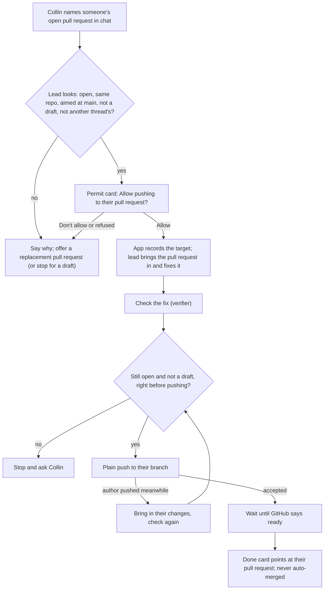

# Fix other people's pull requests

**Idea:** `IDEA.md` — what this is for and why, in plain language. Read it first; it is
the north star this plan serves. Goal and Constraints live there, not here, so they don't
get buried as this file grows.

## Open Questions

Ordered by leverage; discussed one at a time. A settled question moves to the Decision
Log and is deleted from here.


## Watch List

Things noticed that need looking into — not yet decisions for the user. Written down the
moment they're spotted so they can't be forgotten, surfaced to the user one line at a
time as they appear, and emptied before Stage 1 exits.

Each item ends up settled by the agent (noted in the Log), promoted to an Open Question,
promoted to a Constraint or Accepted Risk, or waved off by the user.

| # | Noticed | What needs looking into | Raised to user? | Outcome |
|---|---------|-------------------------|-----------------|---------|

## Decision Log

Append-only. A reversal is a new entry superseding the old, never an edit.

| # | Decision | Rationale | Source |
|---|----------|-----------|--------|
| 1 | Mode two-part | Collin's pick on the mode card | user |
| 2 | Collin's OK is given once per pull request per thread, through a dedicated card the app records (target PR link, head branch, head repo), not a plain question card | The done gate and auto-merge must know the target PR; a recorded card is what the app can read | defaulted |
| 3 | Pushes to another person's PR are plain (non-force) pushes; on rejection: fetch, merge, re-verify, push again | Never overwrites the author's work (IDEA) | defaulted |
| 4 | The thread never opens its own PR when it is fixing someone else's; its done card points at the target PR | IDEA: no replacement PR | defaulted |
| 5 | The thread does not post reviews or comments on GitHub; review findings stay in the thread | Keeps scope to fixing; can be added later | defaulted |
| 6 | A thread takes on someone else's PR when Collin names it in chat ("fix PR #173"); no new start screen. A picker is deferred | Collin's pick; matches how Junjie's thread worked | user |
| 7 | The app never auto-merges a PR the thread did not open; the done card says it is fixed and ready, and Collin or the author merges | Collin's pick: it is the author's PR and they may still be working | user |
| 8 | Only a thread on the small-fix path, with no plan or commits of its own yet, may take on someone else's PR | A plan's documents and unrelated commits would otherwise be pushed into the author's PR | defaulted |
| 9 | No mockup designer: the only visible part is one card shaped like the existing reach card | Trivial visible change | defaulted |
| 10 | The OK card is a new `permit` kind, refused for closed PRs, forks, this thread's own branch and any branch of another thread record on this hub | The hub can check these itself; the lead checks `session leads` too | defaulted |
| 11 | Only PRs whose base is the thread's default branch are supported; others are turned down and a replacement PR offered | Avoids pushing main's commits into a PR aimed elsewhere; collaborators' PRs here target main | review-round-1 |
| 12 | The `permit` card is posted before the PR is brought in, and is relayed synchronously, never queued | Records the chosen PR before any work so a restart finds it; a queued card the hub later refused would vanish | review-round-1 |
| 13 | Off the normal path (a restart, the PR closed, merged, retargeted or made a draft, anything not covered), the thread changes nothing and asks Collin in one question card what to do | Collin's pick after three review rounds drew findings in the self-recovery rules; fewer rules, an occasional extra question | user |

## Spec

### What changes, in one paragraph

A thread can take on an existing open pull request that someone else opened (a "target
PR") when Collin names it in chat. Before bringing it in, the lead posts a new `permit`
card. Once Collin presses Allow, the hub records the target on the thread. The lead brings
the PR into its own worktree, fixes and verifies it as a small fix, and pushes with a plain
(never forced) push to the target PR's head branch. It opens no PR of its own and
finishes with a `done` card pointing at the target PR. The done gate accepts that PR, and
auto-merge never merges it or deletes its branch.

Supported targets: an open PR in the same GitHub repository as the thread's `origin`,
whose head branch is in that repository (not a fork), and whose base is the thread's
default branch. Anything else is turned down and the old way (a replacement PR) is offered.

### The flow



### 1. The `permit` card (new, lead-only, shown)

Fields (both required): `pr_url` (`https://github.com/<owner>/<repo>/pull/<n>`) and `why`
(one line, the user's terms). Nothing else is accepted. Add it to `shown`, `roles` and
`fields` in `viewer/app/card.js`, and to the retractable kinds (`card.js:277`, with the
refusal text `only a question, offer, approval, needs, sudo, deferred, reach or permit card can be retracted`).

**Never queued.** The machine relays a `permit` card synchronously, like `done` and
`lesson` (`machine/service.js:2263`): add `permit` to that condition, with the unavailable
text `the app is unreachable; the permit card was not recorded; try again in a minute`.
So the lead always gets either an id or a refusal.

On post, the hub (`viewer/app/cards.js`, beside the `reach` checks at :163) runs
`gh pr view <pr_url> --json number,title,state,author,headRefName,baseRefName,isCrossRepository`
and refuses (422) in this order:
1. `the pull request link is not a GitHub pull request` (regex of `viewer/app/pr-gate.js:32`).
2. `couldn't reach GitHub to check the pull request; try again in a minute`, or `the app's GitHub login can't read this pull request: <first stderr line>` (same split as `pr-gate.js:36-42`).
3. `that pull request is closed` (state not `OPEN`).
4. `that pull request comes from a fork; pushing to forks isn't supported yet` (`isCrossRepository` true).
4a. `that pull request is a draft; ask the author to mark it ready first` (`isDraft` true; add `isDraft` to the `--json` list).
5. `that pull request targets <baseRefName>, not <thread.default_branch>` (when `thread.default_branch` is set and differs).
6. `that is this thread's own branch` (`headRefName` equals `thread.branch`).
7. `that branch belongs to the thread "<title>" on this hub`: among other thread records that are not archived, one has the same `project` and a `branch` equal to `headRefName`, or (any project) a `target_pr` whose url names the same `<owner>/<repo>` and whose `head_branch` equals `headRefName`.
8. `this thread already has an OK for <target url>` (`thread.target_pr` is set).
9. `a permit request is already open` (an unanswered, unretracted `permit` card exists).

The hub copies onto the stored card: `pr_number`, `pr_title`, `pr_author` (login), `head_branch`.

Shown (`viewer/pages/thread.js`, modelled on the reach card at :981-998): "Let this thread
push its fix to **<pr_author>**'s pull request #<pr_number>: <pr_title>?", the `why`, the
head branch in small text, and **Allow** and **Don't allow**. One answer only, like reach
(:796). Answered, it shows "You picked Allow" / "You picked Don't allow", or "Allow failed:
<reason>" when `allow_failed` is set, extending the reach branches of `answeredTag`
(`thread.js:836-850`) and the tag condition at :1327 to `permit`. An open permit card counts in "Needs you": add `permit` to the kind list at `viewer/app/views.js:142`, with the shown title `Push to #<pr_number>?`.

Press handling (`viewer/app/threads.js`, beside reach at :330). On `allow`, re-run checks
7 and 8 and, in the same synchronous step with no `await` between the checks and the
assignment, set `thread.target_pr = { url, number, head_branch, title, author, card, allowed_at }`,
then save. If a check fails, mark `allow_failed` and send `[card <id>] allow failed: <reason>`.
Otherwise send `[card <id>] picked: allow`. On `don't allow` send `[card <id>] picked: don't allow`
and change nothing else. Messages go to the latest live lead exactly as reach does.

Docs: `protocol/app/cards-lead.md` gets a `permit` section (fields, never queued,
refusals, presses) and the retract refusal text above; `protocol/app/cards.md` gets the
row in the kinds table and the press forms (`picked: allow`, `picked: don't allow`,
`allow failed: <reason>` on your `permit` card); `viewer/test/protocol-rules.test.js` adds
`permit` to `leadKinds`.

### 2. Done gate (`viewer/app/pr-gate.js` `judgePr`)

When `thread.target_pr` is set and the done card's `pr_url` equals `thread.target_pr.url`
exactly, compare `view.headRefName` with
`target_pr.head_branch` instead of `thread.branch`. Every other rule is unchanged,
including the base check against `thread.default_branch`. A done card for any other PR is
judged exactly as today.

### 3. Auto-merge and plan discovery

- A thread with `target_pr` never records a slug, on every path that records one: the
  `newPlanDirectories` path in `viewer/app/views.js` (:38), `discoverSlug`, and the
  remote-machine refresh (`viewer/app/remote-plan.js:24-40`, reached from `hub.js:303` and
  `routes.js:522`) all skip it. Merging a
  collaborator's PR can add their `docs/plans/<slug>/`, which is not this thread's plan.

- `viewer/app/auto-merge.js`: when the current done card's `pr_url` equals
  `thread.target_pr.url`, `afterCheck` does nothing: no merge, no "Not merged
  automatically" notice, no branch deletion. The `merged` card from `pollMerged`
  (`threads.js:466-495`) still appears when someone merges it.

### 4. Lead protocol (`protocol/app/lead.md`)

Change the line at :515 to: "No thread pushes to another thread's branch, except a target
PR's branch as in 'Fixing someone else's pull request'." Add that section:

- **When:** Collin names an open PR (number or link) that this thread did not open and
  asks for it to be reviewed or fixed. Only on the small-fix path, before the thread has
  a plan directory or any commit of its own. Otherwise say it needs a new thread and
  offer a stub naming the PR. If the fix turns out to need a plan, say so and offer a stub.
- **Look first:** `gh pr view <n> --json url,state,isDraft,headRefName,baseRefName,isCrossRepository,author,title`
  run in the worktree (so it resolves against `origin`; a full link must name the same
  repository as `gh repo view --json url`). A draft: say the author must mark it ready
  first and stop. Closed, a fork, a base other than the default branch, another
  repository, or a head branch that equals a `branch` in `session leads`: say so plainly
  and offer the old way (a replacement PR from this thread's own branch, as a normal small
  fix). Make no permit card.
- **Ask first:** post the `permit` card now, before fetching or editing anything, so the
  chosen PR is recorded. A refusal: say why in the reply; for a draft stop there,
  otherwise offer the old way. On
  `don't allow` or `allow failed`, offer the replacement PR in a `question` card. Once
  allowed, the target holds for the life of the thread. After a restart, an allowed
  `permit` card in the context names the target; an open one is still waiting.
- **Off the normal path, stop and ask.** After a restart, or whenever the target PR is
  closed, retargeted or turned into a draft, merged before this thread's `done` card at
  a commit other than the pushed one, or anything else this section does not cover
  happens: change nothing (never abort a merge, push,
  revert or stub on your own), and post one `question` card saying in plain words what you
  see (local work, what is on the PR, its state) with fitting options, such as carry on,
  push after a check, start a follow-up thread, or leave it. Do what Collin picks using
  the rules here and in "Making the pull request mergeable". This replaces that section's
  steps 4 (merged at another commit), 5 and 9 (After a restart) for a target PR. Not a question: a restart
  with an open `permit` card (keep waiting on it); a restart where an accepted `done`
  card's `head` equals local `HEAD` and `git status --untracked-files=no` is clean (carry
  on with step 10's restart rule only); a merge at the pushed commit (post `done` as in
  that section's step 4); a problem reported after `done` (lead step 9, After done, as
  usual, whose `MERGED` stub uses the Stubs rule below; its state check reads
  `gh pr view <target url> --json state,isDraft`, and a draft is off the normal path).
- **Bring it in:** `wc.js git fetch origin <head branch>`, then `wc.js git merge origin/<head branch>`
  (this also brings the default branch, as of the thread's start, into the PR; expected).
  Resolving conflicts is the normal path: edit the files and `wc.js git commit --paths
  <resolved files>`. Review and fix as a small fix: commits, progress line and verifier as step 1, the
  verifier briefed with the PR's title and description and Collin's request.
- **Push:** immediately before every push, run `gh pr view <target url> --json state,isDraft`.
  `OPEN` and not a draft: `wc.js git push origin HEAD:<head branch>`. Never `--force`, `--force-with-lease`
  or `+` refspecs, and never `wc.js git pr`. Anything else: stop and ask, as above. A rejected push (the author
  pushed): `wc.js git fetch origin <head branch>`, merge `origin/<head branch>`,
  re-verify unless it was a fast-forward, then push again.
- **Finish:** follow "Making the pull request mergeable" with `<head branch>` in place of
  `wc/<thread-id>` everywhere and the target URL as the PR. The `done` card's `pr_url` is
  the target URL; its `note` says it is ready for Collin or the author to merge and will
  not merge itself. `verified` follows the usual rule.
- **After done (step 9):** every `gh pr view` names the target URL. Fixes go to the same
  head branch the same way.
- **Stubs:** every stub from such a thread uses `depends_on_parent: false` and names the
  target PR and its branch in the summary.

### Not changed

A thread's own PR and its push to `wc/<thread-id>`; `wc.js`; new-thread creation; fork
PRs; PRs whose base is not the default branch; draft PRs; GitHub comments or reviews; `pollWaiting`.

### Validation

```bash
node --test viewer/test/*.test.js
npm --prefix viewer run test:browser
bash machine/test/run.sh
```

New or extended tests must cover:
- `viewer/test/app-permit.test.js` (new): each refusal 1-9 and 4a with a stubbed `gh` (7 both by another thread's `branch` and by its `target_pr.head_branch`, and not by another project's own `branch`, but yes by another project's `target_pr` for the same repository); an accepted card stores the copied fields; Allow sets `thread.target_pr`; Allow after another thread claimed the branch gives `allow failed`; Don't allow leaves `target_pr` unset; retract while open; a second press is refused.
- `viewer/test/app-done-gate.test.js`: a done card for the target PR passes with the target's head branch; a done card for another PR whose head is not the thread's branch is still refused.
- Slug discovery: a thread with `target_pr` whose worktree gained a new `docs/plans/<slug>/` records no slug.
- `viewer/test/app-auto-merge.test.js`: a target-PR done card with a passing check makes no merge, no notice and no branch deletion.
- `machine/test`: a `permit` card is relayed synchronously and returns 503 with the unavailable text when the hub is down; never spooled.
- `viewer/test/app-permit.spec.js` (new, Playwright): the card shows author, number, title and both buttons; pressing Allow shows it answered; a card with `allow_failed` shows "Allow failed: <reason>".
- `viewer/test/protocol-rules.test.js` passes with `permit` in `leadKinds` and the new section.

## Deferred

Optional; present only in the lighter modes.

| # | Item | Why it can wait | Source | Notes for the follow-up |
|---|------|-----------------|--------|-------------------------|
| D1 | Fixing pull requests that come from a fork | Collaborators push branches to this repo (PR #173 did); forks need the author's "allow edits by maintainers" and pushing to their repo | planning | Query `maintainerCanModify` and `headRepository`; push to the fork URL; until then the thread says it can't push and offers a replacement PR |
| D3 | A "Start from a pull request" picker on the new-thread screen | Naming the PR in chat works for normal use | planning | `viewer/pages/new.js:229-241`, `machine/service.js:668-713` create threads from main today |
| D4 | PRs whose base is not the default branch | Collaborators' PRs here target main | review-round-1 | Would need the thread to start from the PR head and repair against the PR's base, not `origin/<default>` (`machine/service.js:701-709`, lead.md step 7) |
| D5 | Starting the thread exactly at the PR head, so the first push adds only the fix | Merging the default branch into the PR is what a conflict fix does anyway | review-round-1 | Needs a guarded way to point an empty thread's branch at the PR head; `wc.js` has no reset (`viewer/app/wc.js:49-51`) |
| D6 | Fixing draft pull requests | Drafts are still being worked on by their author | review-round-2 | Finishing waits on `DRAFT` (`lead.md` Making the pull request mergeable 2); would need a done path that does not wait for ready |
| D2 | The machine itself refusing pushes to branches the thread has no OK for | Today's own-branch rule is also only a protocol rule; the recorded OK makes this possible later | planning | `machine/service.js:1588-1613` passes push args through; check refspec against own branch or recorded target |

## Accepted Risks

Real issues consciously not fixed, each with the reason. Part of the spec, not review
scaffolding — an implementer should read these, and later review rounds must not
re-raise them. Rare paths per `protocol/app/realism.md` land here in every mode, with round
`review-round-N`, `verification-N` or `lead-check`.

| Risk | Why accepted | Round |
|------|--------------|-------|
| Two Allow presses for the same branch in two threads within the same save window can both succeed | Rare path: sub-second race between two presses | review-round-2 |
| The network drops after the hub records a permit but before the reply, so the lead is told it was not recorded | Rare path; a retry is refused with `a permit request is already open`, which shows it exists | review-round-2 |
| A handed-off thread loses `target_pr`, so the importing machine's done gate refuses the target PR | Rare path: handing off a thread mid-fix of someone else's PR | review-round-1 |
| The author retargets the PR to another base while the thread is fixing it; the done gate then refuses it | Rare path: retargeting during a fix | review-round-1 |
| The author turns the target PR into a draft right after the thread's push; the Finish wait (`pr-wait.py`) polls until its time limit before the lead stops and asks | Rare path: the author changes the PR's state inside the finish window; worst case a ten-minute wait, then the usual time-limit handling | verification-1 |

## Check Once Built

Review findings only the built code can settle, per `protocol/app/realism.md`. Verifiers
check each row against the build; a listed row is settled for later review rounds and
stays as review history.

| # | What to check | Round |
|---|---------------|-------|

## Review Rounds

### Round 1 — 2026-11-23

**Lanes:** intent (claude); mechanics (other family); cross-family: yes.

Written for every round, including one where the table below stays empty. The table gets a row
per finding, so a clean round would otherwise leave no record of which gate ran — which is the
round where knowing it matters most.

<!-- Round 2+: list what changed since the previous round; that list scopes the reviewers. -->

**Changed since Round N-1:** n/a (first round — whole Spec in scope)

| Lane | Reported | Finding | Lead verdict | Resolution |
|------|----------|---------|--------------|------------|
| intent | blocking | Two threads can take on the same PR: refusal 6 only compares other threads' own branch | upheld | Refusal 7 and the Allow recheck also match other threads' `target_pr.head_branch`; check and assignment without an await between |
| intent | minor | Waiting stubs never become ready (pollWaiting uses parent.branch) | upheld | §3 pollWaiting uses the target PR; §4 stubs use `depends_on_parent: false` |
| intent | minor | Merging the PR into a branch cut from main pushes main into their PR; non-default bases get main's commits | upheld | Cut: base must be the default branch (refusal 5); D4, D5 deferred |
| intent | minor | Rare path: handoff loses `target_pr` | accepted-risk | Accepted Risks |
| mechanics | blocking | Permit may name a PR in another repository than origin | downgraded (minor) | A wrong-repo link makes the fetch of `origin/<head>` fail first; still fixed: Look first checks the link's repository against `gh repo view` |
| mechanics | blocking | Two threads can both be allowed for one branch | upheld | Same fix as intent finding 1 |
| mechanics | blocking | Merging the PR into a fresh worktree publishes main's commits; release-branch bases | upheld | Same cut as intent finding 3 |
| mechanics | major | PR closes or merges before the push | upheld | §4 Push: state check before every push, with closed and merged paths |
| mechanics | major | Retargeted base leaves the gate stuck | accepted-risk | Rare path; Accepted Risks |
| mechanics | major | Restart between commit and permit falls between rules | upheld | §4 Ask first: permit posted before fetching or editing; restart reads it |
| mechanics | major | Second permit's denial vs earlier allow | downgraded (minor) | Asking twice is unusual; cut: refusal 8 refuses any permit once a target is set |
| mechanics | major | Queued permit refused later is lost | upheld | §1 Never queued: relayed synchronously like done |
| mechanics | major | Dependent stubs wait forever | downgraded (minor) | Duplicate of intent finding 2; same fix |
| mechanics | minor | Step 9's `gh pr view` is unqualified | upheld | §4 After done: every `gh pr view` names the target URL |
| mechanics | minor | protocol-rules test, press markers and retract text need `permit` | upheld | §1 Docs |

Reported severity is the reviewer's opinion; the lead verdict
(`upheld`/`downgraded`/`declined`/`accepted-risk`/`check-once-built`/`user-decision`) is what gates the
exit. Downgrades and declines cite evidence.

### Round 2 — 2026-11-23

**Lanes:** intent (claude); mechanics (other family); cross-family: yes.

**Changed since Round 1:** permit refusals 5 (base must be default), 7 (also other threads' `target_pr.head_branch`), 8 (any existing target); Allow recheck without await; permit never queued (machine relay); pollWaiting uses the target PR; lead section reordered (permit first, repo check, state check before every push with closed/merged paths, step 9 names the target URL, stubs `depends_on_parent: false`); docs/test list for `permit`; D4, D5 deferred; two Accepted Risks.

| Lane | Reported | Finding | Lead verdict | Resolution |
|------|----------|---------|--------------|------------|
| intent | minor | §3 pollWaiting change and `depends_on_parent: false` cancel out | upheld | Dropped the pollWaiting change and its test; stubs needing unmerged PR code say to start once it merges |
| intent | minor | Needs-you entry would show as "Approval" | upheld | §1 names the kind-list change and title `Push to #<n>?` |
| mechanics | blocking | Overlapping Allow presses race across the async save | accepted-risk | Rare path: sub-second race between two presses in two threads |
| mechanics | major | 503 after the hub saved the permit | accepted-risk | Rare path: network drop in the exact window; retry shows "already open" |
| mechanics | major | Closed-PR path offers a replacement the thread cannot build | upheld | §4 Push: closed or merged both post a stub with the fix's commits |
| mechanics | major | Follow-up stubs needing unmerged PR code start from main | downgraded (minor) | Stubs after done arise when the PR merged; the rare other case says to start once merged |
| mechanics | major | Restart before the first push could abort a conflict merge | upheld | §4 Ask first: resume the small fix; mergeable step 9 only after the first push |
| mechanics | major | Refusal 7 compares branches across projects | downgraded (minor) | Worst case a false refusal; fixed: same `project` only |
| mechanics | major | Draft PRs pass the permit but done waits on DRAFT | upheld | Refusal 4a; drafts deferred (D6) |

### Round 3 — 2026-11-23

**Lanes:** intent (claude); mechanics (other family); cross-family: yes.

**Changed since Round 2:** refusal 4a (drafts) and D6; refusal 7 limited to the same project; Needs-you title; pollWaiting change dropped; closed and merged PRs both end in a stub with the fix's commits; restart before the first push resumes the small fix; follow-up stubs that need unmerged PR code wait for its merge; two Accepted Risks.

| Lane | Reported | Finding | Lead verdict | Resolution |
|------|----------|---------|--------------|------------|
| intent | minor | CLOSED stub has nothing to cherry-pick | upheld | §4 Push: CLOSED changes nothing; MERGED stubs only with own commits |
| intent | minor | Missed-merge stub in step 4 still `depends_on_parent: true` | upheld | §4 Stubs: every stub from a target thread, step 4 included |
| intent | minor | Look first misses drafts; a draft refusal offers a replacement | upheld | `isDraft` in Look first; drafts stop |
| intent | minor | Restart can't tell before or after first push | upheld | §4 Restart before done: ancestor test |
| mechanics | blocking | Two clones of one repo can both claim a branch | downgraded (minor) | Two projects of one repo on one hub, both on the same PR, is unusual; cheap fix: refusal 7 compares target claims by repository |
| mechanics | major | Restart can't tell whether the first push happened | upheld | Same as intent finding 4 |
| mechanics | major | Recovery stub omits a conflict-only fix | upheld | Same as intent finding 1 |
| mechanics | major | Closed or merged after the push: inherited rules misfire | upheld | CLOSED already says so and changes nothing; missed-merge stub fixed by §4 Stubs |
| mechanics | major | A collaborator's plan directory is recorded as this thread's plan | upheld | §3: threads with `target_pr` never record a slug |

### Round 4 — 2026-11-23

**Lanes:** intent (claude); mechanics (other family); cross-family: yes.

**Changed since Round 3:** round 3 fixes (refusal 7 compares target claims by repository; threads with `target_pr` never record a slug; drafts stop at Look first); then Decision 13 replaced the self-recovery rules (restart before or after done, closed or merged PR, step 9 and step 4 handling for a target PR) with "stop and ask"; Push keeps only the OPEN path and the rejected-push retry; Stubs rule shortened.

| Lane | Reported | Finding | Lead verdict | Resolution |
|------|----------|---------|--------------|------------|
| intent | minor | Conflict resolution read as off-path | upheld | §4 Bring it in: resolving conflicts is the normal path |
| intent | minor | A merge after done treated as off-path | upheld | §4: merge at the pushed commit and after-done reports follow the usual rules; names steps 4, 5, 9 |
| intent | minor | Restart with an open permit, and step 10 on restart | upheld | §4: open permit keeps waiting; done-at-HEAD carries on with step 10 |
| mechanics | major | Draft after Allow can still be pushed | downgraded (minor) | Worst case a push Collin already OK'd onto a draft; fixed: pre-push check reads `isDraft` |
| mechanics | major | Restart with uncommitted after-done edits says nothing to do | upheld | Exception requires a clean worktree |
| mechanics | major | Remote-machine slug discovery still records the collaborator's plan | upheld | §3 names the remote refresh too |
| mechanics | minor | Trailing-slash normalization unreachable | upheld | Cut: exact match |

### Round 5 — 2026-11-23

**Lanes:** intent (claude); mechanics (other family); cross-family: yes.

**Changed since Round 4:** slug guard covers the remote-machine refresh; done-gate URL match is exact; Off the normal path narrowed (merge at the pushed commit and after-done reports use the usual rules; open permit keeps waiting; done-at-HEAD needs a clean worktree and keeps step 10) and names the replaced steps 4, 5, 9; conflicts are the normal path; pre-push check reads `isDraft`.

| Lane | Reported | Finding | Lead verdict | Resolution |
|------|----------|---------|--------------|------------|
| intent | minor | "Step 9" names two different steps | upheld | Named "(After a restart)" and "lead step 9, After done" |
| mechanics | major | Draft check too late for an after-done fix | downgraded (minor) | Worst case some wasted work before the pre-push question; fixed: after-done state check reads `isDraft` |
| mechanics | minor | Permit card must show a failed Allow | upheld | §1 names the answered-tag change |

## Prior Work

Parts of the Spec already built before this plan reached Stage 3 — adopted from outside
with work already done, or left behind by an implementation run that died partway.

Stage 3 does not re-implement `pre-existing` items and does not touch their code. Stage 4
verifies them exactly as rigorously as everything else: this code has never been through
the gate, so skipping it would leave the least-trustworthy part of the change as the only
part nobody checked.

Ambiguous evidence means **not done**. A wrong "done" is a silent hole; a wrong "not done"
costs a worker one look.

| Spec item | State | Evidence (file:line) | Confidence |
|-----------|-------|----------------------|------------|
|           | pre-existing / partial | | high / low |

`partial` items are implemented by Stage 3 — the brief names what exists so the worker
completes it instead of restarting it.

## Implementation Tasks

Filled by Stage 3. One row per worker brief.

| # | Objective | Ownership boundary | Lane | Session id | Validation | Status |
|---|-----------|--------------------|------|-----------|------------|--------|
| T1 | Permit card: card.js schema and retract, hub checks and stored fields (cards.js), Allow/Don't allow presses (threads.js), thread page rendering; `tricky` | viewer/app/card.js, cards.js, threads.js, viewer/pages/thread.js, viewer/test/app-permit.test.js, app-permit.spec.js | standard (claude-sonnet-5-5) | wc-426aa645964b-worker | `node --test viewer/test/*.test.js`; `npm --prefix viewer run test:browser` | done |
| T2 | Machine relays permit synchronously, never spooled | machine/service.js (relay condition), machine/test/service.test.js | light (gpt-6-luna) | wc-426aa645964b-worker-2 | `bash machine/test/run.sh` | done |
| T3 | Done gate, auto-merge skip, slug guard (local and remote), Needs-you entry | viewer/app/pr-gate.js, auto-merge.js, views.js, remote-plan.js and their tests | standard (gpt-6.1-terra) | wc-426aa645964b-worker-3 | `node --test viewer/test/*.test.js` | done |
| T4 | Protocol docs: lead.md line and new section, cards-lead.md permit section, cards.md rows and presses, protocol-rules leadKinds | protocol/app/lead.md, cards-lead.md, cards.md, viewer/test/protocol-rules.test.js | standard (claude-sonnet-5-5) | wc-426aa645964b-worker-4 | `node --test viewer/test/protocol-rules.test.js` | done |
| R1-1 | Remediation 1: machine test that permit is relayed synchronously (hub 200 returns id, 422 returns refusal, nothing spooled) | machine/test/service.test.js | light (gpt-6-luna) | wc-426aa645964b-worker-5 | `node --test machine/test/service.test.js` | running |

Session id = the `thread_id` of a `codex exec` lane, so remediation can resume it.

## Log

Free-form running notes: deviations discovered mid-implementation, scope events,
anything a future session needs that fits nowhere above.

Build accepted: approval f7e8be3b-c689-4e48-87e4-e3985a40be81
- 2026-11-23 — Choice: T4, cards.md presses: permit press forms on their own line, not merged into the reach line.
- 2026-11-23 — Choice: T4, lead.md Off the normal path: "lead step 9, After done" written as "step 9, After done" inside lead.md; step labels "(Merged, at another commit), 5 (Closed)" added.
- 2026-11-23 — Choice: T4, cards-lead.md refusal 7: short parenthetical saying when it fires; refusal 5 placeholders named `<base>` and `<default branch>`.
- 2026-11-23 — Choice: T4, cards-lead.md permit section: reach-modelled intro, "one answer only", "only one may be open" and a What reaches you list.
- 2026-11-23 — Choice: T4, lead.md :515: the new sentence joined onto the existing paragraph line, double quotes around the section name.
- 2026-11-23 — T4 accepted (band: scout): docs match Spec §1 Docs and §4; protocol-rules 44/44 re-run by me. Report summarized output instead of pasting tails; accepted since I re-ran it.
- 2026-11-23 — T3: worker reported choices "none"; the scout listed 7, logged below.
- 2026-11-23 — Choice: T3, auto-merge.js: the target-PR skip sits in `attempt` (which `afterCheck` schedules), before any write; same effect as skipping in `afterCheck`.
- 2026-11-23 — Choice: T3, views.js `recordSlug`: an in-lock target_pr check also guards the local path, besides the `features` (:38) and `discoverSlug` guards.
- 2026-11-23 — Choice: T3, remote-plan.js: returns before any bookkeeping for a target thread and rechecks target_pr inside the lock.
- 2026-11-23 — Choice: T3, views.js addNeeds: permit title `Push to #<pr_number>?` with no fallback for a missing number (the hub always copies it).
- 2026-11-23 — Choice: T3, pr-gate.js: the target head branch is chosen from the done card's `pr_url`; a missing `head_branch` skips the branch check exactly as a missing `thread.branch` does today.
- 2026-11-23 — Choice: T3, tests: extra base-mismatch assertion under a target; remote test covers target set before and during discovery, the latter with a fixed 50 ms wait.
- 2026-11-23 — T3 accepted (band: scout): focused suites 37/37 re-run by me. The worker's full-suite stop was `app-harnesses.test.js` "switching a harness off cancels its install..." (`Date.now() - started < 1000`), which also fails 2 of 3 runs on the feature branch without T3 under load ~13–17: pre-existing timing flake, not this task.
- 2026-11-23 — T2: worker reported choices "none"; the scout listed 2, logged below.
- 2026-11-23 — Choice: T2, machine/service.js: a lookup object keyed by kind for the three unavailable texts, instead of a ternary.
- 2026-11-23 — Choice: T2, machine/test/service.test.js: copied the done test as is, so the queued card is an `idea` and the second 503 expects that one spooled `idea` (the permit itself is never spooled).
- 2026-11-23 — T2 accepted (band: scout): `ok 402 - permit is never spooled...` in my own full-suite run on its branch, which had no failures through test 672 and then stopped progressing (other threads' machine suites are hung the same way on this machine); full suite re-run on the final tip.
- 2026-11-23 — Choice: T1, cards.js: `checkPermit` and the shared synchronous `permitConflict` (checks 7 and 8) live in cards.js; the PR regex and GitHub error split are copied from pr-gate.js, not imported.
- 2026-11-23 — Choice: T1, cards.js refusal 7: repository match on `target_pr` claims is case-insensitive; refusal 7 is checked before 8.
- 2026-11-23 — Choice: T1, thread.js permit card: head branch shown as a small "Branch: <head_branch>" line; header "Push to a pull request".
- 2026-11-23 — Choice: T1, cards.js: a missing `author.login` is stored as an empty `pr_author`; no `title` field is stored on the card (views.js builds the Needs-you title).
- 2026-11-23 — T1 accepted (band: self, tricky): diff read in full; mirrors the reach card; press runs checks 7/8 and assigns `target_pr` with no await between. Re-ran app-permit, app-reach, app-hub (130/130) and browser app-permit + app-reach (10/10). Handoff export omits permit cards (historyText default), harmless; handoff mid-fix is an Accepted Risk.
- 2026-11-23 — Verification 1 (claude PASS, gpt FAIL): 2 gaps. Draft-after-push wait accepted as a rare path (Accepted Risks). Machine permit test not asserting the synchronous success relay: must-fix (Spec Validation bullet).
