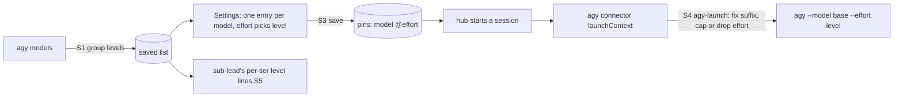

# Google model list and levels

**Idea:** `IDEA.md` — what this is for and why, in plain language. Read it first.

## Open Questions

(None.)

## Watch List

| # | Noticed | What needs looking into | Raised to user? | Outcome |
|---|---------|-------------------------|-----------------|---------|

## Decision Log

| # | Decision | Rationale | Source |
|---|----------|-----------|--------|
| 1 | Use agy's own base model ids plus `--effort` (e.g. `--model gemini-4-hydrogen --effort high`) rather than mapping effort to suffixed ids. | Live checks 2026-11-27: `agy -p … --model gemini-4-hydrogen --effort high`, `gemini-4-neon --effort low` and `gemini-3.8-flash --effort medium` succeed; `gemini-4-hydrogen` with no effort succeeds; `gemini-4-hydrogen-low --effort xhigh` fails ("conflicts with --effort=xhigh"), so today's suffixed pins break effort escalation outright. | defaulted |
| 2 | Group levels generically from `agy models`: an id `<base>-<level>` with level in low, medium, high, xhigh, max, whose display name ends in `(<Level>)`, belongs to model `<base>` (label = name without the level part). Ids that do not fit stay single models with no levels. | IDEA requires a general rule, not a list of names. | defaulted |
| 3 | Models with no levels (Orchestrator variants, Claude and GPT-OSS inside agy) never get `--effort`; their effort choice in Settings is only "CLI default", and escalation skips their effort step. | agy refuses `--effort` for them ("--effort is not supported for model …"). | defaulted |
| 4 | Saved pins with a level suffix (including shipped defaults `gemini-3.8-flash-low/-medium/-high`) are read as base + that effort when the pin has no effort of its own; shipped defaults change to base ids with effort. | IDEA: saved settings keep working. | defaulted |
| 5 | The model list is fetched fresh from `agy models` whenever Settings loads it (about 1 s); the saved copy is only a fallback when agy fails. | IDEA: new models appear the next time Settings opens. | defaulted |
| 6 | No designer: the only visible change is fewer, plainer entries in an existing dropdown. | Trivial visible part. | defaulted |
| 7 | A step up past a model's top level: the hub starts it at the model's top level, says so in the start output, and the escalation rules treat that model as having no effort step left, so the next step moves tier. | User picked "Stay at top, then next tier" over refusing the start. | user |
| 8 | Group only when two or more levels share a base; a lone `<base>-<level>` id stays a single model. | agy's acceptance of a base id was only checked for models it lists in several levels. | defaulted |
| 9 | Settings' list reuses a fetch younger than 30 seconds, so one page load (which asks for the list more than once) runs `agy models` once. | `agy models` takes about 1 s; `show --json` is called from several routes (`viewer/app/routes.js:356`, `:373`, `viewer/app/settings.js:459`). | defaulted |
| 10 | A step up past a model's levels rounds down to the highest listed level (never up past the request); the sub-lead's generated escalation lines list each Antigravity tier's levels, replacing Decision 7's start-output note. | Review round 1: a note reached only some start paths, and rounding up could pass the Settings ceiling. | review-round-1 |
| 11 | The launch fix-up (suffix, cap, drop) runs on the machine that runs Antigravity, through `model.sh agy-launch`, not in the hub; Decision 10's rounding stays, with the lowest-level exception named. | Review round 2: the hub may not have Antigravity installed. | review-round-2 |
| 12 | Antigravity's model list is read on the hub's computer; a setup with Antigravity only on another computer gets no new Settings behaviour (launches there are still fixed up by S4). | Collin: there is no worker-machines feature and none planned soon. | user |

## Spec

Terms. **Level**: one of `low`, `medium`, `high`, `xhigh`, `max`, in that order. **Level group**: a model Antigravity lists in two or more levels. **Base id**: a level group's id with the level dropped (`gemini-4-hydrogen`). Everything here applies only to the `gemini` provider (Antigravity, `connectors/agy/`); other providers do not change.

Facts this rests on (live `agy`, 2026-11-27): `agy --model <base id> --effort <level>` runs that level; `--model <base id>` alone runs; `--model <base>-<level> --effort <other level>` is refused; an effort a model does not list is refused; `--effort` on a model with no levels (Orchestrator, `claude-*`, `gpt-oss-*`) is refused.

### S1. Discovery and grouping (`codex/model.sh`)

1. `agy_parse` groups lines generically. A line `<id>\t<name>` joins group `<base>` when `<id>` ends in `-<level>` and `<name>` ends in ` (<Level>)` with the same level, compared case-insensitively (`XHigh` = `xhigh`). A group is kept only with two or more members (Decision 8); otherwise its lines stay single entries.
2. A group becomes one entry `{value: <base>, label: "<name without the trailing (Level)> · <base>", efforts: [<its levels in level order>]}`, placed where its first member appeared. Every other line is `{value, label}` as today plus `efforts: []`. Existing filters (`none`, duplicates, id format) still apply, to the base id too.
3. Freshness: `agy_models` reuses the saved list only when it is under 30 seconds old (Decision 9); otherwise it runs `agy models`. A failed, timed-out or empty run falls back to the saved list whatever its age, as today; with none, `[]`. The saved file keeps its path and gains `efforts` per entry; `agy_valid` accepts entries with or without `efforts` (an old file without it is read as `efforts` unknown, not `[]`).
4. A new command `model.sh levels gemini <model>` prints the model's levels (one per line, level order) and exits 0; it exits 0 with no output for a model listed with `efforts: []`; it exits 4 for a model not in the list, or listed with unknown efforts (an old-format entry).
5. **Catalog on demand.** Every reader that needs the list (`levels`, `agy-launch`, and the S2 reads below) uses the saved list when it exists in the new format (entries carry `efforts`), whatever its age (except that `show --json` refreshes under S1.3, S4.1 refreshes as it says, and S5.1 refreshes a list over an hour old); when the saved list is missing or in the old format, it runs `agy models` first regardless of the 30-second reuse (an old-format list is never reused as fresh), and saves the result. So a fresh or upgraded install resolves levels at its first session start without Settings having been opened.
6. **Failure back-off.** When a run of `agy models` fails, times out or lists nothing, the failure time is saved beside the list (`agy-models.json` gains `failed_at`, or a sibling file when there is no list); no reader runs `agy models` again within 60 seconds of it, and uses the saved list (or none) meanwhile. A successful run clears it.

### S2. Saved settings carry over (`codex/model.sh`, `connectors/agy/manifest.js`)

1. A gemini pin whose model is `<base>-<level>` with no effort of its own, where `<base>` is a level group in the list (S1.5), is read as model `<base>` with effort `<level>` by every reader (`model.sh <provider> <slot>`, `model.sh effort`, `show --json`). For Settings only (`show --json`), an effort the model is known not to have is then shown as S4.1 would launch it (dropped for a no-level model, else the highest listed level at or below it, else the lowest), so the picker can always display it. The readers that feed a session start (`model.sh <provider> <slot>`, `model.sh effort`) return the pin's effort uncapped, so S4 decides the launch level against its own, possibly fresher, list. The pins file itself is not rewritten; the next save from Settings writes the new form. When the list cannot be had (agy fails and nothing is saved), or `<base>` is not a group in it, the pin is read as is.
2. `show --json` uses one list snapshot (after any S1.3 refresh) for both these pin reads and the model options.
3. A pin `<base>-<level> @<effort>` (both) is read as `<base> @<effort>`, the pin's effort winning, under the same group condition.
4. Shipped defaults become base id plus effort: light `gemini-3.8-flash @low`, standard `@medium`, heavy, critical and lead `@high`. The manifest's pin shape already holds `effort`; regenerate the committed registry (`node connectors/export.js`) whenever the manifest changes. `install.sh` still only writes a missing pins file.

### S3. Settings (`viewer/app/settings.js`, `viewer/pages/settings.js`, `viewer/app/routes.js`)

1. `options()` passes each entry's `efforts` through. Pinned models not in the list are appended as today, with efforts unknown.
2. For a gemini cell, the effort selector offers "CLI default" plus only the chosen model's levels. A model listed with no levels shows only "CLI default" and the selector is disabled. A model with unknown levels (typed through Other…, or missing from the list) offers all gemini efforts, as today.
3. Choosing a different model keeps the cell's effort when the new model has that level; otherwise the effort resets to CLI default, and that is what is saved. A member id typed through Other… (e.g. `gemini-3.8-flash-low`) of a known group is saved as the base with that level as its effort (S3.4), and after the re-read (S3.5) the picker shows the base and that level.
4. PUT `/settings/models` first reads a gemini model and effort through S2.1 and S2.3's suffix rules, using the saved list (S1.5) without the 30-second refresh (so `gemini-3.8-flash-high @max` becomes `gemini-3.8-flash @max`), then refuses an effort the normalized model is known not to have (`<model> has no <effort> level; it has <levels>`, or `<model> takes no effort` for a no-level model), and saves the normalized form. Unknown levels are accepted as today.
5. After a save, the page re-reads GET `/settings` (which already returns `models`, `model_options` and `escalation_text`) and redraws the model cells from it. The PUT response is unchanged. If the PUT succeeded but the re-read fails, the saved value stays shown and the cell says `Saved; the list could not be refreshed`, never the save-failed error.

### S4. Starting a session (`codex/model.sh`, `connectors/agy/machine.js`, `machine/service.js`, `connectors/README.md`, `machine/API.md`)

The fix-up happens on the machine that runs Antigravity, at launch, because the hub may not have Antigravity installed.

1. New command `model.sh agy-launch <model> [<effort>]`, run on the launching machine with that machine's list (S1.5), prints `<model>\t<effort or empty>`:
   - before anything else: if the saved list is older than an hour, or (when it is more than 30 seconds old) does not list the model (or its base) or lists it without the requested effort, it runs `agy models` once to refresh (subject to S1.6), then applies the rules below to the result.
   - S2.1 and S2.3's suffix rules first (a suffixed id of a known group becomes the base; a suffix level is the effort only when no effort was given).
   - no effort: unchanged; no effort is printed.
   - the model is listed with no levels: the effort is dropped.
   - levels listed and the effort is one of them: unchanged.
   - levels listed and the effort is not one of them: the highest listed level at or below it; if none is below it, the lowest listed level (the one case that goes above the request; a rare path, see Accepted Risks).
   - the model is not listed, is listed with unknown efforts (old format, refresh failed), or the list cannot be had: unchanged, including the requested effort.
2. The connector's argv builder stays synchronous. The connector contract's async `launchContext` hook (today `launchContext(service)`, awaited at `machine/service.js:980`; only Kimi implements it) gains two arguments: `machine/service.js` calls it as `launchContext(service, input, session)`, and Kimi's ignores them. The agy connector adds a `launchContext` that runs `<c.root>/codex/model.sh agy-launch` without blocking the service, and returns the fixed-up model and effort in its launch extras; the builder reads them from there (not from `session.effort`, which keeps the requested effort) and uses them for `--model` and `--effort` (`--effort` only when non-empty). Inside `agy-launch`, the `agy models` refresh has a 5-second deadline (on timeout it records the failure per S1.6 and uses the saved list); the connector waits up to 15 seconds for `agy-launch`. If the command fails or times out, it uses the model and effort it was given, as today.
3. The hub's start path does not change; the session record keeps the requested effort.
4. `connectors/README.md`'s `launchContext` row gives the new signature; `machine/API.md`'s description of Antigravity's `--effort` says the model and effort are fixed up at launch by `agy-launch`.

### S5. Stepping up (`viewer/app/settings.js`)

The sub-lead learns which rungs exist from its generated instructions, not from start output, so every start path (immediate, queued, retried) is covered.

1. The lines are worked out only when a sub-lead starts (refreshing the list first when it is over an hour old, S1.5), in `viewer/app/sessions.js` (which already calls `model.sh`), and passed into `roleLayers`; `escalationSentences`, the Settings escalation text and the length check do not change. They are added only when Antigravity can take workers (enabled in `harnesses` and present in `worker_order`): one line per gemini tier cell (light, standard, heavy, critical) that is set, `Antigravity <Tier>: <model>, levels <l1, l2, …>, set to <effort or CLI default>` (`takes no effort` for a no-level model, `levels unknown` when S1.4 exits 4), then the sentences: `On Antigravity, a tier's highest listed level is its highest effort: once a worker ran there, or the model takes no effort, the next step moves tier if a higher tier is allowed; otherwise report the task blocked.` Otherwise nothing is added.
2. `protocol/app/sub-lead.md` is not changed.

### S6. Scout lines

For a gemini scout whose pin (read by S2) has an effort, the scout line names the member id `<model>-<effort>` (e.g. `gemini-3.8-flash-low`) only when the hub's list has a grouped entry for `<model>` whose `efforts` include that effort; otherwise it names the model as read, as today. The same applies to the bigger-changes scout. (The hub has the list, Decision 12.) Other providers' scout lines do not change.

### S7. Usage text and routers

`codex/model.sh`'s USAGE lists `levels` and `agy-launch`; `codex/AGENTS.md`'s `model.sh` entry mentions that the agy connector calls it at launch.

### Not changing

- Antigravity installed only on a computer other than the hub's (Decision 12): Settings, the sub-lead's level lines and the scout line read the hub's list only, and get nothing new there; launches are still fixed up on the launching computer (S4).

- Claude, GPT, Kimi, OpenRouter models and their effort; asides (Gemini has none); usage, onboarding and the Ready check.

### Validation

- `bash codex/test/run.sh` with new cases: grouping from a fake listing matching the 2026-11-27 output (Hydrogen and Neon with four levels, Carbon, Argon and Flash with three, Orchestrator, Claude and GPT-OSS single); a lone `<base>-<level>` stays single; the 30-second reuse and the stale fallback on failure; `levels` exit codes, including 4 for an old-format entry; S1.5 fetching when the saved list is missing or old-format, including a fresh old-format file; every `agy-launch` branch in S4.1, including a stalled `agy models` (5-second deadline) with a saved list; S2 pin reads for suffixed pins with and without effort, with and without a saved list.
- `node connectors/export.js --check`.
- `node --test viewer/test/model-options.test.js viewer/test/app-settings.test.js viewer/test/app-hub.test.js viewer/test/worker-effort-membership.test.js` with new cases for S3.4 (including a suffixed id normalized before the check), S5.1 (lines present when Antigravity takes workers, absent when it is off or not in the worker order; Settings' escalation text unchanged) and S6.
- `npm --prefix viewer run test:browser -- --grep 'effort'` with new cases for S3.2, S3.3 and S3.5.
- `node --test machine/test/project-mcp-agy.test.js` with new assertions (using a fake `agy-launch` or fake `agy` listing): a base id with a session effort gives `--model <base> --effort <e>`; a model with no session effort gives no `--effort`; a legacy suffixed id with a different effort gives the base and that effort; a failing `agy-launch` gives the inputs unchanged. Plus a targeted machine-service start of a fresh Antigravity session (fake `agy-launch` output) asserting the argv sent to tmux carries the fixed-up model and effort. Antigravity sessions are not resumed (`connectors/agy/manifest.js:18`), so no resume case.
- `bash install/test/run.sh` (shipped default pins).
- The real pin round trip (`machine/test/connectors-model-roundtrip-real.test.js`, helper `machine/test/helpers/model-roundtrip.js`) runs with discovery off (`WHEELCHAIR_AGY=` empty) or a controlled list, so Settings' capping does not depend on the host's Antigravity: `node --test machine/test/connectors-model-roundtrip-real.test.js`.

## Accepted Risks

| Risk | Why accepted | Round |
|------|--------------|-------|
| Settings changed during a build: the sub-lead's per-tier level lines are from its start, so one rung may be skipped or repeated. | Worst case one extra or skipped try; the task still escalates and Settings changes mid-build are uncommon. | review-round-2 |
| The list changes between a save and the page's re-read, so the picker shows choices that differ from what was just checked. | Rare path: needs Antigravity's model list to change within seconds. | review-round-2 |
| With the shipped defaults (heavy and critical both Flash at high), a step up from heavy to critical can rerun the same model and level. | The sub-lead's lines show each tier's model and levels, so it can see the repeat; the worst case is one extra try. A skip rule drew findings in three rounds and was cut. | review-round-5 |
| A model whose levels have a gap (e.g. low and high only) can repeat a level on one step up. | Rare path: no model Antigravity lists today has a gap. | review-round-1 |
| Two overlapping refreshes where one fails while the other succeeds: the failure can write the older list back with the back-off set, holding it for 60 s (`codex/model.sh:373`, `:380`). | Rare path: needs a failed and a successful `agy models` run to overlap; the list is corrected on the next refresh. | verification-1 |
| Saving a second Settings cell while the first cell's re-read is still pending, after typing a new Other… draft in that first cell, loses the draft (`viewer/pages/settings.js:232`–`248`). | Rare path: needs a new draft typed and another cell saved inside the one-to-two-second window of a pending re-read. | verification-2 |

## Review Rounds

### Round 1 — 2026-11-27

**Lanes:** intent: claude / claude-opus-5-5; mechanics: gpt / gpt-6.2-sol; cross-family: yes.

**Changed since Round 0:** n/a (first round — whole Spec in scope)

| Lane | Reported | Finding | Lead verdict | Resolution |
|------|----------|---------|--------------|------------|
| intent | major | Effort-to-level mapping needs a saved list that only Settings writes; fresh or upgraded installs still send conflicting ids. | upheld | S1.5 catalog on demand. |
| intent | minor | No-level model gives no signal to the sub-lead. | upheld | S5.1 lists levels per tier. |
| intent | minor | Landing exactly on top level gives no note; next step repeats. | upheld | S5.1 lists levels per tier. |
| intent | minor | Rare path: gaps in levels make one step do nothing. | accepted-risk | Accepted Risks (rare path). |
| intent | minor | S5.1 sentence always present. | upheld | Only when a gemini tier cell is set. |
| intent | minor | Scout line loses the pin's level. | upheld | S6. |
| mechanics | blocking | Legacy suffixed pins unresolved until Settings is opened. | upheld | S1.5, S2.1. |
| mechanics | blocking | Rounding up through a gap can pass the Settings ceiling. | downgraded (minor) | No listed model has a gap today (rare); rule changed anyway to round down (S4.1, Decision 10). |
| mechanics | blocking | Sub-lead cannot learn actual effort / remaining rungs on all start paths. | upheld | S5.1 generated lines; start-output note removed. |
| mechanics | major | PUT validation of suffixed ids undefined. | upheld | S3.4 normalizes first. |
| mechanics | minor | Old-cache entry exit status. | upheld | S1.4 exits 4. |
| mechanics | minor | CLI default case unspecified. | upheld | S4.1 first bullet. |
| mechanics | minor | Page keeps stale options after save. | upheld | S3.5. |
| mechanics | minor | Registry regeneration tied to shape change. | upheld | S2.3. |
| mechanics | minor | S5.2 duplicates rule in role file. | upheld | S5.2 removed. |
| mechanics | minor | argv test does not exercise effort. | upheld | Validation assertions. |

### Round 2 — 2026-11-27

**Lanes:** intent: claude / claude-opus-5-5; mechanics: gpt / gpt-6.2-sol; cross-family: yes.

**Changed since Round 1:** S1.4 exit 4 for old-format entries; new S1.5 (fetch the list when missing or old-format); S2.1 uses it; S2.3 registry regeneration; S3.4 normalizes before validating; new S3.5 (redraw after save); S4 rewritten (no start-output note; rounds down; CLI default passes through); S5 rewritten (generated per-tier level lines, no role-file change); new S6 (scout line names gemini effort); Decision 10; one Accepted Risk; validation additions.

| Lane | Reported | Finding | Lead verdict | Resolution |
|------|----------|---------|--------------|------------|
| intent | minor | Shipped defaults repeat Flash high across heavy, critical. | upheld | S5.1 adds "skip a tier whose model and level were already tried". |
| intent | minor | Lines added even when Antigravity can't take workers. | upheld | S5.1 condition. |
| intent | minor | escalationSentences callers unspecified. | upheld | Lines computed at sub-lead start only. |
| intent | minor | S3.5 widens PUT. | upheld | Re-read GET /settings. |
| intent | minor | Scout effort may not reach the helper. | upheld | S6 names the member id. |
| intent | minor | Rare path: Decision 10 vs lowest-level case. | upheld | Decision 11 names the exception. |
| mechanics | blocking | PUT may validate against one list and respond with another. | accepted-risk | Rare path (list changes within seconds); PUT no longer refreshes, page re-reads. |
| mechanics | major | Fresh old-format cache reused at first start. | upheld | S1.5: old format never reused. |
| mechanics | major | Hub may lack Antigravity, so on-demand lookup can't fix launches. | upheld | S4 moved to the launching machine (Decision 11). |
| mechanics | major | Sub-lead's tier lines frozen if Settings change mid-build. | downgraded (minor) | Worst case one extra or skipped try; accepted risk. |
| mechanics | minor | Saved effort the picker can't show. | upheld | S2.1 caps on read. |
| mechanics | minor | Picker commands pull whole suites into the Spec. | upheld | Line removed. |

### Round 3 — 2026-11-27

**Lanes:** intent: claude / claude-opus-5-5; mechanics: gpt / gpt-6.2-sol; cross-family: yes.

**Changed since Round 2:** S1.5 (old format never reused); S2.1 caps an effort on read; S3.4 uses the saved list; S3.5 re-reads GET /settings; S4 rewritten as `model.sh agy-launch` run by the agy connector on the launching machine (hub start path unchanged); S5.1 lines computed at sub-lead start, only when Antigravity takes workers, plus a skip-repeated-tier sentence; S6 names the member id; Decisions 11; two Accepted Risks; validation updates (picker line removed).

| Lane | Reported | Finding | Lead verdict | Resolution |
|------|----------|---------|--------------|------------|
| intent | major | Launch machine's list never refreshes after first fetch. | upheld | S4.1 refresh step. |
| intent | minor | Scout loses level when hub has no list. | upheld | S6 builds the member id. |
| intent | minor | Failed fetch retried on every read (10 s each). | upheld | S1.6. |
| intent | minor | model.sh USAGE and codex/AGENTS.md not updated. | upheld | S7. |
| mechanics | blocking | Settings, sub-lead lines and scout still use the hub's list when Antigravity is only on another machine. | user-decision | Collin: no such setup planned; Decision 12, Not changing. |
| mechanics | blocking | Launch machine list has no refresh path. | upheld | S4.1 refresh step. |
| mechanics | major | Skip-duplicate-tier rule can discard a reachable higher level. | upheld | S5.1 sentence. |
| mechanics | minor | PUT ok then GET fails looks like a rejected save. | upheld | S3.5. |
| mechanics | minor | Synchronous argv builder would block on discovery. | upheld | S4.2. |

### Round 4 — 2026-11-27

**Lanes:** intent: claude; mechanics: gpt; cross-family: yes.

**Changed since Round 3:** Decision 12 and "Not changing" (Antigravity on the hub's computer only); S1.6 failure back-off; S4.1 refresh step in `agy-launch`; S4.2 asynchronous preparation before the synchronous builder; S5.1 skip rule; S3.5 save-then-refresh failure; S6 scout member id; new S7 (USAGE, `codex/AGENTS.md`).

| Lane | Reported | Finding | Lead verdict | Resolution |
|------|----------|---------|--------------|------------|
| intent | minor | `prepareLaunch` name clashes; use existing `launchContext`. | upheld | S4.2. |
| intent | minor | Where the fixed-up effort lives on the machine. | upheld | S4.2: launch extras, not `session.effort`. |
| intent | minor | Refresh on every launch for unlisted model or level. | upheld | S4.1: only when the list is over 30 s old. |
| intent | minor | S1.6 sentence belongs to S1.5. | upheld | Moved. |
| mechanics | blocking | `agy-launch` and its inner `agy models` share a 10 s deadline. | upheld | S4.2: 5 s inside, 15 s outside; test. |
| mechanics | major | S2 caps the effort before dispatch, losing the request. | upheld | S2.1: cap only for Settings. |
| mechanics | major | Scout suffix built when the list failed. | upheld | S6: only a member id the list contains. |
| mechanics | minor | Skip rule ignores the effort ceiling. | upheld | S5.1. |
| mechanics | minor | No machine-service-level launch test. | upheld | Validation. |

### Round 5 — 2026-11-27

**Lanes:** intent: claude; mechanics: gpt; cross-family: yes.

**Changed since Round 4:** S2.1 caps only for Settings, start readers uncapped; S4.1 refresh only when the list is over 30 s old (or over an hour); S4.2 uses the existing `launchContext` hook and launch extras, 5 s / 15 s deadlines; S5.1 skip rule respects the effort ceiling; S6 member id only when listed; validation additions.

| Lane | Reported | Finding | Lead verdict | Resolution |
|------|----------|---------|--------------|------------|
| intent | minor | Agy has no `launchContext`; service call must change. | upheld | S4.2 names the contract change and `machine/service.js`. |
| intent | minor | Connector contract row not updated. | upheld | S4.4. |
| intent | minor | S1.5 vs S4.1 refresh wording. | upheld | S1.5 points at S4.1. |
| mechanics | blocking | Resumed Antigravity launch test has no real path. | upheld | Validation: fresh start only. |
| mechanics | major | Skip rule can discard a higher pinned effort. | upheld | Skip rule cut; Accepted Risk for the default repeat. |
| mechanics | major | Scout lookup by exact id misses grouped entries. | upheld | S6 looks up the group's efforts. |
| mechanics | minor | Old-format entry with failed refresh unspecified. | upheld | S4.1. |
| mechanics | minor | README and machine API docs. | upheld | S4.4. |

### Round 6 — 2026-11-27

**Lanes:** intent: claude; mechanics: gpt; cross-family: yes.

**Changed since Round 5:** S1.5 wording; S4 header and S4.2 (`launchContext(service, input, session)` contract change); S4.1 old-format-with-failed-refresh case; new S4.4 (README and machine API); S5.1 skip sentence removed; S6 group lookup; one Accepted Risk; validation: fresh start only.

| Lane | Reported | Finding | Lead verdict | Resolution |
|------|----------|---------|--------------|------------|
| intent | minor | "Not changing" layout. | upheld | Made one list. |
| mechanics | blocking | S1.5 "whatever its age" vs S1.3's Settings refresh. | downgraded (minor) | Wording a careful reader reconciles (S1.3 and IDEA both say Settings refreshes); S1.5 now names the exceptions and S2.2 one snapshot. |
| mechanics | major | Sub-lead lines may come from an old list. | downgraded (minor) | Needs Antigravity to add a level since the last fetch; worst case one skipped step. Fixed: S5.1 refreshes a list over an hour old. |
| mechanics | minor | Top-level sentence when no higher tier is allowed. | upheld | S5.1 says report blocked. |
| mechanics | minor | Typed member id: picker vs saved effort. | upheld | S3.3. |
| mechanics | minor | Round-trip fixture depends on host agy. | upheld | Validation. |

## Implementation Tasks

| # | Objective | Ownership boundary | Lane | Session id | Validation | Status |
|---|-----------|--------------------|------|-----------|------------|--------|
| T1 | Discovery and grouping, `levels`, pin reads, `agy-launch`, shipped defaults (S1, S2, S4.1, S7) | codex/model.sh, codex/test/run.sh, codex/AGENTS.md, connectors/agy/manifest.js, connectors/registry.json, install/test/run.sh | standard / gpt-6.1-terra | wc-7a9ed2b4b850-worker | bash codex/test/run.sh; node connectors/export.js --check; bash install/test/run.sh | done |
| T2 | Launch fix-up in the agy connector and service, docs, round-trip isolation (S4.2–S4.4) | connectors/agy/machine.js, machine/service.js (launchContext call), connectors/README.md, machine/API.md, machine/test agy and round-trip files | standard / gpt-6.1-terra | wc-7a9ed2b4b850-worker-2 | node --test machine/test/project-mcp-agy.test.js, service start test, machine/test/connectors-model-roundtrip-real.test.js | done |
| T3 | Settings picker, PUT checks, sub-lead level lines, scout lines (S3, S5, S6); after T1 | viewer/app/{settings,routes,sessions}.js, viewer/pages/settings.js, named viewer tests | standard / claude-sonnet-5-5 | wc-7a9ed2b4b850-worker-4 | node --test viewer model/settings/hub/effort tests; npm --prefix viewer run test:browser -- --grep 'effort' | done |
| T4 | Follow-up to T1: base-id filters (S1.2), no failure marker without agy, missing S4.1 refresh and suffix tests | codex/model.sh, codex/test/run.sh | standard / gpt-6.1-terra | wc-7a9ed2b4b850-worker-3 | bash codex/test/run.sh; node --test machine/test/project-mcp-agy.test.js machine/test/agy-launch-service.test.js | done |
| T5 | Follow-up: replace four literal tool-name checks in codex/model.sh so the name guard passes | codex/model.sh | light / gpt-6-luna | wc-7a9ed2b4b850-worker-5 | node --test machine/test/name-guard.test.js; bash codex/test/run.sh | done |
| R1 | Remediation 1, G3: `model.sh agy-refresh` (only when missing, old format or over an hour old) used by the sub-lead level lines | codex/model.sh, codex/test/run.sh, viewer/app/settings.js (levelLines), viewer/test/app-settings.test.js (refresh tests) | standard / gpt-6.1-terra | wc-7a9ed2b4b850-worker-6 | bash codex/test/run.sh; node --test machine/test/name-guard.test.js; node --test viewer/test/app-settings.test.js | done |
| R2 | Remediation 1, G2 and G4: a save redraws only its own cell; test servers default to no agy and temp pins | viewer/pages/settings.js, viewer/test/app-settings.spec.js, viewer/test/helpers/server.js and other server-starting test helpers | standard / claude-sonnet-5-5 | wc-7a9ed2b4b850-worker-7 | browser 'effort'; the four Spec viewer node files; scratch-HOME proof | done |
| R3 | Remediation 2, G4 second fix: every viewer test path to model.sh runs with discovery off and temp pins; whole-suite scratch-HOME proof | viewer/test/ | standard / claude-sonnet-5-5 | wc-7a9ed2b4b850-worker-8 | four named test files; Spec viewer node files; scratch-HOME proof | done |

## Log
- 2026-11-27 — Choice: T2, connectors/agy/machine.js: test seams `WHEELCHAIR_AGY_MODEL_SCRIPT` (helper path) and `WHEELCHAIR_AGY_LAUNCH_TIMEOUT_MS` (deadline, default 15 s).
- 2026-11-27 — Choice: T2, machine/test/fixtures/agy/model-launch-fake.sh: the service case's fake returns a different effort than requested, to show the record keeps the request.
- 2026-11-27 — Choice: T2, connectors/agy/machine.js: launch-extra keys `agyLaunchModel` / `agyLaunchEffort`; output parsed strictly as one `model\teffort\n` line; no model means no helper call (scout list, not in the report).
- 2026-11-27 — Choice: T2, machine/test/agy-launch-service.test.js: service start test in a new file, stubbing worktree, tmux liveness and readiness (scout list, not in the report).
- 2026-11-27 — T2 accepted (band: scout): validation re-run by the sub-lead (6 + 1 pass, export check clean); `bash machine/test/run.sh` left to the full run.
- 2026-11-27 — Choice: T1, codex/model.sh: the no-list failure marker is the sibling file `agy-models.json.failed` (bare timestamp).
- 2026-11-27 — Choice: T1, codex/model.sh: `agy_models` takes a mode (`demand`, `show`, `launch`), model, effort and timeout; `show` and other readers keep the 10 s `agy models` deadline, `agy-launch` uses 5 s (scout list, not in the report).
- 2026-11-27 — Choice: T1, codex/model.sh: an absent or non-executable agy counts as a failed run and writes the back-off marker (scout list, not in the report).
- 2026-11-27 — Choice: T1, codex/model.sh: `agy-launch` accepts only an effort in the level list, else usage error; the connector omits the argument for no effort (scout list, not in the report).
- 2026-11-27 — Choice: T1, codex/model.sh: a failed run rewrites the saved list with `failed_at` inside it (invalid entries dropped); readers call the list for every gemini read, including `none` pins (scout list, not in the report).
- 2026-11-27 — T1 accepted (band: bigger-scout): validation re-run by the sub-lead (codex 199 pass, install 217 pass, export check clean). Gaps found by the scout go to follow-up task T4: the base id of a group is not checked against `none` and duplicates (S1.2), and tests are missing for S4.1's refresh conditions and for a suffix with no effort at launch (Spec validation).
- 2026-11-27 — Choice: T4, codex/model.sh: a `none` base is excluded in the grouping step itself; singles are also deduplicated against group values, first in listing order wins (scout list; the report said none).
- 2026-11-27 — Choice: T4, codex/model.sh: no agy to run returns early, before any marker write (scout list; the report said none).
- 2026-11-27 — Choice: T4, codex/test/run.sh: refresh tests use list ages 3700, 120 and 5 seconds; the old-format `show` case runs while a recorded failure holds back the refresh (scout list; the report said none).
- 2026-11-27 — T4 accepted (band: scout): validation re-run by the sub-lead (codex 211 pass, machine agy tests 6 pass). The no-marker test covers only an empty WHEELCHAIR_AGY, not a missing binary; same code path, accepted.
- 2026-11-27 — Choice: T3, viewer/app/settings.js levelLines: refreshes the list for S5.1 by running `model.sh agy-launch <first set tier's model>` with no effort, once per sub-lead start, output ignored (asked the sub-lead; ruled yes).
- 2026-11-27 — Choice: T3, viewer/app/settings.js levelTool: Antigravity found by its manifest's `listedKey`, not by name (name guard).
- 2026-11-27 — Choice: T3, viewer/app/settings.js levelLines: a no-level tier reads `<model>, takes no effort, set to <effort or CLI default>`; no lines or sentence when no tier cell is set; a model.sh error other than not-used/unknown fails the sub-lead start, as scout resolution does.
- 2026-11-27 — Choice: T3, viewer/app/settings.js normalizeLevelModel: the PUT's suffix rule is mirrored in JS (no model.sh command normalizes without launch refresh); a group needs two or more levels.
- 2026-11-27 — Choice: T3, viewer/pages/settings.js: the picker keys on an option carrying `efforts`; a typed `<base>-<level>` of a listed group is sent with no effort so the id's level wins; the re-read failure is a plain hint and only the latest save's re-read is drawn; the re-read redraws both model blocks.
- 2026-11-27 — Choice: T3, viewer/test/app-settings.test.js: the fake agy is set inside the test server by a NODE_OPTIONS hook, because helpers/app.js forces WHEELCHAIR_AGY=''.
- 2026-11-27 — Choice: T3, viewer/app/API.md: both settings rows updated; screenshot committed at docs/plans/google-model-levels/reports/T3-grid.png.
- 2026-11-27 — T3 accepted (band: bigger-scout): validation re-run by the sub-lead (node 145 pass, browser 'effort' 10 pass). machine/test/name-guard.test.js fails on four literal tool-name lines in codex/model.sh from T1; follow-up task T5 fixes them.
- 2026-11-27 — T5 accepted (band: scout): no choices beyond the brief (the scout agrees); name guard 2 pass and codex 211 pass re-run by the sub-lead.
- 2026-11-27 — Verification attempt 1 (claude-opus-5-5, gpt-6.2-sol): FAIL. Four gaps; the overlapping-refresh race is a rare path (Accepted Risks); three go to REMEDIATION-1.md. Full run on 0eadce68 passed (all suites exit 0).
- 2026-11-27 — Choice: R1, viewer/app/settings.js levelLines: the `agy-refresh` call runs before the no-tier-set early return, so it also runs when Antigravity takes workers but no gemini tier cell is set (scout list; the report said none).
- 2026-11-27 — Choice: R1, codex/model.sh agy-refresh: uses the normal 10 s `agy models` deadline (the brief's choice), up from the 5 s of the agy-launch call it replaces (scout list).
- 2026-11-27 — R1 accepted (band: scout): validation re-run by the sub-lead (codex 217 pass, name guard 2 pass, app-settings 23 pass).
- 2026-11-27 — Choice: R2, viewer/pages/settings.js: the redraw straight after the PUT is also limited to the saved cell; when a second save overtakes the first one's re-read, the later read redraws both saved cells; a failed latest read clears the pending cells, which keep their options until next drawn.
- 2026-11-27 — Choice: R2, viewer/test/app-settings.spec.js: the existing re-read test now asserts another cell is not redrawn (the saved cell's fresh-read assertion stays).
- 2026-11-27 — Choice: R2, viewer/test/pages.spec.js: an `offline()` env helper gives its server starts the same defaults; viewer/test/helpers/server.js puts the default models file in the state directory and gives WHEELCHAIR_MODELS_CACHE no default.
- 2026-11-27 — R2 accepted (band: scout): validation re-run by the sub-lead (browser 'effort' 12 pass, Spec viewer node files 145 pass). Direct model.sh spawns in viewer/test/app-balancer.test.js and app-hub.test.js `pinned()` do not set WHEELCHAIR_AGY; attempt 2's verifiers are asked to trace every viewer test for real agy calls.
- 2026-11-27 — Verification attempt 2 (claude-opus-5-5, gpt-6.2-sol) on 732be642: FAIL. Merged gaps: (a) overlapping-save draft loss, a rare path (Accepted Risks); (b) a PUT's unchanged response (`show --json`, viewer/app/routes.js:362) refreshes a list over 30 s old: not a gap, since S3.4's no-refresh rule is for the validation read, S3.5 keeps the PUT response unchanged, and the page's re-read that follows reuses that fresh list, so a save costs no extra `agy models` run; (c) viewer tests that run model.sh through in-process hubs or direct spawns still reach the PATH agy and one writes under $HOME/.wheelchair (app-usage, app-balancer, app-project-tools-card): remediation 2 (second fix of G4). Full run on 732be642 passed (all suites exit 0).
- 2026-11-27 — Choice: R3, viewer/test/helpers/isolate-models.js: a side-effect require that always sets WHEELCHAIR_AGY='' and a per-process temp WHEELCHAIR_MODELS (overwriting inherited values), loaded by helpers/server.js and required directly by 26 test files, including files that make no call today.
- 2026-11-27 — Choice: R3, viewer/test/app-uploads-archive.test.js: an `agy` stub first on PATH for its real MachineService, which ran agy directly; the stub prints nothing for `agy models`.
- 2026-11-27 — Choice: R3, WHEELCHAIR_MODELS_CACHE (the GPT cache, read only) is left as each test sets it.
- 2026-11-27 — R3 accepted (band: scout): validation re-run by the sub-lead (four named files 117 pass, Spec viewer files 146 pass); the worker's scratch-HOME proof shows 16 agy calls and one agy-models.json before, none after, across the whole viewer Node and browser suites. Five files that load viewer/app/ carry no direct require (app-lessons, app-lessons-history, app-shared-tools-setting, char-hub-dispatch, background-completion); they made no agy call in the proof run.
