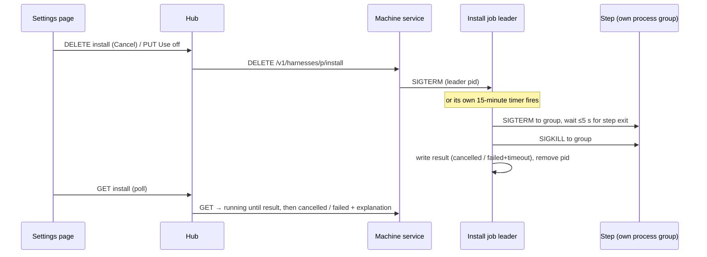

# Make agent installs solid

**Idea:** `IDEA.md` — read it first. **Map:** `MAP.md` and `docs/maps/onboarding-runtime.md`.
Follow-up to plan easy-onboarding (PR #155, `docs/plans/easy-onboarding/PLAN.md`, Deferred D1–D3).

## Open Questions

None.

## Watch List

| # | Noticed | What needs looking into | Raised to user? | Outcome |
|---|---------|-------------------------|-----------------|---------|

## Decision Log

| # | Decision | Rationale | Source |
|---|----------|-----------|--------|
| 1 | Mode: thorough | Collin picked it; this thread is itself the hardening follow-up | user |
| 2 | Cancel is one tap, no confirmation; a cancelled install shows "Install cancelled" (not an error) with Install offered again | Cancelling is harmless and re-installing is one tap; an "Install failed" alert for something the user did would mislead | defaulted |
| 3 | The 15-minute limit is enforced by the install job itself, so it holds with Settings closed and across machine-service restarts | IDEA: "stops on its own"; the job already outlives the service | defaulted |
| 4 | Failure explanations are computed on the machine from the install log and returned as a separate field; the raw tail is unchanged | Machine has the full log; UI stays a renderer | defaulted |
| 5 | Cancel and the time limit stop the whole install process group (SIGTERM, then SIGKILL after 5 s) | Script installers start curl/bash/npm children; killing only the leader would leave them running | defaulted |
| 6 | Switching a harness's Use off also cancels its install, on every reachable machine | Off means "I don't want this"; a hidden install nobody can see or cancel is surprising | user |
| 7 | The cancel on switch-off is done by the hub's settings route, not the page | The switch is hub-wide and an install may run on a machine the picker isn't showing | defaulted |
| 8 | The job leader owns stopping: steps run in their own process group, the leader signals and escalates, and writes the result only once the group is empty (replaces the stop-file design) | A leader that kills its own group can't escalate to SIGKILL, and a retry could overlap a dying install | review-round-1 |

## Spec

### Machine: install job (`machine/lib/harness-install.js`)

The job leader (the detached Node process `start()` spawns, whose PID is in `
.pid`) owns every stop. It outlives machine-service restarts, as today, so Cancel and the time limit do too.

- **Steps.** The job runs its steps (node check, recipe, cleanup, sensitivity, CLI check) with async `spawn` awaited in order, not `spawnSync`, so its event loop stays free. Each step is spawned with `detached: true`, so the step and everything it starts form their own process group (group id = the step's PID). Output still goes to the log as today; behaviour and exit codes of each step are unchanged.
- **Stop request.** The leader handles two causes: SIGTERM sent to the leader's PID (Cancel) → reason `cancelled`; its own timer of `WHEELCHAIR_INSTALL_LIMIT_MS` (default 900000 = 15 min) from job start → reason `timeout`. The timer is cleared when the job ends. A second stop request while one is in progress is ignored.
- **Stopping.** The leader registers its SIGTERM handler as its first act, before waiting for its PID file. On a stop request it starts no further step. If a step is running: send SIGTERM to its group (`process.kill(-g, 'SIGTERM')`), wait up to 5 s for the step process itself to exit, then send SIGKILL to the group unconditionally (ignore ESRCH), so any member that ignored SIGTERM is killed. Only then write the result and remove the PID file, as today. So GET says `running`, and POST is refused with 409, until the stop has finished. (Completion is judged by the step's exit plus the SIGKILL, never by polling the group, which zombies can keep non-empty.)
- **Result.** `cancelled` → `{state: "cancelled", exit_code: null, reason: "cancelled", started_at, finished_at}`; `timeout` → `{state: "failed", exit_code: null, reason: "timeout", started_at, finished_at}`. A job that ends without a stop writes `reason: "recipe"` when the recipe step itself exited non-zero (or failed to start), else no `reason`. Nothing is appended to the log. If writing the result fails (e.g. disk full), the kill has already happened and GET falls back to today's dead-PID answer ("The install stopped before finishing.").
- **`stopJob(p)`** (used by the route): if `state(p).state !== 'running'` return false; else `process.kill(pid, 'SIGTERM')` on the leader and return true.
- **Explanations (D3).** `state(p)` adds `explanation` to every response (null unless `state` is `failed`). For `failed`, first match wins:
  1. Result `reason: "timeout"`: "The install took too long (over 15 minutes) and was stopped. Try again; if it keeps happening, check this machine's network."
  Rules 2–4 apply only when the result has `reason: "recipe"`; failures after a successful recipe (cleanup, "can't find <cli>", `--version`) and the dead-PID case get `null`, so retried-network warnings in a log never mislabel them.
  2. Disk full — the full log contains `ENOSPC` or `No space left on device`: "The disk on this machine is full. Free up some space, then try again."
  3. npm not allowed to write — the log contains `EACCES` or `EPERM` and a line matching `npm (ERR!|error) path <path>`: "npm isn't allowed to write to <path> on this machine (it may be owned by root from an earlier sudo npm). Fix that folder's owner, then try again." With `EACCES`/`EPERM` and `npm` but no such path line: the same sentence with "one of its folders" in place of `<path>`.
  4. No network — any of `Could not resolve host`, `curl: (6)`, `curl: (7)`, `curl: (28)`, `ENOTFOUND`, `EAI_AGAIN`, `ECONNREFUSED`, `ETIMEDOUT`, `ECONNRESET`, `Network is unreachable`: "This machine couldn't reach the internet to download it. Check its network, then try again."
  - No match → `null`.

### Machine: route (`machine/service.js`, `machine/API.md`)

- `DELETE /v1/harnesses/
/install` (hub auth): unknown provider 404; not running 409 `{error: "not installing"}`; else `stopJob(p)` and 202 `{state: "cancelling"}`.
- API.md row updated: DELETE, the `cancelled` state, `reason`, the `explanation` field.

### Hub (`viewer/app/routes.js`)

- The `/machines/<m>/harnesses/
/install` passthrough accepts DELETE as well as GET and POST, same validation and 502 on unreachable.
- POST through it is refused with 409 `{error: "<name> is switched off"}` when the provider's Use switch is off in settings; the page shows that as the row error. The page tells the two POST 409s apart by `body.error`: "already installing" keeps today's switch to GET polling; any other 409 error text is shown as the row error and stops the poll.

- `PUT /settings/harnesses/
` with `enabled: false`: after saving, send `DELETE /v1/harnesses/
/install` to every machine the hub knows, in parallel, without checking reachability first. The PUT responds without waiting for them; their responses (202, 409, 404) and errors are ignored. The PUT with `enabled: true` sends nothing.

### Settings (`viewer/pages/settings.js`)

- Running row (not offline), once a POST 202 or a GET `running` has arrived for this install (not on the optimistic row painted before the POST answers): a `Cancel` button (`aria-label "Cancel installing <name>"`) after "Installing…". Pressing it sends DELETE, then shows "Cancelling…" in place of the button; the existing GET poll carries on. A 409 just continues polling. A network error or 5xx shows the row error line "Couldn't cancel: <machine> isn't reachable." and keeps the Cancel button. Any other status (e.g. 404 from a machine on an older version) shows "Couldn't cancel: update wheelchair on <machine>." and keeps the poll going.
- Hidden while the row shows "Can't reach <machine>, retrying…".
- `cancelled` state, placed in `harnessRow` right before the `!st.installed` branch and used only when `!st.installed` (an agent installed since shows its normal state): hint "Install cancelled" (not `role=alert`), the raw tail if any, and the `Install` button.
- `failed` state: when `explanation` is set, show it as a plain line (`class="h-explain"`) between "Install failed" and the raw tail.
- Job record keeps `explanation` alongside `state` and `tail`.
- Switching Use off keeps today's behaviour in the page (stop polling, drop the job record); the hub does the cancel. Switching it back on GETs the state as today and so shows "Install cancelled" if the install was stopped.

### Not doing

Removing files a cancelled install wrote; Cancel on the home checklist; explaining failures beyond the three listed; changing recipes.

### Validation

- `node --test machine/test/harness-install.test.js`: new cases with fake recipes — cancel a sleeping recipe (DELETE 202, GET stays `running` and POST 409 until the group is gone, then `cancelled`, the recipe's child `sleep` gone from the process table, Install works again); a recipe whose child traps and ignores SIGTERM (`sh -c 'trap "" TERM; sleep 60'`) is gone within ~6 s via SIGKILL, for both Cancel and the time limit (fixtures write a marker file once their child and trap are running, and tests wait for it before cancelling); cancel survives a machine-service restart between start and DELETE; DELETE when idle → 409; `WHEELCHAIR_INSTALL_LIMIT_MS=500` with a sleeping recipe → `failed` with the timeout explanation and children gone; logs containing each pattern → matching explanation, including an npm `path` line naming the path; unmatched failure → null.
- `node --test viewer/test/app-harnesses.test.js`: DELETE passthrough status/body and outage 502; POST refused 409 while the provider is off; PUT `enabled:false` sends DELETE to each known machine and still returns 200 promptly when a machine is unreachable or answers 409; PUT `enabled:true` sends none.
- `npm --prefix viewer run test:browser -- app-harnesses.spec.js`: Cancel button shows while running, sends DELETE, a stale page's Install gets the "switched off" row error, then "Install cancelled" with Install; explanation line shown above tail on failure; no Cancel while offline; phone and desktop sizes.
- Full: `bash machine/test/run.sh` and `npm --prefix viewer run test:browser`.

## Accepted Risks

| Risk | Why accepted | Round |
|------|--------------|-------|
| A vendor installer that starts children in their own process group (setsid) survives Cancel/timeout | Not done by the current recipes' normal paths; rare per realism.md | planning |
| PID reuse: a stale `
.pid` whose PID now belongs to an unrelated process could receive Cancel's SIGTERM | The PID file is removed whenever the job ends normally or is stopped; a stale one needs the leader killed outside the app plus PID reuse; rare per realism.md | review-round-1 |
| An install started before a wheelchair update and cancelled after it may leave its recipe running (old leader has no handler) | Needs an install running across an update plus a cancel; rare per realism.md | review-round-2 |
| A stale tab's Cancel (or a delayed switch-off DELETE after switching back on) can stop a newer install of the same agent | Needs two actors inside a 2–5 s window; Install again recovers; rare per realism.md | review-round-2 |
| Cancel within milliseconds of the 202, before the leader's handler exists, shows "stopped before finishing" instead of "cancelled" | Sub-second window; no step has started yet; rare per realism.md | review-round-2 |
| Cancel landing after the recipe succeeded (during cleanup or the version check) shows "Install cancelled" though the program is installed | Needs a cancel inside a seconds-long window; Install again fixes it; rare per realism.md | review-round-1 |

## Check Once Built

| # | What to check | Round |
|---|---------------|-------|

## Review Rounds

### Round 1 — 2026-11-21

**Lanes:** claude / opus (intent); gpt (mechanics); cross-family: yes.

**Changed since Round 0:** n/a (first round — whole Spec in scope)

| Lane | Reported | Finding | Lead verdict | Resolution |
|------|----------|---------|--------------|------------|
| intent | minor | npm permission sentence always blames ~/.local; ~/.npm cache is common | upheld | Sentence names "one of its folders (often ~/.npm or ~/.local)" |
| intent | minor | No-network sentence says "installer" for npm recipes | upheld | Reworded to "download it" |
| intent | minor | Timeout reason shown twice (log line + explanation) | upheld | Log append removed |
| intent | minor | Switch-off DELETE: reachability check needless; PUT may wait on it | upheld | Send to all known machines, PUT does not wait |
| intent | minor | Rare path: cancel after recipe success shows "cancelled" | accepted-risk | Accepted Risks row |
| mechanics | blocking | Timeout self-kill can't deliver the later SIGKILL | upheld | Leader no longer kills itself: steps run in their own group; leader escalates and survives service restarts |
| mechanics | blocking | Stop terminal while descendants still run; retry overlaps | upheld | Leader writes result only after the group is empty; GET running / POST 409 until then |
| mechanics | blocking | Rare path: PID reuse signals an unrelated process | accepted-risk | Rare (needs external kill + reuse); Accepted Risks row |
| mechanics | major | Full disk blocks stop-file write before kill | upheld | Stop file removed; kill precedes result write; failed write falls back to dead-PID answer |
| mechanics | major | Stale tab POSTs install after switch-off | downgraded (minor) | Worst case an install for a switched-off agent; hub now refuses POST while off |
| mechanics | major | Cached reachability skips recovered machine | upheld | Already fixed: DELETE goes to every known machine, no reachability check |
| mechanics | major | Cancel before POST acknowledged gets 409 | downgraded (minor) | Worst case a second Cancel press; Cancel shown only after 202/GET running |
| mechanics | major | npm sentence names a folder without evidence | downgraded (minor) | Wording; now names the path from npm's `path` line, else "one of its folders" |
| mechanics | minor | Older machine answers 404 to DELETE | upheld | Row shows "update wheelchair on <machine>" |

### Round 2 — 2026-11-21

**Lanes:** claude (intent); not-claude (mechanics); cross-family: yes.

**Changed since Round 1:**
- Stopping redesigned: no stop file; the job leader runs each step in its own process group, handles Cancel (SIGTERM to the leader) and the 15-minute timer, escalates to SIGKILL after 5 s, and writes the result only once the group is empty (Decision 8).
- Result carries `reason`; timeout explanation comes from it; nothing appended to the log.
- npm explanation names the path from npm's `path` line when present.
- Hub refuses install POST while the provider is switched off; switch-off DELETEs every known machine without waiting.
- Settings: Cancel appears only after the start is confirmed; non-409/non-5xx DELETE replies show "update wheelchair on <machine>".
- Validation adds a SIGTERM-ignoring child and a service restart between start and Cancel.

| Lane | Reported | Finding | Lead verdict | Resolution |
|------|----------|---------|--------------|------------|
| intent | minor | Page can't tell "switched off" 409 from "already installing" 409 | upheld | Distinguished by `body.error` |
| intent | minor | `cancelled` branch placement; stale "Install cancelled" on an installed agent | upheld | Branch before `!st.installed`, only when not installed |
| intent | minor | Network patterns anywhere in log mislabel later-step failures | upheld | Rules 2–4 only when `reason: "recipe"` |
| mechanics | blocking | Zombies can keep `kill(-g,0)` succeeding, so a stop never finishes | downgraded (minor) | Only where orphans go unreaped (no init/subreaper); worst case a stuck row. Cut the group polling: wait for the step's exit, then SIGKILL the group unconditionally |
| mechanics | blocking | Rare path: job started before the update has the old protocol | accepted-risk | Needs an install across an update plus a cancel; Accepted Risks row |
| mechanics | major | Rare path: stale tab Cancel stops a newer install | accepted-risk | Two actors in a 2 s window; Accepted Risks row |
| mechanics | major | Rare path: delayed switch-off DELETE after switching back on | accepted-risk | Same row as above |
| mechanics | minor | Rare path: Cancel before SIGTERM handler registered | accepted-risk | Handler now registered first; Accepted Risks row |
| mechanics | minor | Page must tell the two POST 409s apart | upheld | Already fixed this round; browser test added |

## Implementation Tasks

| # | Objective | Ownership boundary | Lane | Session id | Validation | Status |
|---|-----------|--------------------|------|-----------|------------|--------|
| T1 | Machine job: Cancel (SIGTERM leader), 15-min limit, process-group stop, result reason, explanations; DELETE route; API.md; machine tests. tricky | machine/lib/harness-install.js, machine/service.js (install route), machine/API.md, machine/test/harness-install.test.js | standard / gpt-6.1-terra | wc-c3b2aec47d12-worker | node --test machine/test/harness-install.test.js; bash machine/test/run.sh | in progress |
| T2 | Hub DELETE passthrough, POST refused while off, switch-off DELETE fan-out; Settings Cancel, cancelled state, explanation line; hub + browser tests | viewer/app/routes.js, viewer/pages/settings.js, .h-explain CSS, viewer/test/app-harnesses.test.js, viewer/test/app-harnesses.spec.js | standard / claude-sonnet-5-5 | wc-c3b2aec47d12-worker-2 | node --test viewer/test/app-harnesses.test.js; npm --prefix viewer run test:browser | in progress |

## Log
- 2026-11-21 — T1 and T2 dispatched in parallel (disjoint ownership).
