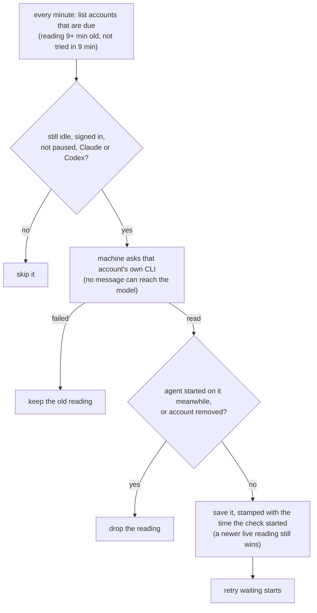

# Check usage on accounts no agent is using

**Idea:** `IDEA.md` — what this is for and why, in plain language. Read it first; it is
the north star this plan serves. Goal and Constraints live there, not here.

**Map:** `MAP.md` (checked against `2007434`; `origin/main` was merged in at `969471c`
before planning, bringing the Antigravity/Gemini provider).

## Open Questions

None.

## Watch List

| # | Noticed | What needs looking into | Raised to user? | Outcome |
|---|---------|-------------------------|-----------------|---------|
| W1 | app-accounts D9 rejected polling undocumented usage endpoints | Whether this feature reverses it | yes (thread) | Settled by D1: no HTTP endpoint is called; both reads go through the provider's own CLI, which spends no quota |
| W2 | Claude OAuth access tokens last ~8 h; an idle account's token expires | Whether polling keeps working on an account idle for days | no | Settled by D1: the CLI refreshes its own login on start; the hub never touches credentials |
| W3 | MAP.md says current `hasRoom` contradicts D9 ("no reading = full") | Check | no | Waved off: D9's "full" means full room, which `hasRoom` matches (`viewer/app/usage.js:19-22`) |
| W4 | main added a third provider, `gemini` (`machine/adapters/agy.js`), with no usage source (`usageFrom() { return null; }`) | Whether to poll it | no | Not polled (IDEA "Not doing"), D8 |

## Decision Log

| # | Decision | Rationale | Source |
|---|----------|-----------|--------|
| D1 | Read idle usage through each provider's own CLI, never a raw HTTP endpoint. Claude: `claude -p /usage --output-format json`. Codex: `codex app-server`, JSON-RPC `initialize` then `account/rateLimits/read`. Both checked by hand on 2026-11-16: neither sends a model turn (Claude reported `num_turns: 0`, `duration_api_ms: 0`, cost 0), so no quota is spent and no limit window is started (IDEA constraint 1) | Supported CLI surfaces, the CLI handles its own login refresh (W2), and app-accounts D9's objection to undocumented endpoints does not apply | defaulted |
| D2 | Poll every 10 minutes from a hub timer; one account at a time | Idle numbers move slowly; one `claude`/`codex` process at a time keeps the machine quiet. Good enough to meet "never more than one interval old" | defaulted |
| D3 | An account is polled when: its provider is `claude` or `gpt`; it is not paused; no session in any thread has `live && account === id` (the same test the balancer uses, `viewer/app/balancer.js:60`); and it is signed in on at least one reachable machine. The poll runs on the hub's own machine if it is signed in there, otherwise the first such machine by name | Matches "not being used by agents"; one machine per account because usage is per account, not per machine | defaulted |
| D4 | The hub records a poll reading only if the account still has no live session at record time; `usage.record()`'s newer-`at`-wins rule is unchanged | A live session's numbers stay the source while it runs (IDEA constraint 2) | defaulted |
| D5 | A failed poll changes nothing stored, posts no card, and is tried again next interval | A stale reading is the status quo; noise on every failure would be worse | defaulted |
| D6 | No change to the Usage page; its existing "as of" time shows how fresh each reading is | IDEA "What good looks like" is met by the numbers themselves | defaulted |
| D7 | After a poll records any reading, run `sessions.retryWaiting(hub)` once (as `hub.event()` does for a reading) | A refilled idle account should release waiting starts without waiting for the minute timer | defaulted |
| D8 | `gemini` accounts are not polled | No usage source exists for that CLI (W4) | defaulted |
| D9 | The Claude probe runs with `ANTHROPIC_BASE_URL` set to a closed local port, so it cannot reach the model whatever the CLI does with `/usage`. The Codex probe sends only `initialize` and `account/rateLimits/read`, never a turn request; an unknown method is an RPC error, not a turn | A check after the fact (`num_turns`) cannot undo a spent turn or a started window (IDEA constraint 1) | review-round-1 |
| D14 | The Claude probe also passes `--setting-sources ""` and sets the closed-port address through `--settings` | A settings file's `env` block outranks the inherited environment and could restore the real address. Checked 2026-11-16: `/usage` still answers with these flags (`num_turns 0`) and a prompt still cannot reach the model | review-round-2 |
| D15 | The 15-second cache in `usage.machineAccounts` is acceptable for D11's re-check | A probe of an account signed out seconds earlier just fails (D5); it cannot spend quota (D9) | review-round-2 |
| D13 | IDEA's "refreshing or rewriting any CLI's login" applies to wheelchair's own code: the hub and machine service never read, refresh or write a credentials file. A probe runs the provider's CLI unchanged, and that CLI may renew its own login as it does every time a session starts on the account. That is allowed | Without it an idle Claude account stops being readable once its token expires (W2), defeating the IDEA; the CLI's own renewal is routine, not a rewrite by us | review-round-2 |
| D10 | Supersedes D2's timing: a one-minute tick probes each eligible account whose reading is missing or ≥ 9 minutes old and that was not probed in the last 9 minutes (so a failing account is retried every 9 minutes, D5). With probes of a few seconds each (30 s worst case) and a handful of accounts, an idle reading stays within about 10 minutes; a long run never skips a whole interval, since the next tick picks up whatever is due | A fixed 10-minute batch, suppressed while the previous one runs, could leave readings 20 minutes old | review-round-1 |
| D11 | Eligibility is re-checked right before each account's probe, not once per run | An account that went live or was paused earlier in the run is not probed | review-round-1 |
| D12 | A poll reading is stamped with the time its probe started | A live reading that arrives during the probe (even from a session that has already ended) is then newer and wins | review-round-1 |

## Spec



### Behavior

Once a minute (first run 30 s after the hub starts) the hub polls each eligible account
(D3) whose stored reading is missing or at least 9 minutes old (D10), one at a time, and stores what it reads as that account's usage reading, exactly as
if a live session had sent it. The balancer, forecast and Usage page then use it with no
change of their own.

### Machine: `POST /v1/usage`

New hub-authorized route in `machine/service.js` (beside `/v1/preflight`), documented in
`machine/API.md`.

- Body `{ account, cli, dir }`: `cli` is `claude` or `codex`; `dir` follows the same rules
  as `/v1/logins` (`accountDir(dir, account)`; `null` for `default-<provider>`). Anything
  else → 400.
- Runs the adapter's new `usageProbe(dir)` **asynchronously** (child process, not the
  `spawnSync` helpers), so `/v1/status`, hooks and other sessions keep being answered
  (`machine/service.js:76`). Timeout 30 s; kill the child on timeout.
- Child environment: `process.env` plus `adapter.loginEnv(dir)`; working directory the
  machine state dir. Nothing from the credentials is read by the service or returned.
- 200 `{ reading }` where `reading` is `{ account, at, five_hour, week, plan_type?,
  limited_until? }` in the existing reading shape (`machine/API.md` "Usage events"),
  `at` = the time the probe finished (the hub replaces it, D12). 502 `{ error }` on timeout, non-zero exit, or output
  it cannot parse.

### Claude probe (`machine/adapters/claude.js`)

Command: `claude -p /usage --output-format json --no-session-persistence
--strict-mcp-config --setting-sources "" --settings '{"env":{"ANTHROPIC_BASE_URL":"http://127.0.0.1:9"}}'`,
also with `ANTHROPIC_BASE_URL=http://127.0.0.1:9` in the child environment (D9, D14).
`--setting-sources ""` stops user, project and local settings loading, so none of them can
put the real API address back; the same address is also set through `--settings`. That points model calls at a closed local port, so even a future CLI
that treated `/usage` as a prompt could not reach the model: the child hangs or errors and the
30 s timeout fails the probe. `/usage` itself still answers with that variable set (checked
2026-11-16, Log). Parse the JSON; also require `num_turns === 0`, otherwise fail.
From `result` text:

- `Current session: <N>% used · resets <Mon> <D>, <h[:mm]><am|pm> (<IANA zone>)` → `five_hour`.
  The minutes are optional: both `6:59pm` and `7pm` were seen on 2026-11-16.
- `Current week (all models): <N>% used · resets …` → `week`.
- Other lines (per-model weeks, the "contributing" breakdown) are ignored.
- A line without a `resets` part gives `resets_at: null`. Reset times are converted from
  the named zone to an ISO UTC string (use `Intl.DateTimeFormat` with `timeZone` to find
  the offset); the year is the one that puts the reset nearest after now, within 8 days.
- Neither window found → fail. `N` at or above 100 for either window sets `reached`, so
  the machine fills `limited_until` with `limitedUntil(reading)` (`machine/lib/limits.js`),
  as the turn-ended path does (`machine/service.js:803-807`).

Sample output to use as a fixture (captured 2026-11-16):
`Current session: 42% used · resets Nov 16, 6:59pm (America/Los_Angeles)` /
`Current week (all models): 52% used · resets Nov 21, 2:59am (America/Los_Angeles)`.

### Codex probe (`machine/adapters/codex.js`)

Command: `codex app-server`. Write to stdin, one JSON line each:
`{"jsonrpc":"2.0","id":1,"method":"initialize","params":{"clientInfo":{"name":"wheelchair","version":"1"}}}`,
`{"jsonrpc":"2.0","method":"initialized"}`,
`{"jsonrpc":"2.0","id":2,"method":"account/rateLimits/read"}`. Read stdout lines until the
response with `id: 2`, then end stdin and kill the child. Ignore notifications. Map
`result.rateLimits`: for each of `primary` and `secondary`, `windowDurationMins` 300 →
`five_hour`, 10080 → `week`, as `{ used: usedPercent, resets_at: ISO(resetsAt seconds) }`;
`planType` → `plan_type`; `rateLimitReachedType` non-null → `reached`. An `error` response
or no window → fail.

### Hub: `viewer/app/usage-poll.js` (new)

- `pollIdle(hub)`: list the candidate accounts in settings order: provider `claude` or
  `gpt`, stored reading missing or with `at` at least 9 minutes old, and no probe of it
  started in the last 9 minutes (D10; kept in memory on the hub, so a failing account is
  retried every 9 minutes, not every tick). For each, in
  turn: **re-check eligibility right before the call** with freshly loaded settings, threads
  and `usage.machineAccounts(hub)` (D3; skip it if no longer eligible, D11); note
  `started = new Date().toISOString()`; then `hub.call(machine,
  '/v1/usage', 'POST', { account: id, cli, dir }, 35000)` where `cli` comes from
  `PROVIDERS[provider].cli` and `dir` is `null` for `default-<provider>` and
  `~/.wheelchair/accounts/<id>` otherwise (as `viewer/app/sessions.js:190-202` builds it).
  On 200, re-load threads and settings; if the account now has a live session or is gone
  from settings, skip it (D4); else `usage.record(hub, { ...reading, at: started, machine })`
  — the reading is stamped with the time the probe **started**, so any live reading that
  arrived while it ran is newer and kept by `record()`'s rule (D12). On error, skip (D5). If anything was
  recorded, `await sessions.retryWaiting(hub)` once at the end (D7).
- One run at a time: `hub.pollIdle()` keeps a single in-flight promise, like
  `hub.pollDead()` (`viewer/app/hub.js:126-129`); a tick that finds a run in flight does
  nothing.
- `viewer/app/hub.js`: `this.usageTimer = setInterval(() => this.pollIdle().catch(() =>
  {}), this.usagePollInterval ?? 60_000)`, `unref()`'d, plus one `setTimeout` of 30 s
  (also `unref()`'d) after start. Cleared wherever the other timers are cleared.
  `usagePollInterval` is a constructor option so tests can shorten it.

### Boundaries and edge cases

- Paused, signed-out, `gemini`, or in-use accounts: never probed.
- Machine unreachable: its accounts count as not signed in there (`machineAccounts`
  already reports `reachable: false`).
- An account becomes in use during a probe: the reading is dropped (D4).
- A live reading newer than the poll's `at` is kept by `record()`'s rule.
- An account removed from settings during a run: its result is dropped (check it is
  still in settings before recording).
- Old machine service without `/v1/usage` (404): treated as a failure (D5).

### Non-goals

Ranking or choice changes; Usage page changes; wheelchair code reading, refreshing or
writing any credentials (the CLI's own renewal while it runs is allowed, D13);
polling `gemini`; per-model weekly windows.

### Validation

```bash
bash machine/test/run.sh
node --test viewer/test/*.test.js
npm --prefix viewer run test:browser
```

Tests to add:

- `machine/test/accounts.test.js`: Claude parser on the sample above (correct UTC times
  for `America/Los_Angeles`, year rollover near 31 Dec, missing `resets`, a reset time without minutes (`7pm`), ≥100% →
  `reached`, `num_turns: 1` → fail, no windows → fail); Codex mapper on a
  `account/rateLimits/read` result with only a weekly primary, with both windows, with
  `rateLimitReachedType` set, and with an `error` response.
- `machine/test/service.test.js`: `/v1/usage` with shim `claude` and `codex` executables on
  `PATH` (200 with a reading; timeout → 502 and child killed; bad `cli` → 400; hub auth
  required; the `claude` shim records its environment and arguments, and the test asserts
  `ANTHROPIC_BASE_URL=http://127.0.0.1:9` in both the environment and the `--settings` JSON,
  and `--setting-sources` with an empty value; the `codex` shim records stdin and the test
  asserts no method other than `initialize`, `initialized` and `account/rateLimits/read`).
- `viewer/test/app-usage.test.js` (fake machine `/v1/usage` route in
  `viewer/test/helpers/app-machine.js`): only eligible accounts probed (paused,
  signed-out, live-session and `gemini` skipped); reading recorded with its machine;
  account gone live mid-probe → not recorded; 502 → stored reading unchanged; a waiting
  start promoted after a poll frees room; overlapping `pollIdle` calls run once; an account
  with a reading under 9 minutes old is not probed; an account made live while an earlier
  account's probe runs is not probed (D11); a live reading recorded during a probe, from a
  session that has ended before the probe returns, is not overwritten (D12).

## Accepted Risks

| Risk | Why accepted | Round |
|------|--------------|-------|
| Machine-wide managed Claude settings (`/etc/claude-code/`) load whatever `--setting-sources` says and could set the API address | None exist on these personal machines (checked on hearth 2026-11-16); an organization policy is outside what wheelchair can override | round 2 |
| D11 may probe an account signed out within the last 15 s (cached sign-in state) | The probe just fails (D5) and cannot spend quota (D9) | round 2 |
| The Claude `/usage` text format and `codex app-server` (marked experimental) can change with a CLI update | A break only stops the readings (D5); D9 keeps a changed CLI from spending quota. The cost of a break is today's behavior | planning, revised round 1 |

## Review Rounds

### Round 3 — 2026-11-16

**Lanes:** intent — gpt; mechanics — gpt (Claude unavailable at start); cross-family: no.

**Changed since Round 2:**
- D13: whose login refresh IDEA excludes (wheelchair's code, not the CLI's own renewal); Non-goals reworded.
- D14: Claude probe adds `--setting-sources ""` and the closed-port address via `--settings`; tests assert both.
- D15 and two new Accepted Risks (managed settings; 15 s cached sign-in state).
- Claude reset-time parsing accepts times without minutes (`7pm`).

| Lane | Reported | Finding | Lead verdict | Resolution |
|------|----------|---------|--------------|------------|

### Round 2 — 2026-11-16

**Lanes:** intent — gpt; mechanics — gpt (Claude unavailable at start); cross-family: no.

**Changed since Round 1:**
- D9: the Claude probe runs with `ANTHROPIC_BASE_URL` at a closed local port; Codex probe sends no turn request; tests assert both.
- D10: one-minute tick, per-account due time (reading ≥ 9 min old and no probe in the last 9 min), replacing the 10-minute batch.
- D11: eligibility re-checked before each probe.
- D12: poll readings stamped with the probe's start time.
- Accepted Risk rationale reworded.

| Lane | Reported | Finding | Lead verdict | Resolution |
|------|----------|---------|--------------|------------|
| mechanics | blocking | A settings file's `env` can override the inherited `ANTHROPIC_BASE_URL`, so a changed `/usage` could reach the model | upheld | D14: `--setting-sources ""` plus the address in `--settings`; test asserts the flags |
| mechanics | minor | D11's re-check can use the 15 s cached sign-in state | accepted-risk | D15; see Accepted Risks |
| intent | major | D1/W2 rely on the CLI renewing its login while IDEA excludes refreshing logins; the boundary is unclear | upheld | D13: the exclusion covers wheelchair's code; the CLI's own renewal is allowed |

### Round 1 — 2026-11-16

**Lanes:** intent — gpt; mechanics — gpt (Claude unavailable at start); cross-family: no.

**Changed since Round 0:** n/a (first round — whole Spec in scope)

| Lane | Reported | Finding | Lead verdict | Resolution |
|------|----------|---------|--------------|------------|
| intent | blocking | `num_turns` guard checks after a turn is spent; retried every interval it would start windows on idle accounts | upheld | D9: Claude probe's model calls point at a closed port; Codex probe never sends a turn |
| mechanics | blocking | Same as the intent finding above | upheld | D9 |
| mechanics | blocking | Eligibility checked once per run, so an account made live or paused mid-run is still probed | downgraded (minor) | Since D9 a probe cannot spend quota and D4 drops the reading, so the harm is one wasted probe. Fixed anyway: D11 |
| mechanics | blocking | A probe stamped at completion can overwrite a live reading recorded during the probe by a session that already ended | upheld | D12: stamp with the probe's start time; regression test added |
| mechanics | major | Sequential 10-minute batches with overlap suppression can't keep the "one interval" freshness bound | downgraded (minor) | A few accounts at seconds per probe never approach 10 minutes; fixed anyway with per-account due times on a one-minute tick, D10 |

## Prior Work

None.

## Implementation Tasks

| # | Objective | Ownership boundary | Lane | Session id | Validation | Status |
|---|-----------|--------------------|------|-----------|------------|--------|
| T1 | Machine `POST /v1/usage`, Claude and Codex probes and parsers, API.md, machine tests | `machine/service.js`, `machine/adapters/{claude,codex}.js`, new `machine/lib/*`, `machine/API.md`, `machine/AGENTS.md`, `machine/test/{accounts,service}.test.js`, `machine/test/fixtures/` | Standard, gpt-6.1-terra | wc-d40ef9c79052-worker (T1-a1) | `bash machine/test/run.sh` | in progress |
| T2 | Hub `usage-poll.js`, `hub.pollIdle()` and timers, fake `/v1/usage`, hub tests, router rows | `viewer/app/usage-poll.js`, `viewer/app/hub.js`, `viewer/test/app-usage.test.js`, `viewer/test/helpers/app-machine.js`, `viewer/AGENTS.md`, `viewer/app/API.md` | Standard, gpt-6.1-terra | wc-d40ef9c79052-worker-2 (T2-a1) | `node --test viewer/test/*.test.js`; `npm --prefix viewer run test:browser` | in progress |

## Log

- 2026-11-16: merged `origin/main` (`969471c`) before planning.
- 2026-11-16: probed by hand on hearth. `claude -p /usage --output-format json` (2.1.326):
  `num_turns 0`, cost 0, text as in the Spec. `codex app-server` (0.169.0)
  `account/rateLimits/read`: `primary {usedPercent 72, windowDurationMins 10080, resetsAt
  <epoch s>}`, `secondary null`, `planType "prolite"`.
- 2026-11-16: with `ANTHROPIC_BASE_URL=http://127.0.0.1:9`, `claude -p /usage` still
  returned the usage text (`num_turns 0`); `claude -p "say hi"` hung without reaching the
  model and was killed by `timeout`.
- 2026-11-16, Ready check at approval: hub and machine service answer (session list; round 3 reviewer starts passed the version check); claude and codex installed; Claude logged in; Codex preflight: token fresh. Ready.
