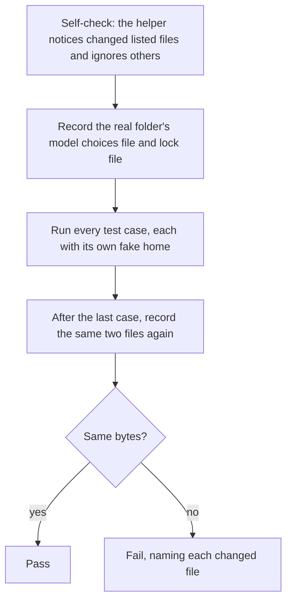

# Install tests: only check wheelchair's own files in the real folder

**Idea:** `IDEA.md`. Map: `MAP.md`, detail in `docs/maps/install-real-home.md`.

## Open Questions

(none)

## Watch List

| # | Noticed | What needs looking into | Raised to user? | Outcome |
|---|---------|-------------------------|-----------------|---------|

## Decision Log

Append-only. A reversal is a new entry superseding the old, never an edit.

| # | Decision | Rationale | Source |
|---|----------|-----------|--------|
| 1 | Plan mode is thorough | Collin's pick | user |
| 2 | Carried over from `docs/plans/load-flaky-tests/` Decisions 6 and 8: byte-check only what wheelchair itself writes in the real folder, listing wheelchair's files rather than skipping the AI tools' files | AI-tool file names change by version and event | user |
| 3 | The real-folder check compares only the files the installer and its children can write in `~/.wheelchair`: `models` and `.lock`, byte for byte | The check exists to catch tested code leaking; that code can write only these two (`codex/model.sh:45,143-164,455-456`). The running app's other writes there cannot trip it | user |
| 4 | The after-copy is taken after the last case, not at run.sh:705 | Darwin, screen and sudo cases run after :705 and could leak unseen | defaulted |
| 5 | The suite's other `tree_state` uses (refusal cases, idempotence) stay full-tree and unchanged | Their job is to compare everything; IDEA.md "What good looks like" | defaulted |
| 6 | `run_case` removes `WHEELCHAIR_MODELS` and `WHEELCHAIR_MODELS_CACHE` from the installer's environment | An exported override in the suite's shell would send the installer's model writes to a real file (`codex/model.sh:45-46`) | defaulted |
| 7 | A model pin changed in Settings while the suite runs makes the check fail; accepted, rerun | Bytes cannot tell a live pin from a leak; the consequence is one false failure in a test run | defaulted |

## Spec

All changes are in `install/test/run.sh`. No other file changes.



### S1. The real-folder list

Near the other helpers, define the list of real-folder paths the installer can write,
relative to `$HOME/.wheelchair`: `models` and `.lock`. A comment above it says: these are
the lasting files `install.sh` and the programs it runs can write under `~/.wheelchair`
(`codex/model.sh` `init`: `models` only if absent, written through a short-lived
`.models.*` file renamed into place; `.lock` on every locked write); add a
path here when the installer gains a new write there; the running app's own files
(accounts, `agy-models.json`, `installs/`) are deliberately left out because they change
during a run.

### S2. Recording the real folder

A helper `real_wheelchair_state <dir>` prints one line per listed path, in list order:
`<path> <file_state of <dir>/<path>>` (so `absent`, or `present:<hash>`). It uses the
existing `file_state`. A listed path that is a directory or symlink is recorded by
`file_state` as it is today (no special case).

### S3. Before and after

- Replace `real_wheelchair_before=$(tree_state "$HOME/.wheelchair" 1)` (run.sh:234) with
  `real_wheelchair_before=$(real_wheelchair_state "$HOME/.wheelchair")`, still before the
  first case.
- Remove the assertion at run.sh:705. After the last case (after the sudo-hint checks,
  immediately before the `RESULT` line), compare `real_wheelchair_state "$HOME/.wheelchair"`
  with the before value. On a match: `pass 'real wheelchair files the installer writes are byte-identical after suite'`.
  On a mismatch: `fail` with a message naming every listed path whose line differs, such as
  `real wheelchair file changed during suite: models`.
- The five real harness-file checks at run.sh:700-704 stay where they are, unchanged.
- `tree_state` keeps its signature and behaviour; its `skip` argument may be removed only
  if no caller passes it after this change.

### S4. Self-check of the helper

Before the real before-copy, the suite checks the helper on a scratch directory under
`$fixture`: record it, then (a) change `models`, (b) create `.lock` where it was absent,
(c) add an unlisted file `agy-models.json` and an `accounts/x/wheelchair-account.json`.
Make (a) and (b) together and compare once: assert the result reports both and the message
names both `models` and `.lock`. Then, on a fresh scratch directory, assert that (c) alone
leaves the state equal. Use the same mismatch-message code as S3, so the self-check proves
the message names the file.

### S5. Installer environment

`run_case` starts the installer with `WHEELCHAIR_MODELS` and `WHEELCHAIR_MODELS_CACHE`
removed (`env -u`), in both the normal and the `detect_path` command forms.

The suite tests this: for one ordinary case and one `detect_path` case whose installer
exits 0 (so it reaches model initialization at `install.sh:168`), export both
variables in the suite's shell pointing at paths under `$fixture` (for example
`$fixture/leak/models` and `$fixture/leak/models-cache`) just for that `run_case`, then
assert neither path exists afterwards and the case's own `${home[<case>]}/.wheelchair/models`
does. Unset them again before the next case.

### Non-goals

- No check of the AI tools' files, the running app's files, or anything else under
  `~/.wheelchair` beyond the S1 list.
- No change to the five real harness-file checks, to `install.sh`, `codex/model.sh` or any
  writer.

### Validation

```bash
bash install/test/run.sh      # passes on a machine with wheelchair and AI sessions running; includes the S4 self-check
grep -n 'real wheelchair directory is byte-identical' install/test/run.sh   # prints nothing
```

## Accepted Risks

| Risk | Why accepted | Round |
|------|--------------|-------|
| Changing a model pin in Settings while the install suite runs fails the real-folder check | One false failure in a test run, fixed by rerunning; bytes cannot tell it from a leak (Decision 7) | planning |
| `file_state` treats a listed path that is a directory or an unreadable file as `present:` with an empty hash, and follows symlinks, so such a change could compare equal | Needs a listed file to be replaced by a directory, made unreadable, or swapped for a symlink with the same bytes; none of these happen in ordinary running | review-round-1 |
| A first-ever `.lock` created by the live app during the suite fails the check | Needs the machine's very first model write to land inside one suite run | planning |

## Review Rounds

### Round 1 — 2026-11-26

**Lanes:** intent (claude); mechanics (other family); cross-family: yes.

**Changed since Round 0:** n/a (first round — whole Spec in scope)

| Lane | Reported | Finding | Lead verdict | Resolution |
|------|----------|---------|--------------|------------|
| intent | — | No findings | — | — |
| mechanics | minor | S1 calls the two paths exhaustive, but `init` also makes a short-lived `.models.*` file | upheld | S1 says "lasting files" and names the temp file |
| mechanics | minor | Rare path: `file_state` gives `present:` for a failed read or directory and follows symlinks | accepted-risk | Rare path; Accepted Risks |
| mechanics | minor | S4 single-path changes cannot show the message names every changed path | upheld | S4 changes both in one comparison and asserts both names |
| mechanics | minor | Nothing tests that S5 removes the overrides | upheld | S5 adds a test with scratch override values, both command forms |

## Implementation Tasks

| # | Objective | Ownership boundary | Lane | Session id | Validation | Status |
|---|-----------|--------------------|------|-----------|------------|--------|
| T1 | S1-S5: narrow real-folder check to `models`/`.lock`, move after-check to end, self-check, strip model env overrides | `install/test/run.sh` | standard, gpt gpt-6.1-terra | wc-baaac1dda694-worker | `bash install/test/run.sh`; grep for old assert prints nothing | done |

## Log
- 2026-11-26 — Choice: T1, run.sh S5 asserts: added a shared predicate `model_overrides_ignored` (run.sh:82) so the two override asserts add no ShellCheck SC2016 notes.
- 2026-11-26 — Choice: T1, `real_wheelchair_mismatch` (run.sh:65-72): matches each listed path's line with unanchored `grep -F "<path> "`; correct for `models`/`.lock`, a future path that is a suffix of another would need anchoring.
- 2026-11-26 — Choice: T1, final check (run.sh:841-848): written as an if/pass/fail block so the fail message names the changed files; paths in the message joined with ", ".
- 2026-11-26 — T1 accepted (band: scout): suite re-run by the sub-lead on e2f807d6 with the real HOME, 217 passed, 0 failed; old assert grep prints nothing; the worker's three negative checks failed as intended; scout found no Spec deviation.
