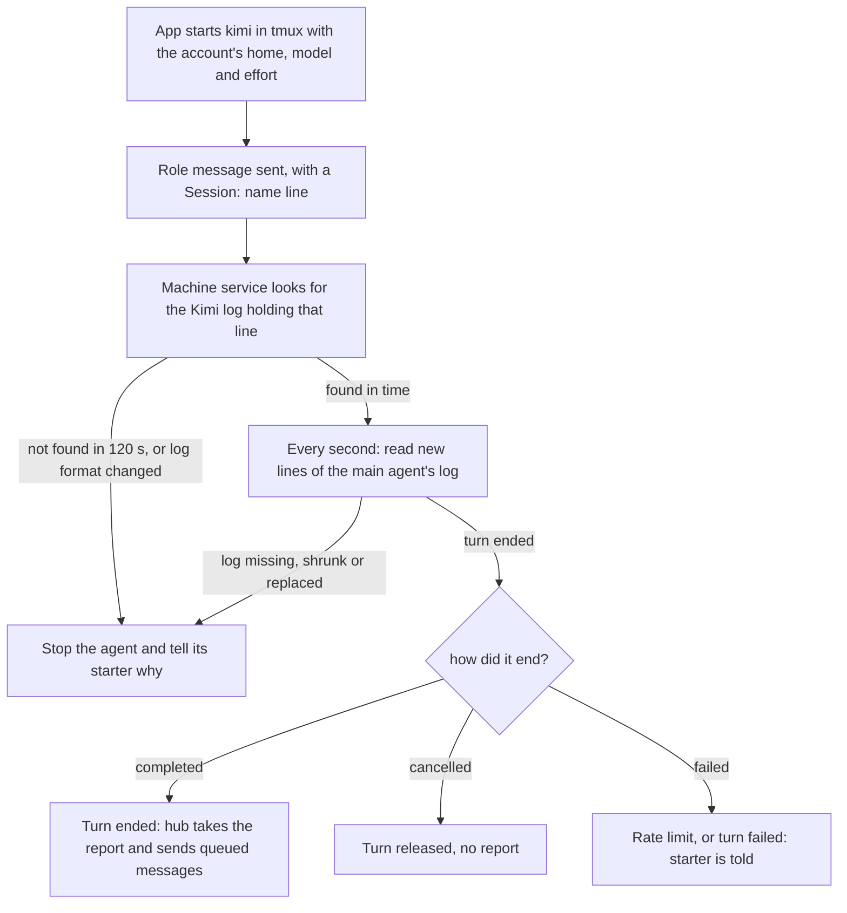

# Kimi Code support

**Idea:** `IDEA.md` — what this is for and why, in plain language. Read it first; it is
the north star this plan serves. Goal and Constraints live there, not here, so they don't
get buried as this file grows.

## Open Questions

Ordered by leverage; discussed one at a time. A settled question moves to the Decision
Log and is deleted from here.

_None._

## Watch List

Things noticed that need looking into — not yet decisions for the user. Written down the
moment they're spotted so they can't be forgotten, surfaced to the user one line at a
time as they appear, and emptied before Stage 1 exits.

Each item ends up settled by the agent (noted in the Log), promoted to an Open Question,
promoted to a Constraint or Accepted Risk, or waved off by the user.

| # | Noticed | What needs looking into | Raised to user? | Outcome |
|---|---------|-------------------------|-----------------|---------|

## Decision Log

Append-only. A reversal is a new entry superseding the old, never an edit.

| # | Decision | Rationale | Source |
|---|----------|-----------|--------|
| 1 | Mode: thorough | Collin's pick | user |
| 2 | Kimi can run any role (lead, sub-lead, worker, reviewer, verifier, mapper) | Collin's pick; matches how Gemini was added | user |
| 3 | Kimi is signed in with a Kimi account login, not an API key | Collin's pick; Ready check mirrors the other CLIs | user |
| 4 | Provider id `kimi`, label "Kimi Code", binary `kimi` | Matches the registry pattern (`viewer/app/providers.js:3`) | defaulted |
| 5 | Each Kimi account gets its own `KIMI_CODE_HOME`, like `CLAUDE_CONFIG_DIR`/`CODEX_HOME` | Kimi documents `KIMI_CODE_HOME` as its data directory; keeps multi-account handling the same as Claude and Codex | defaulted |
| 6 | Turn end comes from Kimi's `Stop` hook, registered as a `[[hooks]]` rule in each account's `config.toml` | Kimi's documented hook; Antigravity does the same with its hooks file | defaulted |
| 7 | Permission modes: bypass maps to `--auto` ("Never Ask"), auto maps to `--yolo` ("Ask When Needed") | Closest documented equivalents | defaulted |
| 8 | ~~No effort choice for Kimi~~ superseded by 15 | Kimi documents no thinking/effort flag | defaulted |
| 9 | Asides and usage polling stay Claude/GPT only; Kimi is left out like Antigravity | Both are capability-limited today (MAP.md); IDEA does not ask for them | defaulted |
| 10 | `review_families` gains `kimi`; `both` keeps meaning "two different families" | Kimi counts as its own family (IDEA.md) | defaulted |
| 11 | Installer detects `kimi` and adds it to the service PATH; it no longer refuses a machine with none of Claude/Codex if Kimi or agy is present | MAP.md: `install.sh:40-48,368-371` | defaulted |
| 12 | Kimi was installed (user-level, 2.6.3, `~/.kimi-code`) and logged in on this machine; a real run's samples are in `samples/` | Collin picked "Install it here" (Q1) | user |
| 13 | Kimi login links are shown with `kimi.ai` in place of `kimi.com` | Collin: outside China use kimi.ai; the CLI printed kimi.com because its region file says `mainland-cn` | user |
| 14 | Login check: `kimi provider list --json` lists a provider whose key starts `managed:` and `$KIMI_CODE_HOME/credentials/kimi-code.json` exists | Kimi has no auth-status command; verified on a logged-in and an empty home | defaulted |
| 15 | Kimi gets effort: app efforts map low→low, medium→high, high→high, xhigh→max, max→max, set with `/effort <level>` typed before the role message | Kimi's models list `support_efforts = [low, high, max]`; the TUI has `/effort`, no CLI flag | defaulted |
| 16 | Model tiers: heavy `kimi-code/k3.1-pro`, standard `kimi-code/k3`, light `kimi-code/kimi-for-coding-highspeed` | From the logged-in account's model list | defaulted |
| 17 | Supersedes 13: log in with `kimi login --region global`; links are shown as printed, no rewriting | The region decides the sign-in server and the API address; rewriting the link alone would leave the account on the China region | review-round-1 |
| 18 | Supersedes 15: effort set per process with `KIMI_MODEL_THINKING_EFFORT`, never `/effort` | `/effort` saves the model and effort as the account default in `config.toml` | review-round-1 |
| 19 | Supersedes 16: Kimi pins cover all five required slots (critical and lead `kimi-code/k3.1-pro`); no live model list in Settings | `model.sh` needs every slot; a live list had no machine/account rule | review-round-1 |
| 20 | Kimi hooks carry the app session name (`sessionNameEnv`), bind by that name plus the transcript's `[wc:role]` prompt, and also handle `Interrupt` | Several sessions share one worktree; titles are asynchronous; Interrupt replaces Stop | review-round-1 |
| 21 | Minimum Kimi version 2.6.3, enforced by Ready and session start | 2.6.3 fixed Stop hooks not firing after each turn | review-round-1 |
| 22 | Folder trust answered by pressing Enter on the screen; nothing written into `workspace-trust/` | Its key format is internal | review-round-1 |
| 23 | Supersedes 14: Kimi account facts (login, region, efforts) come from reading `config.toml`, never from spawning the CLI; region from `oauth_host`, credentials file from the oauth `key` | `provider list` costs ~1s per call; the `region` file stays `mainland-cn` after a global login; the global credential file name is scoped | review-round-2 |
| 24 | Machine status entries may carry `problem`; Ready shows it; placement skips entries not logged in | Version floor and China region must reach Ready and placement without new hub rules | review-round-2 |
| 25 | Turn ends that are interrupted or unverified release the turn but deliver no report | A partial reviewer report must not be published; an unbound turn must not hold the queue | review-round-2 |
| 26 | A Kimi account is ineligible when the CLI is missing; a home with inline `hooks =` refuses session start; failure events get the bound-session check; an interrupted review gets no "no report" reminder | Review round 3 gaps | review-round-3 |
| 27 | Keep all hardening in this plan (stay thorough) and review again | Collin, after three rounds without a clean one | user |
| 28 | Kimi account plans: `{ unknown: 1 }` only | No published Kimi plan ratios; per-account weight still adjustable | defaulted |
| 29 | Supersedes part of 26: Kimi accounts no longer special-case a missing CLI | Same as every other CLI; Ready already reports a missing CLI first | review-round-4 |
| 30 | Kimi commands use the resolved absolute executable path, never PATH inside tmux | tmux panes inherit the server environment, which lacks the service PATH | review-round-4 |
| 31 | Kimi status separates `authenticated` (sign-in worked) from `logged_in` (eligible for agents); `loginEnv` always passes the effective `KIMI_CODE_HOME`; `cliStatus('kimi')` uses the adapter's resolver | Review round 5 gaps | review-round-5 |
| 32 | Kimi sign-in succeeds only on this attempt's success and `authenticated`; account problems are shown on the Settings account row; the Kimi home path is absolute; files with multi-line strings are not edited | Review round 6 gaps | review-round-6 |
| 33 | Kimi sign-in completes only from the wrapper's exit marker; account problems are per machine; unreadable or multi-line-string configs are neither read nor edited | Review round 7 gaps | review-round-7 |
| 34 | Only the main agent's Stop ends a turn; hook prep guards against concurrent writes; sign-in results are kept per attempt; folder trust checks which option is selected | Review round 8 gaps | review-round-8 |
| 35 | Turn ends are read from the main agent's own log (`agents/main/wire.jsonl` `turn.ended` rows), polled by the machine service; no Kimi hooks and no edits to Kimi's `config.toml`. Supersedes 6, 20, 21 (version floor was for hooks), 25 (`unverified`), and the hook-config parts of 26, 32, 34 | Collin picked "Read Kimi's log" after round 9: hook signals cannot tell the main agent from subagents, and editing a file Kimi rewrites can't be made safe | user |
| 36 | Log binding by a `Session: <name>` line in Kimi's role message; turn ends handled once per `turnId` with a persisted offset; protocol major-version guard | Needed by Decision 35 | defaulted |
| 37 | Version floor 2.6.3 restored as a machine-wide problem (guards against the old Python `kimi`); binding in `findTranscript`; fixed `delivery_id` per Kimi turn; fatal log problems stop the session instead of failing a turn; unknown turn-end reasons become `turn-failed` | Review round 10 | review-round-10 |
| 38 | Generic `end_reason` on machine sessions shown in ended notices and the lead's "Sessions ended" card; hub keeps a per-session `last_turn_id`; fixed delivery ids only on the internal path; version floor also checked at agent start; bound-log loss stops the session | Review round 11 | review-round-11 |
| 39 | Supersedes the fixed delivery id in 37/38: the hub's per-session `last_turn_id` is the only re-send guard; poller hands off one turn per tick; bound-log identity persisted and checked by chat copies; fatal stops retry the kill and block submissions | Review round 12 | review-round-12 |
| 40 | Re-send guard keyed by app session only; agent hooks carry only permission prompts for Kimi; poller waits for this session's spool to drain; superseded catch-up turn ends do not release the queue; copier validates the opened file; fatal kill uses an exact target and confirms absence | Review round 13 | review-round-13 |
| 41 | Kimi agent hooks all ignored; spool-drain gate replaces one-turn-per-tick; `kimi_session_id` kept on the machine only | Review round 14 | review-round-14 |
| 42 | Superseded catch-up flag dropped (Accepted Risk instead); all Kimi log reads identity-checked on the opened handle; ordinary Stop after a fatal case uses the exact-target path; Kimi chat replies get stable ids | Review round 14 | review-round-14 |
| 43 | Fatal-stop Stop returns pending and archive waits; raw keys blocked after a fatal case; one shared binding function for chat and poller; recovered Kimi panes are stopped with a reason; chat parser tests use an ordinary turn | Review round 15 | review-round-15 |
| 44 | Plan approved after round 15 without a further round; remaining rare failure paths are covered by the build's tests, verification and live checks | Collin, after the round-15 budget stop | user |

## Spec

Kimi Code is added as a fourth provider. Antigravity (`gemini`/`agy`) is the closest
pattern; MAP.md lists every hard-coded provider list with file:line, and **every one of
them gains Kimi** unless this Spec says otherwise. Facts below were observed on kimi 2.6.3
(`~/.kimi-code/bin/kimi`) on this machine; a real session log is in `samples/wire.jsonl`
(large entries trimmed). `samples/hooks.jsonl` records a hook design that was **dropped**
(Decision 35): this design uses no Kimi hooks and never edits Kimi's `config.toml`.

How a Kimi agent's turn reaches the app (each step is specified below):



### Identity

- Provider id `kimi`, CLI `kimi`, label "Kimi Code". Registry entry in
  `viewer/app/providers.js`: `effort: true, preflight: false, typesRoleMessage: true,
  asideFork: false, singleAccount: false`. Adapter `machine/adapters/kimi.js`, registered
  under key `kimi` in `machine/adapters/index.js`.
- Kimi counts as its own family: `review_families` accepts `kimi` everywhere it accepts
  `gemini` (`viewer/app/settings.js:219`, `viewer/app/routes.js:299`, Settings page), and
  `both` keeps meaning "two different families".
- Default `worker_order` appends `kimi` last; existing saved settings get `kimi` appended
  through the existing `worker_order_seen` migration, never reordered. The legacy
  fallback for saved settings with no `worker_order_seen` (`viewer/app/settings.js:207`,
  `['claude', 'gpt']`) stays exactly as it is (it is not a provider list), so older saved
  orders still receive both Antigravity and Kimi. Tests cover a legacy save (no
  `worker_order_seen`) and a current one (seen list without `kimi`).
- Labels wherever providers are named (thread pages, Settings, Agents screen) say
  "Kimi Code".
- **Account plans.** `PLANS.kimi = { unknown: 1 }` in `viewer/app/settings.js:34`; Kimi
  accounts weigh equally unless Collin sets a per-account weight. Every lookup of
  `PLANS[provider]` works for `kimi`, and saving settings with a Kimi account succeeds
  (tested).

### Executable

tmux panes inherit the tmux server's environment, not the service's PATH, so no Kimi
command relies on PATH inside a pane. The adapter exports `resolveCli()`: `command -v
kimi` in the service's PATH, else `~/.kimi-code/bin/kimi` if it exists and is executable
(the official installer's location), else none. `machine/service.js` `cliStatus('kimi')`
uses `resolveCli()` (instead of `command -v kimi`) for the installed check and for
`--version`, which is cached by resolved path plus the binary's mtime (`kimi --version`
takes about 0.7 s). **Version floor:** a resolved binary whose `--version` is not a
semver of at least 2.6.3 (the version this log format was observed on; the old Python
`kimi-cli` also installs a `kimi`) gives the per-CLI row
`problem: "Kimi Code 2.6.3 or newer is needed (found <output>)"`, and every Kimi account
entry on that machine reports `logged_in: false` (no account-level `problem`), so
placement skips the machine. Agent start also checks it: `startNamed` for a Kimi session
resolves the binary and its (cached) version at that moment and refuses with the same
sentence below 2.6.3, so a binary replaced since the last status snapshot cannot launch
(tested). This is the only per-CLI-row problem for Kimi. Launch argv and
`loginCommand()` both start with the resolved absolute path. A test covers launch and login when the pane's PATH lacks the kimi
directory.

### Accounts and data directory

- Each account has its own data directory, passed as `KIMI_CODE_HOME`. The **effective
  home** is `dir` for a named account, and for the default account the service's
  `KIMI_CODE_HOME` or `~/.kimi-code` (`c.home('KIMI_CODE_HOME', '.kimi-code')`), always
  made absolute with `path.resolve`. `loginEnv(dir)` **always** returns
  `{ KIMI_CODE_HOME: <effective home> }`, so the service (status, transcript lookup) and
  every tmux pane (launch, sign-in) use the same directory even when only the service's
  environment sets `KIMI_CODE_HOME`. A test sets it only in the service and checks both
  pane commands carry it.
- Multiple Kimi accounts are allowed (`singleAccount: false`). `seed()` follows the Claude
  and Codex pattern (writes `wheelchair-account.json`) and never copies credentials.
  `prepare()` does nothing for Kimi.

### Reading a Kimi home's config (read-only)

Status, sign-in checks and launch never spawn the kimi CLI to learn about an account
(`kimi provider list --json` takes about a second per call; machine status has a
3-second budget), and **nothing in this change writes any Kimi `config.toml`**.
`machine/adapters/kimi.js` has a small line reader for `<effective home>/config.toml`
(no TOML library; the machine has no dependencies):

- A table header is a line matching `^\s*\[([^\[\]]+)\]\s*(#.*)?$`, compared after
  trimming with quoted segments kept exactly (for example
  `providers."managed:kimi-code".oauth`). `[[…]]` headers start a table the reader
  ignores.
- Inside a table, `name = "string"` gives a string and `name = [ "a", "b" ]` on one line
  gives an array of strings. Anything else (multi-line arrays, other types) is ignored, as
  are `#` comments and blank lines. Key order within a table does not matter (Kimi
  rewrites this file itself).
- It extracts only: the top-level string `default_model` (before any table header);
  from table `providers."managed:kimi-code".oauth` the strings `key`
  and `oauth_host` (the `services.*.oauth` tables also have `key` and are ignored); from
  each table `models."<alias>"` the array `support_efforts` (absent for some models).
- **File states.**
  - Absent (`ENOENT`): nothing configured (not signed in, no efforts).
  - Exists but cannot be read (any other error): not trusted; status
    `logged_in: false` with `problem: "Kimi Code's config.toml can't be read"`.
  - Contains a multi-line string delimiter (`"""` or `'''` anywhere), so a header- or
    key-shaped line could sit inside a string: not trusted; status `logged_in: false`
    with `problem: "Kimi Code's config.toml has multi-line strings wheelchair can't read"`.
- Unit tests: a fixture with the logged-in shape below (dummy values) including the
  `services.*.oauth` table and a model with and one without `support_efforts`; an empty
  home; an unreadable file; a multi-line string containing a fake OAuth table next to a
  real one (reported as the problem, not misread).

Observed shape after `kimi login --region global`:

```toml
default_model = "kimi-code/kimi-for-coding"

[providers."managed:kimi-code"]
type = "kimi"
api_key = ""
base_url = "https://api.kimi.ai/coding/v1"

[providers."managed:kimi-code".oauth]
storage = "file"
key = "oauth/kimi-code-env-0e4f99c69cc27850"
oauth_host = "https://auth.kimi.ai"

[models."kimi-code/k3"]
provider = "managed:kimi-code"
model = "k3"
support_efforts = [ "low", "high", "max" ]
default_effort = "high"

[services.moonshot_search.oauth]
storage = "file"
key = "oauth/kimi-code"
```

### Account status, Ready and Settings

- `loginStatus(dir)` (no CLI spawn) returns `{ logged_in, authenticated, problem? }`:
  - `authenticated`: the managed provider's oauth `key` is present and
    `<home>/credentials/<key without the leading "oauth/">.json` exists (observed:
    `credentials/kimi-code-env-0e4f99c69cc27850.json`; the name is never hard-coded).
    When the config is not trusted (unreadable or multi-line strings), `authenticated` is
    true if any `*.json` file exists in `<home>/credentials/`.
  - Region: global when `oauth_host`'s host is `auth.kimi.ai`; anything else, or no
    `oauth_host` (Kimi then treats the account as mainland China), is China. The
    `<home>/region` file is **not** read: it stays `mainland-cn` after a global login.
  - `logged_in` (eligible to run agents): `authenticated`, config trusted, and region
    global. A China-region account has
    `problem: "signed in to Kimi's China region; log in again"`.
  - An empty home: not authenticated, not logged in, no problem.
- Machine status entries (the per-CLI row and each `accounts[]` entry) may carry an
  optional `problem` string, which never names an account. For Kimi the per-CLI row never
  carries one except the version floor; all other Kimi problems are per home, on that
  home's `accounts[]` entry (including the default home's).
- `viewer/app/ready.js`: right after its `installed` check, if the per-CLI row has a
  `problem`, that sentence is the missing line (as a missing CLI is), with no account
  name. Otherwise it keeps its rule (some unpaused account of the thread's provider is
  logged in). When that fails: the first account in Settings order
  that is in Settings, unpaused and not retired, and whose status entry has a `problem`,
  gives the line `<account display name from Settings>: <problem>` (name resolved in the
  hub); with none, the usual "<label> is not logged in". Placement (`viewer/app/usage.js`)
  is unchanged: only `logged_in` entries are eligible, so with one global and one
  China-region account, sessions go to the global one and Ready passes.
- **Problem on the Settings account row.** Problems are per machine, like sign-in state.
  `viewer/app/usage.js:57` keeps its boolean `accounts[id]` map untouched (placement and
  usage polling read it by truthiness). The per-machine value built at `usage.js:99`
  gains a third form, `{ state: 'problem', text: <problem> }`, beside `'signed_in'` and
  `'signed_out'`, used when the machine's entry has `logged_in: false` and a `problem`,
  or when the machine's per-CLI Kimi row has a `problem` (the version floor), which then
  supplies the text.
  The account row (`viewer/pages/settings.js:1141-1150`) shows that machine's sentence in
  place of "signed out"; its Sign in button stays. `authenticated` stays on the machine
  (read only by `loginState`). Tests: one Kimi account on two machines, signed in on one
  and with a problem on the other, shows each row correctly and placement uses the
  signed-in machine; a browser test shows the problem sentence.

### Sign-in

- `loginCommand()` → `['<resolved kimi>', 'login', '--region', 'global']`, run with
  `loginEnv(dir)`. `--region global` signs in through kimi.ai and points the account at
  `https://api.kimi.ai/coding/v1` (the default region uses kimi.com; Collin is outside
  China). It prints `Opening browser for Kimi device login: <url>` and
  `paste the URL above and enter code: <CODE>`, then `Logged in to managed:kimi-code.`
  and exits 0 on success. `loginPrompt` → `null`.
- `parseLogin(pane)` returns `{ url, code, wantsCode: false }`, the link and code
  exactly as printed.
- **Completion** (Kimi path of `machine/service.js` `loginState`; other CLIs unchanged):
  - Kimi login panes are addressed with tmux's exact-match form (`=wc-login-<account>`)
    in every operation: capture, kill, has-session, and the terminal's `keys` and `code`
    endpoints (`machine/service.js:1501-1506`), so accounts whose ids share a prefix never
    touch each other's pane (tested with ids `team` and `team-backup`, including a stale
    terminal for `team` after it is gone).
  - `loginDone` returns false for Kimi; completion comes only from the wrapper's exit
    marker `__wc_login_exit <n>`, which stays on the pane (the wrapper sleeps after it).
    Exit 0 and `authenticated` → `done`; exit 0 and not `authenticated` → `failed`;
    nonzero → `failed` (even when older credentials exist). The pane is not killed on
    success.
  - The first terminal result is kept on the login record and returned on every later
    poll of that attempt, even after the pane is gone; starting a new sign-in clears it.
  - With no marker yet: if the capture fails and the session's existence is unknown
    (tmux could not be listed) or the session still exists, `waiting`; if the session is
    known to be gone and no result was kept, `failed`.
  - The `logged_in` field `loginState` returns is `authenticated` for Kimi, so the
    Settings page (`viewer/pages/settings.js:1056`, which needs `state === 'done' &&
    logged_in`) shows "Signed in." even on a China-region or untrusted-config home; the
    account row then shows the problem.
  - Tests: repeated polls after success all return `done`, including after the pane is
    killed; a cancelled login on a home with old credentials returns `failed`; exit 0
    without credentials returns `failed`; a capture failure with the session alive or
    unknown returns `waiting`; sign-in on a China-region home ends with "Signed in.".

### Launch

- argv: `<resolved kimi>`, then `--auto` when `session.permission_mode === 'bypass'`,
  else `--yolo`; then `--model <input.model>` when set. No other flags. Working directory
  is the worktree. Env adds `loginEnv(accountDir)` and, for effort, the launch `env`
  below.
- The `permission_mode` setting already governs Claude and Antigravity and now Kimi: its
  visible row text becomes "Claude, Antigravity and Kimi sessions" and its accessible
  label "Claude, Antigravity and Kimi permission mode" (`viewer/pages/settings.js:481,522`).
- **Effort:** per process, never through `/effort` (which saves the choice as the
  account's default model and effort). When `session.effort` is set, the adapter maps
  low→low, medium→high, high→high, xhigh→max, max→max and sets
  `KIMI_MODEL_THINKING_EFFORT=<level>` only when the launched model's `support_efforts`
  (from the config reader) contains the mapped level; the launched model is
  `input.model` when set, else the home's `default_model`; otherwise no variable (observed:
  the light pin `kimi-code/kimi-for-coding-highspeed` has none). Mechanism:
  `adapter.command(input, session, worktree, context)` may return an `env` object;
  `context` gains the session's account home (`accountDir`, null for the default), and
  `machine/service.js` merges `built.env` into the tmux command's `env …` prefix after
  `loginEnv`. Other adapters return no `env`. The live check confirms the footer shows
  `thinking: <level>`; if the variable has no effect, the worker removes it, leaves effort
  at the model default, and says so in its report.
- **Folder trust.** First launch in a folder shows "Trust this folder?" with options
  `Trust and continue` and `Exit`, the selected one marked `❯`. `answerPrompts(session,
  pane)` (existing contract, `machine/service.js:694`): with `❯` on `Trust and continue`
  (`❯\s*Trust and continue`) → `{ step: 'trust', keys: ['Enter'] }`; with `❯` on `Exit`
  → `{ step: 'trust-select', keys: ['Up'] }` only, so the next readiness poll recaptures
  the pane and sends Enter only once the trust option is shown selected; otherwise
  `null`. Tests cover both selections. Nothing is written into Kimi's
  `workspace-trust/`.
- **Ready text:** the pane shows the input box line `│ >` and the footer's `context:`
  line, and none of the trust screen's text.
- **Role message:** typed (`typesRoleMessage: true`). Kimi's `firstMessage` is
  Antigravity's format with one extra line right after the first:
  `[wc:role] Role: <role>` then `Session: <session name>`, then the rest as in `agy.js`.
  `machine/service.js` passes the allocated session name to every adapter's
  `firstMessage(input, promptPath, sessionName)` (other adapters ignore it), so the line
  is right even when the start request omitted `name` (tested).
  The session line is how the app finds this session's log (below).
- **Permission prompts:** with `--yolo` Kimi may ask; `promptText(pane)` detects Kimi's
  approval prompt so the existing permission card flow fires. The worker captures the
  real prompt text from a `--yolo` run that triggers one and records it in the report.

### Turn ends: read from Kimi's log

No hooks: `machine/hook.sh` gets no `kimi` case and the adapter has no `hookEvent`
behaviour beyond returning `null`. Instead the machine service reads each Kimi session's
main log, the way it already polls Codex rollouts (`pollCodexSteps`,
`machine/service.js:367`).

- **The log.** `<effective home>/sessions/<workDirKey>/<kimiSessionId>/agents/main/wire.jsonl`,
  one JSON object per line with a `type`. Subagents write their own files under
  `agents/<other>/`, which are never read, so subagent activity cannot end a turn.
- **Binding** lives in the adapter's `findTranscript(session)` (the method every adapter
  has; `machine/service.js:920` calls it), so opening a Kimi chat before binding works.
  For an unbound session it lists `<effective home>/sessions/*/*/agents/main/wire.jsonl`
  files modified at or after the session's `created_at`. For each candidate it first
  reads the metadata row: compatible means `protocol_version` has major `1` and
  `min_protocol_version` (when present) is at most `1.5`, the version this reader was
  written against. Among compatible candidates it binds to the one whose first
  `turn.prompt` row with `origin.kind === 'user'` has text starting `[wc:role]` and
  containing the line `Session: <session name>`. On bind it stores `kimi_session_id`
  (the `<kimiSessionId>` directory name) and `source_transcript`, persisted with the
  session, and returns the path. Bound sessions return `source_transcript`. Chat reads
  (`machine/service.js:920-923`) and the poller share **one** binding function per
  session (a single in-flight promise, like the copier's `copying` map): it commits
  `source_transcript`, `kimi_session_id` and `kimi_log_id` together, and its unbound
  result never overwrites a binding committed meanwhile (the chat route no longer
  assigns `findTranscript`'s result directly for Kimi). Test: chat and poller binding at
  once end with one consistent binding. Every read
  (binding and polling) opens the file once, takes `fstat` of that handle and reads
  from it: binding stores the handle's `dev`/`ino` as `kimi_log_id`, and a poll whose
  handle's identity differs from `kimi_log_id` consumes no rows (the fatal case below).
  No identity decision uses a path `stat`.
- **Polling.** A timer, `pollKimiTurns`, every 1 s, calls `findTranscript` for unbound
  live Kimi sessions and reads bound ones. Ticks never overlap (a tick that finds the
  previous one still running returns), and each session is read by one tick at a time.
- **Fatal log problems.** The service stops following a session, records a
  provider-neutral `end_reason` on it, and **stops the session** (kills its tmux session)
  instead of emitting a turn failure, so no queued work goes to a session the app can no
  longer follow. The cases:
  - still unbound 120 s after the session became `ready` (role message submitted or not):
    "Couldn't find Kimi Code's log for this session", unless the next case applies;
  - an incompatible candidate (by its metadata row) that carries this session's marker:
    each line is decoded as JSON and any string value in it that **starts with
    `[wc:role]`** and contains the line `Session: <session name>` (newline-delimited
    after decoding) counts, so a log that merely quotes the name in assistant text or a
    tool call does not (tested with a serialized multi-line prompt, and with an unrelated
    incompatible log quoting the line mid-text): "Kimi Code's log format changed (protocol <v>); update
    wheelchair". An incompatible candidate without that line is someone else's and is
    ignored; candidates not yet showing a user prompt stay pending until the deadline;
  - a bound log that is missing or unreadable on every tick for 30 s, or whose size drops
    below `kimi_offset`, or whose identity changes: "Kimi Code's log for this session
    disappeared or was replaced". A single failed read is retried on the next tick. The
    identity (`dev` and `ino`) is persisted at bind time as `kimi_log_id`, and the
    transcript copier used by chat reads (`machine/service.js:885-925`) checks it too
    for Kimi sessions, on the **opened** handle (`fstat` after `open`, not the earlier
    path `stat`): it copies nothing when the identity differs or the size is below the
    copier's own offset (no restart from byte zero for Kimi). Once `end_reason` is set
    the copier never reads the source again; chat serves the retained copy. Tests: a file
    swapped between `stat` and `open`, and a same-inode truncation, copy nothing.

  **Stopping reliably.** Once a fatal case is recorded, the machine refuses any further
  input to that session: both `submit()` and the terminal's raw keys (`raw()`,
  `/keys`, `machine/service.js:1545-1546`) return the `end_reason` as an error. It
  retries the tmux kill on every tick with the exact target `=<name>` (never
  the prefix-matching bare name used by today's `stop()`, `machine/service.js:764`, which
  could hit a sibling such as `<name>-2` once the pane is gone). Only after a successful
  `list-sessions` shows the name absent is the session marked stopped; a failed listing
  changes nothing. An ordinary Stop (`DELETE`, `machine/service.js:1534` → `stop()`) on
  a session with `end_reason` set takes this same path instead of the bare-name kill.
  While absence is unconfirmed, that Stop returns `202 { pending: true, end_reason }`
  instead of 200: the hub's stop (`viewer/app/sessions.js:676-683`) then leaves the
  session `live` (its `pollDead` marks it ended once the listing confirms absence), and
  archive (`machine/service.js:803-812`) leaves such a session in `sessions.json` and
  does not remove its worktree, reporting the thread as not yet archived so the archive
  is retried. Tests: with `<name>` gone and `<name>-2` live, the retry kills nothing; a
  Stop or an archive during a pending fatal kill finalizes nothing early; raw keys are
  refused after a fatal case.
- **Recovered panes.** `recoverFromTmux` (`machine/service.js:385-395`) detects a Kimi
  pane (its footer `context:` line and `│ >` prompt) as `cli: 'kimi'`, but such a record
  has no account home, start time or binding, so the service cannot follow it: it
  records `end_reason` "Lost track of this Kimi Code session after a machine restart;
  restart it" and takes the fatal stop path. Test: a recovered Kimi pane is stopped with
  that reason.

  The hub's ended-session handling (`pollDead`, `viewer/app/sessions.js:705-757`) shows
  the reason. `sessionList()` already spreads the machine record into the `/v1/sessions`
  listing, so `end_reason` arrives with it. `pollDead` takes `end_reason` from the
  **second** (confirming) listing's record for that session, not only the first; when
  present, `pollDead` appends it to the
  "your session <name> ended" message and card sent to the starter, and to the
  "Sessions ended" card the app posts for a lead (`viewer/app/threads.js:174-177`). Any
  CLI could set `end_reason`; only Kimi does now. The starter restarts the session as
  for any dead one; a restarted session is a new session and binds afresh. Tests: an
  unrelated incompatible log does not stop the session; a matching one does; a deleted
  and a truncated bound log each stop it with the reason; a lead's "Sessions ended" card
  shows the reason.
- **Reading.** For a bound session, a tick reads only bytes after the persisted offset
  (`kimi_offset`, complete lines only) and looks for rows
  `{"type":"turn.ended","agentId":"main","turnId":<n>,"reason":<r>,…}` (observed
  `reason: "completed"`). A row whose `agentId` is not `main` is ignored.
- **Exactly once.** The tick hands each turn end to `hook()` (which delivers or spools
  it), and only then persists `kimi_offset` and `kimi_last_turn`. `kimi_last_turn` is
  absent until the first turn is handled, and absent means none handled: Kimi numbers
  turns from 0 (`samples/wire.jsonl` rows 6 and 27), and turn 0 is the role-message turn.
  Rows with `turnId` at or below `kimi_last_turn` (when present) are skipped. Turns are
  handed off lowest `turnId` first, and the poller never runs ahead of the hub: while
  `spool/events` holds a file for this session, it hands off nothing more for it, so a
  wall-clock jump cannot reorder spool file names (tested with two pending turns and the
  clock moved back). A crash
  between hand-off and saving can re-send a turn end (with a new `delivery_id`, as
  today; shared `hook()` and spool code are unchanged). The hub guards against that: it
  keeps a per-session `last_turn_id` for events that carry `turn_id`, and ignores a
  `turn-ended`, `turn-failed` or `limit-hit` whose `turn_id` is at or below it. The key
  is the app session alone (a session binds one Kimi log for life; a replaced log stops
  it). Events without `turn_id` (other CLIs) are unaffected. Only the poller reports
  Kimi lifecycle: Kimi has no hooks, so the agent-authenticated hook endpoint
  (`machine/service.js:1599`) answers every event from a Kimi session
  `{ ignored: true }` without calling `hook()` (permission prompts come from the
  service's own pane scraper, `machine/service.js:727-729`, which calls `hook()`
  directly). So an agent can neither end a turn, raise a permission hold, move the
  watermark nor rebind the transcript (tested). A
  restart therefore catches up on turns that ended while the service was down, once.
  Tests: turn 0 produces a turn end for a fresh session; a crash after spooling but
  before saving the offset re-sends the turn end and the hub drops it.
- **Events.** For each new `turn.ended`, the service calls its existing `hook(session,
  event)` path (so copying, spooling when the hub is down, and forwarding stay exactly as
  for other CLIs) with `transcript_path` set to the bound file, `turn_id: n`, and:
  - `reason: "completed"` → `{ type: 'turn-ended', turn_id: n }` (`kimi_session_id`
    stays on the machine record; the hub has no use for it, since Kimi has no asides);
  - `reason: "cancelled"` (Collin pressed Esc or Ctrl-C) → the same with
    `interrupted: true`;
  - `reason: "failed"` → `limit-hit` or `turn-failed`, from the `turn.ended` row's
    `error` only. Kimi 2.6.3 writes it as an object with `code`, `message`, `details`
    and a nested `cause` of the same shape (or occasionally a string). It is `limit-hit`
    when any `code` in the chain contains `rate_limit` or `quota` (for example
    `provider.rate_limit`), or, failing that, when the text matches
    `quota|rate.?limit|429|too many requests` (case-insensitive); otherwise
    `turn-failed`. The text is the outer `message` followed by each `cause`'s `message`
    (joined with `: `), with the outer `code` in brackets first when present; a string
    error is used as is; absent → "Kimi Code turn failed". No earlier rows are consulted, so nothing
    needs to survive between polls. The worker confirms this shape against a real failed
    turn or Kimi's journal writer and records it in the report.
  - Any other `reason` → `turn-failed` with "Kimi Code turn ended (<reason>)", so the
    starter is told.
- **Hub handling** (`viewer/app/sessions.js`, turn-ended path): an `interrupted`
  turn end releases the turn (queued messages, permission hold) but skips report
  extraction (`deliverReport`), does not mark a reviewer or verifier finished, and does
  not arm the "turn ended with no report" reminder (`quiet.arm`). The conversation id key
  lists at `viewer/app/sessions.js:552` and `viewer/app/asides.js:41` are unchanged.
- **Report for a turn.** A turn end carries `turn_id`; the hub passes it to the Kimi
  report function, which reads only that turn (see Transcript reading).
- Tests (fake `kimi` and a fake sessions folder): two app sessions in one worktree each
  bind their own log by the `Session:` line; a chat opened before binding works; a
  subagent file under `agents/<other>/` never produces a turn end; `completed`,
  `cancelled`, `failed` (string, object with nested cause, absent) and an unknown reason
  produce the right events; a restart with a persisted offset emits a missed turn once;
  a crash after spooling but before saving the offset re-sends the turn end and the
  hub drops it by `last_turn_id`; a hub outage spools and delivers later; no bind in
  120 s stops the session with the reason; a candidate carrying this session's
  `Session:` line with `protocol_version` `2.0` or `min_protocol_version` `1.9` is not
  bound and stops the session with the format reason.

### Transcript reading

- `viewer/app/chat.js` gets `parseKimi` and `PARSERS.kimi`:
  - `turn.prompt` with `origin.kind === 'user'` starts a turn; its human text is the
    joined `input[].text` (type `text`), passed through `unwrap` as other parsers do.
  - `context.append_loop_event` with `event.type === 'content.part'` and
    `event.part.type === 'text'` is assistant text (`event.part.text`); parts with the
    same `event.stepUuid` join into one reply. `part.type === 'think'` is not shown.
  - `event.type === 'tool.call'` is a tool step (name and arguments from the event);
    `event.type === 'tool.result'` with the same `toolCallId` fills its detail from
    `event.result.output`.
  - Everything else is ignored. Times come from each row's `time` (ms).
  - A file with none of these rows shows "Couldn't read this Kimi Code transcript".
  - Assistant replies get stable ids `<sessionName>#<n>` the way `parseClaude` does
    (`viewer/app/chat.js:154`), so the aside route reaches its provider check and shows
    the "not available on Kimi Code" error instead of "message not found".
- **Report function** (Kimi only; no `ASSISTANT_CONTENT.kimi`, since one reply spans
  several rows). Given a `turn_id` (else the last turn), it takes that turn's rows: those
  between its `turn.prompt` (`turnId`) and its `turn.ended`. A step is identified by the
  `event.uuid` of its `step.begin`/`step.end` rows; a `content.part` belongs to the step
  whose `uuid` equals the part's `event.stepUuid`. It takes the last step in the turn that
  has text parts and joins all of them in order of `event.block`, with no separator.
  `lastAssistantText('kimi', raw, turnId)` dispatches to it. Tests: on the sample it
  returns "done"; a fixture whose final step has two text parts returns both; a fixture
  with a later turn already present returns the requested turn's text.

### Models

- Kimi model ids are aliases with one `/` (`kimi-code/k3`). For provider `kimi` only, the
  model value check becomes `^[a-z0-9][a-z0-9._-]{0,63}(/[a-z0-9][a-z0-9._-]{0,63})?$` in
  `viewer/app/routes.js:247`, in `codex/model.sh`'s `VALUE` check and pin-file reader
  regex (`codex/model.sh:38,80`), and in the Settings page's `MODEL_VALUE`
  (`viewer/pages/settings.js:17`, used by the "Other…" field). Other providers keep
  today's pattern. Tests: a Kimi pin set through the Settings API reloads unchanged via
  `model.sh show --json`; a browser test saves a slashed Kimi alias through "Other…",
  reloads, and sees it.
- `codex/model.sh` gains `kimi` in `PROVIDERS`, its usage text and the reader's provider
  alternation, with defaults for every required slot: light
  `kimi-code/kimi-for-coding-highspeed`, standard `kimi-code/k3`, heavy
  `kimi-code/k3.1-pro`, critical `kimi-code/k3.1-pro`, lead `kimi-code/k3.1-pro`
  (sub-lead inherits lead). `show --json` succeeds with Kimi present.
- Settings shows Kimi's model per slot as it does Antigravity's (`options()` in
  `viewer/app/settings.js:271-279` unchanged: no live model list). Kimi slots get the
  app's usual five efforts; the API accepts them for `kimi` as for `gemini`
  (`viewer/app/routes.js:249`).
- An account whose model list lacks the pinned alias: the session starts with
  `--model <alias>` anyway and Kimi's own error shows, as for other CLIs.

### Installer

- `install.sh` detects `kimi` on PATH and at `~/.kimi-code/bin/kimi`, adds its directory
  to the service PATH, and no longer exits when Claude and Codex are both absent but Kimi
  or Antigravity is present. Model initialisation runs when any provider is present.
  `install/unseen.py` is unchanged.

### Not in this change

- Kimi hooks and any edit to Kimi's `config.toml`.
- Asides (`machine/lib/aside-turns.js`) and usage polling (`viewer/app/usage-poll.js`,
  `machine/service.js:1480`) stay Claude/GPT only. The asides API error at
  `viewer/app/asides.js:40` names the lead's provider label ("Side conversations aren't
  available on Kimi Code sessions yet") instead of always saying Antigravity; no new
  browser guard.
- API-key sign-in, Kimi's `acp`/`web` modes, and Kimi subagent transcripts.
- The graph harness attribution list (`viewer/server.js:1336,…`) labels Kimi as "other".

### Docs

- `protocol/app/lead.md` and `protocol/app/sub-lead.md`: provider flag lists and
  `review_families` values gain `kimi`; the model lookup example in `sub-lead.md:125`
  names every provider. `machine/API.md`, `viewer/app/API.md`, `machine/AGENTS.md`,
  `viewer/AGENTS.md` and the README's provider list gain Kimi. Routers stay true.

### Tests (summary)

Each section above names its tests. In addition: viewer `parseKimi` on a fixture with
an ordinary (non-`[wc:role]`) user turn shows its human text, one tool step with its
output and the final reply, no thinking; on `samples/wire.jsonl` (whose only turn is the
role message) the chat hides that turn as for other CLIs, and the report function still
extracts "done"; settings defaults and `review_families: 'kimi'` with the
updated validation message; several Kimi accounts allowed; model pins and installer
fixtures cover `kimi` (a Kimi-only machine installs).

**Live checks** (real CLI, installed and logged in here; record session names and
outcomes in the report):
1. A Kimi **lead** session through the app's machine service in a throwaway thread: it
   reaches ready, takes the role message, binds its log, and an ordinary user message's
   turn shows in thread chat (role messages are hidden by design).
2. A Kimi **reviewer** started by that lead: its final text reaches the lead as its
   `result` through the hub.
3. A Kimi turn that uses a subagent ends exactly once at the hub, after the main agent's
   reply.
4. Pressing Esc mid-turn releases the session with no report delivered.
5. An effort-setting launch shows the expected `thinking:` level in the footer.

### Validation commands

```bash
bash machine/test/run.sh
bash codex/test/run.sh
bash install/test/run.sh
node --test viewer/test/*.test.js
npm --prefix viewer run test:browser
```

All pass. Never run `./install.sh` from the worktree.

## Accepted Risks

Real issues consciously not fixed, each with the reason. Part of the spec, not review
scaffolding — an implementer should read these, and later review rounds must not
re-raise them.

| Risk | Why accepted | Round |
|------|--------------|-------|
| If the role message's paste or Enter fails right after the session is marked ready, the session waits and is then stopped by the 120 s binding deadline | The paste-after-ready gap exists for every CLI today; for Kimi the deadline turns it into a visible stopped session | 10 |
| A transient failure reading the transcript when a reviewer's turn ends delivers no report, and the "no report" reminder follows | Same for every CLI today (`viewer/app/sessions.js:375-380`) | 10 |
| If Collin types a new message in a Kimi session's terminal while the machine service is down, replaying the missed earlier turn end can release a queued message into his new turn | Needs Collin typing in the terminal during a service outage; tracking superseded turns added more edge cases than it removed (round 14) | 14 |
| If Collin types `/new` or `/sessions` in a Kimi session's terminal, the app keeps following the old conversation | Only Collin can do it, from the terminal; agents never type slash commands | 10 |
| Placement can pick a Kimi account on a machine where the `kimi` binary was removed after login | Same for every CLI today; Ready reports the missing CLI | 4 |

## Review Rounds

### Round 1 — 2026-11-18

**Lanes:** intent: claude / claude-opus-5-5; mechanics: gpt / gpt-6.2-sol; cross-family: yes.

Written for every round, including one where the table below stays empty. The table gets a row
per finding, so a clean round would otherwise leave no record of which gate ran — which is the
round where knowing it matters most.

<!-- Round 2+: list what changed since the previous round; that list scopes the reviewers. -->

**Changed since Round N-1:** n/a (first round — whole Spec in scope)

| Lane | Reported | Finding | Lead verdict | Resolution |
|------|----------|---------|--------------|------------|
| intent | blocking | Login must use `--region global`, not a link rewrite | upheld | Verified `kimi login --help`; Spec Login rewritten, Decision 17 |
| intent | major | `/effort` persists to the shared config | upheld | Effort via `KIMI_MODEL_THINKING_EFFORT`; Decision 18 |
| intent | major | Live model list has no machine/account rule | upheld | Dropped; pins only, Decision 19 |
| intent | minor | Folder trust offered two paths | upheld | Enter on the trust screen; Decision 22 |
| mechanics | blocking | Model aliases with `/` fail validation | upheld | Verified `routes.js:247`, `model.sh:38,80`; widened for `kimi` only, with save-and-reload test |
| mechanics | blocking | Pins miss `critical` and `lead` | upheld | Verified `model.sh:15`; all five slots specified |
| mechanics | blocking | Hook has no session name; spool needs it | upheld | Verified `hook.sh:26`, `service.js:613`; `sessionNameEnv: true`, spool replay test |
| mechanics | blocking | Field is `supportEfforts`, not `support_efforts` | upheld | Verified locally; Spec uses `supportEfforts` (round 3 note: the Spec now reads `support_efforts`, the snake_case key in `config.toml`; camelCase is only the CLI JSON) |
| mechanics | major | `/effort` async, confirm screen, persists | upheld | Same fix as intent finding 2 |
| mechanics | major | Binding on session title is fragile | upheld | Bind by session name + transcript `[wc:role]`; turn always released |
| mechanics | major | Interrupt replaces Stop | upheld | Interrupt hook releases the turn; no report for an interrupted review |
| mechanics | major | No minimum version | upheld | 2.6.3 floor in Ready and start; Decision 21 |
| mechanics | major | Legacy `worker_order_seen` fallback | upheld | Verified `settings.js:207`; fallback kept, both cases tested |
| mechanics | major | Model discovery has no machine/account rule | upheld | Same fix as intent finding 3 |
| mechanics | major | Transcript checks impossible through the viewer as written | upheld | Verified `chat.js:125`; parser-level test plus live lead and reviewer checks |
| mechanics | minor | "Claude permission mode" also governs Kimi | upheld | Label becomes "Claude and Kimi permission mode" |
| mechanics | minor | No aside browser guard to copy | upheld | API error names the provider label, no browser guard (same as Antigravity) |

Reported severity is the reviewer's opinion; the lead verdict
(`upheld`/`downgraded`/`declined`/`accepted-risk`/`user-decision`) is what gates the
exit. Downgrades and declines cite evidence.

### Round 2 — 2026-11-18

**Lanes:** intent: claude / claude-opus-5-5; mechanics: gpt / gpt-6.2-sol; cross-family: yes.

**Changed since Round 1:** login via `--region global` (no link rewrite) plus a China-region Ready line; effort via `KIMI_MODEL_THINKING_EFFORT` gated on `supportEfforts`; hooks gain `Interrupt`, `sessionNameEnv`, spool replay, binding by session name plus transcript `[wc:role]`; minimum version 2.6.3; folder trust by Enter; model aliases with `/` and five-slot pins, no live model list; legacy `worker_order_seen` fallback kept; permission-mode label; asides error wording; tests and live checks rewritten.

| Lane | Reported | Finding | Lead verdict | Resolution |
|------|----------|---------|--------------|------------|
| intent | blocking | China check reads the weak `region` file | upheld | Verified: file says `mainland-cn`, `oauth_host` is `auth.kimi.ai`; region from `oauth_host`, Decision 23 |
| intent | blocking | Credentials file name is not always `kimi-code.json` | upheld | Verified `kimi-code-env-….json`; name from oauth `key` |
| intent | major | Tests still describe the round 1 design | upheld | Machine test list rewritten |
| intent | minor | Tests missing for Interrupt, null efforts, version floor, China region | upheld | Added to the Machine test list |
| intent | minor | hook.sh should not copy `${2:-…}` | upheld | Spec says session name only from env |
| mechanics | blocking | Scoped credential file and region marker | upheld | Same fix as intent finding 1 and 2 |
| mechanics | blocking | Ready ignores version and region | upheld | Verified `ready.js:42-58`; `problem` field, Decision 24 |
| mechanics | blocking | Settings "Other…" field rejects `/` | upheld | Verified `settings.js:17`; widened for Kimi with browser test |
| mechanics | blocking | Unverified binding drops the turn end | upheld | `unverified` forwarded; hub releases without report, Decision 25 |
| mechanics | blocking | Interrupt can publish a partial report | upheld | Hub skips report extraction on `interrupted` |
| mechanics | blocking | `[[hooks]]` after `hooks = []` is invalid TOML | upheld | Refuse to edit, report `problem`; owned rule = event + command |
| mechanics | major | Effort needs a launch-only env input | upheld | `command()` may return `env`; `accountDir` in context |
| mechanics | major | Status probes too slow for the 3s budget | upheld | Verified `service.js:1153`; config line reader, no CLI spawn |
| mechanics | major | Report extraction ignores turn id | accepted-risk | Matches every existing CLI; reviewers run one turn |
| mechanics | minor | Test list asks for superseded rewrite and cwd binding | upheld | Same fix as intent finding 3 |

### Round 3 — 2026-11-18

**Lanes:** intent: claude / claude-opus-5-5; mechanics: gpt / gpt-6.2-sol; cross-family: yes.

**Changed since Round 2:** new "Reading a Kimi home's config" section (no CLI spawn; region from `oauth_host`, credentials from oauth `key`); optional `problem` on machine status entries and how Ready and placement use it; version floor via `problem`; effort through a launch-only `env` from `command()` with `accountDir` in context; hook-config merge rules and `hooks =` refusal; hook.sh reads the session name only from env; binding outcomes (`unverified`, `ignored`) and hub handling of `interrupted`/`unverified`; Settings "Other…" field accepts a slashed Kimi alias; machine test list rewritten; one Accepted Risk.

| Lane | Reported | Finding | Lead verdict | Resolution |
|------|----------|---------|--------------|------------|
| intent | major | "Reading a Kimi home's config" section missing | upheld | Lost in a round 2 edit; restored with a parsing contract and the observed config shape |
| intent | minor | Decision 23 does not say it supersedes 14 | upheld | Marked |
| intent | minor | Round 1 record says `supportEfforts` | upheld | Note appended to that row |
| intent | minor | Interrupted reviewer gets the "no report" nudge | upheld | No reminder armed on `interrupted` |
| mechanics | major | Missing parsing contract for the config reader | upheld | Same fix as intent finding 1 |
| mechanics | blocking | Stop is a proposed end other Stop hooks may block | accepted-risk | No other Kimi hooks are configured; same behavior as Claude Code Stop hooks; Accepted Risks |
| mechanics | blocking | Report extractor keeps only the last row | upheld | Verified `chat.js:228`; Kimi report function joins all text parts of the step, multipart test |
| mechanics | blocking | Missing binary leaves accounts eligible | upheld | Accounts report `problem: kimi is not installed` |
| mechanics | blocking | `hooks =` refusal not enforced at start | upheld | `startNamed` refuses, tested |
| mechanics | major | Ready problem precedence and display names | upheld | Settings-order rule; names resolved in the hub |
| mechanics | major | StopFailure skips the bound-session check | upheld | Carries `conversation_id`; check applied before forwarding |

### Round 4 — 2026-11-18

**Lanes:** intent: claude / claude-opus-5-5; mechanics: gpt / gpt-6.2-sol; cross-family: yes.

**Changed since Round 3:** restored "Reading a Kimi home's config" with a parsing contract and the observed config shape; accounts ineligible when `kimi` is missing; `startNamed` refuses a home with inline `hooks =`; Ready problem precedence (Settings order, names resolved in the hub, `problem` never names an account; China-region text changed); StopFailure carries `conversation_id` and gets the bound-session check; no "no report" reminder after an interrupt; Kimi report function joins all text parts of the final step; Decision 23 marked as superseding 14; one more Accepted Risk.

| Lane | Reported | Finding | Lead verdict | Resolution |
|------|----------|---------|--------------|------------|
| intent | major | No Kimi account plan entry; `PLANS[kimi]` lookups throw | upheld | Verified `settings.js:34`; `PLANS.kimi = { unknown: 1 }`, Decision 28 |
| intent | minor | `ASSISTANT_CONTENT.kimi` contradicts the report function | upheld | Removed |
| intent | minor | Missing-CLI rule is Kimi-only | upheld | Rule dropped; Accepted Risk, Decision 29 |
| intent | minor | `kimi --version` costs 0.7 s per status | upheld | Cached by binary path and mtime |
| mechanics | blocking | Steps are keyed by `event.uuid`, not `stepUuid` | upheld | Verified sample line 21; Spec joins `stepUuid` to `uuid` |
| mechanics | blocking | Quoted `"hooks" = []` missed | upheld | Reader matches bare and quoted keys; tested |
| mechanics | blocking | Existing wheelchair rule with a `matcher` kept | upheld | Owned rules rewritten to exact form |
| mechanics | blocking | tmux panes lack the service PATH | upheld | Verified `service.js:613,1110`; absolute executable path, Decision 30 |
| mechanics | major | Per-CLI row could carry per-home problems | upheld | Per-CLI row carries machine-wide problems only |
| mechanics | major | Inline-hooks refusal would break sign-in | upheld | `seed`/`prepare` never throw; only agent start refuses; tests for both |

### Round 5 — 2026-11-18

**Lanes:** intent: claude / claude-opus-5-5; mechanics: gpt / gpt-6.2-sol; cross-family: yes.

**Changed since Round 4:** `PLANS.kimi`; report function keyed by step `uuid` (no `ASSISTANT_CONTENT.kimi`); missing-CLI special case dropped (Accepted Risk); version cached by binary path and mtime; quoted `"hooks" =` detection; owned hook rules rewritten to exact form; absolute kimi executable path for launch and login; per-CLI status row carries only machine-wide problems; inline-hooks refusal at agent start only, sign-in proceeds.

| Lane | Reported | Finding | Lead verdict | Resolution |
|------|----------|---------|--------------|------------|
| intent | major | Ready and launch disagree on where kimi is | upheld | `cliStatus('kimi')` uses the adapter's `resolveCli()` |
| mechanics | blocking | Sign-in reported failed on a home with inline hooks | upheld | Verified `service.js:1124-1135`; `authenticated` field drives sign-in success |
| mechanics | blocking | Default account home can differ between service and panes | upheld | Verified `loginEnv(null)` passes nothing; effective home always passed |
| mechanics | blocking | Escaped TOML keys evade the hooks detector | accepted-risk | Contrived; Kimi writes `[[hooks]]` itself; Accepted Risks |
| mechanics | major | Status uses `command -v`, not the fallback | upheld | Same fix as intent finding |
| mechanics | minor | Permission label omits Antigravity | upheld | Label names all three, visible and accessible |

### Round 6 — 2026-11-18

**Lanes:** intent: claude / claude-opus-5-5; mechanics: gpt / gpt-6.2-sol; cross-family: yes.

**Changed since Round 5:** `cliStatus('kimi')` uses the adapter's `resolveCli()`; `loginEnv` always passes the effective `KIMI_CODE_HOME` (default account included); Kimi status entries add `authenticated`, which `loginState` uses for sign-in success; permission-mode label names Claude, Antigravity and Kimi; one more Accepted Risk.

| Lane | Reported | Finding | Lead verdict | Resolution |
|------|----------|---------|--------------|------------|
| intent | blocking | `loginState` still returns `logged_in` = eligible, so the page never says "Signed in." | upheld | Verified `settings.js:1056`; Kimi `loginState` returns `logged_in: authenticated` |
| intent | major | No way to show an account's problem in Settings | upheld | Verified `usage.js:57,99`; `problem` carried to the account row |
| intent | minor | Permission label pattern | upheld | Visible "… sessions", accessible "… permission mode" |
| intent | minor | No test for the `authenticated` split | upheld | Tests added |
| mechanics | blocking | Cancelled re-login reports success from old credentials | upheld | Verified `service.js:1124`; success needs this attempt's success marker |
| mechanics | blocking | Relative `KIMI_CODE_HOME` resolves differently in panes | upheld | Verified `common.js:17`; path made absolute |
| mechanics | major | Problem invisible after sign-in | upheld | Same fix as intent finding 2 |
| mechanics | major | Header-shaped text inside multi-line strings | upheld | Files with multi-line strings are not edited; reported as a problem |
| mechanics | minor | Unchanged-file assertion scope | upheld | Scoped to wheelchair's own calls |

### Round 7 — 2026-11-18

**Lanes:** intent: claude / claude-opus-5-5; mechanics: gpt / gpt-6.2-sol; cross-family: yes.

**Changed since Round 6:** Kimi sign-in success needs this attempt's success marker plus `authenticated`, and `loginState` returns `logged_in: authenticated` for Kimi; `usage.js` carries `problem`/`authenticated` to the Settings account row, which shows the problem sentence; effective Kimi home made absolute; config files with multi-line strings are not edited (reported as a problem); permission label wording; sign-in test scoping and new tests.

| Lane | Reported | Finding | Lead verdict | Resolution |
|------|----------|---------|--------------|------------|
| intent | minor | Problem must be per machine, not per account | upheld | Verified `usage.js:57,99`; third per-machine form, boolean map untouched |
| intent | minor | `authenticated` carried to the hub but unused | upheld | Kept machine-side only |
| mechanics | blocking | `loginDone` kills the pane, losing the marker | upheld | Verified `service.js:1111-1135`; Kimi completes from the exit marker only |
| mechanics | major | `problem` must be keyed by machine | upheld | Same fix as intent finding 1, two-machine test |
| mechanics | blocking | Multi-line strings can fool config reads | upheld | Such files are not read or edited |
| mechanics | blocking | Unreadable config could be replaced | upheld | Only `ENOENT` creates a file; unreadable refuses start |
| mechanics | blocking | `answerPrompts` signature | upheld | Verified `service.js:694`; `(session, pane)` returning `{ step: 'trust', keys: ['Enter'] }` |

### Round 8 — 2026-11-18

**Lanes:** intent: claude / claude-opus-5-5; mechanics: gpt / gpt-6.2-sol; cross-family: yes.

**Changed since Round 7:** account problems are a third per-machine form in `usage.js` (boolean map untouched; `authenticated` stays on the machine); Kimi sign-in completes only from the wrapper's exit marker, pane kept; config file states (absent, unreadable, multi-line strings) and what each does to reads, edits and start; `answerPrompts(session, pane)` contract for folder trust; new tests.

| Lane | Reported | Finding | Lead verdict | Resolution |
|------|----------|---------|--------------|------------|
| intent | minor | Multi-line config sign-in reported failed | upheld | `authenticated` from the credentials folder in that case |
| intent | minor | Refusal text sat under the account-row bullet | upheld | Regrouped into three bullets |
| mechanics | blocking | Subagent Stop can end the main turn | upheld | Stop ignored while the main transcript has an open tool call; live check with a subagent |
| mechanics | blocking | Owned rule with `timeout = 0` kept | upheld | Timeout must be 1–600 or the rule is rewritten |
| mechanics | blocking | Concurrent Kimi write lost by rename | upheld | Re-read and compare before publishing; exclusive create on the absent path |
| mechanics | major | Missing exit marker ambiguous | upheld | Kept result per attempt; `waiting` on transient capture failure |
| mechanics | major | Enter could hit `Exit` | upheld | Selection-marker check; Up+Enter when `Exit` selected |

### Round 9 — 2026-11-18

**Lanes:** intent: claude / claude-opus-5-5; mechanics: gpt / gpt-6.2-sol; cross-family: yes.

**Changed since Round 8:** multi-line-string homes sign in successfully (`authenticated` from the credentials folder); refusal and sign-in rules regrouped into "Configs wheelchair will not edit", "Sign-in success versus being usable" and "Showing a problem on the account"; Stop forwarded only for the main agent (open tool call check); owned hook `timeout` range; concurrent-write guard in `prepare()`; sign-in result kept per attempt and transient capture failures; folder-trust selection check.

| Lane | Reported | Finding | Lead verdict | Resolution |
|------|----------|---------|--------------|------------|
| intent | major | Subagents also send Interrupt and StopFailure | upheld | Resolved by Decision 35 (log-based turn ends) |
| intent | major | Subagent guard needs the transcript before binding; check is in `hookEvent` | upheld | Resolved by Decision 35 (log-based turn ends) |
| intent | minor | Agent-id branch can never fire on 2.6.3 | upheld | Resolved by Decision 35 |
| intent | minor | Subagent live check not in the numbered list | upheld | Resolved by Decision 35 |
| intent | minor | Replayed subagent Stop passes the check | upheld | Resolved by Decision 35 |
| mechanics | blocking | Open tool call cannot identify a Stop's source | upheld | Resolved by Decision 35 (log-based turn ends) |
| mechanics | blocking | Which stage resolves the transcript and drops events | upheld | Resolved by Decision 35 |
| mechanics | blocking | Concurrent Kimi writes can still drop wheelchair's hooks | upheld | Resolved by Decision 35 (no config edits) |
| mechanics | major | tmux prefix matching on login session names | upheld | Exact-match targets, tested |
| mechanics | major | Login states with unknown liveness / exit 0 but not authenticated | upheld | `waiting` when unknown; exit 0 unauthenticated is `failed` |
| mechanics | major | Up and Enter sent separately on the trust screen | upheld | Up only; Enter on a later poll once trust is shown selected |

### Round 10 — 2026-11-18

**Lanes:** intent: claude / claude-opus-5-5; mechanics: gpt / gpt-6.2-sol; cross-family: yes.

**Changed since Round 9:** the Spec was rewritten around reading turn ends from Kimi's main log (Decision 35): no hooks, no `config.toml` edits, binding by a `Session:` line, `pollKimiTurns`, once-per-`turnId` with persisted offset, protocol guard, report by `turn_id`. Sign-in: exact tmux targets, missing-marker states. Folder trust: Up then Enter on a later poll. Three Accepted Risks removed. **Scope: the whole Spec in depth** (it was rewritten).

| Lane | Reported | Finding | Lead verdict | Resolution |
|------|----------|---------|--------------|------------|
| intent | minor | Version floor dropped with the hooks | upheld | Restored as a machine-wide problem, Decision 37 |
| intent | minor | Unknown reason silently interrupts | upheld | Becomes `turn-failed` |
| intent | minor | Binding outside `findTranscript` | upheld | Binding moved into `findTranscript` |
| intent | minor | Generalise the Codex poller | declined | Design preference; the Kimi poller is small and its Codex counterpart has different step semantics |
| intent | minor | `samples/hooks.jsonl` invites hooks back | upheld | Marked as a dropped design |
| mechanics | blocking | Offset and spool have no shared commit point | upheld | Fixed `delivery_id` per turn, offset saved after hand-off; hub dedupe verified at `sessions.js:497-502` |
| mechanics | blocking | Role submit failure leaves Kimi waiting | accepted-risk | Existing gap for every CLI; deadline now runs from `ready`, so it ends in a stopped session |
| mechanics | blocking | Log-discovery failure releases queued work | upheld | Fatal log problems stop the session; ended-session notice carries the reason |
| mechanics | major | `firstMessage` lacks the allocated name | upheld | Service passes the name to `firstMessage` |
| mechanics | major | Protocol guard after binding; min version ignored | upheld | Metadata checked per candidate before matching, incl. `min_protocol_version` |
| mechanics | major | `/new` switches conversation | accepted-risk | Only Collin can do it from the terminal |
| mechanics | major | Error fallback needs state across polls | upheld | Failure text from the `turn.ended` row's `error` only, structured form specified |
| mechanics | major | Transient transcript read loses a report | accepted-risk | Same for every CLI today |
| mechanics | major | Login `keys`/`code` endpoints use prefix matching | upheld | Exact targets in every login pane operation |
| mechanics | major | Effort without `--model` | upheld | Reader extracts `default_model` |
| mechanics | minor | `conversation_id` vs `kimi_session_id` | upheld | Event carries `kimi_session_id` |

### Round 11 — 2026-11-18

**Lanes:** intent: claude / claude-opus-5-5; mechanics: gpt / gpt-6.2-sol; cross-family: yes.

**Changed since Round 10:** version floor restored (machine-wide); binding moved into `findTranscript` with a per-candidate metadata check; non-overlapping poll ticks; fatal log problems stop the session; fixed `delivery_id` per turn with offset saved after hand-off; failure text from `turn.ended.error`; unknown reasons become `turn-failed`; `firstMessage` gets the session name; `default_model` read for effort; exact tmux targets in every login pane operation; event carries `kimi_session_id`; three new Accepted Risks.

| Lane | Reported | Finding | Lead verdict | Resolution |
|------|----------|---------|--------------|------------|
| intent | minor | Version floor problem copied onto every account | upheld | Ready reads the per-CLI `problem` after `installed`; accounts carry none |
| intent | minor | `kimi_failure` is Kimi-specific in shared hub code | upheld | Provider-neutral `end_reason`, read by `pollDead` |
| intent | major | Turn 0 skipped if `kimi_last_turn` defaults to 0 | upheld | Absent means none handled; turn-0 test |
| mechanics | blocking | Unrelated incompatible log stops a healthy session | upheld | Needs the `Session:` line as evidence; others ignored |
| mechanics | blocking | No rule when a bound log disappears or is replaced | upheld | 30 s missing/unreadable, shrink or inode change stops the session |
| mechanics | blocking | Preserving `delivery_id` in shared `hook()` trusts agent ids | upheld | Kept only on the internal poller path |
| mechanics | major | Hub keeps only 500 delivery ids | upheld | Per-session `last_turn_id` guard |
| mechanics | major | No version check at agent start | upheld | `startNamed` checks |
| mechanics | major | Rate limit by structured `code` | upheld | Code chain checked before text |
| mechanics | major | Lead's "Sessions ended" card lacks the reason | upheld | Card shows `end_reason` |

### Round 12 — 2026-11-18

**Lanes:** intent: claude / claude-opus-5-5; mechanics: gpt / gpt-6.2-sol; cross-family: yes.

**Changed since Round 11:** version floor on the per-CLI row only, read by Ready after `installed`, and checked at agent start; provider-neutral `end_reason` shown by `pollDead` in the starter notice and the lead's "Sessions ended" card; fatal cases rewritten (incompatible log needs the `Session:` line; bound log missing, shrunk or replaced); `kimi_last_turn` starts absent; fixed `delivery_id` only on the internal path plus hub per-session `last_turn_id`; rate limits by structured `code` first.

| Lane | Reported | Finding | Lead verdict | Resolution |
|------|----------|---------|--------------|------------|
| intent | minor | Two re-send guards where one is enough | upheld | Fixed delivery id dropped; `last_turn_id` only, shared `hook()`/spool unchanged |
| intent | minor | Account row shows "signed out" below the version floor | upheld | Row shows the per-CLI problem |
| mechanics | blocking | Raw JSONL escapes the `Session:` newline | upheld | Decoded string values searched; multi-line test |
| mechanics | blocking | Agents could move the watermark | upheld | Machine strips `turn_id`/`kimi_session_id` from agent hooks |
| mechanics | blocking | Spool ties could reorder turns | upheld | One turn per session per tick |
| mechanics | major | Chat copies could read a replaced log | upheld | Persisted `kimi_log_id` checked by the copier |
| mechanics | major | `pollDead` reads the reason from the first listing | upheld | Reason taken from the confirming listing |
| mechanics | major | Failed tmux kill strands the session | upheld | Kill retried each tick; submissions refused meanwhile |

### Round 13 — 2026-11-18

**Lanes:** intent: claude / claude-opus-5-5; mechanics: gpt / gpt-6.2-sol; cross-family: yes.

**Changed since Round 12:** fixed delivery id dropped, only the hub's per-session `last_turn_id` guards re-sends (shared `hook()` and spool unchanged); version-floor problem shown on the account row; `Session:` line matched in decoded JSON string values; machine strips `turn_id`/`kimi_session_id` from agent-authenticated hook events; at most one turn per session per poll tick; persisted `kimi_log_id` checked by the chat copier; `pollDead` takes `end_reason` from the confirming listing; tmux kill retried each tick with submissions refused meanwhile.

| Lane | Reported | Finding | Lead verdict | Resolution |
|------|----------|---------|--------------|------------|
| intent | minor | Re-send guard keyed by `kimi_session_id` in shared hub code | upheld | Guard keyed by app session only |
| mechanics | blocking | Wall-clock spool names can reorder turns | downgraded (minor) | Needs a backward clock jump during a hub outage; poller now hands off nothing while this session has a spooled event |
| mechanics | blocking | Incompatible log quoting the `Session:` line stops a healthy session | downgraded (minor) | Needs a Kimi format change plus a log quoting the exact name; marker now must sit in a string starting `[wc:role]` |
| mechanics | blocking | Agent hook path can still end a Kimi turn or rebind the transcript | downgraded (major) | Agents can already fake hook events for other CLIs; Kimi agent hooks now pass only permission prompts |
| mechanics | blocking | Copier stat/open race and same-inode truncation | downgraded (major) | Identity checked on the opened handle; no byte-zero restart; no reads after `end_reason` |
| mechanics | blocking | Kill retry by prefix target can hit a sibling | downgraded (major) | Exact `=<name>` target; stopped only after a listing confirms absence |
| mechanics | blocking | Failure outcomes lack `kimi_session_id` for the guard | declined | Guard is keyed by app session only (intent finding this round); every outcome already carries `turn_id` |
| mechanics | major | Catch-up of two missed turns releases the queue twice | downgraded (minor) | Needs terminal typing during an outage; superseded turn ends no longer release the queue |

### Round 14 — 2026-11-18

**Lanes:** intent: claude / claude-opus-5-5; mechanics: gpt / gpt-6.2-sol; cross-family: yes.

**Changed since Round 13:** hub re-send guard keyed by app session only; for Kimi sessions the agent hook endpoint passes only permission `prompt` events (no turn ends, no `transcript_path`, ids removed); poller hands off nothing while this session has a spooled event; incompatible-log marker must sit in a string starting `[wc:role]`; copier checks identity on the opened handle, never restarts from byte zero for Kimi, and stops reading after `end_reason`; fatal kill uses exact `=<name>` and marks stopped only after a listing confirms absence; superseded catch-up turn ends (`superseded: true`) do not release the queue.

| Lane | Reported | Finding | Lead verdict | Resolution |
|------|----------|---------|--------------|------------|
| intent | minor | Kimi agent hook path still lets forged `prompt` events through | upheld | Every agent hook event from a Kimi session is ignored |
| intent | minor | One-turn-per-tick redundant with the spool-drain gate | upheld | One-per-tick rule dropped; spool gate kept |
| intent | minor | Round 13 hardening adds Kimi-only branches to shared code | declined | Each closes a real wrong-copy or double-release case; the branches are gated on Kimi sessions or a generic flag, and the IDEA constraint is about following the pattern, which these keep |
| intent | minor | `kimi_session_id` unused by the hub | upheld | Removed from the event and hub key lists; kept on the machine record |
| mechanics | blocking | Spooled turn ends can become superseded later | accepted-risk | Superseded flag dropped; the case needs terminal typing during an outage; Accepted Risks |
| mechanics | blocking | Superseded failures and rate limits still mark the session idle | accepted-risk | Same; flag dropped |
| mechanics | blocking | Kimi agent `prompt` events carry caller `reading` data | declined | Moot: this round every agent hook event from a Kimi session is ignored |
| mechanics | blocking | Poller checks the path before opening it | downgraded (major) | Tiny window, needs a log swap; binding and polling now check the opened handle |
| mechanics | major | Ordinary Stop bypasses fatal-stop confirmation | upheld | Stop after `end_reason` uses the exact-target path |
| mechanics | minor | Kimi chat replies need stable ids for the aside error | upheld | `parseKimi` assigns `<session>#<n>` ids |

### Round 15 — 2026-11-18

**Lanes:** intent: claude / claude-opus-5-5; mechanics: gpt / gpt-6.2-sol; cross-family: yes.

**Changed since Round 14:** every agent hook event from a Kimi session is ignored (permission prompts come from the pane scraper); one-turn-per-tick dropped, the spool-drain gate alone keeps order; `kimi_session_id` stays on the machine, hub key lists unchanged; superseded catch-up flag removed and accepted as a risk; binding and polling identity-checked on the opened handle; ordinary Stop after a fatal case uses the exact-target path; `parseKimi` gives replies stable ids.

| Lane | Reported | Finding | Lead verdict | Resolution |
|------|----------|---------|--------------|------------|
| intent | — | No findings | — | — |
| mechanics | blocking | Stop and archive finalize before a fatal kill is confirmed | downgraded (major) | Needs a failing tmux kill; Stop returns 202 pending, archive waits |
| mechanics | blocking | `parseKimi` test expects a role turn to be shown | downgraded (major) | Test-only conflict; ordinary-turn fixture for rendering, sample for report and hiding |
| mechanics | major | Chat and poller can race to bind | upheld | One shared binding function commits all fields together |
| mechanics | major | Terminal raw keys bypass the fatal input block | upheld | `raw()` refused after a fatal case |
| mechanics | major | Recovered Kimi panes lack account, start time and binding | upheld | Recovered Kimi panes are stopped with a reason |

## Prior Work

Parts of the Spec already built before this plan reached Stage 3 — adopted from outside
with work already done, or left behind by an implementation run that died partway.

Stage 3 does not re-implement `pre-existing` items and does not touch their code. Stage 4
verifies them exactly as rigorously as everything else: this code has never been through
the gate, so skipping it would leave the least-trustworthy part of the change as the only
part nobody checked.

Ambiguous evidence means **not done**. A wrong "done" is a silent hole; a wrong "not done"
costs a worker one look.

| Spec item | State | Evidence (file:line) | Confidence |
|-----------|-------|----------------------|------------|
|           | pre-existing / partial | | high / low |

`partial` items are implemented by Stage 3 — the brief names what exists so the worker
completes it instead of restarting it.

## Implementation Tasks

Filled by Stage 3. One row per worker brief.

| # | Objective | Ownership boundary | Lane | Session id | Validation | Status |
|---|-----------|--------------------|------|-----------|------------|--------|

Session id = the `thread_id` of a `codex exec` lane, so remediation can resume it.

## Log

- After round 15, Collin chose "Approve now" (Decision 44).

- Review budget reached after round 15 (rounds 13–15 since Collin's Keep going). Round 15's intent reviewer found nothing; the mechanics reviewer still found edge cases around stopping a Kimi agent the app has lost track of, all fixed.

- After round 12, Collin pressed Keep going (round 13, budget reset).

- Review budget reached after round 12 (rounds 10–12 since Collin chose "Read Kimi's log"). Severity is falling but each round still finds blocking edge cases in log following and session stopping.

- After round 9, Collin chose "Read Kimi's log". Spec rewritten in full; three hook-related Accepted Risks removed as no longer applicable (the report now uses the turn id).

- Review budget reached again after round 9 (rounds 7–9 since Collin's last Keep going). Recurring source: hook-based turn-end detection and editing Kimi's config.toml. Proposed redesign: turn end read from the main transcript's `turn.ended` events, hooks only as a wake-up.

- Review budget reached after round 6; Collin pressed Keep going (round 7, budget reset).

Free-form running notes: deviations discovered mid-implementation, scope events,
anything a future session needs that fits nowhere above.
