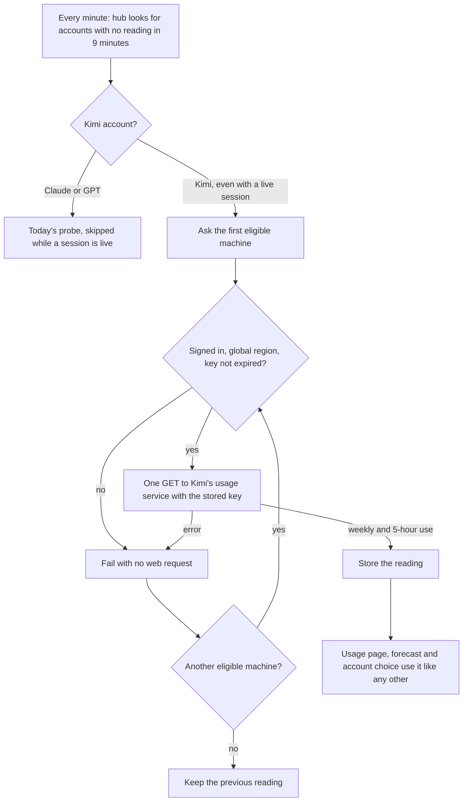

# Kimi Code weekly usage on Settings → Usage

**Idea:** `IDEA.md` — what this is for and why, in plain language. Read it first; it is
the north star this plan serves. Goal and Constraints live there, not here, so they don't
get buried as this file grows.

Map: `MAP.md`, `docs/maps/usage-readings.md`, `docs/maps/machine-usage-kimi.md`.

## Open Questions

None.

## Watch List

| # | Noticed | What needs looking into | Raised to user? | Outcome |
|---|---------|-------------------------|-----------------|---------|

## Decision Log

Append-only. A reversal is a new entry superseding the old, never an edit.

| # | Decision | Rationale | Source |
|---|----------|-----------|--------|
| 1 | Mode is thorough | Chosen by the user | user |
| 2 | Show Kimi's `limit_7d` as the week and `limit_5h` as the five-hour window, in the reading shape Claude/GPT already use (`week: {used, resets_at}`, `five_hour`), `used` = `used_ratio` × 100 | Reuses the existing reader, forecast and rank unchanged (usage.js:19-34) | defaulted |
| 3 | The reading is fetched by the machine service (which already knows each Kimi account's home, config and credential file), through the existing hub → machine `/v1/usage` route, extended to `kimi` | Keeps credentials on the machine; hub never sees a token | defaulted |
| 4 | Kimi readings are allowed while a Kimi session on that account is live (unlike Claude/GPT) | A Kimi reading is one web request and spawns nothing; a live session is when the token is surely fresh | defaulted |
| 5 | Poll interval stays the shared nine minutes | Same freshness as the other providers; under the 15-minute token life | defaulted |
| 6 | Read-only: wheelchair never renews, writes or locks Kimi's login; it reads usage only while the stored access token is unexpired, and otherwise skips without any network request | Zero sign-out risk; Kimi usage only moves while Kimi runs, which keeps the token fresh. Cost: use of the same account on another computer is not seen until Kimi runs here again | user |
| 7 | The usage URL is fixed at `https://api.kimi.ai/coding/v1/usages`; `base_url` in config.toml and `KIMI_CODE_BASE_URL` are ignored, and only accounts whose `loginStatus` is `logged_in: true` (global region) are read | The token is only ever sent to Kimi's own global host, never to an address taken from a file or env var; wheelchair already refuses China-region logins | defaulted |
| 8 | A window at `used_ratio >= 1` marks the reading `reached`, so the machine sets `limited_until` the same way it does for Codex | Reuses `limitedUntil` (machine/lib/limits.js); lets waiting sessions skip a spent Kimi account before it hits the limit | defaulted |
| 9 | Monthly limits and the top-up balance in the response are ignored | IDEA.md Not doing | defaulted |
| 10 | On a Kimi limit hit the machine reads usage once, so the stopped session resumes at Kimi's real reset | Review round 1: otherwise it retries hourly; the key is surely fresh at that moment | review-round-1 |
| 11 | For Kimi, the poller tries each eligible machine until one reads | Review round 1: the same account may be signed in on several machines; only the one that ran Kimi lately has a fresh key | review-round-1 |
| 12 | Supersedes 10: the Kimi limit-hit probe and `kimiLimitedUntil` are split off to their own thread; Kimi limit hits keep today's one-hour retry | That part drew a new upheld timing finding in rounds 1–3 while the rest settled; the user chose to split | user |

## Spec

### Flow

### Behaviour in one paragraph

Every Kimi account (default `~/.kimi-code` or `~/.wheelchair/accounts/<id>`) gets a weekly
and five-hour reading on Settings → Usage, through the same idle poller, `/v1/usage` machine
route, `usage.json` store, forecast, rank and retry that Claude and GPT use. The machine
gets the reading with one HTTPS GET to Kimi's usage service using the access token already
in Kimi's credential file. It never starts the Kimi CLI, never renews, writes or locks any
Kimi file, and never makes a request when the token has expired. Nothing about Claude, GPT
or Antigravity changes.

### Machine: `kimi` adapter `usageProbe(dir, { timeout })` (`machine/adapters/kimi.js`)

1. `loginStatus(dir)` must return `logged_in: true`; otherwise throw `Kimi Code is not
   signed in` (no network). This already requires the global host `auth.kimi.ai` and an
   oauth `key` of the form `oauth/<name>`.
2. Read `<home(dir)>/credentials/<name>.json` (`<name>` = key without `oauth/`). Use only
   `access_token` (non-empty string) and `expires_at` (Unix seconds, number). Missing,
   unparseable or wrong-typed → throw `Kimi Code's login can't be read`.
3. If `expires_at * 1000 <= Date.now() + 30_000`, throw `Kimi Code's login key has expired;
   it renews the next time Kimi Code runs` with no network request.
4. `GET https://api.kimi.ai/coding/v1/usages` with headers `Authorization: Bearer <token>`
   and `Accept: application/json`, using Node's global `fetch` with `redirect: 'error'` (exactly one request; a 3xx
   is a failure) and an abort timeout of `min(timeout, 10000)` ms. The URL comes only from the adapter constant; tests override it
   through a machine-service option (below), never through config.toml or the environment.
5. A non-2xx status → throw `Kimi usage request failed (HTTP <status>)`; a timeout
   (including one while reading the body), redirect, network error or any failure to read
   the body → throw `Kimi usage request failed`; a body read in full that is not JSON or has
   no `usages` object → throw `invalid usage response`. Every thrown message is one
   of the fixed strings in this section (plus the status number); never wrap or forward an
   underlying error's message. Error text never contains the token,
   the response body or headers.
6. Parse the JSON body's `usages` object: `limit_7d` → `week`, `limit_5h` → `five_hour`.
   Each entry `{used_ratio, reset_time}`: `used_ratio` is a number or numeric string;
   `used = used_ratio * 100` (not clamped below; clamp to at most 100). `reset_time` must be
   a non-empty string parseable by `Date.parse`, giving `resets_at` as an ISO string. An
   entry that is missing, has a non-numeric `used_ratio` or has no parseable `reset_time`
   gives `null` for that window (a window with no reset could never age out of a reading). If both
   are `null`, throw `no usage windows`. Ignore every other field.
7. Return `{ five_hour, week, ...(any window used >= 100 ? { reached: true } : {}) }`, the
   same shape Codex's probe returns (`machine/adapters/codex.js:11-20`).
8. The token is held only in a local variable for the request. It is never logged, put in
   an error, a reading, a response, a state file or a test snapshot.

### Machine: `/v1/usage` route (`machine/service.js:1907-1921`)

- Accept `cli: 'kimi'` alongside `claude` and `codex`; the account and directory checks are
  unchanged (`default-kimi` with `dir: null`, or `~/.wheelchair/accounts/<id>`).
- Pass the probe a test-only URL override from `this.options.kimiUsageUrl` when set, (the
  service tests set it to a local fake server); in production the option is unset.
- Reading construction, `reached` → `limited_until`, 200 and 502 handling stay as they are.
- `agy` stays refused with 400.
- Update `machine/API.md` (the `POST /v1/usage` paragraph, line 94): the CLI may also be
  `kimi`; for Kimi the service reads the access token from Kimi's credential file and makes
  one HTTPS GET to Kimi's usage service, never renewing or writing it, and no request when
  the token has expired.

### Hub: idle poller (`viewer/app/usage-poll.js`)

- Candidates include `kimi` accounts alongside `claude` and `gpt` (same unpaused,
  nine-minute reading and attempt rules, CLI from `PROVIDERS.kimi.cli` = `kimi`).
- Machine choice for `kimi`: the same eligible list and order as today (the hub machine
  first if eligible, then the rest by name), but on a failed probe try the next eligible
  machine, stopping at the first reading. The same Kimi account can be signed in on more
  than one machine, and only the one where Kimi ran lately has a fresh key; a failed Kimi
  probe with an expired key costs no network request. Claude and GPT keep today's single
  machine choice.
- For `kimi` accounts only, a live session on the account does **not** skip the poll, in
  either the pre-call or post-call check. Claude and GPT keep today's live-session skips.
- When every eligible machine fails (502, including the expired-key case), the previous
  reading stays as it is, as today; the attempt time still gates the next try to nine minutes.

### Hub and page

No change to `viewer/app/usage.js`, `balancer.js`, `sessions.js` or `viewer/pages/settings.js`.
They already handle this reading shape for every provider without a provider check (Kimi is
special-cased only for CLI problems, `viewer/app/usage.js:62-69`), so a Kimi reading flows
into the page, forecast and rank as is. Do not add Kimi-specific display.

### Edge cases

- Kimi idle more than ~15 minutes: no request, previous reading kept; reset times passing
  still show as zero through `effective()` (unchanged).
- Never read an account: page keeps "no reading yet" until Kimi runs on it.
- Signed out or China region: no request; "no reading yet" or the old reading.
- Kimi's service returns 401/403/5xx or times out: old reading kept, retried after nine
  minutes.
- Response missing `limit_7d` but with `limit_5h`: recorded with `week: null`; page treats it
  like any reading without a week.

### Non-goals

Changing what happens when a running Kimi session hits its limit (it keeps today's
one-hour retry; split to its own thread, Decision 12); renewing tokens; Kimi monthly limits or top-up balance; usage for Antigravity; any change to
Claude/GPT behaviour or to how the page looks.

### Validation

- New machine tests in `machine/test/kimi.test.js` (adapter) and `machine/test/service.test.js`
  (route), using a temp Kimi home with `config.toml` and a credential file and a local HTTP
  fake for the usage URL, covering: a good response → week/five_hour in percent with ISO
  resets; `used_ratio` as string; `used_ratio >= 1` → `limited_until` set on the reading; an
  expired `expires_at` → 502 and the fake received **no** request; not signed in / China
  region → 502, no request; fake returns 401 → 502 and the error text and response contain
  no token; the request carried `Authorization: Bearer <token>`; `agy` still 400.
- New hub tests in `viewer/test/app-usage.test.js`: an idle `kimi` account is polled with
  `cli: 'kimi'` and its reading is stored in `usage.json`; a `kimi` account with a live
  session is still polled **and its reading is stored**; a `kimi` account signed in on two
  machines whose first machine fails is read from the second; a `claude` account with a live
  session is still skipped.
- In the adapter tests, the Kimi home's `config.toml` and credential file have identical
  bytes and modification times before and after every probe (success, expired, HTTP error),
  and the recursive list of entries under the Kimi home is unchanged (no file or directory
  added or removed).
- Adapter or route tests: a 2xx body that is not JSON and contains a dummy secret string
  gives a 502 whose error text does not contain that string; a 302 from the fake gives a 502
  and the fake sees exactly one request.
- Commands, all must pass:
  - `bash machine/test/run.sh`
  - `node --test viewer/test/*.test.js`

## Accepted Risks

| Risk | Why accepted | Round |
|------|--------------|-------|
| A machine that drops its connection right after sending response headers can leave the hub's idle poll pending | Rare path (sub-second window); existing exposure for every provider's poll | review-round-2 |

## Review Rounds

### Round 1 — 2026-11-19

**Lanes:** claude / claude-opus-5-5 (intent); gpt / gpt-6.2-sol (mechanics); cross-family: yes.

**Changed since Round 0:** n/a (first round — whole Spec in scope)

| Lane | Reported | Finding | Lead verdict | Resolution |
|------|----------|---------|--------------|------------|
| mechanics (gpt) | blocking | Poller always picks the same machine; a stale key there blocks readings although another machine running Kimi has a fresh one | downgraded (major) | Real but the rest works; Spec now tries each eligible machine for Kimi until one reads |
| mechanics (gpt) | blocking | A 100% window with no reset never ages out of a reading and blocks placement | downgraded (minor) | Kimi always sends `reset_time` per its CLI parser; still, windows without a parseable reset are now dropped |
| mechanics (gpt) | major | A running Kimi session stopped by its limit still waits the one-hour fallback; poll readings never reach its `last_reading` | upheld | New Spec section: on a Kimi limit hit the machine probes usage once and uses the real reset |
| mechanics (gpt) | minor | Redirects not specified; fetch follows them | upheld | `redirect: 'error'` |
| mechanics (gpt) | minor | Check once built: a parse error could quote the response body into the forwarded error | upheld | Fixed error strings only, plus a malformed-body test |
| mechanics (gpt) | minor | Live-Kimi poll test should assert the reading is stored | upheld | Test now asserts storage |
| intent (claude) | minor | "Hub and page" asks the worker to hunt for a Kimi special case that doesn't exist | upheld | Section now says plainly nothing changes there, with evidence |

### Round 2 — 2026-11-19

**Lanes:** claude (intent); not-claude (mechanics); cross-family: yes.

**Changed since Round 1:**
- Kimi parser drops windows without a parseable `reset_time`; `redirect: 'error'`; fixed error strings, `invalid usage response` for bad bodies.
- New section "Machine: Kimi limit hit": probe usage once on a Kimi `limit-hit` and use the real reset (Decision 10).
- Poller tries each eligible machine for Kimi until one reads (Decision 11).
- "Hub and page" now states nothing changes there.
- Validation: limit-hit, malformed-body, redirect, two-machine and stored-reading tests.

| Lane | Reported | Finding | Lead verdict | Resolution |
|------|----------|---------|--------------|------------|
| intent (claude) | major | Limit-hit used the earliest reset even with no window near full; a throttling 429 would park the account until a quota reset | upheld | Real reset only when a window is ≥ 95%; else one-hour fallback |
| mechanics (gpt) | blocking | Five-hour 96% and week 100%: the earliest reset resumes the session while the week is still spent | downgraded (major) | It self-corrects after one wasted turn, but fixed: new `kimiLimitedUntil` takes the latest reset among full windows |
| mechanics (gpt) | blocking | A machine dropping the connection after sending headers leaves the hub's poll pending forever, now across several machines | accepted-risk | Rare path: needs a drop inside the sub-second window of one response; same exposure already exists for Claude/GPT polling (machine-client.js:33) |
| mechanics (gpt) | major | Failed limit-hit probe falls back to `limitedUntil(last_reading)`, which can pick a weekly reset days away | upheld | Fallback uses `kimiLimitedUntil(last_reading)`: only full windows count, else one hour |
| mechanics (gpt) | major | A failed reading after a good one isn't shown on Settings | declined | IDEA asks for failures shown "the way it does for the other providers"; Claude/GPT also keep the old reading silently (usage-poll.js:44). Changing the page is a non-goal |
| mechanics (gpt) | minor | Test URL override not specified for the limit-hit probe | upheld | Override applies to both |
| intent (claude) | minor | Inline 10-second probe holds up other Kimi turn events | upheld | 5-second timeout, inline stated as acceptable |

### Round 3 — 2026-11-19

**Lanes:** claude (intent); not-claude (mechanics); cross-family: yes.

**Changed since Round 2:**
- "Machine: Kimi limit hit": new `kimiLimitedUntil` helper (latest reset among windows ≥ 95%, else one hour), used for the fresh reading and for `last_reading` on probe failure; 5-second inline probe.
- Test URL override covers the limit-hit probe.
- New validation cases for the helper and the limit-hit fallbacks.
- One Accepted Risk added.

| Lane | Reported | Finding | Lead verdict | Resolution |
|------|----------|---------|--------------|------------|
| intent (claude) | — | No findings | — | — |
| mechanics (gpt) | blocking | Five-hour 100% resetting tonight and week 96% resetting in days: the latest-reset rule parks the session for days | upheld (major) | Part split off to its own thread (Decision 12); open finding carried there |
| mechanics (gpt) | blocking | The poll's machine status check can run `kimi --version` after a Kimi upgrade | declined | Existing machine status check, shared by every provider and the Settings page, cached and run whether or not readings exist (usage.js:48-76); not part of getting a reading, which stays one web request |
| mechanics (gpt) | minor | The grep validation can't prove credentials are untouched | upheld | Replaced by a before/after bytes-and-mtime test |

### Round 4 — 2026-11-19

**Lanes:** claude (intent); not-claude (mechanics); cross-family: yes.

**Changed since Round 3:**
- Removed "Machine: Kimi limit hit" and its tests (split off, Decision 12); added it as a non-goal.
- Test URL override now only for the `/v1/usage` route.
- Credential-untouched check is now a before/after bytes-and-mtime test.

| Lane | Reported | Finding | Lead verdict | Resolution |
|------|----------|---------|--------------|------------|
| intent (claude) | — | No findings | — | — |
| mechanics (gpt) | minor | Malformed-body and redirect tests were dropped with the split | upheld | Restored in Validation |
| mechanics (gpt) | minor | `oauth/` byte check doesn't fit a directory absent from the fixture | upheld | Now: file bytes/mtimes plus unchanged recursive entry list |
| mechanics (gpt) | minor | Body-read failure vs parse failure ambiguous | upheld | Body-read failures are `Kimi usage request failed` |
| mechanics (gpt) | minor | `machine/API.md` still says Claude/Codex only and no credential reads | upheld | Spec requires the API.md update |

## Implementation Tasks

| # | Objective | Ownership boundary | Lane | Session id | Validation | Status |
|---|-----------|--------------------|------|-----------|------------|--------|
| T1 | Kimi `usageProbe` adapter, `/v1/usage` accepts kimi with `kimiUsageUrl` test override, API.md, machine tests | `machine/adapters/kimi.js`, `machine/service.js` (/v1/usage block only), `machine/API.md`, `machine/test/kimi.test.js`, `machine/test/service.test.js` | codex standard / gpt-6.1-terra | wc-12789ba41816-worker | `bash machine/test/run.sh` | in progress |
| T2 | Idle poller includes kimi, no live-session skip for kimi, tries each eligible machine for kimi | `viewer/app/usage-poll.js`, `viewer/test/app-usage.test.js`, `viewer/test/helpers/app-machine.js` (if needed) | codex standard / gpt-6.1-terra | wc-12789ba41816-worker-2 | `node --test viewer/test/*.test.js` | in progress |

## Log

- 2026-11-19 — Build started; T1 and T2 dispatched in parallel (disjoint ownership), both Standard.
