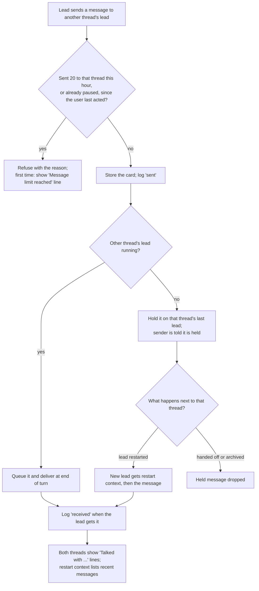

# Make lead-to-lead chat solid

**Idea:** `IDEA.md` — what this is for and why, in plain language. Read it first; it is
the north star this plan serves. Goal and Constraints live there, not here, so they don't
get buried as this file grows.

Map: `MAP.md` → `docs/maps/lead-chat-delivery.md`. Earlier plan: `docs/plans/lead-chat/PLAN.md`
(its Deferred rows D1–D4 are this plan's scope).

## Open Questions

_None._

## Watch List

| # | Noticed | What needs looking into | Raised to user? | Outcome |
|---|---------|-------------------------|-----------------|---------|

## Decision Log

Append-only. A reversal is a new entry superseding the old, never an edit.

| # | Decision | Rationale | Source |
|---|----------|-----------|--------|
| 1 | Mode: thorough | Collin picked it; this thread is already the hardening follow-up | user |
| 2 | A message to a thread with no live lead is held on that thread (not refused) and delivered to its next lead, after the restart context; held messages never expire, and are dropped if the thread is archived or handed off | A restart can be minutes or days away; a held message is information, and leads never wait on each other | defaulted |
| 3 | The sender learns a message was held: `card.js` prints `"held":true` in its receipt | The sending lead should know no one has read it yet | defaulted |
| 4 | The live-lead check and the enqueue-or-hold happen under one target-thread step, so a lead stopping between them no longer loses the message | Closes the loss window the mapper found (`viewer/app/hub.js:203`) | defaulted |
| 5 | Cap: at most 20 cross-thread messages per pair of threads per rolling hour, both directions counted together, held messages included; the 21st is refused (422) with a reason naming the other thread and when sending is possible again | A typical overlap exchange is 2–6 messages; a loop hits 20 within minutes | defaulted |
| 6 | Hitting the cap also shows a small line in the sender's thread: "Message limit reached with <title>" | Collin sees a loop was stopped without a card to answer | defaulted |
| 7 | The restart context gains `cross_thread_messages`: the latest 20 cross-thread messages this thread's leads sent or received, each with time, direction, other thread id and title, and text; `recent_messages` is unchanged | Keeps user messages from being crowded out; outgoing ones were already in cards, incoming ones were missing (`viewer/app/threads.js:144`) | defaulted |
| 8 | The "Talked with" line links to the other thread | One tap to see what the other thread is doing | defaulted |
| 9 | Holding (Decision 2) also applies to a stub thread never opened: the message is delivered after its `[wc:context stub]` message | Same rule as a restarting lead; the stub's lead learns of it on first open | defaulted |
| 10 | "Talked with" lines: one line per conversation; messages with the same thread within 30 minutes of the previous one fold into one line, "Talked with <title> · N messages" | Collin picked it (Q1): fewer lines on a phone | user |
| 11 | Supersedes 9: a never-opened stub has no lead session, so a message to it stays refused ("no lead by that name"); adding to a stub is thread 2c25927136e1's work | Avoids a second way to feed a stub; a held message needs a lead session to wait on (Spec S1) | defaulted |
| 12 | A message may name any lead session of the target thread, live or ended; it goes to the latest live lead or is held. The overlap rules for `lead: null` entries in `session leads` are unchanged (still an overlap card) | Holding protects conversations already under way; changing the overlap path is out of scope | defaulted |
| 13 | Held messages wait in the latest lead session's queue, which `restartLead` already moves to the next lead; no new store | Reuses the existing move (`viewer/app/threads.js:178`) | defaulted |
| 14 | Supersedes 5 and 6: a pair that exchanges 20 messages within an hour is paused until Collin writes or presses something in the sending thread; one "Message limit reached" line per pause | A rolling cap only slows a loop; IDEA asks that it stop | review-round-1 |
| 15 | The pair count reads only the sender's own `peer_log`; no `target_thread` field on cards | One thread, no cross-thread read | review-round-1 |
| 16 | A `received` entry is written when a lead actually gets the message, not when it is queued | Avoids a restarted lead seeing a held message twice | review-round-1 |
| 17 | Held messages do not block hand-off or archive; they are dropped then | A held message is information; it must not force a restart first | review-round-1 |
| 18 | Supersedes 14 and 15: each lead is paused with a thread after sending it 20 messages within an hour, until Collin writes or presses something in the sending thread (`thread.user_at`); the pause is kept in `peer_pauses`, outside the capped log | Counting received messages depended on delivery timing; one rule per sender is simpler and still stops a loop | review-round-2 |
| 19 | Supersedes the S3 payload bullet (round 1): `peer_log` is not stripped from browser responses | The text already reaches the browser through cards and history; IDEA only rules out showing it | review-round-2 |
| 20 | A restarted lead treats `cross_thread_messages` as background and never answers from it | Guessing which questions were answered was error-prone; leads never wait on each other | review-round-2 |

## Spec

Scope: cross-thread `message` cards between leads (the path in `docs/maps/lead-chat-delivery.md`).
Same-thread messages, `reach` cards and `session leads` output are unchanged.

### S1. Holding a message for a lead that is not running

- Acceptance (`viewer/app/cards.js`, cross-thread branch): keep every existing check except
  `that thread has no live lead right now`, which is removed. `to` must still name a lead
  session that exists in the target thread (live or ended); otherwise `no lead by that name`
  as today. A never-opened stub has no session and stays refused.
- Delivery step (`viewer/app/hub.js` `acceptCard`, target-thread update): if the target is
  still reachable (`peers.reachable`), take `peers.latestLiveLead(thread)`; if there is none,
  take the target's most recently created lead session (live or not). Push the same queue
  entry as today (marker text, `source: 'session'`) plus a field
  `peer: { thread: <sender thread id>, title: <sender title>, session: <sender session name>, question: <card id, only when asks is true> }`
  onto that session's queue and `thread.queues`. Attempt delivery only when the chosen lead is
  live. The step returns `{ name, held }`, `held: true` when the lead was not live.
- A held message reaches the next lead because `restartLead` already moves every ended
  lead's queue to the new lead after the new restart context (normal and imported paths;
  `viewer/app/threads.js:159-195`). Verify that ordering in a test; change nothing there
  unless the test shows the message lost or placed before the context.
- Receipt: `acceptCard` returns the card plus `held: true` when held. The machine relays the
  hub body unchanged; `viewer/app/card.js` adds `"held":true` to its printed receipt when the
  body has `held === true` (alongside the existing `queued`). A machine-spooled card
  (`queued`) cannot report `held`.
- Hand-off and archive: queue entries carrying `peer` on a session that is not live and not
  `pending` are ignored by the "lead is busy" checks (`viewer/app/handoff.js:98` and any other
  check over lead queues before export or Advance; other entries still count). When an export
  or Advance succeeds, and when archive completes, those entries are deleted from every
  session's queue and `thread.queues`, so a later restart or import cannot deliver them.
- First contact: a lead that has not talked with a thread still sees `lead: null` in
  `session leads` while that thread's lead is down, and follows the existing overlap rules.
  Holding serves conversations already under way (the sender knows a lead's session name).

### S2. Pausing a lead that messages one thread too much

All checks read only the sender thread's own record, inside the sender's existing thread
update; no new lock and no read of the target thread.

- Let `since` be `thread.user_at` of the sender thread (set when Collin writes in it or presses
  a card there; `viewer/app/sessions.js:496`, `viewer/app/threads.js:345-455`), or the start of
  time when missing.
- New thread field `peer_pauses`: object mapping another thread's id to the time this thread
  was paused with it. It is not capped and is separate from `peer_log`.
- A send to thread T is **paused** when `peer_pauses[T]` exists and is later than `since`.
  Otherwise count this thread's `peer_log` `sent` entries to T that are later than `since` and
  within the last 60 minutes; at 20 or more, set `peer_pauses[T]` to now and the send is paused.
- A paused send is refused with 422 and the reason
  `message limit reached with <target title>: 20 messages within an hour; messaging that thread is paused until the user writes in this thread`.
  The refusal that sets `peer_pauses[T]` also appends one `limit` entry to `peer_log`; later
  refusals append nothing.
- Implementation: the thread-update callback writes those fields and returns a refusal result;
  the hub raises the 422 after the write completes (throwing inside `updateThread` skips the
  write; `viewer/app/state.js:147`). Nothing else is stored.
- Each lead is limited on its own sends, so a loop between two leads stops after at most 20
  messages from each.
- Constants `PAIR_LIMIT = 20` and `PAIR_WINDOW_MS = 3600000` in one place, exported for tests.

### S3. Per-thread record of lead-to-lead traffic

- New thread field `peer_log`: array of
  `{ at, thread, title, session, direction, text, question? }`, newest last, capped at 200
  (oldest dropped). `direction` is `sent`, `received` or `limit`. `thread` is the other thread's
  id, `title` its title at that moment, `session` the other lead's session name, `question` the
  card id when the message asked for an answer. `text` is empty for `limit`.
- `sent`: added to the sender thread when the card is stored (`session` = the card's `to`).
- `received`: added to the target thread when delivery's machine submit succeeds
  (`viewer/app/sessions.js` after `target.queue.shift()`), for a queue entry carrying `peer`,
  built from that entry. A held message is therefore recorded once, when a lead actually gets it.
- Old threads with no `peer_log` read as empty.

### S4. Restart context

- `restartLead` adds `cross_thread_messages`: the last 20 `peer_log` entries with direction
  `sent` or `received` and, for an imported thread, `at` later than `thread.imported.at`; each
  with every S3 field. Omit the field when there are none. `recent_messages` and every other
  field are unchanged.
- `protocol/app/lead.md` "Restarting what died" gains: the restart context's
  `cross_thread_messages` is background on recent conversations with other threads' leads;
  never answer a message from it (the Replies rule applies only to messages delivered to you).

### S5. "Talked with" lines in the thread

- `viewer/app/chat.js` builds, from `peer_log`, items of a new type `peer`, interleaved by time
  with the other items:
  - First drop entries the page's import cutoff would hide (the same rule as
    `viewer/pages/thread.js:582-602` applies to items), then fold.
  - `sent` and `received` entries with the same `thread` fold into one item while each is
    within 30 minutes of the previous entry for that thread; otherwise a new item starts.
    Item: `{ type: 'peer', at: <first entry's at>, thread, title: <latest entry's title>, count }`.
  - Each `limit` entry is its own item `{ type: 'peer', at, thread, title, limit: true }`.
  - Items carry no message text. `count` includes this thread's sent messages still held for
    the other thread's next lead.
- `viewer/pages/thread.js` renders a `peer` item like a context line (class `ctx`): text
  `Talked with <title> · <count> message(s)` ("1 message", "N messages") or
  `Message limit reached with <title>`, with `<title>` a link to
  `/wheelchair/app/thread?id=<thread>`. All text via `textContent`.
- The hidden `[wc:from ...]` turns stay hidden exactly as today (`viewer/app/chat.js:125`).

### S6. Protocol text

- `protocol/app/cards.md`, `message` section: a lead's message to another thread's lead may
  name a lead session of that thread it already knows, live or ended; if none is live it is
  held for that thread's next lead and the receipt shows `"held":true`. A lead that sends 20
  messages to one thread within an hour is paused with that thread until the user writes in
  the sending thread; the refusal says so. Add `held` to the receipt description in "Posting a card".
- `protocol/app/lead.md`, "Other leads on this machine": keep "A thread with `lead: null`
  cannot be messaged" for discovery and overlaps, and add that a lead you are already talking
  with may be messaged at its known session name after it stopped; the message is held, never
  resend it. On a limit refusal, stop messaging that thread and say once, in one line of your
  next visible reply, that the conversation was paused; until the user writes in this thread,
  read that thread's messages without replying or repeating the line.
- Validation of stale wording: `grep -rn "no live lead right now" viewer machine protocol --exclude-dir=test`
  returns nothing (maps and old plans are history and keep it).

### Non-goals

Showing message text in the thread; messages between machines; changing who may message whom,
the `reach` flow or `session leads`; messaging never-opened stubs; first contact with a thread
whose lead is down; a user-facing card for the pause.

### Validation

- `node --test viewer/test/app-lead-messages.test.js viewer/test/app-hub.test.js viewer/test/app-chat.test.js viewer/test/app-handoff-restart.test.js`
- `bash machine/test/run.sh`
- `npm --prefix viewer run test:browser`
- The grep in S6.
- New tests (in `viewer/test/app-lead-messages.test.js` unless noted):
  1. Message to a thread whose only lead has ended: accepted, receipt has `held: true`, entry
     (with `peer`) sits on that lead's queue; `restartLead` then puts it on the new lead's queue
     after the restart context (normal and imported restart).
  2. Lead dies between acceptance and the delivery step: message is held, not lost.
  3. Pause: 20 `sent` entries to one thread within an hour, then a send is refused with the
     reason above, stores no card, sets `peer_pauses` and adds one `limit` entry; a second
     refused send adds none; the pause survives 200 newer `peer_log` entries; after
     `thread.user_at` moves past it (a typed message or a card press), sends succeed again;
     entries older than 60 minutes do not count; sends to a different thread are unaffected.
  4. `peer_log`: `sent` on the sender at acceptance; `received` on the target only after a
     successful submit (not while held); capped at 200.
  5. Hand-off with a held message: export is not refused as busy, and the held entry is gone
     afterwards; archive likewise (`viewer/test/app-handoff-restart.test.js`).
  6. Restart context includes `cross_thread_messages` with `session` and `question`, leaves out
     entries before an import cutoff, and omits the field when empty (`viewer/test/app-hub.test.js`).
  7. Chat builds folded `peer` items: 3 messages within 30 minutes → one item, count 3; a gap
     over 30 minutes → two items; a limit entry → its own item; entries before an import cutoff
     are dropped before folding (`viewer/test/app-chat.test.js`).
  8. Browser: a `peer` item renders as a line with a link to the other thread.
  9. `card.js` prints `"held":true` when the body has it.

## Accepted Risks

| Risk | Why accepted | Round |
|------|--------------|-------|
| A message is stored on the sender but never queued if the target is archived, handed off or moved machine between acceptance and the delivery step | Needs a user action inside a sub-second window; rare path (`realism.md`) | planning |
| A card spooled during a hub outage and refused later by the cap reaches no sender | Needs an outage plus a loop; the `limit` line still shows in the thread | planning |
| The hub restarts after saving the sender's card but before the target-thread step: the message is never queued, and the machine's retry is deduplicated | Needs a hub restart inside the gap between two consecutive saves; existing since lead-chat | review-round-1 |
| The hub restarts during the machine start request of a lead restart: the new lead starts with an empty queue and held messages stay on the ended lead | Needs a hub restart inside one start request; affects all queued messages, not only these | review-round-1 |
| More than 180 other entries (mostly incoming messages) land in a thread's 200-entry `peer_log` within an hour, evicting one of its 20 counted sends, so a 21st send to one thread is accepted without user activity | Needs several other threads flooding this one inside the same hour while it also sends 20 to one thread; each of those senders is itself paused at 20 | verification-1 |

## Review Rounds

### Round 1 — 2026-11-21

**Lanes:** intent — claude / claude-opus-5-5; mechanics — gpt / gpt-6.2-sol; cross-family: yes.

**Changed since Round 0:** n/a (first round — whole Spec in scope)

| Lane | Reported | Finding | Lead verdict | Resolution |
|------|----------|---------|--------------|------------|
| intent | major | S2: a rolling cap slows a loop but never stops it; "send again after" invites retries | upheld | S2 now pauses the pair until the user writes; Decision 14 |
| intent | minor | S2/S3: count from `peer_log` instead of a new card field and a cross-thread read | upheld | S2 reads the sender's `peer_log` only; Decision 15 |
| intent | minor | S3/S4: `received` written at queue time duplicates held messages in restart context and shows unread lines | upheld | `received` written on successful submit; Decision 16 |
| intent | minor | S4: entries lack the peer session and question id | upheld | S3 fields `session`, `question`; S4 lead.md rule |
| intent | minor | S1: first contact while the target's lead is down still meets `lead: null` | upheld | Stated in S1 and Non-goals |
| intent | minor | S5: every refused retry adds a limit line | upheld | One `limit` entry per pause (S2) |
| mechanics | major | S1: hub restart between sender save and target step loses the message; retry deduplicated | accepted-risk | Rare path: restart inside the gap between two saves; Accepted Risks |
| mechanics | major | S1: hub restart during a lead restart's start request strands held messages | accepted-risk | Rare path: restart inside one start request; Accepted Risks |
| mechanics | major | S1: held messages make hand-off report the lead busy | upheld | S1 hand-off and archive bullet; Decision 17 |
| mechanics | major | S3/S4: restart history lacks session and question; queued entries indistinct | downgraded (minor) | A missed peer answer costs no user work and leads never wait on peers; fixed with the intent findings above |
| mechanics | minor | S2: throwing inside `updateThread` drops the `limit` entry | upheld | S2 implementation bullet |
| mechanics | minor | S5: folding across the import cutoff hides new activity | upheld | S5 drops pre-cutoff entries before folding |
| mechanics | minor | S3: `peer_log` text leaks into chat and thread-list payloads | upheld | S3 last bullet; test 7 |
| mechanics | minor | S6: new rule contradicts "`lead: null` cannot be messaged" | upheld | S6 lead.md bullet |
| mechanics | minor | S6: repo-wide grep matches the delivery map | upheld | S6 grep scoped |

### Round 2 — 2026-11-21

**Lanes:** intent — claude / claude-opus-5-5; mechanics — gpt / gpt-6.2-sol; cross-family: yes.

**Changed since Round 1:**
- S1: queue entries carry `peer`; held entries ignored by hand-off busy checks and dropped on hand-off/archive; first contact stated as out of scope.
- S2 rewritten: pause until the user writes, counted from the sender's own `peer_log`; refusal written then raised after the write.
- S3: `received` written on successful submit; `session`/`question` fields; `peer_log` kept out of browser payloads.
- S4: restart fields and the unanswered-question rule.
- S5: import cutoff before folding; no text in items.
- S6: lead.md wording beside `lead: null`; scoped grep.
- Accepted Risks: two hub-restart rare paths added; unlocked-count risk removed.

| Lane | Reported | Finding | Lead verdict | Resolution |
|------|----------|---------|--------------|------------|
| intent | minor | S2: `since` from submitted `thread.sent` misses presses and queued messages | upheld | `since` = `thread.user_at` |
| intent | minor | S5: a held message counts toward "Talked with" | upheld | S5 states the count includes held sent messages |
| intent | minor | S2/S6: a paused lead is woken and repeats the pause line | upheld | S6: say it once, then read without replying |
| mechanics | blocking | S2: per-sender counting lets each side send 20 while inbound waits, so the pair exceeds 20 | downgraded (minor) | The loop still stops; S2 now limits each lead's own sends (at most 20 each), matching what is counted; Decision 18 |
| mechanics | blocking | S2: the pause lives in the capped log and can be evicted | downgraded (minor) | Needs 200 newer entries during a pause; fixed anyway with `peer_pauses` |
| mechanics | blocking | S3: message text still reaches the browser through cards, history and queues | declined | IDEA's non-goal is about what the thread shows; the text is Collin's own data and already in those payloads since lead-chat. The round-1 redaction bullet is cut; Decision 19 |
| mechanics | minor | S2: user activity inferred from submissions; sudo expiry could lift a pause | upheld | `thread.user_at` |
| mechanics | minor | S4: unanswered-question rule misfires | upheld | Rule cut; Decision 20 |
| mechanics | minor | S4: old peer questions replay after Advance | upheld | Import cutoff in S4 |

## Implementation Tasks

| # | Objective | Ownership boundary | Lane | Session id | Validation | Status |
|---|-----------|--------------------|------|-----------|------------|--------|
| T1 | S1-S4 backend: hold, pause, peer_log, restart context, card.js held receipt, hand-off/archive cleanup | viewer/app/{cards,hub,sessions,threads,handoff,handoff-ops,card}.js; viewer/test/app-lead-messages, app-hub, app-handoff-restart tests (not peers.js listLeads) | standard / gpt-6.1-terra | wc-f4c68e8cbb15-worker-3 (branch -w3) | Spec Validation 1,2; tests 1-6, 9 | done (test gaps moved to T4) |
| T2 | S5 Talked-with lines (after T1 lands peer_log) | viewer/app/chat.js, viewer/pages/thread.js, app-chat test, browser spec | standard / claude-sonnet-5-5 | wc-f4c68e8cbb15-worker-4 (branch -w4) | Spec Validation 1,3; tests 7, 8 | done (test 7 tightened in T5) |
| T3 | S6 protocol text (exact wording in brief) | protocol/app/cards.md, protocol/app/lead.md | light / gpt-6-luna; rung 2: light, effort xhigh (attempt 1 claimed all five edits but left out the Restarting-what-died paragraph) | wc-f4c68e8cbb15-worker-2 (branch -w1, replaces -worker) | protocol-rules test, S6 grep | done |
| T4 | Close T1's test gaps: test 3 pause lifted by a real typed message and card press, and the `since` count rule; test 1 end to end; test 2 `peer` and no delivery; test 5 busy negative control | viewer/test/app-lead-messages.test.js, viewer/test/app-handoff-restart.test.js (no app code) | standard / gpt-6.1-terra | wc-f4c68e8cbb15-worker-5 (branch -w5) | Spec Validation 1 | done |
| T5 | Make test 7 prove cutoff-before-fold and the latest-title rule (exact fixture edits in brief) | viewer/test/app-chat.test.js | light / gpt-6-luna | wc-f4c68e8cbb15-worker-6 (branch -w6) | node --test viewer/test/app-chat.test.js | done |

## Log

- 2026-11-21: lead of thread 2c25927136e1 (Avoid duplicate stubs) asked about clashes; it changes `listLeads` output and adds an app message to stub leads. Not an overlap: this plan does not touch `listLeads`; answered the peer.
- 2026-11-21 — Sub-lead: decomposed into T1-T3; T3 dispatched. Usage limit reached before briefing T1/T2; a resumed sub-lead writes those briefs (T1 brief notes: busy check viewer/app/handoff.js:98, delivery step viewer/app/hub.js:200-213, user_at threads.js:345-455, card.js receipt :328).
- 2026-11-21 — Sub-lead restarted (sub-lead-2). T3 attempt 1 (gpt-6-luna) report claimed every edit with choices 'none', but the diff lacks brief edit 5 (lead.md Restarting what died paragraph); edits 1-4 match the brief. Stopped it; attempt 2 on the same branch (rewritten brief: only edit 5, stronger checks; effort raised to xhigh). No maintained copies of cards.md/lead.md exist elsewhere (grep). T1 and T2 dispatched in parallel (disjoint files; T2 reads peer_log as S3 defines it and seeds it in tests).
- 2026-11-21 — T3 accepted (band: scout): all five S6 edits verbatim (cards.md:37,160-161; lead.md:745,747,895); protocol-rules 38/38 and the S6 protocol grep re-run by the sub-lead. Its diff-stat gate showed PLAN.md only because the brief compared two-dot against a feature branch that had moved; not a worker defect.
- 2026-11-21 — Choice: T3, cards.md:37: the held sentence joins the existing long source line rather than a new wrapped line.
- 2026-11-21 — Choice: T3, cards.md:161: the 20-message sentence is a new source line in the same paragraph.
- 2026-11-21 — T1 accepted (band: scout): S1-S4 code matches the Spec (scout checked each bullet with file:line); the focused tests (143/143) and the S6 viewer/machine grep were re-run by the sub-lead. Missing or weak tests went to T4 rather than a redo, because the code was sound: test 3 lifted the pause with a hand-written user_at and never tested the count-side `since`; test 1 had no end-to-end accept→restart; test 2 did not assert `peer` or that nothing was delivered; test 5 had no negative control. machine/test/run.sh stalls on the unchanged feature branch too (sub-lead baseline: 553 tests passed, then a hang until a 500 s timeout; T1 touches no machine code); it will be re-run when no other suite is running.
- 2026-11-21 — Choice: T1, viewer/app/sessions.js: the `received` text is the queue text with the generated marker prefix sliced off.
- 2026-11-21 — Choice: T1, viewer/app/peer-log.js: new module holding the limits, the capped log append and the held-entry helpers.
- 2026-11-21 — Choice: T1, viewer/app/hub.js:205-206: no live lead → the last lead session in array order (creation order), which can be a `pending` restarting lead; the entry then waits in that pending queue and counts toward "busy" (it is about to be delivered).
- 2026-11-21 — Choice: T1, viewer/app/hub.js:205: target no longer reachable → nothing queued, receipt not held (covered by Accepted Risks row 1).
- 2026-11-21 — Choice: T1, viewer/app/hub.js:216: `held` attached in Hub.acceptCard rather than cards.acceptCard.
- 2026-11-21 — Choice: T1, viewer/app/cards.js:172: a `limit` entry's `session` is the card's `to`, `title` the target's name at that moment.
- 2026-11-21 — Choice: T1, viewer/app/handoff.js:166: held entries dropped just before the export save.
- 2026-11-21 — Choice: T1, viewer/app/API.md:40 and viewer/AGENTS.md:15: documented the `held` receipt and the new module.
- 2026-11-21 — Worker didn't fully report its choices; it listed 2, I listed 8 (scout list).
- 2026-11-21 — T4 accepted (band: scout): all five test gaps closed through real paths (app-lead-messages.test.js:106,132,149,160; app-handoff-restart.test.js:253-255); no app code touched; 28/28 re-run by the sub-lead. Narrower than asked, accepted: the no-delivery check counts hub.deliver only, and the busy negative control covers a pending lead, not a live one.
- 2026-11-21 — Choice: T4, app-lead-messages.test.js: a merged-card Keep press and hub.enqueue(..., 'user') drive the two user-activity paths.
- 2026-11-21 — Choice: T4, app-handoff-restart.test.js: a pending lead carries the non-peer busy entry; the export gate's status reply is scripted.
- 2026-11-21 — Choice: T4, tests: break checks were run in a scratch copy; the handoff break used was "busy predicate always false".
- 2026-11-21 — T2 accepted (band: scout): S5 matches (chat.js:387-422 cutoff rule same as thread.js:582-586, fold, item shape, interleave; thread.js:660-668 textContent-only render, fixed href prefix with encoded id). Test 8 passes in both browsers per the report; the 8 app-accounts "lead waiting line" browser failures reproduce on the feature branch before T2 (sub-lead run: 8 failed, 96 passed), so they predate this build. Test 7 did not prove cutoff-before-fold or the latest-title rule; tightened in T5 (Light, exact edits).
- 2026-11-21 — Choice: T2, viewer/test/app-peer-lines.spec.js: test 8 in a new spec file, since browser.spec.js is the graph-editor suite without the thread-page helper.
- 2026-11-21 — Choice: T2, thread.js:661: an empty title links as "another thread".
- 2026-11-21 — Choice: T2, chat.js:418: a peer item goes after items with the same time and before the first later item.
- 2026-11-21 — Choice: T2, chat.js:387,400: entries with a non-string `at`/`thread` or an unknown direction are skipped.
- 2026-11-21 — Choice: T2, chat.js:399: a `limit` entry does not break a fold chain (not reported by the worker).
- 2026-11-21 — Choice: T2, thread.js:663: thread id URL-encoded in the link (not reported by the worker).
- 2026-11-21 — Choice: T2, thread.js:662: a span.peer-line wrapper keeps the flex `ctx` line one centred item.
- 2026-11-21 — Machine suite: run whole, `bash machine/test/run.sh` hangs after 553 passing tests (twice, also on the unchanged feature branch). Run file by file (`node --test` per file, 150 s cap) nothing hangs; 46 of 48 files pass and only win.test.js (16 fail) and win-tool-ready.test.js (2 fail) fail, on `spawnSync wslpath ENOENT`. The same two files fail identically on main 7204dd2a (canonical clone), and this build changes no machine/ file: pre-existing, environment-only.
- 2026-11-21 — T5 accepted (band: scout): six edits verbatim, 25/25 re-run by the sub-lead; worker reported no choices and the scout found none. The sub-lead corrected the one comment the brief's time change made stale (app-chat.test.js:442, 45 → 50 minutes).
- 2026-11-22 — All tasks done; full validation green (focused 209/209, viewer 844/844, browser 1278 passed / 34 skipped, S6 grep empty; machine suite as logged). COMPLETION.md written; status verifying.
- 2026-11-22 — Verification attempt 1: Claude verifier (claude-opus-5-5) PASS; GPT verifier (gpt-6.2-sol) FAIL with 3 gaps. Merged list after rare-path judgment: G1 archive leaves a held message on a lead that was live until the archive (threads.js:246 runs dropHeld before marking sessions ended) — normal use, fix; G2 peer_log eviction lets a 21st send through — rare path (verifier's own label; needs a flood from several other threads), Accepted Risks verification-1; G3 a held message counts toward the stopped thread's "N queued: waiting for the lead to finish its turn" (chat.js:465) — normal use, minor, fix. The verifiers' suite failures were concurrent-run timeouts that passed alone (another thread's sub-lead also killed playwright runs around 00:40).
- 2026-11-22 — R1-2 accepted (band: scout): chat.js:465 line exactly as briefed; new test app-chat.test.js:459-477 seeds a held, an ordinary and a live-lead entry and asserts 2; 26/26 re-run by the sub-lead; worker's break check (old line gives 3 !== 2) reported.
- 2026-11-22 — Choice: R1-2, app-chat.test.js:459: test name and the one-line comment above it are the worker's wording.
- 2026-11-22 — Choice: R1-2, app-chat.test.js: the test thread carries `pinned: {}` and `cards: []` and no `imported`, the minimum for chat() to run.
