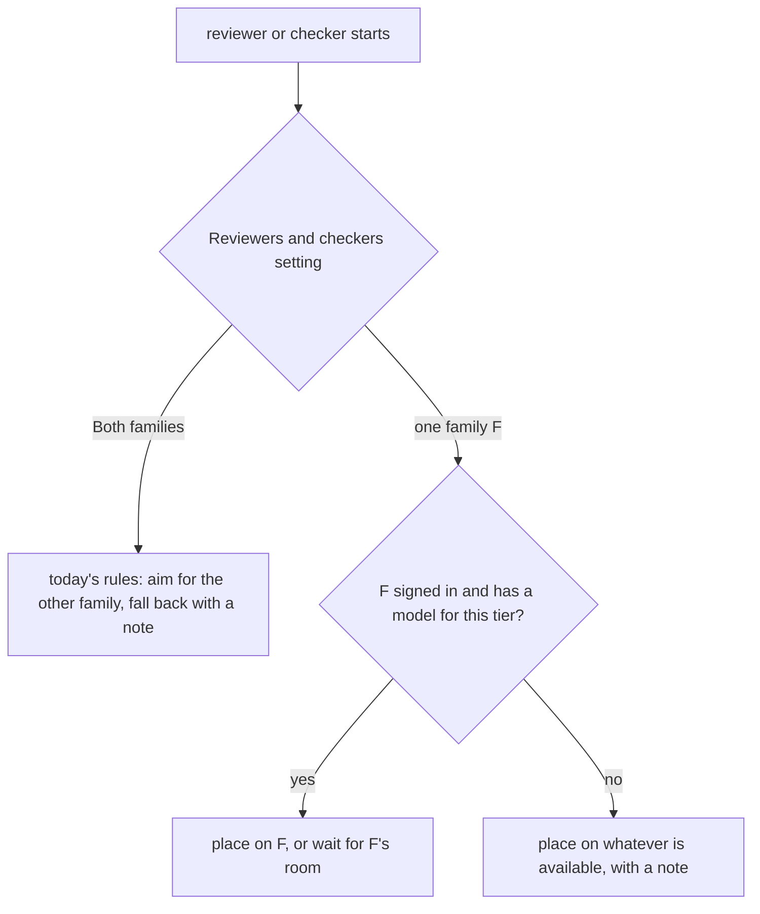

# Reserve the lead's provider, and one-family review

**Idea:** `IDEA.md` — what this is for and why, in plain language. Read it first; it is
the north star this plan serves. Goal and Constraints live there, not here, so they don't
get buried as this file grows. **Map:** `MAP.md`.

## Open Questions

None.

## Watch List

| # | Noticed | What needs looking into | Raised to user? | Outcome |
|---|---------|-------------------------|-----------------|---------|

## Decision Log

Append-only. A reversal is a new entry superseding the old, never an edit.

| # | Decision | Rationale | Source |
|---|----------|-----------|--------|
| 1 | The reserved provider is the first provider in the lead order (with `any` expanded to the worker order, as for leads) that has an unpaused account signed in on the thread's machine. If none, nothing is reserved. | "Selected" in Collin's words means a provider he actually has; an order entry with no account would reserve nothing useful. | defaulted |
| 2 | `save_claude_for_leads` is renamed `save_for_leads`; a saved settings file with the old key carries its value over on load. The Settings label names the reserved provider ("Save GPT for leads"), or reads "Save the lead's provider for leads" when none is resolvable. | IDEA constraint: existing settings keep working. | defaulted |
| 3 | The per-role margin hold-back (`held_back`) follows the same reserved provider instead of `PROVIDERS.claude.saveForLeads`; the `saveForLeads` provider flag is removed. | Same reserve, same provider; otherwise the two halves of the reserve disagree. | defaulted |
| 4 | The Ready check requires only the thread's own family. The other family being installed but signed out no longer fails it. | The fallback rules already land reviewers and checkers on the available family; failing Ready blocks one-account users for a family they never meant to use (`viewer/app/ready.js:38-58`). | defaulted |
| 5 | A worker's `--provider` preference for a family with no unpaused, signed-in account on the machine is dropped with a note, instead of waiting. A family that is signed in but out of room still waits as today. | Critical and taste-sensitive work asks for Claude by name (`protocol/app/sub-lead.md:63-69`); a GPT-only setup would otherwise wait forever. | defaulted |
| 6 | Scope is the app (hub, Settings page, `protocol/app/`). The CLI `/plan-review` and `/verify` stages keep their own rules. | IDEA "Not doing"; they already handle one family. | defaulted |
| 7 | One setting, "Reviewers and checkers": Both families (default), Claude only, GPT only. A single-family choice gives one reviewer per round covering both lenses, and one checker, all from that family. | Collin picked one choice over separate count and family settings. | user |
| 8 | With `both` chosen but only one family usable, a plan still gets two reviewers, both from that family, one per lens. The checker lands on the same family as the builder with a note. | Collin picked two independent reads; matches the CLI `/plan-review`. | user |
| 9 | With one family, the reserve still holds back the ticked roles when it is projected to run short; they wait for the reset. | Collin kept leads protected; per-role ticks already turn it off. | user |

## Spec

Scope: the app only (hub in `viewer/app/`, Settings page `viewer/pages/settings.js`, role
rules in `protocol/app/`). The CLI stages (`protocol/plan-review.md`,
`protocol/verification.md`) are unchanged. Read `MAP.md` and
`docs/maps/app-provider-placement.md` for how placement works today.

How a reviewer or checker is placed once this lands (the reserve and one-account rules in
§1-§2 apply underneath):



### 1. The reserve follows the lead's provider

Today "Save Claude for leads" (`save_claude_for_leads`) and the margin hold-back both key off
`PROVIDERS.claude.saveForLeads` (`viewer/app/providers.js:3`, `viewer/app/balancer.js:39,45`).

- **Reserved provider.** A new helper in `viewer/app/balancer.js` (exported for tests)
  computes it: walk `settings.lead_order` with `any` expanded to `settings.worker_order`
  (same expansion as `balancer.js:28`), de-duplicated; return the first provider that has an
  unpaused account in `settings.accounts` that is signed in on the thread's machine
  (`machines[machineName]?.accounts?.[id]`, the test `usage.rank` and the wait path already
  use). None → `null` (nothing reserved).
- **Ordering** (`balancer.js:45`): when `settings.save_for_leads` is true and the role is not
  lead or sub-lead, move the reserved provider to the end of the candidate list. `null` →
  no reordering.
- **Margin hold-back** (`balancer.js:39`): `margin[p]` is true only when `p` is the reserved
  provider (instead of `PROVIDERS[p].saveForLeads`); the rest of the condition is unchanged.
  With one family this still holds back ticked roles until the reset (Decision 9).
- Remove `saveForLeads` from `PROVIDERS` and every reader of it.
- **Setting key.** `save_claude_for_leads` → `save_for_leads` in `BALANCING`,
  `defaults()` (default `true`), `validBalancing`, the Settings page draft/save lists
  (`viewer/pages/settings.js:1059,1136`), `viewer/app/API.md`, and the tests. `normalize()`
  carries an old file's boolean `save_claude_for_leads` into `save_for_leads` when the new
  key is absent. `PUT /settings/balancing` accepts only the new key (the old key is a 400,
  like any unknown key).
- **Label.** `GET /settings` adds `reserved_provider`: the label (`Claude`/`GPT`) of the
  first provider in the expanded lead order with an unpaused account signed in on **any**
  configured machine (`usage.machineAccounts(hub)`, `viewer/app/usage.js:48`; the default
  account records alone do not count), or `null`. The Settings row reads "Save <label> for
  leads", or "Save the lead's provider for leads" when `null`. Its hint: "Sessions with no
  provider preference try other providers first. Does not hold anyone back; the ticks below
  do." The checkbox `id` becomes `bal-save-lead` and its `aria-label` matches the visible
  label. The rest of the reserve's text names the same provider (`P` below is the label, or
  "the lead's provider" when `null`; `viewer/pages/settings.js:1146-1147`): the margin hint
  becomes "When P is projected to have less than this left at refill, ticked roles go to
  another provider, or wait if there is none", and "Held back when Claude runs short"
  becomes "Held back when P runs short".
  `PUT /settings/balancing` also returns the recomputed `reserved_provider`, and the
  Settings page applies it after any balancing save (lead order, worker order or the
  reserve section), so the label and hints update without a reload.

### 2. One-account setups

- **Ready check** (`viewer/app/ready.js:38-58`): only the thread's own CLI is required to be
  installed and logged in (or pass Codex preflight). The other CLI is no longer checked, so
  its absence or sign-out never adds to `missing`. Update the comment above the loop.
- **Worker preference for a family with no account** (`balancer.js:30-33,48-50`): "signed
  in" below means X has an unpaused account in `settings.accounts` that is signed in on the
  thread's machine. A worker `--provider X`:
  - X **not** signed in: place it as if it had no flag (the normal order, so the reserve
    ordering still applies) and return `note: "Could not use X; using Y."`. The model-cell
    check at `balancer.js:30-33` is skipped in this case. If nothing else can take it either,
    the normal wait result applies.
  - X signed in: exactly today's behaviour, unchanged: the 400 "<label> is not used at
    <slot>" when X's model cell is Not used; otherwise wait for X's room, or fall through
    when X is below its margin with workers held back.
- `protocol/app/sub-lead.md` "Which family" bullet: add that the hub sends a Claude
  preference elsewhere, with a note, when no Claude account is signed in on the machine
  (replacing "including while Claude is signed out on that machine" at `sub-lead.md:67-68`).

### 3. Reviewers and checkers setting

- **Setting.** `review_families`: `"both"` (default) | `"claude"` | `"gpt"`. Saved with the
  other preferences: `PUT /settings/preferences` accepts `review_families`, rejects any
  other value with 400 `review_families must be both, claude or gpt`; `GET /settings` and the
  preferences response include it; `normalize()` falls back to `both` on a missing or bad
  value. Document in `viewer/app/API.md`.
- **Settings page** (Other agents section, `viewer/pages/settings.js:363-368`): a new first
  row "Reviewers and checkers" with a three-way mode group (Both families / Claude only /
  GPT only), saved like `tool_steps`. Hint per value: both → "Two plan reviewers from
  different families; the checker is from the other family than the builder."; one family →
  "One plan reviewer and the checker, both on <family>." Replace the reviewer and checker
  row hints with "Model tier" wording that no longer claims two providers.
- **Session list.** `wc.js session list` (`sessions.js:387`) returns
  `{ sessions, review_families }`, so a lead or sub-lead reads the setting without another
  call.
- **Hub enforcement.** When `review_families` is `F` (`claude` or `gpt`), a reviewer or
  verifier start ignores any `--provider`/`--not-provider` it sent, and its candidate list
  is `[F]` alone, regardless of `worker_order` (so `worker_order: ['gpt']` with
  `review_families: 'claude'` still places reviewers on Claude). "Signed in" as in §2.
  - F signed in and its model cell for the slot is used: place on F, or **wait** for F's
    room (the normal wait result, `waiting_provider: F`). The reserve hold-back (Decision 9)
    applies as for any role: if F is the reserved provider, below its margin, and the role
    is ticked, the session waits for the reset. It never moves to the other family.
  - F not signed in on the machine, or F's model cell for the slot is Not used: place by
    the normal order with no constraint and return
    `note: "Reviewers and checkers are set to F, but F is not available; using Y."` This is
    the only way a single-family setting lands on the other family, so a misconfigured
    setting cannot wait forever.
  - Worker, mapper, lead and sub-lead placement is unaffected.
- **Protocol, `protocol/app/lead.md`:**
  - Step 5: read `review_families` from `session list` before each round. `both` → today's
    two reviewers and flags (unchanged; with one family usable they both land on it, one per
    lens — Decision 8). `claude`/`gpt` → start **one** reviewer, no provider flag, briefed
    with both lenses from `reviewer.md`; the Review Rounds "Lanes" line records one lane.
  - Steps 1 and 9 (small fix and after-done verifier): `both` → unchanged
    (`--not-provider <lead's provider>`); single family → no provider flag.
  - Lanes / "cross-family" wording in the Review Rounds template stays; a single-family
    round records `cross-family: no`.
- **Protocol, `protocol/app/sub-lead.md`** verification step 3: `both` → unchanged.
  Single family → start exactly one verifier, no provider flag, whatever families built.
- **Protocol, `protocol/app/reviewer.md`:** change "Review only the lens you were given" to allow a brief that assigns both
  lenses; then apply each and label every finding with its lens.

### Non-goals

Forecasting, a third provider, tier choice per role, the CLI `/plan-review` and `/verify`
stages, per-thread overrides of the new setting.

### Validation

```bash
node --test viewer/test/*.test.js
npm --prefix viewer run test:browser
bash machine/test/run.sh
```

New or changed tests (in `viewer/test/`):

- `app-balancer.test.js` (single-family): `review_families: 'claude'`, `worker_order:
  ['gpt']`, Claude signed in with room → reviewer on Claude; Claude signed in, no room →
  waits with `waiting_provider: 'claude'`; Claude not signed in → GPT with the note.
- `app-balancer.test.js`: lead order `['gpt','any']` with `save_for_leads` → a worker with
  no flag gets Claude first; the margin hold-back applies to GPT, not Claude. Lead order
  `['claude','any']` → today's results. Reserved provider skips a provider with no signed-in
  account. Old `save_claude_for_leads: false` on disk loads as `save_for_leads: false`.
  GPT-only (no Claude account signed in): a worker `--provider claude` is placed on GPT with
  a note, not waiting. Claude signed in but out of room: still waits. `review_families:
  'gpt'`: a reviewer `--provider claude` and a verifier `--not-provider gpt` both land on
  GPT.
- `app-usage.test.js`: `PUT /settings/balancing` 400 for `save_claude_for_leads`, 200 for
  `save_for_leads`; `PUT /settings/preferences` round-trips `review_families` and 400s a bad
  value; `GET /settings` has `reserved_provider`.
- Ready test (`app-hub.test.js` or `app-usage.test.js`, wherever the existing "is not logged in" case lives; update any case that now expects the other CLI to fail Ready): Claude thread, Codex installed but signed
  out → `ok: true`.
- Session list returns `review_families`.
- `app-accounts.spec.js:237`: expected key list uses `save_for_leads`. A browser check that
  the label reads "Save GPT for leads" when lead order starts with GPT, and that the
  Reviewers and checkers group saves.

## Accepted Risks

| Risk | Why accepted | Round |
|------|--------------|-------|

## Review Rounds

### Round 1 — 2026-11-15

**Lanes:** intent lens, GPT (Claude requested, held back); mechanics lens, GPT; cross-family: no.

**Changed since Round N-1:** n/a (first round — whole Spec in scope)

| Lane | Reported | Finding | Lead verdict | Resolution |
|------|----------|---------|--------------|------------|
| intent (GPT) | blocking | Single-family setting fell back to the other family whenever the chosen one had no room, contradicting IDEA "checks from that family" | upheld (major: the Spec was explicit, but drifted from IDEA) | §3 Hub enforcement: strict, waits for room; falls back with a note only when the family has no signed-in account or no model at that tier |
| mechanics (GPT) | major | Worker "Not used" model-cell fallback vs the retained 400 contradicted each other | upheld | §2 rewritten as two exclusive cases by sign-in |
| mechanics (GPT) | major | Unclear whether the review family overrides `worker_order` membership | upheld | §3: candidate list is `[F]` regardless of `worker_order` |
| mechanics (GPT) | minor | Label could name Claude on a GPT-only machine because default account records exist | upheld | §1 Label: signed in on any machine via `usage.machineAccounts` |
| mechanics (GPT) | minor | Margin hint and "Held back when Claude runs short" still name Claude | upheld | §1 Label: all reserve text names the reserved provider |

### Round 2 — 2026-11-15

**Lanes:** intent lens, GPT (Claude requested, held back); mechanics lens, GPT; cross-family: no.

**Changed since Round 1:**
- §1 Label: `reserved_provider` counts only accounts signed in on some machine; margin hint
  and "Held back when … runs short" name the reserved provider.
- §2 Worker preference: two exclusive cases by whether the asked-for family is signed in.
- §3 Hub enforcement: a single-family setting is strict (candidate list `[F]` regardless of
  `worker_order`, waits for room); falls back with a note only when F is not signed in or
  has no model at that tier.
- Validation: single-family balancer cases.

| Lane | Reported | Finding | Lead verdict | Resolution |
|------|----------|---------|--------------|------------|
| mechanics (GPT) | minor | `reserved_provider` not refreshed after saving an order | upheld | §1 Label: balancing PUT returns it; page applies it |

## Prior Work

| Spec item | State | Evidence (file:line) | Confidence |
|-----------|-------|----------------------|------------|

## Implementation Tasks

| # | Objective | Ownership boundary | Lane | Session id | Validation | Status |
|---|-----------|--------------------|------|-----------|------------|--------|
| T1 | Hub: reserve follows the lead's provider, one-account Ready and worker preference, `review_families` setting and enforcement, session list, API.md, node tests (Spec §1-§3 hub parts) | `viewer/app/**` (incl. `API.md`), `viewer/test/*.test.js` | worker, Standard, no provider flag | — | `node --test viewer/test/*.test.js`; `bash machine/test/run.sh` | not started |
| T2 | Protocol: lead.md steps 1, 5, 9; sub-lead.md "Which family" and verification step 3; reviewer.md both-lenses (Spec §2, §3 protocol parts) | `protocol/app/lead.md`, `protocol/app/sub-lead.md`, `protocol/app/reviewer.md` | worker, Standard, no provider flag | — | `git diff --stat` touches only those three files | not started |
| T3 | Settings page: reserve label and hints, `bal-save-lead`, Reviewers and checkers mode group, browser tests (Spec §1 Label, §3 Settings page). After T1 | `viewer/pages/settings.js`, `viewer/test/*.spec.js` | worker, Standard, `--provider claude` | — | `npm --prefix viewer run test:browser`; `node --test viewer/test/*.test.js` | not started |

## Log
