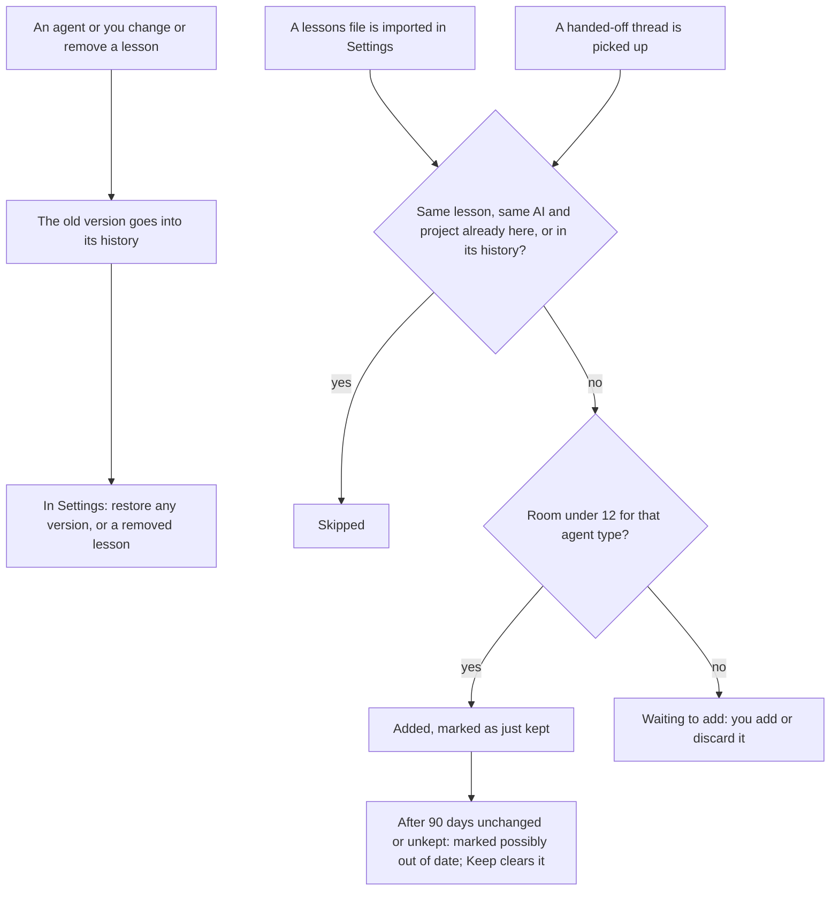

# Make agent lessons solid

**Idea:** `IDEA.md` — what this is for and why, in plain language. Read it first; it is
the north star this plan serves. Goal and Constraints live there, not here, so they don't
get buried as this file grows.

## Open Questions

Ordered by leverage; discussed one at a time. A settled question moves to the Decision
Log and is deleted from here.

_None._

## Watch List

Things noticed that need looking into — not yet decisions for the user. Written down the
moment they're spotted so they can't be forgotten, surfaced to the user one line at a
time as they appear, and emptied before Stage 1 exits.

Each item ends up settled by the agent (noted in the Log), promoted to an Open Question,
promoted to a Constraint or Accepted Risk, or waved off by the user.

| # | Noticed | What needs looking into | Raised to user? | Outcome |
|---|---------|-------------------------|-----------------|---------|

## Decision Log

Append-only. A reversal is a new entry superseding the old, never an edit.

| # | Decision | Rationale | Source |
|---|----------|-----------|--------|
| 1 | Mode: thorough | Chosen by Collin before planning | user |
| 2 | Every change to a lesson (agent add/replace/remove, Settings edit/remove, restore, import) records the previous version with who changed it and when; up to 20 versions per lesson are kept, oldest dropped first | Enough to undo any realistic run of changes without growing settings without bound | defaulted |
| 3 | Removed lessons stay findable in Settings with their history (the 50 most recently removed across all agent types) and can be restored | "A removed lesson can be found again" (IDEA.md) needs a home for them | defaulted |
| 4 | Restoring is a user action: the restored lesson is marked "(edited by the user)" | Matches how Settings edits already make a lesson user-owned (`viewer/app/routes.js:229`) | defaulted |
| 5 | Restoring a removed lesson into an agent type that already has 12 is refused with a plain message to remove one first | The cap of 12 stays (IDEA.md Constraints) | defaulted |
| 6 | Lessons travel two ways: Export/Import of a lessons file in Settings, and handoffs carry lessons automatically; both use the same merge rule | Q1 answered "File and handoffs" | user |
| 7 | A project-only lesson in a handoff is re-scoped to the project path the thread is imported into; in a file import it keeps its path | The exact path differs between installs (`viewer/app/settings.js:183`); a handoff knows the destination, a file does not | defaulted |
| 8 | Handoffs from an install without lessons support still import; an install without support importing a newer handoff is out of scope (it refuses version 3 with its existing message) | IDEA.md Constraints name only the first direction | defaulted |
| 9 | Incoming lessons are added automatically: matched by agent type + exact text (trimmed); a match is skipped; a new one is added with a new local id, saved_by and only_ai kept; nothing existing is overwritten; lessons that would take a type past 12 wait in a "Waiting to add" list in Settings where Collin adds (after removing one) or discards each | Q3 answered "Add automatically" | user |
| 10 | A lesson is marked possibly stale after 90 days since it was last saved, edited, restored or kept; a Keep button in Settings clears the mark; agents are unchanged | Q2 answered "Age only" | user |
| 11 | A handoff carries only the lessons whose `thread` is the handed-off thread, not the whole store; full transfer is the lessons file's job | IDEA.md says a handed-off thread should bring "the lessons its agents learned"; carrying everything would approach the live-sync non-goal | review-round-1 |
| 12 | Supersedes Decision 7 for files: a project-only lesson in a file import is kept only if its path is a project this hub lists; otherwise skipped and counted | A path from another install usually doesn't exist here, so the lesson would reach no agent yet take one of the 12 places | review-round-1 |
| 13 | Supersedes Decision 2's list: import never changes an existing lesson, so it records no history | Decision 9: nothing existing is overwritten | review-round-1 |
| 14 | `lesson_waiting` has no cap; nothing incoming is ever dropped, so there is no "not kept" count | Removes the only silent-loss path for incoming lessons; the list only grows by imports and Collin clears it | review-round-2 |
|   |          |           | user / defaulted / adopted / idea-change / review-round-N |

## Spec

The settled design, grown as decisions land. Bar: a fresh agent with no conversation
history can implement from this section alone — behavior, boundaries, edge cases,
non-goals, and concrete validation commands.

A Mermaid diagram of the flow belongs here, added by Stage 2 at approval — not while the
Spec is still churning. See `protocol/diagrams.md`.

Terms. A **lesson** is an entry in `settings.lessons[<role>]` (`viewer/app/settings.js:282-288`): `{id, text, provider?, project?, saved_by: 'agent'|'user', thread?, saved_at}`. **Role** is one of the agent types in `ROLES`. "Settings" is the "Lessons learned · <role>" editor reached from the Templates section (`viewer/pages/settings.js:894`, list item `:936-958`).

### S1 Storage

All new data lives in the hub's `settings.json` beside `lessons`, read and written through the existing serialized `update` (`viewer/app/settings.js`), and `normalize` (`:265`) must keep it (dropping only invalid entries, as it does for lessons):

- `lessons[role][i].kept_at` (optional ISO time): set by Keep (S4).
- `lesson_history`: object keyed by lesson id. Each value is `{ role, versions: [...], removed?: { at, by } }`. A version is a copy of the lesson's fields as they were before a change (`text, provider?, project?, saved_by, thread?, saved_at, kept_at?`) plus `vid` (a random id unique within that lesson's history, never reused), `changed_at` (ISO time of the change that replaced it) and `changed_by`: `agent` | `user`. Newest last. At most 20 versions per id; the oldest is dropped first. `removed` is present when the lesson is not in `lessons` any more.
- At most 50 ids may have `removed`; when a removal would make 51, the entry with the oldest `removed.at` is deleted from `lesson_history` entirely. An id with no `removed` whose lesson no longer exists in `lessons` is dropped by `normalize`.
- `lesson_waiting`: array of `{ role, text, provider?, project?, saved_by, saved_at, kept_at?, thread?, source: 'file'|'handoff', received_at, wid }` (`wid`: a random id, never reused), no two with the same match key (S5), with no cap: entries leave only by Add or Discard (Decision 14).
- New lesson ids are never ids already present in `lessons` or `lesson_history` (extend the uniqueness loop at `:212`).

### S2 Recording history

Every change to an existing lesson appends that lesson's previous state to its history, in the same `update` as the change:

| Change | Where | `changed_by` | Effect on history |
|---|---|---|---|
| Agent `replace` that changes the lesson | `applyLesson` (`settings.js:191`) | `agent` | append previous |
| Agent `remove` | `applyLesson` | `agent` | append previous; set `removed: {at, by: 'agent'}` |
| Settings edit (text changed) | `PUT /settings/lessons/:role` (`routes.js:224`) | `user` | append previous |
| Settings removal | same route | `user` | append previous; set `removed: {at, by: 'user'}` |
| Restore (S3) | new route | `user` | append the current state if the lesson exists, unless the current lesson already has that version's text, provider, project and thread and `saved_by: 'user'`: then nothing changes (no history, `saved_at` kept) |

No-op changes (identical retry; an edit or replace that changes none of text, provider and project) record nothing. A `replace` that changes only provider or project is a change and appends history. An agent `add` creates no history entry. History never appears in agents' starting instructions: `lessonBlocks` (`:181`) keeps reading only `lessons`.

### S3 History and restore in Settings

In each role's editor:

- Each lesson row has a "History (N)" toggle when it has versions. Expanded, it lists versions newest first: the text with the same "only on <AI>" / "only in <project>" markers the current row shows, "by an agent" / "by you", and the date it was replaced (`changed_at`). Each version has **Restore**.
- Below the current lessons, a **Removed** section lists that role's removed lessons (newest removal first): last text, who removed it and when, its History toggle, and **Restore**.
- Restore sends the lesson id and the version's `vid`; the server finds that version inside the same settings `update`. If the lesson or version is gone (an agent changed it meanwhile, or the 20-version cap dropped it), it answers 409 "This lesson changed; reload to see its history" and Settings reloads the editor. Otherwise it sets the lesson's fields to that version's `text`, `provider`, `project`, `thread`, with `saved_by: 'user'` and `saved_at` now (Decision 4); it keeps the same id. A removed lesson's Restore uses its newest version. Restoring a removed lesson puts it back at the end of `lessons[role]` and deletes `removed`.
- Restoring a removed lesson when the role already has 12 is refused (422) with "<Role> lessons are full (12): remove one before restoring"; Settings shows that sentence.
- The Templates list shows a role's "Lessons learned" item when it has current lessons, removed lessons or waiting lessons (today only current, `:939`).
- Pending unsaved edits in the editor are not lost by a restore: restore is disabled while the editor has unsaved changes, with the hint "Save or undo your changes first".

### S4 Possibly stale

- A current lesson is **possibly stale** when now − max(`saved_at`, `kept_at`) ≥ 90 days.
- Its row in Settings shows "Possibly out of date: not changed or kept since <date>" and a **Keep** button. Keep sets `kept_at` to now (no history entry, `saved_by` unchanged), and the mark goes away.
- The Templates list item for that role shows the count of possibly stale lessons beside its lesson count (e.g. "5 · 2 may be out of date"), and the count of waiting lessons when non-zero (e.g. "· 3 waiting to add").
- Agents are unchanged: no prompt text, card field or rule mentions staleness.

### S5 Merging incoming lessons

One function merges a list of incoming lessons (from S6 or S7) in a single `update`, and returns `{added, skipped, invalid, unknown_project, waiting}` counts (`unknown_project` is used only by S6). For each incoming lesson, in order:

1. Validate it like `normalize` does (role in `ROLES`, `validLessonText`, known provider, `saved_by` agent|user, valid `saved_at`); invalid ones are counted in `invalid`. For a handoff, `project` must be absent or exactly `true` (resolved to the destination path); anything else is invalid.
2. **Match key** is role + trimmed text + `provider` (absent = any) + `project` (absent = all projects; for a handoff, after resolving `true`). If a current lesson has the same key, or any version in the `lesson_history` of an id with that role (current or removed) has the same key, or a waiting entry has the same key, count it in `skipped`. The local lesson is left exactly as it is, including its `saved_by`. So a lesson edited, replaced or removed here is not brought back in its old wording.
3. Otherwise, if the role has fewer than 12 current lessons, add it with a new local id, keeping `text, provider, project, saved_by, saved_at`, with `kept_at` set to now (so it is not shown as out of date on arrival); `thread` is kept for a handoff and dropped for a file. Record no history.
4. Otherwise put it in `lesson_waiting` with its `source` and `received_at` now.

Nothing existing is overwritten. Running the same merge twice changes nothing the second time (step 2), so a retried handoff import is safe.

In each role's editor, a **Waiting to add** section lists that role's waiting lessons with **Add** and **Discard**. Add is disabled while the role has 12, with "Remove one first". Add and Discard send the entry's `wid`; if no entry has it, the server answers 409 and Settings reloads the editor. Inside one settings `update`, Add removes the entry, then re-checks it: if a current lesson now has the same key it is not added again (Settings says "Already in your lessons"); if the role now has 12 it is refused (422, "Remove one first") and the entry stays; otherwise it is appended as in step 3. Discard removes it.

### S6 Lessons file: Export and Import in Settings

- The Templates section of Settings gets **Export lessons** and **Import lessons** buttons.
- Export downloads `wheelchair-lessons.json`: `{ format: 'wheelchair-lessons', version: 1, exported_at, lessons: { <role>: [ {text, provider?, project?, saved_by, saved_at, kept_at?} ] } }` with every current lesson of every role. No ids, threads, history or waiting entries.
- Import takes such a file (≤ 1 MB). A file whose `format`/`version` doesn't match, that isn't JSON, or whose `lessons` isn't an object of arrays is refused whole with a plain message ("This isn't a wheelchair lessons file"). Otherwise S5 runs with `source: 'file'`. A project-only lesson keeps its path only if that path is in `knownProjects(projects, settings)` (`viewer/app/settings.js:328`: projects and saved directories); otherwise it is counted in `unknown_project`, not added and not in `skipped` (Decision 12). Settings then shows "Added A, skipped S already here or removed or changed here, W waiting for room", plus "I unreadable", and "P for projects not on this machine (add the project, then import the file again)" when non-zero, and refreshes. The upload is its own route (e.g. `POST /settings/lessons/import`) that reads the raw body itself, refuses over 1 MB with "This file is too big for a lessons file", and parses the JSON itself so a parse failure gives the message above (the generic body reader at `viewer/app/routes.js:22-67` is not used for it).

### S7 Handoffs carry lessons

- `buildHandoffFile` (`viewer/app/handoff.js:58`) writes `version: 3` and a top-level `lessons` array: the current lessons, of any role, whose `thread` is the handed-off thread's id (the lessons this thread's agents learned; Decision 11), as `{role, text, provider?, project?, saved_by, saved_at, kept_at?}`. A project-only lesson is written with `project: true` (meaning "the thread's project") when its path is the thread's project, and left out otherwise. A thread id stays the same across a handoff (`viewer/app/handoff-import.js:15`), so merged lessons keep `thread` and travel on if the thread is handed off again.
- `validateHandoffFile` (`:12`) accepts versions 1, 2 and 3; `lessons` is allowed (optional) only for version 3; only a `lessons` that is not an array refuses the file. Each element is checked by S5 step 1, so a malformed element (including `null`) is just counted invalid. Version 3 history is treated like version 2 (`:29`, `:31`).
- On import, `importHandoff` (`viewer/app/handoff-import.js:8`) runs S5 on the file's lessons with `source: 'handoff'` inside `createLocked` / `advanceLocked` (`viewer/app/handoff-ops.js:125`, `:132`), after `firstPreclaim` succeeds and before `thread.handoff_op` is saved; the import passes the file's lessons and `targetProject` in. So every import-level check and the preclaim (dirty checkout, wrong branch, divergent commits) has passed, and a file the app refuses or only `opened` merges nothing. `project: true` becomes `targetProject`. The lessons merge is not part of the saved handoff operation: Retry and resuming a pending operation never run it, and a file uploaded while an operation is pending (the `thread.handoff_op` path) merges no lessons. If the thread operation later fails, the merged lessons stay (Accepted Risks). Lessons it puts in Waiting show as the waiting count on the role's Templates item (S4); nothing is dropped (Decision 14).
- A version 1 or 2 file imports exactly as today (IDEA.md Constraints). An older install refusing a version 3 file is accepted (Decision 8).

### S8 Not changing

- The `lesson` card, its fields and receipts, `applyLesson`'s rules (access matrix, cap, user-edited protection), the thread notice, and what agents see at start.
- Lessons remain user-protected through every path here: restore marks `saved_by: 'user'`; import keeps an incoming `saved_by: 'user'`.

### S9 Validation

From `viewer/`:

- `npm test` passes, including new node tests in `test/app-lessons.test.js` (or a new `test/app-lessons-history.test.js`) covering: each S2 row records history with the right `changed_by`; 20-version and 50-removed caps; normalize keeps `kept_at`, `lesson_history`, `lesson_waiting` and drops invalid entries; restore of a version and of a removed lesson, refusal at 12, `saved_by: 'user'` after restore; new ids avoid history ids; stale at 90 days and Keep clearing it; S5 match/skip/add/waiting/invalid and running it twice, same text with different provider or project both kept, skip of a lesson matching an older history version, `kept_at` set on add, a 72-lesson import into a hub with every role full (72 waiting, existing waiting entries untouched); Add re-checking key and capacity; a repeated identical restore recording nothing; restore by `vid` and the 409 when the version is gone; restore bringing back `thread`; file export/import round-trip and refusal of a non-lessons file; handoff v3 export carrying only this thread's lessons, with the project filter and `project: true`, file import skipping unknown project paths and keeping a saved directory's path, import into another project path, v2 file import unchanged, Retry of a pending handoff operation running no lessons merge, the existing dirty-Advance test (`test/app-handoff-import.test.js:220`) also asserting lessons and Waiting unchanged; a scope-only agent replace recording history; Add/Discard with a gone `wid` answering 409; `lessonBlocks` output unchanged by history, waiting and `kept_at`.
- Existing handoff tests (`test/app-handoff*.test.js`) pass. They may be updated where they depend on the version: export assertions now expect 3; unsupported-version cases use 4; fixtures meant as version 1 or 2 are explicit files without `lessons` rather than clones of the current export.
- `npx playwright test test/app-lessons.spec.js test/app-handoff.spec.js` passes, with new browser cases: History toggle and Restore; Removed section and Restore; stale mark and Keep; Waiting to add Add/Discard; Export then Import showing the counts.

## Accepted Risks

Real issues consciously not fixed, each with the reason. Part of the spec, not review
scaffolding — an implementer should read these, and later review rounds must not
re-raise them. Rare paths per `protocol/app/realism.md` land here in every mode, with round
`review-round-N`, `verification-N` or `lead-check`.

| Risk | Why accepted | Round |
|------|--------------|-------|
| A handoff whose thread operation fails after the checks still adds its lessons | They are the thread's own lessons, added by the normal rules; nothing is overwritten | review-round-1 |
| Re-importing the same file or handing the same thread back brings a discarded waiting lesson back to Waiting to add | Worst outcome is one more Discard press | review-round-1 |
| A thread handed back after an agent on the other install replaced one of its lessons arrives with the new wording beside the old one | Nothing existing is overwritten (Decision 9); Collin can remove the old one in Settings | review-round-2 |
| Typing in the editor during the moment a Restore request is in flight can be lost if it answers 409 and reloads | Rare path: a sub-second window on a local request | review-round-3 |

## Check Once Built

Review findings only the built code can settle, per `protocol/app/realism.md`. Verifiers
check each row against the build; a listed row is settled for later review rounds and
stays as review history.

| # | What to check | Round |
|---|---------------|-------|

## Review Rounds

### Round 1 — 2026-11-21

**Lanes:** intent: claude / claude-opus-5-5; mechanics: gpt / gpt-6.2-sol; cross-family: yes.

Written for every round, including one where the table below stays empty. The table gets a row
per finding, so a clean round would otherwise leave no record of which gate ran — which is the
round where knowing it matters most.

<!-- Round 2+: list what changed since the previous round; that list scopes the reviewers. -->

**Changed since Round N-1:** n/a (first round — whole Spec in scope)

| Lane | Reported | Finding | Lead verdict | Resolution |
|------|----------|---------|--------------|------------|
| intent | major | S7 handed off every lesson in the hub, not the thread's own | upheld (major) | S7 carries lessons whose `thread` is the thread; Decision 11 |
| intent | major | S5 match ignored older wording, so an edited lesson's old text came back on re-import | upheld (major) | S5 step 2 matches any history version |
| intent | minor | File import kept project paths that don't exist here | upheld (minor) | S6 skips unknown project paths; Decision 12 |
| intent | minor | `changed_by: import` never written | upheld (minor) | removed; Decision 13 |
| intent | minor | Imported old lessons shown as out of date on arrival | upheld (minor) | S5 sets `kept_at` on add |
| intent | minor | Waiting list overflow dropped lessons silently | upheld (minor) | S5 step 5 counts `not_kept`; shown on file import |
| mechanics | blocking | Text-only match collapsed lessons with different AI/project scope | upheld (major: loses lessons in normal use, design not wrong) | S5 match key includes provider and project; local lesson untouched |
| mechanics | blocking | Handoff Retry has no lessons payload | upheld (blocking) | Cut: merge runs once in `importHandoff` before the operation starts, never on Retry |
| mechanics | blocking | Existing handoff tests reject v3 and clone the current export | upheld (blocking) | S9 allows version-dependent test updates |
| mechanics | major | Waiting list evicted entries on overflow | upheld (major) | No eviction; overflow counted `not_kept` (already in intent fix); full-hub test |
| mechanics | major | Retry could replay merge after a discard | upheld (major) | Resolved by the Retry cut above |
| mechanics | major | Restore can't identify the clicked version | upheld (major) | Versions get `vid`; 409 and reload when gone |
| mechanics | minor | Version omitted `thread`; History hid scope | upheld (minor) | `thread` stored and restored; History shows markers |
| mechanics | minor | Invalid counted as "already here"; upload transport unspecified | upheld (minor) | `invalid` count; own raw upload route, 1 MB |
| mechanics | minor | `lessons` element validation vs whole-file rejection | upheld (minor) | Only a non-array refuses; `project` absent or `true` |

Reported severity is the reviewer's opinion; the lead verdict
(`upheld`/`downgraded`/`declined`/`accepted-risk`/`check-once-built`/`user-decision`) is what gates the
exit. Downgrades and declines cite evidence.

### Round 2 — 2026-11-21

**Lanes:** intent: claude; mechanics: not claude; cross-family: yes.

**Changed since Round 1:**
- S7: a handoff carries only the thread's own lessons (Decision 11); the merge runs once in `importHandoff` before the operation starts, never on Retry.
- S5: match key is role + text + provider + project, against current lessons, every history version and waiting; counts `invalid` and `not_kept`; `kept_at` set on add; waiting entries never evicted.
- S6: file import skips project paths not on this hub (Decision 12); its own raw upload route.
- S1–S3: versions carry `vid` and `thread`; restore by `vid` with a 409 when gone; History shows scope markers; `changed_by: import` removed (Decision 13).
- S9: handoff tests may change version-dependent fixtures; new cases listed.

| Lane | Reported | Finding | Lead verdict | Resolution |
|------|----------|---------|--------------|------------|
| intent | minor | Handoff waiting/not-kept lessons never surfaced | upheld (minor) | S7 import note; S4 Templates item shows waiting count |
| intent | minor | Replaced lesson's old wording comes back when a thread returns | accepted-risk (minor) | Accepted Risks; Decision 9 forbids overwriting |
| intent | minor | "already here" wrong for removed/changed matches | upheld (minor) | S6 wording |
| intent | minor | New install skips all project lessons with no hint | upheld (minor) | S6 message says to add the project and import again |
| mechanics | major | Handoff merge could run before busy/opened checks | upheld (major) | S7: merge immediately before `createLocked`/`advanceLocked` |
| mechanics | major | Handoff overflow (`not_kept`) never shown; redirect hides `note` | upheld (major) | Cut: waiting list uncapped, `not_kept` removed (Decision 14); import note removed, waiting count in Settings |
| mechanics | major | Repeated restore re-records history, can evict a version | downgraded (minor: worst case one old history version lost on a lost-response retry) | S2 restore row is a no-op when already identical |
| mechanics | minor | Add from Waiting doesn't re-check key/capacity | upheld (minor) | S5 Add re-checks inside one update |
| mechanics | minor | Unknown-project check ignores saved directories | upheld (minor) | S6 uses `knownProjects` |

### Round 3 — 2026-11-21

**Lanes:** intent: claude; mechanics: not claude; cross-family: yes.

**Changed since Round 2:**
- S1/S5/S7: `lesson_waiting` has no cap and `not_kept` is gone (Decision 14); handoff import note removed; waiting count on the Templates item (S4).
- S7: the lessons merge runs immediately before `createLocked`/`advanceLocked`, after every import-level check.
- S2: an identical repeated restore changes nothing.
- S5: Add from Waiting re-checks key and capacity in one update.
- S6: unknown-project check uses `knownProjects`; summary wording.

| Lane | Reported | Finding | Lead verdict | Resolution |
|------|----------|---------|--------------|------------|
| intent | — | No findings | — | — |
| mechanics | blocking | Merge ran before `firstPreclaim`, so a refused (dirty) import still added lessons | downgraded (minor: the lessons are the thread's own and are skipped on the retry; nothing wrong is built) | S7 merge after `firstPreclaim`, before the op is saved |
| mechanics | major | Waiting entries identified by match key; stale tab could act on a newer entry | downgraded (minor: a same-key entry is the same lesson text and scope) | `wid` on entries; 409 when gone |
| mechanics | major | Typing during an in-flight Restore could be lost on the 409 reload | accepted-risk (rare path: sub-second window on a local request) | Accepted Risks |
| mechanics | minor | Scope-only replace history unstated | upheld (minor) | S2 states it; S9 case |
| mechanics | minor | No counter for unknown-project lessons | upheld (minor) | S5 `unknown_project` |

## Prior Work

Parts of the Spec already built before this plan reached Stage 3 — adopted from outside
with work already done, or left behind by an implementation run that died partway.

Stage 3 does not re-implement `pre-existing` items and does not touch their code. Stage 4
verifies them exactly as rigorously as everything else: this code has never been through
the gate, so skipping it would leave the least-trustworthy part of the change as the only
part nobody checked.

Ambiguous evidence means **not done**. A wrong "done" is a silent hole; a wrong "not done"
costs a worker one look.

| Spec item | State | Evidence (file:line) | Confidence |
|-----------|-------|----------------------|------------|
|           | pre-existing / partial | | high / low |

`partial` items are implemented by Stage 3 — the brief names what exists so the worker
completes it instead of restarting it.

## Implementation Tasks

Filled by Stage 3. One row per worker brief.

| # | Objective | Ownership boundary | Lane | Session id | Validation | Status |
|---|-----------|--------------------|------|-----------|------------|--------|
| T1 | `tricky` Server side: S1 storage/normalize, S2 history, S3 restore, S4 keep, S5 merge + Waiting Add/Discard, S6 export/import routes | `viewer/app/settings.js`, `viewer/app/routes.js` (settings/lessons routes), `viewer/test/app-lessons.test.js`, `viewer/test/app-lessons-history.test.js` | Standard, gpt-6.1-terra | | `node --test test/app-lessons-history.test.js test/app-lessons.test.js`; `npm test` | done |
| T2 | Settings UI: S3 History/Removed/Restore, S4 stale mark + Keep + Templates counts, S5 Waiting to add, S6 Export/Import buttons (after T1) | `viewer/pages/settings.js` (lessons editor and Templates list parts only), `viewer/test/app-lessons.spec.js` | Standard, claude-sonnet-5-5 | | `npx playwright test test/app-lessons.spec.js`; `npm test` | done |
| T3 | Handoff v3: S7 export/validate/import of the thread's lessons (after T1) | `viewer/app/handoff.js`, `viewer/app/handoff-import.js`, `viewer/app/handoff-ops.js`, `viewer/test/app-handoff*.test.js`, `viewer/test/app-handoff.spec.js` | Standard, gpt-6.1-terra | | `node --test test/app-handoff*.test.js`; `npm test`; `npx playwright test test/app-handoff.spec.js` | done |
| T4 | Strengthen handoff lesson tests left thin by T3: advance-path merge, null element counted invalid, Retry with lessons present, rescoping to a different project path, explicit v1/v2 fixtures | `viewer/test/app-handoff*.test.js` | Standard, gpt-6.1-terra | | `node --test test/app-handoff*.test.js`; `npm test` | done |
| T5 | Fix T2 defects: Keep/Add/Discard must not wipe unsaved edits; 409 message lost on reload; Templates "Lessons learned" label wrapping; 409 browser test | `viewer/pages/settings.js` (lessons parts), `viewer/pages/settings.css`, `viewer/test/app-lessons.spec.js` | Standard, claude-sonnet-5-5 | | `npx playwright test test/app-lessons.spec.js`; `npm test` | done |
| R1-UI | Remediation 1 gaps 1-3: vanished-lesson draft shown not dropped; Removed Restore sends newest `vid`; History shows `changed_by` | `viewer/pages/settings.js` (lessons editor), `viewer/test/app-lessons.spec.js` | Standard, claude-sonnet-5-5 | | `npx playwright test test/app-lessons.spec.js`; `npm test` | done |
| R1-TESTS | Remediation 1 gaps 4-6: waiting entries survive overflow, non-empty export/import round-trip, `changed_by` asserts | `viewer/test/app-lessons-history.test.js` | Standard, gpt-6.1-terra | | `node --test test/app-lessons-history.test.js test/app-lessons.test.js`; `npm test` | done |
| R2-UI | Remediation 2 gap 1: Import keeps or shows unsaved drafts | `viewer/pages/settings.js` (lessons editor, import/export), `viewer/test/app-lessons.spec.js` | Standard, claude-sonnet-5-5 | | `npx playwright test test/app-lessons.spec.js`; `npm test` | done |
| R2-TESTS | Remediation 2 gaps 2-6: tests that can fail (removal `changed_by`, restore thread, prompt without history, Keep on stale, Retry merge spy) | `viewer/test/app-lessons-history.test.js`, `viewer/test/app-handoff-import.test.js` | Standard, gpt-6.1-terra | | `node --test test/app-lessons-history.test.js test/app-lessons.test.js test/app-handoff-import.test.js`; `npm test` | done |
| R3-UI | Remediation 3 gap 1: refused Save keeps Restore-while-dirty and Add-while-full guards | `viewer/pages/settings.js` (lessons editor), `viewer/test/app-lessons.spec.js` | Standard, claude-sonnet-5-5 | | `npx playwright test test/app-lessons.spec.js`; `npm test` | done |
| R3-TESTS | Remediation 3 gaps 2-3: removal appends a version; skip matches older history versions | `viewer/test/app-lessons-history.test.js` | Standard, gpt-6.1-terra | | `node --test test/app-lessons-history.test.js test/app-lessons.test.js`; `npm test` | done |
| R4-TESTS | Remediation 4: caps drop exactly the oldest records; identical Restore leaves the lesson deep-equal; audit every S9 node item for exact outcomes | `viewer/test/app-lessons-history.test.js` | Standard, gpt-6.1-terra | | `node --test test/app-lessons-history.test.js test/app-lessons.test.js`; `npm test` | done (gaps 1-2; audit part moved to R4-AUDIT) |
| R4-AUDIT | Pin exact outcomes for the remaining S9 node items R4-TESTS listed as weak | `viewer/test/app-lessons-history.test.js` | Standard, gpt-6.1-terra | | `node --test test/app-lessons-history.test.js test/app-lessons.test.js`; `npm test` | done |
| R5-TESTS | Remediation 5: agent removal appends a version; Waiting entry skipped on re-merge; Add `already` removes entry, no copy; trimmed-text match | `viewer/test/app-lessons-history.test.js` | Standard, gpt-6.1-terra | | `node --test test/app-lessons-history.test.js test/app-lessons.test.js`; `npm test` | done |
| R6-TESTS | Remediation 6: restore keeps version scope; import/waiting ids avoid history ids; export shape exact; mutation sweep of every lessons function | `viewer/test/app-lessons-history.test.js` | Standard, gpt-6.1-terra | | `node --test test/app-lessons-history.test.js test/app-lessons.test.js`; `npm test` | done |

Session id = the `thread_id` of a `codex exec` lane, so remediation can resume it.

## Log

Free-form running notes: deviations discovered mid-implementation, scope events,
anything a future session needs that fits nowhere above.

- 2026-11-21 — Choice: T1, settings.js: history `vid` and waiting `wid` are 16-byte random hex strings.
- 2026-11-21 — Choice: T1, settings.js normalize: an invalid `kept_at` is dropped while the lesson or version is kept.
- 2026-11-21 — Choice: T1, routes.js PUT lessons: an edit whose text is unchanged is now a full no-op (it no longer marks the lesson `saved_by: 'user'`). (seen in diff, not reported)
- 2026-11-21 — Choice: T1, settings.js restoreLesson: the restored lesson carries no `kept_at` (its `saved_at` is now). (seen in diff, not reported)
- 2026-11-21 — Choice: T1, settings.js keepLesson/waitingAction: a missing lesson or `wid` answers 409 "This lesson changed; reload to see its history"; an unknown waiting action answers 400. (seen in diff, not reported)
- 2026-11-21 — Choice: T1, routes.js: the lessons import route sits beside the handoff import route, before the generic body reader, reading the whole body and answering 413 after it. (seen in diff, not reported)
- 2026-11-21 — T1 accepted (band: self, tricky): focused suite 16/16; `npm test` failed 1-2 tests per run in different unrelated files (app-quiet, routes, server, app-hub: port/timing under machine load), each passing alone (app-quiet + routes 46/46). Worker reported 2 choices; I listed 4 more from the diff.
- 2026-11-21 — Choice: T3, handoff-import.js: import stamps `thread: <thread id>` on each incoming lesson element before merging (the file format carries no thread). (seen in diff)
- 2026-11-21 — Choice: T3, handoff-import.js: advance passes `targetProject = thread?.project || project` (the existing thread's project wins). (seen in diff)
- 2026-11-21 — Choice: T3, handoff-ops.js: merge runs when `lessons` is truthy rather than checked as an array; `startCreate` passes explicit `{file, machine, project}`. (seen in diff)
- 2026-11-21 — Choice: T3, handoff.js: export loads the full settings via `settings.load(hub)`; a v4 file with `lessons` is refused as "invalid fields". (seen in diff)
- 2026-11-21 — T3 accepted (band: scout): handoff node tests 89/89, `npm test` 841/841 re-run by me; worker reported "Choices: none", scout listed 4 unreported choices, logged above. Test gaps (advance merge, null-invalid count, Retry with lessons present, other project path, explicit v1/v2 fixtures) go to T4.
- 2026-11-21 — Choice: T2, settings.js: a version's "by an agent / by you" uses the version's own `saved_by` (who wrote that text), not `changed_by`.
- 2026-11-21 — Choice: T2, settings.js: one shared "Save or undo your changes first" hint below the Save row, toggled live, rather than one per row.
- 2026-11-21 — Choice: T2, settings.js: Import posts the raw file bytes with content-type application/json through plain fetch; the Templates tag reads "Written by agents · N · K may be out of date · W waiting to add".
- 2026-11-21 — Choice: T2, settings.js: waiting entries show a small "from a file" / "from a handoff" mark.
- 2026-11-21 — Choice: T2, settings.js: Removed rows read "removed by you/an agent <date>"; version rows read "replaced <date>" and omit the "edited by the user" marker; dates are UTC days. (seen by scout, not reported)
- 2026-11-21 — Choice: T2, settings.js: Removed lists only entries with versions; History open/closed state kept across saves; Export/Import buttons sit in the Templates nav above the role groups; Add/Discard disabled while saving; success after Keep/Restore/Discard shows the "Saved" note. (seen by scout, not reported)
- 2026-11-21 — T2 accepted (band: bigger-scout): lessons spec 30/30 and lessons node tests re-run by me; worker reported 4 choices, scout listed more, logged above. Defects found (Keep/Add/Discard wipe unsaved edits — silent loss of typed work; 409 sentence never shown because the editor re-renders first; "Lessons learned" label wraps letter-split in the Templates list per the screenshot; no 409 test) go to T5. Screenshot: docs/plans/lessons-hardening/reports/T2-lessons-history.png.
- 2026-11-21 — Worker didn't report its choices accurately ("none"); scout listed 4 for T4, logged here: — Choice: T4, app-handoff-import.test.js: the different-path test overrides `hub.call` locally to return `/dest/project` rather than changing the shared fixture; the advance test saves the thread at `/existing` with picker path `/picker`; malformed elements are `null`, `42` and an empty-text object; pending-path test compares before/after snapshots.
- 2026-11-21 — T4 accepted (band: scout): handoff node tests 92/92 re-run by me; my full `npm test` hit my 560 s timeout under machine load (worker pasted 844 pass). The Retry test cannot detect a merge because `operation()` carries no lessons at all, so Retry has no lesson source by construction; the pending-upload test (which can fail) covers the reachable regression. Accepted as is.
- 2026-11-21 — Choice: T5, settings.js keepLessonEdits: typed text equal to the text shown before the action is dropped, so a Restore shows the restored text.
- 2026-11-21 — Choice: T5, settings.js: the editor's error host gets class `lesson-err` so the 409 sentence can be written into the re-rendered editor.
- 2026-11-21 — Choice: T5, settings.css: the lessons name is `nowrap; flex-shrink: 0` and the tag wraps right-aligned beneath; `flex: 1 1 auto; min-width: 0` was added on the shared `.tpl-item .tag.agent-tag` selector (only the lessons item uses that class). (seen by scout)
- 2026-11-21 — Choice: T5, settings.js: after a 409 reload, unsaved typed text for a lesson still present is kept even if the server text changed, and Save writes it (as the brief asked). (seen by scout)
- 2026-11-21 — T5 accepted (band: scout): lessons spec 36/36, handoff spec 34/34, lessons+handoff node tests 105/105 and `npm test` 841/841, all re-run by me. Worker reported 2 choices; scout listed 2 more. The 409 test checks that a message is shown, not the exact sentence (minor).
- 2026-11-21 — Verification 1 (63510ee6): FAIL from both verifiers; 6 distinct gaps, none judged rare; all go to REMEDIATION-1.md. Gap 3 reverses T2's choice to show `saved_by` in History.
- 2026-11-21 — Choice: R1-TESTS, app-lessons-history.test.js: the two pre-existing waiting entries use sources `file` and `handoff`; the round-trip clears the same hub (keeping its saved directory) rather than using a fresh one; the first test's `versions[0]` check became `versions.at(-1)`. (first reported, rest seen by scout)
- 2026-11-21 — R1-TESTS accepted (band: scout): lessons node tests 16/16 and `npm test` 844/844 re-run by me. Gaps 4, 5, 6 asserted. Minor: the replace-version text assert uses a scope-only replace, so it does not tell old from new wording (outside the gap list).
- 2026-11-21 — Choice: R1-UI, settings.js: on a 409 the lost-draft sentences come first, then the server sentence, in one block with `white-space: pre-line`; an empty draft is not reported; a version with no `changed_by` reads "replaced by an agent". (last seen by scout)
- 2026-11-21 — Choice: R1-UI, app-lessons.spec.js: test ids `L0000a5`-`L0000a8`; the Removed-Restore test deletes the shown version on the server to force the 409.
- 2026-11-21 — R1-UI accepted (band: scout): lessons spec 42/42, handoff spec 34/34, `npm test` 844/844 re-run by me. Gaps 1, 2, 3 fixed; each new test fails if its fix is reverted (scout read). Minor: test (b) checks that a message shows, not its exact wording.
- 2026-11-21 — Verification 2 (685f3967): claude PASS, gpt FAIL with 6 gaps, none judged rare; all go to REMEDIATION-2.md. Gap 1 is the Import path of attempt 1's draft-loss class, first fix on this path. R2-TESTS must show each new test failing under the verifier's mutation.
- 2026-11-21 — Worker didn't report its choices accurately ("none"); scout listed 2 for R2-UI: — Choice: R2-UI, settings.js: drafts are reconciled after an import only if the lessons editor was open when the import began; the reconcile-and-show code is one helper `showLessonLost(lost, extra)` shared with `lessonAction`.
- 2026-11-21 — Choice: R2-TESTS, app-lessons-history.test.js / app-handoff-import.test.js: separate marker texts for current and removed history; a fixed id `L0f0f0f` with relative timestamps for the stale lesson; one spy helper over `mergeIncoming` and `mergeLessons`, also applied to the opened-outcome import.
- 2026-11-21 — R2-UI accepted (band: scout): lessons spec 44/44 and `npm test` 844/844 re-run by me; report lists every other reload place in the lessons editor (Save, Export, thread loading, toggles), none dropping drafts.
- 2026-11-21 — R2-TESTS accepted (band: scout): lessons + handoff-import node tests 52/52 re-run by me; report pastes each new test failing under the verifier's mutation and passing once restored.
- 2026-11-22 — Verification 3 (81b9ddbd): claude PASS, gpt FAIL with 3 new gaps, none rare, none a repeat; all go to REMEDIATION-3.md.
- 2026-11-22 — Choice: R3-TESTS, app-lessons-history.test.js: three history versions built by agent replaces; the oldest and middle versions of a current lesson and the oldest of a removed lesson merged in one call, checked as `skipped: 3, added: 0` with lessons and waiting unchanged; the removal mutation was a marker-only path. (last three seen by scout)
- 2026-11-22 — R3-TESTS accepted (band: scout): focused 18/18 and `npm test` 846/846 re-run by me; I re-applied the newest-version-only mutation and test 6 failed, then restored.
- 2026-11-22 — Choice: R3-UI, settings.js: `setLessonsBusy(false)` calls `refreshRestore()` and a new `refreshAdd()`; a `lessonFull(role)` helper is shared with the waiting renderer; no re-render after a refused Save, so drafts and open history stay.
- 2026-11-22 — R3-UI accepted (band: scout): lessons spec 46/46 and `npm test` 845/845 re-run by me. Restore-while-dirty after a refused Save is fixed, and the test fails on revert for it. The Add half of gap 1 is narrower than reported: Add was never inside `.lesson-row` so busy mode never touched it; it shows enabled after a refused Save only because the page keeps its last-loaded list (Save's 409 does not reload, as before this build), and the server then refuses with "Remove one first" (422). Worst outcome is one extra message (minor per realism.md); recorded in COMPLETION.md residual risks.
- 2026-11-22 — Verification 4 (c88a155a): claude PASS, gpt FAIL with 2 new S9 test-strength gaps (code correct per the verifier); both go to REMEDIATION-4.md with a full audit of the S9 node items.
- 2026-11-22 — Choice: R4-TESTS, app-lessons-history.test.js: removal times seeded at `i*1000` ms from the epoch; a 5 ms wait before the repeated restore; the overflow check compares role, text, saved_by, saved_at and source of the 72 waiting entries after the two pre-existing ones. (seen by scout)
- 2026-11-22 — R4-TESTS accepted for gaps 1-2 (band: scout): focused 18/18 and `npm test` 846/846 re-run by me; I re-applied all three mutations (evict newest removed, drop second-oldest version, no-op restore rewriting `saved_at`) and each failed its test, then restored. The worker stopped with the S9 audit (brief item 3) incomplete and listed the weak items; they go to R4-AUDIT on a narrower brief.
- 2026-11-22 — Choice: R4-AUDIT, app-lessons-history.test.js: a 5 ms wait before the edit so the later `saved_at` shows; scoped incoming lessons compared in insertion order without generated fields; the normalize waiting fixture now carries `thread`, `provider` and `project`; `structuredClone` snapshots around the 422 refusals. (last two seen by scout)
- 2026-11-22 — R4-AUDIT accepted (band: scout): focused 18/18, `npm test` 846/846 and the lessons + handoff browser specs 80/80 re-run by me. Five of seven mutations fail their tests. The other two cannot change stored state: normalize clears `removed` for a current lesson, and a refused update is never written. So those tests are right to pass.
- 2026-11-22 — Verification 5 (db8a21d7): both FAIL on S9 test strength only (code correct per both); 3 distinct gaps, none rare, go to REMEDIATION-5.md. Gap 1 is the second fix on agent-removal history coverage (first: R1 gap 6).
- 2026-11-22 — Choice: R5-TESTS, app-lessons-history.test.js: separate focused tests for agent removal, Waiting retry and trimmed matching; the Add `already` check extends the existing test; Waiting retry fills the role by direct `update` pushes with fixed ids; agent-removal setup replaces the text with 'Changed' first. (last two seen by scout)
- 2026-11-22 — R5-TESTS accepted (band: scout): focused 21/21 re-run by me; I re-applied four mutations (no Waiting clause, no trim, `already` keeps the entry, removal marker without a version) and each failed its test, then restored. `npm test` 847/849 with failures in app-quiet and server tests (untouched files), both passing alone (74/74).
- 2026-11-22 — Verification 6 (9a595e40): claude PASS, gpt FAIL with 3 new S9 test-strength gaps (code correct); REMEDIATION-6.md adds a mutation sweep over every lessons function to end the one-gap-per-round pattern.
- 2026-11-22 — Choice: R6-TESTS, app-lessons-history.test.js: fixed epoch timestamps and made-up ids for repeatable fixtures; a separate scope case after an agent replace beside direct restore fixtures; collision paths split into separately named tests.
- 2026-11-22 — R6-TESTS accepted (band: scout): focused 30/30; I re-applied the three gap mutations (restore takes the current project, `newLessonId` ignores history, export adds history/waiting) and each failed its test, then restored. Part B recorded all 22 listed breaks, and every one that survived at first got an assertion that now catches it. The worker's `npm test` hit port clashes in untouched files. My own run: 857/858, the one failure (lifecycle.test.js, untouched) passes alone (31/31). Lessons + handoff browser specs 80/80.

