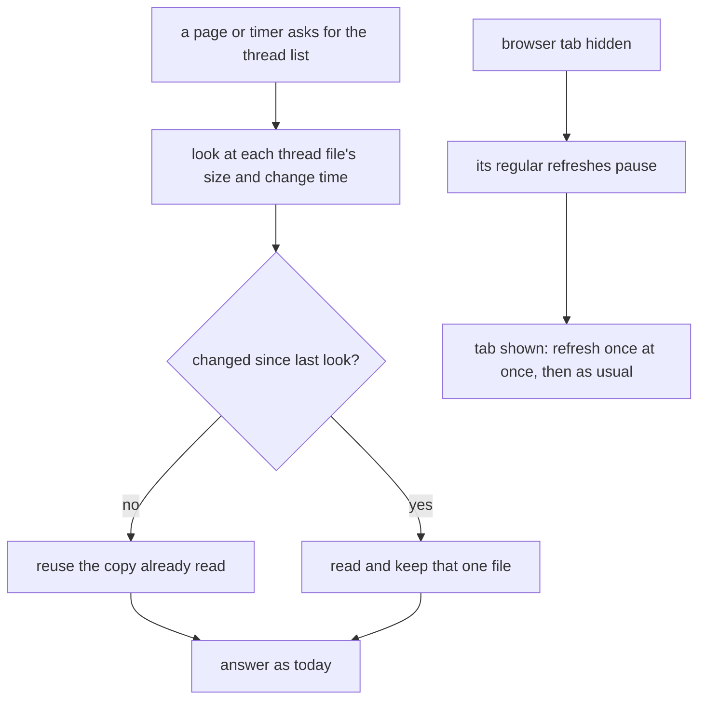

# A lighter server when many agents run

**Idea:** `IDEA.md` — what this is for and why, in plain language. Read it first; it is
the north star this plan serves. Goal and Constraints live there, not here, so they don't
get buried as this file grows. Current code is mapped in `MAP.md`.

## Open Questions

None.

## Watch List

| # | Noticed | What needs looking into | Raised to user? | Outcome |
|---|---------|-------------------------|-----------------|---------|

## Decision Log

Append-only. A reversal is a new entry superseding the old, never an edit.

| # | Decision | Rationale | Source |
|---|----------|-----------|--------|
| 1 | Mode is thorough | Collin's pick | user |
| 2 | Thread reads go through an in-memory cache keyed per file by `(mtimeMs, size, ino)`, checked with `fs.stat` on every `allThreads`/`thread` call; a changed or new file is re-read, a vanished one dropped. Callers get their own copy (no shared mutable objects) | A stat is far cheaper than read+parse of 18.5 MB; stat-based checks also catch writes from tests and outside the hub's queues (MAP: Thread reads) | defaulted |
| 3 | Archived threads stay in every listing (served from cache) rather than being filtered out of timers | Some timers need archived records (pending cancellations, parents of waiting stubs; MAP: Hub timers). With a cache they cost a stat, not a parse | defaulted |
| 4 | Locked "fresh read before acting" paths keep reading from disk, never the cache | They exist to avoid acting on stale data (pollDead, queues, quiet, merged, cancellation; MAP) | defaulted |
| 5 | `GET /threads` stops locking and re-reading every thread; it uses cached snapshots and locks only to persist a discovered slug/status, like `/features` | Same pattern `/features` already uses safely (`viewer/app/views.js:30`) | defaulted |
| 6 | Chat reads transcripts incrementally: the hub remembers each session's bytes and asks the machine for only what was appended (existing `?offset=` API), re-parsing only when new bytes arrived; the hub's transcript memory is capped and evicts sessions not read recently | Removes whole-file transfer and parse every 2s per open thread, and the unbounded `transcriptCache` (`viewer/app/chat.js:225`) | defaulted |
| 7 | The machine stops reading and hashing the whole kept transcript on each read: it serves offset reads from the file directly and keeps dedupe state in memory per session | `machine/service.js:900-943` reads and hashes the entire file per call | defaulted |
| 8 | Machine service polling (readiness, trust, Codex steps, tmux listing) uses non-blocking subprocess calls; a tmux failure still stays distinct from an empty list | `spawnSync` blocks the service's event loop (`machine/service.js:79`); MAP warns failure ≠ empty | defaulted |
| 9 | Keep polling with the same intervals; no switch to server push | Push would be a larger rewrite; the goal is cheap polls, not faster ones | defaulted |
| 10 | Pages pause their polling while the browser tab is hidden and refresh at once when shown again | A hidden tab shows nothing; refreshing on return keeps what Collin sees as fresh as today | defaulted |
| 11 | Browser test runs are capped at 2 workers each (`workers: 2` in `viewer/playwright.config.js`); no machine-wide queue | Collin's pick: predictable load, runs never wait on each other | user |
| 12 | Hub's transcript memory evicts a session not read for 10 minutes | Long enough that switching between a few threads stays instant; short enough that memory stays flat | defaulted |
| 13 | Chat re-parses a session's whole accumulated transcript only when new bytes arrived, rather than parsing incrementally | Parser state depends on earlier rows (MAP: Transcripts); parse-on-change removes the steady cost without that complexity | defaulted |
| 14 | `node --test` concurrency is left at its default | Unit tests spawn light processes; the browser runs are what saturate the machine | defaulted |
| 15 | No CPU benchmark is added to the repo; the before/after measurement is done on the live machine after install (Check it yourself) | A synthetic benchmark would not reflect real load; read-count tests guard the mechanism | defaulted |
| 16 | `/threads/:id/chat` gets no ETag/304 | With parse-on-change, an unchanged poll is already cheap | defaulted |
| 17 | Supersedes the "own copy" part of #2: `allThreads` returns shared, deep-frozen cached snapshots (copying 18.5 MB per call would cost about what parsing does). Every caller is audited; one that mutates clones that single record first. `thread(id)` and locked paths keep returning fresh, mutable objects from disk | Keeps the saving while making any missed mutation throw instead of corrupting the cache | defaulted |
| 18 | Machine and viewer test helpers must leave no process behind after a run ends normally or is killed; the cause of the leaked `/tmp/wheelchair-machine-test-*` session is found and fixed | IDEA "Why": leftover test processes ran for days | defaulted |
| 19 | Supersedes #15: add a repeatable synthetic measurement, `test-support/bench/hub-idle.js`, and record its pre-change numbers in the Log before code changes; the live-machine baseline is also recorded in the Log | Reviewers: success criteria in IDEA could not be checked as written, and the "before" would be lost after install | review-round-1 |
| 20 | Settings sign-in polling is excluded from hidden-tab pausing | Its GET drives the login forward (answers prompts, ends the login pane), and Collin signs in from another tab (`machine/service.js:1139-1157`) | review-round-1 |
| 21 | Malformed thread JSON keeps today's behaviour (the listing throws); a malformed file is never cached | Only `ENOENT` falls back today (`viewer/app/state.js:32-38`) | review-round-1 |
| 22 | `GET /threads` keeps discovering and persisting only the slug, as now; status discovery stays in `/features` | Spec had wrongly added status persistence to `/threads` (`viewer/app/routes.js:425-441`) | review-round-1 |
| 23 | Timers apply each action's own eligibility check to cached snapshots first, and lock and re-read only threads that match, re-checking before acting | Otherwise retry, quiet, waiting and limits still re-read every thread under lock each tick | review-round-1 |
| 24 | Transcript replies prove continuity: the hub sends a hash of the last bytes before its offset; on mismatch the machine returns the whole file flagged as a reset | A same-size or larger replacement would otherwise splice old and new text | review-round-1 |
| 25 | Hub transcript memory: 10-minute idle eviction plus a total budget of 64 MB, least-recently-read evicted first | A time limit alone does not bound memory for frequently read large transcripts | review-round-1 |
| 26 | Codex step registry writes are left as they are | Batching writes adds failure-ordering risk for a small saving | review-round-1 |
| 27 | Supersedes #8: the machine service's tmux and CLI checks stay synchronous; no machine polling changes in this plan | Collin's pick: the machine service is already light (128 MB, ~3% of a core), and non-blocking checks need extra coordination to avoid races | user |
| 28 | Supersedes #4 and refines #23: only `retryQueues`, `checkQuiet`, `pollWaiting`, `pollMerged`, `retryWaiting` and `releaseLimits` get a snapshot prefilter. `pollDead`, `pollIdle` and the aside timer keep their current logic and only take their listing from the cache. Every action still re-reads under its lock before acting | pollDead has two reasons to lock (missing session, CLI id to copy) and pollIdle decides per account, not per thread; prefiltering them adds risk for little gain | review-round-2 |
| 29 | Supersedes #24: transcript continuity uses a generation id of the kept file (inode plus birth time) instead of a tail hash. The machine owns the kept file and only appends whole lines, so a new generation means a new file; replies end at the last complete line | A tail hash missed edits earlier in the file; the generation id is simpler and exact for a machine-owned append-only file | review-round-2 |
| 30 | The live before/after and day-long memory check is done after install through Check it yourself, against the Log baseline; the Spec's acceptance is the benchmark, which now includes chat polling over many growing transcripts and a 5-minute memory check | A pre-merge verifier cannot observe a day on the live server; the benchmark exercises the same growth paths | review-round-2 |
| 31 | The chat route reads its thread and parent from the cache; it locks and re-reads only to persist a discovered slug | Every open chat page otherwise parses the thread (and parent) file every 2s | review-round-2 |
| 32 | Supersedes #6, the offset-read part of #7, #24 and #29: no byte-offset deltas between hub and machine. The hub sends what it already holds (`known=<gen>:<end>`); the machine answers `unchanged` (a stat, no data) or the whole transcript. The hub re-parses only on a whole reply | Deltas kept producing splice, bootstrap and concurrency hazards; most polls happen while the lead is idle, where `unchanged` gives nearly all the saving, and a whole reply is always a coherent snapshot | review-round-3 |
| 33 | Supersedes the locking part of #31: chat keeps holding the thread lock through assembly, as today; inside the lock it reads the thread and parent as stat-checked cached snapshots and takes a fresh mutable read only to persist a slug | A handoff mutation must not interleave with chat assembly (`viewer/test/app-handoff.test.js:372`); a stat-checked snapshot under the lock is as fresh as a disk read for the hub's atomic writes | review-round-3 |
| 34 | Parsed chat output is kept only for the 8 most recently read entries; the 64 MB budget counts raw text | Bounds the parsed objects too without estimating object sizes | review-round-3 |
| 35 | Supersedes #34: parsed chat output is kept for the sessions of the 4 most recently read threads | Chat reads every lead session of a thread, so a per-session cap covered under two threads | review-round-4 |
| 36 | Split: fetching chat transcripts only when they changed (the hub-machine transcript protocol, #32, and the machine-side transcript read and copy changes, old S4) moves to its own follow-up thread. This thread keeps the hub's transcript memory budget and reuses parsed chat when the fetched text is identical. Supersedes #7, #13, #29, #32, #34, #35 for this thread | Collin's pick after four review rounds kept finding edge cases in that part | user |
| 37 | IDEA.md "Not doing" gains: chat fetching only changed transcripts (split to a follow-up thread) | Follows from #36 | idea-change |
| 38 | IDEA.md narrowed to the app server: the machine service is not changed (S4 moved out, S5 dropped), added to "Not doing" | Follows from #27 and #36; keeps IDEA and the plan consistent | idea-change |
| 39 | Hidden-tab pausing is a visibility gate only: the helper skips ticks while hidden and calls the page's existing poll function once when shown; each page keeps its own in-flight handling and its own post-action refreshes exactly as today. No shared promise, queued follow-up or target binding | Simpler; if a running poll drops the on-show call, the next tick (1-10s) covers it, no later than today. The extra machinery drew findings in four rounds | review-round-7 |
| 40 | The most recently read transcript entry is never evicted by the byte budget, even if it alone exceeds 64 MB | Otherwise an oversized transcript evicts itself and an actively viewed chat loses its fallback | review-round-7 |
| 41 | Supersedes #40: entries for the sessions of the most recently read thread are never evicted for size | A thread can have several lead sessions; keeping only the last-read entry let a chat poll evict its own oversized transcript | review-round-8 |
| 42 | `releaseLimits` keeps its current logic (no snapshot prefilter), joining `pollDead`, `pollIdle` and the aside timer | It checks the clock after taking the lock; a prefilter would delay an expiring limit by a sweep, for a 60s timer whose cost is small | review-round-8 |
| 43 | On becoming visible, the poller calls `fn` and restarts its interval from that moment | Otherwise the on-show call and the next tick can overlap and an older reply can overwrite a newer one | review-round-8 |
| 44 | Supersedes #41: an entry read by chat in the last 60 seconds is never dropped for size | An actively polled chat (every 2s) can never lose its fallback to another thread's read, whatever the interleaving; the overshoot is bounded by what chat read in the last minute | review-round-9 |
| 45 | Timer prefilters use only the structural part of each eligibility check (a queue exists, a live session awaits something, a stub is waiting, a PR is unmerged), never a clock comparison; deadlines are checked under the lock as today | A deadline can pass between the snapshot and the locked check; structural filters cannot skip work that becomes due | review-round-9 |
| 46 | Refines #44: an entry is also protected from size eviction while a chat read for its thread is waiting (for the lock or the machine) | A chat call can wait minutes behind a held lock; protection must not lapse while the page is still asking | review-round-10 |
| 47 | `checkQuiet`'s prefilter passes any thread with a live session or any session carrying quiet-tracking state (`quiet_check_at` and the other fields `viewer/app/quiet.js` reads or clears; the worker lists them in the Log) | The sweep also clears obsolete state and escalates mid-turn, not only sends reminders | review-round-10 |
| 48 | `GET /threads` waits for a thread's lock when it is already held, then uses a fresh snapshot of that thread | Today the route waits behind an in-progress operation and returns its saved result; returning the pre-operation snapshot would show staler state | review-round-10 |
| 49 | Supersedes #23, #28, #42, #45 and #47: no timer gets a snapshot prefilter. Every timer keeps its current logic and locked re-reads exactly as today; the only change is that its initial listing comes from the cache | Collin's pick ("Simplify both"): prefilters caused most remaining review findings; skipping archived threads via the cached listing keeps most of the saving | user |
| 50 | Supersedes #25, #34, #35, #40, #41, #44 and #46: the hub's transcript store has no size cap; an entry (with its parsed result) is dropped only when not read for 10 minutes | Collin's pick ("Simplify both"): an open chat re-reads every 2s so it is never dropped; memory stays bounded by what was read in the last 10 minutes | user |
| 51 | Cache key adds `ctimeMs`: `(mtimeMs, ctimeMs, size, ino)` | Any write changes ctime and it cannot be set back, so even an equal-length in-place write with a restored mtime is detected | review-round-11 |
| 52 | A transcript entry counts as read when a chat read for it starts and when it is served as chat's fallback | A chat request waiting behind a lock or a slow machine must not let its entry cross the 10-minute cutoff | review-round-11 |
| 53 | Refines #52: when `hub.chat` is called, before it waits for the thread lock, `lastRead` is set for every held entry of that thread's lead sessions | A chat request queued behind the lock must keep its fallback; the per-session read starts only after the lock | review-round-12 |
| 54 | Refines #48: `/threads` checks for held locks after its listing completes (as today it joins each lock queue after listing), waits for each, then re-snapshots that thread | An operation that takes a lock during the listing must still be waited for | review-round-12 |
| 55 | Hub map pruning drops only entries older than 10 minutes (and for `handoffStatus*`, only for threads that are gone or archived); a `handoffInspect` result keeps its existing 60-second validity | Archived handed-off threads still read the banner result; pruning by archive alone would discard a valid one | review-round-12 |
| 56 | Supersedes #55: the hub's small per-thread maps (`handoffStatus`, `handoffStatusAt`, `handoffInspect`, `state.watched`) are not pruned | They hold one small entry per thread or graph path, so they cannot cause the memory growth; pruning added rules for nothing | review-round-13 |
| 57 | Supersedes #5, #48 and #54: `/threads` keeps today's per-thread loop (after the listing, join each thread's lock queue in turn) but inside it reads `threadSnapshot` (stat-checked) instead of `hub.thread()`; a record needing provider migration or a slug save takes `hub.thread()` as today | Mirrors today's ordering exactly, so no write can slip between listing and response; the only change is that an unchanged file is not parsed again | review-round-13 |
| 58 | Refines #52/#53: an entry is never evicted while a chat request for its thread is pending (a per-thread pending count, set when `hub.chat` is called and cleared when it returns) | A request can wait longer than 10 minutes behind a lock; the browser skips polls meanwhile | review-round-13 |
| 59 | A machine reply with empty `data` is treated like a failed read for fallback, as today (`viewer/app/chat.js:229` stores only non-empty replies) | The machine returns 200 with empty data for a missing copy | review-round-13 |
| 60 | The hub transcript memory fix (S3: replacing `transcriptCache`, idle eviction, parsed reuse, and decisions #50, #52, #53, #58, #59) moves to the chat follow-up thread; the content is kept below under "Moved to the chat follow-up" | Collin's pick: the follow-up rewrites the same transcript code; every round since the split re-raised this part | user |
| 61 | IDEA.md: "memory stays flat" and the memory half of "CPU and memory clearly lower" move to "Not doing" (handled by the chat follow-up) | Follows from #60 | idea-change |
| 62 | Supersedes the memory part of #30: the benchmark is CPU only; peak RSS is printed for information with no pass bar | Memory is a non-goal after #60/#61, and the S1 cache holds parsed records by design | review-round-14 |
| 63 | The test-run marker is `WCTEST_RUN_ID` (no `WHEELCHAIR_` prefix), and code that launches detached children in tests must pass it through | `machine/lib/aside-turns.js:94` strips every `WHEELCHAIR_*` variable from detached aside CLIs | review-round-14 |
| 64 | `/threads` enqueues every thread's lock at once (as today, `Promise.all`), keeps listing order, and builds each row as the listed snapshot overlaid with the fresh record (`{ ...listed, ...fresh }`), as today's `Object.assign` does | Exact compatibility with today's ordering and JSON | review-round-14 |
| 65 | Supersedes the leftover parts of #18 and #63: the leftover fix covers the runner that leaked (`bash machine/test/run.sh`): fix the cause found, mark the run, clean up on exit and at the next start, and test SIGTERM and SIGKILL there. Other runners only inherit the marker; no signal tests for them | Matches the one observed leak; three runners times five signals was far more than the goal needs | review-round-16 |
| 66 | Supersedes #63 and #65's marker approach: machine tests get a private tmux server. `machine/test/run.sh` unsets `TMUX`, points `TMUX_TMPDIR` at a run-owned folder, supervises `node --test` so traps run promptly, and kills that private server on exit and any orphaned one at the next start. No `/proc` environ scan, no `WCTEST_RUN_ID` | The observed leak is a test `claude` running as a pane of Collin's real tmux server (session `wc-t-worker-1`, started 2026-11-15); a pane takes its environment from the server, so no exported marker reaches it. Keeping tests off the real server removes the cause | review-round-17 |
| 67 | Concurrent browser runs get separate Playwright output by `outputDir: test-results/<runner pid>`; the two-runs check counts browsers by runner process tree | Replaces the marker-based output folder and count after #66 | review-round-17 |
| 68 | Supersedes #66's mechanism: the private tmux server is set up by the machine test process itself through `test-support/run-dir.js` (as the smoke harness does): `TMUX_TMPDIR` under the process's run folder, `TMUX`/`TMUX_PANE` deleted, `tmux kill-server` in `onCleanup`, and run-dir's existing abandoned-owner sweep kills a dead owner's private server before removing its folder. `machine/test/run.sh` is not changed | Covers every way the tests run (including direct `node --test`, as CI does); each test file process owns its own server, so a SIGKILLed owner cannot launch late; reuses existing PID and start-time checks | review-round-18 |
| 69 | Supersedes #67: no Playwright config change; the two-runs check passes each run its own `--output=<dir>` | Playwright reloads the config in each worker, so a PID in the config splits output; agents in separate worktrees never share output anyway | review-round-18 |
| 70 | Supersedes #66 and #68 and the benchmark parts of #19, #30 and #62: the machine-test cleanup (keeping tests off the real tmux server) moves to its own thread, and `test-support/bench/hub-idle.js` is dropped. The CPU saving is measured by hand on the live server after the change is installed, against the Log baseline | Collin's pick after three unclean rounds; every objection in rounds 17-19 was about these two side pieces | user |
| 71 | IDEA.md "Not doing" gains the test cleanup, now its own thread | Follows from #70 | idea-change |

## Spec

Current code is described in `MAP.md` (file:line). Decision numbers refer to the Decision Log.

In short: a thread list reads only the thread files that changed since the last look (S1, S2); a browser tab that is not on screen stops asking the server for updates until it is shown again (S6); a browser test run opens at most two browsers at a time (S7).



### S1. Thread snapshot cache (`viewer/app/state.js`)

- Add `threadSnapshot(id)`: the same stat-checked cache for one file, returning the frozen record (used by chat and `/threads`, S2). A missing file, or one that holds no thread record (for example JSON `null`), throws exactly as `thread(id)` does (so a thread deleted while `/threads` waits for its lock gives today's 404), unlike the listing's skip.
- `allThreads()` keeps a per-file cache: `path -> { mtimeMs, ctimeMs, size, ino, record }`. Each call lists the directory, `fs.stat`s every `*.json`, re-reads and parses only files whose `(mtimeMs, ctimeMs, size, ino)` differ (#51) from the entry or that are new, and drops entries whose file is gone. Result order and filtering are unchanged (non-null records, sorted by `updated_at` desc).
- Cached records are deep-frozen. `allThreads` returns the cached objects (no copy).
- A file that fails to parse is never cached, and `allThreads` throws as it does today (#21); only a file that vanished between listing and reading is skipped, as now (`ENOENT`).
- `thread(id)`, `updateThread` and `save` keep reading from disk and returning fresh mutable objects. Code that mutates or saves inside `withThread` uses `thread(id)`; read-only code under a lock may use `threadSnapshot` (S2, #33). After the hub's own `save`/`updateThread`, the cache entry for that file is dropped (the next `allThreads` re-reads it).
- Handoff's direct unlink (`viewer/app/handoff-ops.js:45`) and any other delete is caught by the directory listing.
- Audit every `allThreads` caller listed in MAP.md ("All allThreads call sites"), plus `threadBySession`, balancer, usage, usage-poll, settings, agents, views, handoff, hub startup, cards `sudo_index`. A caller that mutates a returned record (including sorting a nested array in place) must `structuredClone` that one record first. Record the audit result (caller, mutates yes/no, fix) in this plan's Log.
- No archived filtering is added (#3).

### S2. Routes and timers use the cache

- Split `findSlug` (`viewer/app/views.js:99`) into a read-only `discoverSlug(thread)` that returns the slug or `null` without mutating or saving, and the persisting step. `GET /threads` (both views) calls `discoverSlug` on the snapshot read inside the thread's lock; only when it returns a slug does it re-read with `hub.thread()`, run `discoverSlug` again on the fresh record, and if it still returns a slug set it, save and register the plan, as `findSlug` does today. For a thread where that happened (or where the locked re-check found a slug already saved by someone else), the response is built from the fresh record read under the lock (after the save, with its `updated_at`), not the earlier snapshot. `findSlug`'s other callers keep its current behaviour (implemented on top of `discoverSlug`). No status discovery is added to `/threads` (#22).
- `GET /threads` keeps today's structure (#57): list with `allThreads()`, then join every thread's lock queue at once as today (`viewer/app/routes.js:427`, `Promise.all`), and inside each read it with `threadSnapshot` instead of `hub.thread()`. A record needing `hub.thread()`'s provider migration (`viewer/app/hub.js:111`: no `provider`, has `cli` and sessions) or a slug save (above) is read with `hub.thread()` there, as today, so the migration or slug is saved and its `updated_at` shows in the response. Build each row as `{ ...listed, ...fresh }` in listing order (#64), never mutating snapshots. For the same thread files, the JSON returned equals today's.
- Chat (`hub.chat`, `viewer/app/hub.js:244`) keeps its lock through assembly (#33). Inside it, `chat.chat` and `hub.chat` read the thread and its parent with `threadSnapshot`, except that a record needing the provider migration (as for `/threads`) is read with `hub.thread()`, which saves it, as today. They use `discoverSlug`, and only when a slug is found take `hub.thread()`, set the slug, save and register as above; the rest of the assembly then uses that fresh record. Response objects built from snapshots are new objects; snapshots are never mutated.
- Timers keep their intervals and their logic exactly as today, including every locked re-read; the only change is that their initial listing comes from `allThreads()`'s cache (#49). Timers that already skip archived threads in their listing therefore stop parsing archived files. `pollWaiting` and `releaseLimits` still lock and re-read every thread, archived included, once a minute (`viewer/app/threads.js:450`, `viewer/app/sessions.js:777`); that stays as today (Accepted Risks).

### S3. Hub transcript memory

Moved to the chat follow-up thread (#60); see "Moved to the chat follow-up" at the end of this file. Chat's transcript fetching, `hub.transcriptCache` and fallbacks are not changed by this plan.

### S4. Machine transcript reads

Moved to the follow-up thread (#36). `machine/service.js` transcript code is not changed by this plan.

### S5. Non-blocking machine polling

Dropped (#27). The machine service's tmux, readiness, trust, Codex step and `status()` code is not changed by this plan. Codex step registry writes are unchanged (#26).

### S6. Hidden tabs (`viewer/pages/*.js`)

- Add one shared helper, for example `poller(fn, ms)` returning `{ stop() }` (#39). It calls `fn` every `ms` only while `document.visibilityState` is `visible` (a tick while hidden does nothing) and, when the tab becomes visible, calls `fn` once and restarts its interval from that moment, so the next tick comes a full `ms` later (#43). It adds no in-flight tracking: `fn` is the page's existing poll function, with whatever guard that page has today. `stop()` removes the poller for good, so a stopped poller is never called again by a later visibility change. Pages keep their post-action refresh calls exactly as today.
- Use it for: Threads, Agents, Features and nav polls, the thread chat poll, the aside panel poll (`viewer/pages/aside.js:30`), the terminal pane poll (`viewer/pages/term-view.js:177`) and the Settings usage poll. Where a page today clears or replaces a timer (closing, retargeting or finishing an aside, closing a terminal), it calls `stop()` and creates a new poller where it created a new timer.
- Not paused: Settings sign-in polling (#20), and the `/usage/alert` 5-minute check.

### S7. Browser tests and measurement

- `viewer/playwright.config.js` sets `workers: 2` (#11). `--workers` on the command line still overrides.
- No benchmark script (#70). Before the change is installed, the lead takes a fresh baseline on the live hub under a fixed workload: exactly one visible wheelchair tab, on a thread page, and no other wheelchair tabs open in any browser. After the change is merged and installed, the lead measures under the same workload the live hub's CPU by hand as the Log baseline was taken: CPU seconds of `viewer/server.js --service` over 60 seconds with a similar number of agents live, one thread page open and the hub up about 47 minutes (as at the baseline), compared with that fresh baseline (the 30.8 CPU-seconds in the Log had an unrecorded browser workload); RSS is recorded beside both readings. This is reported to Collin, not a build gate.
- Machine tests and `test-support/run-dir.js` are not changed by this plan; the leftover tmux fix is its own thread (#70).

### Non-goals

Agent CLIs' own usage; fetching chat transcripts only when changed, the hub's transcript memory, and any machine transcript change (chat follow-up thread, #36, #60); machine-service polling and subprocess calls (#27); poll intervals; server push; ETags; moving or deleting archived threads or transcripts; changes to what any page shows; machine-test tmux cleanup and a benchmark script (#70).

### Validation

New tests (in the existing suites):
- `viewer/test`: with N unchanged thread files, a second `allThreads()` parses no file (spy on the read/parse path); an atomic outside replace, an in-place outside write with a new size, a new file and a deleted file are each reflected on the next call; mutating a returned record throws; `save` then `allThreads` returns the saved content.
- `viewer/test`: `discoverSlug` never mutates or saves; a `/threads` fixture includes a record without `provider`, and its migration is saved with the same response as today; a thread whose slug is discovered appears in that same response with the slug and new `updated_at`; `GET /threads?view=list` parses no thread file (no `hub.thread()` call) when nothing changed and nothing needs persisting, and its JSON equals the pre-change output for the fixture set.
- `viewer/test`: chat assembly (inside `hub.chat`'s lock) parses no thread file when nothing changed; a handoff status refresh started after assembly is outside this check; the handoff lock test (`viewer/test/app-handoff.test.js:372`) still passes; chat for a legacy thread without `provider` still saves the migration and returns `provider`; chat output is unchanged for the existing chat fixtures.
- Browser test (`viewer/test/*.spec.js`): while hidden, no new paused poll starts (a poll already running when the tab was hidden may finish; the `/usage/alert` check and sign-in are not paused); when shown it polls once immediately and the next tick comes a full interval later; a stopped aside or terminal poller is not called on show; sign-in keeps polling while hidden.
- Two browser runs at once: start two `npm --prefix viewer run test:browser -- --output=<separate dir> --trace=on` concurrently (#69); sampling every second, no run ever has more than 2 Playwright browser main processes (Chromium or Firefox) among the descendants of its runner process, at least one trace of each run lands in its own `--output` folder, and both pass.
- `viewer/test`: an equal-length in-place write with a restored mtime (the test asserts `mtimeMs`, `size` and `ino` are identical afterwards) is picked up on the next listing; a `/threads` request whose listing overlaps an operation taking a lock waits for it, and a save that finishes during the listing shows in the response; a held lock on one thread does not delay others; a key deleted by an intervening save stays in that response as today; a `/threads` request during a locked operation returns the saved result; each timer's existing tests pass unchanged.

Commands (all must pass):
```bash
node --test viewer/test/*.test.js
npm --prefix viewer run test:browser
bash install/test/run.sh
```

## Accepted Risks

| Risk | Why accepted | Round |
|------|--------------|-------|
| Live thread files are large (one is 2.7 MB, mostly per-session briefs) and rewritten on every event, so busy threads are still re-parsed often | The cache removes the listing re-reads of unchanged and archived files (most of the bytes); timers' locked re-reads stay (see the timers row); shrinking stored session records changes what is kept and is a separate piece of work | 1 |
| A hidden thread tab's browser-tab title does not update when the thread is renamed until the tab is shown again | Only the tab strip text; it updates the moment the tab is opened, and pausing hidden tabs is the point of S6 | 8 |
| Right after returning to a tab, a page may briefly show a reply that was in flight before it was hidden, or a page that skips polls while busy may wait up to one interval for its next refresh | Corrected by the next tick (1-10s); pages without a guard can already show out-of-order replies today when requests are slow; tracking in-flight requests drew findings in four rounds (#39) | 9 |
| Timers keep re-reading under lock as today (#49): `retryQueues` and `checkQuiet` re-read every non-archived thread every 5s (about 180 MB a minute on the live state, about 7.5 MB of non-archived files), `pollDead` every 10s, and `pollWaiting` and `releaseLimits` every thread, archived included, once a minute (about 40 MB a minute) | Collin chose to keep timer logic unchanged (#49); once a minute is small next to the several-times-a-second reads removed | 11 |
| The server's memory keeps growing (it keeps every transcript it has shown) until the chat follow-up lands | Collin moved that fix there (#60); restarting the app clears it meanwhile | 13 |

## Review Rounds

### Round 1 — 2026-11-18

**Lanes:** intent: claude / claude-opus-5-5; mechanics: gpt / gpt-6.2-sol; cross-family: yes.

**Changed since Round 0:** n/a (first round — whole Spec in scope)

| Lane | Reported | Finding | Lead verdict | Resolution |
|------|----------|---------|--------------|------------|
| intent | major | Sign-in poll drives the login; pausing it when hidden stalls sign-in | upheld | #20, S6 |
| intent | major | No step records the before numbers or checks memory over a day | upheld | #19, S7, Log baseline |
| intent | minor | Live thread files are large and rewritten often, so they re-parse often | accepted-risk | Accepted Risks |
| intent | minor | Aside panel poll missing from S6 list | upheld | S6 |
| mechanics | blocking | Smaller offset is not proof of continuity; same-size or larger replacement splices | upheld | #24, S3, S4 |
| mechanics | blocking | Async checkReady callers can race on trust prompt and stopped sessions | user-decision | #27: dropped S5 |
| mechanics | blocking | Sign-in GET answers prompts; pausing stalls it | upheld | #20, S6 |
| mechanics | major | Malformed JSON throws today, not null | upheld | #21, S1 |
| mechanics | major | /threads discovers slug only; Spec added status | upheld | #22, S2 |
| mechanics | major | Retry, quiet, waiting, limits still re-read every thread under lock | upheld | #23, S2 |
| mechanics | major | Parsed cache ignores parent_title | upheld | S3 parsedKey |
| mechanics | major | No byte budget; outage after eviction undefined | upheld | #25, S3 |
| mechanics | major | Dedupe set commit point on failed append | upheld | S4 |
| mechanics | major | status() CLI checks stay synchronous | user-decision | #27: dropped S5 |
| mechanics | major | Codex batch persistence failure behaviour undefined | upheld | #26, dropped |
| mechanics | major | Aside poll missing; helper must not restart disposed pollers | upheld | S6 |
| mechanics | major | Leftover check misses descendants, viewer runner, SIGINT | upheld | S7, Validation |
| mechanics | major | No repeatable acceptance check for CPU/RAM | upheld | #19, S7 bench |

### Round 2 — 2026-11-18

**Lanes:** intent: claude / claude-opus-5-5; mechanics: gpt / gpt-6.2-sol; cross-family: yes.

**Changed since Round 1:** S1 malformed-file behaviour (#21); S2 rewritten: `/threads` slug-only, timers check eligibility on snapshots before locking (#22, #23); S3 continuity tail hash, parsedKey with thread fields, 64 MB budget, eviction behaviour (#24, #25); S4 tail check and reset, dedupe set committed after append; S5 dropped (#26, #27); S6 shared poller with stop(), aside poll added, sign-in excluded (#20); S7 run-marker leftover check and `hub-idle.js` benchmark (#19); Validation updated; Accepted Risk on large live thread files; Log baseline.

| Lane | Reported | Finding | Lead verdict | Resolution |
|------|----------|---------|--------------|------------|
| intent | major | Benchmark skips chat and transcripts; no live after-reading | upheld | #30, S7 bench |
| intent | minor | Chat poll still parses thread and parent from disk every 2s | upheld | #31, S2 |
| intent | minor | #4 contradicts #23 | upheld | #28 |
| mechanics | blocking | Tail hash misses changes earlier in the file | upheld | #29, S4 gen |
| mechanics | blocking | Same-size reset keeps stale parsed output | upheld | S3 full drops parsed; parsedKey has gen |
| mechanics | blocking | Offset past end handled three ways | upheld | S4 one rule; Validation aligned |
| mechanics | blocking | No fallback for an older machine's reply | upheld | S3 no-mode rule, S4 legacy form |
| mechanics | blocking | Partial append leaves a fragment counted as a line | upheld | S4 truncate to last newline |
| mechanics | blocking | findSlug mutates and saves; can't run on frozen snapshot | upheld | S2 discoverSlug split |
| mechanics | major | pollDead eligibility has two reasons | upheld | #28: pollDead unchanged |
| mechanics | major | pollIdle is per account | upheld | #28: pollIdle unchanged |
| mechanics | major | Empty reply vs unavailable copy | upheld | S3/S4 `unavailable` |
| mechanics | major | Visibility refresh while a poll is in flight | upheld | S6 follow-up call |
| mechanics | major | Benchmark lacks `--state-dir`, could read real state | upheld | S7 |
| mechanics | major | RE-RAISE: day-long memory unchecked | upheld | #30 |

### Round 3 — 2026-11-18

**Lanes:** intent: claude / claude-opus-5-5; mechanics: gpt / gpt-6.2-sol; cross-family: yes.

**Changed since Round 2:** S2 rewritten (`discoverSlug` split, chat route uses snapshots, prefilter only for six timers; pollDead, pollIdle, aside unchanged; #28, #31); S3 rewritten (generation id, `append`/`full`/`unavailable`/no-mode handling, parsed cache keyed by gen; #29); S4 rewritten (gen, last-newline `end`, legacy reply, truncate-to-newline recovery); S6 in-flight follow-up; S7 benchmark with `--state-dir`, fake machine, chat over 40 growing transcripts, 5 minutes, heap summary (#30); Validation updated to match.

| Lane | Reported | Finding | Lead verdict | Resolution |
|------|----------|---------|--------------|------------|
| intent | major | Memory check at 1 minute fails a correct build; budget not yet full | upheld | S7: measure from 6 min, 12-min run |
| intent | minor | Benchmark never rewrites thread files | upheld | S7: rewrite 3 files every 3s |
| intent | minor | Budget ignores parsed output | upheld | #34 |
| mechanics | blocking | New hub can never bootstrap incremental reads | upheld | #32: `known` param always sent |
| mechanics | blocking | Concurrent deltas corrupt the cached transcript | upheld | #32 whole replies; S3 per-key serialization |
| mechanics | blocking | Older-machine fallback drops last good copy | upheld | S3 keeps it as text |
| mechanics | major | Legacy request vs missing copy rules overlap | upheld | S4 legacy path unchanged |
| mechanics | major | gen, end and bytes must come from one handle | upheld | S4 one handle |
| mechanics | blocking | Unlocked chat breaks the handoff lock guarantee and test | upheld | #33 chat keeps lock |
| mechanics | major | Provider migration changes `updated_at` | upheld | S2 migration via locked read |
| mechanics | major | Poller can't see page-owned in-flight requests | upheld | S6 shared promise |
| mechanics | major | Benchmark may not exercise transcript growth | upheld | S7 checks before measuring |

### Round 4 — 2026-11-18

**Lanes:** intent: claude / claude-opus-5-5; mechanics: gpt / gpt-6.2-sol; cross-family: yes.

**Changed since Round 3:** S3 and S4 redesigned: no byte-offset deltas; `known=<gen>:<end>` with `unchanged`/`full`/`unavailable` replies, legacy paths, one file handle, per-key serialized fetches, parsed output for 8 entries (#32, #34); S1 `threadSnapshot`; S2 chat keeps its lock and uses snapshots inside it, provider migration via locked read (#33); S6 shared in-flight promise; S7 benchmark: 40 sessions over 8 threads, thread rewrites, pre-measure checks, 12 minutes, RSS from 6 minutes; Validation updated.

| Lane | Reported | Finding | Lead verdict | Resolution |
|------|----------|---------|--------------|------------|
| intent | major | Benchmark grows every transcript, so `unchanged` never fires | upheld | S7: only 2 sessions grow |
| intent | minor | Parsed cap per session covers under two threads | upheld | #35 |
| intent | minor | S1 still says all locked reads come from disk | upheld | S1 reworded |
| mechanics | blocking | Chat skips provider migration for legacy threads | upheld | S2 |
| mechanics | blocking | Older machine's empty reply blanks chat | upheld | S3 |
| mechanics | blocking | Change-only persist loses retry after a failed write | upheld | S4 dirty flag |
| mechanics | major | Machine dedupe sets have no retention limit | upheld | S4 |
| mechanics | major | Shared promise swallows aside post-action refresh | upheld | S6 |
| mechanics | major | Benchmark growth cadence defeats `unchanged` | upheld | S7 |
| mechanics | minor | Aside test route matcher needs updating | upheld | Validation |

**Budget:** third round since Collin's last decision without a clean one; stopped and asked Collin.

### Round 5 — 2026-11-18

**Lanes:** intent: claude / claude-opus-5-5; mechanics: gpt / gpt-6.2-sol; cross-family: yes.

**Changed since Round 4:** Split (#36, #37): S3 reduced to a memory budget and identical-text parse reuse on today's transcript route; S4 moved out (no machine changes); S1 reworded for snapshots under lock; S2 chat migration rule; S6 post-action refresh; S7 benchmark: today's machine form only, idle-mostly transcripts, two phases (CPU without chat, memory with chat); Validation updated; IDEA.md "Not doing".

| Lane | Reported | Finding | Lead verdict | Resolution |
|------|----------|---------|--------------|------------|
| intent | major | Memory phase may never fill the budget | upheld | S7: archived open every 20s, 12-minute phase 2 |
| intent | minor | 6-minute point mislabeled as two passes | upheld | S7 |
| intent | minor | No CPU check with an open chat | upheld | Validation: phase 2 CPU lower |
| intent | minor | IDEA still promises machine service changes | upheld | #38, IDEA.md |
| mechanics | blocking | Local transcript_path fallback must stay | upheld | S3 fallbacks |
| mechanics | major | Parsed result must be tied to its text and cli | upheld | S3 |
| mechanics | major | Response record after locked slug discovery | upheld | S2 |
| mechanics | major | Queued refresh must stay with its poller and target | upheld | S6 |
| mechanics | major | Benchmark may not exercise eviction | upheld | S7 |

### Round 6 — 2026-11-18

**Lanes:** intent: claude / claude-opus-5-5; mechanics: gpt / gpt-6.2-sol; cross-family: yes.

**Changed since Round 5:** S2 response built from the fresh record after locked slug discovery; S3 parsed result tied to its text and `session.cli`, explicit local `transcript_path` fallbacks; S6 queued calls bound to poller and target; S7 benchmark archived fixture and schedule (budget fills, idle eviction fires, 12-minute phase 2, budget bytes reported); Validation updated; IDEA.md narrowed to the app server (#38).

| Lane | Reported | Finding | Lead verdict | Resolution |
|------|----------|---------|--------------|------------|
| intent | minor | Benchmark wording claims idle eviction | upheld | S7 reworded |
| mechanics | major | Eviction plus outage can empty chat | accepted-risk | Accepted Risks |
| mechanics | major | Aside action must bind before its POST | upheld | S6 |
| mechanics | major | Stalled shared promise blocks later refreshes | upheld | S6: only guarded pages share |
| mechanics | major | Benchmark cannot exercise idle eviction | upheld | S7 reworded; unit test covers it |

### Round 7 — 2026-11-18

**Lanes:** intent: claude / claude-opus-5-5; mechanics: gpt / gpt-6.2-sol; cross-family: yes.

**Changed since Round 6:** S6 in-flight sharing only for pages that already guard (chat, terminal, aside); aside actions bind poller and target before the POST; S3 fallback wording and a new Accepted Risk for eviction during an outage; S7 no longer claims idle eviction.

| Lane | Reported | Finding | Lead verdict | Resolution |
|------|----------|---------|--------------|------------|
| intent | major | Aside has no in-flight guard today | upheld | #39 S6 simplified |
| intent | minor | "As today" wrong for chat post-action refresh | upheld | #39: post-action refreshes unchanged |
| intent | minor | Simpler visibility gate meets the goal | upheld | #39 |
| intent | minor | Report-read check listed twice | upheld | Validation |
| mechanics | major | Aside overlapping GETs vs shared guard | upheld | #39 |
| mechanics | major | Aside POST callbacks can affect a switched panel | declined | Today's behaviour (`viewer/pages/aside.js:37,63,68`); with #39 this plan no longer touches aside actions |
| mechanics | major | RE-RAISE: oversized transcript evicts itself | upheld | #40 |
| mechanics | minor | Baseline has no budget fields | upheld | S7 prints n/a |

**Budget:** third round since Collin's last decision without a clean one; stopped and asked Collin.

### Round 8 — 2026-11-18

**Lanes:** intent: claude / claude-opus-5-5; mechanics: gpt / gpt-6.2-sol; cross-family: yes.

Collin chose "Keep going" (budget reset).

**Changed since Round 7:** S6 simplified to a visibility gate with no in-flight sharing or target binding (#39); S3 most recently read entry kept regardless of size (#40); S7 baseline prints n/a for budget fields; Validation updated.

| Lane | Reported | Finding | Lead verdict | Resolution |
|------|----------|---------|--------------|------------|
| intent | minor | Hidden thread tab's title goes stale | accepted-risk | Accepted Risks |
| intent | minor | Browser test contradicts unpaused /usage/alert | upheld | Validation |
| mechanics | blocking | Oversized entry in a multi-session chat evicted by its sibling | upheld | #41 |
| mechanics | major | On-show call overlaps next tick | upheld | #43 |
| mechanics | major | releaseLimits prefilter delays expired limits | upheld | #42 |
| mechanics | minor | Benchmark byte bound too loose | upheld | Validation |

### Round 9 — 2026-11-18

**Lanes:** intent: claude / claude-opus-5-5; mechanics: gpt / gpt-6.2-sol; cross-family: yes.

**Changed since Round 8:** S3 size exception covers the most recently read thread's sessions (#41); S2 `releaseLimits` unchanged (#42); S6 on-show restarts the interval (#43); Validation (browser test scope, byte bound, multi-session case); Accepted Risk for hidden tab titles.

| Lane | Reported | Finding | Lead verdict | Resolution |
|------|----------|---------|--------------|------------|
| intent | minor | Report reads could move the size protection | upheld | S3 |
| mechanics | minor | Dangling "; " in Validation | upheld | Validation |
| mechanics | blocking | RE-RAISE: interleaved thread read evicts an active oversized entry | upheld | #44 |
| mechanics | major | On-show reset can delay a busy page's refresh | accepted-risk | Accepted Risks |
| mechanics | major | Aside on-show GET can race an older GET | accepted-risk | Accepted Risks |
| mechanics | major | Deadline race in checkQuiet and retryQueues prefilters | upheld | #45 |
| mechanics | minor | Hidden-tab test must allow a running poll to finish | upheld | Validation |

### Round 10 — 2026-11-18

**Lanes:** intent: claude / claude-opus-5-5; mechanics: gpt / gpt-6.2-sol; cross-family: yes.

**Changed since Round 9:** S3 size exception is now "read by chat in the last 60 seconds" (#44); S2 prefilters are structural only, no clock comparisons (#45); Validation (byte bound, interleaving and deadline cases, hidden-tab test wording); Accepted Risk for on-show timing.

| Lane | Reported | Finding | Lead verdict | Resolution |
|------|----------|---------|--------------|------------|
| intent | minor | pollMerged and retryWaiting already filter | upheld | S2 note |
| mechanics | blocking | RE-RAISE: protection lapses while chat waits behind a lock | upheld | #46 |
| mechanics | major | checkQuiet prefilter misses clearing and escalation | upheld | #47 |
| mechanics | major | /threads snapshot during a locked operation | upheld | #48 |
| mechanics | minor | Benchmark bound lets an eviction bug pass | upheld | Validation |

**Budget:** third round since Collin's "Keep going" without a clean one; stopped and asked Collin.

### Round 11 — 2026-11-18

**Lanes:** intent: claude / claude-opus-5-5; mechanics: gpt / gpt-6.2-sol; cross-family: yes.

Collin chose "Simplify both" (budget reset).

**Changed since Round 10:** S2 timers: no prefilters, logic unchanged, cached listing only (#49); S3 memory: idle-only eviction, no size cap (#50); S7 benchmark memory phase (20 minutes, archived open every 60s, RSS from 12 minutes, last-read age); Validation updated.

| Lane | Reported | Finding | Lead verdict | Resolution |
|------|----------|---------|--------------|------------|
| intent | minor | Bench fixture should match live non-archived sizes | upheld | S7 |
| intent | minor | pollWaiting and releaseLimits still parse archived files | accepted-risk | S2 note, Accepted Risks |
| mechanics | major | RE-RAISE: pending chat read can cross the idle cutoff | upheld | #52 |
| mechanics | major | Equal-length in-place write with restored mtime is missed | upheld | #51 |
| mechanics | minor | `--scale` breaks sampling clocks | upheld | S7: smoke only |

### Round 12 — 2026-11-18

**Lanes:** intent: claude / claude-opus-5-5; mechanics: gpt / gpt-6.2-sol; cross-family: yes.

**Changed since Round 11:** S1 cache key adds `ctimeMs` (#51); S2 note on `pollWaiting`/`releaseLimits`; S3 `lastRead` rule (#52); S7 fixture sized like live, `--scale` is smoke only; Validation; Accepted Risk for once-a-minute archived parses.

| Lane | Reported | Finding | Lead verdict | Resolution |
|------|----------|---------|--------------|------------|
| intent | minor | Accepted risk understates remaining timer re-reads | upheld | Accepted Risks row widened |
| mechanics | major | RE-RAISE: queued chat can cross the cutoff | upheld | #53 |
| mechanics | major | RE-RAISE: lock check at arrival misses locks taken during listing | upheld | #54 |
| mechanics | major | Pruning handoffInspect by archive discards valid results | upheld | #55 |
| mechanics | minor | ctime test must hold other key fields equal | upheld | Validation |
| mechanics | minor | RE-RAISE: smoke run sampling undefined | upheld | S7 |

### Round 13 — 2026-11-18

**Lanes:** intent: claude / claude-opus-5-5; mechanics: gpt / gpt-6.2-sol; cross-family: yes.

**Changed since Round 12:** S3 `lastRead` on `hub.chat` call (#53); S2 `/threads` lock check after listing (#54); S3 map pruning rules (#55); S7 smoke-run output; Validation; Accepted Risk row widened.

| Lane | Reported | Finding | Lead verdict | Resolution |
|------|----------|---------|--------------|------------|
| intent | minor | Map pruning unneeded | upheld | #56, dropped |
| mechanics | major | RE-RAISE: write finishing during listing missed | upheld | #57 |
| mechanics | major | RE-RAISE: queued request beyond 10 minutes | upheld | #58 |
| mechanics | major | RE-RAISE: empty data reply must fall back | upheld | #59 |

**Budget:** third round since Collin's last decision without a clean one; stopped and asked Collin.

### Round 14 — 2026-11-18

**Lanes:** intent: claude / claude-opus-5-5; mechanics: gpt / gpt-6.2-sol; cross-family: yes.

Collin chose "Move it" (budget reset).

**Changed since Round 13:** S3 moved to the chat follow-up (#60), with its content kept under "Moved to the chat follow-up"; S2 `/threads` keeps today's per-thread lock loop with stat-checked reads (#57); S7 benchmark shortened to CPU only (8 minutes, two phases); Validation updated; Accepted Risks (removed the eviction outage row, added memory growth until the follow-up); IDEA.md memory goals moved to "Not doing" (#61).

| Lane | Reported | Finding | Lead verdict | Resolution |
|------|----------|---------|--------------|------------|
| intent | major | Peak RSS bar contradicts memory non-goal | upheld | #62 |
| intent | minor | Phase 2 bar weaker than "clearly lower" | upheld | Validation 75% |
| intent | minor | Fixture carries unused archived transcripts | upheld | S7 |
| intent | minor | #30 still names a memory check | upheld | #62 |
| mechanics | blocking | Detached aside CLIs lose the test-run marker | upheld | #63 |
| mechanics | major | `/threads` must enqueue locks in parallel | upheld | #64 |
| mechanics | major | Benchmark lacks success counts and live sessions | upheld | S7 |
| mechanics | major | No check for two concurrent browser runs | upheld | Validation |
| mechanics | minor | Deleted key in a fresh record changes JSON | upheld | #64 |

### Round 15 — 2026-11-18

**Lanes:** intent: claude / claude-opus-5-5; mechanics: gpt / gpt-6.2-sol; cross-family: yes.

**Changed since Round 14:** S2 `/threads` parallel lock enqueue and row overlay (#64); S7 marker renamed `WCTEST_RUN_ID` and passed to detached children (#63), benchmark success counts and live sessions, no archived transcripts, RSS informational (#62); Validation: two concurrent browser runs, phase 2 bar 75%.

| Lane | Reported | Finding | Lead verdict | Resolution |
|------|----------|---------|--------------|------------|
| intent | major | `node --test` viewer runner not covered by leftover fix | upheld | S7, Validation |
| intent | minor | SIGKILL path untested | upheld | S7 sweep, Validation |
| intent | minor | #63 appears to change machine code | upheld | S7: no code change needed |
| intent | minor | Accepted Risks rows contradict | upheld | Row 1 reworded |
| mechanics | major | `threadSnapshot` must 404 on a deleted file | upheld | S1 |
| mechanics | major | Benchmark must prove machine work in timed phases | upheld | S7 |
| mechanics | major | Detached-child check must confirm the child is alive | upheld | Validation fixture |
| mechanics | minor | Concurrent browser runs share `test-results` | upheld | S7 outputDir |

### Round 16 — 2026-11-18

**Lanes:** intent: claude / claude-opus-5-5; mechanics: gpt / gpt-6.2-sol; cross-family: yes.

**Changed since Round 15:** S1 `threadSnapshot` throws on a missing file; S7 three runners covered, SIGKILL sweep, no machine code change for the marker, per-run Playwright `outputDir`, benchmark machine-work counts; Validation: detached-child fixture, SIGKILL case; Accepted Risks row 1 wording.

| Lane | Reported | Finding | Lead verdict | Resolution |
|------|----------|---------|--------------|------------|
| intent | major | Bare `node --test` gets no marker | upheld | #65: run-dir sets the marker |
| intent | minor | SIGKILL sweep presented as existing | upheld | S7 names it as new work |
| intent | minor | Leftover work far beyond the goal | upheld | #65 |
| mechanics | major | npm-launched run ownership undefined | upheld | #65: npm runners out of signal tests |
| mechanics | major | Viewer runner invocation ambiguous | upheld | #65 |
| mechanics | major | `/v1/sessions` threshold met by route calls | upheld | S7: reachability only |
| mechanics | minor | `threadSnapshot` on JSON null | upheld | S1 |

**Budget:** third round since Collin's last decision without a clean one; stopped and asked Collin.

### Round 17 — 2026-11-18

**Lanes:** intent: claude / claude-opus-5-5; mechanics: gpt / gpt-6.2-sol; cross-family: yes.

Collin chose "Keep going" (budget reset).

**Changed since Round 16:** S7 leftover fix narrowed to `machine/test/run.sh` with run marker, run record, exit and next-start cleanup; run-dir sets the marker for other test processes (#65); S1 `threadSnapshot` not-found matches `thread(id)`; S7 benchmark checks machine reachability only; Validation leftover case narrowed.

| Lane | Reported | Finding | Lead verdict | Resolution |
|------|----------|---------|--------------|------------|
| intent | blocking | The real leak runs under the real tmux server; no marker reaches it | upheld | #66 |
| intent | major | Cause predates current code; check current reachability | upheld | S7 |
| intent | minor | run-dir marker read by nothing | upheld | #66: no marker |
| intent | minor | S1 cites superseded #28 | upheld | S1 |
| mechanics | major | Shutdown sequence under foreground node | upheld | S7: background + wait, forward signal |
| mechanics | major | SIGKILL record needs PID start time and a safe home | upheld | S7 folder name, own prefix |
| mechanics | minor | Marker invisible to the running node process | upheld | #66: no marker |
| mechanics | major | Fixture rewrites could hide wrong session deaths | upheld | S7 rewrites keep hub fields |
| mechanics | minor | Chat zero-parse boundary | upheld | Validation scoped |

### Round 18 — 2026-11-18

**Lanes:** intent: claude / claude-opus-5-5; mechanics: gpt / gpt-6.2-sol; cross-family: yes.

**Changed since Round 17:** S7 leftover fix redesigned to a private tmux server for machine tests with supervised shutdown and orphan cleanup (#66); marker removed everywhere; Playwright output and browser count by runner pid (#67); benchmark rewrites keep hub fields; Validation updated; S1 citation.

| Lane | Reported | Finding | Lead verdict | Resolution |
|------|----------|---------|--------------|------------|
| intent | minor | Private tmux only via run.sh misses direct `node --test` | upheld | #68 |
| intent | minor | Fake tmux already existed at the leak | upheld | S7 wording |
| intent | minor | Playwright outputDir change unneeded | upheld | #69 |
| mechanics | blocking | SIGKILL of the shell leaves node and late launches | upheld | #68: per-process ownership |
| mechanics | major | RE-RAISE: benchmark rewrite races hub saves | upheld | S7: rewrite only session-free threads |
| mechanics | major | PID in Playwright config splits output across workers | upheld | #69 |

### Round 19 — 2026-11-18

**Lanes:** intent: claude / claude-opus-5-5; mechanics: gpt / gpt-6.2-sol; cross-family: yes.

**Changed since Round 18:** S7 private tmux set up per test process through run-dir with sweep cleanup, `run.sh` unchanged (#68); no Playwright config change, `--output` per run in the check (#69); benchmark rewrites only session-free threads; Validation updated.

| Lane | Reported | Finding | Lead verdict | Resolution |
|------|----------|---------|--------------|------------|
| intent | minor | No shared machine test helper; use `runDir()` | upheld | S7 |
| intent | minor | Rewrite threads distort chat rotation and sizes | upheld | S7 |
| mechanics | blocking | RE-RAISE: late tmux launch after SIGKILL | accepted-risk | Accepted Risks |
| mechanics | major | Cleanup must use real tmux and keep folder on failure | upheld | S7 |
| mechanics | major | Passing runs produce no artifact for the check | upheld | `--trace=on` |
| mechanics | major | Chat rotation over session-free threads; 8 vs 10 wording | upheld | S7 |

**Budget:** third round since Collin's last decision without a clean one; stopped and asked Collin.

### Round 20 — 2026-11-19

**Lanes:** intent, mechanics; cross-family: see sessions.

**Changed since Round 19:** Collin's decision #70/#71: machine-test tmux cleanup moved to its own thread (S7 text kept under "Moved to the test cleanup thread"); benchmark script dropped, CPU measured by hand on the live server after install against the Log baseline; S7 now only `workers: 2` and the measurement note; Validation's leftovers and benchmark items removed; the SIGKILL-mid-launch accepted risk removed; IDEA.md "Not doing" gains the test cleanup. Budget reset by Collin's decision.

| Lens | Severity | Finding | Verdict | Fix |
|------|----------|---------|---------|-----|
| intent | minor | Moved section hands over the benchmark and `workers: 2` | upheld | Section keeps only tmux; benchmark marked dropped |
| intent | minor | By-hand reading needs comparable uptime | upheld | S7: about 47 min uptime, RSS recorded |
| intent | minor | Commands still run machine and test-support suites this plan no longer touches | upheld | Removed from Commands |
| mechanics | major | Baseline's browser workload unrecorded; after-reading not comparable | downgraded to minor | Affects only the lead's after-install reading, not an implementing worker. S7: fresh baseline before install under a fixed workload |
| mechanics | minor | Handoff still lists worker cap and benchmark | upheld | Already fixed after the intent review |

**Result:** clean (no upheld blocking or major).

## Prior Work

| Spec item | State | Evidence (file:line) | Confidence |
|-----------|-------|----------------------|------------|

## Implementation Tasks

| # | Objective | Ownership boundary | Lane | Session id | Validation | Status |
|---|-----------|--------------------|------|-----------|------------|--------|

## Moved to the chat follow-up

For the lead of the "Chat fetches only changed transcripts" thread (#60). Settled in review rounds 5-13 here; treat as a starting design, not a decision:

- Replace the unbounded `hub.transcriptCache` (`viewer/app/chat.js:225`) with entries `{ text, parsed, parsedKey, lastRead }`, filled and used as today: set from each successful non-empty reply; chat (`keepLast`) uses it only when a read fails, times out or returns empty `data`; report readers (`viewer/app/sessions.js:373`) never use it and fall through to the local `session.transcript_path` on failure or empty data.
- Reuse parsed chat when the fetched text is identical and `parsedKey` (`session.cli` plus thread fields the parser reads, such as `parent_title`) matches.
- Drop an entry only after 10 minutes unread, no size cap; `lastRead` is set when `hub.chat` is called (before the lock), on success and when served as fallback; never drop while a chat request for its thread is pending.
- Measured on the live server (Log below): 730 MB at 10 minutes, 1.7 GB at 47 minutes.

## Moved to the test cleanup thread

For the lead of the machine-test cleanup thread (#70). The tmux part of S7 as it stood after review round 19; treat as a starting design. (The benchmark that sat beside it was dropped, not moved.)

- Machine tests never touch the real tmux server (#66, #68). The leaked process was a test `claude` (settings under `/tmp/wheelchair-machine-test-VRhNCN`, session `wc-t-worker-1`, test token `twice`, `machine/test/service.test.js:345-353`) running as a pane of Collin's real tmux server since 2026-11-15, even though the fake `tmux` was already on `PATH` then (since 2026-11-14), so real tmux was reached anyway. The worker first finds how (for example `close()` restoring `PATH` while an async start is in flight, `machine/test/service.test.js:61-69`), records it in the Log, and fixes it. Then, in `test-support/run-dir.js`'s `runDir()` (on first call, before it returns, so before anything a test spawns through it): set `process.env.TMUX_TMPDIR` to a `tmux` folder inside `runDir()`, delete `TMUX` and `TMUX_PANE`, and register `onCleanup(() => tmux kill-server against that folder)`, following `test-support/smoke/harness.js:108,174`. Cleanup and sweep run the real tmux by the absolute path resolved when `runDir()` first runs (before any test puts a fake `tmux` on `PATH`); if no real tmux is installed there is nothing to kill. If `kill-server` fails for a reason other than "no server running", the folder is kept so a later sweep can retry. In `test-support/run-dir.js`'s sweep of an abandoned owner's folder (owner PID gone or start time changed), if the folder has a `tmux` subfolder, run `tmux kill-server` against it (with `TMUX_TMPDIR` set to it) before removing the folder. `machine/test/run.sh` is unchanged.

Accepted then: a SIGKILL at the instant a tmux client is launching a server can let that server start after the next sweep (round 19).

## Log

- 2026-11-18 live baseline (before any change): hub `viewer/server.js --service` up 47 min, RSS 1.7 GB (730 MB at 10 min), 30.8 CPU-seconds per 60 s (51% of a core); machine service RSS 128 MB, 77 CPU-seconds over 48 min; 21 agent CLIs live; 117 thread files, 19 MB.
- 2026-11-19 Ready check at approval: hub and machine service answer (`wc.js session list`); Claude CLI logged in; Codex preflight passed (token fresh).
