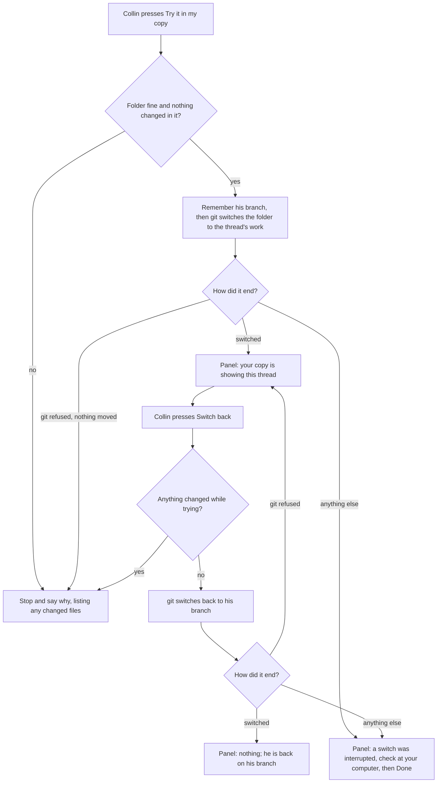

# Try a thread's work in my own checkout

**Idea:** `IDEA.md` — what this is for and why, in plain language. Read it first; it is
the north star this plan serves. Goal and Constraints live there, not here, so they don't
get buried as this file grows.

## Open Questions

Ordered by leverage; discussed one at a time. A settled question moves to the Decision
Log and is deleted from here.

None.

## Watch List

Things noticed that need looking into — not yet decisions for the user. Written down the
moment they're spotted so they can't be forgotten, surfaced to the user one line at a
time as they appear, and emptied before Stage 1 exits.

Each item ends up settled by the agent (noted in the Log), promoted to an Open Question,
promoted to a Constraint or Accepted Risk, or waved off by the user.

| # | Noticed | What needs looking into | Raised to user? | Outcome |
|---|---------|-------------------------|-----------------|---------|

## Decision Log

Append-only. A reversal is a new entry superseding the old, never an edit.

| # | Decision | Rationale | Source |
|---|----------|-----------|--------|
| 1 | Switch Collin's folder to the thread's work in place; his own branch is left untouched | Same folder keeps engine caches; easy to undo | user |
| 2 | The switch puts his folder on the thread's latest committed work as a detached commit (no new branch name); uncommitted agent edits are not included | The thread branch is already checked out in the agent's copy, so git will not check it out twice; a detached commit needs no extra branch to clean up | defaulted |
| 3 | Uncommitted changes in his folder are set aside automatically (stash, including untracked files) before the switch and restored on switching back | He is usually on a phone with no way to commit | user |
| 4 | A "Switch back" button returns the folder to the branch it was on and restores the set-aside changes; switching from one thread to another keeps the original return point | Follows from 1 and 3; IDEA requires getting back as easily | defaulted |
| 5 | Changes made while trying (for example files an engine rewrites) are never discarded: on switching back they are set aside under a label naming the thread, and the app says so | IDEA: nothing of his is lost | defaulted |
| 6 | The folder switched is the thread's own project folder (`thread.project`) on the thread's machine (`thread.machine`); no per-project setting, no other machine | Agents' copies are made from that folder, so it is usually his copy; nothing to set up | user |
| 7 | The thread's work is the local ref `wc/<thread-id>` in that folder's repository (shared with the agent's linked worktree), so no fetch or push is needed | The thread's worktree is linked to this repository, so its branch ref is already there | defaulted |
| 8 | Pressing "Try it in my copy" asks for one confirmation naming the folder and machine | A mis-tap on a phone rewrites his working folder | defaulted |
| 9 | Pressing "Try it" again for the thread already in place moves to its newest commit | Agents keep committing; he needs a way to refresh | defaulted |
| 10 | The control lives on the thread page for any thread whose branch exists in the folder, at any stage, and shows which thread (if any) the folder is currently showing | He may want to try work before it is done; one place to look | defaulted |
| 11 | Every git change is journalled in the record first; switches never overwrite ignored files or guess names; set-aside changes are pinned under `refs/wheelchair/kept/`; outcomes are judged by where HEAD actually is, not git's exit code; Switch back carries the record version | Mechanics findings 1-11, round 1 | review-round-1 |
| 12 | Refuse folders that run wheelchair itself, agents' copies, and folders with submodule changes | Intent finding 1 and mechanics findings 10-11, round 1 | review-round-1 |
| 13 | Supersedes 3, 4 (restore part) and 5: Try refuses when his copy has changes; nothing of his is ever set aside. Switch back (and moving to another thread) backs up anything changed while trying to a private pinned commit, then clears only those files. The stash list is never used | Round 2 showed stash can delete files and races on the shared stash list | user |
| 14 | Records split into `active`, `pending` and `backups`; outcomes judged by full HEAD identity; return point and moved commits pinned; stale records need Dismiss; submodule pointer changes refused; hub and machine contracts carry `dismiss`, `version`, `backup`; linked-worktree refusal dropped (agents' copies are refused by location) | Round 2 findings | review-round-2 |
| 15 | Supersedes the `refs/wheelchair/kept/` part of 11: pins are `refs/wheelchair/<return|backup>/...`. Supersedes 10's location rule: the panel shows on every thread page for the folder, including archived threads; Try needs the thread's branch, Switch back does not | Round 3 intent findings | review-round-3 |
| 16 | Backups are byte-exact (no filters, modes and symlinks kept) and include the index; they are recorded before anything is cleared; outcomes also need a status scan; folder identity checked; Switch back returns to the branch's current tip; first Try state lives in `pending` until success | Round 3 mechanics findings | review-round-3 |
| 17 | HEAD unmoved always means "nothing moved"; Status reads metadata only and reports folder refusals; a Finish (`recover`) action; Dismiss keeps the return commit as a backup; queue keyed by the folder's real path; identity includes device and inode; per-path index check before clearing; `--no-renames`, `--` and a temporary index copy | Round 4 findings | review-round-4 |
| 18 | Identity checked only during a trial and re-stamped on first Try; half-switched first Try recovered by Finish; same-place switches skip git; Dismiss deletes a return pin its branch still contains; Status not polled; plain "files in the way" message | Round 5 findings | review-round-5 |
| 19 | Supersedes the back-up part of 13: Switch back (and Try while trying) refuses when files changed while trying and lists them; wheelchair never deletes or overwrites a file in his folder. Automatic back-up deferred (D1) | Rounds 3-5 kept finding edge cases in clearing files; Collin chose "List now, back-up later" | user |
| 20 | Mode changed from thorough to two-part, so the back-up work becomes a follow-up thread | Follows from 19 | user |
| 21 | Decision 19 also supersedes the back-up parts of 16 and 17 (byte-exact backups, index copy, per-path index check, temporary index copy, Dismiss keeping the return commit as a backup unconditionally) | Round 6 intent finding | review-round-6 |
| 22 | Half-switched outcomes are recorded with their files and finished by Finish after he cleans up; Dismiss keeps `active` unless the trial is gone; a separate Forget for kept pins; protected paths are exact files; switches get a deadline, a busy flag and a long hub timeout; identity is real paths only | Round 6 findings | review-round-6 |
| 23 | Exit result recorded before judging; switches and scans run in a killable process group with deadlines; 30-second admission; Forget skips reconcile; Dismiss treats HEAD at a Try's target as success and never runs git on an identity mismatch; `last` outcome stored; protected list only in the side file | Round 7 findings | review-round-7 |
| 24 | Try writes get their own lock, separate from agents' `inRepoQueue`; Status takes no lock; writes are acknowledged then finished in the background; switch process groups are tracked by `pgid` across restarts and terminated (SIGTERM, then SIGKILL) after their deadline; one outcome table; `pending` blocks Try and Back; Dismiss never reconciles or scans; a leftover `index.lock` is reported, never deleted | Round 8 findings | review-round-8 |
| 25 | Rare broken switches (killed, service restarted mid-switch, half-switched, unexpected) are all shown as "interrupted" with files and his earlier branch, and he sorts them out at his computer then presses Done; Finish, process-group tracking across restarts and automatic re-judging are deferred (D3). Supersedes the parts of 22-24 about Finish, `pgid` and the full outcome table | Collin chose "Hand rare cases to me" | user |
| 26 | Done, Try and Back refused while `index.lock` exists; git output reporting a failed removal counts as interrupted; Back judges and finalizes from one scan; Status checks a lock generation before showing an interruption; Done re-creates a missing return pin before keeping it | Round 9 findings | review-round-9 |
| 27 | Only `unable to unlink`/`unable to rmdir` with HEAD at the target overrides the table; scan-free checks run before acknowledging, and every accepted action writes `last` with an outcome; the lock-file line shows in any state; `appeared` lists raw paths, capped at 50 | Round 10 findings | review-round-10 |
| 28 | Removal override matches only git's own warning lines; hook outcome follows its exit code; pre-switch scan failure is a refusal; lock-file line only when no switch runs; `appeared` is the raw post-minus-pre difference and the only list on a Back success; all file lists capped at 50 with counts; Status returns `last` and `index_lock`; only `try`/`back` write `last` | Round 11 findings | review-round-11 |
| 29 | Approve after round 11 without a further round; the remaining findings were wording and consistency, left to the build and its verification | Collin chose "Approve now" after the review budget stopped | user |

## Spec

The settled design, grown as decisions land. Bar: a fresh agent with no conversation
history can implement from this section alone — behavior, boundaries, edge cases,
non-goals, and concrete validation commands.

A Mermaid diagram of the flow belongs here, added by Stage 2 at approval — not while the
Spec is still churning. See `protocol/diagrams.md`.

### Flow



### Behaviour

Wheelchair never deletes, overwrites or sets aside a file in Collin's folder. It only
asks git to switch, and git switches only when nothing would be lost; otherwise
wheelchair stops and lists the files.

Terms:
- **The folder** is `thread.project` on `thread.machine` (`viewer/app/threads.js:20-25`).
- **Identity**: the folder's real path plus the real path of `git rev-parse
  --git-common-dir`, stamped into the record at every first Try. Checked before
  every write only while `active` or `pending` is set; a mismatch then is shown with
  Dismiss (3) ("This folder is no longer the copy that was switched"), and only Dismiss is
  allowed (it skips the identity check).
- **HEAD identity** is `{branch: full refname or null if detached, sha}`. Comparisons
  compare both parts.
- **Status scan**: `git --no-optional-locks status --porcelain=v2 -z --no-renames
  --untracked-files=all --ignore-submodules=none`. It may run content filters (for
  example Git LFS), so it runs only inside writes, never in Status (3).
- **Protected paths**: at the first Try, `git ls-files -z --others --ignored
  --exclude-standard` (every file, not collapsed), saved beside the record as
  `<record name>.protected` (NUL-separated): files git ignored before trying. It is
  written at a first Try, before the `pending` record, and deleted when `active` and
  `pending` are both cleared; the record itself never holds the list. An
  **untracked** (`?`) scan entry exactly equal to a protected path is not counted or
  listed; a new file in an ignored directory is counted (a thread's changed ignore rules can make it
  look untracked). Tracked entries are never protected.
- **Clean**: the status scan has no entries after protected untracked entries are
  removed. **Not clean** lists the remaining paths.
- **The folder's own lock**: every Try write (try, back, dismiss, forget) takes a lock
  of its own, keyed by the folder's real path, separate from `inRepoQueue`
  (`machine/service.js:547`), so a long switch never delays agents' worktree starts or
  handoffs (git's own lock files refuse a rare clash cleanly). A write that finds the
  lock held is refused at once ("A switch is already running") and does nothing.
- **Running git**: a switch or status scan runs in its own process group (`spawn` with
  `detached: true`) with a deadline (15 minutes for a switch, 5 for a scan). On the
  deadline the machine sends SIGTERM to the group, waits 10 seconds, sends SIGKILL, and
  waits until the group is gone before going on. The exit code (or `killed`) is kept in
  memory for judging the outcome.
- **Acknowledged, then finished**: `try` and `back` first run, synchronously, the checks
  that need no scan (version, folder checks, identity, `pending`, `index.lock`, Stale,
  target ref, return branch). A failure is answered at once as a refusal. Otherwise they
  answer the hub as soon as they hold the lock (`{accepted: true}`) and finish in the
  background. Every accepted `try` and `back` ends by writing `last` with its outcome, including
  refusals found later (not clean, submodule) and including when no `pending` was ever
  written; the hub keeps its default
  5-second timeout (`viewer/app/machine-client.js:10`). The page shows "Switching…",
  re-reads Status every 3 seconds while it says running, then shows `last`.
- **Outcome of a switch**, judged once git has exited, by HEAD identity, a status scan
  and the exit code:

  | HEAD | Copy | Exit | Outcome |
  |---|---|---|---|
  | target | clean | 0 | success |
  | target | clean | nonzero | success with a warning (git's last line) |
  | target | not clean | 0 | success with a warning listing the files |
  | source | clean | nonzero or killed | nothing moved (killed: "git took too long"; else git's message) |
  | anything else | | | **interrupted** |

  Before the table: git runs with `LC_ALL=C`. If HEAD is at the target and a line of
  git's stderr starts with `warning: unable to unlink '` or `warning: unable to rmdir '`
  (git can report a removal it could not do and still exit 0), the outcome is
  interrupted. Text elsewhere (for example a commit subject in the detached-HEAD
  message) never matches. No other output changes
  the outcome: a refusal before HEAD moves ("would be overwritten by checkout") is
  "nothing moved" with the "in the way" sentence and git's listed paths (6), and a
  hook's own `error:` lines never change the outcome: a hook exiting nonzero gives
  "success with a warning", a hook exiting 0 gives plain success, by the table.
  A scan that fails **before** the switch starts writes `last` with outcome `refused`
  and the reason; `active` and `pending` are unchanged.
  Interrupted (also: the outcome scan after the switch failed, or the service finds `pending` set at start-up or
  on a later request, meaning it stopped mid-switch): `pending` is kept, with `files`
  from the scan when there was one. Wheelchair does not try to repair it (see Deferred
  D3). Status says "A switch was interrupted", lists the files if known, names the
  branch his copy was on before trying, and says: "Check your copy at your computer,
  then press Done." **Done** is Dismiss (4). If `<git-dir>/index.lock` exists, Status
  adds "Git left a lock file: <full path>. At your computer, check no git is running,
  then delete it." It is never deleted automatically, and Status shows this line
  whenever the file exists and no switch is running (the lock generation check passes
  and wheelchair's lock is not held), worded "A lock file exists: <full path>. At your
  computer, check no git is running, then delete it." The interrupted line also says
  "Git may still be running in this folder" (the machine service unit uses
  `KillMode=process`, `install.sh:401`, so a switch can outlive a service restart).
  **Done is refused while `<git-dir>/index.lock` exists** ("Git may still be running in
  this folder. Check at your computer."), as are Try and Switch back.
  While `pending` is set, Try and Switch back are refused; only Done (Dismiss) and
  Forget run.
- **Switches** always run as `git -c submodule.recurse=false switch --no-guess
  --no-overwrite-ignore --no-recurse-submodules <short branch name>` or the same with
  `--detach <sha>`, and only when clean. Git refuses rather than overwrite an ignored
  file.
- **Same place**: if source and target HEAD identity are equal (another thread at the
  same commit, or a Back to a detached commit already in place), git is not run: after
  the usual checks, the record is updated as a success in one write.
- **Pins**: `git update-ref refs/wheelchair/<return|kept>/<folder hash>/<nonce> <sha>`
  (nonce: 8 random hex chars). The full ref name is saved in the record before anything
  relies on it. Wheelchair never uses the stash list.

**The record**, one per folder: `<stateDir>/tries/<sha256 of real folder path>.json`,
written atomically (temp file then rename):

```
{ folder, identity, version,            // version: random id, changes on every write
  active: null | { thread_id, commit, return_point: {branch, sha}, return_ref,
                   },
  pending: null | { op: "try"|"back", first: bool, thread_id,
                    from: HEADid, to: HEADid, files?: [path], files_count?,
                    return_point?, return_ref? },  // first Try only
  last: null | { op, thread_id, at,
                 outcome: "success"|"warning"|"nothing-moved"|"refused"|"interrupted",
                 reason, files?: [path], files_count?, appeared?: [path],
                 appeared_count? },
  kept: [ { ref, label, thread_id, branch?, at } ] }            // pinned commits
```

`active` is only ever written by a successful switch. A first Try keeps what it needs in
`pending` until then.

**Trying** means `active` is set and HEAD is detached at `active.commit`. **Moved** means
`active` is set and HEAD is detached elsewhere (he committed while trying). **Stale**
means `active` is set and HEAD is attached to a branch (he switched by hand).

**Checks** (nothing changes; the reason is shown). Folder checks first:
- not a git working tree top level (`git rev-parse --show-toplevel` must equal the
  folder's real path) or a bare repository;
- the folder lies under `<stateDir>/worktrees` (agents' copies, `machine/service.js:488-490`);
- the folder's real path equals or contains the real path of the running service's own
  source root (`ROOT`, `machine/service.js:29`; the hub makes the same check with its own
  root when `thread.machine` is the hub's machine): "This folder runs wheelchair itself;
  switching it would swap the running app for untested code.";
- a merge, rebase, `git am`, cherry-pick, revert or bisect is in progress (`MERGE_HEAD`,
  `rebase-merge`, `rebase-apply`, `CHERRY_PICK_HEAD`, `REVERT_HEAD`, `BISECT_LOG` under
  `git rev-parse --git-dir`), or the index has unmerged entries;
- identity mismatch (only while `active` or `pending` is set; Dismiss skips this).
Then action checks (Try and Switch back are refused while `pending` is set):
- a submodule has changes, or the source and target trees differ in any gitlink
  (`git diff --raw --ignore-submodules=none <source> <target>` with mode 160000 on either
  side): "This thread changes a submodule, which isn't supported.";
- Try or Switch back when not clean: lists the files, "These files have changes. Commit,
  undo or delete them at your computer, then press again." (On a first Try they are his own;
  while trying they are changes made during the trial.)
- Try or Switch back when Stale: "You switched your copy by hand. Dismiss first.";
- Try when `refs/heads/wc/<thread-id>` does not exist;
- Switch back when the return point is a branch that no longer exists or is checked out
  in another worktree (`git worktree list --porcelain`);
- Switch back, Dismiss or Forget whose `version` differs from the record's: "Your copy
  changed since this page loaded", returning the current status.
Every write holds the folder's own lock (keyed by real path, so two spellings of one
folder share it). Version checks happen under the lock before anything else.

1. **Try it in my copy.** Confirmation names the folder and machine, suggests closing
   any app using the folder, and says it brings in
   the thread's merged work so far (work agents have not yet merged into the thread is
   not included).
   1. Target is the sha of `wc/<thread-id>`. If Trying this same thread at this sha:
      "Already showing the newest", no change.
   2. If Moved: pin HEAD as `kept` ("commits made while trying thread <id>") and list it.
   3. If `active` is null: write `pending {op: "try", first: true, thread_id, from: HEAD,
      to: {branch: null, sha: target}, return_point: HEAD, return_ref}` (after writing the protected list), then
      pin the return point. Otherwise write `pending {op: "try", first: false, ...}`.
   4. Switch detached to the target (or Same place) and judge the outcome. Success:
      `active` set (from `pending` on a first Try, else thread and commit updated),
      `pending` cleared. Nothing moved: `pending` cleared; on a first Try also delete the
      return pin. Interrupted: `pending` kept.
2. **Switch back.** Carries the shown `version`; its confirmation suggests closing any
   app using the folder. Available from every thread page whose
   project is this folder, including archived threads and threads whose branch is gone.
   1. Resolve the return target now: a branch's current tip (it may have moved on), or
      the saved sha. If Moved, pin HEAD as `kept`.
   2. Write `pending {op: "back", from: HEAD, to: <resolved target>}`, switch (or Same
      place), and judge the outcome from its one scan; the record is changed only after
      that scan. Success: `active` and `pending` cleared, return pin deleted; the protected
      filter decides cleanliness as usual. `appeared` is every path in the raw
      post-switch scan (no protected filter) that was not in the raw pre-switch scan of
      the same Back; it is the only list shown for a Back success ("These files appeared
      after switching back", left in place), with `appeared_count` giving the total and
      at most 50 listed. Nothing moved:
      `pending` cleared, still trying. Interrupted: `pending` kept.
3. **Status** (GET, takes no lock and never waits). The machine keeps, per folder, an
   in-memory lock generation that increases on every acquire and release. Status reads
   the generation and lock state, then the record and HEAD, then the generation again;
   if it changed or the lock is held, it answers "A switch is running" instead of
   publishing an interruption. Reads only metadata: the record, HEAD
   identity, `wc/<id>` and pins (`rev-parse`, `symbolic-ref`, `for-each-ref`), plus the
   folder checks; never runs the status scan, never fetches, never writes. Every file
   list it returns is capped at 50 paths with its total count. Returns `last`,
   `index_lock` (full path, or null; null while a switch is running),
   `version`, `active_thread_id`, `target_available` (whether `wc/<this thread>` exists),
   `refused` (the first failing folder check's sentence, or null) and one of, checked in
   this order: identity mismatch: "This folder is no longer the copy that was switched"
   with Dismiss;
   busy (lock held): "A switch is running"; `pending` set: "A switch was interrupted"
   with the files, the earlier branch and **Done**; Stale: "You switched your copy by hand" with Dismiss; Moved:
   "Your copy moved since you tried <thread>" with Switch back; trying this thread:
   "Your copy is showing this thread's merged work as of <short sha>" with Switch back
   (plus "Get newest" when `wc/<id>` moved on); trying another: "Your copy is showing
   another thread: <title>" with Switch back; nothing. Plus every `kept` entry: label,
   date and ref, each with "Delete" (confirmed; action `forget`). Try shows only when `target_available`,
   `refused` is null and the thread is not archived; with `refused` set the panel shows
   that sentence instead. The page fetches Status on load, after each action and on a
   refresh button, never on its poll timer (`viewer/pages/thread.js:1229`).
4. **Dismiss** (shown as **Done** for an interrupted switch; version-checked; runs no
   scan and no switch). It checks identity read-only and clears `pending`.
   - Identity mismatch: clears `active` and `pending` without any git command; the return
     pin and every `kept` entry stay in the list, marked with the old identity and shown
     as "in the copy that used to be here".
   - HEAD detached at `pending.to` of a `try` (first or not): treated as that Try's
     success (`active` set or updated to the target, return pin kept), so Switch back
     still works.
   - HEAD at `pending.to` of a `back`: treated as that Back's success (`active` cleared,
     return pin deleted).
   - Stale, or a first Try whose HEAD is not at its target: clears `active`. The return
     pin (`active.return_ref`, else `pending.return_ref`) is deleted if the return point
     was a branch that still contains its sha (`git merge-base --is-ancestor`); otherwise
     (after checking the ref exists, and re-creating it from the saved sha if the
     service stopped before it was made) it becomes a `kept` entry ("where your copy was before trying thread <id>", with
     `branch`).
   - Otherwise `active` is left as it is, so Switch back still knows his return point.
   **Forget** (action `forget`, version-checked, with a `kept` ref from the record): under
   the folder's lock it checks the version and that the ref is in
   `kept`, then deletes only that pin and entry (for an entry marked with an old
   identity, only the entry: no git command). `active`, `pending` and the return pin are
   untouched. Nothing else deletes a `kept` pin. Kept refs that no longer resolve show
   as missing.
5. **Start-up**: when the machine service starts, every record with `pending` set is
   left as it is; Status shows it as interrupted. Nothing runs git for it.
6. **Errors** reach Collin as one plain sentence under the control: machine
   unreachable, a check's sentence, or git's message. The outcome of every `try`
   and `back` (warning, files listed, files that appeared after Back, or a refusal
   found after acknowledgement) is stored in `last` and shown by Status until the next
   `try` or `back`; Dismiss and Forget never change `last`, so a phone that slept through a long switch still sees
   it. While its own request is waiting, the panel shows "Switching…" and disables its
   buttons. When git refuses a switch because
   files are in the way, the sentence is "These files in your copy are in the way:
   <paths>", using the paths git listed. After any write error or timeout, the page
   re-reads status.

### Where it lives

- **Machine** (`machine/service.js`): new hub-secret-only endpoint `POST /v1/try`,
  authorised like `/v1/handoff` (`machine/service.js:403-420,1602-1604`). Body
  `{action: "status"|"try"|"back"|"dismiss"|"forget", thread_id, project,
  version?, kept?}`. `thread_id` matches `^[0-9a-f]{12}$`; `project` validated with
  `projects({check})` (`machine/service.js:1198-1232`); `version` required for `back`,
  `dismiss` and `forget`; `kept` (a ref from the record) required for, and
  only for, `forget`. Agents can
  never call it.
- **Hub** (`viewer/app/routes.js`, `viewer/app/machine-client.js:53-108`):
  `GET /api/threads/<id>/try` and `POST /api/threads/<id>/try` with body
  `{action: "try"|"back"|"dismiss"|"forget", version?, kept?}`, under browser write auth
  (`viewer/server.js:1292-1298`), allowed for archived threads; `thread.machine` and
  `thread.project` always come from the thread record. The hub forwards `version` and
  `kept` and returns the machine's status plus the active thread's title.
- **Thread page** (`viewer/pages/thread.js`): a small "Your copy" panel near the top with
  the status line, buttons, confirmations, kept list and error line, shown also on
  archived threads (unlike the actions gated on `t.archived`,
  `viewer/pages/thread.js:157,176`). Not a card; nothing reaches the lead.

### Non-goals

Merging, pushing or touching the pull request; launching any app; other machines or a
configurable folder; including uncommitted agent edits; changing agent git rules;
deleting, overwriting or setting aside any file in Collin's folder (see Deferred);
submodule changes.

### Validation

- `bash machine/test/run.sh`: new tests in `machine/test/service.test.js` against a temp
  repo with a linked worktree on `wc/<id>`:
  - try from a clean branch and back; from a detached start and back; try A, then B
    (including B at the same sha: record updated, git not run), then back to the
    original branch; back after the return branch advanced;
  - try refused when not clean (tracked, untracked, staged rename; with
    `status.showUntrackedFiles=no`); back refused when files changed while trying,
    listing them, nothing deleted;
  - a tracked path colliding with an ignored file both ways (refused with the plain
    "in the way" sentence, file intact);
  - a thread that removes an ignore rule (the file is not counted, back succeeds, file
    intact); files appearing after back are listed;
  - gitlink change with `diff.ignoreSubmodules=all` set (refused);
  - folder under the worktrees dir, the service root, `git am` in progress (refused);
  - post-checkout hook exiting nonzero (success with warning); a required smudge filter failing
    on a first Try, on a move between threads and on Back, and a delayed filter failing
    after HEAD moved (each interrupted, files recorded, Status shows them after a
    reload, no file deleted); a hanging filter subprocess outliving the deadline (group
    gets SIGTERM then SIGKILL; clean at the source = nothing moved, otherwise
    interrupted); a leftover `index.lock` reported, not deleted; the service restarted
    with `pending` set (interrupted, no git run); a second write while one runs
    (refused at once); a long switch does not delay an agent worktree start in the same
    project; `try` answers `accepted` at once and the page shows `last` after polling;
    Try and Back refused while `pending` is set; Done refused while `index.lock`
    exists; a git switch that exits 0 after "unable to unlink" (interrupted); Status
    polled across a switch finishing never shows "interrupted"; an ignored file in the
    way stays "nothing moved" with its path listed; a post-checkout hook printing
    `error:` stays a success with warning; a dirty first Try answers `accepted` then
    writes `last` as refused with the files; `index.lock` line shown after a "nothing
    moved"; no lock-file line while a switch runs; a commit subject containing
    "unable to unlink" (success); a pre-switch scan timing out (refused in `last`, no
    `pending`); Forget leaves `last`; a file untracked before and after Back is not in
    `appeared`; a hook exiting 0 after printing `error:` (plain success);
  - Done after an interrupted Try with HEAD at the target (Switch back kept); after an
    interrupted Back with HEAD at the return branch (counts as success, no "switched by
    hand"); after an interrupted move between threads (`active` kept);
  - commit made while trying (pinned and listed); return branch deleted or checked out
    elsewhere (refused); stale record (Try and Back refused; Dismiss clears; return pin
    deleted when its branch contains it, else kept); folder replaced by another clone
    during a trial — test by replacing the common dir path (Status shows mismatch,
    Dismiss runs no git, entries kept and marked); re-cloning after a completed Back
    (Try works); two symlink spellings pressed together (serialised); Forget during an
    interrupted switch leaves `pending`, `active` and the return pin; stale `version`
    on back, dismiss and forget (refused); a new file in an originally ignored
    directory whose rule the thread removed (listed on Back);
  - Status on a repo with an LFS filter runs no filter (shim records calls); Status for
    the wheelchair clone returns `refused`.
- `node --test viewer/test/*.test.js`: routes resolve machine and project from the
  record; `version` and `kept` forwarded; archived threads allowed; unauthenticated
  writes refused.
- `npm --prefix viewer run test:browser`: the panel shows status, confirmations, the
  kept list, Switch back from another thread's page and from an archived thread, and an
  error line.

## Deferred

| # | Item | Why it can wait | Source | Notes for the follow-up |
|---|------|-----------------|--------|-------------------------|
| D1 | Back up and clear files changed while trying, so Switch back works from the phone even when an engine rewrote files | Switch back refuses and lists the files instead; nothing is lost, he sorts them out at his computer | planning | The full design reviewed over rounds 2-5 is in this PLAN.md at commit 45b21ec ("Back up the leftovers": byte-exact backup with `hash-object --no-filters`, index copy compared by `I^{tree}`, recorded before clearing, per-path re-check, `:(literal)` pathspecs, missing parents allowed). Round 2-5 Review Rounds rows list every edge case found |
| D2 | Automatic recovery of a half-switched first Try (for example a failed Git LFS download) | Status lists the files and offers Done; his branch was clean before, so nothing of his is lost | planning | Needs D1's back-up-and-clear to restore safely |
| D3 | Automatic handling of interrupted switches: a Finish action that judges them again, tracking a switch's process group across service restarts, and finishing or undoing based on where HEAD ended | Status says the switch was interrupted, lists files and his earlier branch; he checks at his computer and presses Done; nothing is deleted | planning | The reviewed design is in this PLAN.md at commit ab0e5c7: full outcome table with exit `killed`/unknown, `pending.pgid`/`started_at`, Finish (`recover`), reconcile rules; Round 5-8 rows list the cases |

## Accepted Risks

Real issues consciously not fixed, each with the reason. Part of the spec, not review
scaffolding — an implementer should read these, and later review rounds must not
re-raise them.

| Risk | Why accepted | Round |
|------|--------------|-------|
| An app saving a file in the instant git replaces or removes it during a switch can lose that save | The same is true of any `git switch` he runs himself; nothing outside git can lock his files; the confirmation suggests closing the app using the folder | 6 |

## Review Rounds

### Round 1 — 2026-11-18

**Lanes:** intent: claude / claude-opus-5-5; mechanics: gpt / gpt-6.2-sol; cross-family: yes.

Written for every round, including one where the table below stays empty. The table gets a row
per finding, so a clean round would otherwise leave no record of which gate ran — which is the
round where knowing it matters most.

<!-- Round 2+: list what changed since the previous round; that list scopes the reviewers. -->

**Changed since Round N-1:** n/a (first round — whole Spec in scope)

| Lane | Reported | Finding | Lead verdict | Resolution |
|------|----------|---------|--------------|------------|
| intent | major | Trying a thread could switch the folder wheelchair itself runs from | upheld (install.sh:384,397 run from `$ROOT`) | Refusal added to 1.1 |
| intent | minor | Status overstates: unmerged worker branches are not included | upheld | Confirmation and status say "merged work as of <commit>" |
| intent | minor | Drift silently drops the pointer to his set-aside changes | upheld | One-time status line naming the stash (Behaviour 4) |
| intent | minor | Shared stash list can lose the entry | upheld | Pinned under `refs/wheelchair/kept/` (1.3, 1.5, 2.3) |
| mechanics | blocking | Checkout overwrites ignored files by default | upheld (git-checkout(1): `--overwrite-ignore` is default) | `--no-overwrite-ignore` on every switch |
| mechanics | blocking | Thread removing an ignore rule moves an ignored file into the trial stash | downgraded to major: file is stashed, not lost | Kept-ignored list excluded from trial stashes |
| mechanics | blocking | No journal; crash leaves detached copy without Switch back | downgraded to major: changes stay in the stash | Record phases written first; reconcile (5) |
| mechanics | blocking | Failing post-checkout hook misread as no switch | downgraded to major: same, and hooks are rare | Outcome judged by actual HEAD (1.4) |
| mechanics | blocking | `stash@{n}` races across linked worktrees | downgraded to major: agents cannot stash via the machine (`machine/service.js:1044`) | Restore by sha; drop verifies printed sha and re-stores a foreign entry |
| mechanics | major | Switch back has no preflight; plain checkout guesses names | upheld | Refusals for missing/elsewhere branch; `git switch --no-guess` |
| mechanics | major | SHA-only drift detection | upheld | Trying needs detached HEAD; moved-detached pins HEAD on back |
| mechanics | major | Status GET writes and is unlocked | upheld | GET read-only under queue; Dismiss is a write |
| mechanics | major | Stale tab can undo a newer trial | upheld | `version` on back/dismiss; re-read status after errors |
| mechanics | major | Untracked hidden by config; submodule changes not stashed | upheld | `--untracked-files=all`; submodule refusal; clean re-check |
| mechanics | major | A managed agent worktree passes project validation | upheld | Main-working-tree and worktrees-dir refusals |

Reported severity is the reviewer's opinion; the lead verdict
(`upheld`/`downgraded`/`declined`/`accepted-risk`/`user-decision`) is what gates the
exit. Downgrades and declines cite evidence.

### Round 2 — 2026-11-18

**Lanes:** intent: claude; mechanics: not claude; cross-family: yes.

**Changed since Round 1:** Behaviour rewritten: terms (record phases, kept sets pinned
under `refs/wheelchair/kept/`, drop-by-verified-sha, clean check flags, `git switch
--no-guess --no-overwrite-ignore`, kept-ignored list); refusals list (service root,
agents' copies, submodule changes, return-branch preflight); Try judged by actual HEAD;
Switch back with version check and pinning commits made while trying; status read-only
under the queue with Dismiss; reconcile of interrupted operations. Record shape and
validation list updated. Decisions 11-12.

| Lane | Reported | Finding | Lead verdict | Resolution |
|------|----------|---------|--------------|------------|
| intent | blocking | Stale `trying` record reused by the next Try | upheld | Stale needs Dismiss (Refusals, 4) |
| intent | major | Commits made while trying lost when Try moves away | upheld | Fixed in the Q5 redesign |
| intent | major | Hub/machine contracts omit `dismiss` and `version` | upheld | Fixed in the Q5 redesign |
| intent | minor | After a clash the only pointer to his changes is one error line | upheld | Fixed in the Q5 redesign |
| intent | minor | Kept sets pile up unseen | upheld | Fixed in the Q5 redesign |
| intent | minor | Main-working-tree refusal blocks his own linked worktree | upheld (agents' copies are all under `<stateDir>/worktrees`, `machine/service.js:488-490`) | Fixed in the Q5 redesign |
| mechanics | blocking | Stash's internal reset can delete an ignored file before the switch | user-decision | Collin chose (c): no stash; Decision 13 |
| mechanics | blocking | Stash's broad clean can delete a file an engine writes mid-stash | user-decision | Collin chose (c): no stash; Decision 13 |
| mechanics | blocking | Clean check treats protected ignored paths as dirt | user-decision | Collin chose (c): no stash; Decision 13 |
| mechanics | blocking | Journal cannot tell which operation to recover | upheld | Fixed in the Q5 redesign |
| mechanics | blocking | Back applies the stash when HEAD moved somewhere else | upheld | Fixed in the Q5 redesign |
| mechanics | blocking | `stash drop` printed sha cannot verify what was deleted | user-decision | Collin chose (c): no stash; Decision 13 |
| mechanics | major | Submodule pointer changes strand a trial | upheld | Fixed in the Q5 redesign |
| mechanics | major | Detached return commit and refresh commits unpinned | upheld | Fixed in the Q5 redesign |
| mechanics | major | Stale record has no defined Try behaviour | upheld (dup of intent 1) | Fixed in the Q5 redesign |
| mechanics | major | Browser POST omits `dismiss` and `version` | upheld (dup of intent 3) | Fixed in the Q5 redesign |

### Round 3 — 2026-11-18

**Lanes:** intent: claude; mechanics: not claude; cross-family: yes.

**Changed since Round 2:** Collin chose (Decision 13) to drop setting aside his own
changes: Try now refuses a copy with changes, and leftovers from trying are backed up to
private pinned commits and cleared path by path ("Back up the leftovers"). The whole
Behaviour, record shape (`active`/`pending`/`backups`), refusals, reconcile, Dismiss,
hub and machine contracts, non-goals and validation list were rewritten; one Accepted
Risk added.

| Lane | Reported | Finding | Lead verdict | Resolution |
|------|----------|---------|--------------|------------|
| intent | major | Switch back unreachable once the tried thread is archived or its branch gone | upheld (`viewer/pages/thread.js:157,176`) | Panel on every thread page of the folder, archived included (2, 3) |
| intent | major | Interrupted first Try looks Stale | upheld | First Try state kept in `pending`; reconcile undoes it (1.2, 5) |
| intent | minor | Try's backup of leftovers is silent | upheld | Confirmation and report (1, 1.5) |
| intent | minor | Backup list lacks ref and file names | upheld | Status lists both (3) |
| intent | minor | Files hidden by the trial's ignore rules appear after Back | upheld | Listed after Back (2.3) |
| intent | minor | Decision 11 still names `kept/` refs | upheld | Decision 15 |
| mechanics | blocking | Backup can drop staged content | downgraded to major: needs staging during a trial | Index copy I as second parent (Back up 2, 4) |
| mechanics | blocking | `git add` filters change bytes; symlinks followed | upheld (LFS is common in game projects) | `hash-object --no-filters`, modes, link text (Back up 3) |
| mechanics | blocking | Restoring a file replaced by a directory removes the directory | downgraded to major: rare | Refused in Back up 1 |
| mechanics | blocking | HEAD alone cannot certify a checkout | downgraded to major | Outcome also needs a status scan |
| mechanics | blocking | Folder path not bound to the repository | downgraded to major: needs the folder replaced mid-trial | Identity check |
| mechanics | blocking | Pre-trial edit made during the first switch rides into the trial | downgraded to minor: it is backed up on return, not lost | Success-with-warning lists it |
| mechanics | major | Return branch advanced: two targets | upheld | Back resolves the current tip (2.1) |
| mechanics | major | Journal gaps for first Try and return ref | upheld | `pending` carries first-Try state and `return_ref`; backup listed before clearing |
| mechanics | major | Collapsed protected directory masks tracked files | upheld | Protection only for untracked entries |
| mechanics | major | Submodule check honours `diff.ignoreSubmodules` | upheld | `--ignore-submodules=none`, both modes |
| mechanics | major | Same-sha other thread reported as no-op | upheld | No-op only for the same thread (1.1) |
| mechanics | major | Queue key can differ from the existing calls' key | downgraded to minor: existing calls key on `path.resolve(project)` too | Same key specified |
| mechanics | major | `git am` and unmerged index not refused | upheld | Added to folder checks |
| mechanics | minor | Status lacks target availability | upheld | `target_available`, `active_thread_id` |
| mechanics | minor | Status scan can write the index | upheld | `--no-optional-locks` |

### Round 4 — 2026-11-18

**Lanes:** intent: claude; mechanics: not claude; cross-family: yes.

**Changed since Round 3:** "Back up the leftovers" rewritten (byte-exact, index copy,
directory refusal, recorded before clearing); terms: identity, status scan with
`--no-optional-locks`, protection only for untracked entries, outcome needs a scan;
record: first-Try state in `pending`, `return_ref`, `common_dir`; folder checks add `git
am` and unmerged index; submodule check `--ignore-submodules=none`; Try no-op only for
the same thread; Switch back from any thread page including archived, to the branch's
current tip, lists files that appear afterwards; status fields `target_available`,
`active_thread_id`, backup refs and files; Dismiss clears unexpected state; queue key;
validation list. Decisions 15-16.

| Lane | Reported | Finding | Lead verdict | Resolution |
|------|----------|---------|--------------|------------|
| intent | major | Back interrupted by an app writing leaves no way back | upheld | HEAD unmoved = nothing moved; Dismiss keeps the return commit |
| intent | minor | Wheelchair's own threads show a Try that always fails | upheld | Status returns `refused` |
| intent | minor | Accepted Risk names the wrong step | upheld | Now step 6 |
| mechanics | blocking | Restore can overwrite an ignored file after `git rm --cached` | declined: that path is a listed change and present on disk, so Back up step 3 stores its exact bytes in B before step 6 restores it; nothing is lost | — |
| mechanics | blocking | Deleting a tracked directory strands Back | upheld | Missing parents allowed; `lstat` on existing parents |
| mechanics | major | Interrupted switch has no button when Try is unavailable | upheld | Finish (`recover`) on every page of the folder |
| mechanics | major | Symlink aliases use different queues | upheld | Queue keyed by real path |
| mechanics | major | Replacement clone at the same path passes identity | downgraded to minor: needs a re-clone mid-trial | Device and inode added |
| mechanics | major | Staging during clearing can lose index content | downgraded to minor: needs staging from a desktop during a phone press | Per-path index check |
| mechanics | major | Status scan in GET can run LFS filters | upheld | Status metadata only |
| mechanics | minor | Staged rename gives one entry with two paths | upheld | `--no-renames` |
| mechanics | minor | `write-tree` rewrites the real index's cache-tree | upheld | Temporary index copy |
| mechanics | minor | File named `--stdin` | upheld | `--` before paths |

### Round 5 — 2026-11-18

**Lanes:** intent: claude; mechanics: not claude; cross-family: yes.

**Changed since Round 4:** outcome rule (HEAD unmoved always "nothing moved"); status
scan gets `--no-renames` and runs only in writes; Status is metadata-only with
`refused` and a Finish (`recover`) action; Dismiss keeps the return commit as a backup;
queue keyed by the folder's real path with version checks inside it; identity adds
device and inode; Back up the leftovers: missing parents allowed, temporary index copy,
`--` before paths, per-path index check before clearing; contracts add `recover`;
validation list. Decision 17.

| Lane | Reported | Finding | Lead verdict | Resolution |
|------|----------|---------|--------------|------------|
| intent | major | An identity mismatch can never be cleared and disables the folder for good | upheld | Identity only during a trial; Dismiss skips it |
| intent | minor | Try confirmation needs dirt info Status no longer has | upheld | Unconditional wording |
| intent | minor | Dismiss's return pin source and backup shape undefined | upheld | Source named; `branch`, `files: []` |
| intent | minor | Every Dismiss after a hand switch leaves a backup | upheld | Pin deleted when its branch contains it |
| intent | minor | "Aborting" shown instead of the files in the way | upheld | Plain sentence with git's listed paths |
| intent | minor | Status polling cost | upheld (`viewer/pages/thread.js:1229`) | Fetched on load, action, refresh |
| mechanics | blocking | Failed smudge filter (Git LFS) leaves a first Try half-switched with no journal | upheld | Half-switched state with Finish |
| mechanics | blocking | Same source and target identity is ambiguous | upheld | Same place rule |
| mechanics | blocking | Index verify compares commit ids with timestamps | upheld | Compare `I^{tree}` |
| mechanics | major | Finish offered in the unexpected state | upheld | Unexpected checked first, Dismiss only |
| mechanics | major | Try confirmation depends on dirt (dup of intent 2) | upheld | Same fix |
| mechanics | minor | Per-path index check uses a glob pathspec | upheld | `:(literal)`, exact path |

### Round 6 — 2026-11-18

**Lanes:** intent: claude; mechanics: not claude; cross-family: yes.

**Changed since Round 5:** Collin chose "List now, back-up later" (Decisions 19-20) and
the mode is now two-part. Wheelchair never deletes, overwrites or sets aside a file:
"Back up the leftovers" and the backups list are gone; Try and Switch back refuse when
not clean and list the files; half-switched first Try shows files and Dismiss; pinned
commits kept as `kept`; Deferred D1-D2; the clearing Accepted Risk removed; contracts use
`kept`; validation list rewritten. Budget reset after Collin's decision.

| Lane | Reported | Finding | Lead verdict | Resolution |
|------|----------|---------|--------------|------------|
| intent | major | Status cannot know a half-switched state or its files | upheld | `pending.half` and `files` recorded |
| intent | major | Dismiss after a half-switched move loses the return point | upheld | Dismiss keeps `active`; Finish after cleanup |
| intent | minor | Decisions 16-17 still prescribe back-up | upheld | Decision 21 |
| intent | minor | "Commit or remove" wording | upheld | "Commit, undo or delete" |
| intent | minor | Identity and Finish are now over-built | upheld in part: device and inode dropped; Finish kept, it now finishes half-switched states | Identity is real paths only |
| mechanics | blocking | An app saving during git's write pass can lose that save | accepted-risk: inherent to any `git switch`, including his own | Accepted Risks; confirmations suggest closing the app |
| mechanics | blocking | Status cannot distinguish half-switched from interrupted (dup of intent 1) | upheld | Same fix; Finish scans an unclassified interruption |
| mechanics | blocking | Delayed smudge failure after HEAD moved reported as success | upheld | Target + git failure + dirty = half-switched |
| mechanics | major | Collapsed ignored directory hides new files | upheld | Exact protected file list |
| mechanics | major | Deleting a kept pin shares Dismiss | upheld | Separate `forget` |
| mechanics | major | Slow LFS checkout outlives timeouts | upheld (`viewer/app/machine-client.js:10`, 5 s default) | Deadline, busy flag, 16-minute hub timeout |

### Round 7 — 2026-11-18

**Lanes:** intent: claude; mechanics: not claude; cross-family: yes.

**Changed since Round 6:** half-switched outcomes (including HEAD at target with a git
failure) recorded as `pending.half`/`files` and finished by Finish; Dismiss keeps
`active` unless the trial is gone; new `forget` action for kept pins; protected paths are
an exact file list stored beside the record; switch deadline, busy flag and 16-minute
hub timeout; identity is real paths only; refusal wording; confirmations suggest closing
the app; one Accepted Risk; validation additions. Decisions 21-22.

| Lane | Reported | Finding | Lead verdict | Resolution |
|------|----------|---------|--------------|------------|
| intent | major | Dismiss after a half-switched first Try at the target loses Switch back | upheld | Dismiss treats it as success |
| intent | minor | Switch outcome lost if the phone sleeps | upheld | `last` in the record; "Switching…" |
| intent | minor | Record shape still holds the protected list | upheld | Side file only, lifecycle stated |
| mechanics | blocking | Restart after git moved HEAD but failed can be finished as success | upheld | Exit result recorded; missing result never counts as success when dirty |
| mechanics | major | Deadline kill misses filter subprocesses | upheld (`machine/service.js:85-98` waits for `close`) | Process group, kill and wait |
| mechanics | major | Timeout rules conflict and queue admission is unbounded | upheld | Admission bound, exit `killed` keeps `pending`, hub disconnect rule |
| mechanics | major | Forget runs reconcile | upheld | Forget skips reconcile |
| mechanics | major | Dismiss on identity mismatch checks ancestry in the wrong repository | downgraded to minor: needs a re-clone mid-trial | No git command on mismatch; entries kept and marked |

### Round 8 — 2026-11-18

**Lanes:** intent: claude; mechanics: not claude; cross-family: yes.

**Changed since Round 7:** process-group deadlines for switches and scans; 30-second
admission; exit result recorded before judging, and rules for a missing result; Dismiss
rules rewritten (identity mismatch runs no git; HEAD at a Try's target counts as
success); Forget skips reconcile; `last` outcome stored and shown; "Switching…" state;
protected list only in a side file with its lifecycle; validation additions. Decision 23.

| Lane | Reported | Finding | Lead verdict | Resolution |
|------|----------|---------|--------------|------------|
| intent | major | Try shares agents' repo queue and would stall their starts and handoffs | upheld (`machine/service.js:496,547,1286`; `viewer/app/sessions.js:171`) | Own lock per folder |
| intent | major | Status and Try wait behind agent work and report it wrongly | upheld | Status takes no lock; refusal immediate |
| intent | major | Killed switch with a clean copy has no defined outcome | upheld | Outcome table |
| intent | minor | Dismiss after a half-switched Back says "switched by hand" | upheld | Back at `pending.to` counts as success |
| intent | minor | Hub timeout shorter than the longest write | upheld | Acknowledge then finish; page polls |
| mechanics | blocking | A restart leaves the old switch running while recovery judges it | upheld | `pgid` recorded; nothing judged while the group is alive; terminated after deadline |
| mechanics | blocking | Outcome rules incomplete and `pending` not a gate for new Try | upheld | Outcome table; `pending` blocks Try and Back |
| mechanics | major | Dismiss reruns reconcile and can hang | upheld | Dismiss skips reconcile and scans |
| mechanics | major | Timeout budget omits scans; Status waits behind fetches | upheld (dup of intent 2 and 5) | Same fixes |
| mechanics | major | A hard kill can leave `index.lock` | upheld | SIGTERM with grace; lock reported with path, never deleted |

### Round 9 — 2026-11-18

**Lanes:** intent: claude; mechanics: not claude; cross-family: yes.

**Changed since Round 8:** Collin chose "Hand rare cases to me" (Decision 25): every
broken switch other than a plain success or "nothing moved" is shown as interrupted, with
files and his earlier branch, and he presses Done after checking at his computer. Finish
(`recover`), process-group tracking across restarts, unknown-exit rules and reconcile
removed; Deferred D3 added; start-up rule; outcome table cut down; validation updated.
Budget reset after Collin's decision.

| Lane | Reported | Finding | Lead verdict | Resolution |
|------|----------|---------|--------------|------------|
| intent | major | A switch can outlive a service restart (`KillMode=process`) and Done then loses the trial | upheld (`install.sh:401`) | Done refused while `index.lock` exists; wording says git may still run |
| intent | minor | Identity mismatch described two ways | upheld | Terms point to Status (3) |
| mechanics | major | Git exits 0 after failing to remove a file | downgraded to minor: needs read-only directories | Removal errors in git's output count as interrupted |
| mechanics | major | Back's second scan runs after the record is cleared | upheld | One scan, record changed after it |
| mechanics | major | Status can publish a false interruption during a running switch | upheld | Lock generation check |
| mechanics | minor | Return pin may not exist when Done keeps it | upheld | Checked and re-created from the saved sha |

### Round 10 — 2026-11-18

**Lanes:** intent: claude; mechanics: not claude; cross-family: yes.

**Changed since Round 9:** Done, Try and Back refused while `index.lock` exists, and the
interrupted line says git may still be running; git output reporting a failed removal
counts as interrupted; Back judges and finalizes from one scan; Status lock-generation
check; Done re-creates a missing return pin; identity-mismatch wording. Decision 26.

| Lane | Reported | Finding | Lead verdict | Resolution |
|------|----------|---------|--------------|------------|
| intent | blocking | The `error:` rule turns a plain "in the way" refusal into an interruption | upheld | Only removal failures with HEAD at the target |
| intent | minor | A hook's `error:` line turns success into interrupted | upheld | Same fix |
| intent | minor | Lock-file line only when interrupted | upheld | Shown in any state |
| mechanics | blocking | Same as intent 1 | upheld (dup) | Same fix, `LC_ALL=C` |
| mechanics | major | Refusals found after acknowledgement have nowhere to go | upheld | Scan-free checks first; `last.outcome` and `reason` |
| mechanics | minor | `appeared` raw or filtered unclear | upheld | Raw, capped at 50 |

### Round 11 — 2026-11-18

**Lanes:** intent: claude; mechanics: not claude; cross-family: yes.

**Changed since Round 10:** the git-output override narrowed to removal failures with
HEAD at the target, under `LC_ALL=C`; scan-free checks run before acknowledging; `last`
gains `outcome` and `reason` and is written by every accepted action; lock-file line in
any state; `appeared` uses raw paths, capped. Decision 27.

| Lane | Reported | Finding | Lead verdict | Resolution |
|------|----------|---------|--------------|------------|
| intent | major | Lock-file line tells him to delete a lock git is using | upheld | Shown only when no switch runs |
| intent | minor | `appeared` mislabels his own files and duplicates the warning list | upheld | Raw difference; one list |
| intent | minor | `files` lists uncapped | upheld | 50 with counts |
| intent | minor | Status return list omits `last` and the lock line | upheld | `last`, `index_lock` |
| intent | minor | Dismiss and Forget overwrite `last` | upheld | Only `try`/`back` write it |
| mechanics | major | Pre-switch scan failure has conflicting outcomes | upheld | Refused in `last`, no `pending` |
| mechanics | major | Hook with `error:` and exit 0 contradicts validation | upheld | Outcome by exit code; fixtures named |
| mechanics | minor | Override matches a commit subject | upheld | Only git's warning lines |
| mechanics | minor | `appeared` includes already-untracked files | upheld (dup of intent 2) | Raw difference |

## Prior Work

Parts of the Spec already built before this plan reached Stage 3 — adopted from outside
with work already done, or left behind by an implementation run that died partway.

Stage 3 does not re-implement `pre-existing` items and does not touch their code. Stage 4
verifies them exactly as rigorously as everything else: this code has never been through
the gate, so skipping it would leave the least-trustworthy part of the change as the only
part nobody checked.

Ambiguous evidence means **not done**. A wrong "done" is a silent hole; a wrong "not done"
costs a worker one look.

| Spec item | State | Evidence (file:line) | Confidence |
|-----------|-------|----------------------|------------|
|           | pre-existing / partial | | high / low |

`partial` items are implemented by Stage 3 — the brief names what exists so the worker
completes it instead of restarting it.

## Implementation Tasks

Filled by Stage 3. One row per worker brief.

| # | Objective | Ownership boundary | Lane | Session id | Validation | Status |
|---|-----------|--------------------|------|-----------|------------|--------|

Session id = the `thread_id` of a `codex exec` lane, so remediation can resume it.

## Log

Free-form running notes: deviations discovered mid-implementation, scope events,
anything a future session needs that fits nowhere above.
