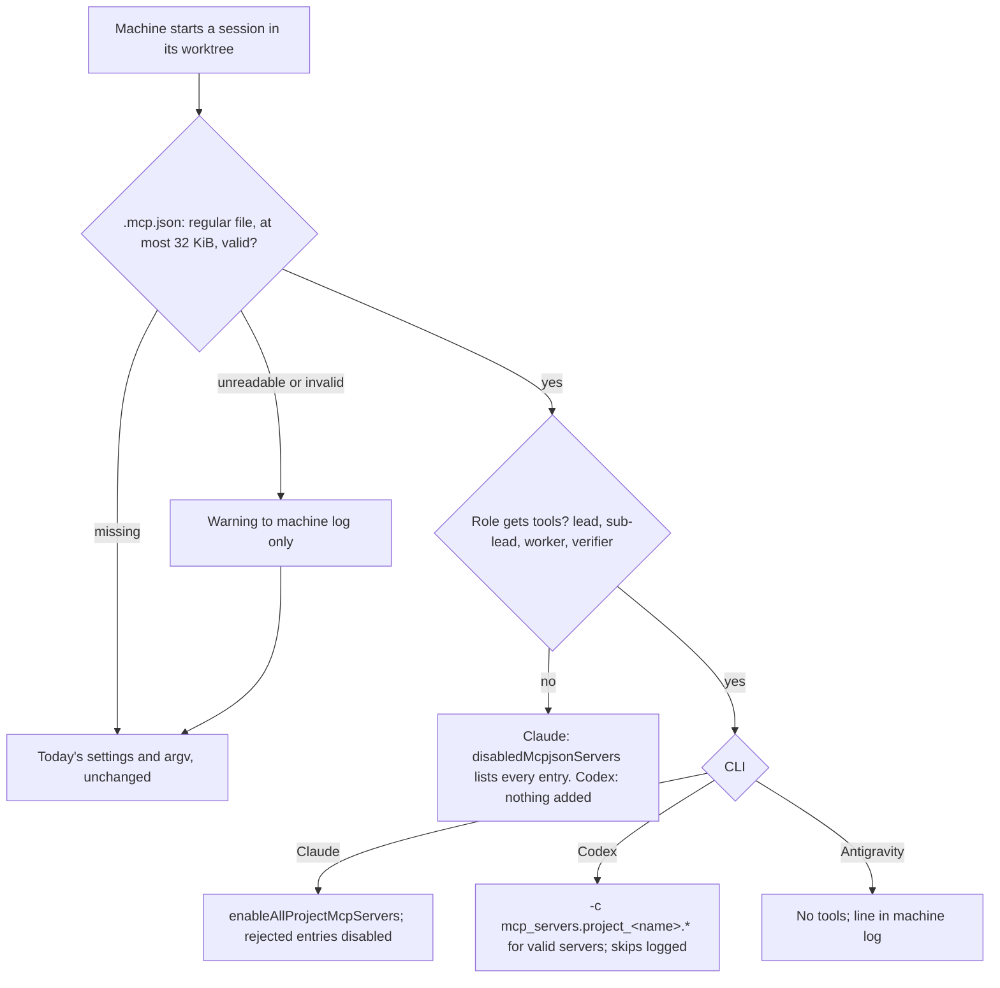

# Custom MCP tools for a project's agents

**Idea:** `IDEA.md` — what this is for and why, in plain language. Read it first; it is
the north star this plan serves. Mapping: `MAP.md` and `docs/maps/local-project-runtime.md`.

## Open Questions

None.

## Watch List

| # | Noticed | What needs looking into | Raised to user? | Outcome |
|---|---------|-------------------------|-----------------|---------|
| 1 | Claude Code asks for approval of project `.mcp.json` servers interactively | A session in tmux could stall on that prompt | no | Settled: pre-approve via `enableAllProjectMcpServers` in the per-session `--settings` file (verified); see Spec. Decision 5 |
| 2 | Codex and Antigravity config locations | Per-session MCP config without touching global config | no | Codex: `-c mcp_servers.<name>.*` per invocation (verified). Antigravity: none found; promoted to Q3, settled as Decision 7 |
| 3 | IDEA asks for plain failure reporting | How a tool that fails to start is detected and shown | no | Settled by default, Decision 6; superseded by 10 and 15; moved to the follow-up by Decision 16 |

## Decision Log

Append-only. A reversal is a new entry superseding the old, never an edit.

| # | Decision | Rationale | Source |
|---|----------|-----------|--------|
| 1 | Mode two-part | Collin's pick; get something usable, harden in a follow-up | user |
| 2 | This thread builds custom MCP tools only; seeing the app run and trying results locally became separate stub threads | Collin's pick of the three pieces | user |
| 3 | A project's tools are defined in the repo's own `.mcp.json` (Claude Code format); wheelchair translates it for Codex and Antigravity. No new settings UI | One versioned file, also works for Claude Code outside wheelchair | user |
| 4 | Lead, sub-lead, workers and verifiers get the project's tools; reviewers, the mapper, asides and usage probes do not | Read-only roles must not be able to change things through a tool | user |
| 5 | Claude sessions that get tools pre-approve them with `enableAllProjectMcpServers: true` in the per-session settings (`machine/adapters/claude.js:68`); sessions that don't get tools set `disabledMcpjsonServers` to every server name in `.mcp.json` | Otherwise an interactive session stalls on the approval prompt, which the adapter's `answerPrompts` (`claude.js:75-81`) does not handle | defaulted |
| 6 | Failure reporting for the first part: at session start the machine checks `.mcp.json` parses and each stdio server's `command` resolves on that machine's PATH; problems come back as a warning in the start output's `note`, the session still starts without the broken tools, and the lead tells Collin. A real connection health check is deferred | `claude mcp list` can health-check but `codex mcp list` and `agy mcp list` cannot; a command-exists check covers the common failure (missing program) for every CLI | defaulted |
| 7 | Claude Code and Codex get project tools now; Antigravity sessions start without them and say so; Antigravity support is deferred to the follow-up. IDEA.md's "What good looks like" and Constraints updated to match | `agy --settings` rejects `mcpServers`; no per-session config found; writing global config would leak tools across projects | idea-change |
| 8 | Problems are surfaced through `session list` and the start output's `note`, and the lead tells Collin; lead.md gains one line saying so | No new card kind or screen needed; the lead already reads both | defaulted |
| 9 | For Codex, `${VAR}` and `${VAR:-default}` in `.mcp.json` are expanded from the session's environment at start; an unset variable with no default skips that server with a warning. Servers with `headers`, or of `type` other than `stdio`/`http`, are skipped for Codex with a warning (deferred) | Claude Code expands these itself; Codex's `-c` takes literal values | defaulted |
| 10 | Supersedes 6 and 8: problems are warnings only (no server is removed), and the hub shows them to Collin itself as a system `needs` card; no lead.md change and no `note` plumbing | Intent review: removing on a wrong PATH guess hides a working tool, and relying on the lead to relay misses the lead's own start; the hub already posts a system card for a failed Codex preflight (`viewer/app/sessions.js:253`) | review-round-1 |
| 11 | Supersedes 9: wheelchair never expands `${...}` into the Codex argv. An `env` entry whose value is exactly `${NAME}` with the same key `NAME` becomes `env_vars=["NAME"]` (Codex reads it from the session's environment; verified on codex-cli 0.169.0); any other `${...}` in `command`, `args`, `env` or `url` skips that server for Codex with a warning | The launch argv is stored as `session.command` and returned by `session list --full`, so expanded secrets would leak | review-round-1 |
| 12 | Codex server names must match `[A-Za-z0-9_-]+`; others are skipped for Codex with a warning | Codex's `-c` key parser splits on every dot and keeps quotes (verified: `mcp_servers."a.b"` fails to load) | review-round-1 |
| 13 | Codex: a project server whose name matches a server in the account's own Codex config is skipped with a warning, instead of overriding it | `-c` overrides merge field by field into the account table (env keys survive, mixed transports are rejected); skipping is the only safe rule | review-round-2 |
| 14 | One open `Project tools problem` card per thread, keyed on its warning lines, closed by the hub when a later tools-getting start has no warnings | Avoid a stack of identical cards; system cards cannot be closed by hand | review-round-2 |
| 15 | Supersedes 5 and 14 where they differ: Claude rules as in the Spec (rejected entries always disabled). The card's lines are kept per CLI; each tools-getting start replaces its own CLI's lines; the card closes when no lines are left | A clean start on one CLI must not clear another CLI's problems; deleting or emptying the file must clear them | review-round-3 |
| 16 | Supersedes 6, 10, 14 and 15 for this part: no program check and no `Project tools problem` notice. Skips and problems are written as lines to the machine service's log only. Telling Collin about broken or skipped tools moves to the follow-up (D4). IDEA.md's "finds out plainly" bullet moves to the follow-up. This also covers Decision 7's "say so": the Antigravity line goes to the log only | Three review rounds churned on notice delivery and the program check, not on loading tools; Collin chose to move them | idea-change |
| 17 | Supersedes 13: Codex project servers are registered under the name `project_<name>` instead of probing the account's config for collisions | The probe could not reliably see the pane's environment (default account `CODEX_HOME`); a prefix makes collisions practically impossible with no probe, timeout or parsing | review-round-4 |
| 18 | Housekeeping: Decision 3's "translates it for Codex and Antigravity" reads "for Codex" (Antigravity per Decisions 7 and 16, D1); Watch List row 2's Q3 was settled as Decision 7 | Keep the Log consistent with the Spec | review-round-5 |
| 19 | `.mcp.json` is read only if it is a regular file of at most 32 KiB; otherwise it is "could not be read" | Never block on a pipe; keep the Codex overrides well under the single-argument limit (128 KiB on Linux) | review-round-5 |

## Spec

### What this adds

A project gives its agents MCP tools through `.mcp.json` at the root of the repo, in
Claude Code's format (`{"mcpServers": {"<name>": {"command", "args", "env"} | {"type": "http", "url"}}}`).
Wheelchair reads that file from the session's own worktree when the machine starts a
session, and gives the tools to the roles that get them on Claude Code and Codex. No file
means today's behaviour, byte for byte: same settings file, same argv.

### Who gets the tools

- **Get them:** `lead`, `sub-lead`, `worker`, `verifier`.
- **Don't:** `reviewer`, `mapper`, asides, usage probes. Asides and probes already run with
  MCP off (`machine/adapters/claude.js:54-55`, `machine/adapters/codex.js:28`); leave them.

### Reading the file (machine side)

- In `startIn` (`machine/service.js`, before `commandFor`), read `<worktree>/.mcp.json`.
  Pass to the adapter's `command` through its `context`: `mcp = null` when the file is
  missing or unreadable, otherwise `{ names: [every key in mcpServers], servers: {valid
  entries only} }`. Collect a `warnings` array (used only for the log, below).
- Missing file: no servers, no warnings.
- Before reading, `fs.stat` the path: it must be a regular file of at most 32 KiB, or it
  counts as unreadable (a pipe, a directory, too large). Never open a non-regular file.
- Any read error other than "not found" (permissions, a directory named `.mcp.json`),
  unparseable JSON, or `mcpServers` missing, not an object, or an array: `mcp = null`, one
  warning (`.mcp.json could not be read: <reason>`). Never throw; the session still starts.
  Do not reuse a reader that throws (`machine/service.js:73-76`).
- Each entry is validated on its own; a bad entry is dropped with a warning naming it and
  never affects its siblings. An entry is valid when it is an object and either:
  - stdio (`type` absent or `"stdio"`): `command` is a non-empty string; `args`, if
    present, is an array of strings; `env`, if present, is an object of string values.
  - http (`type: "http"`): `url` is a non-empty string.
  Anything else (`null`, wrong types, other `type`) is dropped for both CLIs.
- Warnings never contain an expanded value: they quote the file's own text.
- Warnings are only collected for roles that get tools (and for the Antigravity case
  below). Roles that don't get tools still read the file to disable its entries, but log
  nothing.
- Each warning is written as one line to the machine service's stderr
  (`console.error`), prefixed with the session name: `<session>: project tools: <warning>`.
  Names and reasons from the file are inserted with `JSON.stringify`, so a line break in
  a name cannot split the line.
  Nothing is added to the start response, the hub or the thread.
- What is read is the file on disk in the session's worktree at start, which is also what
  Claude Code reads, so both always agree.

### Claude Code (`machine/adapters/claude.js` `command`)

- Role gets tools, file has entries: every entry wheelchair rejected (invalid, or a
  `type` it doesn't support such as `sse`) goes into `disabledMcpjsonServers`, even when
  none are valid. Add `enableAllProjectMcpServers: true` only when at least one entry is valid.
- Role doesn't get tools, file has entries: `disabledMcpjsonServers: [<every name in mcpServers>]`.
- Unparseable file: settings unchanged (Claude cannot read it either).
- Either way the session never shows the project-server approval prompt. Claude does its
  own `${...}` expansion; wheelchair passes nothing expanded.

### Codex (`machine/adapters/codex.js` `command`)

- Role gets tools: for each valid server add `-c` overrides after the existing ones:
  - Name must match `[A-Za-z0-9_-]+`, otherwise skip with a warning (no quoting).
  - Any `${...}` in `command`, `args`, `url`, or in an `env` value that is not exactly
    `${KEY}` for its own key `KEY`: skip the server with a warning.
  - stdio: `mcp_servers.project_<name>.command=<toml string>`, `.args=[...]` (empty array if
    absent), `.env={K="v",...}` with the literal entries (empty table if none),
    `.env_vars=[...]` with the pass-through keys (empty array if none), `.enabled=true`.
  - http: `mcp_servers.project_<name>.url=<toml string>`, `.enabled=true`.
  - Every key is written as `mcp_servers.project_<name>.…`, so a project server can never
    merge into a server of the same name in Codex's own config. Agents see the tool under
    `project_<name>` in Codex and `<name>` in Claude Code. Project instructions that name a
    tool should say so (for example "the `engine` tool, `project_engine` on Codex"); the
    README section (below) tells Collin this.
  - Skip with a warning: servers with `headers` (deferred, D3).
- Role doesn't get tools: add nothing. The account's `config.toml` is never written.
- No expanded value ever enters the argv, so `session.command` and `session list --full`
  hold only what is already in the repo's file.

### Antigravity (`machine/adapters/agy.js`)

- No change to its argv. If the file has servers and the role would get tools, add the
  warning `project tools aren't supported on Antigravity yet; this agent runs without them`.

### Edge cases

- Session restart or replacement re-reads the file from its worktree at start.
- The file changing mid-session has no effect until the next session start.
- A project that already commits `.mcp.json` for Collin's own Claude Code counts as a
  project with tools: its servers start, without a prompt, for the roles that get tools.
  The "no change" constraint applies to projects with no `.mcp.json`.
- A newly cut worktree sees `.mcp.json` as committed on the branch it is cut from (the
  fetched default branch for a new thread; the thread branch for workers and verifiers). A
  reused worktree (lead restart, sub-lead, a worker replacement) sees the file on disk,
  committed or not. A local, uncommitted or gitignored file in Collin's own checkout is
  never seen.
- Who may change what runs: any agent that can commit to the thread branch can already run
  any program through its shell, so a `.mcp.json` it edits adds no new power. Roles without
  shell writes (reviewers, mapper) never get project tools.
- Add a short README section "Project MCP tools": put tools in `.mcp.json` at the repo
  root (Claude Code format), committed; which roles get them; Codex sees them as
  `project_<name>`; Antigravity not yet.
- `.mcp.json` servers already used by Collin's own Claude Code outside wheelchair behave the
  same there; nothing here writes the file.

### Non-goals

- Any settings screen for tools; writing `.mcp.json`; installing programs.
- Telling Collin about broken or skipped tools, and checking that a tool's program exists (deferred, D4).
- Real connection health checks (deferred).
- Antigravity support (deferred).

### Validation

- `bash machine/test/run.sh` and `cd viewer && npm test` pass.
- New tests in `machine/test/` cover, for Claude and Codex (and Antigravity where named): no file (settings and argv
  identical to today's), a worker with a stdio and an http server, a reviewer with servers
  (Claude `disabledMcpjsonServers`, Codex none), bad JSON, an array as `mcpServers`, a bad
  entry next to a good one, every entry invalid (Claude disables them all, no
  `enableAllProjectMcpServers`), an `env` pass-through `${KEY}` becoming `env_vars`,
  another `${...}` skipping the server (Codex), a dotted name skipped (Codex), a `headers`
  server skipped (Codex), the `project_` prefix (Codex), no expanded value in the argv, an
  unreadable `.mcp.json` (a directory, a named pipe, over 32 KiB) not stopping the start, a name with a line break
  logged on one line, the Antigravity warning in the log, and a warning line reaching the
  service log.
- Manual: in a scratch repo with `.mcp.json` naming a tiny stdio server with one tool,
  start a Claude worker and a Codex worker; each reaches ready without a prompt, `/mcp`
  inside each session shows the server connected, and each calls the tool once.

## Deferred

| # | Item | Why it can wait | Source | Notes for the follow-up |
|---|------|-----------------|--------|-------------------------|
| D1 | Antigravity support | Claude Code and Codex cover normal use; Antigravity has no per-session config | planning | `agy --settings` rejects `mcpServers` (verified). Servers live in global `~/.gemini/config/mcp_config.json` or `plugins/<name>/mcp_config.json`. Try a per-session config home (e.g. `XDG_CONFIG_HOME`/`HOME` override) or a per-session plugin dir |
| D2 | Real connection health check for tools | Tools load without it; an agent that can't reach a tool says so | planning | `claude mcp list` reports Connected/Failed; `codex mcp list` and `agy mcp list` only list config |
| D4 | Telling Collin when a tool is broken or skipped, including a check that each tool's program exists | Tools load without it; an agent that can't reach a tool says so | review-round-3 (Collin's choice) | Review rounds 1-3 in this PLAN.md worked through a design: per-CLI warning lines on the thread, one system `needs` card keyed on them, closed when a CLI's clean start clears its lines, applied on `startSession`, queued promotion and `resumeUnanswered`; program check PATH from `tmux show-environment -g PATH`, with `update-environment` and a restart-gap as known limits. Warnings already reach the machine log (Decision 16) |
| D3 | Codex: servers with `headers`, other transport types, or `${...}` beyond env pass-through | Stdio and plain http cover typical local tools | planning | Check Codex keys such as `http_headers` / `bearer_token_env_var` |

## Accepted Risks

| Risk | Why accepted | Round |
|------|--------------|-------|
| A Codex account that already has its own server named `project_<name>` merges with the project server, and can stop Codex starting if the transports differ | Requires Collin to have hand-named an account server with the prefix; the fix (rename one) is obvious from Codex's error | review-round-5 |
| `.mcp.json` changing in the milliseconds between the machine reading it and Claude reading it can leave a new server unapproved (a prompt) or approved without wheelchair's checks | Needs another session to commit the file in that window; Claude validates entries itself | review-round-5 |

## Review Rounds

### Round 1 — 2026-11-18

**Lanes:** intent: claude / claude-opus-5-5; mechanics: gpt / gpt-6.2-sol; cross-family: yes.

**Changed since the last round:** n/a (first round — whole Spec in scope)

| Lane | Reported | Finding | Lead verdict | Resolution |
|------|----------|---------|--------------|------------|
| intent | major | lead.md first-turn `session list` changes every thread, including projects with no tools | downgraded to minor | Implementable as written, so no worker would stop; design improved anyway: hub posts a system card (Decision 10) |
| intent | minor | Warnings depend on the lead relaying them; the lead's own start has no reader | upheld | Decision 10 |
| intent | minor | Removing a server on a failed PATH check goes beyond "find out" and fails unsafe | upheld | Warning only (Decision 10, Spec "Program check") |
| intent | minor | Nothing says `.mcp.json` must be committed and pushed | upheld | Edge case line and card body text |
| mechanics | blocking | Codex `-c` key quoting doesn't preserve server names | upheld | Verified on codex 0.169.0; names restricted (Decision 12) |
| mechanics | blocking | Expanded secrets would be stored in `session.command` and `session list --full` | upheld | No expansion into argv; `env_vars` pass-through (Decision 11) |
| mechanics | blocking | A thread commit can authorize its own program to run at the next launch | declined | Workers, verifiers and leads already run arbitrary shell commands in the worktree (`machine/adapters/codex.js:50` workspace-write or bypass; Claude auto/bypass), so `.mcp.json` adds no capability; read-only roles never get tools. Edge case line added |
| mechanics | blocking | Program check has undefined environment/cwd and rejects `${VAR}` commands | upheld | Spec "Program check" |
| mechanics | major | Per-entry validation undefined; arrays accepted | upheld | Spec "Reading the file" |
| mechanics | major | Codex same-name collision with account servers | upheld | Always set command/args/env/env_vars/enabled |
| mechanics | major | Warnings miss duplicate, recovered and queued starts | upheld | Hub posts card wherever a start response is handled, deduped |
| mechanics | minor | Manual `claude mcp list` check doesn't use the worker's settings | upheld | Manual check uses `/mcp` and a tool call in each session |

### Round 2 — 2026-11-18

**Lanes:** intent: claude / claude-opus-5-5; mechanics: gpt / gpt-6.2-sol; cross-family: yes.

**Changed since the last round:**
- Warnings are warning-only (no server removed) and the hub posts a system `needs` card; lead.md, `note` and `session list` plumbing dropped (Decision 10).
- Codex: no `${...}` expansion into argv; exact `${KEY}` env values become `env_vars`; other `${...}` skips the server (Decision 11).
- Codex: server names restricted to `[A-Za-z0-9_-]+` (Decision 12); command/args/env/env_vars/enabled always set to beat same-name account servers.
- New per-entry validation rules; program check rules (PATH, worktree-relative, `${` unchecked).
- Edge cases: committed-file requirement; thread-edited `.mcp.json` adds no new power.
- Validation list and manual check updated.

| Lane | Reported | Finding | Lead verdict | Resolution |
|------|----------|---------|--------------|------------|
| intent | minor | Dedup keyed on the session name lets the same warning post at every start | upheld | One open card keyed on warning lines (Decision 14) |
| intent | minor | File-level warnings fire for roles that never get tools | upheld | Warnings only for roles that get tools |
| intent | minor | An existing committed `.mcp.json` now starts servers; say it counts as tools | upheld | Edge case line |
| mechanics | blocking | Codex `-c` overrides merge into a same-name account server | upheld | Skip on collision (Decision 13) |
| mechanics | blocking | Worktree file read on restart may be uncommitted; card push text wrong | downgraded to minor | The worktree on disk is what Claude reads too, so both agree; only agents with shell can write it (round 1 decline). Card text and Spec sentence corrected |
| mechanics | blocking | All entries rejected leaves Claude free to prompt for an SSE entry | upheld | Rejected entries always disabled |
| mechanics | major | Program check uses the service PATH, but panes get tmux's global env | upheld | Use tmux global PATH when a server runs |
| mechanics | major | Warning card has no close condition | upheld | Closed by a later clean start (Decision 14) |
| mechanics | major | Warnings lost if the service restarts mid-start | accepted-risk | Accepted Risks |
| mechanics | minor | `mcp_warnings` appears in `--full` output | upheld | Spec allows it |

### Round 3 — 2026-11-18

**Lanes:** intent: claude / claude-opus-5-5; mechanics: gpt / gpt-6.2-sol; cross-family: yes.

**Changed since the last round:**
- Codex: same-name account servers make the project server skip with a warning (Decision 13), found via `codex mcp list --json`.
- Claude: rejected entries are always disabled; `enableAllProjectMcpServers` only with at least one valid entry.
- Program check PATH comes from the tmux global environment when a server runs.
- Warnings only for roles that get tools; worktree file on disk is the source for both CLIs.
- One open `Project tools problem` card per thread, keyed on warning lines, closed by a clean start (Decision 14); `mcp_tools` flag in the start response.
- Edge cases: existing `.mcp.json` counts as tools; restart-gap accepted risk.

| Lane | Reported | Finding | Lead verdict | Resolution |
|------|----------|---------|--------------|------------|
| intent | minor | Card close ignores which CLI raised a warning, so it flaps | upheld | Lines kept per CLI (Decision 15) |
| intent | minor | Deleting or emptying the file never closes the card | upheld | `mcp_checked` on every tools-getting start (Decision 15) |
| intent | minor | Collision advice tells Collin to rename the project server | upheld | Warning now says the account's version is used and to remove it there |
| intent | minor | Watch List row 3 and Decision 5 out of date | upheld | Decision 15, row updated |
| mechanics | blocking | Collision probe doesn't see the session's effective config | upheld | Probe runs in the worktree with the trust override and login env |
| mechanics | major | Collision probe has no deadline or bad-output rule | upheld | 10 s deadline; timeout or bad output = failed lookup |
| mechanics | blocking | A clean start can close warnings it never checked | upheld | Decision 15 |
| mechanics | blocking (re-raise) | `resumeUnanswered` success path drops warnings | upheld as major | Shared helper on all three paths |
| mechanics | minor (re-raise) | tmux `update-environment` can override PATH | accepted-risk | Accepted Risks |
| mechanics | minor (re-raise) | Reused worktrees see uncommitted edits; text says commit | upheld | Edge case and card text corrected |

### Round 4 — 2026-11-18

**Lanes:** intent: claude / claude-opus-5-5; mechanics: gpt / gpt-6.2-sol; cross-family: yes.

**Changed since the last round:**
- Program check and the `Project tools problem` notice removed from this part and moved to Deferred D4 (Decision 16, Collin's choice). Warnings are only logged by the machine service.
- The two Accepted Risks about the notice and program check were removed with them (now notes on D4).
- Validation list trimmed to match.

| Lane | Reported | Finding | Lead verdict | Resolution |
|------|----------|---------|--------------|------------|
| intent | minor | Decision 7 "say so" not superseded by 16 | upheld | Decision 16 now covers it |
| intent | minor | Antigravity warning lost from Validation | upheld | Restored |
| intent | minor | D2's reason cites the moved program check | upheld | Reason updated |
| mechanics | blocking | Adapter context loses rejected names Claude must disable | downgraded to minor | A worker would see the Claude rules need the names and pass them; context shape now spelled out |
| mechanics | blocking (re-raise) | Collision probe can't see the pane's `CODEX_HOME` for the default account | upheld | Probe removed; `project_` prefix (Decision 17) |
| mechanics | major | Probe output rows not validated | upheld | Moot: probe removed (Decision 17) |
| mechanics | major | Filesystem errors on reading `.mcp.json` undefined | upheld | Any read error is "could not be read"; never throw |
| mechanics | minor | Line breaks in names split log lines | upheld | `JSON.stringify` names |
| mechanics | minor | D2 rationale stale | upheld | Same fix as intent |

### Round 5 — 2026-11-18

**Lanes:** intent: claude / claude-opus-5-5; mechanics: gpt / gpt-6.2-sol; cross-family: yes.

**Changed since the last round:**
- Codex: collision probe removed; servers registered as `project_<name>` (Decision 17).
- Adapter context shape spelled out (`mcp = null` or `{names, servers}`).
- Any read error on `.mcp.json` is "could not be read"; never throws.
- Log lines use `JSON.stringify` for names.
- Decision 16 covers Decision 7; D2 reason; Validation list (Antigravity warning restored).

| Lane | Reported | Finding | Lead verdict | Resolution |
|------|----------|---------|--------------|------------|
| intent | minor | `project_` prefix makes tool names differ per CLI; say so | upheld | Spec note and README section |
| intent | minor | Decision 3 and Watch List row 2 stale | upheld | Decision 18 |
| intent | minor | Duplicate, contradictory edge-case bullets | upheld | First one removed |
| mechanics | blocking (re-raise) | Account server already named `project_<name>` can collide | accepted-risk | Accepted Risks: needs a hand-made account server with the prefix |
| mechanics | blocking | File can change between wheelchair's read and Claude's | accepted-risk | Accepted Risks: millisecond window, needs a concurrent commit |
| mechanics | blocking | Reading a named pipe blocks forever | downgraded to minor | Needs a pipe named `.mcp.json` in a worktree; fixed anyway: regular file only (Decision 19) |
| mechanics | blocking | Huge `.mcp.json` overflows the tmux argument (E2BIG) | downgraded to minor | Real files are a few KiB; fixed anyway: 32 KiB cap (Decision 19) |

## Implementation Tasks

| # | Objective | Ownership boundary | Lane | Session id | Validation | Status |
|---|-----------|--------------------|------|-----------|------------|--------|

## Log

- 2026-11-18 Ready check: hub and machine service answer (`session list`); Claude Code 2.1.327 and codex-cli 0.169.0 installed; Codex preflight passed.
- Build accepted: approval 334a1270-6c27-468e-bc91-69408620361d
