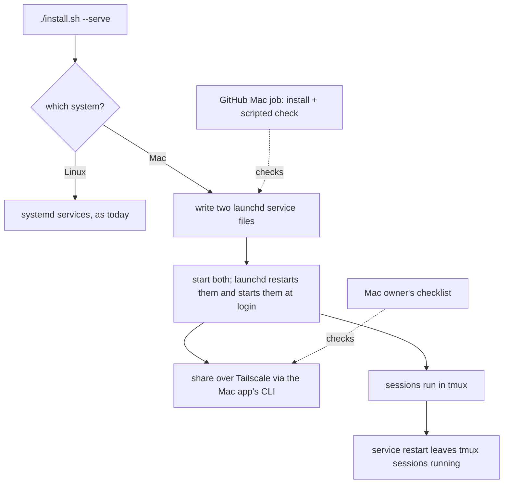

# Run wheelchair on a Mac

**Idea:** `IDEA.md` — what this is for and why, in plain language. Read it first; it is
the north star this plan serves. Goal and Constraints live there, not here, so they don't
get buried as this file grows.

## Open Questions

None.

## Watch List

| # | Noticed | What needs looking into | Raised to user? | Outcome |
|---|---------|-------------------------|-----------------|---------|
| 1 | Tailscale's Mac app ships a CLI inside the app bundle, not on PATH | Whether `tailscale serve` with the HTTPS mappings the installer writes works from the Mac app variants | no | Settled: CLI lookup is Decision 8; whether serve works is item 2 of the friend's checklist and an Accepted Risk |

## Decision Log

| # | Decision | Rationale | Source |
|---|----------|-----------|--------|
| 1 | Scope: the Mac runs sessions and serves the app over Tailscale; no sudo helper on the Mac | Collin's pick; the root helper is the hardest port and can be its own thread | user |
| 2 | Services on macOS are launchd LaunchAgents in `~/Library/LaunchAgents`, loaded with `launchctl bootstrap gui/<uid>`, `KeepAlive` and `RunAtLoad` on | The macOS equivalent of systemd user units; runs under the logged-in user per IDEA "Not doing" | defaulted |
| 3 | The machine LaunchAgent sets `AbandonProcessGroup` so a service restart leaves tmux sessions alone | Same guarantee `KillMode=process` gives on Linux (`install.sh:313-322`) | defaulted |
| 4 | `codex/preflight.sh` takes its lock in Python `fcntl.flock`, on every platform | `flock` is missing on macOS; `codex/model.sh` already does this; one code path | defaulted |
| 5 | `sensitivity/set.sh` is rewritten to run on bash 3.2 (no associative arrays) | Adds no Homebrew dependency for the service's PATH | defaulted |
| 6 | `machine/lib/aside-turns.js` uses `ps` where `/proc` is absent; Linux keeps `/proc` | Smallest change; Linux behavior untouched | defaulted |
| 7 | With no flag, a Mac keeps today's behavior: not serving unless `--serve` is passed | A Mac usually has a display, like a desktop; the README tells Mac servers to pass `--serve` | defaulted |
| 8 | The installer finds Tailscale's CLI on PATH or inside `/Applications/Tailscale.app` | The Mac app does not put it on PATH by default | defaulted |
| 9 | The installer does not change power settings; the README covers keeping the Mac awake | Changing sleep needs sudo and is the owner's call | defaulted |
| 10 | Mac testing: a new GitHub Actions macOS job runs on every PR; Collin's friend (the Mac user) then tries only Tailscale, phone access and Claude accounts by checklist | Collin has no Mac; the repo is public so hosted macOS runners are free | user |
| 11 | Multiple Claude accounts on a Mac: build as if each `CLAUDE_CONFIG_DIR` keeps its own Keychain login; the friend checks it; a shared login becomes its own thread | Collin's pick; the friend likely uses one Claude account | user |
| 12 | On macOS the installer skips the sudo-helper hint and says sudo cards aren't available on a Mac | The helper is out of scope (Decision 1); the hint would point at a Linux-only installer | defaulted |

## Spec



The diagram repeats sections 1, 2, 6 and 7 below.

### Goal and boundary
Make macOS (Apple Silicon and Intel, current macOS) a serving wheelchair machine: `./install.sh --serve` installs the viewer and machine services under launchd, sessions (Claude and GPT) start and survive a machine-service restart, Settings → Diagrams works, and the README documents it. Linux behavior, flags, file paths and output stay byte-for-byte as today except where a line below says otherwise. The sudo helper is untouched and unsupported on a Mac.

Platform test everywhere: `uname -s` = `Darwin` (shell) / `process.platform === 'darwin'` (Node). No other platform is added.

### 1. Installer (`install.sh`)
- **bash 3.2.** `install.sh` must run under `/bin/bash` 3.2 with `set -euo pipefail`. In particular, expanding an empty array under `set -u` (`"${a[@]}"`) is an error before bash 4.4: guard such expansions (`${a[@]+"${a[@]}"}`). No `declare -A`, `mapfile`, `${x,,}`, `&>>`, namerefs. No GNU-only tool flags (`sed -i` without a suffix argument, `stat -c`, `readlink -f`, `sha256sum`, `date -d`, `grep -P`, `find -printf`, `xargs -r`, `timeout`, `base64 -w`).
- **Tailscale CLI lookup.** A function `tailscale_cli` prints the command to use: `tailscale` if on PATH; else, on Darwin only, `/Applications/Tailscale.app/Contents/MacOS/Tailscale` if executable; else fails. Every installer call to `tailscale` (machine_host, served_origin, tailscale_mapping_states, configure_tailscale_serve, the "run later" lines in disable_service) goes through it. On Darwin the serve commands it runs or prints carry no `sudo` (the Mac app's CLI talks to the app as the user); Linux keeps `sudo tailscale ...` exactly.
- **Platform seams (tests only).** Every platform decision in `install.sh` reads a function `platform` that prints `${WHEELCHAIR_PLATFORM:-$(uname -s)}`, and the systemd check uses `${WHEELCHAIR_SYSTEMD_RUN_DIR:-/run/systemd/system}` instead of the literal path. Both variables are documented beside `WHEELCHAIR_TTY` as testing seams; unset, production behavior is exactly today's on Linux.
- **`platform_supports_serving`** is true on Linux as today, or on Darwin when `launchctl` is on PATH.
- **Darwin service setup** (in `configure_service`, after the serving decision is written, in place of the systemd unit/linger block; the Linux branch is unchanged):
  - Two LaunchAgent property lists in `$HOME/Library/LaunchAgents/`: `com.wheelchair.viewer.plist` and `com.wheelchair.machine.plist`, written with mode 644. Paths are installer variables next to `unit_file`/`machine_unit_file`.
  - Both: `Label` exactly `com.wheelchair.viewer` / `com.wheelchair.machine` (the file name without `.plist`; every `launchctl` call in this Spec uses these labels); `ProgramArguments` = node's absolute path (`command -v node`) then the script and args (viewer: `$ROOT/viewer/server.js --service`; machine: `$ROOT/machine/service.js`); `RunAtLoad` true; `KeepAlive` true; `ThrottleInterval` 5; `WorkingDirectory` `$HOME`; `StandardOutPath`/`StandardErrorPath` `$HOME/Library/Logs/wheelchair/<viewer|machine>.log` (the directory is created); `EnvironmentVariables` with `PATH` = the same `service_path` the Linux machine unit gets (CLI dirs first, then the installer's PATH) and `HOME`. The viewer also gets `WHEELCHAIR_NO_BROWSER=1`. The machine plist also has `AbandonProcessGroup` true (the launchd form of `KillMode=process`: on stop, launchd kills only the service, not tmux or sessions it started).
  - XML-escape every interpolated value (`&`, `<`, `>`); paths with those characters must still produce valid plists. Validate each written file with `plutil -lint` and fail the setup with a message naming the file if it is invalid.
  - Load: for each label, `launchctl bootout gui/$(id -u)/<label>` (ignore failure: not loaded), then `launchctl bootstrap gui/$(id -u) <plist>`. On a bootstrap failure, print `viewer: could not start <label>: <launchctl output>` to stderr and continue to the next. Rerunning the installer reloads both (that replaces the Linux `restart`).
  - No linger. Instead print once: `viewer: on macOS the services run while you are logged in; to keep this Mac serving, turn on automatic login and stop it sleeping (see README, "On macOS")`.
  - Then `configure_tailscale_serve` and `node viewer/server.js --url` as on Linux.
- **Darwin `disable_service`:** for each label, `launchctl bootout gui/$(id -u)/<label>` (ignore failure) and remove the plist; the rest (serving file, mapping "run later" lines, without `sudo` on Darwin) as on Linux.
- **First-run default** unchanged: a Mac counts as having a display, so no flag means not serving (Decision 7).
- **Sudo-helper hint** (`install.sh:56-58`): on Darwin print `sudo helper: not available on macOS; sudo cards won't work on this machine` instead.
- **Stale viewer stop** and every other step are unchanged; if one turns out to call a Linux-only command, it gets a Darwin branch under the same rules.

### 2. Machine service (`machine/service.js`, `machine/lib/aside-turns.js`)
- `machine_host`-equivalent in `service.js:115-117`: try `tailscale ip -4`; on Darwin, if `tailscale` is not on PATH, try `/Applications/Tailscale.app/Contents/MacOS/Tailscale ip -4`; else loopback, as today.
- Session start (`service.js:493-501`): on Darwin skip `systemd-run` and run `tmux` directly (the fallback already exists; skip the failing attempt). Restart survival on a Mac comes from `AbandonProcessGroup` plus tmux daemonizing its server.
- `aside-turns.js` `proc` keeps the `/proc` implementation when `/proc` exists (checked once at load). Otherwise:
  - `start(pid)`: the process start time from `ps -o lstart= -p <pid>` (trimmed; null on failure). Values are compared only with values from the same function, so the format is free.
  - `marked(id)`: pids whose environment contains `WHEELCHAIR_ASIDE_TURN=<id>`, from `ps -E -ww -o pid=,command= -A` (BSD `ps -E` appends the environment to the command), matching the exact `WHEELCHAIR_ASIDE_TURN=<id>` token bounded by whitespace or end of line; empty array on failure. Never throws.
  - `kill(pid)`: the process group from `ps -o pgid= -p <pid>`; then `process.kill(-group, 'SIGKILL')` with the same ESRCH handling; return quietly when the group can't be read.
  - All `ps` calls use `execFileSync` with a 5 s timeout and no shell.
- `viewer/server.js:1912-1930` (`harnessLabel`) is left as is: it already falls back when `/proc` is missing.

### 3. GPT preflight (`codex/preflight.sh`)
- Remove `exec 9>"$lock"` / `flock 9`. The embedded Python opens `$lock` (creating it, mode 600) and holds `fcntl.flock(fd, LOCK_EX)` around everything it does now: the re-read, the token exchange and the atomic write-back. Exit codes, output, `CODEX_HOME` handling and the margin variable are unchanged. Same code on Linux and macOS.
- `codex/model.sh` and `codex/preflight.sh` must otherwise run under bash 3.2 and BSD tools.

### 4. Diagram setting writer (`sensitivity/set.sh`)
- Replace the associative arrays (`state levels starts ends start_lines end_lines`, `output backup existed`) with bash-3.2 structures: an indexed array of paths and parallel indexed arrays, with a small `index_of <path>` helper (the key set is at most the source file plus each harness target, so linear lookup is fine). Behavior, messages, exit codes, `--json`/`--report` output and file results are unchanged.
- The whole script must run under `/bin/bash` 3.2 with `set -euo pipefail` (same empty-array rule) and BSD tools.
- `sensitivity/test/run.sh` is ported the same way (no `declare -A`, `sed -i` replaced with a portable write-to-temp-then-move helper, `sha256sum` replaced with a helper that uses `sha256sum` or falls back to `shasum -a 256`) and passes on Linux and on the Mac job.

### 5. Test suites that must pass on the Mac job
The Mac job (section 7) runs these; each must pass on Linux too:
- `bash sensitivity/test/run.sh` (ported per section 4).
- `bash codex/test/run.sh` (port any bash-4/GNU use found in it; it covers preflight).
- `bash install/test/run.sh`: ported to bash 3.2 (its `declare -A` at `:57`, `sort -z`, `stat -c`, `sha256sum` at `:35-41,562`), with every existing case pinned to Linux (`WHEELCHAIR_PLATFORM=Linux`, `WHEELCHAIR_SYSTEMD_RUN_DIR` pointing at a directory the fixture creates, so it passes on a Mac without systemd) and new Darwin cases (`WHEELCHAIR_PLATFORM=Darwin`) with `launchctl` and `plutil` shims that record calls: `--serve` writes both plists with the fields above and bootstraps both labels; rerun boots out then bootstraps again; `--no-serve` boots out and removes both plists; the Tailscale app-path fallback is used when `tailscale` is not on PATH, and its serve commands have no `sudo`; the Darwin sudo-helper line is printed. Existing Linux cases keep passing unchanged.
- `node --test machine/test/aside-turns.test.js`, with new cases for the `ps` implementation (forced by an injectable "no /proc" switch, not by platform), including `load()` recovery not throwing.
Other suites (viewer browser tests, smoke, sudo-helper, the rest of `machine/test`) are not required to pass on the Mac and are not run there.

### 6. Mac end-to-end check (`test-support/macos/check.sh`)
A new script, Mac-only (exits 2 with a message on any other platform), run by the Mac job after the real install. Using only the running services and the machine's own secret (the file named by `secret_file` in `~/.local/state/wheelchair/machine.json`, normally `~/.local/state/wheelchair/machine.secret`; header `x-wheelchair-machine-secret`):
1. Both labels are loaded: `launchctl print gui/$(id -u)/com.wheelchair.viewer` and `.machine` succeed.
2. The viewer answers on `http://127.0.0.1:7373/wheelchair` and the machine on `GET /v1/status` (port 7374, with the secret), retrying up to 60 s.
3. Start a session through `POST /v1/sessions` (role `worker`, cli `claude`, a throwaway git repo as `worktree`) with a fake `claude` placed first on the service's PATH by the job before install. The fake answers `--version` (prints `0.0.0-fake`, exits 0) and any `auth ...` call (exits 0) at once, because `/v1/status` runs them synchronously (`machine/service.js:938-942`, `machine/adapters/common.js:16`); any other invocation prints a line and sleeps. Wait until `tmux has-session -t <name>` succeeds.
4. `launchctl kickstart -k gui/$(id -u)/com.wheelchair.machine`; wait for `/v1/status` again; the tmux session from step 3 still exists.
5. Kill the machine service's process with SIGKILL; within 30 s it answers again (KeepAlive).
6. `GET /v1/diagram-sensitivity` returns 200; `POST` it with the level it reported returns 200.
7. `bash codex/preflight.sh` with `CODEX_HOME` pointing at a temp dir holding a fake `auth.json` whose access token expires in 30 days exits 0 (no network: the token is within margin).
It prints one line per step and exits non-zero on the first failure, naming the step. It stops the session it started; it removes nothing else.

### 7. Mac CI job (`.github/workflows/macos.yml`)
- Triggers: `pull_request` and `push` to `main`. `runs-on: macos-latest`. Read-only `contents` permission. Timeout 30 minutes.
- Steps: checkout; `actions/setup-node` with Node 20; `brew install tmux`; put a shim directory first on PATH where `bash` links to `/bin/bash`, and assert `bash --version` reports 3.2 and `sed --version` fails (BSD sed); run the section 5 suites; install the fake `claude` (section 6) and a fake `tailscale` that answers `status --json` with a `DNSName`, `ip -4` with `127.0.0.1`, and records and accepts `serve` calls; run `./install.sh --serve` (the checkout is a normal clone, so the canonical-clone guard passes; set `PLAYWRIGHT_SKIP_BROWSER_DOWNLOAD=1` or the installer's existing equivalent if one exists, so browsers aren't downloaded; if neither exists, let it download); run `test-support/macos/check.sh`; on failure, print `~/Library/Logs/wheelchair/*.log`.
- No secrets, no Tailscale account, no real CLI logins.

### 8. Docs
- `README.md`: an "On macOS" section beside "On Windows": what to install (Xcode command line tools for git and python3, Homebrew, `brew install node tmux`, the Tailscale Mac app, Claude Code and/or Codex), `./install.sh --serve`, where logs are, that services run only while logged in (turn on automatic login in System Settings → Users & Groups), how to stop sleep (`sudo pmset -a sleep 0 disksleep 0` or System Settings → Energy, "Prevent automatic sleeping"), that sudo cards don't work on a Mac, and that a second Claude account may share the first one's login (check below). Update the platform line at `README.md:24` and the systemd mentions at `:121`, `:134` to cover launchd.
- `AGENTS.md` (root) and `CONTRIBUTING.md`: mention launchd next to systemd where the install/services are described, list `test-support/macos/` and `.github/workflows/macos.yml` in the routers.
- A friend checklist, `docs/plans/macos-support/MAC-CHECKLIST.md`, short and plain, for the Mac owner: (1) install per README and `./install.sh --serve`; (2) the Tailscale serve mappings are set and the app opens at the printed URL from a phone; (3) start a thread with a Claude session and with a GPT session from the phone; (4) reboot, log in, and the app is back; (5) if two Claude accounts are used: sign both in from Settings, then run `security dump-keychain | grep -c "Claude Code-credentials"` and check that both accounts still show as logged in after starting a session on each; report the result.

### Non-goals
- The sudo helper on macOS; any change to `sudo-helper/`.
- Running when no user is logged in (LaunchDaemons).
- Making viewer browser tests, smoke suites, sudo-helper tests or the rest of `machine/test` pass on a Mac.
- Changing power settings or Tailscale configuration beyond what Linux already does.
- Fixing Claude Keychain sharing (Decision 11).

### Validation
On Linux (this machine), all unchanged in result:
```bash
bash sensitivity/test/run.sh
bash codex/test/run.sh
bash install/test/run.sh
bash machine/test/run.sh
node --test test-support/test/*.test.js
node --test viewer/test/*.test.js
```
On the Mac job: green on the pull request, including `test-support/macos/check.sh`.
`bash -n` and `shellcheck` (if installed) on every changed shell file.

## Accepted Risks

| Risk | Why accepted | Round |
|------|--------------|-------|
| A second Claude account on a Mac may share the first one's Keychain login and log it out | Collin's choice (Decision 11); the friend checks it; fix is its own thread | planning |
| Whether `tailscale serve` from the Mac app works with the installer's mappings is untested until the friend tries it | No Tailscale account in CI; checklist item 2 | planning |
| A `sudo` card posted on a Mac fails with the existing "helper unreachable" 503 | Helper is out of scope (Decision 1); the README says so | planning |

## Review Rounds

### Round 1 — 2026-11-16

**Lanes:** intent / gpt; mechanics / gpt (claude unavailable); cross-family: no.

**Changed since Round N-1:** n/a (first round — whole Spec in scope)

| Lane | Reported | Finding | Lead verdict | Resolution |
|------|----------|---------|--------------|------------|
| mechanics/gpt | major | LaunchAgent `Label` ambiguous (file name includes `.plist`) | upheld | Exact labels stated in section 1 |
| mechanics/gpt | major | Fake `claude` sleeps on `--version`/`auth status`, which `/v1/status` runs synchronously (`service.js:938-942`, `common.js:16`) | upheld | Fake answers those at once; section 6 step 3 |
| mechanics/gpt | major | Installer fixture Linux cases can't run on a Mac: `platform_supports_serving` reads `uname` and `/run/systemd/system` directly (`install.sh:210-212`) | upheld | `WHEELCHAIR_PLATFORM` / `WHEELCHAIR_SYSTEMD_RUN_DIR` seams; existing cases pinned to Linux |
| mechanics/gpt | minor | Secret path in section 6 wrong; installer writes `~/.local/state/wheelchair/machine.secret` (`install.sh:14-17`) | upheld | Read via `machine.json` `secret_file` |

### Round 2 — 2026-11-16

**Lanes:** intent / gpt; mechanics / gpt (claude unavailable); cross-family: no. Both lanes: no findings.

**Changed since Round 1:** exact LaunchAgent labels (section 1); installer platform seams `WHEELCHAIR_PLATFORM`, `WHEELCHAIR_SYSTEMD_RUN_DIR` and fixture cases pinned to Linux (sections 1, 5); fake `claude` answers `--version`/`auth` at once (section 6 step 3); secret path read from `machine.json` (section 6).

| Lane | Reported | Finding | Lead verdict | Resolution |
|------|----------|---------|--------------|------------|

## Prior Work

| Spec item | State | Evidence (file:line) | Confidence |
|-----------|-------|----------------------|------------|

## Implementation Tasks

| # | Objective | Ownership boundary | Lane | Session id | Validation | Status |
|---|-----------|--------------------|------|-----------|------------|--------|
| T1 | Spec 1 installer + install/test/run.sh port, Darwin cases (Spec 5) | install.sh, install/test/ | standard / gpt-6.1-terra medium | wc-cb4717eb2af5-worker | bash install/test/run.sh; bash -n; shellcheck | dispatched |
| T2 | Spec 2 machine service Tailscale/tmux on Darwin, aside-turns ps impl + tests | machine/service.js (2 spots), machine/lib/aside-turns.js, machine/test/aside-turns.test.js | standard / gpt-6.1-terra medium | wc-cb4717eb2af5-worker-2 | node --test machine/test/aside-turns.test.js; bash machine/test/run.sh | dispatched |
| T3 | Spec 3 preflight lock in Python fcntl; codex scripts bash 3.2; test port | codex/preflight.sh, codex/model.sh, codex/test/ | standard / gpt-6.1-terra medium | wc-cb4717eb2af5-worker-3 | bash codex/test/run.sh | dispatched |
| T4 | Spec 4 set.sh without associative arrays; test port | sensitivity/set.sh, sensitivity/test/ | standard / gpt-6.1-terra medium | wc-cb4717eb2af5-worker-4 | bash sensitivity/test/run.sh; bash machine/test/run.sh | dispatched |
| T5 | Spec 6 check.sh + fakes; Spec 7 macos.yml | test-support/macos/, .github/workflows/macos.yml | standard / gpt-6.1-terra medium | wc-cb4717eb2af5-worker-5 | bash -n; shellcheck; check.sh exits 2 on Linux; YAML parse | dispatched |
| T6 | Spec 8 README macOS section, routers, MAC-CHECKLIST.md | README.md, AGENTS.md, CONTRIBUTING.md, docs/plans/macos-support/MAC-CHECKLIST.md | standard / gpt-6.1-terra medium (asked claude; hub: claude unavailable) | wc-cb4717eb2af5-worker-6 | git diff --stat; grep launchd | dispatched |

## Log

- 2026-11-16 — Prior Work: none; every Spec item is new in this run.
- 2026-11-16 — Deviation (temporary): macos.yml also triggers on push to `wc/**` so the Mac job can run before a PR exists; removed before the build result.
