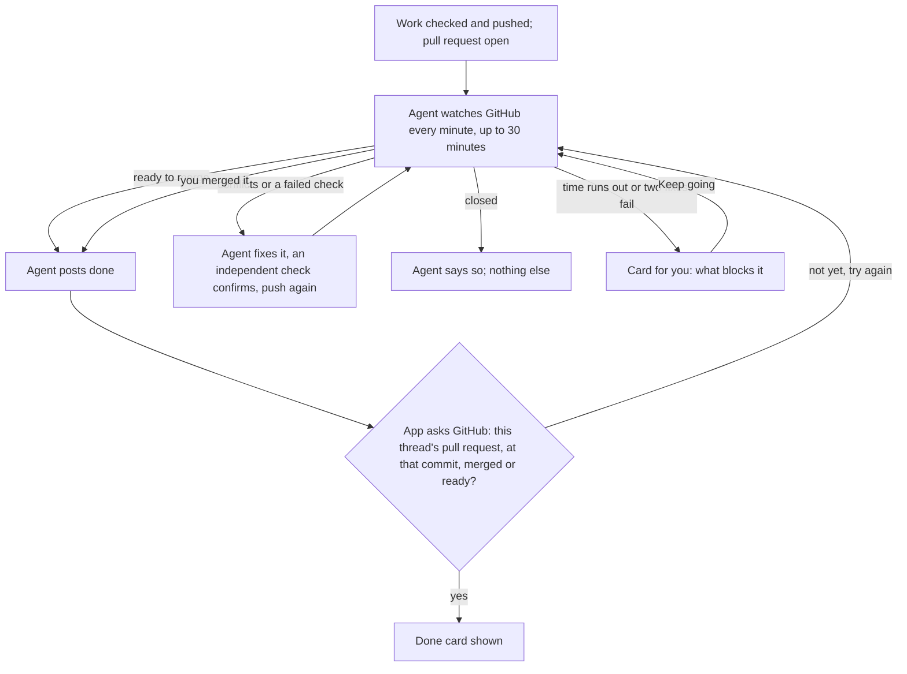

# Pull requests are mergeable before work is called done

**Idea:** `IDEA.md` — what this is for and why, in plain language. Read it first; it is
the north star this plan serves. Goal and Constraints live there, not here, so they don't
get buried as this file grows. Code map: `MAP.md` and `docs/maps/pr-finishing.md`.

## Open Questions

(none)

## Watch List

| # | Noticed | What needs looking into | Raised to user? | Outcome |
|---|---------|-------------------------|-----------------|---------|
| 1 | A `done` card spooled during a hub outage is acked to the agent, then a later 4xx goes to rejected storage (`machine/service.js:883-888,911-923`) | How a gate refusal reaches the lead in that case | no | Settled: Decision 37 (no queuing of `done`) |
| 2 | After-done fix on an already-merged PR still posts `done` (`protocol/app/lead.md:354-357`) | Gate must not refuse that case | no | Settled: Decision 8 |

## Decision Log

Append-only. A reversal is a new entry superseding the old, never an edit.

| # | Decision | Rationale | Source |
|---|----------|-----------|--------|
| 1 | In a feature build, the sub-lead fetches and merges `origin/<default branch>` into the thread branch, resolving conflicts, before its final verification, so the verifier checks the merged result | The builder knows the code best; conflicts surface before verification instead of after | defaulted |
| 2 | After pushing, the lead waits for the PR's checks. A conflict or failing check found then is fixed by the lead like an after-done fix: commit, fresh verifier, two attempts, then a `question` card to Collin (push as is, or drop) | Reuses the existing after-done fix loop (`protocol/app/lead.md:333-359`) rather than inventing a new one | defaulted |
| 3 | A PR with no checks configured counts as passing checks | Repos without CI must still be able to finish | defaulted |
| 4 | If checks have not finished after 30 minutes (the workflow's job timeout, `.github/workflows/macos.yml`), the lead posts a `needs` card instead of waiting silently | IDEA constraint: GitHub slow or down must not leave a thread silently stuck | defaulted |
| 5 | Main moving on after `done` is not chased; mergeability is checked at the moment of `done` | Otherwise a thread never ends; the merged notice and after-done flow already cover later work | defaulted |
| 6 | The app enforces it: the hub refuses a `done` card unless GitHub reports the PR free of conflicts with passing checks; the protocol rule stays as well | Collin: agents must do this "to be able to mark its work done"; only the app can guarantee it | user |
| 7 | Whenever the hub refuses a `done` card on the gate, it also sends the posting lead a `[wc:from app]` message with the reason, so a card refused after sitting in the machine spool is not lost silently | A spooled card is acked 202 and a later refusal only moves it to rejected storage (`machine/service.js:883-888,911-923`) | defaulted |
| 8 | A PR whose state is `MERGED` passes the gate | The after-done flow posts `done` for a fix that landed in a merge race (`protocol/app/lead.md:354-357`); conflicts and checks no longer matter once merged | defaulted |
| 9 | The gate also checks the `pr_url` is this thread's PR (head branch `wc/<thread-id>`), and that `mergeable` is known: GitHub's `UNKNOWN` (still computing) refuses with "try again in a minute" | Prevents a done card pointing at someone else's green PR; `UNKNOWN` is transient | defaulted |
| 10 | No override: a refused `done` card leaves the thread open; the lead tells Collin with a `needs` card and retries | Collin picked "No override"; `done` is only a notice and the PR can be merged regardless | user |
| 11 | Supersedes D1: the sub-lead does not merge main before verification; conflicts are found after the push and fixed by the lead's loop (D2), with a fresh verifier on the merge result | IDEA "Not doing" excludes changing how work is built before the push; D2 already meets "checked again before done" | review-round-1 |
| 12 | Supersedes D2's final step: before `done`, a fix that fails its check twice goes straight to a `needs` card, not the push-as-is/drop question | Neither answer lets `done` through the gate | review-round-1 |
| 13 | The gate checks identity (head branch `wc/<thread-id>`, base = thread's default branch) before the MERGED exception | A merged unrelated PR must not pass; the random thread id makes the branch name a sufficient binding | review-round-1 |
| 14 | Empty rollup passes only when the repo has no workflow files at the PR head; otherwise "no checks have started yet" | Empty can mean CI has not registered yet | review-round-1 |
| 15 | Checks are de-duplicated by workflow+name (or status context), latest run wins; 100+ entries refuse | Re-runs; gh reads only the first 100 | review-round-1 |
| 16 | `wc.js git commit` completes a merge in progress: add the paths, then commit without a pathspec | Git refuses a path-limited commit during a merge (`machine/service.js:993`) | review-round-1 |
| 17 | The lead watches with `gh pr view` every minute using the gate's rules, handling MERGED-while-watching by step 9's head comparison | `gh pr checks --watch` lacks mergeability and fails on no checks | review-round-1 |
| 18 | `status: done` stays committed before the push; a restarted lead resumes the watch when no `done` card was accepted | PR must carry the status; avoids a second push and CI run | review-round-1 |
| 19 | Gate runs outside the thread lock; a refusal re-reads under the lock before enqueueing; the machine's card relay waits 30 s | `hub.acceptCard` holds `withThread` (`viewer/app/hub.js:143`); machine relay times out at 5 s (`machine/service.js:183`) | review-round-1 |
| 20 | Gate and lead judge readiness by GitHub's `mergeStateStatus`, not by re-implementing check rules; supersedes D9's `mergeable` use and D15 | Round 2: test-merge-commit checks, re-run de-dup and same-name collisions are GitHub's to resolve; the lead's rules stay short | review-round-2 |
| 21 | Supersedes D14: empty checks pass only on positive evidence of zero active workflows (`actions/workflows`); any error refuses | A 404 can mean no access, not absence | review-round-2 |
| 22 | `done` carries a required `head` (pushed commit); the gate refuses when the PR's head differs, merged or not | Closes the merge race where a different head was merged | review-round-2 |
| 23 | Supersedes D19's details: snapshot via `hub.state.thread`; refusal rechecks `delivered_ids` under the lock; gh 8 s per call, card relay 45 s | `hub.thread` can save; concurrent spool drain; two gh calls | review-round-2 |
| 24 | Supersedes D17: the lead waits with one foreground poll command (≤10 min each) on `state`/`mergeStateStatus`/failed checks, and posts `done`; the gate is the only judge; transient refusals stay in the window | Intent round 2: the lead can't mirror the gate's rules | review-round-2 |
| 25 | A repair's verifier is briefed with Collin's request (small fix) or the plan's Spec, plus what the repair changed | Small fixes have no plan | review-round-2 |
| 26 | Supersedes D12: two failed repair attempts (verifier fail or still red/conflicting after push), an ended 30-minute window, or a credentials refusal → `needs` card; Keep going resets | Every path ends in a card, never silent | review-round-2 |
| 27 | Supersedes D18's restart signal: waiting = pushed branch tip differs from the latest accepted `done` card's `head` | Works for small fixes and after-done pushes | review-round-2 |
| 28 | `BLOCKED` with every check passed is accepted; with any check not passed, refused | IDEA asks for no conflicts and passing checks; a required review is Collin's to clear | review-round-3 |
| 29 | One gate evaluation per `delivery_id` at a time; a concurrent duplicate awaits it | Both orderings of a direct relay racing a spool drain | review-round-3 |
| 30 | Spool drain marks `from_spool`; an accepted spooled `done` sends the lead an "accepted" message; `card.js` prints the response body | The lead must tell accepted from pending | review-round-3 |
| 31 | Workflow listing uses `--paginate` | Active workflow on a later page | review-round-3 |
| 32 | `head` is the remote branch tip read after a successful push, never local `HEAD` | A restart after an unpushed commit must not submit it | review-round-3 |
| 33 | The lead decides a check failed only from `gh pr checks --json name,bucket` showing `fail`/`cancel`; gh errors and empty lists never start a repair | `gh pr checks` exit 1 also means no checks or an API error | review-round-3 |
| 34 | Closed while waiting → step 9's CLOSED rule; head changed while open → step 9's updated-branch merge, re-verify, new window | Every exit of the wait has a next step | review-round-3 |
| 35 | Supersedes D27: restart checks local unpushed commits first, then PR state; CLOSED, missed-merge with an existing stub, and legacy `done` without `head` are not waiting | Avoid re-posting `done` or duplicate stubs | review-round-3 |
| 36 | Lighter enforcement: the app asks GitHub once whether this thread's PR at the pushed commit is merged or ready to merge; rare cases become accepted risks | Collin picked "Lighter enforcement" after four review rounds of gate edge cases | user |
| 37 | `done` cards are never spooled: the machine relays directly (30 s) and answers 503 "try again" when the hub is unreachable or other cards are queued. Supersedes D7, D19's relay part, D23's message part, D29, D30 | Removes delivery tracking; the lead retries inside its window | user (via D36) |
| 38 | Supersedes D24/D33/D34: the lead's section as written in the Spec (poll `gh pr view` incl. `statusCheckRollup`; no `gh pr checks --json`, absent in gh 2.46.0) | Simpler; works with the installed gh | user (via D36) |
| 39 | Supersedes D14/D21: no workflow probe; the lead waits 5 minutes after a push before treating "no checks" as ready | Keeps the gate to one call | user (via D36) |
| 40 | Someone else's push to the branch is merged, re-verified and pushed without counting toward the budget or resetting the window | Bounded by the window | review-round-4 |
| 41 | Supersedes D35: restart resumes the wait when finishing and no `done` card names the PR head; unaccounted local commits go to Collin as a question, an unfinished merge is aborted | Simple, never pushes unknown work | user (via D36) |
| 42 | The hub validates a `done` card's schema before the gate; an invalid card skips the gate | Gate must never read a missing `head` | review-round-5 |
| 43 | One retry rule for every `done` post, naming each refusal reason's next step | Merged path and not-ready refusals had no action | review-round-5 |
| 44 | Merged at a later commit that contains the pushed one counts as landed; `done` uses the merged head | "Update branch" then merge is not a missed fix | review-round-5 |
| 45 | A repair that fails its verifier is fixed again locally and re-verified, never pushed or polled; a failed verifier after someone else's push → `needs` card | Defines the next action after a failed verification | review-round-5 |
| 46 | After `wc.js git merge`, commit only when it reported conflicts | A clean merge already commits | review-round-5 |
| 47 | Failed-check diagnosis: Actions run id from `detailsUrl`; non-Actions checks via their URL, else `needs` card | The poll returns no run id | review-round-5 |
| 48 | Restart resumes only for an `OPEN` PR | A merged or closed PR has nothing left to finish | review-round-5 |
| 49 | Merged-at-another-commit: fetch `pull/<n>/head`; exit 1 → stub (once); lookup failure → `needs` card, never a stub | Squash-merge and deleted branches | review-round-6 |
| 50 | Any failed check the lead can't diagnose → `needs` card | Logs may be unavailable | review-round-6 |
| 51 | The window's deadline is an accepted `done`, not "ready" | A ready PR during a hub outage must still end in a card | review-round-6 |
| 52 | Supersedes D48: restart handles `MERGED` (no `done` naming its head) via item 4; `CLOSED` → nothing | A PR merged mid-wait still gets its `done` and merged notice | review-round-6 |
| 53 | Restart reconciles an advanced PR branch via item 6 before polling | Keeps verification on the real tip | review-round-6 |
| 54 | Step 9 item 4's PR-state handling is replaced by the new section | One rule per case | review-round-6 |
| 55 | Merged-missed (stub inline in item 4) and Closed end the wait without a `needs` card | Those outcomes are final | review-round-7 |
| 56 | Resolve the finishing `needs` card only if still open | "Keep going" already closes it | review-round-7 |
| 57 | Supersedes D53's order: restart aborts an unfinished merge, then asks Collin about unpushed local commits, then uses the local tip as the pushed commit and reconciles via 4/6 | Never pushes unknown work; gives the merged path a pushed commit | review-round-7 |
| 58 | The merged path ends only on an accepted `done` or a posted stub; transient refusals retry, and a window ending there gets the `needs` card | No path ends without a card | review-round-8 |
| 59 | Conflicts from merging someone else's push are resolved as in item 7; every `wc.js git` result's `ok` is checked | Wrapper returns git failures with exit 0 | review-round-8 |
| 60 | Supersedes D57: restart reads PR state first; MERGED decides landed vs missed from the local tip; the unpushed-commits question applies only to an OPEN PR and says where to resume | Missed-merge stub reachable after restart; no pointless question | review-round-8 |
| 61 | Supersedes D41/D57/D60: restart handles only the plain cases (done already names the tip; tip equals PR head) and asks Collin with a `question` card for anything else | Rounds 5-9 kept finding restart corner cases; the lighter design (D36) accepts rare cases | review-round-9 |
| 62 | A `wc.js git` failure other than a conflict: retry once, then the `needs` card | Every git failure has a next step | review-round-9 |
| 63 | Restart: uncommitted changes other than an unfinished merge go to Collin's question first | Never leave a half-made fix silently | review-round-10 |
| 64 | Restart's not-waiting test: a `done` whose `head` contains the local tip, a legacy `done`, or a closed PR | Avoid spurious questions and duplicate `done` | review-round-10 |
| 65 | "Keep going" on a git-failure `needs` card redoes the failed operation first | A push or PR creation can fail before a PR exists | review-round-10 |
| 66 | Restart's uncommitted-change check ignores untracked files | Scratch and test output are common | review-round-11 |
| 67 | The git-failure rule applies only within the new section and the push/PR that start it | IDEA non-goal: nothing before the push changes | review-round-11 |
| 68 | A non-fast-forward push rejection fetches and goes through item 6 before pushing again | Retrying the same push can never succeed | review-round-11 |
| 69 | The git-failure `needs` card before a PR exists says nothing was pushed and Keep going retries | The usual wording mentions merging a PR that doesn't exist | review-round-11 |
| 70 | During the first 5 minutes after a push with no checks, the poll keeps polling instead of stopping on a ready state | Avoids a tight loop of GitHub calls | review-round-12 |
| 71 | A rejected starting push merges, verifies if needed, pushes, opens the PR if missing; the window starts at the successful push | Item 6 assumes an existing PR | review-round-12 |
| 72 | The pre-PR `needs` card names what failed: the push, or opening the PR | PR creation runs after a successful push | review-round-12 |
| 73 | One window rule: a successful push of your new commits starts a new 30-minute window; others' fast-forwards don't; Keep going and restart start one; the 5-minute no-checks grace counts from the window start | Competing deadlines; pushes not by the lead | review-round-13 |
| 74 | "Keep going" resumes where the `needs` card was posted; an unverified local repair returns to fix-and-verify | Never poll or post `done` for a stale commit | review-round-13 |
| 75 | Pushes use `wc.js git push -u origin HEAD:wc/<thread-id>` | Thread branches have no upstream | review-round-13 |

## Spec

### Goal in one line

A `done` card is accepted only for this thread's pull request, at the commit the lead pushed,
when GitHub says it is merged or ready to merge. Agents are told to get it there themselves.
This is the lighter enforcement Collin chose (D36): one question to GitHub, no queuing of
`done` cards, rare cases written down as accepted risks rather than handled in code.

### The flow

### GitHub's merge state

`gh pr view <url> --json mergeStateStatus` (works in the installed gh 2.46.0) gives GitHub's own
judgement for an open PR:

| `mergeStateStatus` | Meaning here |
|---|---|
| `CLEAN`, `HAS_HOOKS` | Ready: no conflicts, checks passing |
| `DIRTY` | Conflicts with the base branch: repair |
| `BEHIND` | Base moved and the repo requires up-to-date branches: merge base in (a repair) |
| `UNSTABLE` | Some check pending or failed: wait, or repair a failure |
| `BLOCKED` | A branch rule blocks it. Ready if no check is pending or failed (the block is then a rule only Collin clears, such as a required review) |
| `UNKNOWN`, `DRAFT`, other | Not ready yet: wait |

A **check** is an entry of `statusCheckRollup`. It is *failed* when it is a CheckRun with
`status === 'COMPLETED'` and `conclusion` not in `SUCCESS`, `NEUTRAL`, `SKIPPED`, or a
StatusContext with `state` `FAILURE` or `ERROR`; *pending* when a CheckRun's `status` is not
`COMPLETED` or a StatusContext's `state` is `PENDING` or `EXPECTED`; otherwise *passed*.

### Part A: code

**1. `done` card field (D22).** `head`: required, the full commit id the lead pushed
(`/^[0-9a-f]{40}$/`). Add to `card.js`'s `done` schema (`viewer/app/card.js:116-122`).

**2. `done` cards are never queued (D37).** In the machine's card handler
(`machine/service.js:1272-1305`), for `input.kind === 'done'` only:
- If other cards are waiting in the spool, try `drainSpool('cards')` first (as now). If any
  remain, answer 503 `{ error: "the app is unreachable; the done card was not recorded; try again in a minute" }`.
- Relay directly without writing a spool file, with a 30-second timeout (`requestJson`'s 5th
  argument; default is 5 s, `machine/service.js:183`). 2xx and 4xx pass through as today. A 5xx,
  timeout or connection error answers 503 with the same message. No `hub_url` configured: same 503.
- Other card kinds are unchanged.
`card.js` already turns a non-2xx into a non-zero exit with the body (`viewer/app/card.js:267-269`),
so the lead sees the refusal directly. No `[wc:from app]` messages are sent (supersedes D7).

**3. The gate (hub).** New `viewer/app/pr-gate.js` exporting `async function checkPr(thread, card)`
→ `{ ok: true }` or `{ ok: false, reason }`, and a pure `judgePr(view, thread, card)` for tests.
In `hub.acceptCard` (`viewer/app/hub.js:143`), for `payload.kind === 'done'` only, first
validate the card exactly as `cards.acceptCard` does (`validate('done', input, role, { machine:
true })`, `viewer/app/cards.js:59`, with `session`, `thread_id` and `delivery_id` stripped and the
role from the snapshot's session); if it is invalid, skip the gate and let the existing path
refuse it (D42). Then run the gate **before** `withThread`, on a snapshot from `hub.state.thread(payload.thread_id)` (a pure read,
`viewer/app/state.js:107`; never `hub.thread()`, which may save). Never save the snapshot. On ok,
continue with the existing `withThread(… cards.acceptCard …)`. On refusal, throw
`appError(422, reason)`; nothing else changes.

The decision, in order:
1. `pr_url` must match `^https://github\.com/[^/\s]+/[^/\s]+/pull/\d+$`; else refuse "the pull
   request link is not a GitHub pull request" (no gh call).
2. One call: `gh pr view <url> --json state,mergeStateStatus,headRefName,baseRefName,headRefOid,statusCheckRollup`,
   `execFile`, 15-second timeout, the hub's own environment (as `pollMerged`,
   `viewer/app/threads.js:372`). Stderr matching
   `/authentication|gh auth login|HTTP 401|HTTP 403|HTTP 404|Could not resolve to/i` → refuse
   "the app's GitHub login can't read this pull request: <first stderr line>". Any other error,
   timeout or unparsable output → refuse "couldn't reach GitHub to check the pull request; try
   again in a minute".
3. Identity (D13, D22): `thread.branch` set and `headRefName !== thread.branch` → refuse "that
   pull request is not this thread's (its branch is <headRefName>)"; `thread.default_branch` set
   and `baseRefName !== thread.default_branch` → refuse "that pull request targets <baseRefName>";
   `headRefOid !== card.head` → refuse "the pull request is at <first 7 of headRefOid>, not
   <first 7 of head>".
4. `state === 'MERGED'` → ok (D8). `state !== 'OPEN'` → refuse "the pull request is closed".
5. `CLEAN` or `HAS_HOOKS` → ok. `BLOCKED` with no failed or pending check → ok (D28).
6. Otherwise refuse with: `DIRTY` "the pull request conflicts with <base>"; `BEHIND` "<base> moved
   on and must be merged in"; `UNSTABLE` or `BLOCKED` "checks not passed yet: <up to five
   'name: failed|running' items>"; anything else "GitHub is still working out whether it can
   merge; try again in a minute".

No caching. No workflow probe (supersedes D14/D21; see Accepted Risks).

**4. Finishing a conflicted merge (D16).** `wc.js git commit` runs `git commit -m <msg> --
<paths>` (`machine/service.js:993`), which git refuses during a merge. Change: if
`git rev-parse -q --verify MERGE_HEAD` succeeds in the worktree, run `git add -- <paths>` as now,
then `git commit -m <msg>` with no pathspec. Git still refuses while unmerged paths remain;
outside a merge, unchanged.

### Part B: protocol text

- `protocol/app/sub-lead.md`, `protocol/app/verifier.md`: no change (D11).
- `protocol/app/cards-lead.md`, `done`: add `head` to the table, and one paragraph: the app
  accepts the card only when GitHub says this thread's PR, at `head`, is merged or ready to
  merge; otherwise `card.js` fails with the reason; a `done` card is never queued, so "the app
  is unreachable" means try again.
- `protocol/app/lead.md`: steps 1, 8 (item 2) and 9 (item 4) send the lead to a new section,
  "Making the pull request mergeable", before posting `done`. Its content (D38):
  0. **Windows (D73).** A new 30-minute window starts whenever a push of yours that adds
     commits succeeds (the first push, a repair, a re-verified merge, a recovered rejected push).
     Someone else's fast-forward keeps the current window. "Keep going" and a restart start a new
     one.
  1. **The pushed commit** is `git rev-parse origin/wc/<thread-id>` read right after a
     successful `wc.js git push`; it is the `head` of the `done` card.
  2. **Wait.** Run one foreground shell command that polls
     `gh pr view <url> --json state,mergeStateStatus,headRefOid,statusCheckRollup` every 60
     seconds and stops on any of: `state` not `OPEN`; `headRefOid` not the pushed commit;
     `mergeStateStatus` `CLEAN`, `HAS_HOOKS`, `DIRTY` or `BEHIND`; a failed check; `BLOCKED` with no
     failed or pending check; 10 minutes. Exception: a "ready" state (`CLEAN`, `HAS_HOOKS`, or
     `BLOCKED` with nothing failed or pending) with no checks at all, less than 5 minutes after the
     current window started, does not stop the command; it keeps polling every 60 seconds (D39, D70). (Failed and pending as defined in the Spec table;
     include the definitions in lead.md.) A gh error inside the loop is ignored. Repeat while the
     30-minute window from the push lasts (D4).
  3. **Ready:** post `done` with `head`. (The poll already waited out the first 5 minutes when
     there are no checks; D39.)
     **Posting `done`, wherever this section says so (D43):** if `card.js` fails with "try
     again", "still working out" or "checks not passed yet", wait 2 minutes and go back to 2
     within the same window (for a merged PR, just post again after 2 minutes, until the window
     ends). "Conflicts", "moved on" → 7. "Is at <commit>, not <commit>" → 6 (or 4 if merged).
     "Closed" → 5. "GitHub login can't read" → the `needs` card in 8.
  4. **Merged:** at the pushed commit → post `done` (retrying per 3 until accepted or the window
     ends; a window ending here gets the `needs` card in 8) (D58). At another commit: fetch the
     PR's final head explicitly (`wc.js git fetch origin pull/<number>/head`, which GitHub keeps
     even after the branch is deleted), then run
     `git merge-base --is-ancestor <pushed commit> <merged head>`.
     Exit 0: the work landed (for example Collin updated the branch, then merged): post `done`
     with `head` = the merged head (D44), retried as above. Exit 1: the fix missed the merge: post a `stub` card
     (`depends_on_parent: true`, `commits` = this fix's own commits, not merge commits, a summary
     saying the fix missed the merged pull request) unless a `stub` card in the thread already
     lists those commits; no `done`; posting the stub ends the wait (D55). A failed fetch or any other exit: post
     the `needs` card in 8 saying the merge couldn't be matched to the work; never a stub on a
     lookup failure (D49).
  5. **Closed:** say so in a reply, change nothing; the wait ends with no `needs` card (D55).
  6. **Head changed while open** (someone pushed to the branch): `wc.js git fetch`,
     `wc.js git merge origin/wc/<thread-id>`. If it reports conflicts, resolve them as in 7
     (edit, `wc.js git commit --paths <resolved files>`), then continue (D59). If that brought in only their commits (a fast-forward,
     nothing of yours unpushed), the new tip is the pushed commit: back to 2 in the same window,
     no verifier (their push is theirs). Otherwise re-verify the merge as in 7, push, back to 2 with a
     new window (new commits of yours trigger CI afresh). It does not count toward the budget (D40). If that verifier fails, post
     the `needs` card in 8 (D45).
  7. **Repair.** Conflicts or behind: `wc.js git fetch`, `wc.js git merge origin/<default
     branch>`. If the merge succeeded, git already made the merge commit. If it reports
     conflicts, edit the conflicted files and `wc.js git commit --paths <resolved files>`
     (completes the merge, D16) (D46). A failed check: a CheckRun's `detailsUrl` contains
     `/actions/runs/<run id>/`; run `gh run view <run id> --log-failed`; otherwise open the
     check's `targetUrl`/`detailsUrl`. Fix the cause and `wc.js git commit`. Whenever you cannot
     tell what a failed check needs (no logs, an unreadable URL), post the `needs` card in 8
     naming the check (D47, D50). Then a fresh verifier on the new commit by step 9's provider
     rule, briefed with Collin's request (small fix: no plan) or the plan's Spec, plus what the
     repair changed (D25). On a pass, push and go back to 2 with a new window. On a fail, that is
     one failed attempt: fix again locally and re-verify (never push an unverified commit, never
     poll for the unpushed one) (D45).
  8. **Budget (D26).** A repair that fails its verifier, or whose push still ends in a failed
     check or a conflict, is one failed attempt. After two, or when a window ends without an
     accepted `done`, a posted stub (4) or a closed PR (5) (D51, D58), or on a "GitHub login can't read"
     refusal, post a `needs` card saying what blocks `done` and that he can merge the PR himself
     regardless. "Keep going" (which closes the card) resets the budget and
     resumes where the card was posted: an unverified local repair goes back to 7's
     fix-and-verify (never to polling); otherwise 2 with a new window (D74). If the
     card is still open when `done` is accepted, resolve it (D56).
  9. **After a restart** (D61, supersedes D41/D57/D60). Restarts are rare, so only the plain
     cases are handled alone; anything else goes to Collin. Applies when the thread is finishing
     (the plan's `status` is `done` or there is no plan, and the branch has a PR). In this order:
     1. `git status --untracked-files=no`: abort an unfinished merge (`wc.js git merge --abort`).
        Any other change to a tracked file (an edit cut off mid-fix) → 5, before anything else
        (D63; untracked files are ignored, D66).
     2. `wc.js git fetch` and `wc.js git fetch origin pull/<number>/head`; read the PR's `state`
        and head; your local tip is `HEAD`.
     3. Not waiting, nothing to do, when: an accepted `done` card's `head` is your local tip or
        contains it (`git merge-base --is-ancestor HEAD <head>` exits 0), whatever the PR head is
        now (D5); or the latest `done` card has no `head` (from before this change); or the PR
        is `CLOSED` (D64).
     4. Local tip equals the PR head and no `done` names it: `OPEN` → 2 with a new window;
        `MERGED` → post `done` with that `head`, retrying per 3 within a new 30-minute window, then
        the `needs` card in 8.
     5. Anything else (local commits the PR lacks, PR commits your branch lacks, or a merge at a
        commit that is not your tip): do not push, revert, merge or stub on your own. Post a
        `question` card that says in plain words what differs (for example "two commits of the
        fix were never pushed" or "the pull request was merged without the last fix"), with the
        options that fit (push them after a check, drop them, start a follow-up thread, leave it),
        and do what he picks using items 6-8.
- Within this section, and for the push and `wc.js git pr` that start it in steps 1, 8 and 9
  (D67: the rule reaches no other git use), every `wc.js git` call returns JSON with `ok`; check
  it, since a failed git command still exits 0 (`machine/service.js:1308`) (D59).
  - Every push in this section, and the push that starts it, is
    `wc.js git push -u origin HEAD:wc/<thread-id>` (thread branches are created without an
    upstream, `machine/service.js:485-487`) (D75).
  - A push rejected because the remote branch moved (non-fast-forward): `wc.js git fetch`,
    `wc.js git merge origin/wc/<thread-id>` (conflicts resolved as in 7), and verify as in 6 if
    the merge was more than a fast-forward; then push again. If this was the push that starts the
    section, carry on with that start (open the PR with `wc.js git pr` if none exists yet) and
    the window starts when that push succeeds; otherwise return to 2 with a window per 0 (D68,
    revised by D71).
  - Any other failure that is not a merge conflict (a failed fetch, a merge that stops for another
    reason, another push or PR-creation failure): retry once after a minute; if it fails again,
    post the `needs` card in 8 with git's message (D62). If no PR exists yet, that card says
    what did not happen (the push, or opening the pull request after a successful push) and that
    "Keep going" retries it; it does not mention merging the PR (D69, revised by D72). On "Keep going", redo the failed operation first (applying the
    non-fast-forward rule above), then carry on from where it failed (D65).
- Step 8 still commits `status: done` before the push, so the PR carries it.
- Step 9's existing item 4 (`OPEN` / `MERGED` with the pushed head / `MERGED` with an older
  head / `CLOSED` by then, `protocol/app/lead.md:354-359`) is **replaced** by a pointer to the
  new section; its fetch-and-merge of an updated PR branch (item 3) stays (D54).

### Edge cases

- Repo without CI: no checks; `CLEAN` → accepted after the lead's 5-minute wait (D39).
- Repo requiring a review: `BLOCKED` with checks passed → accepted (D28).
- Main moves after `done`: not re-checked (D5).
- Collin merges while the lead waits: accepted if merged at the pushed commit (D8, D22), or at a
  later commit that contains it (D44).
- Hub down when `done` is posted: `card.js` fails with "try again"; the window and the `needs`
  card bound the wait.

### Non-goals

- Agents never merge the pull request. No new CI checks. No override (D10).
- No re-checking after `done`; `pollMerged` unchanged.
- No queuing, delivery tracking or acceptance messages for `done` cards.

### Validation

- New `viewer/test/app-done-gate.test.js`, stubbing `gh` on `PATH` as
  `viewer/test/app-merged.test.js:17-27`. Cases: merged at `head` → accepted; merged at another
  commit → refused; `CLEAN` → accepted; `HAS_HOOKS` → accepted; `BLOCKED` all passed → accepted;
  `BLOCKED` with a pending check → refused; `DIRTY`, `BEHIND`, `UNSTABLE` (reason names the failed
  check), `UNKNOWN` → refused with their reasons; wrong branch, wrong base, closed → refused;
  non-GitHub URL → refused without calling gh; gh non-zero exit → "couldn't reach GitHub"; auth
  stderr → login reason; a slow gh stub (3 s) does not block another card on the same thread; a
  refused card leaves the thread file unchanged.
- Card schema test: `done` without `head`, or with a non-40-hex `head`, is refused; through the
  hub, such a card is refused by schema without calling gh.
- `machine/test/service.test.js`: the existing spool tests that use a `done` card
  (`machine/test/service.test.js:277,289`) switch to `idea`, which the fake hub's role table
  (`machine/test/service.test.js:42`) already limits to leads, so a worker's `idea` is still
  refused (expected error "worker may not post idea") and the tests still cover rejection and
  drain order. Then: a `done` card with the hub down returns 503 "try again" and
  leaves no spool file; a `done` card while other cards are spooled and the hub stays down → 503;
  a `done` whose hub answers 422 after 6 seconds returns 422; other kinds still spool. `wc.js git
  commit` during a conflicted merge, after resolving, completes the merge; with unmerged paths
  left, refused.
- Existing tests that post `done` cards keep passing (add `head` and a gh stub as needed).
- `viewer/test/protocol-rules.test.js`: lead.md has "Making the pull request mergeable" and steps
  1, 8 and 9 refer to it; cards-lead.md's `done` lists `head`.
- Commands: `node --test viewer/test/*.test.js`, `bash machine/test/run.sh`.

## Accepted Risks

| Risk | Why accepted | Round |
|------|--------------|-------|
| `done` accepted before CI has registered any check (`CLEAN`, empty rollup) | The lead waits 5 minutes after a push first; lighter enforcement (D36) | 4 |
| `BLOCKED` with a required check that has not reported yet can be accepted | Rare; lighter enforcement | 4 |
| A `done` accepted whose response was lost, then re-posted, appears twice | Harmless notice duplicate | 4 |
| A thread with a `done` card from before this change, given an after-done fix, isn't recognised as waiting after a restart (9.3 treats a legacy `done` as not waiting) | Transitional | 3 |
| A restart in any but the plain cases asks Collin instead of recovering alone | Restarts mid-wait are rare; one question is cheaper than more rules (D61) | 9 |
| CI that reports only on GitHub's test merge commit is invisible to the rollup | GitHub Actions reports on the head commit | 3 |
| A repo whose workflows never pass on PRs can never reach `done` | `needs` card covers it; Collin can merge regardless | 1 |
| A lead already running when this ships has old instructions; its `done` without `head` is refused by schema ("head" missing), and it needs a restart to pick up the new section | One-time rollout; the refusal names the missing field | 5 |
| The feature list shows Done while the lead waits for checks | `status: done` is committed before the push so the PR carries it | 1 |

## Review Rounds

### Round 1 — 2026-11-17

**Lanes:** intent lens (provider per start); mechanics lens (other family); cross-family: yes.

**Changed since the last round:** n/a (first round — whole Spec in scope)

| Lane | Reported | Finding | Lead verdict | Resolution |
|------|----------|---------|--------------|------------|
| intent | major | Sub-lead merge-in (D1) breaks IDEA non-goal | upheld | D11: dropped; lead's loop handles conflicts |
| intent | minor | Hub gh credentials may not read the repo; no override makes it permanent | upheld | Distinct credentials refusal reason in Part A |
| intent | minor | Push-as-is/drop question useless before done | upheld | D12: straight to needs card |
| intent | minor | Head-branch check (D9) beyond IDEA | declined | Without it a done card could point at any green PR and pass the gate; one comparison, already-read field |
| mechanics | blocking | Empty rollup may mean CI not registered yet | upheld | D14 |
| mechanics | blocking | GitHub call still inside `withThread`; refusal enqueue on stale snapshot | upheld | D19, Part A "Where it runs" |
| mechanics | blocking | Machine relay 5 s timeout turns slow gate into spooled 202 | upheld | D19, 30 s card relay |
| mechanics | blocking | `wc.js git commit` cannot finish a conflicted merge | upheld | D16; confirmed `machine/service.js:993` |
| mechanics | blocking | MERGED accepted before identity; base not bound | upheld | D13; repository binding not added: `wc/<thread-id>` is random per thread |
| mechanics | blocking | Rollup limited to 100 contexts | downgraded → minor | One check in this repo; fixed anyway with a 100+ refusal (D15) |
| mechanics | major | Lead's watch commands can't drive the decisions; MERGED while waiting | upheld | D17 |
| mechanics | major | Re-runs may appear as duplicates | upheld | D15 |
| mechanics | major | `status: done` shows Done while gate pending | downgraded → minor | Display only; needs card covers stuck case; restart signal defined (D18); accepted risk |
| mechanics | major | "Drop" procedure wrong for already-pushed commits | declined | D12 removed the push-as-is/drop question before done; fixes are verified before push, as in step 9 |

## Prior Work

| Spec item | State | Evidence (file:line) | Confidence |
|-----------|-------|----------------------|------------|

## Implementation Tasks

| # | Objective | Ownership boundary | Lane | Session id | Validation | Status |
|---|-----------|--------------------|------|-----------|------------|--------|
| T1 | tricky — hub done gate (`pr-gate.js`, hub.acceptCard), `done.head` schema, gate tests, existing done-posting tests | viewer/app/card.js, pr-gate.js, hub.js, cards.js; viewer/test/app-done-gate.test.js + existing tests posting done | standard, gpt-6.1-terra | wc-b7adc9776939-worker | node --test viewer/test/*.test.js | done |
| T2 | Machine: `done` never spooled (30 s relay, 503), merge-completing `wc.js git commit`, machine tests | machine/service.js, machine/test/ | standard, gpt-6.1-terra | wc-b7adc9776939-worker-2 | bash machine/test/run.sh | done |
| T3 | Protocol text: lead.md "Making the pull request mergeable" + pointers from steps 1/8/9; cards-lead.md `done.head`; protocol-rules test | protocol/app/lead.md, protocol/app/cards-lead.md, viewer/test/protocol-rules.test.js | standard, gpt-6.1-terra (Claude unavailable) | wc-b7adc9776939-worker-3 | node --test viewer/test/protocol-rules.test.js | done (follow-up T4) |
| T4 | Follow-up to T3: move the poll into `viewer/app/pr-wait.py` (the inline heredoc can't be pasted from an indented list), print the stop reason, restore wording drift | viewer/app/pr-wait.py (new), viewer/test/pr-wait.test.js (new), protocol/app/lead.md, protocol/app/cards-lead.md | light, gpt-6-luna | wc-b7adc9776939-worker-4 | node --test viewer/test/pr-wait.test.js viewer/test/protocol-rules.test.js | done (one edit missed → T5) |
| T5 | Follow-up to T4 (T4 claimed an edit it didn't make): the pre-PR wording in lead.md's git-failure bullet; print only one `STOP:` line in pr-wait.py | protocol/app/lead.md, viewer/app/pr-wait.py | light (brief rewritten with exact strings; rung: rewrite, no step up) | | node --test viewer/test/pr-wait.test.js viewer/test/protocol-rules.test.js | in progress |

## Log

- 2026-11-18 — Choice: T2, machine/service.js: a direct `done` relay gets a generated `delivery_id` (honouring one the client supplied), as the spool path does.
- 2026-11-18 — Choice: T2, machine/test/service.test.js: the test hub gained a `delay` option for `/cards`; "hub down" is exercised as a hub 503 and as no `hub_url`.
- 2026-11-18 — T4: worker didn't fully report its choices (wrote "none"); scout listed 2: the stop reason is a chained conditional, and the time-limit line printed after the loop (which can double a `STOP:` line).
- 2026-11-18 — T4 accepted (band: scout) with follow-up T5: 40/40 pass on re-run; edit 4 (pre-PR `needs` wording) was claimed but not made.
- 2026-11-18 — Choice: T1, viewer/app/hub.js: `pr-gate.js` is required when a `done` card arrives rather than at load, so the boot-commit test's temporary clone (which copies hub.js alone) still loads.
- 2026-11-18 — Choice: T1, viewer/test/app-thread-list.test.js and app-threads.spec.js: the fixtures clear the thread's `branch` and `default_branch` and stub gh with a CLEAN view at the card's `head`; these tests check display, not PR identity.
- 2026-11-18 — T1 accepted (band: self): I read the diff; the worker stopped after two full-suite runs with different unrelated failures. My re-run hung once in app-sudo.test.js (passes alone on both branches); a second full run passed 541/541.
- 2026-11-18 — Choice: T3, protocol/app/lead.md: the poll is a Python foreground script that prints each response; the merge-state table is written as prose; the section is a `##` heading.
- 2026-11-18 — T3 accepted (band: scout) with follow-up T4: protocol-rules 35/35 pass. Scout found the indented heredoc poll can't run when pasted, item 0 lost "succeeds", and the pre-PR git-failure wording lost its tie to the `needs` card; T4 fixes these.
- 2026-11-18 — T2 accepted (band: scout): 142/142 machine tests pass on re-run; timeout and connection-error paths reach the same 503 catch but have no dedicated test.

### Round 2 — 2026-11-17

**Lanes:** intent lens (provider per start); mechanics lens (other family); cross-family: yes.

**Changed since the last round:**
- D1 dropped (D11): no sub-lead change; conflicts handled after push by the lead.
- D12: two failed fixes before done go to a `needs` card, no push-as-is/drop question.
- Part A rewritten: gate outside the thread lock, refusal re-read under lock (D19); machine card relay 30 s (D19); identity before MERGED, base check (D13); empty-rollup rule via workflow files (D14); de-dup and 100-entry limit (D15); credentials reason.
- D16: `wc.js git commit` completes a merge in progress (machine change).
- Part B: lead watch via `gh pr view` every minute with MERGED-while-watching handling (D17); status while waiting and restart signal (D18).
- Validation list extended (gate cases, machine relay timing, merge commit).

| Lane | Reported | Finding | Lead verdict | Resolution |
|------|----------|---------|--------------|------------|
| intent | major | Lead can't mirror the gate's rules; simpler: gate is sole judge | upheld | D20, D24 |
| intent | minor | Protocol test wording refers to dropped merge-in step | upheld | Validation reworded |
| intent | minor | No cap on retries after gate refusals | upheld | D24, D26 |
| intent | minor | How the lead waits between polls unspecified | upheld | D24 (foreground poll command) |
| mechanics | blocking | `hub.thread()` may save the snapshot | upheld | D23; confirmed `viewer/app/hub.js:87` |
| mechanics | blocking | Concurrent delivery can produce a false refusal | upheld | D23 |
| mechanics | major | Two gh calls exceed 30 s relay | upheld | D23 |
| mechanics | blocking | Workflow 404 may be no-access, passing the gate | upheld | D21 |
| mechanics | blocking | Rollup misses test-merge-commit and expected checks | upheld | D20 |
| mechanics | blocking | De-dup key hides failures | upheld | D20 removes de-dup |
| mechanics | blocking | `needs` procedure and attempt counting missing | upheld | D26 |
| mechanics | blocking | Hub accepts a merge of a different head | upheld | D22 |
| mechanics | major | Restart can't identify a pending watch | upheld | D27 |
| mechanics | major | Repair verifier brief assumes a plan | upheld | D25 |

### Round 3 — 2026-11-17

**Lanes:** intent lens (provider per start); mechanics lens (other family); cross-family: yes.

**Changed since the last round:**
- One signal (D20): gate and lead use GitHub's `mergeStateStatus`; rollup de-dup and the 100 limit are gone.
- Empty checks (D21): positive evidence of zero active workflows.
- `done` gets a required `head` (D22); identity (branch, base, head) checked before merged.
- Gate mechanics (D23): pure snapshot read, duplicate recheck under lock, 8 s gh calls, 45 s card relay.
- Lead section rewritten (D24-D27): foreground poll, gate as sole judge, repair verifier brief, attempt budget and `needs` card, restart signal.

| Lane | Reported | Finding | Lead verdict | Resolution |
|------|----------|---------|--------------|------------|
| intent | major | `BLOCKED` covers rules only Collin can clear (reviews, conversations); stricter than IDEA | upheld | D28 |
| intent | major | Restart signal treats merged-missed, closed and legacy-done threads as waiting | upheld | D35 |
| intent | minor | PR closed while waiting has no next step | upheld | D34 |
| mechanics | blocking | Checks only on test merge commit invisible to rollup | downgraded → minor | Actions `pull_request` runs report on the head commit; only third-party CI posting to the merge commit hits this |
| mechanics | blocking | Workflow listing reads only the first page | downgraded → minor | Needs >30 workflows; fixed anyway (D31) |
| mechanics | blocking | Spooled `done` returns 202; lead can't tell accepted from pending | upheld | D30 |
| mechanics | blocking | Concurrent deliveries: refusal-first ordering still double-handles | upheld | D29 |
| mechanics | blocking | `gh pr checks` exit 1 also means no checks / API error | upheld | D33 |
| mechanics | blocking | Restart may submit an unpushed local repair as `head` | upheld | D32 |
| mechanics | major | Legacy `done` cards without `head` look pending on restart | upheld | D35 |
| mechanics | major | PR head changes or closes during the wait: no next step | upheld | D34 |

**Budget:** three triaged rounds without a clean one; stopped for Collin (needs card). Collin: "Keep going" — budget reset.

### Round 4 — 2026-11-17

**Lanes:** intent lens (provider per start); mechanics lens (other family); cross-family: yes.

**Changed since the last round:**
- D28: `BLOCKED` accepted when all checks passed.
- D29: one gate evaluation per delivery id; D30: spooled `done` gets an accepted message, `card.js` prints the body, drain marks `from_spool`.
- D31: paginated workflow listing.
- Lead section rewritten (items 1-8): pushed commit from the remote tip (D32); failed-check detection via `gh pr checks --json bucket` (D33); closed / head-changed exits (D34); restart rules (D35).
- Three new Accepted Risks (round 3).

| Lane | Reported | Finding | Lead verdict | Resolution |
|------|----------|---------|--------------|------------|
| intent | minor | Machine could refuse to spool `done` instead of D29/D30 machinery | user-decision | Part of the simplification fork put to Collin |
| intent | minor | No re-post interval after "try again" refusals | upheld | moot under D36-D41 |
| intent | minor | Collin's own pushes re-verified without budget | upheld | moot under D36-D41 |
| mechanics | blocking | Installed gh 2.46.0 has no `gh pr checks --json` | upheld | confirmed locally; pending fork |
| mechanics | blocking | `BLOCKED` may hide a required check with no rollup entry | upheld | moot under D36-D41 |
| mechanics | blocking | Review-required repo with no checks: gate accepts, lead never posts | upheld | moot under D36-D41 |
| mechanics | blocking | Lost direct-relay response → drain sees duplicate, no accepted message | upheld | moot under D36-D41 |
| mechanics | blocking | Spooled wait can't both receive messages and keep its deadline | upheld | moot under D36-D41 |
| mechanics | blocking | Restart may push unfinished local commits | upheld | moot under D36-D41 |
| mechanics | blocking | Restart may post `done` for someone else's merged commit unverified | upheld | moot under D36-D41 |
| mechanics | major | Ready → pending race between poll and gate | upheld | moot under D36-D41 |
| mechanics | major | Restart doesn't recover an uncommitted merge | upheld | moot under D36-D41 |

**Fork for Collin (user-decision):** answered "Lighter enforcement" (D36); the round 4 findings are moot or settled by the rewritten Spec.

Prior note: the full gate keeps producing blocking edge cases (spool delivery, restart recovery, check evidence). Put to Collin: lighter enforcement, keep hardening, or rule only.

### Round 5 — 2026-11-17

**Lanes:** intent lens (provider per start); mechanics lens (other family); cross-family: yes.

**Changed since the last round:** the Spec was rewritten to the lighter enforcement (D36-D41): one gh call gate, no workflow probe, `done` never spooled (503 "try again"), no app messages, lead section simplified, restart rule simplified, Accepted Risks rewritten. Review the whole Spec in depth.

| Lane | Reported | Finding | Lead verdict | Resolution |
|------|----------|---------|--------------|------------|
| intent | major | Restart fires on merged PRs, causing bogus stubs | upheld | D48 |
| intent | minor | Merged at a descendant commit treated as missed | upheld | D44 |
| intent | minor | Not-ready refusals have no named action | upheld | D43 |
| mechanics | blocking | Gate reads fields before schema validation | upheld | D42 |
| mechanics | blocking | Clean `BEHIND` merge has no paths to commit | downgraded → major | A worker would see git made the commit; fixed (D46) |
| mechanics | major | No next action after a failed repair verifier | upheld | D45 |
| mechanics | major | Failed-check run id not in poll output; non-Actions checks | upheld | D47 |
| mechanics | major | Merged path has no retry rule | upheld | D43 |
| mechanics | major | Live leads at rollout have old instructions | accepted-risk | One-time; schema refusal names `head` |
| mechanics | minor | Machine spool tests use `done` | upheld | Validation: switch to `progress` |

### Round 6 — 2026-11-17

**Lanes:** intent lens (provider per start); mechanics lens (other family); cross-family: yes.

**Changed since the last round:** schema validation before the gate (D42); one retry rule for `done` posts (D43); merged at a descendant commit (D44); failed repair verification and someone else's push (D45); clean merge commit (D46); failed-check diagnosis (D47); restart only for `OPEN` (D48); machine spool test fixtures; one new Accepted Risk (rollout).

| Lane | Reported | Finding | Lead verdict | Resolution |
|------|----------|---------|--------------|------------|
| intent | minor | Restart skips a PR merged mid-wait; no `done` or merged notice | upheld | D52 |
| intent | minor | Step 9 item 4 vs new item 4 overlap | upheld | D54 |
| intent | minor | Stale references (Watch List #1, edge case) | upheld | fixed |
| mechanics | blocking | Ready PR + hub outage reaches window end with no card | upheld | D51 |
| mechanics | blocking | Squash-merged, deleted branch: ancestry lookup failure → false stub | upheld | D49 |
| mechanics | major | Restart doesn't reconcile an advanced PR head | upheld | D53 |
| mechanics | major | No fallback when Actions logs are unavailable | upheld | D50 |
| mechanics | minor | Spool fixture switch needs role table change | upheld | Validation: use `idea` |

### Round 7 — 2026-11-17

**Lanes:** intent lens (provider per start); mechanics lens (other family); cross-family: yes.

**Changed since the last round:** merged-at-another-commit lookup (D49); undiagnosable check → `needs` (D50); window deadline is an accepted `done` (D51); restart handles `MERGED` and reconciles an advanced branch (D52, D53); step 9 item 4 replaced (D54); spool test fixture uses `idea`; stale references fixed.

| Lane | Reported | Finding | Lead verdict | Resolution |
|------|----------|---------|--------------|------------|
| intent | major | Restart reconciles before checking unpushed commits/unfinished merge | upheld | D57 |
| intent | minor | Merged-missed and Closed paths would trigger a spurious `needs` card | upheld | D55 |
| intent | minor | Restart has no "pushed commit" for the merged path | upheld | D57 |
| intent | minor | Item 7 states the diagnosis fallback twice | upheld | merged into one sentence |
| mechanics | blocking | Restart can push unaccounted commits (same as intent major) | upheld | D57 |
| mechanics | major | MERGED restart path lacks the last pushed commit | upheld | D57 |
| mechanics | minor | Item 4 cites a replaced step 9 rule | upheld | D55, stub instructions inline |
| mechanics | minor | Resolve `needs` only if still open | upheld | D56 |

**Budget:** three triaged rounds (5, 6, 7) since Collin's last decision without a clean one; stopped for Collin. Fixes already applied.
Collin: "Keep going" — budget reset.

### Round 8 — 2026-11-18

**Lanes:** intent lens (provider per start); mechanics lens (other family); cross-family: yes.

**Changed since the last round:** item 4 (stub inline, wait ends, D55); item 5 (wait ends, D55); item 7 (one diagnosis sentence); item 8 (`needs` card resolve only if open, D56; window end excludes 4/5); item 9 restart rewritten in order (D57).

| Lane | Reported | Finding | Lead verdict | Resolution |
|------|----------|---------|--------------|------------|
| intent | minor | Unpushed-commit check before PR state makes the missed-merge stub unreachable | upheld | D60 |
| intent | minor | No resume point after Collin answers the restart question | upheld | D60 |
| mechanics | blocking | Restart guard makes missed-merge branch unreachable | upheld | D60 |
| mechanics | blocking | Transient refusal on merged path can end with no card | upheld | D58 |
| mechanics | major | Conflicts when merging someone else's push have no next step | upheld | D59 |

### Round 9 — 2026-11-18

**Lanes:** intent lens (provider per start); mechanics lens (other family); cross-family: yes.

**Changed since the last round:** merged path end condition and retries (D58); item 6 conflicts and checking `wc.js git` results (D59); restart order rewritten: state first, landed/missed from the local tip, question only for OPEN with resume points (D60).

| Lane | Reported | Finding | Lead verdict | Resolution |
|------|----------|---------|--------------|------------|
| intent | minor | Restart re-posts `done` for a thread already done when Collin updated and merged | upheld | D61 item 9.3 |
| mechanics | blocking | Interrupted after-done fix hidden by an existing `done` naming the PR head | upheld | D61: local tip ≠ PR head → question |
| mechanics | blocking | Restart answers can push onto a diverged branch; reverting merges | upheld | D61: diverged → question, Collin's pick via 6-8 |
| mechanics | blocking | Restart stub may include default-branch commits | upheld | D61: no stub on restart without Collin |
| mechanics | major | Merged restart path has no retry deadline | upheld | D61 item 9.4: new window |
| mechanics | major | Non-conflict git failures in item 6 lack a next step | upheld | D62 |

### Round 10 — 2026-11-18

**Lanes:** intent lens (provider per start); mechanics lens (other family); cross-family: yes.

**Changed since the last round:** restart (item 9) cut to plain cases plus a question to Collin (D61); git failures other than conflicts (D62); one new Accepted Risk.

| Lane | Reported | Finding | Lead verdict | Resolution |
|------|----------|---------|--------------|------------|
| intent | minor | 9.3 misses `done` at the merged head / Update branch after `done` | upheld | D64 |
| intent | minor | Legacy-`done` accepted risk misdescribes 9.4 | upheld | D64; risk row clarified |
| mechanics | blocking | Restart ignores uncommitted edits when a `done` names the tip | upheld | D63 |
| mechanics | major | Git failure before a PR exists: "Keep going" has nothing to poll | upheld | D65 |

**Budget:** three triaged rounds (8, 9, 10) since Collin's last decision without a clean one; stopped for Collin. Fixes applied.
Collin: "Keep going" — budget reset.

### Round 11 — 2026-11-18

**Lanes:** intent lens (provider per start); mechanics lens (other family); cross-family: yes.

**Changed since the last round:** restart: uncommitted edits go to the question (D63); not-waiting test (D64); "Keep going" after a git failure redoes the operation (D65); legacy-`done` risk row clarified.

| Lane | Reported | Finding | Lead verdict | Resolution |
|------|----------|---------|--------------|------------|
| intent | minor | Untracked files trigger restart questions | upheld | D66 |
| intent | minor | `needs` wording before a PR exists | upheld | D69 |
| intent | minor | Git-failure rule reaches past this feature | upheld | D67 |
| mechanics | blocking | Non-fast-forward push rejection loops | upheld | D68 |
| mechanics | minor | `needs` wording before a PR exists (same as intent) | upheld | D69 |

### Round 12 — 2026-11-18

**Lanes:** intent lens (provider per start); mechanics lens (other family); cross-family: yes.

**Changed since the last round:** restart ignores untracked files (D66); git-failure rule scoped (D67), non-fast-forward push (D68), wording before a PR exists (D69).

| Lane | Reported | Finding | Lead verdict | Resolution |
|------|----------|---------|--------------|------------|
| intent | minor | Window start after a rejected starting push | upheld | D71 |
| mechanics | major | Rejected starting push routed to item 6, which assumes a PR | upheld | D71 |
| mechanics | minor | "Nothing was pushed" wrong when PR creation fails | upheld | D72 |
| mechanics | minor | Grace period ends the poll at once, tight loop | upheld | D70 |

### Round 13 — 2026-11-18

**Lanes:** intent lens (provider per start); mechanics lens (other family); cross-family: yes.

**Changed since the last round:** poll grace period (D70); rejected starting push (D71); pre-PR `needs` wording (D72).

| Lane | Reported | Finding | Lead verdict | Resolution |
|------|----------|---------|--------------|------------|
| intent | minor | 5-minute grace start unclear for pushes not by the lead | upheld | D73 |
| mechanics | blocking | Push without upstream fails | downgraded → minor | Steps 1 and 8 already push today with the lead's own arguments; named explicitly anyway (D75) |
| mechanics | major | Competing window deadlines after a recovered repair push | upheld | D73 |
| mechanics | major | "Keep going" after failed verifications resumes at polling | upheld | D74 |

**Budget:** three triaged rounds (11, 12, 13) since Collin's last decision without a clean one; stopped for Collin. Fixes applied.
