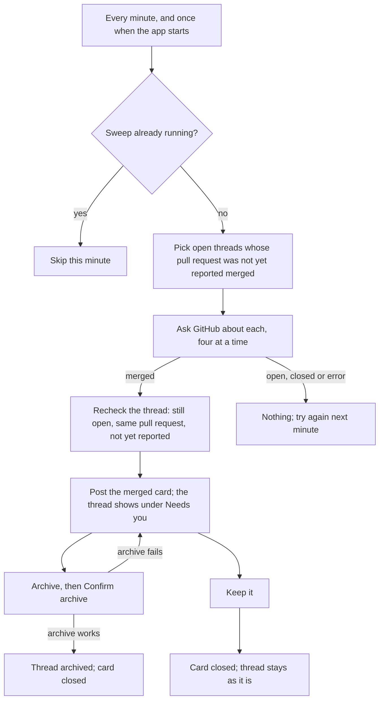

# Merged notice with archive button

**Idea:** `IDEA.md` — what this is for and why, in plain language. Read it first; it is
the north star this plan serves. Goal and Constraints live there, not here, so they don't
get buried as this file grows.

## Open Questions

## Watch List

| # | Noticed | What needs looking into | Raised to user? | Outcome |
|---|---------|-------------------------|-----------------|---------|

## Decision Log

Append-only. A reversal is a new entry superseding the old, never an edit.

| # | Decision | Rationale | Source |
|---|----------|-----------|--------|
| 1 | The hub checks GitHub itself, every minute, beside the existing waiting-stub poll (`viewer/app/hub.js:40-74`), by running `gh pr view <pr_url> --json state` on the hub. | A full PR URL needs no project folder, so it works whatever machine the thread ran on; the hub already depends on its own `gh` for stubs (`viewer/app/threads.js:334-355`). | defaulted |
| 2 | Checked threads: not archived, with a `done` card carrying a `pr_url`, and not yet marked merged. The newest `done` card's URL is the thread's PR (same rule as `viewer/app/chat.js:256`). Small fixes, features and stubs alike. | Every thread that ends in a PR should get the notice. | defaulted |
| 3 | One card per thread: the thread records that its merge was noticed; later `done` cards for the same PR never post a second one. | IDEA: "each merge produces one card". | defaulted |
| 4 | A failed `gh` call (missing, logged out, offline) leaves the thread unchecked until the next minute; no card and no error card. | Same behavior as the stub poll; an error card every minute would be noise. Recorded as an accepted risk. | defaulted |
| 5 | The lead is not told about the merge. | The lead already checks `gh pr view` itself before acting after done (`protocol/app/lead.md` step 9). | defaulted |
| 6 | The merged card asks for attention: it counts under "Needs you" and badges the thread until Collin archives the thread or presses "Keep it" on the card. | So he hears about the merge without opening every thread. | user |
| 7 | The card's Archive button asks to confirm first: it turns into "Confirm archive" and "Cancel", like the thread page's Archive. | Archiving stops sessions and removes the worktree; a stray tap in the chat is easy on a phone. | user |
| 8 | A `pr_url` that is not `https://github.com/<owner>/<repo>/pull/<number>` is never checked. `gh` runs through `execFile` (no shell). | The `done` validator only checks for non-empty text (`viewer/app/card.js:114-119`). | defaulted |
| 9 | The card is a new kind, `merged`, posted only by the app. Agents cannot post it, and the lead's `resolve` cannot close it. | It needs its own buttons; reusing `needs` would give it lead-needs semantics. | defaulted |

## Spec

### Behavior

When a thread's pull request is merged on GitHub, within about a minute the app posts a `merged` card in that thread. The card says the pull request was merged, links to it, and has two buttons: **Archive** and **Keep it**. Until it is answered, it counts under "Needs you" and badges the thread in the Threads list. No agent session needs to be running.

### Flow

### 1. Noticing the merge (hub)

- New function `pollMerged(hub)` in `viewer/app/threads.js`, exposed as `hub.pollMerged()` in `viewer/app/hub.js`. Run it from the existing 60-second `waitTimer` alongside `pollWaiting` (`viewer/app/hub.js:61-62`). Also start it once in `init()`, **without awaiting it**: `this.pollMerged().catch(() => {})`, so the first API request is not held up by GitHub calls.
- **No overlapping sweeps:** the hub keeps an in-flight flag (or promise). A tick that finds a sweep still running returns at once and starts nothing.
- **Select, then check outside the lock:** read `hub.allThreads()` and pick the eligible threads without taking any thread lock. A thread is eligible only if all of these hold:
  - not `archived`;
  - its PR URL is set: the `pr_url` of the newest `done` card with a non-empty `pr_url` among cards not `replaced` (same rule as `prOf`, `viewer/app/chat.js:256`);
  - the URL matches `^https://github\.com/[^/\s]+/[^/\s]+/pull/\d+$`;
  - `thread.merge_noticed_url` is not equal to that URL.
- Ask GitHub for each eligible thread with **no thread lock held**, at most 4 calls at a time: `execFile('gh', ['pr', 'view', url, '--json', 'state'], { timeout: 15000 })` (promisified, no shell, no `cwd`). A thread's lock must never be held across a `gh` call, because agents' cards for that thread wait on the same lock.
- If the parsed JSON's `state` is `"MERGED"`: take the thread's lock with `hub.withThread(id, …)` and reload the thread. If it is now archived, or its PR URL changed, or `merge_noticed_url` already equals the URL, do nothing. Otherwise set `thread.merge_noticed_url = url` and `thread.merge_noticed_at` to now (ISO), add the card with `addCard(thread, { kind: 'merged', title: 'Pull request merged', pr_url: url }, { system: true })` (`viewer/app/cards.js:11`), then `hub.save(thread)`.
- Any other state, any error (missing `gh`, logged out, offline, bad JSON, timeout): change nothing and throw nothing. The thread is checked again on the next tick. One thread's failure never stops the others.
- One card per PR: the `merge_noticed_url` marker is never cleared. A later `done` card carrying the same URL (an after-done fix) posts no second card.

### 2. The card kind

- `merged` is app-only. It is not added to the kinds agents may post in `viewer/app/card.js`. Posting `card.js merged …` from a session stays refused as an unknown kind. `resolvable()` (lead `resolve` and `dismiss`) keeps refusing it, because it only accepts `needs`/`question`.
- Fields: `kind: 'merged'`, `title`, `pr_url`, plus what `addCard` adds (`id`, `at`, `answered: false`, `system: true`, …).
- **Needs you:** in `addNeeds` (`viewer/app/views.js:122-130`), an unanswered `merged` card counts like an open `question`, `needs` or `approval` card, with `title: card.title`. Archived threads already drop out of the Threads list's default view; their cards are answered anyway (see 4).

### 3. The card on the thread page (`viewer/pages/thread.js`)

- Add a `case 'merged'` in `renderCard` (`:496`, beside `case 'done'` at `:655`). It shows:
  - the title "Pull request merged";
  - a "Review pull request" link to `pr_url`, as on the `done` card;
  - while unanswered and the thread is not archived, the buttons **Archive** and **Keep it**.
- **Archive** is two-step, like the page header's (`:159-164`). The first press swaps the buttons for **Confirm archive**, **Cancel** and the note "Stops its sessions and removes the worktree." **Confirm archive** POSTs to the existing archive route (`POST <T>/archive`, where `T` is the thread page's API base, `viewer/app/routes.js:476`), the same call `doArchive` makes. Then it repolls, as `doArchive` does. **Cancel** restores the two buttons. The confirm state is per card and lives only on the page.
- **Keep it** POSTs a card press with action `keep` (see 4). The card then shows dimmed and answered, with the note "Kept", like a resolved needs card (`:448`).
- An answered `merged` card shows no buttons. It shows "Archived" or "Kept" from `resolved_note`.
- Pin and sort the card like other unpinned cards, in time order in the conversation. It is not pinned.

### 4. Actions (hub)

- **Keep it:** in `press` (`viewer/app/threads.js:266`), handle `card.kind === 'merged'` **before** the live-lead check. Accept only `input.action === 'keep'`, else return 400 `"a merged card takes keep"`. An already answered card returns 422 `"card is already answered"`. Otherwise call `resolveCard(card, 'collin', 'Kept')` (`viewer/app/cards.js:31`), save, and return `{ queued: false }`. Nothing is sent to the lead. This works with no live lead.
- **Archive:** reuses `threads.archive` (`viewer/app/threads.js:158-195`) unchanged in what it does to sessions and worktrees. Add one step: only when the archive succeeds (`thread.archived = true` is set), every unanswered `merged` card in the thread gets `resolveCard(card, 'collin', 'Archived')`. If the archive leaves the thread unarchived (rebase in progress, upload removal failed), the merged card stays open, so Collin can retry.
- Archiving from the page header also closes open merged cards; that is the same code path.

### 5. Documents to update in the same change

- `protocol/app/cards.md`: in the "Which kinds exist" table, add `merged`: shown yes, emitted by the app, not pinned. Add a short `### merged` section under the shown kinds. It says the app posts it when the thread's PR is merged, gives its fields, and says that Archive (with confirm) and Keep it are handled by the app. Nothing reaches the lead, and no session may post it. Keep `viewer/test/protocol-rules.test.js` passing, and extend it if it enumerates kinds.
- `viewer/app/API.md`: document the `keep` action on the card press route and the `merge_noticed_url`/`merge_noticed_at` thread fields.
- `viewer/AGENTS.md`: update only if its file/role table describes `threads.js` polling or card kinds in a way this change makes false.

### Edge cases

- A small-fix thread with no slug still gets the card. `addNeeds` runs before the slug check (`viewer/app/views.js:36-42`).
- A dependent stub's own `pr_url` comes only from its own `done` cards, never from its parent's.
- A PR merged before this feature ships is noticed on the first tick for any unarchived thread. One card per such thread is expected.
- A thread whose PR was closed without merging gets no card (IDEA "Not doing").
- The thread is never archived automatically.

### Non-goals

Automatic archiving; merging from the app; any notice for a closed-unmerged PR; telling the lead; an error card when `gh` fails; changing the stub poll.

### Validation

- `node --test viewer/test/*.test.js` (unquoted glob). Add tests in `viewer/test/app-hub.test.js` (or a new `viewer/test/app-merged.test.js`) with a fake `gh` on `PATH`, as `app-hub.test.js:690-693` does. Cover:
  - `MERGED` posts exactly one card and sets the marker;
  - two overlapping `pollMerged()` calls run `gh` once per thread (the second returns at once);
  - a thread archived while its `gh` call is in flight gets no card;
  - `init()` resolves while a slow fake `gh` is still running;
  - a second poll posts nothing;
  - `OPEN` and `CLOSED` post nothing;
  - a failing `gh` posts nothing and does not throw;
  - an archived thread and a non-GitHub `pr_url` are not checked (assert that `gh` was not called);
  - the newest `done` URL is used;
  - a `merged` card appears in `views` needs until answered;
  - the `keep` press resolves it with no live lead;
  - a successful archive resolves it, and a failed archive leaves it open;
  - `card.js merged` from a session is refused.
- `npm --prefix viewer run test:browser`. Add a spec (for example in `viewer/test/app-needs.spec.js`) with a stubbed thread holding a `merged` card. Cover:
  - the card renders with its link;
  - Archive shows Confirm archive and Cancel;
  - Cancel restores the buttons;
  - Confirm archive calls the archive route;
  - Keep it calls the press route with `keep` and the card dims.
- `bash test-support/smoke/run.sh` only if the hearth machine is available; it is not a gate.

## Accepted Risks

| Risk | Why accepted | Round |
|------|--------------|-------|
| If the hub's `gh` is missing or logged out, merges are never noticed and nothing says why. | Matches the existing stub poll; the hub's `gh` is already assumed. | planning |

## Review Rounds

### Round 1 — 2026-11-16

**Lanes:** gpt / gpt-6.1-sol (intent); gpt / gpt-6.1-sol (mechanics); cross-family: no (claude unavailable at start).

**Changed since Round N-1:** n/a (first round — whole Spec in scope)

| Lane | Reported | Finding | Lead verdict | Resolution |
|------|----------|---------|--------------|------------|
| intent | — | No findings | — | — |
| mechanics | blocking | Hub initializes lazily on the first API request (`viewer/server.js:2083-2096`), so after a restart with no API traffic nothing polls. | declined | The card is only seen through the API, and the first API request runs `init()`, whose startup sweep posts it. Every existing hub timer (stubs, dead sessions) has the same lifecycle. Not a defect for this idea. |
| mechanics | major | Sweep concurrency, overlap and the awaited startup sweep are unspecified; copying `pollWaiting` would hold each thread's lock across a 30 s `gh` call and delay the first request. | upheld | Spec 1: startup sweep not awaited; in-flight guard; `gh` runs outside the thread lock, 4 at a time, 15 s timeout; re-check under the lock before posting. Tests added. |

### Round 2 — 2026-11-16

**Lanes:** gpt / gpt-6.1-sol (intent); gpt / gpt-6.1-sol (mechanics); cross-family: no (claude unavailable at start).

**Changed since Round 1:**
- Spec 1: the startup sweep is no longer awaited; an in-flight guard stops overlapping sweeps; `gh` runs with no thread lock held, 4 at a time, 15 s timeout; the thread is reloaded and re-checked under its lock before the card is posted.
- Validation: tests for overlapping sweeps, archive during an in-flight `gh`, and a non-blocking `init()`.

| Lane | Reported | Finding | Lead verdict | Resolution |
|------|----------|---------|--------------|------------|
| intent | — | No findings | — | — |
| mechanics | — | No findings | — | — |

## Prior Work

| Spec item | State | Evidence (file:line) | Confidence |
|-----------|-------|----------------------|------------|

## Implementation Tasks

| # | Objective | Ownership boundary | Lane | Session id | Validation | Status |
|---|-----------|--------------------|------|-----------|------------|--------|
| T1 | Hub: pollMerged, merged in needs, keep press, archive closes merged cards; cards.md, API.md; node tests | viewer/app/{threads,hub,views,cards}.js, viewer/app/API.md, protocol/app/cards.md, viewer/AGENTS.md, viewer/test/app-merged.test.js, viewer/test/protocol-rules.test.js | gpt standard (gpt-6.1-terra) | wc-d0ae8d2e2356-worker | node --test viewer/test/*.test.js | done |
| T2 | Thread page: merged card with two-step Archive and Keep it; browser spec | viewer/pages/thread.js, viewer/pages/thread.css, viewer/test/app-merged.spec.js | gpt standard (gpt-6.1-terra; asked claude, unavailable) | wc-d0ae8d2e2356-worker-2 | npm --prefix viewer run test:browser; node --test viewer/test/*.test.js | done |

## Log

- 2026-11-16 — T1 accepted. Choices reported: none. Full node suite: 3 failures pre-existing on the base (app-balancer placement, lifecycle freed-port, routes font route), plus one load-flaky test that changes between runs (app-hub boot commit, server.test.js write lock); both pass alone and neither is touched by T1.
- 2026-11-16 — T2 accepted. Choices reported: none. Its 'blocked' was the same pre-existing node failures; on the merged branch the browser suite is 638 passed, 2 skipped.
- 2026-11-16 — Verification attempt 1: PASS (gpt-6.1-sol, same family as the builders; --not-provider gpt could not be honoured). It verified b8592a6; the only later change is COMPLETION.md (414f278), which it found absent because the first commit dropped it.
