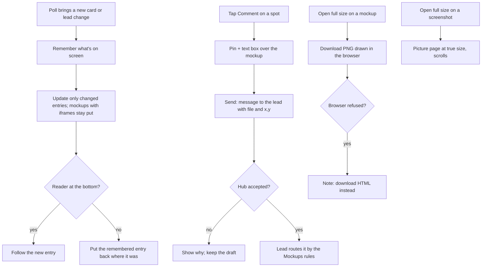

# Mockups that behave well in a thread

**Idea:** `IDEA.md` — what this is for and why, in plain language. Read it first; it is
the north star this plan serves. Goal and Constraints live there, not here.

**Map:** `MAP.md` and `docs/maps/mockup-viewer-flow.md`.

## Open Questions

(none)

## Watch List

| # | Noticed | What needs looking into | Raised to user? | Outcome |
|---|---------|-------------------------|-----------------|---------|

## Decision Log

Append-only. A reversal is a new entry superseding the old, never an edit.

| # | Decision | Rationale | Source |
|---|----------|-----------|--------|
| 1 | Mode is two-part. | Collin picked it on the mode card. | user |
| 2 | No designer mockups for this plan's own screens. | The visible parts are a comment pin and box, a PNG button and a scrolling image page, each following existing patterns in the thread and picture pages. | defaulted |
| 3 | Fix the flashing by updating the chat in place: keep existing card elements (above all mockup iframes) and only add, replace or remove the cards that changed; keep the reader's scroll position when not at the bottom. | The map traces the flash to `renderChat` clearing and rebuilding every card on each change (`viewer/pages/thread.js:603-605,622-637`), which reloads every iframe and loses the scroll anchor. | defaulted |
| 4 | A spot comment is sent as Collin's own message to the lead, naming the mockup file, the card, and the spot in the mockup's own pixels; the lead passes it to the designer verbatim, as the Mockups rules already require. | Press and composer routes already target the lead (`viewer/app/threads.js:411-426`, `viewer/app/routes.js:682-690`); routing straight to a designer would need a new delivery contract, and the lead must see feedback anyway (it may be a design change after agreement). | defaulted |
| 5 | The spot is captured by a transparent layer over the mockup, not by reading the mockup's document. | The mockup iframe is sandboxed with no same-origin access; loosening that is not needed to know where Collin tapped. The designer can render its own file to see what sits there. | defaulted |
| 6 | Built's Open full size opens the picture page with the screenshot at its natural pixel size in a scrolling area. | The picture page already does this for mockups (`viewer/pages/picture.js:61-79`); the raw file link leaves scaling to the phone. | defaulted |
| 7 | A mockup PNG is drawn in the phone's browser (fetch the mockup HTML, draw it to a canvas), not on the machine. | Collin picked it: no new install, same as diagram PNGs. If a browser refuses, the HTML download stays and the machine route is Deferred. | user |
| 8 | A spot comment's message names the mockup by file path, not by card (supersedes that part of Decision 4); the lead handles it by the existing Mockups rules for the current stage. | Round 1: a designer may not be running, and comments on a build's Mockup half are usually about the build; the versioned file path already identifies the mockup. | review-round-1 |
| 9 | Decision 8 also supersedes Decision 4's "passes it to the designer": the lead routes a spot comment by the Mockups rules for the current stage (live designer while drafting, fresh designer during review, stub after Start building), keeping its location line. | Round 2: the log contradicted itself. | review-round-2 |
| 10 | Keep all four items; run another review round (budget reset). | Collin picked "Run another round" after three rounds without a clean one. | user |

## Spec

Four changes in the viewer, plus two short protocol lines. Background on the code is in
`MAP.md` and `docs/maps/mockup-viewer-flow.md`.

### Flow



### S1. The chat updates in place

Today `render()` in `viewer/pages/thread.js` (~1467-1476) calls `renderChat()` whenever a
signature covering every message, card, pin and lead state changes, and `renderChat()`
(~603) empties the chat and rebuilds every node. That reloads every mockup iframe and loses
the reader's place.

- `renderChat()` reconciles instead of rebuilding. Each chat entry (message bubble, card,
  the lead-name line, pending bubble, queued and notice rows) gets a stable key and a
  signature of what it draws. An entry whose key and signature are unchanged keeps its
  existing DOM node. **An unchanged entry that contains an iframe is never removed or
  moved** (detaching an iframe reloads it); other unchanged entries may be moved when the
  order changes (for example queued messages reordered by Send now). Cards are in time
  order, so iframe entries never need to move. New entries are inserted at their place;
  changed entries are replaced in place; gone entries are removed. A card's signature covers its own fields and every outside state
  its drawing reads (pinned, archived, slug, worktree, card errors, open/folded state).
  A kept card's handlers look up the current card by id in `data` when pressed, never a
  card object captured when the node was drawn.
- Everything the current rebuild does after building (placeIds, aside anchors, pending
  bubble matching, the import cutoff) still works; a full rebuild stays allowed only where
  the cutoff moves (import, hand-off).
- Scroll: near the bottom (existing 80px test) the page still follows new entries. Away
  from the bottom, the top visible chat entry stays at the same screen position after an
  update. Record it and its position before anything above the chat changes in that
  update (the poll error banner set or cleared in the poll path, the banners and pins in
  `render()`), and correct `scrollY` once the chat is updated. Record the
  key and viewport offset of every chat entry visible at that moment; afterwards restore
  the first of them that still exists to its own recorded offset. If none survive, leave
  `scrollY` as it is. The same capture and restore wraps a poll that only shows or clears
  the poll error banner without calling `render()`.
- A mockup reserves its final height when created: `mockup()` in `viewer/pages/diagram.js`
  sets the frame box's height from `aspect-ratio: width / height` (CSS) so the box never
  starts at zero and grows later. The scale transform still follows the box width.

### S2. Comment on a spot in a mockup

Where: every mockup shown in a thread (a `diagram` card with `format: mockup`, and the
Mockup half of an image card) and the mockup on the picture page.

- A **Comment on a spot** button sits with the mockup's Open full size link. It is shown
  only while the thread composer could send (live lead, not archived, not frozen: the same
  `canSend` test as the Send button), and otherwise hidden with `visibility: hidden` so it
  keeps its space and showing or hiding it never moves the mockup. That eligibility is not part
  of any card's S1 signature: each render shows or hides the existing buttons in place.
- An open draft (pin position, coordinates, text) is kept per mockup outside the card's
  DOM, keyed by card id and mockup file. If the card's node is replaced while a draft is
  open, the draft is redrawn on the new node with its text and pin intact. A draft is
  cleared only by acceptance or Cancel; the button hiding does not close an open draft
  (Send then reports why it can't send, as below).
- Mockup iframes on the picture page get `scrolling="no"`, like the inline ones, so the
  iframe always shows the mockup from its top-left at its declared size (what the
  designer renders); the picture pane around it still scrolls.
- Pressing it puts a transparent layer over the mockup (the iframe stays sandboxed and is
  never read). The next tap on the layer drops a visible pin there and opens a small text
  box with Send and Cancel under the mockup. Tapping elsewhere on the mockup moves the
  pin. Cancel, or sending, removes the layer, pin and box.
- The tap is converted to the mockup's own pixels: x and y divided by the current scale,
  rounded, clamped to 0..width-1 and 0..height-1.
- Send posts Collin's own message the way the composer's send handler does
  (`POST <thread>/messages` with `{text}`, then the pending-bubble push; `thread.js`
  ~1577-1579; share that code rather than copy it), so it appears as Collin's bubble and
  queues to the lead like any message. `sendNow` is not involved. On the picture page it
  is the same `POST <thread>/messages`.
- Send keeps the pin, coordinates and text until the hub accepts the message. On a
  failure, show the error beside the box ("Comment not sent: <reason>") and keep
  everything so Send can be pressed again. Only acceptance or Cancel clears them. While
  the request is pending (including the picture page's eligibility re-check), the text
  box, pin, Send and Cancel are disabled.
- The picture page has no live state: it checks whether the thread can take a message
  when it loads and again (re-reading `<thread>/chat`) when Send is pressed. If it can't,
  it says why in plain words, naming the failed condition (the lead isn't running, the
  thread is archived, or the thread is being handed off), and keeps the draft. Text:
  `Comment on mockup "<title>" (docs/plans/<plan>/graphs/<graph>.html, <width>x<height>) at x=<x>, y=<y>: <comment>`.
  An empty comment cannot be sent. On the picture page a sent comment shows "Sent to the
  thread" with a link back.
- Protocol: `protocol/app/lead.md` Mockups gets one sentence: a spot comment is feedback
  like any other, handled by the Mockups rules for the stage the thread is in; whatever
  it is passed on to keeps its location line verbatim. `protocol/app/designer.md` gets one
  sentence: a spot comment's x and y are in the mockup's own pixels; render the file to
  see what sits there before changing it.
- The file path (which carries the mockup's version) identifies the mockup; the message
  does not name the card.

### S3. Download a mockup as a PNG

On the picture page for a mockup (`viewer/pages/picture.js`, the mockup branch of
`showCard`), Download makes a PNG using the existing `offerPng` / `WCPictureExport.save`
path, and a second link **Download HTML** keeps today's HTML download.

- The PNG is drawn in the browser: fetch the mockup HTML from its source URL, parse it,
  serialize it as XHTML inside an SVG `foreignObject` of exactly width x height, load
  that SVG as an image from a `data:image/svg+xml` URL (as `graphCanvas` does; the picture
  page's policy allows `data:` images, not blob URLs) and draw it to a canvas sized with
  the existing `scaleFor`, filled white first (the backing the mockup iframe shows,
  `viewer/pages/picture.css:12`). The `foreignObject` content is a root box of exactly
  width x height painted with the page's canvas background as a browser would show it
  (the `html` element's background, or the `body`'s if `html` sets none; a body background
  used this way is moved to the root box, not copied), so a short mockup with a body
  background fills the whole picture as it does in the iframe. Inside SVG, `:root` no
  longer matches the mockup's `html`, so every `:root` in the mockup's `<style>` text is
  rewritten to `html` before serializing (CSS variables declared on `:root` are common). Add the
  function to `viewer/pages/picture-export.js` beside `graphCanvas` and `formCanvas`.
- No script from the mockup runs at any point (scripts are stripped before drawing).
- If the browser refuses (load error or a tainted canvas), the note under Download says
  "This browser could not make a PNG of this mockup. Download HTML instead." The HTML link
  stays.

### S4. Screenshots open at true size

- The picture page gains a screenshot view: `picture?thread=<id>&card=<id>&view=image`.
  It shows the image card's file at its natural pixel size (no max-width) inside the
  picture page's scrolling area, with a Download link to the original file. A file removed
  on archive shows the existing "Image removed when the thread was archived" text.
- In the thread, the Built half's Open full size and the tap on any image card's picture
  (with or without a mockup) open that view instead of the raw file URL.

### Not in this plan

Saving comments as pins that stay on the mockup; comments on screenshots or ordinary
diagrams; a machine-side PNG.

### Validation

```bash
node --test viewer/test/*.test.js
npm --prefix viewer run test:browser
```

New browser tests (Chromium and Firefox, phone viewport 390x844 where it matters):

1. Chat stability: a thread with two mockup cards, scrolled to the middle; a new card and
   a lead-state change arrive. Each mockup iframe is the same element and fired no second
   `load`; the top visible entry moved by at most 2px. Scrolled to the bottom, the new card
   comes into view.
2. A mockup box has its final height before the iframe loads.
3. Spot comment: tap at a known point on a scaled mockup; the sent message text has the
   exact format above with the expected rounded coordinates; the button is hidden in an
   archived thread.
4. PNG: Download on a mockup's picture page saves a PNG whose pixel size is width x height
   times the export scale, and in which a known foreground block, a body background below the body's content
   (fixture: short content, `body` background set), and a spot in a second fixture that
   sets no background (white) have their expected colours; a third fixture sets its
   colours through CSS variables on `:root` and `:root > body` and must export them; Download HTML still gives HTML.
5. True size: at 390px viewport, the screenshot view of a 1200px-wide image renders it
   1200 CSS px wide and the page scrolls sideways; Built's Open full size links to it.

## Deferred

| # | Item | Why it can wait | Source | Notes for the follow-up |
|---|------|-----------------|--------|-------------------------|
| D1 | Earlier spot comments stay as pins on the mockup | The comment's text already says where; pins are a convenience | planning | Needs storing comments per mockup and drawing them on the overlay layer from S2 |
| D2 | Make the mockup PNG on the machine when the phone's browser refuses | Only needed if Collin's browser refuses; HTML download still works | planning | Headless browser screenshot served from the machine; see Decision 7 |
| D3 | Firefox PNG of a mockup that uses media queries | Only desktop Firefox drops width-based rules inside the SVG drawing; Chromium is right and the HTML download stays exact | verification | In the w x h helper frame, test each `@media` rule with `matchMedia` and unwrap the matching ones / drop the rest before serializing. Evidence: /tmp/wc-mockup-verify-WvBg2G/responsive.log (Firefox PNG button rgb(66,88,220) vs preview rgb(38,116,83)) |

## Accepted Risks

| Risk | Why accepted | Round |
|------|--------------|-------|
| A poll that changes only the lead's name or the thread's worktree leaves the old byline or mockup URL in the chat until the next chat change | Rare path: both change rarely mid-thread, the chat trigger already ignored them before this build, and the next card redraws correctly | verification-1 |
| The `:root` to `html` rewrite lowers specificity, so a mockup with competing `:root` and `html` rules for the same property may export different colours | Rare path: mockups don't normally set the same property on both; the HTML download stays exact | review-round-5 |
| A body background that uses a variable declared on `body` may vanish when moved to the export root | Rare path: unusual way to write a background; the HTML download stays exact | review-round-5 |
| A hand-off that freezes the thread while a spot comment is open leaves its Cancel disabled | Rare path: needs a hand-off mid-draft; the draft is lost, nothing else | review-round-3 |
| The mockup PNG is tested only in Chromium and Firefox; on an iPhone (WebKit) it may fail | A failure shows the "Download HTML instead" note and the HTML link stays; D2 covers a machine-side PNG | review-round-1 |

## Check Once Built

| # | What to check | Round |
|---|---------------|-------|

## Review Rounds

### Round 1 — 2026-11-23

**Lanes:** intent: claude / claude-opus-5-5; mechanics: gpt / gpt-6.2-sol; cross-family: yes.

**Changed since Round 0:** n/a (first round — whole Spec in scope)

| Lane | Reported | Finding | Lead verdict | Resolution |
|------|----------|---------|--------------|------------|
| intent | major | Lead sentence assumes a live designer; Mockup half comments arrive during build | downgraded (minor) | Real, but the existing Mockups rules already route feedback by stage, so a careful lead reconciles it. Rewrote the sentence to defer to those rules (S2, Decision 8) |
| intent | minor | Decision 4 says the message names the card; the format does not | upheld | Decision 8: the versioned file path identifies it; S2 says so |
| intent | minor | PNG untested in WebKit (iPhone) | accepted-risk | Fallback note and HTML link; D2 |
| mechanics | blocking | S2 names `sendNow`, which re-sends a queued message, not a new one | upheld | S2 now names the composer's `POST /messages` + pending bubble, shared |
| mechanics | blocking | Queued rows reorder (Send now), contradicting "never moved" | downgraded (major) | Real contradiction, but only a reorder case; S1 now pins only iframe entries in place |
| mechanics | major | Spot-comment forwarding assumes a live designer during build | downgraded (minor) | Same as intent finding 1; fixed by Decision 8 |
| mechanics | major | A failed send discards the draft and pin | upheld | S2: keep everything until accepted; show the error |
| mechanics | minor | Picture page checks send eligibility only at load | upheld | S2: re-check on Send, keep the draft |
| mechanics | minor | Scroll anchor measured after banners update; no fallback if it disappears | upheld | S1: record at start of render; fall back to next surviving entry |
| mechanics | minor | PNG test passes with a blank image | upheld | Validation 4 checks known pixels |

### Round 2 — 2026-11-23

**Lanes:** intent: claude / claude-opus-5-5; mechanics: gpt; cross-family: yes.

**Changed since Round 1:**
- S1: only unchanged entries containing an iframe are pinned in place; others may move. Scroll anchor recorded at the start of `render()`, with a fallback.
- S2: protocol sentence defers to the Mockups rules by stage (Decision 8); sending uses the composer's `POST /messages` path; draft kept on failure; picture page re-checks before sending; message names the file, not the card.
- Validation 4 checks known pixels. Accepted Risk: PNG untested in WebKit.

| Lane | Reported | Finding | Lead verdict | Resolution |
|------|----------|---------|--------------|------------|
| intent | minor | Decision 4's routing to the designer not superseded | upheld | Decision 9 |
| mechanics | major | Eligibility change replaces the card and erases an open draft | upheld | S2: eligibility toggled outside the signature; drafts kept per mockup and redrawn on replacement |
| mechanics | major | Full-size mockup can scroll inside its iframe, so tap coordinates drift | downgraded (minor) | Needs content taller than the declared size; fixed anyway with `scrolling="no"` on the picture iframe |
| mechanics | minor | Scroll fallback offset unclear | upheld | S1: record every visible entry's offset; restore first survivor; else leave |
| mechanics | minor | Intermediate SVG URL unspecified (blob URLs blocked) | upheld | S3: `data:` URL as `graphCanvas` |
| mechanics | minor | Canvas has no white backing; test misses it | upheld | S3 fills white; Validation 4 checks an unset spot |

### Round 3 — 2026-11-23

**Lanes:** intent: claude; mechanics: gpt; cross-family: yes.

**Changed since Round 2:**
- Decision 9: spot comments routed by the Mockups rules for the current stage.
- S2: comment-button eligibility toggled outside card signatures; open drafts kept per mockup and redrawn if the card node is replaced; picture-page mockup iframe `scrolling="no"`.
- S1: scroll restore records every visible entry's offset and restores the first survivor.
- S3: SVG drawn via a `data:` URL; canvas filled white first. Validation 4 checks an unset spot.

| Lane | Reported | Finding | Lead verdict | Resolution |
|------|----------|---------|--------------|------------|
| mechanics | blocking | PNG loses the body background below short content | upheld | S3: root box width x height carries the canvas background; Validation 4 checks below the content |
| mechanics | major | Draft editable while Send is pending | downgraded (minor) | Window is one request long; fixed by disabling the draft while pending |
| mechanics | minor | Frozen-card lock blocks Cancel if a hand-off replaces a card mid-draft | accepted-risk | Rare path: a hand-off started while a comment is being written |
| mechanics | minor | Poll error banner changes before the scroll anchor is captured | upheld | S1: capture before anything above the chat changes, poll path included |

### Round 4 — 2026-11-23

**Lanes:** intent: claude; mechanics: gpt; cross-family: yes.

**Changed since Round 3:**
- S3: the `foreignObject` root box is width x height and carries the page's canvas background (html, else body). Validation 4 checks below short content and an unset-background fixture.
- S2: draft disabled while Send is pending.
- S1: scroll anchor captured before anything above the chat changes, including the poll error banner.
- Accepted Risk: hand-off mid-draft.

| Lane | Reported | Finding | Lead verdict | Resolution |
|------|----------|---------|--------------|------------|
| mechanics | blocking | `:root` styles (CSS variables) don't match inside SVG, so PNG colours are wrong | upheld | S3: rewrite `:root` to `html`; fixture with `:root` variables |
| mechanics | minor | Translucent body background painted twice | upheld | S3: move, not copy |
| mechanics | minor | Banner-only poll change skips scroll restore | upheld | S1: same capture/restore wraps it |
| mechanics | minor | Cancel enabled while Send pending | upheld | S2: Cancel disabled too |
| mechanics | minor | Kept card handlers can hold a stale card object | upheld | S1: handlers look up the card by id |

### Round 5 — 2026-11-23

**Lanes:** intent: claude; mechanics: gpt; cross-family: yes.

**Changed since Round 4:**
- S3: `:root` in mockup styles rewritten to `html` before export; body background moved (not copied) to the root box; Validation 4 adds a `:root` variables fixture.
- S2: Cancel also disabled while Send is pending.
- S1: banner-only poll changes also keep the scroll place; kept card handlers look up the current card by id.

| Lane | Reported | Finding | Lead verdict | Resolution |
|------|----------|---------|--------------|------------|
| mechanics | blocking | `:root` → `html` lowers specificity; competing rules export wrong colours | accepted-risk | Rare path: needs competing `:root` and `html` rules for one property |
| mechanics | minor | Body background using a body-scoped variable may vanish | accepted-risk | Rare path; HTML download exact |
| mechanics | minor | Showing/hiding the comment button can move the mockup | upheld | S2: `visibility: hidden` keeps its space |
| mechanics | minor | Picture page always blames a stopped lead | upheld | S2: message names the failed condition |

## Implementation Tasks

| # | Objective | Ownership boundary | Lane | Session id | Validation | Status |
|---|-----------|--------------------|------|-----------|------------|--------|
| T1 | S1 chat reconciled in place + scroll keep; mockup box aspect-ratio height; S4 thread links to `view=image` (tricky) | viewer/pages/thread.js, thread.css, diagram.js, viewer/test/app-chat-stability.spec.js, app-mockups.spec.js | claude standard / claude-sonnet-5-5 | wc-c06d283728e9-worker | browser tests 1, 2, 5 (link half); full suites | done |
| T2 | S3 mockup PNG in browser + Download HTML; S4 picture page `view=image` true-size view | viewer/pages/picture.js, picture-export.js, picture.css, picture.html, viewer/test/app-mockup-png.spec.js, app-screenshot-view.spec.js, app-picture-download.spec.js | claude standard / claude-sonnet-5-5 | wc-c06d283728e9-worker-2 | browser tests 4, 5; full suites | done |
| T3 | S2 spot comments (thread + picture page) + lead.md/designer.md sentences; after T1, T2 | viewer/pages/thread.js, thread.css, diagram.js, picture.js, picture.css, protocol/app/lead.md, protocol/app/designer.md, new spot-comment spec | claude standard / claude-sonnet-5-5 | wc-c06d283728e9-worker-3 | browser test 3; full suites | done |
| R1 | Remediation 1: scroll anchor below pinned header; frozen only in signatures of cards that draw it; PNG helper iframe sized w x h | viewer/pages/thread.js, thread.css, picture-export.js, app-chat-stability/app-spot-comment/app-mockup-png specs | claude standard / claude-sonnet-5-5 | wc-c06d283728e9-worker-4 | REMEDIATION-1.md scenarios; browser subset; unit suite | done |
| R2 | Remediation 2: Done card thread link uses live(card); hand-off and chat-stability tests wait for the first iframe load | viewer/pages/thread.js (one line), app-spot-comment.spec.js, app-chat-stability.spec.js | claude light / claude-haiku-5-5 | wc-c06d283728e9-worker-5 | browser subset + repeat-each=3 | in progress |

## Log

Build accepted: approval 0fa443cd-2221-4538-8537-32e849071195
- 2026-11-23 — Choice: T1, chat entry keys: type + id/time + first 60 chars of text, with a `#n` counter for duplicates (thread.js `renderChat`).
- 2026-11-23 — Choice: T1, lead-name line: its own entry keyed to the entry it precedes, signature = lead name.
- 2026-11-23 — Choice: T1, scroll keep: `showError()` itself wraps capture/restore, covering the poll path and every other banner change.
- 2026-11-23 — Choice: T1, screenshot links: `view=image` links open in the same tab (dropped `target=_blank`).
- 2026-11-23 — Choice: T1, card order: cards pushed out of time order are not reordered (existing `cardsBefore` assumption).
- 2026-11-23 — T1 accepted (band: self): reconcile, scroll keep, aspect-ratio box and image links read in the diff; chat-stability, mockups and app-threads specs re-run green (42 passed). `viewer/test/app-threads.spec.js:867` asserted the old full redraw; the fix landed with T3 (the sub-lead's own edit was never committed and was dropped). The app-harnesses timing failure the worker saw passes alone (20/20).
- 2026-11-23 — Choice: T2, mockup PNG background: read from a hidden script-free `sandbox="allow-same-origin"` srcdoc iframe's computed style (colour, image, repeat, position, size), not by parsing CSS (picture-export.js).
- 2026-11-23 — Choice: T2, picture page: Download HTML link is `#download-html`, left of Download (picture.html/css).
- 2026-11-23 — Choice: T2, screenshot view: accepts any non-retracted image card with a file, mockup or not; Download sets `download` to the card name; a missing card reuses "This picture was not found in the thread." (picture.js).
- 2026-11-23 — Choice: T2, PNG export: inline `on*` attributes stripped as well as scripts; the wrapped `html` is forced to `display:block` at w x h with the root `overflow:hidden`; tainted canvas probed with `getImageData(0,0,1,1)`; `offerPng` gained an optional failure-text argument (picture-export.js, picture.js).
- 2026-11-23 — Choice: T2, PNG failure note: shown for any failure making the PNG (fetch, load, taint), not only a refusal (picture.js).
- 2026-11-23 — T2 accepted (band: bigger-scout): scout found no Spec deviation; its script-stripping test cannot fail (scripts can't run in an SVG image anyway), noted, not sent back. Sub-lead re-ran app-mockup-png, app-screenshot-view, app-picture-download: 26 passed. Full suites run once all tasks merge.
- 2026-11-23 — Choice: T3, message title: the card's own title (image cards without the "Mockup: " prefix); picture page falls back to the graph name (diagram.js, thread.js `spotButton`, picture.js).
- 2026-11-23 — Choice: T3, placement: the spot UI lives in `diagram.js` as `WCDiagram.spot`, shared by thread and picture page; image card Mockup half gets a `.mockup-links` row.
- 2026-11-23 — Choice: T3, draft key: card id + graph name (the plan is fixed per card, so it names the mockup file).
- 2026-11-23 — Choice: T3, box before first tap: hint "Tap the spot on the mockup." with Cancel only; textarea and Send appear with the pin; first tap scrolls the box into view.
- 2026-11-23 — Choice: T3, thread Send checks `cantSendWhy()` first so a draft whose button is hidden reports why (archived / handed off / lead isn't running).
- 2026-11-23 — Choice: T3, picture page ineligible at load: note "Comments on a spot cannot be sent: <why>." and the button `visibility: hidden`.
- 2026-11-23 — Choice: T3, picture bar `flex-wrap: wrap` so the added button doesn't push Download off a phone screen; layer has a dashed outline; taps are click events.
- 2026-11-23 — Choice: T3, `app-threads.spec.js` redraw-while-typing test now waits for the second card and asserts the answer box node is kept.
- 2026-11-23 — T3 accepted (band: bigger-scout): scout found no Spec deviation; handed-off reason and picture-page pending state are untested (noted). Sub-lead re-ran spot-comment, mockups, chat-stability, picture, mockup-png, screenshot-view: 82 passed.
- 2026-11-23 — Verification 1: FAIL (gpt-6.2-sol), 4 gaps; 1 judged rare and recorded in Accepted Risks; 3 sent to the lead for defer/fix.
- 2026-11-23 — Lead answered verification-1 gaps: fix all three (anchor, frozen in signatures, PNG helper size); nothing deferred. REMEDIATION-1.md written; R1 dispatched.
- 2026-11-23 — Choice: R1, scroll anchor: the covered area is the lowest bottom of `#head`, `#dead` and `#pinned` when shown (thread.js `chatPlace`).
- 2026-11-23 — Choice: R1, card signatures: `frozen()` left out for `diagram` and `image` cards (exclusion list; every other kind reads it through `off` or the disabling loop) (thread.js `cardSig`).
- 2026-11-23 — Choice: R1, hand-off: diagram and image cards skip the frozen disabling loop, so an open spot draft keeps Cancel usable during a hand-off; Send is still refused by `cantSendWhy()` (thread.js `renderCard`).
- 2026-11-23 — Choice: R1, PNG helper: falls back to 800x600 when no size is given (picture-export.js `canvasBackground`).
- 2026-11-23 — R1 accepted (band: scout): scout confirmed the three fixes match their scenarios; report gave counts rather than pasted output, so the sub-lead re-ran chat-stability, spot-comment, mockup-png, handoff: 82 passed.
- 2026-11-23 — Verification 2: FAIL (gpt-6.2-sol, commit 699c1a26), 3 gaps, none rare; sent to the lead for defer/fix.
- 2026-11-23 — Lead answered verification-2 gaps: fix 1 (Done handler live(card)) and 3 (hand-off test waits for the first load); defer 2 as D3.
