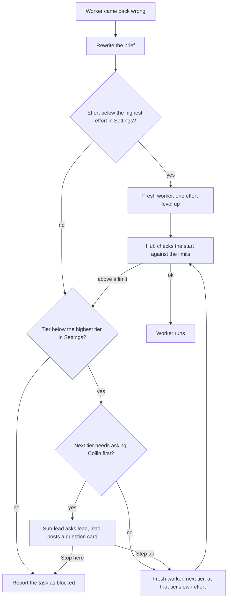

# Effort and escalation rules in Settings

**Idea:** `IDEA.md` — what this is for and why, in plain language. Read it first; it is
the north star this plan serves. Goal and Constraints live there, not here, so they don't
get buried as this file grows. How the code works today: `MAP.md`.

## Open Questions

None open.

## Watch List

| # | Noticed | What needs looking into | Raised to user? | Outcome |
|---|---------|-------------------------|-----------------|---------|

## Decision Log

Append-only. A reversal is a new entry superseding the old, never an edit.

| # | Decision | Rationale | Source |
|---|----------|-----------|--------|
| 1 | Escalation in Settings: plain-words explanation plus a few switches, not a full editor | Collin picked "Show, plus a few switches" | user |
| 2 | Escalation switches cover effort as well as model | Collin: "include model effort as well in escalation settings" | idea-change (folded into IDEA.md before confirmation) |
| 3 | Every model cell in Settings gets an effort select: Claude and GPT tiers, and both providers' lead slot | IDEA "What good looks like" bullet 1; store, API and `sessions.js:33` already support the lead slot (MAP.md) | defaulted |
| 4 | GPT efforts offered: `low medium high xhigh` (no `max`, which Codex's `model_reasoning_effort` does not take); Claude keeps `low medium high xhigh max`. Unset stays "CLI default" for both | Matches each CLI's own value set; unset keeps today's behavior for anyone who never touches it | defaulted |
| 5 | Codex sessions get effort as `-c model_reasoning_effort=<e>` in `machine/service.js` argv, only when set | Same flag `protocol/lanes.md:43` already uses for terminal lanes; `codex exec --help` (0.169.0) confirms `-c key=value` | defaulted |
| 6 | Escalation steps: with "effort first", effort climbs one level at a time to the ceiling at the current tier, then the tier moves up one rung and starts at that tier's pinned effort, and so on up to the highest tier; with "model first", the tier climbs to the ceiling at pinned effort, then effort climbs at the top tier. Unset effort counts as `high` for stepping. Each step still comes after a brief rewrite and in a fresh session; one failed try per step | Keeps today's "rewrite brief first, fresh session, one rung at a time" (`sub-lead.md:122-132`) and gives the switches a definite meaning | defaulted |
| 7 | Switches live in hub `settings.json` under `escalation`; the hub renders them into plain sentences that (a) the Settings page shows and (b) go into the sub-lead's role layers. `protocol/app/sub-lead.md` "Escalation" section is rewritten to defer to those sentences and include the effort rung | One source (IDEA constraint); reuses the existing role-layers path (MAP.md "How Settings content reaches agents") | defaulted |
| 8 | `wc.js session start` gains `--effort <e>`; the hub accepts it for worker starts only, and refuses (with the reason) a worker start above the highest tier or highest effort switch | Without it the app sub-lead cannot raise effort at all (MAP.md "Things that do not line up"); enforcing the ceilings in the hub makes the limits real, not advice | defaulted |
| 9 | "Ask me before …" travels as today's escalation path for questions: sub-lead sends the lead a `message`, the lead posts a `question` card (step up / stop and report the task as blocked) | `lead.md` step 7 already routes sub-lead questions this way; no new card kind | defaulted |
| 10 | Terminal workflow (`protocol/lanes.md`, `implementation.md`, `verification.md`) unchanged | IDEA "Not doing" | defaulted |
| 11 | The switch set is exactly four: what steps up first, highest effort, highest tier, ask me before. Defaults `effort`, `xhigh`, `critical`, `critical`. No failed-tries switch (one try per step) | Collin picked "Use the four" | user |
| 12 | The effort ceiling caps only effort the sub-lead asks for with `--effort`; a tier's pinned effort is Collin's own choice and is used as is even when above the ceiling. A GPT start treats a `max` ceiling as `xhigh` | Refusing starts because of Collin's own pin would lock builds; GPT has no `max` (Decision 4) | defaulted |
| 13 | "Ask me before" is followed by the sub-lead and lead as written rules; the hub does not enforce it | The hub cannot tell whether Collin approved a step; the ceilings (Decision 8) are the enforced part | defaulted |

## Spec

Read IDEA.md and MAP.md first. Effort order everywhere: `low < medium < high < xhigh < max`.
Tier order: `light < standard < heavy < critical`.

How a worker that came back wrong steps up (with "effort first"; "model first" swaps the two climbs). The prose in §2 to §4 says all of this; the diagram leaves out the start of a task and the Settings page.



### 1. Effort for every model cell (Claude and GPT, tiers and lead)

- `codex/model.sh`: accept `@<effort>` on `gpt.<slot>` lines, GPT efforts `low medium high
  xhigh` (reject `max` with a usage error naming the allowed values); Claude keeps `low
  medium high xhigh max`. `set gpt <slot> <model> [effort]` writes it; `effort gpt <slot>`
  prints it (empty when unset); `show --json` includes GPT efforts. `none` cells still reject
  an effort. Existing files without GPT efforts read unchanged.
- `PUT /settings/models` (`viewer/app/routes.js:51-62`): accept `effort` for `gpt`, validated
  against the GPT list; an absent `effort` clears it, as for Claude today. Update
  `viewer/app/API.md`.
- Settings page (`viewer/pages/settings.js`): the GPT tier row passes `withEffort: true`; the
  Leads row passes `withEffort: true` for both providers. The effort select lists only that
  provider's values. "CLI default" = unset. Disabled while the cell is "Not used". The hint
  under the table drops "Claude's": "Effort is how hard the model thinks; \"CLI default\"
  leaves it to the CLI." Works at phone width (the existing stacked-table CSS,
  `settings.css:133-139`).
- `viewer/app/sessions.js resolveModel`: read effort for both providers
  (`model.sh effort <provider> <slot>`), including the `lead` slot for lead and sub-lead.
- `machine/service.js` codex argv (`:287`): when `session.effort` is set, add
  `-c model_reasoning_effort=<effort>`. Claude path unchanged (`--effort`).

### 2. The sub-lead can ask for an effort

- `viewer/app/wc.js sessionRequest`: optional `--effort <e>`, sent as `effort`.
- Hub session start (`viewer/app/sessions.js`): `effort` accepted only when the starter is a
  sub-lead and the role is `worker`; otherwise 400 "effort can only be set for a worker".
  Validate the value for the CLI (GPT list for codex). It overrides the pinned effort for that
  session.
- Ceilings, from the escalation switches (section 3), for worker starts only:
  - tier above `max_tier` → 400 "tier <t> is above the highest tier in Settings (<max>)".
    `top` resolves to `heavy` before the check.
  - requested `effort` above `max_effort` → 400 "effort <e> is above the highest effort in
    Settings (<max>)". For a codex start a `max` ceiling counts as `xhigh`.
  - pinned effort is never checked against the ceiling (Decision 12).

### 3. Escalation switches

- Stored in hub `settings.json` as `escalation: {first, max_effort, max_tier, ask_before}`.
  Values: `first` `effort|model`; `max_effort` `high|xhigh|max` (`low`/`medium` are left out: they would only matter for tiers pinned below them, and a ceiling under the CLI default is not a useful limit);
  `max_tier` `standard|heavy|critical`; `ask_before` `never|critical|any`. Defaults
  `effort`, `xhigh`, `critical`, `critical` (`viewer/app/settings.js defaults()` and
  `normalize`, merged like `other_agents`).
- `PUT /settings/preferences` accepts `escalation` (partial object, each key validated, 400
  naming the bad key) and its response adds `escalation` and `escalation_text` to the
  fields it returns today (`viewer/app/routes.js:96`). `GET /settings` returns `escalation` and `escalation_text` (the
  sentences below joined). Update `viewer/app/API.md`.
- `escalationSentences(escalation)` in `viewer/app/settings.js`, plain words, for example
  with the defaults:
  1. "A worker that came back wrong gets a rewritten brief and a fresh session; each step up
     comes after one failed try."
  2. "Raise effort first, one level at a time, up to xhigh, then move to the next tier and
     repeat, up to Critical. A tier's own effort setting is used as is." (`model` first: "Move up one tier at a time, up to Critical,
     at each tier's own effort; then raise effort at the top tier, up to xhigh.")
  3. "Before moving a task to Critical, ask the lead, who asks Collin." (`any`: "Before any
     step up, ask the lead, who asks Collin." `never`: "Do not stop to ask; at the limits,
     report the task as blocked.") With `ask_before: critical` and `max_tier` below
     Critical, sentence 3 is left out, since that step can never happen.
  4. "A task still failing at the limits is reported as blocked."
  Sentence 2 always names the actual `max_effort` and `max_tier` values ("up to <effort>",
  "up to <Tier>"), whatever they are. Stepping rule for every value: effort climbs one level
  at a time from the tier's own effort (unset counts as `high`, Decision 6) while it is below
  `max_effort`; a tier already at or above the ceiling takes no effort step. When `max_effort` is
  `max`, sentence 2 adds "(GPT stops at xhigh, which is its highest)", so a Codex worker at
  `xhigh` steps tier instead of asking for `max`. The hub's refusal of `max` for a codex start
  says "GPT's highest effort is xhigh" so it is never read as a Settings limit.
- Role layers (`roleLayers`, `viewer/app/settings.js:121-134`): for role `sub-lead`, after
  the template block, append a blank line, "Escalation rules from Settings:" and the sentences. `sub-lead.md` names this block as
  the one source of escalation moves and limits, so it does not conflict with the layer's
  "Nothing below overrides" line. Still within the 12000-character check.
- Settings page: a new "Escalation" section after "Leads": the plain-words text at the top,
  then four rows with segmented controls like the permission-mode rows
  (`modeGroup`): What steps up first (Effort / Model); Highest effort (High / xhigh / Max); Highest tier
  (Standard / Heavy / Critical); Ask me before (Never / Critical / Any step up). A change
  saves immediately, re-renders the text from the response, and shows the usual
  "Saved, applies to new sessions" note. Works at phone width.

### 4. Protocol text

- `protocol/app/sub-lead.md` "Escalation, only on evidence": keep the evidence rule and
  "rewrite the brief first, fresh session, record the rung and reason"; replace the fixed
  ladder with: the moves and limits are the "Escalation rules from Settings" in your
  instructions; raise effort with `wc.js session start ... --effort <e>`. Refusals: a
  refusal that names "the highest tier in Settings" or "the highest effort in Settings" means
  only that kind of step is used up: take the other kind of step if the rules still allow it,
  otherwise report the task as blocked. Any other refusal (a bad value, "hub unavailable", a
  missing CLI) is not a limit: fix the request or retry as the role file already says.
  Exception: on a task's first dispatch, a tier refusal means dispatch it at Standard or
  below (first dispatches never start at Heavy or Critical); that is not an escalation step. Asking means
  a `message` to the lead naming the task, what failed, and the step proposed, then waiting.
- `protocol/app/lead.md` step 7: one sentence: a sub-lead asking to step a task up becomes a
  `question` card with two options, "Step up" and "Stop here" (task reported blocked); the
  answer goes back as a `message`.
- `machine/API.md` (`POST /v1/sessions` row, `:10`): effort now reaches Codex as
  `-c model_reasoning_effort=<e>`; GPT values `low medium high xhigh`.
- `protocol/app/cards.md`: no change. `protocol/lanes.md`, `implementation.md`,
  `verification.md`: no change.

### Edge cases

- Saved settings without `escalation` load the defaults.
- `max_tier: standard` and a sub-lead's first dispatch at `top`: refused; the sub-lead
  dispatches at an allowed tier. Reviewer, verifier, mapper and lead starts are never
  checked against the ceilings.
- A GPT pin file written by this version and read by an older `model.sh`: not supported;
  only one clone runs per machine.
- Running sessions keep the effort and rules they started with.

### Non-goals

- No full rules editor, no failed-tries switch, no provider switching on escalation.
- No change to terminal (non-app) lanes or their rules.
- The hub does not enforce "ask me before" (Decision 13).

### Validation

```bash
bash codex/test/run.sh                # model.sh: GPT effort parse/set/print, max refused for gpt
bash machine/test/run.sh              # codex argv carries -c model_reasoning_effort only when set
node --test viewer/test/*.test.js     # routes, settings, sessions
npm --prefix viewer run test:browser  # Settings page controls, desktop and phone width
```

New tests to add:
- `codex/test/run.sh`: `set gpt heavy <m> xhigh` round-trips; `set gpt heavy <m> max` fails;
  `effort gpt heavy` prints it.
- `machine/test/service.test.js`: codex start with `effort` includes
  `-c model_reasoning_effort=xhigh`; without it, no such flag.
- `viewer/test/app-settings.test.js`: PUT models with GPT effort; PUT preferences escalation
  valid and each invalid key; GET returns defaults and `escalation_text`; sub-lead role
  layers contain the sentences, other roles do not.
- `viewer/test/app-hub.test.js` (or the sessions test home): worker start above `max_tier`
  refused; `--effort` above `max_effort` refused; codex with `max` ceiling refuses `max`
  (invalid for GPT) and accepts `xhigh`; effort from a lead start refused; pinned effort above
  ceiling still starts.
- `viewer/test/app-settings.spec.js`: GPT and lead effort selects save; Escalation section
  renders text, a switch change updates the text; no horizontal scroll at 390px.

## Accepted Risks

Real issues consciously not fixed, each with the reason. Part of the spec, not review
scaffolding — an implementer should read these, and later review rounds must not
re-raise them.

| Risk | Why accepted | Round |
|------|--------------|-------|

## Review Rounds

### Round 1 — 2026-11-15

**Lanes:** Claude (intent lens, Other agents reviewer tier); GPT (mechanics lens, same tier); cross-family: yes.

Written for every round, including one where the table below stays empty. The table gets a row
per finding, so a clean round would otherwise leave no record of which gate ran — which is the
round where knowing it matters most. `protocol/plan-review.md` shows a filled example.

<!-- Round 2+: list what changed since the previous round; that list scopes the reviewers. -->

**Changed since Round N-1:** n/a (first round — whole Spec in scope)

| Lane | Reported | Finding | Lead verdict | Resolution |
|------|----------|---------|--------------|------------|
| intent (Claude) | minor | Role-layer heading "replace the defaults" conflicts with the "Nothing below overrides" line and with §4 removing the ladder | upheld (minor) | Heading is now "Escalation rules from Settings:"; sub-lead.md names it as the one source |
| intent (Claude) | minor | `max_effort` low/medium/high all mean "never raise" | upheld (minor) | Options reduced to high ("Don't raise") / xhigh / max |
| mechanics (GPT) | major | Rendered rules don't say GPT stops at xhigh; a Codex worker would ask for max and misread the refusal | upheld | §3 adds the GPT clause when `max_effort` is max; codex `max` refusal worded distinctly |
| mechanics (GPT) | major | "A refusal means the task has reached the limit" also covers operational refusals and the `top`-above-ceiling retry | upheld | §4 now separates Settings-limit refusals (named) from all others |
| mechanics (GPT) | minor | `machine/API.md` still says effort is ignored for Codex | upheld (minor) | Added to §4 |
| intent (Claude) | minor | Plain-words text says "up to xhigh" while a tier's pin may be higher | upheld (minor) | Sentence 2 adds "A tier's own effort setting is used as is." |

### Round 2 — 2026-11-15

**Lanes:** Claude (intent lens); GPT (mechanics lens); cross-family: yes.

**Changed since Round 1:**
- §3 `max_effort` options are now `high|xhigh|max`; page shows Don't raise / xhigh / max.
- §3 sentence 2 adds "A tier's own effort setting is used as is." and, when `max_effort` is `max`, the GPT xhigh clause; codex `max` refusal wording.
- §3 role-layer heading is "Escalation rules from Settings:".
- §4 sub-lead.md refusal handling separates Settings-limit refusals from all others.
- §4 adds `machine/API.md`.

| Lane | Reported | Finding | Lead verdict | Resolution |
|------|----------|---------|--------------|------------|
| intent (Claude) | major | "Don't raise" for `high` is false when a tier is pinned below high; no sentence-2 wording for other values | upheld | Label is now High; sentence 2 always names the actual values; one stepping rule stated for every ceiling |
| intent (Claude) | minor | First-dispatch tier refusal contradicts the "use the other step or report blocked" rule | upheld (minor) | §4 carve-out: first dispatch starts at `max_tier` |
| intent (Claude) | minor | PUT preferences response lacks `escalation_text` the page re-renders from | upheld (minor) | §3 PUT response adds both fields |
| mechanics (GPT) | major | Same as the intent finding: "Don't raise" vs a `low` pin stepping to `high` | upheld | Same fix as the intent row above |

### Round 3 — 2026-11-15

**Lanes:** Claude (intent lens); GPT (mechanics lens); cross-family: yes.

**Changed since Round 2:**
- §3 `max_effort` page label High / xhigh / Max; the reason `low`/`medium` are left out; sentence 2 always names the actual values; one stepping rule for every ceiling.
- §3 PUT /settings/preferences response adds `escalation` and `escalation_text`.
- §4 first-dispatch carve-out: a tier refusal on a first dispatch means start at `max_tier`.

| Lane | Reported | Finding | Lead verdict | Resolution |
|------|----------|---------|--------------|------------|
| intent (Claude) | minor | First-dispatch carve-out to `max_tier` could start at Heavy/Critical, which sub-lead.md forbids | upheld (minor) | Carve-out now: dispatch at Standard or below |
| intent (Claude) | minor | "Ask before Critical" shown when `max_tier` is below Critical | upheld (minor) | Sentence 3 left out in that case |
| intent (Claude) | minor | Duplicate "unset counts as high"; wrong reason for leaving out low/medium | upheld (minor) | Duplicate removed, reason corrected |

Reported severity is the reviewer's opinion; the lead verdict
(`upheld`/`downgraded`/`declined`/`accepted-risk`/`user-decision`) is what gates the
exit. Downgrades and declines cite evidence.

## Prior Work

Parts of the Spec already built before this plan reached Stage 3 — adopted from outside
with work already done, or left behind by an implementation run that died partway.

Stage 3 does not re-implement `pre-existing` items and does not touch their code. Stage 4
verifies them exactly as rigorously as everything else: this code has never been through
the gate, so skipping it would leave the least-trustworthy part of the change as the only
part nobody checked.

Ambiguous evidence means **not done**. A wrong "done" is a silent hole; a wrong "not done"
costs a worker one look.

| Spec item | State | Evidence (file:line) | Confidence |
|-----------|-------|----------------------|------------|
|           | pre-existing / partial | | high / low |

`partial` items are implemented by Stage 3 — the brief names what exists so the worker
completes it instead of restarting it.

## Implementation Tasks

Filled by Stage 3. One row per worker brief.

| # | Objective | Ownership boundary | Lane | Session id | Validation | Status |
|---|-----------|--------------------|------|-----------|------------|--------|
| T1 | GPT effort in model.sh: parse, write, set, effort, show --json (Spec §1) | codex/model.sh, codex/test/run.sh | codex standard (gpt-6.1-terra) | wc-70d7c545bb47-worker | bash codex/test/run.sh; bash install/test/run.sh | done |
| T2 | Codex argv `-c model_reasoning_effort` when effort set; API.md row (Spec §1, §4) | machine/service.js, machine/API.md, machine/test/service.test.js | codex light (gpt-6-luna) | wc-70d7c545bb47-worker-2 | bash machine/test/run.sh | done |
| T5 | sub-lead.md escalation section and lead.md §7 sentence (Spec §4) | protocol/app/sub-lead.md, protocol/app/lead.md | claude standard (claude-sonnet-5-5) | wc-70d7c545bb47-worker-3 | git diff review | done |
| T3 | Hub: GPT/lead effort, `--effort`, ceilings, escalation store, sentences, role layers, routes, API.md (Spec §1–§3); after T1 | viewer/app/{settings,routes,sessions,wc}.js, viewer/app/API.md, viewer/test/*.test.js | codex standard (gpt-6.1-terra) | wc-70d7c545bb47-worker-4 | node --test viewer/test/*.test.js | done |
| T4 | Settings page: GPT and lead effort selects, Escalation section (Spec §1, §3); after T3 | viewer/pages/settings.js, viewer/pages/settings.css, viewer/test/app-settings.spec.js | claude standard (claude-sonnet-5-5) | wc-70d7c545bb47-worker-5 | npm --prefix viewer run test:browser | done |
| R1 | Remediation 1: escalation sentence 2 states unset=high, no step at/above ceiling, model-first one level at a time | viewer/app/settings.js, viewer/test/app-settings.test.js | codex light (gpt-6-luna) | wc-70d7c545bb47-worker-6 | node --test viewer/test/*.test.js | done |

Session id = the `thread_id` of a `codex exec` lane, so remediation can resume it.

## Log

Free-form running notes: deviations discovered mid-implementation, scope events,
anything a future session needs that fits nowhere above.

- 2026-11-15 — Choice: T5, sub-lead.md Tiers: left "Heavy and Critical are not implementation tiers … only as an escalation, below." unchanged; it does not contradict.
- 2026-11-15 — Choice: T5, sub-lead.md order sentence: "then change tier" reworded to "then step up" so it covers both step kinds.
- 2026-11-15 — T1, T2 reported no choices. T2 also renamed the machine test "effort … is ignored for Codex" to drop the Codex clause (body unchanged).
- 2026-11-15 — Sub-lead decision for T3 (not in the Spec): the heads-up "switch" action keeps a GPT cell's effort when it changes the model, since model.sh `set` without an effort now clears a GPT effort.
- 2026-11-15 — T3 reported no choices. It stopped on its fails-twice guardrail over two full-suite failures that are not its own: the font route (its worktree had no viewer/node_modules) and "a starter that loses the freed port…" (already failing on the feature branch before T3, listed in docs/known-issues.md). Re-run with dependencies installed: 266/267, only that known failure. Accepted, no escalation.
- 2026-11-15 — Choice: T4, viewer/pages/settings.css: added `.escalation-text` spacing styles.
- 2026-11-15 — Choice: T4, app-settings.spec.js: effort values set by the effort test are left set, not reset; no later test reads them.
- 2026-11-15 — Choice: T4, viewer/pages/settings.js: escalation_text rendered as one `<p>` per line, empty lines dropped.
- 2026-11-15 — Full validation on c959d63: codex, machine, install suites green; node 266/267 and browser 452 passed / 2 failed, all three failures not from this build (see COMPLETION.md). No task needed escalation.
- 2026-11-15 — Verification round 1: verifier-2 (claude) and verifier-3 (codex; the first codex start, verifier, timed out at the machine and never went live). Checking commit 57aea28.
- 2026-11-15 — R1 reported no choices; diff matches the brief verbatim. Merged d393ad0. Verification attempt 2 started.
