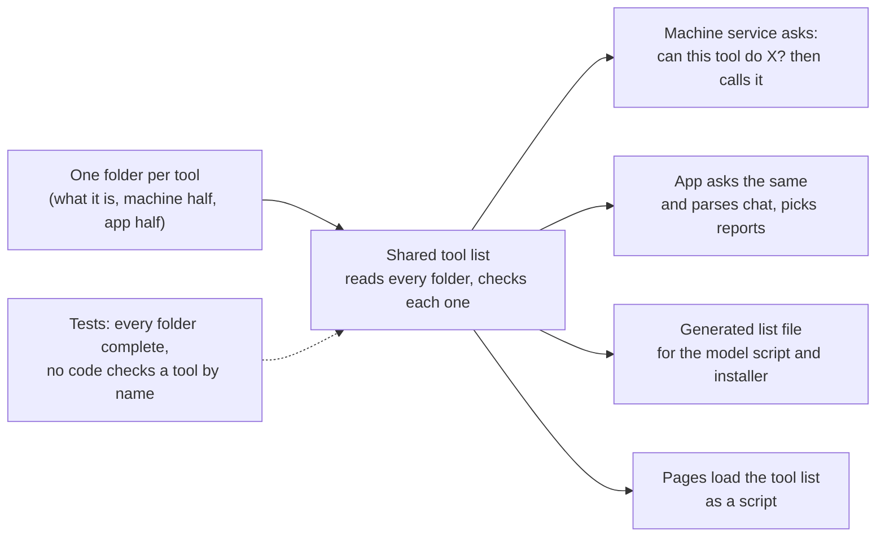

# Make harness connectors modular

**Idea:** `IDEA.md` — what this is for and why, in plain language. Read it first; it is
the north star this plan serves. Goal and Constraints live there, not here, so they don't
get buried as this file grows.

**Map:** `MAP.md` and `docs/maps/harness-connector-dispatch.md` (current inventory of every
name-based branch, with file:line).

## Open Questions

_None._

## Watch List

| # | Noticed | What needs looking into | Raised to user? | Outcome |
|---|---------|-------------------------|-----------------|---------|

## Decision Log

Append-only. A reversal is a new entry superseding the old, never an edit.

| # | Decision | Rationale | Source |
|---|----------|-----------|--------|
| 1 | Mode is thorough | Chosen on the mode card | user |
| 2 | The settings page gets the tool list and per-tool details from the hub instead of its own copy (`viewer/pages/settings.js:15-16`) | A second hand-kept list is exactly what this refactor removes | defaulted |
| 3 | `codex/model.sh` reads its provider list and default pins from the same registry data (via a generated or shared JSON file), not its own tuple (`codex/model.sh:14-38`) | Same reason; bash/python cannot import the JS table directly | defaulted |
| 4 | A connector must provide: launch, ready detection, first message, turn-end detection, transcript binding and chat parsing, login and login status. Everything else (usage probe, spend, live account switch, aside turns, effort levels, preflight, version check, startup diagnostics) is optional and declared; the app treats an undeclared optional feature as "not supported" the way it does today for tools that lack it | Lets a new tool be added minimally without silently missing required pieces | defaulted |
| 5 | A conformance test loads every connector and registry entry and fails on a missing required piece or an undeclared capability being used | In IDEA.md's "What good looks like" | defaulted |
| 6 | Behaviour is pinned before moving code: existing tests stay green, and each of the five tools gets characterization tests for the branches being moved where none exist | IDEA.md constraint: no behaviour change | defaulted |
| 7 | One pull request; no new tool added | Thread scope; IDEA.md Not doing | defaulted |
| 8 | One folder per tool: `connectors/<cli>/` holds both halves (machine and app), its install recipe, settings-page details and model defaults | Adding a tool really is one connector | user |
| 9 | Folders are named by CLI (`claude`, `codex`, `agy`, `kimi`, `pi`); the manifest carries the provider id (`claude`, `gpt`, `gemini`, `kimi`, `openrouter`). Stored ids (settings, accounts, session records, `only_ai`, `--provider`) do not change | Saved state and running sessions must keep working (IDEA.md constraint) | defaulted |
| 10 | `machine/hook.sh` keeps its path and its `<cli> <session>` arguments; CLI-specific payload reading moves into each connector's machine part, called from a generic hook path | Account homes of running sessions and CLI settings files already point at that path | defaulted |
| 11 | Live smoke tests (`test-support/smoke/`) stay limited to Claude and GPT; they only read the tool list from the registry where they list names | Making live smoke generic is new work, not cleanup | defaulted |
| 12 | Supersedes 11: the Kimi and Pi smoke scripts exist and import adapter paths; they are updated to the new connector paths. `live.sh`'s Claude/GPT scope is unchanged | 11's premise was wrong | review-round-1 |
| 13 | Registry data for non-JS callers (`codex/model.sh`, `install.sh`) is a committed generated file `connectors/registry.json`, kept in sync by a test, instead of calling `node` at run time | The hub runs `model.sh` without the login PATH, so a bare `node` call can fail | review-round-1 |
| 14 | Each tool's model-discovery code moves into `connectors/<cli>/models.py`, loaded by `model.sh` by file path | Otherwise a new tool with a new discovery method still edits `model.sh` | review-round-1 |
| 15 | The hub loads only `manifest.js` and `hub.js`; `machine.js` is loaded only by the machine service, its libs and tests | Today the hub never loads machine code | review-round-1 |
| 16 | Supersedes 14: `codex/model.sh` keeps all its per-tool model code (GPT pin workflow, GPT and Kimi discovery), allowlisted in the guard as `model-script`; it reads only the tool list, default pins, model formats and effort levels from `registry.json`. A new tool that can list its own models adds one discovery function there; IDEA.md's "What good looks like" now says so | Collin chose to leave model lists in the model script (Q2) | idea-change |
| 17 | Keep reviewing after three rounds without a clean one; review budget reset | Collin pressed Keep going on the review-budget card | user |
| 18 | The model-pin round trip gap (survived fixes L1 and M1) is closed structurally: the contract test runs the real `codex/model.sh` init, set and read round trip for every connector through `WHEELCHAIR_REGISTRY`, failing on any manifest value `model.sh` cannot round-trip and checking other providers' saved pins survive; plus direct checks (every pin slot present, default efforts within `models.efforts`, effort words within the pin grammar, anchored `models.format`). The Settings caption and two guide errors are fixed too | Each earlier fix closed one route; only a test that runs the real script catches every route | user |

## Spec



A pure refactor. Every one of the five tools (Claude Code, Codex, Antigravity, Kimi Code,
Pi for OpenRouter) behaves exactly as before; the change is where code lives and how the
rest of the code asks about a tool. The current inventory of name-based branches, with
file:line, is `docs/maps/harness-connector-dispatch.md` ("Dispatch and capability
inventory"). That inventory is not complete. In scope is every item in it, every item S4
names as missing from it, and every hit of the guard test (S6); each gets one of the S4
treatments.

### S1. Layout

```
connectors/
  index.js            registry: list() and manifest(cli) / byProvider(id) return manifests;
                      machine(cli) and hub(cli) require and validate that half on first use
  common.js           shared helpers (today's machine/adapters/common.js) and the shared
                      output scrub (S4)
  contract.js         required/optional members and capability names; validate(half)
  export.js           writes registry.json; --check exits 1 if it is stale
  registry.json       generated from the manifests, committed (S5)
  README.md           the guide for writing a connector (S7)
  <cli>/              one folder per tool: claude, codex, agy, kimi, pi
    manifest.js       plain data, safe to load anywhere (S2)
    machine.js        the machine half (today's machine/adapters/<cli>.js, plus moved branches)
    hub.js            the app half (chat parsing, report picking, usage display, model rules)
    (helpers)         anything else the tool needs (e.g. pi/extension.js, pi/guard.js)
```

- `connectors/` sits at the repository root. `machine/` and `viewer/app/` require it by
  relative path; every machine runs from a full clone (`install.sh:439`), so no packaging
  changes. `connectors/` must not require anything under `viewer/`; a connector's
  `machine.js` may require `machine/lib/*` and `connectors/common.js`.
- `machine/adapters/` is removed except `common.js`, which moves to `connectors/common.js`
  (`machine/lib` callers updated). `machine/adapters/index.js` is deleted; its callers use
  `connectors/index.js` (`machine(cli)`). Callers never reach a half any other way.
- `viewer/app/providers.js` keeps its exports (`PROVIDERS`, `DISPLAY_NAMES`, `providerOf`,
  `cliOf`) with identical values, now built from the manifests, so existing importers and
  `card.js` validation are unchanged.
- Registry order is `claude, codex, agy, kimi, pi`, so `Object.keys(PROVIDERS)` stays
  `claude, gpt, gemini, kimi, openrouter` (settings lists, `codex/model.sh` output). Registry
  order is a listing order only, never placement policy: see `placement` in S2.
- Loading: the hub (`viewer/app/`) uses only `list()`, manifests and `hub(cli)`; it never
  calls `machine(cli)`. The machine service calls `machine(cli)`. Validation of a half runs
  when that half is first loaded, and the contract test (S6) loads and validates both halves
  of every connector.

### S2. Manifest (data only)

Each `manifest.js` exports a plain object, no functions and no requires of other modules:

- `cli`, `provider`, `label`, `displayName` — today's values from `providers.js`.
- The existing flags `typesRoleMessage`, `singleAccount`. `asideFork`, `preflight` and
  `effort` are not stored separately: `providers.js` derives them from
  `capabilities.aside`, `capabilities.preflight` and whether `models.efforts` is non-empty,
  so each fact is written once. Effort levels live only in `models.efforts`; the settings
  page's effort choices and `codex/model.sh`'s effort lists read them from there (today
  `viewer/pages/settings.js:16`, `codex/model.sh:42-43,104-106`; Kimi has none).
- `capabilities`: an object of booleans naming the optional features in S3, true only for
  the tools that have them today.
- `install`: today's recipe from `machine/lib/harness-recipes.js` and binary name and label
  from `machine/lib/harness-install.js`.
- `settings`: what `viewer/pages/settings.js` shows per tool today (model placeholder,
  permission choices, account policy text, setup and install links).
- `models`: what `codex/model.sh` holds per provider today (default pins per tier, model
  name format, effort levels).
- `placement`: the data behind today's defaults, giving exactly today's results and
  nothing more:
  - `workerRank`: position in the fresh-settings default `worker_order`
    (`viewer/app/settings.js:54`; today GPT before Claude), or `null` for a tool left out
    of the default order (today OpenRouter). `null` does not affect saved orders or
    `appendWhenRequested`.
  - `leadDefault`: true for the tool named in the fresh-settings `lead_order` before
    `'any'` (today Claude, `settings.js:36-40,54`).
  - `seenByDefault`: counts as already seen when saved settings have no
    `worker_order_seen` (today Claude and GPT, `settings.js:280`).
  - `addOnMigration: false`: not appended to a saved `worker_order` by the migration at
    `settings.js:281` (today OpenRouter only). It does not stop Collin adding the tool to
    either order in Settings, and does not stop the balancer choosing it from a saved order
    or as the only signed-in review family (`viewer/app/balancer.js:76-109`).
  - `appendWhenRequested`: when a worker explicitly requests this tool and it is not in the
    order, the balancer appends it (today OpenRouter, `balancer.js:97`).
  The settings migration and balancer logic are otherwise unchanged.
- `install.sensitivity` (default false): see S4, diagram-sensitivity setup.
- `report.useHookText` (default true) and `stopWhenEnded` (default false): see S3.
- `models.hubPattern`, `models.slotAliases`, `models.effortError`: the hub's own checks in
  `viewer/app/routes.js:313-322`, kept as today (the model-name pattern per provider, which
  differs from both the browser's and the script's; Claude's `haiku`/`sonnet`/`opus` slot
  aliases; the effort error text, e.g. GPT's "effort for GPT must be one of low, medium,
  high, xhigh" vs others' "effort is invalid"). A 65-character GPT model still passes the
  browser and gets "model is invalid" from the hub.
- `settings.modelPattern`: the settings page's own model-name check, kept separate from
  `models` format because the two differ today (browser `viewer/pages/settings.js:17-19`,
  e.g. `MODEL_VALUE`, `KIMI_MODEL_VALUE`, `OPENROUTER_MODEL_VALUE`; script
  `codex/model.sh:44-53`). Each keeps today's rule, so the same inputs are rejected in the
  same place with the same wording.
- `shortName`: the name used in machine messages where it differs from `displayName`
  (today Pi: "Pi"), so machine wording stays byte-identical.
- `asideParentField`: only for tools with `capabilities.aside`; the session field holding
  the conversation id an aside forks from (`viewer/app/asides.js:41`; today Claude and Pi
  `cli_session_id`, Codex `codex_thread_id`). Antigravity's unreachable entry is dropped.
- `hook`: for hook-driven tools, how the hook delivers its event: `payload` is `stdin` or
  `last-arg`, and `sessionFromEnv` is true when the session may come from
  `WHEELCHAIR_SESSION_NAME` (today: Claude and Pi stdin; Codex last-arg; Antigravity stdin
  with `sessionFromEnv`).
- `settings` also carries each per-tool branch of the settings page today: the
  extra-account warning (`viewer/pages/settings.js:487-491`), the model heads-up line
  (`:611`), sign-in kind (`:1411,1457`), membership in the review-family choices
  (`:1600-1601`, `viewer/app/routes.js:378`, `viewer/app/settings.js:323`), and plan and
  weight tables (`viewer/app/settings.js:36-40`).
- `install` also carries `versionArgs`: the arguments the install job uses to check the
  installed CLI's version (`--version` for all but Pi, which has none and is skipped, as
  `machine/lib/harness-install.js:116-125` does today).
- `install` also carries the fallback binary path the installer checks when the CLI is not
  on PATH (today Kimi `~/.kimi-code/bin/kimi`, Pi `~/.local/bin/pi`) and `pathRank`, the
  order the installer prepends CLI directories to the service PATH (today
  `codex, claude, agy, kimi, pi`, `install.sh:402-415`), so PATH precedence is unchanged.

`connectors/index.js` writes nothing at load.

### S3. Contract and capabilities

Required machine members (every tool has these today): `command`, `firstMessage`,
`readyText`, `answerPrompts`, `findTranscript`, `loginEnv`, `seed`, `loginCommand`,
`parseLogin`, `loginStatus`, plus turn-end detection by exactly one of `hookEvent`
(hook-driven) or `turnPoller` (log-polled, today only Kimi).

Required hub members: `parseChat` (today's per-CLI parser in `viewer/app/chat.js`) and
`readReport(raw, payload)` (today's per-CLI last-report selection,
`viewer/app/chat.js:270-299,369-375`). `readReport` returns `{ text, settled }`:
`settled: false` means the transcript has not caught up yet (today only Pi, when
`payload.entry_id` is set and that entry is absent, `chat.hasPiEntry`). The delivery loop in
`viewer/app/sessions.js:432-454` keeps its budget and schedule exactly, retrying while
`settled` is false and stopping on the first settled read, as today. Manifest flag
`report.useHookText` (false for Pi, true for the rest) says whether the loop first takes
the report from the hook payload (`sessions.js:435`).

Optional members, each paired with a capability flag of the same meaning:

| Capability | Members | Today |
|---|---|---|
| `usageProbe` | `usageProbe` (the machine usage endpoint, `machine/service.js:2282-2286`) | claude, codex, kimi |
| `usageEvents` | `usageFrom` (usage carried in hook payloads, `machine/service.js:1641`); without it the service ignores usage in that tool's events | claude, codex |
| `preflight` | the Codex preflight (`codex/preflight.sh`, `viewer/app/balancer.js:59`, Ready check). The machine endpoint `POST /v1/preflight` keeps its request shape; it runs the preflight of the one connector with this capability (the contract test fails if more than one has it). Hub callers check the capability of the session's tool before calling, as they check "is it GPT" today | codex |
| `sandbox` | `sandboxed(session)`: true when the session's tools run sandboxed (today Codex with `codex_mode !== 'unrestricted'`). Drives screen command wrapping (`machine/lib/screen.js:223`, via a `sandboxWrap(command)` member), Windows launch denial and status (`machine/lib/win.js:436,452,459`, `machine/lib/win-prompt.js:9`), for both new and recovered sessions | codex |
| `restartLoss` | Two paths, both kept exactly. (1) `restartLossReason()`: the `end_reason` text given to a session newly adopted from tmux after a machine restart (`machine/service.js:552-564`; Pi "Lost track of this Pi session after a machine restart; restart it", Kimi "Lost track of this Kimi Code session after a machine restart; restart it"). Sessions that already have a recorded `end_reason` keep it. (2) Manifest flag `stopWhenEnded`: at startup and on each later poll, a non-stopped session of this tool with an `end_reason` is stopped fatally, retrying until it stops (today Pi, `:568,1097`). Kimi's sessions end on its polling path as today (`:1102`, part of `turnPoller`) | kimi, pi |
| `projectTools` | `projectToolReason(name, entry)` returning the full skip text or null, and `projectToolFileWarning(servers)` (today Codex: `codexEntryReason`, "on Codex: …", and `codexOverrides(...).tooLarge`, `machine/lib/project-tools.js:7,20-34`). Project-tool checks run without a session, so `project-tools.js` iterates every connector with this capability | codex |
| `recover` | `recognizePane(text)`: true when a live tmux pane adopted after a machine restart (`machine/service.js:550-564`) belongs to this tool. The service asks connectors in manifest `recoverRank` order (today's match precedence) and assigns the first match's `cli`; with no match it keeps today's fallback (the tool with manifest `recoverFallback: true`, today the one the current ternary falls back to) | tools matched today |
| `spend` | `spend` | pi |
| `liveSwitch` | `usual` + switch support | claude, codex |
| `aside` | `asideArgv`, plus manifest `asideParentField` (`machine/lib/aside-turns.js:61-147`, `viewer/app/asides.js:41`). Aside replies, stderr and failure messages pass through the tool's `redact` when it has one, as Pi's do today (`aside-turns.js:80,97,138-142`) | claude, codex, pi |
| `versionCheck` | `checkVersion` | kimi, pi |
| `steps` | `readSteps` (tool-call tailing / vocabulary from `machine/lib/steps.js`) | as today |
| `prepare`, `sessionNameEnv`, `promptText`, `retryStartupEnter`, `onTurnEnded`, `loginCwd`, `loginPrompt`, `loginDone`, `codeNeedsPrompt`, `resolveCli`, `redact` (this tool's own redaction of transcript lines, events and aside output, see S4) | same names | as today (`docs/maps/harness-connector-dispatch.md`, "Adapter boundary") |

`contract.js` exports `validate(connector)`: it throws, naming the tool and member, when a
required member is missing, when a capability flag is true without its members, or when a
member exists without its flag. Each half is validated when first loaded (S1).

### S4. Replacing name checks

Outside `connectors/`, no source file may compare a cli or provider value to a tool name
literal or hold a hand-written list of tool names. Each such branch in the inventory
becomes one of:

1. A capability check (`connector.capabilities.liveSwitch`), for "does this tool support X"
   — e.g. `machine/service.js:870` live switch, `:2282-2286` usage probe,
   `viewer/app/usage-poll.js:17,26`, `viewer/app/sessions.js:627`.
2. A call to an optional member, for tool-specific behaviour — e.g. version gate
   (`machine/service.js:805-806,839`), lost-session message after restart (`:563-568,1097,1102`,
   becomes the `restartLoss` capability in S3), pane capture options (`:601`),
   transcript reading and identity checks (`:1478-1489`, `:1554`), Kimi polling
   (`:1076-1162`, `:2443`), Codex step tailing (`:1167`), Claude settings/MCP handling
   (`:940-1003`), login differences (`:1740-1794`), Pi completion and spend (`:1618-1627`,
   `:2268-2293`).
3. A manifest field, for data — labels, defaults, install recipes, settings details,
   model pins, reviewer choices (`viewer/app/routes.js:313-331,378`,
   `viewer/app/settings.js:36-40,54,238,280-282,323,430-440`, `viewer/app/usage.js`,
   `viewer/app/balancer.js:59,97`, `viewer/app/ready.js:29-68`).

Where today's behaviour differs between tools in a way no existing name explains, the
implementer adds a capability or optional member with a plain name and lists it in
`contract.js` and the guide, rather than keeping the name check.

Known branches missing from the map's inventory: browser pages `viewer/pages/threads.js:15`
and `viewer/pages/thread.js:4` (`PROVIDER_LABEL`), `viewer/app/asides.js:41`,
`machine/lib/aside-turns.js:61-147`, the Codex sandbox checks (`sandbox` capability),
`machine/lib/statusline.js` (S5), `test-support/smoke/` (S6), the installer's per-tool
fallback paths and PATH order (S2 `install`), `machine/lib/project-tools.js:7,20-34` (`projectTools`
capability), diagram-sensitivity setup (`sensitivity/set.sh`,
`machine/lib/harness-install.js:102-110`: stays as it is, see below), and named
property dispatch such as `adapters.codex.loginEnv` (`machine/service.js:2293`) and `adapters.pi.redact`, and CLI ids produced by ternaries
in the restart recovery classifier (`machine/service.js:550-564`, `recover` capability).

**Diagram-sensitivity setup.** `sensitivity/set.sh` (Claude's `CLAUDE.md`, Codex's
`AGENTS.md`, the Codex `AGENTS.override.md` refusal, two-tool messages and disagreement
check) is unchanged and keeps its own tool list; it is outside the machine service and the
app and outside the guard's scope. The trigger in the install job
(`machine/lib/harness-install.js:102-110`) uses a manifest flag instead of names:
`install.sensitivity: true` (today Claude and Codex). After a successful install of a
flagged tool, the step runs as today with `installedName` = that tool's `cli` and
`other` = the other flagged tool's `cli`, including the `install/unseen.py` hook cleanup.
The step supports at most two flagged tools; the contract test fails if more than two
manifests set the flag.

**Shared output scrub stays shared.** Pane capture and sign-in output are scrubbed of
OpenRouter keys for every tool today (`machine/service.js:603,1757,1763`). That scrub moves
to one shared function (in `connectors/common.js`, using the Pi connector's key pattern)
applied to all panes and login output regardless of tool; it is not an optional per-tool
member. The Pi connector's own `redact` additionally covers its transcript lines, events
and aside replies, stderr and failures (`:1489,1618-1622`,
`machine/lib/aside-turns.js:80,97,138-142`).

Wording users see stays byte-identical (error messages, labels, settings text).

### S5. Non-JS callers

- `machine/hook.sh` keeps its path and accepts the same arguments (Decision 10). It no
  longer branches by tool: it execs a new `machine/lib/hook-in.js` with all its arguments,
  leaving stdin unread. `hook-in.js` loads only the tool's manifest and follows its `hook`
  field (S2): `stdin` reads stdin to EOF; `last-arg` takes the last argument and never
  reads stdin, so a Codex notify with stdin left open posts at once; with
  `sessionFromEnv`, a missing session argument falls back to `WHEELCHAIR_SESSION_NAME`,
  and when neither is set it exits 0. It then posts through `hook-post.js` exactly as
  today.
- `machine/lib/hook-post.js` keeps its current command line (`<state> <token> <kind>
  <session>`, payload on stdin) because `machine/lib/statusline.js:28` calls it directly
  for running Claude sessions; the statusline path is unchanged. Unknown tools still exit 64; a missing token still
  exits 0 silently; spooling is unchanged. `hook.sh` must stay bash 3.2 compatible (macOS CI).
- `connectors/registry.json` is generated by `node connectors/export.js` from the
  manifests and committed; `node connectors/export.js --check` fails when it is stale, and
  the contract test runs that check (Decision 13).
- `codex/model.sh` reads its provider list (`PROVIDERS`, `codex/model.sh:14`), default
  pins, model formats and effort levels from `connectors/registry.json` with Python's
  `json`, never by running `node` (Decision 16). Every place in `model.sh` that enumerates
  providers derives them from that list, including the pin-file parser's provider
  alternatives (`parse_pins`, `codex/model.sh:94-124`), so a registry-only provider's pins
  round-trip through `init`, `set` and reads. `WHEELCHAIR_REGISTRY`, when set, points
  `model.sh` at another `registry.json` (test seam). Otherwise `model.sh` finds
  `connectors/registry.json` from its own real path, resolving symlinks (with Python's
  `os.path.realpath`; bash 3.2 has no `readlink -f`), because callers such as the preflight
  test fixture run it through a symlink outside the checkout (`codex/test/run.sh:448-493`).
  Only the registry lookup changes; every other path `model.sh` uses is resolved as today. Everything else per tool stays in
  `model.sh` unchanged: GPT's pin workflow (bare-tier commands, `set`, aliases,
  `family claude`, the heads-up `check`) and GPT and Kimi model discovery with their
  `show --json` keys. Those lines are allowlisted in the guard with the tag
  `model-script`. The command-line interface and output of `model.sh` are unchanged.
- `install.sh` detection, "harness found" lines, the `present` list passed to
  `install/unseen.py`, fallback paths and the service PATH order read
  `connectors/registry.json` (via `python3`, already required). `install.sh` gains no CLI
  version probes; CLI version checks stay in the install job
  (`machine/lib/harness-install.js`), driven by `install.versionArgs`. One-off cleanup of retired
  Claude skills and Codex prompts (`install.sh:61-62,138-149`) stays as it is, allowlisted
  as `legacy` (S6). `hook.sh` and install
  scripts stay bash 3.2 compatible.
- Browser pages get the tool list, labels and `settings` details from the hub (Decision
  2) through a script, not a fetch: the hub serves `/wheelchair/assets/tools.js`, built
  from the manifests (minus `install`; `models` is included so effort choices reach the
  settings page, which checks model names only with `settings.modelPattern`), which sets a global the page scripts
  read. The settings, threads and thread pages load it with a `<script>` tag before their
  own script, so cached renders (`viewer/pages/threads.js:75-78`) have labels at once,
  including on the first load after the update. Delete the pages' own copies
  (`viewer/pages/settings.js:15-16`, `threads.js:15`, `thread.js:4`) and per-tool
  branches. Labels shown stay identical (`thread.js` and `threads.js` show "OpenRouter",
  the `label` field).

### S6. Tests

- Before moving any branch, add characterization tests for branches with no current test
  (coverage list: map, "Coverage and CI"). Each pins today's observable result per tool.
- `machine/test/adapters-loaded.test.js` iterates the registry instead of a fixed list.
- `test-support/smoke/kimi-live.js`, `pi-aside-live.js` and `pi-guard.js` require the new
  connector paths; `live.sh` scope is unchanged (Decision 12).
- New `machine/test/connectors-contract.test.js` (the machine suite runs only `machine/test/*.test.js`): every registered
  connector passes `validate` for both halves; every folder under `connectors/` that has a
  `manifest.js` is registered and every registry entry has a folder; `cli` and `provider`
  ids are unique; every manifest has every required field of S2 with the right type
  (required: `cli`, `provider`, `label`, `displayName`, `typesRoleMessage`, `singleAccount`,
  `capabilities` with a boolean for every capability, `install.command`, `install.binary`,
  `settings.modelPattern`, `models.efforts` (array, may be empty), `models.pins`,
  `models.format` (the rule `model.sh` validates pins with), `models.hubPattern`,
  `placement.workerRank` (number or `null`), and for hook-driven tools `hook.payload` equal to `stdin` or
  `last-arg`; defaulted, type-checked only when present: `hook.sessionFromEnv`,
  `report.useHookText`, `stopWhenEnded`, `install.sensitivity`, `install.versionArgs`, the
  other `placement` and `settings` fields, `shortName`, `asideParentField`), and a fake
  manifest missing a required field or with a wrong type is rejected naming the field; `export.js --check` passes; a fake connector missing a required member, or with a flag
  but no member, is rejected with a message naming it; `providers.js` exports equal a
  frozen snapshot of today's values.
- New name-check guard test: scans `machine/`, `viewer/app/`, `viewer/pages/`,
  `viewer/server.js`, `install.sh` and `codex/model.sh` (excluding test files, `test-support/`
  and `connectors/`), and fails listing each hit. A hit is a tool's cli or provider id as:
  a string literal in a comparison (`===`, `!==`, `==`, `!=`, `case`, `includes(...)`), a
  string literal argument to any call (`machine('codex')`, `manifest('kimi')`,
  `byProvider('gpt')`), a `require` path into a specific connector folder, a
  string literal result of a ternary or `||`/`&&` expression, an element of an array literal, an object literal key, a bracket access (`x['pi']`), or a
  property access on a connector or adapter object (`adapters.codex`); in shell, a `case`
  pattern, a `[[ ... == name ]]` test or a word in a `for` list; in Python, a string in a
  comparison, tuple or list. An explicit allowlist in the test holds `file:line-pattern`
  entries, each tagged and with a one-line reason: `not-tool` (the word means something
  else, e.g. a model name or URL), `legacy` (one-off cleanup of retired files, e.g.
  `install.sh:61-62,138-149`), `model-script` (per-tool model code kept in `codex/model.sh`,
  Decision 16), or `compat` (outside connectors' meaning, e.g. the graph
  viewer's caller label `viewer/server.js:1336,1922-1935`).
- `codex/test/` gains a round trip: with `WHEELCHAIR_REGISTRY` pointing at a copy of
  `registry.json` plus a sixth provider, `model.sh init`, `set` and a read of that
  provider's pin succeed and the other providers' pins are unchanged.
- Existing tests move with their code or keep working; none is deleted without its
  assertions moving.

### S7. The guide

`connectors/README.md`: what a connector folder contains, every required and optional
member with its signature and when it is called, every capability and what the app does
without it, how turn end works (hook vs poller), and a checklist for adding a tool (folder,
registry line, install recipe, settings details, model defaults, a discovery function in
`codex/model.sh` if the tool can list its own models, placement data, and, if the tool has a global instructions file, `install.sensitivity`
plus support in `sensitivity/set.sh` and in the install job's `install/unseen.py` call,
which passes the Claude and Codex home folders by hand (`machine/lib/harness-install.js:104`;
`set.sh`'s disagreement check and messages assume at most
two tools, as does the install job's "other tool" copy; a third such tool means changing
both), regenerating `registry.json`, tests). Update
`machine/AGENTS.md`, `viewer/AGENTS.md`, `machine/API.md` and `viewer/app/API.md` where
they name adapter paths or list tools; `protocol/app/*.md` provider lists stay as they are
(they describe the user-facing names, which do not change).

### Non-goals

No new tool; no change to anything a user sees, any stored file format, the hub API's
existing fields, `only_ai` / `--provider` values, or the live smoke scope (Decision 12).

### Validation

```
bash machine/test/run.sh          # from the repository root; hook fixtures resolve paths from cwd
(cd viewer && npm test && npm run test:browser)
bash install/test/run.sh
bash sensitivity/test/run.sh
bash codex/test/run.sh
node connectors/export.js --check
grep -rnE "adapters/(index|claude|codex|agy|kimi|pi)" machine viewer codex install.sh test-support  # expect no hits
```

All must pass with no test deleted. Additionally `node -e "console.log(JSON.stringify(require('./viewer/app/providers')))"` prints
the same output on `main` and on this branch.

## Accepted Risks

Real issues consciously not fixed, each with the reason. Part of the spec, not review
scaffolding — an implementer should read these, and later review rounds must not
re-raise them. Rare paths per `protocol/app/realism.md` land here in every mode, with round
`review-round-N`, `verification-N` or `lead-check`.

| Risk | Why accepted | Round |
|------|--------------|-------|
| `hook.sh` exit-code precedence for malformed calls (missing tool, missing session argument, Kimi called through the hook) may differ in detail after the manifest-driven rewrite | Rare path: the CLIs always call the hook with the arguments wheelchair configured | review-round-3 |
| Pages fall back to an empty tool list (`window.WHEELCHAIR_TOOLS || []`) when `/wheelchair/assets/tools.js` fails to load while the page itself loads, showing raw CLI names | Rare path: the page and its script come from the same local server in one load | build-T5 |
| The settings page throws on an account whose provider is not in the registry (`toolOf(...)`) | Rare path: accounts are only created for registered providers; a hand-edited settings file is tampering | build-T5 |
| `codex/model.sh` refuses a model name ending in a newline (`re.fullmatch`), which the base accepted | Rare path: malformed input the hub never sends; its own model check rejects such names first | verification-1 |
| Name-check guard misses unusual spellings: `adapters?.codex`, a property dot on the next line, a tool id after a nested array element, a backtick `require` path | Rare path: none appears in the code; the guard pins 32 of 33 ordinary S6 forms and lists its limits | verification-3 |
| A connector exporting `turnPoller` as a non-function passes validation | Rare path: malformed member value | verification-3 |
| `settings.permissionChoices: [null]` passes validation and breaks the Settings page | Rare path: malformed manifest data | verification-3 |
| Name-check guard misses `kimi )` (space before the parenthesis) and `[[ codex == $cli ]]` (bare literal on the left) | Rare path: unusual spellings absent from the code | verification-5 |

## Check Once Built

Review findings only the built code can settle, per `protocol/app/realism.md`. Verifiers
check each row against the build; a listed row is settled for later review rounds and
stays as review history.

| # | What to check | Round |
|---|---------------|-------|

## Review Rounds

### Round 1 — 2026-11-22

**Lanes:** intent — claude / claude-opus-5-5; mechanics — gpt / gpt-6.2-sol; cross-family: yes.

Written for every round, including one where the table below stays empty. The table gets a row
per finding, so a clean round would otherwise leave no record of which gate ran — which is the
round where knowing it matters most.

<!-- Round 2+: list what changed since the previous round; that list scopes the reviewers. -->

**Changed since Round N-1:** n/a (first round — whole Spec in scope)

| Lane | Reported | Finding | Lead verdict | Resolution |
|------|----------|---------|--------------|------------|
| mechanics | blocking | Registry order used as default worker order changes placement; OpenRouter must stay out of automatic placement | upheld | S1 order is listing only; S2 `placement` data reproduces `settings.js:54,280-281`, `balancer.js:97` |
| mechanics | blocking | Lost-session message via `displayName` breaks byte-identical text; Pi stop timing differs from Kimi | upheld (major; same as intent finding) | S3 `restartLoss` capability with exact text and timing; S2 `shortName` |
| intent | major | Same lost-session `displayName` contradiction | upheld | merged with the row above |
| mechanics | blocking | Validation `cd machine && ./test/run.sh` breaks hook fixtures that resolve from cwd (`service.test.js:248`) | upheld | Validation runs `bash machine/test/run.sh` from the repository root |
| mechanics | major | Statusline calls `hook-post.js` directly (`statusline.js:28`) | upheld | S5: `hook-post.js` command line unchanged; new dispatch lives in `hook-in.js` |
| mechanics | major | Buffering stdin would stall Codex notify | upheld | S5: `readStdin()` called only by stdin tools; Codex never reads it |
| mechanics | major | Pane/login scrub of OpenRouter keys applies to every tool; per-connector `redact` would leak | upheld | S4: shared output scrub stays shared |
| mechanics | major | `node` call from `model.sh` fails without login PATH in the hub | upheld | Decision 13: committed `registry.json`, read with Python |
| mechanics | major | Codex sandbox checks missing from inventory and capabilities | upheld | S3 `sandbox` capability |
| intent | minor | Same Codex sandbox gap | upheld | merged with the row above |
| mechanics | major | Kimi/Pi smoke scripts import removed adapter paths | upheld | Decision 12; S6 smoke path updates; validation grep covers `test-support` |
| intent | major | Same smoke-script gap; Decision 11 premise wrong | upheld | merged with the row above |
| mechanics | minor | `usageProbe`/`usageFrom` coupled though called independently | upheld | S3 split into `usageProbe` and `usageEvents` |
| mechanics | minor | Contract test misses unregistered folders and duplicate ids | upheld | S6 both-direction and uniqueness checks |
| mechanics | minor | Browser suite missing from validation | upheld | Validation adds `npm run test:browser` |
| intent | minor | `threads.js`, `thread.js` label tables and `asides.js` parent-field map not covered | upheld | S5 `tools` array for all pages; S2 `asideParentField` |
| intent | minor | Model discovery stays in `model.sh`, so new tools still edit it | upheld | Decision 14: `connectors/<cli>/models.py` |
| intent | minor | `asideFork`/`preflight` duplicate capability flags | upheld | S2: derived from capabilities |
| intent | minor | Hub would load every `machine.js` | upheld | Decision 15; S1 lazy halves |

Reported severity is the reviewer's opinion; the lead verdict
(`upheld`/`downgraded`/`declined`/`accepted-risk`/`check-once-built`/`user-decision`) is what gates the
exit. Downgrades and declines cite evidence.

### Round 2 — 2026-11-22

**Lanes:** intent — claude / claude-opus-5-5; mechanics — gpt / gpt-6.2-sol; cross-family: yes.

**Changed since Round 1:** Decisions 12–15 (smoke paths, committed `registry.json` for non-JS callers, `models.py` discovery per tool, hub loads only manifest and `hub.js`); S1 inventory is a starting list with the guard test as the definitive list, listing order only, lazy halves; S2 flags derived from capabilities, new `placement`, `shortName`, `asideParentField`; S3 new capabilities `usageEvents`, `preflight`, `sandbox`, `restartLoss`, `redact` scoped to transcripts/events, `hookInput` required; S4 known missing branches and shared output scrub; S5 `hook-in.js` with lazy stdin, `hook-post.js` unchanged for statusline, `registry.json` and `models.py` for `model.sh`, `tools` array for all browser pages; S6 smoke updates, both-direction registry checks, guard scans `test-support/`; Validation from repo root plus browser suite.

| Lane | Reported | Finding | Lead verdict | Resolution |
|------|----------|---------|--------------|------------|
| intent | major | `model.sh` holds GPT pin workflow and two discovery shapes; Decision 14's single `discover()` doesn't fit | user-decision | Q2 answered: leave model lists in the model script (Decision 16) |
| mechanics | minor | Codex `discover()` has no single return contract (`check` vs `show --json`) | user-decision | merged into Q2 |
| intent | minor | Guard on `install.sh` hits legacy cleanup lines | upheld | S6 `legacy` allowlist tag; S5 install bullet |
| intent | minor | `lead_order` default and several settings-page branches missing from manifest | upheld | S2 `placement.leadDefault`, `settings` additions |
| intent | minor | `hookInput` loads the whole machine half per hook event | upheld | S2 manifest `hook` field; S5 `hook-in.js` reads the manifest only |
| intent | minor | `asideParentField` for Antigravity is dead and fails validation | upheld | S2: aside tools only |
| mechanics | blocking | `auto: false` too broad; OpenRouter can be chosen from saved orders and as the only review family | upheld | S2 `placement.addOnMigration` and `appendWhenRequested` |
| mechanics | blocking | Pi aside replies, stderr and failures are redacted today; S3/S4 dropped them | upheld | S3 `aside` row; S4 redact scope |
| mechanics | major | `restartLoss` conflates assigning the reason with retrying stops | upheld | S3 `restartLoss` two paths, `stopWhenEnded` |
| mechanics | major | Guard matcher misses property dispatch and `viewer/server.js` | upheld | S6 hit forms defined; `compat` tag for graph caller label; S4 names property dispatch |
| mechanics | minor | Preflight endpoint has no connector selection | upheld | S3 `preflight` row: one connector, endpoint shape unchanged |
| mechanics | minor | Installer PATH precedence would change with registry order | upheld | S2 `install.pathRank` |
| mechanics | minor | Threads page cached render lacks labels before fetch | upheld | S5 `assets/tools.js` script instead of fetch |
| mechanics | minor | S1 accessor, helper path and validation timing inconsistent | upheld | S1 tree and loading; S3 validate text |

### Round 3 — 2026-11-22

**Lanes:** intent — claude / claude-opus-5-5; mechanics — gpt / gpt-6.2-sol; cross-family: yes.

**Changed since Round 2:** Decision 16 (model lists stay in `codex/model.sh`, reads only shared data from `registry.json`; IDEA.md "What good looks like" gains the one exception); S1 tree, accessors (`manifest`, `machine(cli)`, `hub(cli)`), `connectors/common.js`, per-half validation; S2 `placement` split into `workerRank`, `leadDefault`, `seenByDefault`, `addOnMigration`, `appendWhenRequested`; `asideParentField` aside tools only; manifest `hook` field; more `settings` items; `install` fallback paths and `pathRank`; S3 `preflight` endpoint selection, `restartLoss` two paths with `stopWhenEnded`, aside output redaction, `hookInput` removed; S4 redact scope, named property dispatch; S5 `hook-in.js` reads the manifest only, installer reads more from `registry.json`, browser pages load `assets/tools.js`; S6 guard hit forms, scope (`viewer/server.js` added, `test-support/` excluded) and tagged allowlist (`not-tool`, `legacy`, `model-script`, `compat`).

| Lane | Reported | Finding | Lead verdict | Resolution |
|------|----------|---------|--------------|------------|
| intent | major | Guard misses tool ids passed as call arguments; `project-tools.js` Codex import not covered | upheld (blocking; same as mechanics) | S6 call-argument and `require` hit forms; S3 `projectTools` capability |
| mechanics | blocking | Same guard gap via `machine('codex')`; project-tool checks run without a session | upheld | merged with the row above |
| intent | minor | Diagram-sensitivity setup is per-tool and uncovered | upheld | S2 `install.instructionsFile`; `sensitivity/set.sh` in guard scope |
| intent | minor | Effort held in three places per manifest | upheld | S2: `models.efforts` only; `effort` derived |
| mechanics | blocking | `parse_pins` provider regex stays hard-coded; a sixth tool's pins would invalidate the file | upheld (major: only affects a future tool) | S5 all provider enumerations in `model.sh` from the registry; S6 round-trip test |
| mechanics | major | `pickReport` cannot express Pi's skip-hook-text and retry-until-entry | upheld | S3 `readReport` returns `{ text, settled }`; manifest `report.useHookText` |
| mechanics | minor | Version checks belong to the install job, not `install.sh`; Pi skips them | upheld | S2 `install.versionArgs`; S5 install bullet |
| mechanics | minor | Rare path: hook exit precedence for malformed calls | accepted-risk | Accepted Risks (rare path) |

### Round 4 — 2026-11-22

**Lanes:** intent — claude / claude-opus-5-5; mechanics — gpt / gpt-6.2-sol; cross-family: yes.

**Changed since Round 3:** S3 `readReport` returning `{ text, settled }` with manifest `report.useHookText`, new `projectTools` capability; S2 effort held only in `models.efforts` (`effort` flag derived), `install.instructionsFile` for diagram-sensitivity setup, `install.versionArgs`; S4 adds `project-tools.js` and sensitivity setup to the known-missing list; S5 install bullet names callers (no new probes in `install.sh`), `model.sh` derives every provider enumeration incl. `parse_pins` from the registry with `WHEELCHAIR_REGISTRY` seam; S6 guard catches call arguments and connector `require` paths and scans `sensitivity/set.sh`, new `model.sh` round-trip test; Accepted Risks: hook exit precedence (rare path).

| Lane | Reported | Finding | Lead verdict | Resolution |
|------|----------|---------|--------------|------------|
| mechanics | blocking | `tools.js` strips `models`, so the settings page loses effort choices | upheld | S5: `tools.js` excludes only `install` |
| intent | minor | Same: browser gets no effort lists or model formats | upheld | merged with the row above |
| mechanics | major | Registry-driven sensitivity writer can't express Codex's `AGENTS.override.md` refusal | upheld | Cut: sensitivity setup keeps its own tool list (`own-list`); `install.instructionsFile` removed |
| intent | minor | `set.sh` needs more than `instructionsFile` (override check, two-tool messages); simpler to leave it | upheld | merged with the row above |
| intent | minor | `harness-install.js` sensitivity step's `unseen.py` cleanup and "other tool" copy unspecified | upheld | merged with the row above |
| mechanics | minor | Sensitivity fixture lacks the registry; suite missing from Validation | upheld | Fixture concern moot after the cut; Validation adds `bash sensitivity/test/run.sh` |
| mechanics | minor | Contract test doesn't validate manifest data | upheld | S6: required manifest fields checked |
| intent | minor | `report.useHookText` and `stopWhenEnded` missing from S2 with no defaults | upheld | S2 lists both with defaults |

### Round 5 — 2026-11-22

**Lanes:** intent — claude / claude-opus-5-5; mechanics — gpt / gpt-6.2-sol; cross-family: yes.

**Changed since Round 4:** diagram-sensitivity setup (`sensitivity/set.sh`, `harness-install.js:102-110`) keeps its own tool list, allowlisted as `own-list` (S4), and `install.instructionsFile` is removed; `tools.js` now includes `models`; S2 lists `report.useHookText` and `stopWhenEnded` with defaults; S6 contract test checks required manifest fields; Validation adds the sensitivity suite; S7 checklist line for sensitivity setup.

| Lane | Reported | Finding | Lead verdict | Resolution |
|------|----------|---------|--------------|------------|
| intent | major | Sensitivity cut left hard-coded names in the install job (machine service), a second unapproved exception to IDEA.md | upheld | S4: install-job trigger uses manifest `install.sensitivity`; `set.sh` keeps its list (outside service and app) |
| intent | minor | Scanning `sensitivity/set.sh` with the guard adds nothing | upheld | Removed from guard scope |
| mechanics | blocking | `model.sh` registry lookup breaks when run through the preflight fixture's symlink | upheld | S5: lookup resolves the script's real path; `WHEELCHAIR_REGISTRY` seam |
| mechanics | minor | Browser and script model validators differ today | upheld | S2 `settings.modelPattern` kept separate from `models` format |
| mechanics | minor | Required nested manifest fields unnamed | upheld | S6 lists required and defaulted fields |
| mechanics | minor | Sensitivity checklist hides the two-tool assumptions | upheld | S7 checklist names both points; contract test caps flagged tools at two |

### Round 6 — 2026-11-22

**Lanes:** intent — claude / claude-opus-5-5; mechanics — gpt / gpt-6.2-sol; cross-family: yes.

**Changed since Round 5:** S4 diagram-sensitivity: install-job trigger uses manifest `install.sensitivity` (at most two flagged tools), `sensitivity/set.sh` unchanged and out of guard scope, `own-list` tag removed; S5 `model.sh` finds `registry.json` from its real path (symlinks resolved) or `WHEELCHAIR_REGISTRY`; S2 `settings.modelPattern` separate from `models` format, `install.sensitivity` listed; S6 required vs defaulted manifest fields named; S7 checklist names sensitivity's two-tool assumptions.

| Lane | Reported | Finding | Lead verdict | Resolution |
|------|----------|---------|--------------|------------|
| intent | minor | S5 says `models` gives the page model formats, contradicting `settings.modelPattern` | upheld | S5 wording: effort choices only |
| intent | minor | `unseen.py` call also hard-codes Claude/Codex homes; checklist omits it | upheld | S7 checklist names it |
| mechanics | minor | `workerRank` required but OpenRouter has no rank | upheld | S2 `workerRank` may be `null` |
| mechanics | minor | Hub PUT model validator and effort wording unspecified | upheld | S2 `models.hubPattern`, `slotAliases`, `effortError` |
| mechanics | minor | Manifest may omit `models.format` | upheld | S6 requires `models.format` and `models.hubPattern` |
| mechanics | minor | Restart recovery classifier assigns CLI ids by ternary; guard misses it | upheld | S3 `recover` capability; S4 names it; S6 ternary hit form |

## Prior Work

Parts of the Spec already built before this plan reached Stage 3 — adopted from outside
with work already done, or left behind by an implementation run that died partway.

Stage 3 does not re-implement `pre-existing` items and does not touch their code. Stage 4
verifies them exactly as rigorously as everything else: this code has never been through
the gate, so skipping it would leave the least-trustworthy part of the change as the only
part nobody checked.

Ambiguous evidence means **not done**. A wrong "done" is a silent hole; a wrong "not done"
costs a worker one look.

| Spec item | State | Evidence (file:line) | Confidence |
|-----------|-------|----------------------|------------|
|           | pre-existing / partial | | high / low |

`partial` items are implemented by Stage 3 — the brief names what exists so the worker
completes it instead of restarting it.

## Implementation Tasks

Filled by Stage 3. One row per worker brief.

| # | Objective | Ownership boundary | Lane | Session id | Validation | Status |
|---|-----------|--------------------|------|-----------|------------|--------|
| T1 (+T1b–T1e) | Characterization tests pinning every untested per-tool branch before code moves (S6 first bullet) | new `machine/test/char-*.test.js`, `viewer/test/char-*.test.js`, their fixtures | standard / gpt-6.1-terra | wc-dfb566cd9dd5-worker (T1, partial), -2 (T1b), -3 (T1c), -4 (T1d), -5 (T1e); T1c–T1e at standard/xhigh | machine suite; viewer npm test | done |
| T2 | `tricky` Foundation: `connectors/` tree (index, contract, common, export, registry.json, five manifests with full S2 data, machine halves moved from `machine/adapters/`, hub halves with `parseChat`/`readReport`), `providers.js` from manifests, contract test, adapters-loaded test, smoke paths | `connectors/**`, `machine/adapters/**`, `viewer/app/providers.js`, `viewer/app/chat.js`, require lines elsewhere, `machine/test/adapters-loaded.test.js`, new `machine/test/connectors-contract.test.js`, `test-support/smoke/*` | standard / gpt-6.1-terra | wc-dfb566cd9dd5-worker-6 | full Validation | done |
| T3a | `tricky` Machine libs, hook bridge, install job: aside-turns, screen/win/win-prompt (sandbox), project-tools, steps vocabularies + codex-steps move (steps), harness-install/recipes from manifest `install`, hook.sh → hook-in.js | `machine/hook.sh`, `machine/lib/hook-in.js`, the named `machine/lib/*.js`, codex-steps require line in service.js, `connectors/*/machine.js`, manifests, `contract.js`, `common.js`, `registry.json`, contract test | standard / gpt-6.1-terra | wc-dfb566cd9dd5-worker-7 | machine suite, contract test, viewer npm test | done |
| T3b | `tricky` service.js asks capabilities / calls members (restartLoss, recover, versionCheck, Kimi turnPoller, usage, live switch, login, transcript, shared scrub, shortName); contract "exactly one" turn end | `machine/service.js`, `connectors/*/machine.js`, manifests, `contract.js`, `common.js`, `registry.json`, contract test | standard / gpt-6.1-terra | wc-dfb566cd9dd5-worker-11 (partial), T3c worker-13 (partial), T3d worker-14 at standard/high (rung: effort +1) | machine suite, contract test | done |
| T4 | Hub rewire: viewer/app name checks to capabilities/manifest fields; readReport loop; manifest field for the settings page mono class | `viewer/app/**`, `connectors/*/hub.js`, manifests (new fields), `contract.js` validateManifest, `registry.json`, contract test, new viewer tests | standard / gpt-6.1-terra | wc-dfb566cd9dd5-worker-15 | viewer npm test, char tests, contract test, hub-loads-no-machine-half check | done |
| T5 | Browser pages: `/wheelchair/assets/tools.js`, settings/threads/thread pages read it; manifests read-only | `viewer/server.js` asset route, `viewer/pages/{settings,threads,thread}.{js,html}`, new viewer tests | standard / claude-sonnet-5-5 | wc-dfb566cd9dd5-worker-8, T5b worker-12 | viewer npm test + browser | done |
| T6 | `codex/model.sh` and `install.sh` read `registry.json`; round-trip test; manifests read-only | `codex/model.sh`, `codex/test/**`, `install.sh`, `install/test/**` | standard / gpt-6.1-terra | wc-dfb566cd9dd5-worker-9, T6b worker-10 (light / gpt-6-luna) | codex, install, sensitivity suites | done |
| T7a | Name-check guard test (S6), residual hits it finds (pages: `monoModelNames`, `keyPrompt`), remove the tool-named service wrappers and re-point their tests | new `machine/test/name-guard.test.js`, `viewer/pages/settings.js`, `machine/service.js` wrappers, `connectors/*/machine.js`, machine tests that call the wrappers | standard / gpt-6.1-terra | wc-dfb566cd9dd5-worker-16 | full Validation | done |
| T7b | `connectors/README.md` guide (S7), routers (`AGENTS.md` connectors row, `machine/AGENTS.md`, `viewer/AGENTS.md`), `machine/API.md`, `viewer/app/API.md` | those docs only | standard / claude-sonnet-5-5 | wc-dfb566cd9dd5-worker-17 | doc review against code | done (corrections in T7c) |
| T7c | `report.useHookText` default true (S2), `stepsReady` into the `steps` capability, `contract.js` header, guide corrections, rename the last three tool-named service methods | `viewer/app/sessions.js` (one expression), new viewer test, `connectors/contract.js`, `connectors/README.md`, contract test, `machine/service.js` method names and their call lines | standard / gpt-6.1-terra | wc-dfb566cd9dd5-worker-18 | contract, char, guard tests; machine and viewer suites | done |

Session id = the `thread_id` of a `codex exec` lane, so remediation can resume it.

## Log

Free-form running notes: deviations discovered mid-implementation, scope events,
anything a future session needs that fits nowhere above.

- 2026-11-22 — Build started. Sequence: T1 → T2 → (T3 ∥ T5 ∥ T6) → T4 → T7. T4 runs after T3 because both need manifests and contract.js; T5/T6 treat manifests as read-only.
- 2026-11-22 — Machine-suite baseline at base commit c7fc1322 (scratch copy via git archive): 689 tests, 669 pass, 18 fail, all Windows-bridge copy tests that need `wslpath` (absent on hearth): tests 654, 655, 671-684, 687, 689 (`existing copy remains waiting until a post-start reconcile completes` … `restart recovery tracks a live lead and reconciles on stop`). These are not regressions; any other machine failure counts. Listed by name in COMPLETION.md.
- 2026-11-22 — T1 accepted as partial (band: scout): four char tests (hook transport, pane/login scrub, live-switch eligibility, usage allowlist) merged; worker stopped early on the known wslpath failures, so the rest of the inventory goes to T1b with the baseline list in its brief.
- 2026-11-22 — Choice: T1, char tests: drive the service in-process (`machine.handle` on an ephemeral 127.0.0.1 server, stubbed `authorize`/`tmux`, seeded `machine.sessions`) rather than the fake-tmux process fixtures; hook "service down" via port 1 spooling; synthetic key `sk-or-v1-synthetic123456`. Worker reported none; listed from the scout read.
- 2026-11-22 — T1b accepted as partial (band: scout): four more char tests (Kimi-only hook suppression, sandboxed-Codex Unity prompt, Ready per CLI with Codex-only preflight, fresh/migrated order defaults). Second incomplete return on the same list.
- 2026-11-22 — Choice: T1b, validation: ran the two suites one at a time with a 180-second timeout after parallel runs stalled.
- 2026-11-22 — Escalation for the rest of T1: brief rewritten into three narrow fixed checklists (T1c machine service, T1d machine libs and install job, T1e hub), each "done only when every line has an outcome"; effort raised one step to xhigh (rung: standard/xhigh) because two standard attempts stopped with the list unfinished.
- 2026-11-22 — T1c accepted (band: bigger-scout): `machine/test/char-service-branches.test.js`, 11 tests, every checklist line has an outcome. Extra full-suite failure `project tools launch privately and stale Antigravity files are swept` passed in isolation (load from three parallel workers); re-checked on the merged branch before T2. Caveat for T3: these tests stub service methods (`checkPiVersion`, `checkKimiVersion`, `cliStatus`, `stopFatal`, `kimiLaunchPath`, `commandFor`), so a move may update the stub target but never the assertions.
- 2026-11-22 — Choice: T1c, char-service-branches: `CHAR_MACHINE_SERVICE` env seam to point the tests at another service file; service driven in-process with `authorize` stubbed; fake binaries on PATH with `process.env` restored in `finally`. Listed from the scout read; report had none beyond its checklist.

- 2026-11-22 — Sub-lead restarted (sub-lead-2). T1d and T1e results had gone to the ended sub-lead; both had committed, so I accepted from their branches.
- 2026-11-22 — T1d accepted (band: bigger-scout): seven `machine/test/char-lib-*.test.js` files, 12 tests (aside eligibility/argv/Pi redaction, Codex sandbox wrap and Windows denial for new and recovered sessions, project-tool Codex reason and size warning, install job version args and sensitivity step, recipes, step names). Weak spot noted, not sent back: install labels asserted only for Codex and Pi. `char-lib-argv.test.js` pins the Pi guard path under `machine/adapters/`; T2's brief allows changing only that path.
- 2026-11-22 — Choice: T1d, char-lib-win: recovered Codex session's `codex_mode: 'unrestricted'` set by hand on the record.
- 2026-11-22 — Choice: T1d, char-lib-install: labels asserted only through the Node-requirement error (Codex, Pi).
- 2026-11-22 — Choice: T1d, tests: stub WinBridge internals; PATH shims for every CLI, python3, bash and node with `WHEELCHAIR_HARNESS_RECIPES` swapped to `true`; up to 15 one-second polls; `screen.test.js` fixture copied rather than imported; service methods stubbed in the project-tools launch test; step classification checked only for `Agent`/`spawn_agent` (rest covered by `steps.test.js`, `codex-steps.test.js`). Listed from the scout read; the report named only the first two.
- 2026-11-22 — T1e accepted (band: bigger-scout): `viewer/test/char-hub-dispatch.test.js`, 10 tests over checklist items 1–8; OpenRouter append-when-requested covered by `app-balancer.test.js:464`. Worker reported blocked only for viewer-suite port collisions while other workers ran; I re-ran the viewer suite alone on its branch: 910 tests, 910 pass.
- 2026-11-22 — Choice: T1e, char-hub-dispatch: one file instead of several; `Hub` driven with stubbed `machines`/`call`/`allThreads`; `chat.chat` and `settings.modelCommand` monkeypatched and restored; temporary shell script as model command; OpenRouter long-model case is `a/` plus 127 characters; mutation checks via an in-memory loader. Report listed only the fake responses, model command and mutation loader; rest from the scout read.
- 2026-11-22 — Machine suite on the merged T1 branch (a84eba8c): four runs. Two stalled after `win-sync.test.js` output (killed at 590 s and 1500 s, no failures beyond the known list up to that point); two finished in about 65 s: 719 tests, one with exactly the 18 known failures, one with those plus `Codex and Antigravity receive private URLs` (`win-forward-service.test.js`, "tmux buffer failed"). Treated as environment flakes, not regressions: the T1 work only adds test files, and the tmux-buffer error matches T1c's note. Gate for later tasks: the 18 known failures, plus any "tmux buffer failed" test that passes when re-run alone; a stalled run is re-run.
- 2026-11-22 — T2 accepted (band: self, tricky): `connectors/` tree, five manifests, machine halves moved, hub halves with `parseChat`/`readReport`, `providers.js` from manifests (output identical to main), contract test. Worker's first result was a partial (three extra require sites in `machine/lib/{screen,project-keys,hook-post}.js`, and `pi.test.js` asserted the removed `usageFrom`); the lead authorised both and the worker finished: machine suite 722 tests with the 18 known failures plus the tmux-buffer flake `project tools launch privately…` (passes alone), viewer 910/910, export check and adapter grep clean.
- 2026-11-22 — Choice: T2, manifests: descriptive `settings` fields (cliLabel, vendor, setupUrl, permissionMode/Choices, accountWarning, modelHeadsUp, signInKind, reviewFamily, plans, weights, reportedPlans, oldPlanWeights, modelError, familyHint, accountPolicy), pins as `{model, effort?}` objects, regexes as source strings; schema documented in the `contract.js` header (lead confirmed).
- 2026-11-22 — Choice: T2, `connectors/hub-common.js`: shared timestamp state kept with a `resetAt` helper so moved parsers behave as before; all parser helpers exported from it.
- 2026-11-22 — Choice: T2, `pi.test.js`: the `usageFrom` assertion moved to "capability false, member absent, service ignores the same pane inputs plus a usage-like object".
- 2026-11-22 — Choice: T2, `connectors/index.js`: manifests are not validated at load; `validateManifest`/`validateRegistry` run in the contract test only. `project-tools.js` imports via `connectors.machine('codex')` (T3a removes it). Listed from my read.
- 2026-11-22 — T3 split into T3a (machine libs, hook bridge, install job) then T3b (`machine/service.js`), since 82 tool-name literals remain machine-side, about half in service.js. T3a, T5 and T6 run in parallel with disjoint files; only T3a may edit manifests, `contract.js` and `registry.json` (T5/T6 report needed manifest changes instead), so the generated file never conflicts. T4 waits for T3b for the same reason.
- 2026-11-22 — T6 first attempt (worker-9) reported blocked on `install/test/run.sh` "real wheelchair directory is byte-identical after suite". The same assertion fails on the feature branch without T6 (live sessions write to `~/.wheelchair`): environmental, not a T6 defect; recorded as known for later install runs. Scout read (band: scout) found three gaps: `install.sh` reads optional `install.sensitivity`/`pathRank` without defaults; `model.sh` keeps a `provider == "kimi"` no-effort check instead of an empty `models.efforts` check; two unmarked format lines. Sent as T6b (light, gpt-6-luna, `--replaces` worker-9, same branch). Not an escalation: a narrow fix-up brief.
- 2026-11-22 — Choice: T6, `model.sh`: `re.fullmatch` for every provider (as briefed); empty `WHEELCHAIR_REGISTRY` falls back to the default path; `ALIASES`/`CLAUDE_ALIASES` stay hard-coded (Decision 16); `parse_pins` tagged model-script.
- 2026-11-22 — Choice: T6, `install.sh`: registry read by one `python3 -I` heredoc whose shell-quoted output is `eval`ed into indexed arrays; service PATH prepends in `pathRank` order and appends fallback dirs in reverse rank (keeps `~/.local/bin` then `~/.kimi-code/bin`); `harness found` lines in registry order; legacy tag covers the derived `claude_present`/`codex_present` loop.
- 2026-11-22 — Choice: T6, `codex/test/run.sh`: round trip copies the Claude manifest as `newtool` and compares every slot of every existing provider. Choices beyond the report's three are from the scout read.
- 2026-11-22 — T3a accepted (band: self, tricky): hook.sh now execs `machine/lib/hook-in.js` (manifest `hook` field); aside turns, sandbox (screen/win/win-prompt), project-tools, step vocabularies, install job and recipes all go through connectors; `codex-steps.js` moved to `connectors/codex/steps.js`; capabilities `sandbox`, `projectTools`, `steps` true for codex. My runs: machine suite 722 tests, only the 18 known failures; viewer 910/910; export check clean; name grep over `machine/lib` and `hook.sh` empty.
- 2026-11-22 — Choice: T3a, aside members: `asideNewId`, `asideModel` (a RegExp on the half), `asidePrepare` (Codex MCP list), `asideMessage` (Codex fork stdin), `asideResult`, `asideProblem`; listed in `contract.js` OPTIONAL.
- 2026-11-22 — Choice: T3a, Codex `projectToolReason`/`projectToolFileWarning` return the full text or null.
- 2026-11-22 — Choice: T3a, manifest `install.lookup` (`path` | `absolute` | `fallback`) expresses the install job's per-tool executable lookup; required in `validateManifest`.
- 2026-11-22 — Choice: T3a, `stepVocabulary` plain data on each half; Antigravity, Kimi and Pi halves reuse Codex's table by requiring `../codex/machine` (cross-connector require; matches today's non-Claude default), Pi's hook classifies with Claude's table; `classify` accepts a cli string (looked up through the connector) or a vocabulary object.
- 2026-11-22 — Choice: T3a, `hook-in.js` strips trailing newlines from stdin to match bash `$(cat)`; missing session exits 1 for non-env tools.
- 2026-11-22 — T3b dispatched (standard, worker-11) with the remaining `service.js` sites; may update only stub targets in char tests.
- 2026-11-22 — T6 accepted with T6b (band: scout): installer reads optional `install.sensitivity`/`pathRank` with defaults; `model.sh` "no effort setting" message driven by an empty `models.efforts` and the manifest label (Kimi wording identical, new exact assertion); remaining per-tool lines marked `model-script`. My runs: codex suite 164/164, sensitivity 67/67, `bash -n install.sh` ok, install suite 212/213 with only the known `~/.wheelchair` assertion. T6b choices: none.
- 2026-11-22 — T5 first attempt (worker-8, claude-sonnet-5-5) reported blocked: pages, `tools.js` route and asset test done; two existing tests (`app-openrouter-settings`, `app-openrouter-signin`) read the deleted page constants; browser run interrupted at about half. Scout read (band: scout): no visible output change in the replaced branches. Sent as T5b (standard, claude, `--replaces` worker-8, same branch): re-point those assertions at the manifest data, full browser run, base-commit check for the three midnight `lead waiting line` specs.
- 2026-11-22 — Residual page items for T7 (after T4): `settings.js:180` `provider === 'claude'` mono class needs a manifest `settings` field; `settings.js:~1341` `signinHint` hard-codes "Paste your OpenRouter key" (derive from the key tool's label); prose tool lists at `settings.js:~581,~720` to check.
- 2026-11-22 — Choice: T5, settings page: account warning applies to any tool with `settings.accountWarning`; single-account from the `singleAccount` flag and `default-<provider>` ids; key sign-in label from the account's tool, else the first `signInKind: key` tool; 409 "Start again" on `signInKind === 'key'`, link button on `'link'`; permission choices from the first tool with each `permissionMode` (titles and settings keys stay literal); review families from `settings.reviewFamily` in registry order; `modelHeadsUp` drives the `gpt` row class and heads-up lines; shared `toolOf`/`TOOLS`; `tools.js` built lazily on first request. Report listed three; rest from the scout read.
- 2026-11-22 — T3b first attempt (worker-11) returned partial, honestly reported: 7 commits (shared scrub, steps, recovery with `recognizePane`/`restartLossReason`, Kimi `turnPoller` and exactly-one turn-end contract, live switch/usage/spend by capability, status listing, `joinPaneLines`/`wrapProjectTools`/`injectProjectKeys` fields); 24 name checks left. My read (band: self, tricky) of the committed part: faithful moves. Not merged yet. Continued as T3c on the same branch (`--replaces`, standard, same effort): brief rewritten as a numbered list of the 24 remaining sites, each with its treatment. Not an escalation step; the rewrite comes first.
- 2026-11-22 — Choice: T3b, Kimi poller, binding and spool check run as connector members invoked with the service as `this` (`turnPoller.call(this, cli)`, `bindTranscript`, `spoolWaiting`, `validTranscript`); service keeps `kimiBinding`/`kimiSpoolWaiting` wrappers for existing tests.
- 2026-11-22 — Choice: T3b, Codex `stepsReady(session)` encapsulates the thread-id prerequisite; usage URL test option read as `<cli>UsageUrl` (keeps `kimiUsageUrl`); manifest booleans `wrapProjectTools`, `injectProjectKeys`, `joinPaneLines`; Claude member `disableProjectServers`; status account masking temporarily keyed on `resolveCli` presence (T3c replaces it with `versionCheck`).
- 2026-11-22 — T3c (worker-13) returned partial after under two minutes: groups 6, 7, 10 (login CLI check via `resolveCli`, manifest `login.killTarget` defaulting to the bare name, Claude `stylePreview` flag and member); 21 hits left. Second short return on this task. Escalation rung: effort +1 (standard slot runs gpt-6.1-terra at medium → high), on the same narrow brief with "a partial result is not accepted" (T3d, worker-14, `--replaces`, same branch).
- 2026-11-22 — Choice: T3c, `login.killTarget` omitted means the bare session name.
- 2026-11-22 — T3b accepted (band: self, tricky) after T3d (worker-14, standard/high): all name checks gone from `machine/service.js`, `machine/lib`, `hook.sh`. Version gate and status via `versionCheck` (kimi, pi) with `checkVersion`/`versionStatus`; `recordLaunch`, `launchContext`, `failureNote`, `beforeTurnEvent`, `loginState`/`loginResult`, `startupCheck` members; generic AsideTurns `problem(cli)` (two constructor-option renames in tests, no assertion change). My runs: machine 722 tests, only the 18 known failures; viewer 910/910; export check, providers output and name grep clean. Read checked: Pi sign-in still requires its exit marker (its `loginState` handles every case the old generic line covered).
- 2026-11-22 — Choice: T3d, `service.js` keeps tool-named delegating methods (`checkPiVersion`, `checkKimiVersion`, `kimiLaunchPath`, `piVersionStatus`, `kimiVersionStatus`, `piVersionNote`, `kimiBinding`, `kimiSpoolWaiting`, `readCodexSteps`) as seams for existing tests, locating the Pi/Kimi half by which optional member it has (`find(a => a.recordLaunch)`). No behaviour change, but they name tools in the service: queued for T7 to remove (re-point test stubs at connector members).
- 2026-11-22 — Choice: T3d, Pi/Kimi version caches stay on the service; one `beforeTurnEvent` member for Pi's pre-completion copy, failure note and transcript-path removal; `loginState` returns a result or null, `loginResult` for Kimi's cached shortcut.
- 2026-11-22 — T4 dispatched (standard, worker-15) as a numbered list with "partial not accepted"; also adds the manifest field for the settings page `mono` class.
- 2026-11-22 — T5 accepted with T5b (band: scout): the two OpenRouter page tests now assert the same facts against the manifests plus the page code reading them (old assertion → new listed in reports/T5.md). Browser suite full run: 1400 passed, 6 failed (the three `lead waiting line` specs at `app-accounts.spec.js:576,584,591` in chromium and firefox, which fail when now+3h crosses midnight); the same 6 fail on the feature branch without T5 (worker ran `app-accounts.spec.js` from a git-archive copy). Merged branch: viewer 911/911. T5b choices: none beyond the report's notes.
- 2026-11-22 — The T5 worktree (`wc-dfb566cd9dd5-w8`) still holds uncommitted edits by the first T5 worker (a `settings.monoModelNames` manifest field and the page change at `settings.js:180`); not on the branch, so not merged. Saved as a patch in my scratch folder; the worktree was not force-removed. T4 adds the field; T7 makes the page change.
- 2026-11-22 — T4 accepted (band: scout): `viewer/app` asks capabilities, manifest fields and hub `readReport`; only leftovers are `path.join(hub.root, 'codex', 'model.sh')` directory segments; hub loads no machine half (checked by requiring the hub modules and scanning `require.cache`). Scout: no behaviour difference across the 12 items, no existing manifest value or test changed. My runs on its branch: viewer 910/910, contract + char tests 33/33, export check and providers output clean. Unguarded `connectors.manifest(cli)` in `sessions.js:210` checkEffort is unreachable today (callers pass `cliOf(provider)`).
- 2026-11-22 — Choice: T4, new manifest fields: `models.familyCommand` (claude), `models.bareTierSet` (codex), `settings.scoutAgentTool` (claude: Agent-tool scout clause and the 12000-character check), `settings.monoModelNames` (all but claude), `settings.keyPrompt` (pi), `usage.showWarning` (pi), `usage.probeWhileLive`, `usage.tryEveryMachine`, `usage.defaultProblem` (kimi). `stylePreview`, `scoutAgentTool`, `bareTierSet` are looked up with `list().find(...)` (one tool each). Helpers `listWords` (routes.js) and `table` (settings.js). The lead's overlap question (T5 vs T4 on `monoModelNames`) resolved: T5 never committed it; T4 is the only definition.
- 2026-11-22 — T7 split into T7a (guard test, residual code, wrapper removal) and T7b (guide and docs, claude), disjoint files, run in parallel.
- 2026-11-22 — Merged branch after T4 (49e5246c): viewer 911/911. Machine suite stalled twice (10 min, then ~6.5 min) while T7a/T7b workers were also running suites; a run with `--test-timeout=60000` finished with the 18 known failures plus `screen.test.js` and `win-tool-proxy.test.js` timing out (and one proxy subtest failing in the same file). Each file run alone passes (screen 46 pass and 1 skipped of 47, win-tool-proxy 27/27). Load-related, same pattern as earlier stalls; a clean full run is due before verification, once no worker is running.
- 2026-11-22 — T7b accepted (band: bigger-scout): `connectors/README.md` (members, capabilities, manifest fields, turn end, registry and tools.js, add-a-tool checklist), root `AGENTS.md` Layout and Where-to-go rows, `machine/AGENTS.md`, `viewer/AGENTS.md`, `machine/API.md`; every contract member named in the guide (checked); router edits accurate. Scout found: (a) code gap — Spec S2 says `report.useHookText` defaults to true but `viewer/app/sessions.js:439` treats an omitted field as false; (b) `stepsReady` is called for every `steps` tool but is not in the `steps` capability's members; (c) guide inaccuracies: `useHookText` default, `command` context keys, `stepsReady` status, `readReport` also called for thread rendering, hook-in exit codes (1 without session, 64 without `hook`), defaults' values not stated, `monoModelNames`/`keyPrompt` "read by no code" (T7a changes that); `contract.js` header calls `slotAliases`/`effortError` required while `validateManifest` treats them as optional. All go to T7c after T7a.
- 2026-11-22 — Choice: T7b, second `machine/AGENTS.md` row for the hook files; `viewer/app/API.md` left unchanged (names no adapter paths or asset routes); optional members grouped as "no capability flag"; "contract.js wins" stated in the intro.
- 2026-11-22 — T7a accepted (band: scout): `machine/test/name-guard.test.js` (tool ids from the registry; S6 scope and hit forms; allowlist entries tagged not-tool for `codex/model.sh` directory paths and the `gpt` CSS class, compat for the graph viewer's caller label in `viewer/server.js`, legacy for `install.sh` retired-files block, model-script for `codex/model.sh`); settings page reads `settings.monoModelNames` and `settings.keyPrompt`; the tool-named service delegates replaced by generic paths (`checkVersion(cli)`, `bindTranscript`, `spoolWaiting`, `readSteps`, `launchPath(cli)`), tests re-pointed with no assertion change (scout checked every line). Guard bite-tested by the worker. My runs on its branch: machine 723 tests, only the 18 known failures (72 s; the run before it stalled at 10 min with no failures, load flake); viewer 910/911 with `6 message clears debt` failing once and passing alone (same flake T1e saw). Guard blind spots are listed in its header comment (multi-line calls, plain assignments, Python dict keys).
- 2026-11-22 — Choice: T7a, renamed service methods (`readCodexSteps`→`readSteps`, `kimiBinding`→`bindTranscript`, `kimiSpoolWaiting`→`spoolWaiting`, `kimiLaunchPath`→`launchPath(cli)`), removed dead `piVersionNote`; three char-test stubs now replace the generic `checkVersion` (assertions unchanged, still hold since only kimi/pi have `versionCheck`); guard skips comment lines. Parts 1 and 2 committed together at my instruction (the guard cannot pass before the fix).
- 2026-11-22 — T7c dispatched (standard, worker-18), also renaming `pollKimiTurns`, `pollCodexSteps`, `piExitedBeforeReady` found by the T7a scout.
- 2026-11-22 — T7c accepted (band: scout; my read of the 161-line diff): `report.useHookText` omitted now means true (S2) with `viewer/test/report-default.test.js`; `stepsReady` moved into the `steps` capability with a contract-test line; `contract.js` header marks `slotAliases`/`effortError` optional; guide corrected; `pollKimiTurns`→`pollTurns`, `pollCodexSteps`→`pollSteps`, `piExitedBeforeReady`→`checkStartupExit` with call-only test edits. Remaining tool-named identifiers (`sweepAgyTools`, `retryPiStartupEnter`, `reconcilePiExits`, `kimiTimer`, `piStartupRetries`, `codexStepChunkSize`) are names only, recorded in COMPLETION.md residual risks.
- 2026-11-22 — Choice: T7c, report-default test uses a cloned Codex manifest and a minimal event fixture.
- 2026-11-22 — Full Validation at ed360596 with no worker running: machine 723 tests, 18 known + 1 tmux-buffer flake (passes alone), after one stalled run; viewer 912/912; browser 1397 passed, 9 failed (8 midnight `lead waiting line`, 1 `app-send-now` timeout passing alone 6/6); install 213/213; sensitivity 67/67; codex 164/164; export check, adapter grep and providers main-vs-branch clean. COMPLETION.md written; status → verifying.
- 2026-11-22 — Verification attempt 1 (80b45598): both verifiers FAIL. Merged gaps G1–G7 in REMEDIATION-1.md; G6 (`model.sh` trailing newline) judged rare and added to Accepted Risks (verification-1); six gaps to remediation: R1 (gpt: G1–G5) then R2 (claude: G7 and guide updates).
- 2026-11-22 — R1 (worker-19) committed G1–G4 in two stops: an ownership question (install job reads optional `install.fallbackPath`), answered by me: `fallbackPath` required in `validateManifest` when `install.lookup` is `fallback`; then G5 hit the fails-twice guardrail (shorthand-key rule matched "claude, codex" inside the `cli must be …` error string). G5 re-briefed (R1b, worker-20, `--replaces`, same branch, same tier: brief rewritten, not an escalation): detector blanks string/template/regex literals and comments before matching; the `cli must be claude, codex, agy, kimi or pi` message is built from the registry, byte-identical.
- 2026-11-22 — Choice: R1, `viewer/test/hooks/minimal-connector.js` injects a minimal clone of the first provider into an isolated server process to exercise HTTP and asset paths; shorthand object keys counted as S6 object-literal keys.
- 2026-11-22 — R1 accepted (band: bigger-scout): G1 (`settings.modelOptions`, exact `options()` output kept, sixth-tool test), G2 (defaults for `slotAliases`, `effortError`, plan tables; `install.fallbackPath` required with `lookup: fallback`; minimal-connector hub test), G3 (`hook.payload` required with `hookEvent`, `hook` forbidden with `turnPoller`), G4 (`aside` requires `asideArgv`, `asideResult`, RegExp `asideModel`), G5 (guard masks literals/comments, multi-line forms, pinned snippet table; `cli must be …` built from the registry, text pinned). My runs on its branch: machine 725 tests, only the 18 known failures (after one stall); viewer 915/916 with `run.test.js` "rollups, nesting…" failing once and passing alone. R1's report summary is stale (still says G2/G5 uncommitted); the commits and my runs are the record. Scout leftovers sent to R2: Settings page `PLAN_OPTIONS[provider]` unguarded (`viewer/pages/settings.js:~1507`), `recoverRank` needed with `recover`, `install.label` needed by the install job. `stylePreview`/`bareTierSet` lookups throw only if no registered tool carries the flag, which adding a tool cannot cause: left as is.
- 2026-11-22 — Choice: R1, `modelOptions` shapes validated strictly (string pairs; `includePins` required for listed forms); `listWords` helper added to `machine/service.js`; hook/turnPoller rules live in `validate()`; the worker also edited `connectors/README.md` once (fallbackPath rule), outside its boundary but consistent with the code.
- 2026-11-23 — R2 accepted (band: scout): G7 docs fixed (`machine/AGENTS.md`, `viewer/app/API.md`), guide updated for R1, Settings page plan select guarded, `recoverRank` required with `recover`, `install.label` required (R1's minimal-connector fixtures gained `install.label` with my approval; no assertion change). Merged head dc1bb93f: machine 725 tests, only the 18 known failures; viewer 916/916; export check clean. Two guide sentences about hypothetical registries are slightly off (empty plan select; keyPrompt fallback), recorded in COMPLETION.md as residual rather than fixed.
- 2026-11-23 — Choice: R2, plan guard renders an empty select (`PLAN_OPTIONS[provider] || []`) rather than no control; `install.label` moved from the optional list to required.
- 2026-11-23 — Verification attempt 2 (132c4acf): both verifiers FAIL. Merged gaps H1–H6 in REMEDIATION-2.md, all normal use, no rare paths. H2 is the second attempt on G2 (optional plan data) and H6 the second attempt on G5 (guard coverage); if either survives, it goes to the user as a plan defect. R3 (gpt, standard) dispatched for all six.
- 2026-11-23 — R3 first attempt (worker-22) moved the step vocabularies to `connectors/common.js` and added a cross-require test, then hit its fails-twice guardrail: the test's regex read `require('../../machine/lib/…')` as a connector folder named `..`. Brief defect (my brief did not give the pattern); re-briefed with the exact lookahead pattern as R3b (worker-23, `--replaces`, same branch, same tier).
- 2026-11-23 — R3b (worker-23) committed H1–H6. My runs on its branch: machine 726 tests, only the 18 known failures; viewer 916/916; contract + guard 6/6; export, providers, cross-require grep clean. Scout (band: scout) probed H6 with every quoted shell/Python/backtick form and multi-line form from both verifiers: all detected, negatives clean. H2 only half closed: server safe for a weights-only tool, but the Settings page's plan select is built from `settings.plans` and is empty for such a tool (save then sends `''`, refused). Finished within this remediation round as R3c (light, gpt-6-luna, `--replaces`, same branch): `settings.plans` required (string pairs, includes `unknown`, keys ⊆ `weights`); all five manifests already comply.
- 2026-11-23 — Choice: R3, vocabulary tables `stepVocabularies.claudeStyle`/`codexStyle` in `connectors/common.js`; `defaultAccount(cli)` service helper from the manifest; `provider` and the poller transcript members rejected by key presence; `settings.weights.unknown` must be a finite number; the minimal test's `PLANS` assertion changed from `undefined` to `{ unknown: 1 }` because the brief made weights required (fixture change, not a weakened check).
- 2026-11-23 — R3 accepted with R3c (band: scout): H1–H6 closed; `settings.plans` required too. Merged head 808c3dcf: machine 726 tests, 18 known + tmux-buffer flake (passes alone); viewer 916/916; export clean. Remediation 2 section in COMPLETION.md. Verification attempt 3 started (claude + gpt).
- 2026-11-23 — Verification attempt 3 (cc90bc9c): both FAIL, H1–H6 confirmed fixed. Three rare paths to Accepted Risks (verification-3): unusual guard spellings (both verifiers; verifier 5 itself judged rare), non-function `turnPoller`, `permissionChoices: [null]`. Six new gaps J1–J6 (none a repeat) in REMEDIATION-3.md, sent as R4 (gpt, standard).
- 2026-11-23 — R4 accepted (band: bigger-scout): J1–J6 closed, no assertion changed, no behaviour change. My runs on its branch: machine 727 tests, only the 18 known failures; viewer 917/917; settings+accounts browser specs 87/87; contract+guard 6/6; export and providers clean. Verification attempt 4 started (claude + gpt).
- 2026-11-23 — Choice: R4, J2 test removes `onTurnEnded` from a Codex clone; service uses `{}` when a tool has no `onTurnEnded`; key-prompt test in its own file.
- 2026-11-23 — Verification attempt 4 (02129f90): verifier-7 (claude) PASS with no gaps; verifier-8 (gpt) FAIL with five small gaps K1–K5 (aside output redaction per S3, version-check masking keyed on `resolveCli`, hard-coded `kimiExecutable` launch field, `versionArgs` default, default account weight). All fixed as R5 (light, gpt-6-luna: every change specified). REMEDIATION-4.md.
- 2026-11-23 — R5 (worker-26) closed K1–K5 (scout read: no behaviour change for the five tools); viewer 918/918 on its branch, machine run stalled (load). Fix-up R5b (light, `--replaces`, same branch): `launchExtras` spread first in `commandFor` so a connector cannot replace the service's own context fields; the K2 test stubs the login status instead of reading the host's Claude sign-in, and checks `problem` is cleared; the K3 test goes through `launchContext`.
- 2026-11-23 — Deviation: R5 changed one char-test assertion's lookup path (`context.kimiExecutable` → `context.launchExtras.kimiExecutable`, `char-service-branches.test.js:175`); the expected values are unchanged, because the context now nests launch extras.
- 2026-11-23 — R5 accepted with R5b (band: scout): K1–K5 closed; launch extras cannot replace service context fields; K2/K3 tests bite. R5b branch machine 731 tests, only the 18 known failures; merged head 13d264cd viewer 918/918, export and contract/guard clean. Verification attempt 5 started (claude + gpt).
- 2026-11-23 — Verification attempt 5 (9fba590b): verifier-9 (claude) PASS, no gaps; verifier-10 (gpt) FAIL with five future-tool gaps. One rare path (guard spellings) to Accepted Risks; four fixes L1–L4 sent as R6 (light, gpt-6-luna, every change specified). REMEDIATION-5.md.
- 2026-11-23 — R6 (worker-28) closed L1–L4 (scout: four permission strings byte-identical, GPT effort text unchanged, no assertion changed) but reported its viewer runs as stalled/incomplete; my run found `minimal-manifest.test.js` failing (`claude: settings.modelError`: the minimal fixture lacks the newly required field) and the scout found the L2 test missing. Fix-up R6b (light, `--replaces`, same branch). Other sessions on the machine were running suites at the same time (a machine-suite process 12 minutes old that this thread did not start), the likely cause of the stalls.
- 2026-11-23 — Choice: R6, `permissionName` refused without `permissionMode`; L4 assertions added to `viewer/test/app-settings.spec.js`; `parse_pins` matches `\S+?` then checks `PIN_MODEL`.
- 2026-11-23 — R6 accepted with R6b (band: scout): L1–L4 closed; fixtures keep `modelError`; L2 test bites. R6b branch viewer 919/919; merged head 1e75a6d9 machine: 18 known + two load flakes that pass alone; codex 167/167; export clean. Verification attempt 6 started (claude + gpt).
- 2026-11-23 — Verification attempt 6 (69c299a4): verifier-11 (claude) PASS, no gaps; verifier-12 (gpt) FAIL with two: M1 default pins can break the shared pin file (second attempt on L1) and M2 guide corrections. R7 (light). REMEDIATION-6.md.
- 2026-11-23 — R7 accepted (band: scout): M1 default pins checked against the pin-file rule and the tool's format (test value fixed to reach the format branch, bite-checked); M2 guide corrected. R7 branch viewer 919/919; codex 167/167; merged head machine with only the 18 known failures. Verification attempt 7 started (claude + gpt).
- 2026-11-23 — Verification attempt 7 (02dcade6): both FAIL. Merged gaps: N1 model-pin round trip (both verifiers): a sixth tool's manifest still passes the contract yet makes `model.sh` write a pin file its reader rejects (default pin effort outside `models.efforts`, a custom effort word such as `very-high`, an unanchored `models.format`, a missing pin slot that crashes `init`), hiding the user's other saved pins. N1 is the same gap after two fix attempts (L1 in R6, M1 in R7): per the sub-lead rules a plan defect, sent to the lead for the user; no third fix. N2 Settings prompt caption hard-codes which tools get role instructions as a file (`viewer/pages/settings.js:726`; `typesRoleMessage`). N3 guide: `resolveCli` gates sign-in, not launch; `loginCommand(dir)` argument omitted. N2/N3 wait with N1. All other validation clean (viewer 919/919, browser 1408 passed 0 failed, codex 167/167, machine only the 18 known failures after re-run).
- 2026-11-23 — Collin chose option A for the model-pin round trip (Decision Log #18, via the lead). R8 (gpt, standard) dispatched for N1 as decided, N2 caption, N3 guide. REMEDIATION-7.md.
- 2026-11-23 — R8 accepted (band: scout): N1 closed as decided (real `model.sh` round trip per connector with named-reason negative cases and controls; direct contract checks), N2 caption word-for-word from manifest data, N3 guide. R8 branch: machine 733 tests, only the 18 known failures; viewer 919/919. Verification attempt 8 started (claude + gpt).
- 2026-11-23 — Choice: R8, sentinel pins on GPT (or Claude for GPT itself); `sub-lead` not required in pins (model.sh falls back for it); caption `joinNames` helper; one contract-test fixture changed `'pattern'` → `'^pattern$'` so it still reaches the assertion it targets.
- 2026-11-23 — Verification attempt 8 (d2b269b7): verifier-15 (claude) PASS, no gaps; verifier-16 (gpt) FAIL with P1 (`sub-lead` default ignored by `model.sh init`) and P2 (effort word outside the machine's five). Neither is the Decision 18 gap (no unreadable pin file). R9 (light): contract refuses a `sub-lead` pin and limits efforts to an ordered subset of the five; round trip checks `init`'s output. REMEDIATION-8.md.
