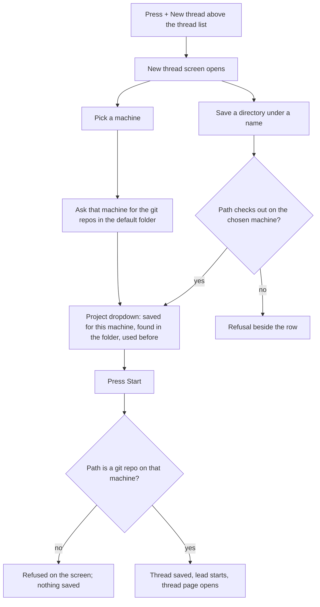

# A New thread screen, with projects found from a folder

**Idea:** `IDEA.md` — what this is for and why, in plain language. Read it first; it is
the north star this plan serves. Goal and Constraints live there, not here, so they don't
get buried as this file grows.

## Open Questions

None.

## Watch List

| # | Noticed | What needs looking into | Raised to user? | Outcome |
|---|---------|-------------------------|-----------------|---------|
| 1 | Removing the top-bar button leaves no way to start a thread from inside a thread on a phone (list column hidden under 900px, `app.css:161`) | Collin chose this knowing it | yes (reply after the button question) | Accepted Risk (Collin's choice, Decision 1) |

## Decision Log

Append-only. A reversal is a new entry superseding the old, never an edit.

| # | Decision | Rationale | Source |
|---|----------|-----------|--------|
| 1 | The "+ New thread" button above the thread list stays and opens the new screen; the top-bar (nav) New thread button is removed | Collin picked "Keep the list one" | user |
| 2 | The screen keeps today's fields: project, lead CLI (claude/codex), machine, optional first message; on start it goes to the thread page as today | IDEA: starting works as today | defaulted |
| 3 | The machine field becomes a dropdown of registered machines (a new `GET /machines` from `machines.json`), default `hub` | Free text invites typos; the list exists | defaulted |
| 4 | Saved directories are `{name, path}` entries kept by the hub; the screen can add and remove them. A saved name that equals a discovered folder's name wins | "Save directories and link them to project names" | defaulted |
| 5 | The project dropdown is: saved directories, then folders found in the default folder, then any earlier project from `projects.json` not already listed. No free-text path field; a new path is added by saving it | One place to pick from, no typing to start | defaulted |
| 6 | The project path is checked (exists, is a directory) before the thread is saved or added to `projects.json`; a refusal shows on the screen | IDEA: bad path refused before a thread exists | defaulted |
| 7 | Folders found in the default folder count as known projects for behavior-template scope, alongside `projects.json` | Otherwise a discovered project can't scope a template (`routes.js:104,127`) | defaulted |
| 8 | The sidebar form is removed from both the Threads page and the thread page, with the `?new=1` path and its tests updated | IDEA | defaulted |
| 9 | The default project folder and the path check work on every machine: a new machine-service route lists a folder's projects and checks a path. Settings holds one folder path, read on whichever machine the thread targets, so the dropdown follows the chosen machine | Collin picked "Every machine, one folder" | user |
| 10 | A found project is an immediate subdirectory of the default folder that holds a `.git` entry (directory or file); hidden names (leading `.`) are skipped. The path check requires an existing directory holding `.git` | Thread start runs `git fetch` + `git worktree add` in the path (`machine/service.js:229-255`); anything else fails there | defaulted |
| 11 | `~` and `~/...` in the default folder or a saved path expand on the target machine (its `$HOME`); other paths must be absolute | Paths differ per machine; relative paths resolved on the hub are today's bug (`threads.js:24`) | defaulted |
| 12 | Supersedes 7: known projects for behavior-template scope are `projects.json` plus saved-directory paths. Found folders join `projects.json` when a thread starts in them, as today | Listing a machine's folder from a Settings write would make template saves depend on a machine being up | defaulted |
| 13 | Saving a directory checks its path on the machine currently selected on the screen | The only machine the screen has in hand; a path can be valid on one machine and not another | defaulted |
| 14 | Supersedes 3: no `GET /machines`; `GET /new-thread` carries the machine list, with `hub` first and the hub's own hostname entry folded into it | `machines.json` names the hub by hostname (`install.sh:161`, `state.js:152`) | review-round-1 |
| 15 | Supersedes 4 and 13: each saved directory belongs to the machine it was saved on (`{name, path, machine}`) and only shows for that machine. Names are unique per machine. Dedup against found folders is by path only; a found folder is never hidden by name | A directory valid on one machine is not valid on another; hiding by name could make a found repo unpickable | review-round-1 |
| 16 | A found or checked project's folder name must match `^[A-Za-z0-9._-]+$` and not contain `..`; other names are left out of the list and refused by the check with "has characters a thread can't use in its name" | The machine service refuses such names at thread start (`safeName`, `machine/service.js:27-29,232`) | review-round-1 |
| 18 | Supersedes 5 (its "Used before" source): "Used before" lists projects of earlier threads on the selected machine, not `projects.json`. A thread's machine matches when it equals the requested name or both resolve to the same entry through `state.resolveMachine` (so a thread stored under the hub's hostname counts as `hub`) | `projects.json` has no machine; every entry was written by `createThread`, so nothing is lost | review-round-3 |
| 17 | Supersedes 11 in part: only exactly `~` or a path starting `~/` expands; `~user` is refused as not absolute, by the hub and the machine alike | Hub and machine must accept the same values | review-round-1 |

## Spec



Pressing "+ New thread" opens the screen. Picking a machine asks that machine for the git
repositories in the default folder; the dropdown lists saved entries for that machine, the
found repositories, and projects used before on it. Start checks the path on the machine
first: a bad path is refused with nothing saved, a good one creates the thread as today.
Saving a directory is checked the same way and then appears in the dropdown.

### What changes, from Collin's side

- "+ New thread" above the thread list (Threads page and thread page) is a link to a new
  **New thread screen** at `/wheelchair/app/new`. The sidebar form is gone from both pages.
  The New thread button in the top bar (`viewer/pages/nav.js:80-94`) is gone.
- Settings has a **Default project folder** text field.
- The New thread screen has: **Machine** (dropdown), **Project** (dropdown), **Lead runs as**
  (claude/codex), **First message** (optional), **Start**. Below them, **Saved directories**:
  the saved list with a Remove button on each, and an Add row (name + path + Save).

### Machine service: one new route

`GET /v1/projects?folder=<path>&check=<path>` (hub secret, like `/v1/status`), in
`machine/service.js` beside the other `/v1/*` routes, documented in `machine/API.md`.

- `folder` (optional): expand exactly `~` or a leading `~/` against the service's `$HOME`;
  must then be absolute, else `400`. Returns `found`: the immediate subdirectories (symlinks
  to directories followed) whose name does not start with `.`, matches
  `^[A-Za-z0-9._-]+$` without `..`, and which contain a `.git` entry (directory or file), as
  `[{name, path}]` sorted by name. A folder that does not
  exist or is not a directory gives `found: []` and `folder_error: "<plain reason>"`.
- `check` (optional): expand the same way. Returns `checked: {path, ok, reason?}` where
  `path` is the expanded absolute path, and `ok` is true only for an existing directory
  containing `.git`. `reason` is one of "does not exist", "is not a directory",
  "is not a git repository", "must be an absolute path",
  "has characters a thread can't use in its name" (the last path segment fails the name rule
  above, which the service's `safeName` enforces at thread start, `machine/service.js:27-29`).
- Neither given: `400`. Reads only; writes nothing.

### Hub

**State.** `settings.json` gains two fields, with defaults in `defaults()` and lines in
`normalize` (`viewer/app/settings.js:22-24, 150-162`):
- `default_project_folder`: string, default `""` (unset).
- `saved_dirs`: array of `{name, path, machine}`, default `[]`. `name` non-empty after trim,
  at most 60 characters, unique within its `machine`; `path` is the expanded absolute path the
  machine returned; `machine` is the name the screen used (`hub` for the hub).

**Routes** (`viewer/app/routes.js`, documented in `viewer/app/API.md`):
- `PUT /settings/preferences` accepts `default_project_folder` (string; trimmed; `""`
  clears; otherwise must be absolute, exactly `~`, or start with `~/`, else `400`). It is not checked
  against a machine. The response and `GET /settings` include it.
- `GET /new-thread?machine=<name>` (default `hub`) returns
  `{machines, machine, default_folder, saved, found, found_error?, previous}`:
  - `machines`: `hub` first, then every other name in `machines.json` except the entry that
    `state.resolveMachine(machines, 'hub')` returns (the hub's own hostname entry,
    `viewer/app/state.js:152-161`). There is no `GET /machines`.
  - `found`: from the machine's `/v1/projects?folder=` when a folder is set, else `[]`.
    The machine's `folder_error` is passed on as `found_error`. A machine that does not answer, or answers 404 (an older service), gives `found: []`
    and `found_error` in plain words ("<machine> is not reachable", "<machine> needs
    updating"); the route still returns 200.
  - `saved`: the `saved_dirs` entries whose `machine` equals the requested one.
    `previous`: the distinct `project` paths of threads (archived included) whose `machine`
    equals the requested one, or resolves through `state.resolveMachine` to the same entry
    (a thread stored under the hub's hostname counts as `hub`), newest first. `projects.json` has no machine field, so it is not
    used here.
- `POST /settings/saved-dirs` `{name, path, machine}`: validates the fields, checks `path`
  on `machine` through `/v1/projects?check=`, stores the expanded path. Refusals: `400`
  with the field error or the check's reason; `409` when the name exists for that machine; `502` when the
  machine does not answer. Returns `{saved}`.
- `DELETE /settings/saved-dirs/:name?machine=<name>` (default `hub`) returns `{saved}` for that
  machine; `404` for an unknown name.
  Removing one changes no thread.
- Template scope (`routes.js:104,127`) accepts a path in `projects.json` or any
  `saved_dirs` path. `describe()`'s `projects` and `scope_missing` use the same union.

**Starting a thread** (`createThread`, `viewer/app/threads.js:42-64`): after the existing
field checks and **before** `hub.save`, call the thread's machine with
`/v1/projects?check=<project>`. Not `ok`: `400 "<path> <reason> on <machine>"`. Unknown
machine: `404` as today from `state.machine`. No answer: `502 "<machine> is not reachable"`.
On success the thread's `project` is the **expanded path the machine returned**, not
`path.resolve` on the hub. Nothing is saved and nothing is added to `projects.json` on any
refusal. The `POST /threads` body is unchanged.

### The New thread screen

- `viewer/pages/new.html`, `new.js`, `new.css`; `new` added to `APP_PAGES`
  (`viewer/server.js:1830`). Includes `app.css` and `nav.js`, header without a
  `data-current` match (or `threads`).
- On load and whenever Machine changes, fetch `GET /new-thread?machine=`. Project dropdown,
  in this order, without duplicates by path: **Saved** (by name), **In <default folder>**
  (found, by name), **Used before**
  (`previous` not already listed, by last path segment, with the full path where two share
  one). A found folder whose path equals a saved entry's path is listed once, under Saved;
  nothing is ever hidden by name. Use `<optgroup>` labels. The option's value is the path; the full path shows under
  the dropdown for the selected one.
- When a default folder is set, a short note under the dropdown: "Only git repositories in
  <default folder> are listed."
- `found_error` shows as one line under the dropdown. No default folder set: one line
  "Set a default project folder in Settings" linking to Settings.
- An empty list (nothing saved, found or used before) disables Start and says to save a
  directory below.
- Start posts `{project, cli, machine, message?}` to `POST /threads` and goes to
  `/wheelchair/app/thread?id=<id>`, as `threads.js:183-188` does today. A refusal shows on
  the screen and keeps the fields.
- Saved directories: Add posts `{name, path, machine}`; on success the list and dropdown
  refresh and the new entry is selected. Remove asks no confirmation and refreshes. Errors
  show beside the row.
- Phone (under 900px): one column, full-width controls, no horizontal scroll.

### Settings page

- `viewer/pages/settings.js`: in the existing "Threads" section (beside Tool steps,
  `:282-285`), a **Default project folder** text input with a Save button and a one-line
  hint ("Each git repository inside it can be picked when starting a thread. `~` is each
  machine's home folder."). Save sends `PUT /settings/preferences {default_project_folder}`;
  a `400` shows its message under the input and keeps the typed value; success shows "Saved".
  Empty and saved clears it.

### Removals

- `viewer/pages/threads.html`: the `col-side` aside (the form) goes, and its `.shell` gets a
  class (e.g. `no-side`) with a two-column grid rule (`minmax(220px, 280px) minmax(0, 1fr)`)
  that also overrides the 900-1099px rule (`viewer/pages/app.css:107,184`), so no empty third
  column remains; `#new-toggle` becomes
  `<a id="new-toggle" href="/wheelchair/app/new">+ New thread</a>`.
- `viewer/pages/thread.html:45-59`: the form goes; the rest of `col-side` (files) stays;
  `#new-toggle` (`:14`) becomes the same link.
- `viewer/pages/threads.js`: form code (toggle, datalists, submit, `?new=1` opening)
  removed; `?new=1` on the Threads page now replaces the location with `/wheelchair/app/new`.
  The thread list code stays.
- `viewer/pages/nav.js`: the New thread button and its `#new-form` handling removed;
  `app.css` rules for the nav button, `#new-form` (`:139-144`, `:159`, `:166-175`) removed.

### Not doing

- No change to thread lifecycle after start, the thread list, or the Features page.
- No per-machine folder setting; no editing a saved entry in place (remove and re-add).
- Existing threads keep their stored `project`; `projects.json` is not migrated.

### Tests and validation

- `machine/test/service.test.js`: the new route (found filtering, `~` expansion, hidden and
  non-git directories skipped, missing folder, each `check` reason, `400` with neither).
- `viewer/test/*.test.js`: `GET /new-thread` (with a fake machine: found, unreachable,
  404), saved-dir add/duplicate/remove/check refusal, `default_project_folder` validation,
  `createThread` refusing a bad path with no thread and no `projects.json` entry, template
  scope accepting a saved path, saved entries filtered by machine, `hub` alias in the machine
  list, `~user` refused, `new` page served.
- Browser specs that used the form (`viewer/test/app-ui.spec.js:50-76`,
  `app-threads.spec.js:102-107`, `app-views.spec.js:102-104`) move to the new screen; add
  one for the screen at phone width, and one for the Settings field (save, and a `400`
  shown under it).
- Existing tests that conflict and must change, keeping what they cover:
  `viewer/test/app-settings.spec.js:248-250` (phone-width check of the removed nav button:
  check the "+ New thread" link or the new screen instead);
  `viewer/test/app-machines.test.js:38-45` (a refused start leaves a failed lead: the fake
  machine must now pass the `/v1/projects?check=` call so the start itself is what fails, and
  a second case asserts an unreachable machine leaves no thread and no `projects.json` entry).
- Commands:
  ```bash
  bash machine/test/run.sh
  node --test viewer/test/*.test.js
  npm --prefix viewer run test:browser
  ```

## Accepted Risks

| Risk | Why accepted | Round |
|------|--------------|-------|
| On a phone, inside a thread, there is no button to start a new thread (the list column is hidden under 900px); go back to Threads first | Collin chose to keep the list button over the top-bar one | planning |

## Review Rounds

### Round 1 — 2026-11-15

**Lanes:** Codex (mechanics); Claude (intent); cross-family: yes.

**Changed since Round N-1:** n/a (first round — whole Spec in scope)

| Lane | Reported | Finding | Lead verdict | Resolution |
|------|----------|---------|--------------|------------|
| Codex mechanics | major | Folder names with spaces/Unicode pass discovery and the check but fail at start (`safeName`) | upheld (major) — confirmed `machine/service.js:27-29,232` | Decision 16; name rule in the route and check |
| Codex mechanics | minor | Machine list must fold the hub's hostname entry into `hub` | upheld — `install.sh:161` | Decision 14; Spec `machines` |
| Codex mechanics | minor | `folder_error` not forwarded to `found_error` | upheld | Spec route |
| Codex mechanics | minor | Removing the sidebar leaves an empty third grid column | upheld — `app.css:107,184` | Spec Removals |
| Codex mechanics | minor | `~user` accepted by hub, rejected by machine | upheld | Decision 17 |
| Claude intent | minor | Saved directories not tied to a machine | upheld | Decision 15 |
| Claude intent | minor | Found folder hidden by a same-named saved entry | upheld | Decision 15; Spec screen |
| Claude intent | minor | Git-only listing differs from IDEA's "every directory" with no hint | upheld | Note on the screen and in the Settings hint |
| Claude intent | minor | Decision 3 contradicts the Spec on `GET /machines` | upheld | Decision 14 |
| Claude intent | minor | Settings page side of the field unspecified | upheld | Spec "Settings page" |

### Round 2 — 2026-11-15

**Lanes:** Codex (mechanics); Claude (intent); cross-family: yes.

**Changed since Round 1:**
- Saved directories belong to a machine and show only for it; dedup by path only (Decision 15).
- Folder-name rule matching the service's `safeName` (Decision 16).
- `~` expansion narrowed to `~` and `~/` (Decision 17).
- Machine list folds the hub's hostname entry into `hub` (Decision 14); `folder_error` forwarded.
- New "Settings page" section; two-column grid for the Threads page; git-only note on the screen.

| Lane | Reported | Finding | Lead verdict | Resolution |
|------|----------|---------|--------------|------------|
| Claude intent | major | Stale hide-by-name rule left in the screen section | downgraded to minor — a one-line leftover the same paragraph and Decision 15 contradict explicitly; a worker would follow the decision | Line removed |
| Claude intent | minor | "Used before" not filtered by machine | upheld | `previous` from threads on that machine |
| Claude intent | minor | Git-only note shows with no folder set | upheld | Shown only when a folder is set |
| Codex mechanics | minor (re-raise) | Same stale hide-by-name line | upheld | Same fix |
| Codex mechanics | minor | Two existing tests conflict with the new behavior | upheld — `app-settings.spec.js:248`, `app-machines.test.js:38-45` | Named in Tests |

### Round 3 — 2026-11-15

**Lanes:** Codex (mechanics); Claude (intent); cross-family: yes.

**Changed since Round 2:**
- Removed the leftover hide-by-name line in the screen section.
- `previous` ("Used before") now comes from threads on the selected machine, not `projects.json`.
- The git-only note shows only when a default folder is set.
- Tests list names the two existing tests that must change.

| Lane | Reported | Finding | Lead verdict | Resolution |
|------|----------|---------|--------------|------------|
| Codex mechanics | — | No findings | — | — |
| Claude intent | minor | Decision 5 not superseded by the new "Used before" source | upheld | Decision 18 |
| Claude intent | minor | A thread stored under the hub's hostname shows under no machine in "Used before" | upheld — `state.js:155-161` | Decision 18; Spec `previous` |

## Prior Work

| Spec item | State | Evidence (file:line) | Confidence |
|-----------|-------|----------------------|------------|

## Implementation Tasks

| # | Objective | Ownership boundary | Lane | Session id | Validation | Status |
|---|-----------|--------------------|------|-----------|------------|--------|
| T1 | Machine route `GET /v1/projects` (found + check), API.md, tests | `machine/service.js`, `machine/API.md`, `machine/test/service.test.js` | claude standard (claude-sonnet-5-5) | wc-1a4f2c3d8d4c-worker | `bash machine/test/run.sh` | done (merged 08801b5; 66/66 re-run by sub-lead) |
| T2 | Hub: settings fields, `/new-thread`, saved-dirs, preferences, createThread check, template scope, API.md, fake machine `/v1/projects`, node tests | `viewer/app/`, `viewer/test/helpers/app-machine.js`, `viewer/test/*.test.js` (not pages, server.js, specs) | claude standard (claude-sonnet-5-5) | wc-1a4f2c3d8d4c-worker-3 (commits 9af06ab + 3fe67e0); worker-2 collided, worker-4 (light, claude-haiku-5-5) stopped as redundant | `node --test viewer/test/*.test.js` | done (merged; 275 pass, 1 known flaky fail, re-run by sub-lead) |
| T3 | Pages: New thread screen, APP_PAGES, removals (threads/thread/nav/app.css), Settings field, Playwright specs | `viewer/pages/`, `viewer/server.js` (APP_PAGES), `viewer/test/*.spec.js`, `viewer/test/app-pages.test.js` | claude standard (claude-sonnet-5-5) | wc-1a4f2c3d8d4c-worker-5 | node tests + `npm --prefix viewer run test:browser` | in progress |

## Log

- 2026-11-15 — Sub-lead restarted (sub-lead-2); nothing had been built or committed beyond the status line. T1 and T2 dispatched in parallel; T3 after T2 merges.
- 2026-11-15 — T2 worker (worker-2) died with nothing committed or changed; restarted on the same brief and branch as worker-3 (attempt t2-a2).
- 2026-11-15 — Choice: T1, machine/service.js folder listing: an existing but unreadable folder gives `found: []` with `folder_error: "cannot be read"`.
- 2026-11-15 — Choice: T1, machine/service.js check order: exists, is a directory, name rule, then `.git`, so a bad-name non-repo reports the name reason.
- 2026-11-15 — Choice: T1, machine/service.js params: a non-absolute `folder` is `400 "folder must be an absolute path"`; an empty `folder=`/`check=` counts as given and fails as not absolute.
- 2026-11-15 — Choice: T1, machine/service.js name rule: a local regex `^[A-Za-z0-9._-]+$` without `..`, not `safeName` itself (which allows `/`).
- 2026-11-15 — worker-2 was not dead: the hub's "ended" notice was wrong, and it kept editing w2 alongside worker-3. Stopped worker-2 on its own report of the collision; worker-3 told to re-check its files before finishing.
- 2026-11-15 — T2 attempt 2 (worker-3, commit 9af06ab) not accepted: the collision left duplicate `newThread`, `addSavedDir`, `checkProject`, a duplicated `new-thread` route branch and the folder check run twice; behavior and tests were right because the later copies run. Worker-3 also did not confirm the re-check asked of it. Attempt 3 (Light, same family, not an escalation: the cause was the collision, and the brief is now a transcription) cherry-picks 9af06ab and deletes the earlier copies.
- 2026-11-15 — Node suite has two failures that also fail on the feature branch before T2: the font route test (viewer/node_modules not installed in the worktree) and the port-holder test (flaky; passes alone). To settle before final validation.
- 2026-11-15 — Choice: T2, threads.js `checkProject`: a 404 on the check (older service) is `502 "<machine> needs updating"`, any other failure `502 "<machine> is not reachable"`; a reply without a boolean `checked.ok` is "needs updating".
- 2026-11-15 — Choice: T2, routes.js `POST /settings/saved-dirs`: success is `201`; `DELETE` is `200`; a missing `machine` defaults to `hub`.
- 2026-11-15 — Choice: T2, routes.js `POST /settings/saved-dirs`: duplicate-name `409` checked before the machine call and again inside the write; message "<name> is already saved for <machine>".
- 2026-11-15 — Choice: T2, routes.js `GET /new-thread`: unknown machine is `404 "unknown machine: <name>"`; `previous` ordered by thread `created_at`, newest first.
- 2026-11-15 — Choice: T2, routes.js `PUT /settings/preferences`: a non-string `default_project_folder` is `400`; the response includes `default_project_folder`.
- 2026-11-15 — Choice: T2, threads.js refusal message uses the machine's returned `checked.path`, falling back to the submitted path.
- 2026-11-15 — Choice: T2, viewer/test/helpers/app-machine.js: a failed check of a relative path returns `{ok:false, reason}` without `path`.
- 2026-11-15 — T2 accepted from worker-3 after all: before it was stopped it committed 3fe67e0, which removes the duplicates (one copy each of `newThread`, `addSavedDir`, `checkProject`; `checkProject` returns the machine's answer and its callers refuse on not-ok). Diff read; node suite re-run on its branch: 275 pass, 1 fail (the known flaky port-holder test). Merged. Attempt 3 (worker-4, branch wc-1a4f2c3d8d4c-w4) stopped as redundant and not merged; its worktree stays because the service removes only merged ones.
- 2026-11-15 — T3 dispatched (worker-5).
