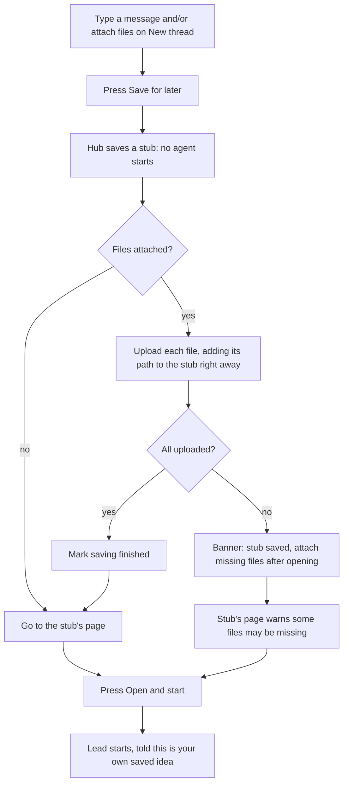

# Save an idea as a stub from the New thread screen

**Idea:** `IDEA.md` — what this is for and why, in plain language. Read it first; it is
the north star this plan serves. Goal and Constraints live there, not here, so they don't
get buried as this file grows.

## Open Questions

(none)

## Watch List

| # | Noticed | What needs looking into | Raised to user? | Outcome |
|---|---------|-------------------------|-----------------|---------|

## Decision Log

Append-only. A reversal is a new entry superseding the old, never an edit.

| # | Decision | Rationale | Source |
|---|----------|-----------|--------|
| 1 | Mode: thorough | Collin's pick | user |
| 2 | No designer: the visible change is one button and a hint on an existing form | Trivial visible part; follows the form's existing button style | defaulted |
| 3 | Saving a stub needs a non-empty message; the save button is disabled otherwise | An empty stub has nothing for its lead to start from | defaulted |
| 4 | The stub's title is the message's first line cut to 60 characters, as Start does; its context is the full message | Same naming as threads started now | defaulted |
| 5 | The stub has no parent, `depends_on_parent: false`, no commits; it opens straight away with the existing Open button | Nothing to wait on | defaulted |
| 6 | A parentless stub's transcript marker reads "Started from a saved idea" instead of "Started from parent thread"; parent-only text on its page is not shown | IDEA: nothing may claim another thread made it | defaulted |
| 7 | Other leads may add to it (`adds_to`) like any unopened stub | Same rules as other unopened stubs; additions are what stubs are for | defaulted |
| 8 | Button label "Save for later", beside Start; after saving, the browser goes to the stub's page | Plain words; the stub page already shows the context and Open | defaulted |
| 9 | A saved stub keeps attached files: they upload when it is saved and their `[attached: path]` lines join its saved context | Ideas parked from a phone often come with a screenshot | user |
| 10 | Supersedes 3: a stub may be saved with attached files and no text; it is then titled from the first file's name | A screenshot-only idea must be savable (Decision 9) | review-round-1 |
| 11 | A stub saving files is marked `saving_files` until the page finishes; an interrupted save stays visible on the stub's page | Closing the tab mid-upload must not leave silently missing files | review-round-1 |
| 13 | Each uploaded file's path is added to the stub right after it uploads; only a final `done` clears `saving_files` | A closed tab or failed upload must not drop files that did upload, and must leave the warning | review-round-2 |
| 12 | Opening a parentless stub tells its lead it came from the New thread screen (a first line in the `[wc:context stub]` message) | The lead must know the text is Collin's own first message | review-round-1 |

## Spec

### Flow



### S1. Hub: create a stub from the New thread screen
- `POST /threads` (`viewer/app/routes.js`, `handleThreads`) accepts `stub: true`. `createThread` (`viewer/app/threads.js:60`) then does everything it does today (project check on the machine, save, `addProject`) **except start a lead or queue a message**.
- With `stub: true` the body may also carry `files` (integer, number of attachments the page will upload, default 0). A trimmed non-empty `message` is required unless `files >= 1`; otherwise 400 `a stub needs a message`. With an empty message and files, the page also sends `title` (the first file's name).
- The saved thread has `stub: true`, `title` = first line of the message cut to 60 characters (same `truncateTitle` call as today), or, with no message, the given `title` cut the same way; `context` = the full trimmed message (may be empty); `saving_files: true` when `files >= 1`, absent otherwise; `parent: null`, no `parent_title`, `depends_on_parent: false`, `commits: []`, `sessions: []`. Response 201 with the thread, as today.
- Without `stub: true`, `POST /threads` behaves exactly as today.

### S2. Hub: files for an unopened stub
- An **unopened stub** is a thread with `stub: true`, no sessions, not archived, not frozen (`handoff.refuseFrozen`).
- The upload route (`routes.js` `upload`, ~line 160) also accepts an unopened stub. A thread with a live lead is accepted exactly as today (including an opened stub); any other thread keeps the current 409.
- New route `POST /threads/<id>/stub-attachments` with body `{ paths: [string, ...], done?: true }` (`paths` zero or more non-empty strings; not an array, a bad entry, or `done` other than `true` → 400). Under `hub.withThread`, for an unopened stub only (else 409 `this thread is not an unopened stub`), it appends one `[attached: <path>]` line per path to `context` (separated from existing non-empty text by a blank line; no leading blank line when `context` is empty), deletes `saving_files` only when `done: true`, saves, and returns 200 with `{ context }`. Appending (not replacing) keeps any addition another lead made meanwhile.
- `openStub` (`viewer/app/threads.js:112`) deletes `saving_files` when it starts the lead. For a stub with no `parent`, the queued message is `[wc:context stub] (saved from the New thread screen)` followed by a newline and the context (then the commits line as today, which is empty here). A stub with a parent gets exactly today's message.
- Restart (`restartLead`, `viewer/app/threads.js:151`): for a stub with no `parent`, `stub_summary` is the context preceded by the line `(saved from the New thread screen)`, the same text `openStub` sends after the marker; a stub with a parent keeps today's `stub_summary`.
- Archiving an unopened stub that has uploads removes or keeps them exactly as archiving any other thread does (no file left orphaned on the machine because the stub had no sessions or worktree).

### S3. New thread screen
- `viewer/pages/new.html`: a second button **Save for later** (`id="nt-save"`) in `.new-actions`, between Start and Import a handoff, with the existing button styling. Update the hint below the message to add one sentence: "Save for later keeps the message as a stub in the thread list; no agent starts until you open it."
- `viewer/pages/new.js`: Save for later is disabled whenever Start is disabled, while sending, and when the trimmed message is empty and no file is attached. It updates as the message is typed and files are added or removed.
- Pressing it posts `/threads` with `{ project, machine, stub: true, message }`, plus `files: <count>` when files are attached and, when the message is empty, `title: <first file's name>`. With no attachments, on success the browser goes to `/wheelchair/app/thread?id=<id>`.
- With attachments: after the stub is created, upload each file in order, stopping at the first failure; right after each file uploads, post its path alone to `/threads/<id>/stub-attachments`, so a closed tab loses at most the file in flight. Once every file is uploaded and posted, post `{ paths: [], done: true }` and go to the stub's page. If only the final `done` post fails, every file is already in the stub: the banner reads "The stub was saved with its files, but the app did not confirm it finished: " with the "Open the thread" link. On any other failure the page sends no `done` (the stub keeps `saving_files`, so its page shows the warning in S4). If an upload or a post fails, both buttons stay disabled (no second stub) and the error banner reads "The stub was saved, but not all files were added (<reason>). Attach them after opening it: " followed by an "Open the thread" link, like Start's banner.
- A failed create shows "Could not save the stub: <reason>" and re-enables the buttons.
- Start keeps its current behaviour.

### S4. Showing a parentless stub
- The transcript marker for `[wc:context stub]` (`connectors/hub-common.js:97`, and any other copy of this text such as `viewer/pages/thread.js` or `viewer/app/chat.js`) reads `Started from <parent_title>` when the thread has a parent, and `Started from a saved idea` when it has none (no `parent`). The "parent thread" fallback stays only for a thread that has a `parent` but no `parent_title`.
- The unopened-stub page (`renderStub`, `viewer/pages/thread.js:627`), when the thread has `saving_files`, shows a `warn` line: "This was still saving its attached files when the save stopped; some may be missing. You can attach them after opening it." Open and start still works.
- The lean list response and the thread response carry `saving_files` where they carry other stub fields.
- Otherwise the thread list and unopened-stub page need no change: with no parent they show no parent link and no waiting text (`viewer/pages/thread.js:637`), and the Open and start button opens it. Confirm this in tests.
- These stubs appear in `session leads` as candidate stubs (`takes_additions: true`, `waits_on_parent: false`) and accept `adds_to` additions, like other unopened stubs; no change needed beyond confirming it in a test.

### S5. Protocol
- `protocol/app/cards.md`, the `[wc:context stub]` row: "with "Started from <parent thread>" in its place" becomes "with "Started from <parent thread>", or "Started from a saved idea" for a stub saved from the New thread screen, in its place".
- `protocol/app/lead.md`, the paragraph "If you are the lead of a stub…" (around line 926): add one sentence: "If the summary starts `(saved from the New thread screen)`, the stub has no parent thread: the text after that line, up to any "Added from" or "Also came up in" paragraph, is the user's own first message (with any `[attached: ...]` lines), and you handle it as their first message. The same holds for a restart context's `stub_summary` that starts with that line: it is the user's own first message, not background."
- `viewer/app/API.md`: the `POST /threads` row documents `stub`, `files` and the stub `title`; the upload row (or a new one) says an unopened stub accepts uploads; a new row documents `POST /threads/:id/stub-attachments` as in S2.

### S6. Tests
- `viewer/test/app-hub.test.js` (or a new `viewer/test/app-new-stub.test.js`): stub creation saves the fields in S1 and starts no session; empty or whitespace message gives 400; a files-only stub (empty message, `files: 1`, `title`) is saved with that title, empty context and `saving_files`; upload to an unopened stub is accepted, to an archived stub refused, and to an opened stub with no live lead refused; `stub-attachments` appends lines (with and without existing text, and after an `adds_to` addition), clears `saving_files` only with `done: true` (also with empty `paths`) and keeps it otherwise, refuses non-stubs, opened stubs and bad bodies; opening a parentless stub queues `[wc:context stub] (saved from the New thread screen)` then the message and attached lines, and clears `saving_files`; opening a child stub queues exactly today's message; restart of an opened parentless stub carries `stub_summary` starting `(saved from the New thread screen)`, and of a child stub today's value; the stub is listed by `session leads` with `takes_additions: true` and accepts an `adds_to` addition.
- `viewer/test/app-uploads-archive.test.js`: an unopened saved stub with an upload is archived and its machine upload files are gone, as for other threads.
- `viewer/test/app-chat.test.js`: existing child-stub fixtures that give only `parent_title` (around lines 123 and 384) also get a `parent` id; add a case for a child with `parent` and no `parent_title` ("Started from parent thread"); the marker reads "Started from a saved idea" for a parentless stub and still names the parent for a child stub.
- `viewer/test/app-new-thread.spec.js`: Save for later disabled with empty message; saves and lands on the stub page showing the message and Open and start, with no lead started; with an attachment, posts `stub-attachments` with each path right after its upload, then `done: true`, before navigating, and with two files the first path is saved before the second upload starts; a files-only save (no text) is allowed and titled from the file name; a failed second upload shows the banner, leaves the first file's path in the stub, sends no `done`, and leaves both buttons disabled; following the banner's link shows the interrupted-save line.

### Validation
```bash
node --test viewer/test/app-hub.test.js viewer/test/app-chat.test.js viewer/test/app-new-thread.test.js viewer/test/app-uploads-archive.test.js viewer/test/app-lead-list.test.js
npm --prefix viewer run test:browser -- test/app-new-thread.spec.js test/app-threads.spec.js
node test-support/pick-tests.js --base <comparison commit>   # and run the commands it prints
```
(plus any new test file added under S6.)

Protocol check (CONTRIBUTING.md: protocol documents have no suite): read the edited `lead.md` paragraph and `cards.md` row as a lead would, next to the exact `[wc:context stub]` message a hub test produces for a parentless stub, and confirm the lead can tell the user's own text from additions.

### Non-goals
- Editing a stub's text after it is saved; changing stubs posted by leads; changing Start.

## Accepted Risks

| Risk | Why accepted | Round |
|------|--------------|-------|
| Opening the stub from another device during the seconds its files upload starts the lead without them | Rare path: needs a second device acting inside the upload window; the page's banner still shows the failed attach | review-round-1 |
| Another lead's `adds_to` addition landing during the seconds of upload puts later `[attached: ...]` lines after the "Added from" paragraph | Rare path: needs another thread to add to this exact stub inside the upload window | review-round-2 |
| A stub page polled between the last path and `done` may keep the interrupted-save warning until reloaded | Rare path: a sub-second window and a second open page | review-round-3 |
| A lost create response, then a retry, saves a second stub | Rare path: needs the response lost after the hub saved; the duplicate is visible and can be archived | review-round-1 |

## Review Rounds

### Round 1 — 2026-11-27

**Lanes:** claude / opus (intent); gpt (mechanics); cross-family: yes.

**Changed since Round N-1:** n/a (first round — whole Spec in scope)

| Lane | Reported | Finding | Lead verdict | Resolution |
|------|----------|---------|--------------|------------|
| intent | minor | Screenshot-only idea can't be saved (message required) | upheld | Decision 10; S1, S3 |
| intent | minor | lead.md sentence ignores `adds_to` text and repeats step 1 | upheld | S5 rewritten |
| intent | minor | Non-goal "assistant creating stubs" not in IDEA | upheld | Dropped from Non-goals |
| mechanics | blocking | S6 says opened stubs refuse uploads, conflicting with live-lead uploads | downgraded to minor: S2 already kept live-lead uploads; only the test line was loose | S2, S6 wording |
| mechanics | blocking | Lead can't tell a saved idea from a lead-made stub | downgraded to minor: the lead still starts from step 1 with the text; only its framing would be off | Decision 12; S2, S5 |
| mechanics | major | Open from another device during upload starts without files | accepted-risk (rare path) | Accepted Risks |
| mechanics | major | Closing the tab mid-save leaves silently missing files | upheld | Decision 11; S1–S4 |
| mechanics | major | First Open failing after session recorded loses the context; Restart on an unopened stub | declined: existing `openStub`/restart behaviour for every stub, unchanged by this plan (`threads.js:112-125`) | — |
| mechanics | minor | Lost create response then retry makes a duplicate | accepted-risk (rare path) | Accepted Risks |
| mechanics | minor | No test for archiving an unopened stub's uploads | upheld | S6 |
| mechanics | minor | API.md not updated | upheld | S5 |
| mechanics | minor | No check of rendered protocol text | upheld | Validation |

### Round 2 — 2026-11-27

**Lanes:** claude (intent); gpt (mechanics); cross-family: yes.

**Changed since Round 1:**
- Files-only stubs (Decision 10; S1, S3).
- `saving_files` flag and interrupted-save line (Decision 11; S1–S4).
- Parentless stub opening message `(saved from the New thread screen)` and the lead.md sentence (Decision 12; S2, S5).
- Upload eligibility wording (S2), API.md (S5), tests (S6), protocol check (Validation), Accepted Risks, Non-goals.

| Lane | Reported | Finding | Lead verdict | Resolution |
|------|----------|---------|--------------|------------|
| intent | minor | Rare path: `adds_to` during upload puts attachments after the addition | accepted-risk (rare path) | Accepted Risks |
| mechanics | blocking | Attachments appended after an `adds_to` paragraph fall outside the user's message | accepted-risk (rare path): needs an addition inside the upload window | Accepted Risks |
| mechanics | major | Tab closed after an upload but before the final post loses that file | upheld | Decision 13; S2, S3 |
| mechanics | major | A handled failure clears `saving_files`, hiding the warning | downgraded to minor: the banner already told Collin; fixed anyway | Decision 13; S2, S3, S6 |
| mechanics | minor | Chat fixtures lack `parent` for the new marker rule | upheld | S6 |

### Round 3 — 2026-11-27

**Lanes:** claude (intent); gpt (mechanics); cross-family: yes.

**Changed since Round 2:**
- `stub-attachments` takes `done`; only `done: true` clears `saving_files` (Decision 13; S2).
- The page posts each path right after its upload, then `done` (S3).
- Tests for these and the chat fixtures (S6); new Accepted Risk.

| Lane | Reported | Finding | Lead verdict | Resolution |
|------|----------|---------|--------------|------------|
| mechanics | major | Restarted lead reads a saved idea's text only as background `stub_summary` | downgraded to minor: the text still reaches it; only its framing would be off | S2 restart line, S5, S6 |
| mechanics | minor | Lost response to the final `done` makes the banner say files are missing | upheld | S3 |
| mechanics | minor | Rare path: polled page keeps the warning after `done` | accepted-risk (rare path) | Accepted Risks |
| mechanics | minor | Tests don't prove each path is saved before the next upload | upheld | S6 |
| intent | — | No findings | — | — |

## Implementation Tasks

| # | Objective | Ownership boundary | Lane | Session id | Validation | Status |
|---|-----------|--------------------|------|-----------|------------|--------|
| T1 | Hub: stub create, uploads + stub-attachments route, openStub/restart text, transcript marker, API.md, hub tests (S1, S2, S4 hub, S5 API.md, S6 hub) — tricky | viewer/app/{threads,routes,chat}.js, connectors/hub-common.js, viewer/app/API.md, viewer/test/{app-new-stub,app-hub,app-chat,app-uploads-archive,app-lead-list}.test.js | standard / gpt-6.1-terra; rung 2: standard xhigh effort (attempt 1 hit its fails-twice guardrail on its restart test) | wc-b6eb8da6feac-worker → wc-b6eb8da6feac-worker-3 | node --test (6 files) + pick-tests node cmds | done |
| T2 | New thread Save for later button and upload sequence; interrupted-save line on stub page; browser specs (S3, S4 page, S6 specs) | viewer/pages/{new.html,new.js,new.css,thread.js}, viewer/test/{app-new-thread,app-threads}.spec.js | standard / claude-sonnet-5-5 | — | test:browser both specs | in progress |
| T3 | Protocol wording in cards.md and lead.md (S5) | protocol/app/{cards,lead}.md | light / gpt-6-luna | wc-b6eb8da6feac-worker-2 | grep checks | done |

## Log

- 2026-11-27 — Choice: T3, lead.md paragraph: rewrapped the appended sentences (and the paragraph's last original line) to ~90 columns.
- 2026-11-27 — T3 accepted (band: scout): both protocol edits match the brief's text exactly; only cards.md and lead.md changed.
- 2026-11-27 — T1 attempt 1 came back blocked: hub code and API.md done and read by the sub-lead (self band, tricky), but its one combined test failed twice at the restart step. Attempt 2 on the same branch at xhigh effort, with a rewritten brief: focused tests, copy the app-hub.test.js:2220 restart pattern, mutation checks.
- 2026-11-27 — Choice: T1, routes.js stub-attachments: whitespace-only paths are rejected as empty (400).
- 2026-11-27 — Choice: T1, threads.js restartLead: the saved-idea `stub_summary` prefix applies to any `stub: true` thread without `parent`, even with empty context.
- 2026-11-27 — Choice: T1, app-new-stub.test.js restart case: sets lead_order to gpt, as the existing restart test's fixture does.
- 2026-11-27 — T1 accepted (band: self): hub code read in full; 11 focused tests plus four mutation checks reported; sub-lead re-ran the six-file node suite, 178/178 pass.
